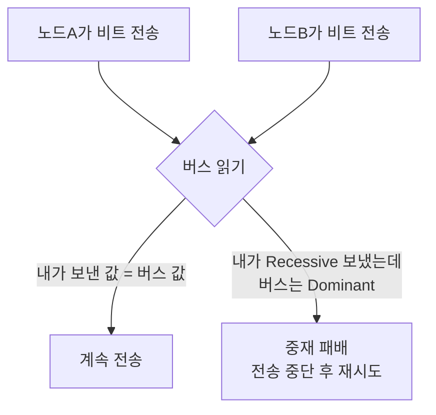
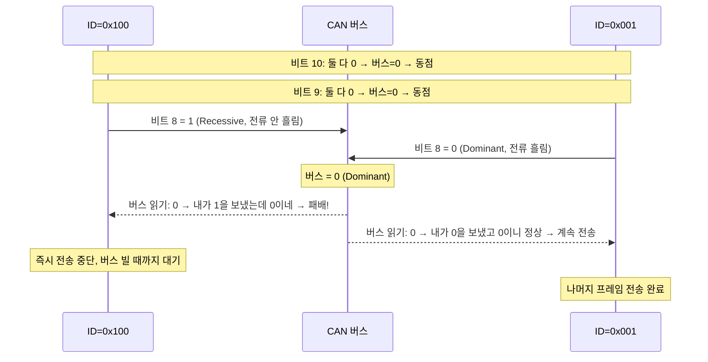
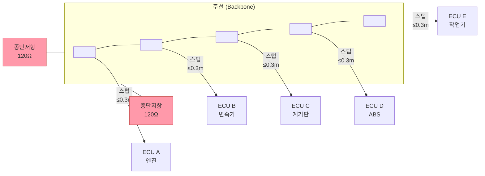
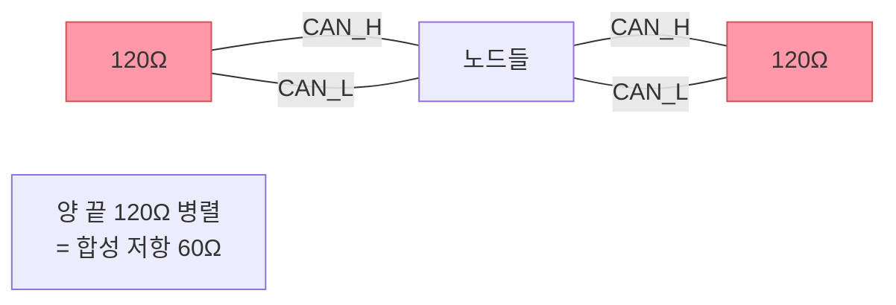
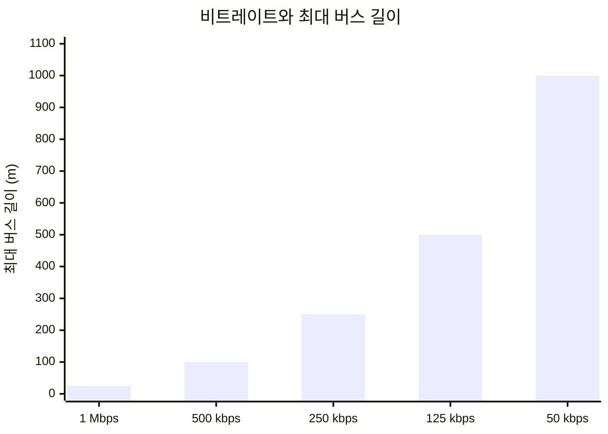
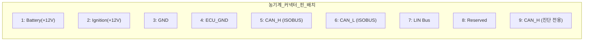

# CAN 물리 계층

::: info 학습 목표
- CAN_H와 CAN_L 차동 신호의 원리와 노이즈 내성을 설명할 수 있다.
- Dominant(0)과 Recessive(1) 상태의 전압을 암기하고 Wired-AND 동작을 이해한다.
- CAN 버스의 선형 토폴로지와 종단 저항의 역할을 설명할 수 있다.
- 통신 속도에 따른 최대 버스 길이를 이해한다.
- DB9 커넥터 핀 배치를 확인할 수 있다.
- ISO 11783 네트워크 세그먼트를 이루는 부품(4선 꼬임 케이블, 노드 리드, TBC, 커넥터)을 Part 1 기준으로 구분할 수 있다.
- 노드 30개 한계를 근거로 작업기 네트워크 설계에 NIU 분리가 필요한지 판단할 수 있다.
:::

## 1. CAN_H와 CAN_L — 차동 신호

CAN은 <strong>두 개의 선(CAN_H, CAN_L)</strong>으로 신호를 전달한다. 이 방식을 <strong>차동 신호(Differential Signal)</strong>라고 한다.

### 왜 두 선이 필요한가

한 선만 쓰면(단선 신호) 외부 노이즈가 신호에 직접 더해진다. 그런데 두 선을 쓰면 노이즈가 두 선에 <strong>같은 크기로</strong> 더해진다. 수신 측은 두 선의 <strong>전압 차이</strong>만 보기 때문에, 두 선에 동일하게 더해진 노이즈는 자동으로 상쇄된다.

```
노이즈 발생 시:
  CAN_H: 3.5V + 0.3V(노이즈) = 3.8V
  CAN_L: 1.5V + 0.3V(노이즈) = 1.8V
  전압 차: 3.8 - 1.8 = 2.0V  ← 노이즈가 상쇄되어 원래 신호 유지
```

모터, 점화 플러그 등 노이즈가 많은 농기계 환경에서 CAN이 선택된 핵심 이유이다.

### 전압 레벨

| 상태 | CAN_H | CAN_L | 전압 차(CAN_H - CAN_L) |
|------|-------|-------|----------------------|
| Dominant (비트 0) | 2.75 ~ 3.5 V | 1.5 ~ 2.25 V | ≥ 1.5 V (통상 2 V) |
| Recessive (비트 1) | 2.5 V | 2.5 V | ~0 V |
| 유휴(버스 비어 있음) | 2.5 V | 2.5 V | ~0 V |


## 2. Dominant vs Recessive — Wired-AND 동작

### 상태 정의

- **Dominant (우세, 비트 0)**: CAN_H=3.5V, CAN_L=1.5V, 전압 차 2V
- **Recessive (열세, 비트 1)**: CAN_H=CAN_L=2.5V, 전압 차 0V

### Wired-AND란

버스에 연결된 노드 중 <strong>단 하나라도 Dominant(0)</strong>를 보내면, 버스 전체가 Dominant가 된다. 모든 노드가 Recessive(1)를 보낼 때만 버스가 Recessive 상태가 된다.

논리식으로: `버스 상태 = 노드A AND 노드B AND 노드C AND ...`  
(0이 "강한" 값이므로, 하나라도 0이면 결과는 0)

이것이 중재(Arbitration) 메커니즘의 기반이다.



### 물리적으로 이해하기

Dominant와 Recessive의 차이는 <strong>전류를 흘리느냐 안 흘리느냐</strong>의 차이이다.

| 동작 | 트랜시버가 하는 일 | 버스 상태 |
|------|-------------------|-----------|
| Dominant(0) 보내기 | 전류를 흘려서 CAN_H를 3.5V, CAN_L을 1.5V로 강제 변경 | Dominant |
| Recessive(1) 보내기 | 아무것도 안 함. 종단 저항이 자연히 2.5V로 유지 | Recessive |

아무도 전류를 흘리지 않으면 버스는 자연히 Recessive(2.5V) 상태이다. 그래서 <strong>하나라도</strong> 전류를 흘리면(Dominant), 나머지가 아무것도 안 해도 버스는 Dominant가 된다. 별도의 AND 게이트 칩 없이 <strong>전선(Wire) 자체의 물리적 특성으로</strong> AND 동작이 구현되기 때문에 "Wired-AND"라 부른다.

### 줄다리기 비유

두 팀이 줄다리기를 한다고 생각해봅시다. 각 라운드마다 "당기기(0)" 또는 "쉬기(1)"를 선택한다.

- 한쪽이라도 당기면 줄은 그쪽으로 감 (Dominant 승리)
- 둘 다 쉬어야 줄이 가운데에 유지 (Recessive)

```
라운드 1: 팀A=당김(0), 팀B=당김(0) → 같음 → 아직 승부 안 남
라운드 2: 팀A=당김(0), 팀B=당김(0) → 같음 → 계속
라운드 3: 팀A=당김(0), 팀B=쉼(1)  → 팀A가 줄을 당김!
  팀B: "나는 쉬었는데 줄이 움직였네" → 내가 졌다 → 포기
  팀A: 아무 일 없었다는 듯 계속 진행
```

팀B가 포기한 뒤, 팀A 혼자서 나머지 데이터를 전부 보낸다. 팀A의 메시지는 처음부터 끝까지 손상 없이 전달된다.

### 왜 ID가 작을수록 우선순위가 높은가

ID는 MSB(최상위 비트)부터 한 비트씩 버스에 전송된다. 두 노드가 동시에 전송을 시작하면 ID를 비트 단위로 비교해 나간다.

**예시: ID=0x001 vs ID=0x100 (11비트)**

```
비트 위치:  10  9  8  7  6  5  4  3  2  1  0

ID=0x100:   0  0  1  0  0  0  0  0  0  0  0
ID=0x001:   0  0  0  0  0  0  0  0  0  0  1
                   ↑
              비트 8에서 갈림
```



ID가 작으면 상위 비트에 0(Dominant)이 더 많다. 0은 1을 항상 이기므로, 상대가 1을 보내는 순간 내가 덮어쓰고 승리한다.

```
ID=0x001: 00000000001  ← 앞에 0이 10개 → 거의 무적
ID=0x100: 00100000000  ← 비트 8에서 이미 1이 나옴 → 일찍 탈락
ID=0x7FF: 11111111111  ← 전부 1 → 누구에게나 짐
```

이것이 <strong>브레이크, 조향 같은 안전 메시지에 낮은 ID를 배정</strong>하는 이유이다. 버스가 아무리 바빠도 이 메시지가 항상 가장 먼저 전달된다.

이러한 파형이 정상적으로 나타나려면, 버스 자체가 올바른 물리적 구조로 연결되어 있어야 한다. CAN 버스의 배선 방식을 살펴봅시다.

## 3. 파형으로 보는 CAN 신호

오실로스코프로 CAN 버스를 측정하면 CAN_H와 CAN_L이 서로 반전된 형태로 움직이는 것을 볼 수 있다.

**이상적인 파형:**


**실제 파형에서 보이는 현상:**

| 현상 | 원인 | 대처 |
|------|------|------|
| 신호 끝이 뭉툭함 | 버스 커패시턴스(배선 길이) | 배선 단축, 비트레이트 낮추기 |
| 링잉(파형 진동) | 종단 저항 미설치 또는 불일치 | 양 끝 120Ω 확인 |
| 전압 레벨 비대칭 | 접지(GND) 연결 불량 | GND 배선 점검 |
| 신호 없음 | CAN_H/CAN_L 단선 또는 합선 | 배선 점검, 저항값 측정 |

오실로스코프 없이 멀티미터로도 기본 점검이 가능한다. 버스가 유휴 상태일 때 CAN_H와 CAN_L 모두 약 2.5V이어야 한다.

이러한 파형이 정상적으로 나타나려면, 버스 자체가 올바른 물리적 구조로 연결되어 있어야 한다. CAN 버스의 배선 방식을 살펴봅시다.

## 4. 버스 토폴로지

CAN은 **선형 버스(Linear Bus)** 구조를 사용한다. 하나의 주선(Backbone)에 각 노드가 짧은 분기선(Stub)으로 연결된다.



**스텁(Stub) 길이 제한:**
- 스텁이 길면 신호 반사가 발생한다.
- 1 Mbps에서는 스텁 0.3m 이하 권장 (속도가 낮을수록 허용 스텁 길이가 늘어남).
- ISOBUS(250 kbps)에서는 최대 스텁 길이 1m.

**최대 노드 수:**
- CAN 사양 상 이론적 최대 노드 수는 제한이 없으나, 실제로는 버스 전기적 특성으로 약 110개 노드가 한계이다.
- ISOBUS는 ISO 11783-2가 정한 전기적 한계로 네트워크 하나에 노드를 30개까지 둔다(ISO 11783-1:2017 6.4, §8 참고).

## 5. 종단 저항 (120Ω)

### 왜 필요한가

전선은 일종의 전송 선로이다. 신호가 선로 끝에 도달하면 "반사"가 일어난다. 반사된 신호가 되돌아오면 원래 신호를 왜곡시킨다.

<strong>종단 저항(Termination Resistor)</strong>은 버스 양 끝에 달아 신호를 흡수해 반사를 막다. 저항값이 선로 특성 임피던스(120Ω)와 같아야 한다.



두 종단 저항이 병렬 연결되므로 버스 전체 임피던스는 <strong>60Ω</strong>이다. 이 값이 맞지 않으면 파형이 불안정해진다.

**멀티미터로 종단 저항 확인하는 방법:**

```
1. 버스의 전원을 끈다.
2. CAN_H와 CAN_L 사이의 저항을 측정한다.
3. 정상: 약 60Ω
   종단저항 1개 없음: 약 120Ω
   종단저항 모두 없음: 무한대(∞)
   단선: 무한대(∞)
   CAN_H/CAN_L 단락: 0Ω
```

::: details Python 예제: 종단 저항 측정값 해석
```python
# 종단 저항 측정값 해석 예시 (진단 스크립트)
def interpret_termination_resistance(ohm):
    if ohm < 10:
        return "ERROR: CAN_H/CAN_L 단락 (Short circuit)"
    elif 50 <= ohm <= 70:
        return "OK: 정상 (양쪽 120Ω 종단저항 장착됨)"
    elif 110 <= ohm <= 130:
        return "WARNING: 종단저항 1개만 장착됨"
    elif ohm > 1000:
        return "ERROR: 종단저항 없음 또는 단선"
    else:
        return f"WARNING: 비정상 저항값 {ohm}Ω — 배선 점검 필요"

print(interpret_termination_resistance(60))   # OK
print(interpret_termination_resistance(120))  # WARNING
print(interpret_termination_resistance(9999)) # ERROR
```
:::

종단 저항이 올바르게 설치된 버스에서, 실제로 얼마나 빠르게, 얼마나 먼 거리까지 통신할 수 있을까요? 속도와 거리 사이에는 중요한 트레이드오프가 있다.

## 6. 통신 속도와 버스 길이

CAN에서 **속도와 거리는 반비례** 관계이다. 속도가 빠를수록 비트 하나의 시간이 짧아지는데, 버스가 길면 신호가 양 끝을 왕복하는 시간(전파 지연)이 비트 시간을 초과해 버린다.

| 비트레이트 | 최대 버스 길이 | 주요 용도 |
|-----------|--------------|-----------|
| 1 Mbps | 약 25 m | 고속 제어 (소형 ECU 네트워크) |
| 500 kbps | 약 100 m | 자동차 파워트레인 네트워크 |
| **250 kbps** | 약 250 m | **ISOBUS 표준 속도** |
| 125 kbps | 약 500 m | 저속 기능 버스 (차체 계통) |
| 50 kbps | 약 1000 m | 장거리 산업 네트워크 |

ISOBUS는 250 kbps를 표준으로 사용한다. 트랙터 + 작업기의 연결 거리를 고려해도 충분한 속도와 거리를 제공한다.

다만 위 표의 길이는 CAN 일반의 이론적 상한이다. ISOBUS 물리 계층(ISO 11783-2의 twisted quad 방식)은 이보다 훨씬 엄격하다. 버스 전체 길이는 최대 40 m, ECU 사이 간격은 최소 0.1 m, 한 세그먼트의 ECU 수는 최대 30개로 제한된다. 이 수치는 Part 2 원문이 아니라 이를 인용한 논문([Embrapa, 2007](https://www.alice.cnptia.embrapa.br/alice/bitstream/doc/30581/1/Proci07.00059.pdf))에서 확인한 값이다. 30개 상한은 Part 1도 언급한다(§8). 개정판(ISO 11783-2:2019)의 twisted pair 물리 계층(TPPL)은 규정이 다를 수 있으니, 하드웨어 설계에는 현행 Part 2 원문을 확인한다.



```c
/* CAN 비트 타이밍 설정 예시 (250 kbps, 16 MHz 클럭) */
/* Bit time = 1 / 250,000 = 4 µs */
/* TQ(Time Quantum) 단위로 비트 시간을 분할 */

typedef struct {
    uint8_t brp;   /* Baud Rate Prescaler */
    uint8_t tseg1; /* Time Segment 1 */
    uint8_t tseg2; /* Time Segment 2 */
    uint8_t sjw;   /* Synchronization Jump Width */
} CAN_BitTiming;

/* 250 kbps @ 16 MHz: BRP=4, TSEG1=11, TSEG2=4, SJW=1 */
/* Bit time = (1 + TSEG1 + TSEG2) * TQ = 16 TQ          */
/* TQ = BRP / f_clk = 4 / 16MHz = 0.25 µs               */
/* Bit time = 16 * 0.25 µs = 4 µs → 250 kbps            */
CAN_BitTiming timing_250k = {
    .brp   = 4,
    .tseg1 = 11,
    .tseg2 = 4,
    .sjw   = 1
};
```

속도와 거리가 정해지면, 마지막으로 물리적인 연결 방법을 알아야 한다. CAN 장비를 실제로 연결할 때 사용하는 커넥터와 핀 배치를 살펴봅시다.

## 7. 커넥터와 핀아웃

### DB9 커넥터 (ISO 11898 권장)

CAN 디버깅 장비나 PC 인터페이스에서 가장 많이 쓰이는 9핀 D-Sub 커넥터이다.


**핵심 핀 요약:**

| 핀 번호 | 신호명 | 설명 |
|---------|--------|------|
| 2 | CAN_L | 통신 선 (저전압 측) |
| 3 | GND | 공통 접지 |
| 7 | CAN_H | 통신 선 (고전압 측) |

### ISOBUS / 농기계 진단 커넥터

트랙터와 작업기 연결에는 **AMP Deutsch DT 시리즈** 방수 커넥터가 많이 사용된다. 진단 목적으로는 <strong>9핀 Deutsch 커넥터</strong>가 표준이다.



실제 농기계 커넥터 배치는 제조사마다 다를 수 있으므로, 항상 해당 기종의 전기 회로도를 참고해야 한다.

**현장에서 CAN 신호 확인 방법:**

```c
/* CAN 메시지 수신 및 출력 예시 (의사코드 / 임베디드 C) */
#include <stdio.h>
#include <stdint.h>

typedef struct {
    uint32_t id;
    uint8_t  dlc;       /* Data Length Code: 0~8 */
    uint8_t  data[8];
} CAN_Message;

void on_can_receive(CAN_Message *msg) {
    printf("ID: 0x%08X  DLC: %d  Data:", msg->id, msg->dlc);
    for (int i = 0; i < msg->dlc; i++) {
        printf(" %02X", msg->data[i]);
    }
    printf("\n");
}

/* 출력 예시:
   ID: 0x0CF004B4  DLC: 8  Data: F0 00 FF 00 00 00 00 FF
   → ISOBUS J1939 EEC1 (엔진 전자 제어 #1) 메시지
*/
```

::: tip 핵심 정리
- CAN은 CAN_H/CAN_L 두 선의 <strong>전압 차이</strong>로 신호를 전달해 노이즈에 강한다.
- Dominant(0): CAN_H=3.5V, CAN_L=1.5V / Recessive(1): 양쪽 2.5V.
- 종단 저항 120Ω을 버스 양 끝에 반드시 설치해야 한다. 합성 저항 60Ω.
- 멀티미터로 CAN_H-CAN_L 간 저항을 측정해 60Ω이면 정상이다.
- ISOBUS 표준 속도는 250 kbps다. CAN 일반 기준으로는 250 kbps에서 약 250 m까지 가능하지만, ISOBUS 버스는 전체 길이 40 m·ECU 30개로 제한된다(2차 출처 기준, §6).
- DB9 커넥터 기준 CAN_H=핀7, CAN_L=핀2, GND=핀3이다.
:::

## 8. ISO 11783가 정한 물리 계층 요구사항

지금까지는 CAN 일반의 물리 계층을 봤다. ISOBUS의 물리 계층은 ISO 11783-2가 따로 정한다. 그런데 이 스터디가 근거로 삼는 원문 묶음에는 Part 2가 없다. 그래서 이 절은 ISO 11783-1:2017(이하 Part 1)이 6.2절에 요약해 둔 Part 2의 요구사항만 정리한다. 전압·저항값·핀 배치처럼 Part 2 본문에만 있는 수치는 다루지 않는다.

### Part 2가 정하는 범위

Part 1 6.2에 따르면 Part 2가 정하는 것은 세 묶음이다.

| 범위 | 내용 |
|---|---|
| 계층 | ECU의 매체 접근 부계층(media access sub-layer), 트랙터·작업기 네트워크의 물리 매체 의존 부계층(physical medium-dependent sub-layer) |
| 커넥터 | 작업기를 트랙터에 연결하는 커넥터, 기존 네트워크에 ECU를 추가하는 커넥터, 서비스 툴을 연결하는 커넥터 |
| 전원 | 네트워크 동작에 필요한 전원과 그 연결 |

ECU 인터페이스는 두 CAN 표준을 따라야 한다(shall). 물리 신호 부계층(physical signalling sub-layer)은 ISO 11898-1:2015를, 물리 매체 접근 부계층(physical media access sub-layer)은 ISO 11898-2:2016을 따른다(Part 1 6.2). ISO 11898-2는 Part 1의 인용 규격 목록에 "고속 매체 접근 장치(High-speed medium access unit)"로 올라 있는 표준이고, §1~§5에서 본 차동 신호와 Dominant/Recessive 전압이 이 표준의 영역이다. Part 1 서문도 ISO 11783을 "ISO 11898-2 프로토콜에 기반한 통신 시스템"이라고 소개한다.

### 세그먼트를 이루는 부품

Part 1 6.2는 네트워크의 모양을 세 문장으로 요약한다.

- 네트워크는 <strong>한 가닥의 선형 4선 꼬임 케이블</strong>(single linear quad-twisted wire cable)로 이뤄지고, 각 ECU는 노드에서 이 케이블에 연결된다.
- 각 ECU는 <strong>짧은 케이블 리드</strong>(short cable lead)로 노드에 붙는다. §4의 스텁(Stub)이 이것이다. Part 1은 노드를 "ECU가 네트워크에 물리적으로 연결되는 지점"으로 정의한다(Part 1 3.40).
- 네트워크 세그먼트의 양 끝에는 <strong>능동형 종단 바이어스 회로</strong>(active TBC, Terminating Bias Circuit)를 둔다.

TBC의 정의는 Part 1 3.63에 있다. 세그먼트 양 끝에 필요한 회로로, CAN_H와 CAN_L에 바이어스 전압을 공급하고 각 도선의 공통 모드 임피던스 종단을 제공한다. §5의 120Ω 저항은 반사를 막는 수동 부품이다. TBC는 여기에 더해 버스의 기준 전압까지 잡아 주는 회로라는 점이 다르다. 4선 중 CAN_H·CAN_L이 아닌 나머지 두 가닥의 용도와 TBC의 회로값은 Part 2 본문 소관이라 여기서는 확인하지 못했다.

표준이 이유를 직접 적지는 않는다. 다만 작업기를 수시로 붙였다 떼는 농기계 네트워크에서는 종단이 특정 ECU의 전원 상태에 묶이면 곤란하므로, 종단을 ECU와 분리된 별도 회로로 정의한 것으로 보인다(추론).

### 트랙터·작업기 네트워크의 배치


Part 1 Figure 2(전형적인 트랙터·작업기 네트워크의 물리 연결 구조)를 단순화한 그림이다. 전면 작업기, 다른 표준의 네트워크, 전원 입력 같은 요소는 뺐다.

- 트랙터 안에는 <strong>트랙터 네트워크</strong>(엔진·변속기·브레이크·히치 제어기)와 <strong>작업기 네트워크</strong>가 따로 있다. Tractor ECU는 두 네트워크에 함께 연결된다.
- 작업기 네트워크는 트랙터 안에서 시작해 <strong>작업기 버스 분리 커넥터</strong>(implement bus breakaway connector)를 지나 견인 작업기로 이어진다. VT·TC 같은 장치와 진단 커넥터(diagnostic connector), 버스 연장 커넥터(bus extension connector)는 트랙터 쪽 작업기 네트워크에 붙는다.
- 종단기(terminator)는 각 세그먼트의 양 끝에 있다. 작업기 안쪽에 별도 네트워크가 있으면 NIU(Network Interconnection Unit)가 그 사이를 나눈다.

두 네트워크의 물리 계층 요구 수준은 다르다. 트랙터 네트워크는 트랙터 제조사가 관리하는 구간이라 Part 2 준수가 <strong>권고</strong>(recommended)에 그친다(Part 1 6.6.2). 작업기 네트워크의 물리 계층 커넥터는 Part 2를 <strong>따라야 한다</strong>(shall)(Part 1 6.6.3). 여러 제조사의 장비가 꽂히는 쪽이 작업기 네트워크이기 때문으로 보인다(추론).

### 노드 30개 한계와 NIU

Part 1 6.4는 Part 2가 정한 <strong>30노드 전기적 한계</strong>를 언급한다. 복잡한 시스템이 한 ISO 11783 네트워크에 이보다 많은 노드를 필요로 하면, 작업기 시스템 제조사는 NIU로 네트워크를 나눠 전기적 부하 한계를 지켜야 한다(shall). NIU 자체는 [ISOBUS 네트워크 아키텍처](/study/isobus/13-isobus-architecture) 챕터에서 다룬다.

설계할 때 헷갈리기 쉬운 점이 하나 있다. 30은 <strong>노드</strong>, 즉 버스에 물리적으로 붙은 ECU의 수다. 주소의 수가 아니다. ECU 하나가 CF(Control Function, 제어 기능)를 여러 개 수행하면 CF마다 주소가 필요하지만(Part 1 6.5), 전기적으로는 노드 하나다.

| 세는 대상 | 한계를 정하는 것 | 근거 |
|---|---|---|
| 노드(ECU의 물리 연결) | 네트워크당 전기적 한계 30 | Part 1 6.4 |
| 주소(CF) | 주소 공간과 주소 할당 규칙 | [J1939 주소 체계](/study/isobus/10-j1939-address) |

::: warning 이 절의 근거로 확인하지 못한 값
비트레이트(250 kbit/s), 최대 버스 길이, 최대 스텁 길이, 커넥터 핀 배치는 Part 2 본문에 있는 값이라 이 스터디의 원문 묶음으로는 확인하지 못했다. 앞 절의 해당 값을 실제 하드웨어 설계에 쓰기 전에는 ISO 11783-2 원문을 확인해야 한다.
:::

::: tip 정리
- ISO 11783의 물리 계층은 Part 2가 정하고, ECU 인터페이스는 ISO 11898-1:2015와 ISO 11898-2:2016을 따른다.
- 세그먼트는 4선 꼬임 케이블, 짧은 노드 리드, 양 끝의 능동형 TBC로 이뤄진다.
- 작업기 네트워크의 커넥터는 Part 2 준수가 필수이고, 트랙터 네트워크는 권고다.
- 노드는 네트워크당 30개가 전기적 한계이고, 넘으면 NIU로 나눈다. 주소 수와는 별개다.
:::

::: details 확인 문제
1. (비교형) Part 1 3.63의 TBC 정의를 근거로, TBC가 §5의 120Ω 종단 저항과 무엇이 다른지 설명하라.
2. (시나리오형) 트랙터 쪽 작업기 네트워크에 Tractor ECU, VT, TC, 진단 장비를 포함해 노드 24개가 이미 붙어 있다. 새로 연결할 견인 작업기는 ECU 9개를 작업기 네트워크에 직접 연결하도록 설계됐다. 이 연결에 어떤 문제가 있고, 표준은 어떻게 해결하라고 하는가? ECU 9개 중 하나가 CF 3개를 수행한다면 계산이 달라지는가?

**답 가이드**
1. 120Ω 저항은 반사를 막는 수동 종단이다. TBC는 세그먼트 양 끝에서 CAN_H·CAN_L에 바이어스 전압을 공급하고 공통 모드 임피던스 종단까지 제공하는 능동 회로다(Part 1 3.63, 6.2).
2. 24 + 9 = 33으로 30노드 전기적 한계(Part 1 6.4)를 넘는다. 작업기 제조사는 NIU로 네트워크를 나눠야 한다. 작업기 내부 ECU를 NIU 뒤 별도 네트워크로 옮기면 작업기 네트워크에는 NIU만 노드로 붙는다. CF가 3개인 ECU도 물리 연결은 하나이므로 노드 수는 그대로다. 다만 주소는 CF마다 하나씩 필요하다(Part 1 6.5).
:::

## 다음 챕터

- 다음 : [CAN 데이터 프레임](/study/isobus/04-can-data-frame)
