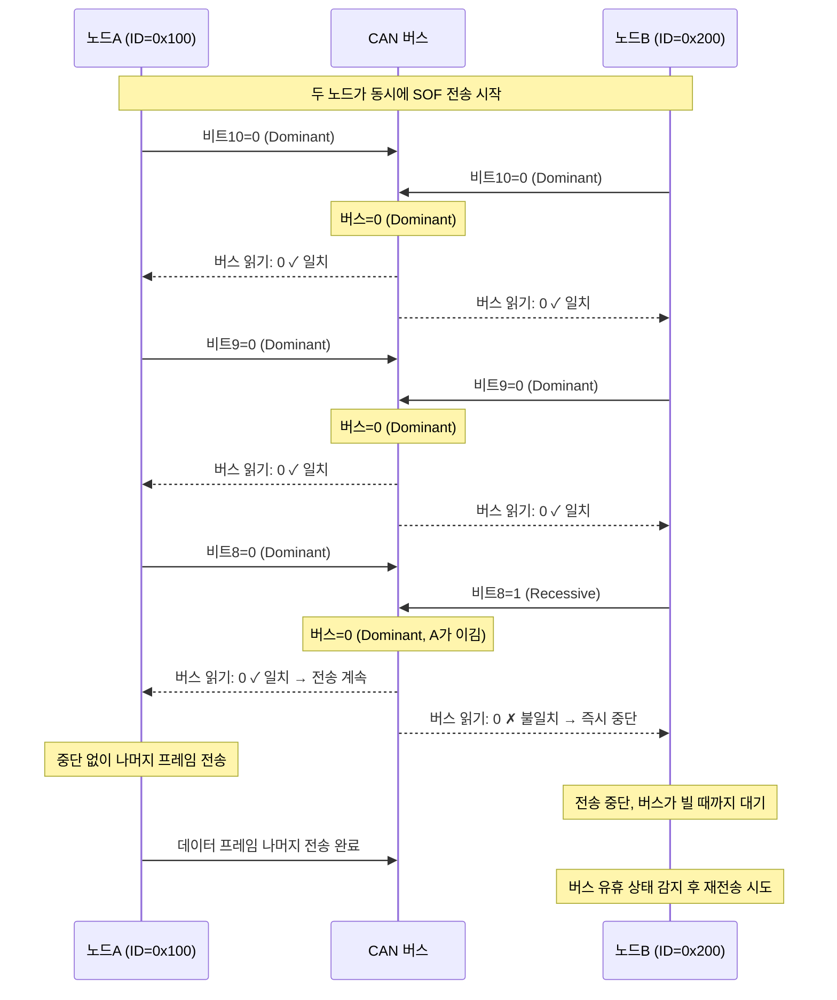
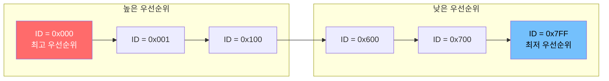

<Header/>

[[toc]]

# CAN 중재와 우선순위

::: info 학습 목표
- CAN 버스의 중재(Arbitration) 개념과 필요성을 설명할 수 있다
- CSMA/CD+AMP 메커니즘의 동작 방식을 이해한다
- 비트 단위 중재 과정을 단계별로 추적할 수 있다
- ID 값과 우선순위의 관계를 설명할 수 있다
- 안전 관련 메시지 설계 시 ID 배정 원칙을 적용할 수 있다
- Part 3 기본값(3·6·7)과 Annex D 권고표로 새 메시지의 Priority를 고를 수 있다
- CBFF와 CEFF 프레임이 동시에 중재할 때 몇 번째 프레임 비트에서 누가 이기는지 계산할 수 있다
:::

## 1. 버스 중재(Arbitration)란

**문제 상황<strong>: 여러 노드가 하나의 버스를 공유하는 CAN에서, 두 노드가 </strong>동시에 메시지를 전송하기 시작하면** 어떻게 될까?

이더넷의 경우 충돌(Collision)이 발생하면 두 노드 모두 전송을 멈추고 임의의 시간 뒤 재전송한다. 이 방식은 충돌 후 데이터가 손실된다.

**CAN의 해답**: CAN은 **CSMA/CD+AMP** 방식을 사용해 충돌 없이 우선순위가 높은 메시지가 이기도록 한다.

| 용어 | 의미 |
|---|---|
| **CSMA** (Carrier Sense Multiple Access) | 전송 전 버스가 사용 중인지 확인한다 |
| **CD** (Collision Detection) | 전송 중 충돌(다른 신호)을 감지한다 |
| **AMP** (Arbitration on Message Priority) | 메시지 우선순위에 따라 중재한다 |

<strong>핵심 차이</strong>: 이더넷은 충돌 후 <strong>모두 재전송</strong>하지만, CAN은 중재 패배 노드만 재전송한다. 승리한 노드는 전송을 <strong>중단 없이 계속</strong>한다.

::: info
중재는 ID 필드 전송 구간에서만 일어난다. 중재에서 이긴 노드의 메시지는 데이터 손실 없이 그대로 버스에 전달된다.
:::

### "노드 ID"가 아니라 "메시지 ID"

한 가지 주의할 점이 있다. CAN에서 ID는 **노드(장치)를 식별하는 것이 아니라 메시지의 종류를 식별한다.** 하나의 ECU가 여러 종류의 메시지를 보낼 수 있으며, 각각 다른 ID를 가진다.

```
엔진 ECU (하나의 노드)가 보내는 메시지들:
  ID=0x100: 엔진 RPM 정보
  ID=0x101: 엔진 온도 정보
  ID=0x102: 엔진 토크 정보
```

따라서 중재에서 비교되는 것은 노드의 고유번호가 아니라, <strong>그 순간 전송하려는 메시지의 ID</strong>다. 같은 노드라도 어떤 메시지를 보내느냐에 따라 우선순위가 달라진다.

## 2. 비트 단위 중재 과정

중재는 ID를 다 보낸 뒤에 비교하는 것이 아니다. 각 노드가 ID를 MSB(최상위 비트)부터 <strong>한 비트씩 버스에 보내면서, 동시에 버스를 읽어 실시간으로 비교</strong>한다.

```
시간 →
노드A: [SOF][비트10][비트9][비트8]...[비트0] → 승리 시 [DLC][Data]... 계속
노드B: [SOF][비트10][비트9][비트8] ← 여기서 탈락하면 즉시 중단
```

ID 구간이 끝나면 중재도 끝나고, 승자만 나머지(DLC, Data, CRC 등)를 전송한다. 구체적인 예시를 보자. 노드A(ID=0x100)와 노드B(ID=0x200)가 동시에 전송을 시작하는 상황이다.

**ID 이진수 변환**


**비트별 중재 과정**

| 비트 위치 | 노드A | 노드B | 버스 상태 | 결과 |
|---|---|---|---|---|
| 비트 10 (MSB) | 0 (Dominant) | 0 (Dominant) | Dominant | 동점, 계속 |
| 비트 9 | 0 (Dominant) | 0 (Dominant) | Dominant | 동점, 계속 |
| 비트 8 | 0 (Dominant) | 1 (Recessive) | **Dominant** | **노드B 탈락** |

비트 8에서 노드A는 0(Dominant)을, 노드B는 1(Recessive)을 전송한다. 버스는 Dominant 값인 0이 된다. 노드B는 자신이 1을 보냈는데 버스가 0이 된 것을 감지하고, <strong>즉시 전송을 중단</strong>한다. 노드A는 아무것도 모른 채 전송을 계속한다.



## 3. ID 값과 우선순위 관계

**원칙: ID 숫자가 작을수록 우선순위가 높다.**

이유는 간단하다. CAN 버스에서 **0(Dominant)이 1(Recessive)을 이긴다**. ID의 상위 비트부터 비교할 때, 먼저 0을 보내는 노드가 버스를 차지한다.

```
ID = 0x001: 0000 0000 001  ← 앞쪽이 0으로 가득 참 → 버스 독점 유리
ID = 0x7FF: 1111 1111 111  ← 앞쪽이 1로 가득 참 → 버스 독점 불리
```



**29bit Extended ID에서의 우선순위**

ISOBUS는 29bit Extended ID를 사용하며, ID의 상위 3비트가 Priority 필드다.


Priority 0이 가장 높고, Priority 7이 가장 낮다. 이를 통해 메시지 종류별 우선순위를 명시적으로 설정할 수 있다.

### Priority가 같으면 어떻게 되는가

Priority 필드는 29비트 ID의 최상위 3비트일 뿐이다. Priority가 같으면 중재가 끝나는 것이 아니라, <strong>나머지 비트(EDP → DP → PF → PS → SA)로 계속 비교</strong>한다. 결국 29비트 ID 전체가 하나의 우선순위 값이다.


| 상황 | 중재 방식 |
|------|-----------|
| Priority가 다름 | Priority가 작은 쪽이 즉시 승리 |
| Priority가 같음 | PF → PS → SA 순서로 계속 비교 |
| 29비트 전체가 같음 | 발생할 수 없음 (같은 PGN+SA 조합은 네트워크에 하나뿐) |

이 원칙을 이해하면, 실제 시스템에서 메시지 ID를 어떻게 배정해야 하는지가 자연스럽게 도출된다.

## 4. 메시지 설계 시 고려사항

중재 메커니즘을 이해하면 <strong>ID 배정 전략</strong>이 명확해진다.

**안전 관련 메시지에는 낮은 ID를 배정**

```
Priority 0 (ID 앞자리 000): 브레이크, 조향, 비상 정지
Priority 1 (ID 앞자리 001): 엔진 제어, 변속기
Priority 2 (ID 앞자리 010): 차량 속도, 자세 제어
Priority 3 (ID 앞자리 011): 일반 제어 데이터
Priority 6 (ID 앞자리 110): 진단, 설정
Priority 7 (ID 앞자리 111): 정보성 메시지, 로그
```

**주기적 메시지 vs 이벤트 메시지**

| 구분 | 특징 | ID 전략 |
|---|---|---|
| **주기적 메시지** | 일정 주기(예: 10ms, 100ms)로 반복 전송 | 중간 우선순위 배정. 너무 낮은 ID는 다른 중요 메시지를 방해할 수 있음 |
| **이벤트 메시지** | 특정 조건 발생 시에만 전송 | 안전 관련이면 낮은 ID, 정보성이면 높은 ID |

**버스 부하 고려**

중재에서 계속 패배하는 메시지는 버스가 바쁠수록 더 오래 기다려야 한다. 높은 우선순위 메시지가 너무 자주 전송되면, 낮은 우선순위 메시지는 <strong>기아 상태(Starvation)</strong>에 빠질 수 있다.

::: tip 실무 설계 원칙
- 안전 관련 메시지: Priority 0~2
- 실시간성이 중요한 제어 데이터: Priority 3~4
- 진단, 설정, 정보: Priority 5~7
- 동일 Priority 내에서는 기능별로 ID 범위를 구분해 관리한다
:::

지금까지는 §2에서 2개 노드짜리 예시로 중재 원리를 봤다. 이번에는 노드 3개가 동시에 전송을 시작하는 실제 ISOBUS 메시지 조합으로, ID의 첫 비트부터 승부가 갈리는 순간까지 끝까지 따라가 본다.

## 5. 중재 과정 따라가기

### 시나리오: 노드 3개가 동시에 전송을 시작한다

버스가 유휴 상태였다가, 세 노드가 <strong>같은 순간</strong> SOF를 보내며 전송을 시작한다.

| 노드 | 메시지 | PGN | 근거 | Priority | SA |
|---|---|---|---|---|---|
| A (엔진 ECU) | EEC1(엔진 속도) | 61444 (0xF004) | [CAN 데이터 프레임](/study/isobus/04-can-data-frame)에서 이미 파싱해 본 PGN | 3 | 0x00 |
| B (차속 센서) | Wheel-based Speed and Distance(차속·거리) | 65096 (0xFE48) | ISO 11783-7 Part 7의 차속 메시지 | 6 | 0x1C |
| C (진단 도구) | DM1(활성 고장 코드) | 65226 (0xFECA) | ISO 11783-12 Annex B의 DM1 | 6 | 0xF9(오프보드 진단 도구 주소) |

Priority는 두 값만 쓴다. EEC1처럼 <strong>제어와 직결된 상태 메시지</strong>는 기본값 3, 진단처럼 <strong>제어 명령이 아닌 상태·기록 메시지</strong>는 기본값 6이다. 차속 메시지의 ISO 11783-7 기본값은 3이지만, 이 예제에서는 제조사가 6으로 재설정했다고 가정한다(재설정이 허용되는 근거와 기본값 3일 때의 결과는 §6에서 본다).

PGN을 PF/PS로 역산하고 SA를 붙이면 29비트 ID가 나온다. Priority(3bit) + EDP(1bit) + DP(1bit) + PF(8bit) + PS(8bit) + SA(8bit) = 29bit다.

| 노드 | ID(hex) | Priority(3) | EDP(1) | DP(1) | PF(8) | PS(8) | SA(8) |
|---|---|---|---|---|---|---|---|
| A | `0x0CF00400` | `011` | `0` | `0` | `11110000`(0xF0) | `00000100`(0x04) | `00000000`(0x00) |
| B | `0x18FE481C` | `110` | `0` | `0` | `11111110`(0xFE) | `01001000`(0x48) | `00011100`(0x1C) |
| C | `0x18FECAF9` | `110` | `0` | `0` | `11111110`(0xFE) | `11001010`(0xCA) | `11111001`(0xF9) |

각 칸을 왼쪽부터 순서대로 이으면(비트28→비트0) 위 ID(hex)가 그대로 나온다.

::: tip 비트 번호 규칙
29비트 ID는 SOF 다음으로 <strong>맨 처음 나가는 비트를 비트28(MSB, Priority 최상위)</strong>, <strong>맨 마지막에 나가는 비트를 비트0(LSB, SA 최하위)</strong>이라 부른다. Priority는 비트28~26, EDP는 비트25, DP는 비트24, PF는 비트23~16, PS는 비트15~8, SA는 비트7~0이다.
:::

### 1라운드 만에 갈리는 승부

세 노드가 SOF 직후 ID의 첫 비트(비트28, Priority 최상위 비트)를 동시에 내보낸다.

| 라운드 | 비트 위치 | 노드A 송신 | 노드B 송신 | 노드C 송신 | 버스(wired-AND) | 판정 |
|---|---|---|---|---|---|---|
| 1 | 비트28 | 0 (Dominant) | 1 (Recessive) | 1 (Recessive) | **Dominant(0)** | A 계속 · <strong>B, C 동시 탈락</strong> |

Priority 3은 이진수로 `011`, Priority 6은 `110`이다. 최상위 비트만 봐도 A는 0, B와 C는 1이다. 버스는 세 값을 wired-AND로 합친 결과이므로, 하나라도 Dominant(0)를 내보내면 버스는 무조건 0이 된다. B와 C는 자신이 1을 보냈는데 버스가 0으로 관측되는 것을 <strong>동시에</strong> 감지하고, <strong>같은 라운드에서</strong> 각자 독립적으로 전송을 중단하고 수신 모드로 전환한다. 서로의 존재와 무관하게, 자신이 보낸 값과 버스 값을 비교하는 것만으로 판단이 끝난다는 점이 핵심이다.

::: tip 중재는 반드시 한 명씩 떨어지지 않는다
2개 노드짜리 예시(§2)에서는 매 라운드 최대 1개 노드만 탈락했다. 하지만 노드가 3개 이상이면, Dominant를 보낸 노드를 제외한 <strong>Recessive 노드 전부가 한 라운드에 동시에</strong> 탈락할 수 있다. 중재는 승자를 한 명씩 좁혀가는 토너먼트가 아니라, 매 비트마다 "그 순간 버스 값과 다르게 보낸 노드는 전부 탈락"하는 규칙이 반복될 뿐이다.
:::

A는 자신이 보낸 0과 버스 값 0이 일치하는 것을 확인하고 <strong>중단 없이</strong> 나머지 28비트(Priority 나머지 2비트 + EDP + DP + PF + PS + SA)를 마저 보낸 뒤, RTR/SRR, IDE, r0, DLC, Data, CRC, ACK, EOF까지 프레임 전체를 끝까지 전송한다. 이 과정에서 A의 데이터는 한 비트도 다시 보내지 않는다 — 중재에서 이긴 메시지는 처음부터 끝까지 그대로 버스에 실린다.

### 패배한 노드는 어떻게 되는가

B와 C는 전송을 중단한 순간부터 수신 노드로 동작하며, A가 보내는 프레임을 끝까지 수신한다(다른 목적지로 가는 메시지라도 버스에 실린 이상 모든 노드가 물리적으로 수신한다). A의 EOF까지 끝나고 버스가 다시 유휴 상태가 되면, B와 C는 각자 <strong>처음부터 다시</strong> SOF를 보내며 재전송을 시도한다. 이번에는 둘 다 이전과 동일한 ID를 다시 내보내므로, §3에서 정리한 원칙대로 <strong>같은 우선순위 관계가 그대로 반복</strong>된다.

여기서 이 절 전체를 관통하는 결론이 나온다. B와 C는 이번 라운드에서 메시지를 <strong>보내지 못했을 뿐, 데이터 자체를 잃어버리지는 않았다.</strong> 재시도해서 버스가 비는 다음 기회에 다시 온전히 보낼 수 있다. 이것이 §1에서 이더넷과 대비해 언급한 <strong>비파괴적 중재(non-destructive arbitration)</strong>다 — 충돌이 나도 아무도 데이터를 버리지 않는다.

### 우선순위가 같다면 몇 라운드까지 가는가

방금 예시는 A의 Priority(3)가 B·C(6)보다 낮아 1라운드 만에 끝났다. 그렇다면 <strong>Priority가 완전히 같은 두 메시지</strong>는 몇 라운드까지 가야 승부가 갈릴까? B와 C만 놓고 — A가 잠시 버스에 없었다고 가정하고 — 계속 비교해보자.

B와 C는 둘 다 Priority 6, EDP 0, DP 0이고, PGN이 둘 다 65000번대라 <strong>PF도 0xFE로 완전히 같다.</strong> 즉 비트28부터 비트16까지 13비트가 전부 동일하다. 승부는 PS 필드로 넘어가서야 갈린다.

| 구간 | 비트 위치 | 노드B | 노드C | 비고 |
|---|---|---|---|---|
| Priority(3bit) | 비트28~26 | `110` | `110` | 완전히 동일, 계속 |
| EDP | 비트25 | `0` | `0` | 동일, 계속 |
| DP | 비트24 | `0` | `0` | 동일, 계속 |
| PF(8bit) | 비트23~16 | `11111110`(0xFE) | `11111110`(0xFE) | 완전히 동일, 계속 |
| PS 최상위 비트 | 비트15 | `0` (Dominant, PS=0x48) | `1` (Recessive, PS=0xCA) | **여기서 갈림** — B 승, C 탈락 |

SOF 이후 <strong>14번째로 나가는 비트(비트15, PS 필드 최상위 비트)</strong>에 가서야 승부가 갈린다. B의 PS(0x48 = `01001000`)는 최상위 비트가 0이고, C의 PS(0xCA = `11001010`)는 최상위 비트가 1이기 때문이다. 이 예시가 §3에서 정리한 "Priority가 같으면 EDP → DP → PF → PS → SA 순서로 계속 비교한다"는 원칙을 실제 비트로 보여준다 — Priority와 PF까지 같아도, PS 한 비트 차이로 승부가 갈린다.

:::details 파이썬으로 검산해 보기
```python
def build_id(priority, edp, dp, pf, ps, sa):
    return (priority << 26) | (edp << 25) | (dp << 24) | (pf << 16) | (ps << 8) | sa


def pgn_to_pf_ps(pgn):
    return pgn // 256, pgn % 256          # PF>=240(PDU2) 기준: PGN = PF*256 + PS


def bits29(v):
    return [(v >> i) & 1 for i in range(28, -1, -1)]   # 비트28(MSB) -> 비트0(LSB)


# 노드 정의: (이름, priority, PGN, SA)
defs = [
    ("A_엔진(EEC1)",  3, 61444, 0x00),
    ("B_차속",        6, 65096, 0x1C),
    ("C_진단(DM1)",   6, 65226, 0xF9),
]

ids = {}
for name, prio, pgn, sa in defs:
    pf, ps = pgn_to_pf_ps(pgn)
    ids[name] = build_id(prio, 0, 0, pf, ps, sa)
    print(f"{name}: PF=0x{pf:02X} PS=0x{ps:02X} ID=0x{ids[name]:08X}")

# 3-way 중재 시뮬레이션
alive = set(ids)
bitstreams = {k: bits29(v) for k, v in ids.items()}
for i in range(29):
    vals = {k: bitstreams[k][i] for k in alive}
    bus = min(vals.values())              # 하나라도 0(Dominant)이면 버스는 0
    losers = [k for k, v in vals.items() if v != bus]
    if losers:
        print(f"round {i+1} (bit{28-i}): bus={bus}, 탈락={losers}")
    for l in losers:
        alive.discard(l)
    if len(alive) == 1:
        print("최종 승자:", alive)
        break

# B vs C만 남았다면 (Priority가 같을 때) 몇 라운드까지 가는가
bB, bC = bitstreams["B_차속"], bitstreams["C_진단(DM1)"]
for i in range(29):
    if bB[i] != bC[i]:
        print(f"B vs C 결정 라운드: {i+1} (bit{28-i}), B={bB[i]} C={bC[i]}")
        break
```

실행하면 노드A가 round 1(bit28)에서 즉시 승리하고, B와 C만 남길 경우 결정 라운드가 14(bit15)로 나온다 — 위 표와 정확히 일치한다.
:::

::: tip 핵심 정리

- CAN의 **CSMA/CD+AMP** 방식은 비트 단위로 중재해, 우선순위 높은 메시지가 데이터 손실 없이 전송된다.
- Dominant(0)이 Recessive(1)을 이기므로, **ID 값이 작을수록 우선순위가 높다**.
- 중재 패패 노드는 즉시 전송을 중단하고 버스가 빌 때까지 대기 후 재시도한다.
- ISOBUS의 29bit ID에서 상위 3비트(Priority)로 메시지 우선순위를 명시한다.
- 안전 관련 메시지(브레이크, 조향)에는 낮은 ID를, 정보성 메시지에는 높은 ID를 배정한다.

:::

## 6. ISO 11783가 정한 우선순위 규칙

§3~§5는 CAN 중재 원리와 Priority 필드를 봤다. ISO 11783-3:2018(이하 Part 3)은 이 필드를 송신 측이 어떻게 쓰고 수신 측이 어떻게 읽을지까지 정한다.

### 중재 규칙의 원문 표현

Part 3 5.5~5.7은 이 챕터 §1~§3의 내용을 규범 문장으로 다시 적는다.

| 절 | 내용 |
|---|---|
| 5.5 메시지 우선순위 | 우선순위는 ISO 11898-1을 따른다. CAN 식별자 값이 낮을수록(29비트 전부 0이 최고) 우선순위가 높고, 클수록(전부 1이 최저) 낮다. 할당은 응용 계층이 5.9의 지침에 따라 정한다 |
| 5.6 버스 접근 | 버스가 비어 있으면 어느 컨트롤러든 송신을 시작할 수 있다. 동시에 시작하면 식별자로 경합 중재(contention-based arbitration)를 하므로 정보도 시간도 잃지 않는다 |
| 5.7 경합 중재 | 보낸 비트와 버스에서 읽은 비트가 같으면 계속 보낸다. recessive를 보냈는데 dominant를 읽으면 중재에서 진 것이고, 비트를 하나도 더 보내지 않고 물러나야 한다(shall). dominant를 보냈는데 recessive를 읽으면 비트 에러다 |

마지막 문장은 [CAN 에러 처리](/study/isobus/06-can-error) 챕터의 Bit Error와 이어진다. 중재 구간이라도 "dominant를 보냈는데 recessive를 읽음"은 패배가 아니라 에러다.

### 송신 측 — 기본값과 재설정

Priority 필드는 버스에 오를 때의 지연을 줄이는 데만 쓴다(Part 3 5.2.2). 값은 0(최고)~7(최저)이고, Part 3이 정한 기본값은 다음과 같다.

| 메시지 성격 | 기본 Priority | 근거 |
|---|---|---|
| 제어 지향(control oriented) 메시지 | 3 (`011`) | 5.2.2 |
| 그 밖의 정보성·제조사 독점·요청·NACK 메시지 | 6 (`110`) | 5.2.2 |
| Request(59904), Acknowledgement(59392), Proprietary A·A2·B | 6 | 5.4.3, 5.4.5, 5.4.6 |
| TP.CM(60416)·ETP.CM(51200) 연결 관리 | 7 | 5.10.4.1, 5.11.5.2 |
| TP.DT(60160)·ETP.DT(50944) 데이터 전송 | 7 (운반하는 PGN과 무관) | 5.10.5, 5.11.6 |

각 PGN에는 응용 계층 표준에 추가될 때 권장 Priority가 붙는다. 그래도 Priority 필드는 제조사가 네트워크를 조정(tuning)할 수 있도록 다시 설정할 수 있어야 한다(should, Part 3 5.2.2·5.9.1). 기본값을 코드 상수로 박아 두지 말고 PGN별 설정값으로 두라는 뜻이다.

### 수신 측 — Priority는 보지 않는다

수신 컨트롤러는 Priority 비트를 전역적으로 마스킹해 무시해야 한다(should, Part 3 5.2.2). Annex A의 전형적 수신 루틴도 "3개 priority 비트는 중재에만 쓰이므로 수신 측은 쓰지 않는다"고 적는다.

이 규칙은 수신 필터를 설정할 때 중요하다. 같은 PGN이 Priority 3으로 오든 6으로 오든 같은 메시지다. 하드웨어 수락 필터나 PGN 디스패치 테이블을 29비트 ID 전체로 비교하면, 송신 측이 Priority를 재설정하는 순간 메시지를 놓친다.

::: details 파이썬 — Priority를 빼고 비교하기
```python
PRIO_MASK = 0x1C000000          # 29비트 ID의 비트 28~26


def without_priority(can_id):
    return can_id & 0x1FFFFFFF & ~PRIO_MASK


# 같은 PGN(65096)·같은 SA(0x1C)를 Priority 3과 6으로 보낸 두 ID
a, b = 0x0CFE481C, 0x18FE481C
assert a != b                                        # ID 전체로 비교하면 다른 메시지
assert without_priority(a) == without_priority(b) == 0x00FE481C
```

하드웨어 필터라면 마스크 레지스터에서 비트 28~26을 "무관(don't care)"으로 두는 것과 같다.
:::

### Annex D의 권고표와 §4 예시 비교

Part 3 Annex D(참고)는 주기로 Priority를 고르라고 권한다. 주기가 짧은 메시지가 느린 메시지보다 먼저 나갈 수 있게 하려는 것이다. §4의 "ID 배정 전략"은 일반 CAN 설계 예이므로, ISOBUS 메시지를 설계할 때는 Annex D와 다른 점을 알아 둬야 한다.

| Priority | §4의 예시 배정 | Annex D 권고 (주기·용도) |
|---|---|---|
| 0 | 브레이크·조향·비상 정지 | 예약 — 쓰지 않는다 |
| 1 | 엔진 제어·변속기 | 10~20 ms, 기계 간 제어 |
| 2 | 차량 속도·자세 제어 | 20~50 ms, 시스템 보호 |
| 3 | 일반 제어 데이터 | 50~100 ms, 운전자 기반 제어 |
| 4~5 | (없음) | 100~200 ms / 200~400 ms, 시스템 상태 |
| 6 | 진단·설정 | 400 ms 이상, 낮은 상태·UI·E/TP.CM |
| 7 | 정보성 메시지·로그 | TP·ETP 데이터, 대용량 전송 |

용도 이름과 SAE J1939 대응까지 담은 전체 표는 [Part 3 정리 부록](/study/isobus/appendix-iso-part03)에 있다. 비교에서 눈여겨볼 점은 세 가지다.

- <strong>0은 예약</strong>이다. 가장 급한 메시지도 1부터 쓴다.
- <strong>7은 TP·ETP 데이터 전송 자리</strong>다. 주기적 로그 메시지를 7에 두면 대용량 전송 프레임과 같은 자리에서 경쟁한다. 표준이 이유를 적지는 않지만, 수백~수천 프레임이 이어지는 대용량 전송을 가장 낮은 자리에 둬 다른 모든 메시지에 버스를 양보하게 한 배치로 보인다(추론).
- 새 메시지는 이 표로 Priority를 정하고, 기존 메시지를 새 시스템에 쓸 때는 기본값이 맞는지 다시 검토하라고 권한다(Annex D).

::: warning 원문 안의 차이 — TP.CM의 Priority
TP.CM·ETP.CM의 PG 정의는 기본 Priority를 7로 적는다(Part 3 5.10.4.1, 5.11.5.2). 그런데 Annex D 표는 E/TP.CM을 Priority 6의 용도에 넣고, 7은 TP·ETP 데이터에만 둔다. 규범 조항인 PG 정의와 참고 부속서인 Annex D가 다르므로, 구현은 PG 정의의 7을 기본값으로 쓰고 Annex D는 튜닝의 참고로 보는 편이 안전하다(추론). 수신 측은 어차피 Priority를 무시하므로 어느 쪽이든 수신 호환성 문제는 없다.
:::

### §5 예제를 표준 기본값으로 다시 보기

§5의 3노드 예제는 차속 메시지(PGN 65096)를 Priority 6으로 보냈다. ISO 11783-7은 이 메시지의 기본 Priority를 3, 송신 주기를 100 ms로 정한다(ISO 11783-7:2015 B.3). 기본값 3으로 다시 중재하면 결과가 달라진다.

| 노드 | ID(hex) | Priority |
|---|---|---|
| A (EEC1) | `0x0CF00400` | 3 |
| B (차속, 기본값) | `0x0CFE481C` | 3 |
| C (DM1) | `0x18FECAF9` | 6 |

1라운드(비트 28)에서 C만 탈락한다. A와 B는 Priority·EDP·DP가 같고 PF가 `0xF0`(`11110000`)과 `0xFE`(`11111110`)라서, PF의 다섯 번째 비트인 비트 19(10라운드)에서 B가 진다. Priority를 6으로 재설정했던 §5에서는 B가 1라운드에 졌다. Priority 재설정이 중재 순서를 실제로 바꾼다는 것을 보여 주는 예다.

::: details 파이썬으로 검산 — 기본값 3으로 다시 중재
§5의 검산 코드에서 `defs`의 차속 줄만 `("B_차속", 3, 65096, 0x1C),`로 바꿔 실행하면 다음이 출력된다.

```
B_차속: PF=0xFE PS=0x48 ID=0x0CFE481C
round 1 (bit28): bus=0, 탈락=['C_진단(DM1)']
round 10 (bit19): bus=0, 탈락=['B_차속']
최종 승자: {'A_엔진(EEC1)'}
```
:::

## 7. CBFF와 CEFF가 함께 중재할 때

[CAN 데이터 프레임](/study/isobus/04-can-data-frame) 챕터에서 본 것처럼 ISO 11783은 11비트 CBFF 메시지를 제조사 독점용으로 허용한다. 11비트 ID는 Priority 3비트와 SA 8비트로 이뤄진다(Part 3 5.1.4). 이 프레임이 29비트 CEFF 프레임과 같은 순간 중재에 들어가면 어떻게 될지 Part 3이 직접 경고한다.

### 비교되는 비트가 다르다

중재는 SOF 다음 비트부터 차례로 비교한다. Part 3 Table 1로 두 형식의 앞부분을 나란히 놓으면 다음과 같다.

| 프레임 비트 | CBFF(11bit) | CEFF(29bit) |
|---|---|---|
| 2~4 | Priority | Priority |
| 5 | SA8 | EDP |
| 6 | SA7 | DP |
| 7~12 | SA6~SA1 | PF8~PF3 |
| 13 | RTR (dominant) | SRR (recessive) |
| 14 | IDE (dominant) | IDE (recessive) |

Priority가 같으면 CBFF의 SA가 CEFF의 EDP·DP·PF 상위 6비트와 맞붙는다. Part 3은 이를 "11비트 메시지의 SA가 29비트 메시지의 EDP·DP·PF보다 높은 우선순위를 나타낼 수 있다"고 표현하고, 올바른 중재를 위해 Priority 3비트를 쓰라고 권고한다(should, Part 3 5.1.4).


그림의 예는 Priority 6, SA `0x00`인 CBFF 메시지와 Priority 6인 Engine Temperature(`0x18FEEE00`)의 대결이다. 프레임 비트 2~6은 같고, 비트 7에서 CBFF는 SA6 = 0을, CEFF는 PF8 = 1을 보낸다. 같은 Priority의 표준 메시지가 제조사 독점 메시지에 진다.

하나가 더 있다. 앞 12비트가 모두 같으면 13번 비트에서 CBFF는 RTR(dominant), CEFF는 SRR(recessive)을 보낸다. 따라서 <strong>끝까지 비기면 언제나 CBFF가 이긴다</strong>. Table 1의 비트 레벨에서 그대로 따라 나오는 결과다.

| CBFF | CEFF | 승자 | 갈린 프레임 비트 |
|---|---|---|---|
| P6, SA `0x00` | `0x18FEEE00` (P6, PF `0xFE`) | CBFF | 7 |
| P6, SA `0x00` | `0x0CF00400` (P3) | CEFF | 2 |
| P7, SA `0x00` | `0x1CEB2623` (TP.DT, P7) | CBFF | 7 |
| P7, SA `0x80` | `0x1CEB2623` (TP.DT, P7) | CEFF | 5 |
| P6, SA `0x00` | `0x18000000` (P6, PF 0, PS 0, SA 0) | CBFF | 13 (RTR 대 SRR) |

같은 Priority라면 승패는 CBFF 송신자의 SA 값에 따라 바뀐다. SA는 주소라서 마음대로 바꿀 수 없으니, 설계자가 쓸 수 있는 손잡이는 CBFF 메시지의 Priority뿐이다. Part 3 Annex D는 한 걸음 더 나가 CBFF 트래픽을 별도 서브넷으로 분리하라고 강하게 권고한다.

::: details 파이썬으로 검산 — CBFF와 CEFF의 비트 대결
```python
def cbff_stream(p, sa):
    s = [(p >> i) & 1 for i in (2, 1, 0)]          # 프레임 비트 2~4
    s += [(sa >> i) & 1 for i in range(7, -1, -1)]  # 5~12 = SA8..SA1
    s += [0, 0]                                     # 13 RTR(d), 14 IDE(d)
    return s


def ceff_stream(can_id):
    b = lambda n: (can_id >> n) & 1
    s = [b(n) for n in range(28, 17, -1)]           # 2~12 = P3..P1, EDP, DP, PF8..PF3
    s += [1, 1]                                     # 13 SRR(r), 14 IDE(r)
    return s


def cbff_vs_ceff(p, sa, can_id):
    for i, (u, v) in enumerate(zip(cbff_stream(p, sa), ceff_stream(can_id))):
        if u != v:
            return ("CBFF" if u < v else "CEFF"), i + 2   # 0(dominant)을 보낸 쪽이 이긴다
    raise AssertionError("14비트 안에서 갈리지 않음")


assert cbff_vs_ceff(6, 0x00, 0x18FEEE00) == ("CBFF", 7)
assert cbff_vs_ceff(6, 0x00, 0x0CF00400) == ("CEFF", 2)
assert cbff_vs_ceff(7, 0x00, 0x1CEB2623) == ("CBFF", 7)
assert cbff_vs_ceff(7, 0x80, 0x1CEB2623) == ("CEFF", 5)
assert cbff_vs_ceff(6, 0x00, 0x18000000) == ("CBFF", 13)
```
:::

::: tip 정리
- 수신 측은 Priority 비트를 무시한다. 수신 필터와 PGN 비교에서 비트 28~26을 빼야 한다.
- 기본값은 제어 3, 그 밖 6, TP·ETP 7이다. Priority는 PGN별로 재설정할 수 있어야 한다.
- Annex D는 주기로 Priority를 고르게 한다. 0은 예약이고 7은 TP·ETP 데이터 자리다.
- CBFF와 CEFF가 맞붙으면 CBFF의 SA가 CEFF의 EDP·DP·PF와 비교되고, 끝까지 비기면 CBFF가 이긴다. 손잡이는 CBFF의 Priority와 서브넷 분리다.
:::

::: details 확인 문제
1. (설명형) 수신 필터를 29비트 ID 전체로 걸면 안 되는 이유를 Part 3의 규칙으로 설명하라.
2. (계산형) Priority 6, SA `0x10`인 CBFF 메시지와 CEFF 메시지 `0x18FEEE00`이 동시에 중재에 들어간다. 누가 몇 번째 프레임 비트에서 이기는가?
3. (설계형) 80 ms 주기로 작업기의 특정 CF 하나에 목표값을 명령하는 새 메시지를 만든다. Annex D 기준 Priority는 몇이 적절한가? 송신 코드에서 이 값을 어떻게 다뤄야 하는가?

**답 가이드**
1. Priority는 송신 지연을 줄이는 용도이고 수신 측은 마스킹해 무시해야 한다(Part 3 5.2.2, Annex A). 송신 측은 Priority를 재설정할 수 있으므로, 비트 28~26까지 비교하면 같은 PGN·SA인데도 Priority가 바뀐 프레임을 놓친다.
2. 프레임 비트 2~4는 둘 다 `110`이고, 비트 5·6은 SA8·SA7(0, 0)과 EDP·DP(0, 0)로 같다. 비트 7에서 CBFF는 SA6 = 0, CEFF는 PF8 = 1을 보내므로 CBFF가 이기고 CEFF가 물러난다.
3. 50~100 ms 구간이므로 Annex D 기준 Priority 3(운전자 기반 제어)이 맞고, 제어 지향 메시지의 기본값 3과도 일치한다. 이 값은 상수가 아니라 PGN별 설정값으로 둬서 OEM이 네트워크 튜닝으로 바꿀 수 있게 한다(Part 3 5.2.2, 5.9.1).
:::

## 다음 챕터

- 다음 : [CAN 에러 처리](/study/isobus/06-can-error)
