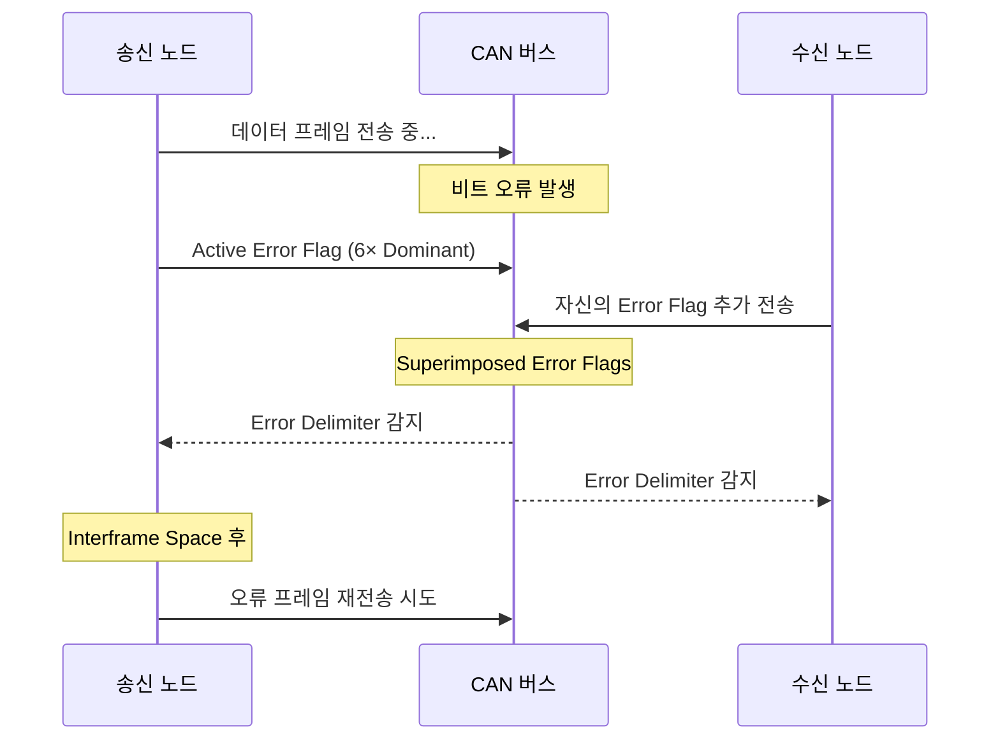
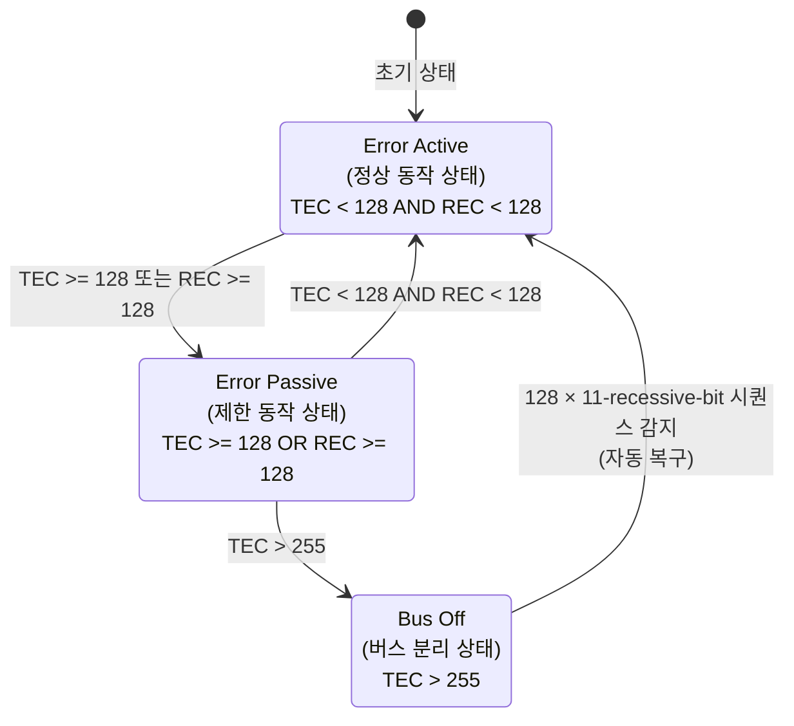
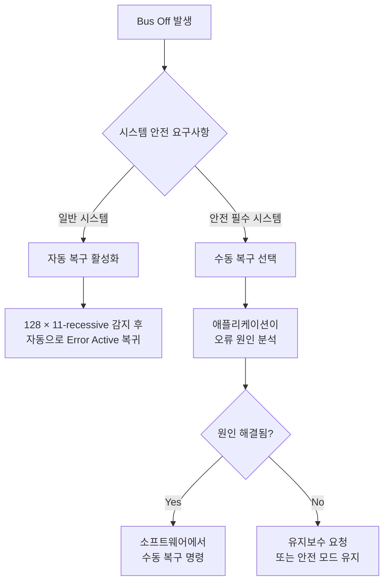

<Header/>

[[toc]]

# CAN 에러 처리

::: info 학습 목표
- CAN의 5가지 에러 검출 메커니즘을 각각 설명할 수 있다
- 에러 프레임의 구조와 역할을 이해한다
- TEC, REC 카운터의 증감 규칙을 적용할 수 있다
- Error Active → Error Passive → Bus Off 상태 천이 조건을 설명할 수 있다
- Bus Off에서 자동 복구 메커니즘을 이해한다
- CAN 수준 ACK와 응용 계층 Acknowledgement(PGN 59392)가 각각 무엇을 보장하는지 구분하고, 목적지 무응답을 어느 계층에서 감지해야 하는지 판단할 수 있다
- 중재 구간에서 Bit Error가 되는 경우와 중재 패배가 되는 경우를 구분할 수 있다
:::

## 1. 에러 검출 메커니즘 5가지

CAN은 하드웨어 레벨에서 5가지 독립적인 방법으로 오류를 감지한다. 이 중 하나라도 오류를 감지하면 즉시 에러 프레임을 전송한다.

### 1-1. Bit Error (비트 에러)

**원리**: 노드가 비트를 전송하는 동시에 버스를 읽어서, 자신이 보낸 값과 버스의 값이 다르면 오류로 판단한다.

```
전송한 값: 1 (Recessive)
버스 읽은 값: 0 (Dominant) ← 다른 노드가 0을 보냄
→ Bit Error 발생
```

**예외**: 중재(Arbitration) 구간과 ACK 슬롯에서는 Recessive를 보내고 Dominant를 읽어도 Bit Error로 보지 않는다. 중재 중 패배하는 것은 정상 동작이기 때문이다. 반대로 Dominant를 보냈는데 Recessive를 읽으면 중재 구간에서도 Bit Error다(ISO 11783-3:2018 5.7, §7 참고).

### 1-2. Stuff Error (스터프 에러)

**원리**: 비트 스터핑 규칙에 따르면, 같은 값의 비트 5개 후에는 반드시 반대 비트가 온다. 이 규칙이 위반되면 Stuff Error가 발생한다.

```
수신된 비트열: 1 1 1 1 1 1 ...
                          ↑ 6번째 동일 비트 → Stuff Error
```

### 1-3. CRC Error (CRC 에러)

**원리**: 송신 노드가 계산한 CRC 값을 프레임에 포함해 전송한다. 수신 노드는 받은 데이터로 직접 CRC를 계산해 프레임의 CRC 필드와 비교한다. 값이 다르면 CRC Error다.

```
송신 노드 계산 CRC: 0x1A3F
수신 노드 계산 CRC: 0x1A3E  ← 전송 중 비트 변형
→ CRC Error 발생
```

### 1-4. Form Error (폼 에러)

**원리**: CAN 프레임의 특정 필드(CRC Delimiter, ACK Delimiter, EOF)는 반드시 Recessive(1)여야 한다. 이 위치에서 Dominant(0)를 수신하면 Form Error다.

```
EOF 필드 (반드시 7개 Recessive):
수신: 1 1 1 0 1 1 1
              ↑ Dominant → Form Error
```

### 1-5. ACK Error (ACK 에러)

**원리**: 송신 노드는 ACK Slot을 Recessive로 전송하고, 수신에 성공한 모든 노드가 이 위치를 Dominant로 덮어쓴다(ACK). 아무도 ACK를 보내지 않으면(버스가 Recessive 유지), 송신 노드는 ACK Error를 인식한다.

```
ACK Slot 전송: 1 (Recessive)
버스 읽기:     1 (Recessive) ← 아무도 ACK 안 함
→ ACK Error 발생
```

**5가지 에러 비교 요약**

| 에러 종류 | 검출 주체 | 검출 지점 | 주요 원인 |
|---|---|---|---|
| Bit Error | 송신 노드 | 전송 중 버스 모니터링 | 버스 결함, 전기적 간섭 |
| Stuff Error | 수신 노드 | 데이터/CRC 필드 | 노이즈, 동기화 오류 |
| CRC Error | 수신 노드 | CRC 필드 비교 | 데이터 손상 |
| Form Error | 수신 노드 | 구조적 필드 위치 | 프레임 구조 손상 |
| ACK Error | 송신 노드 | ACK Slot | 수신 노드 없음, 버스 단선 |

이 5가지 중 하나라도 오류를 감지하면, 다음 단계는 이를 버스 전체에 알리는 것이다. 이때 사용되는 것이 에러 프레임이다.

## 2. 에러 프레임

오류를 감지한 노드는 즉시 <strong>에러 프레임(Error Frame)</strong>을 전송해 버스 전체에 오류 발생을 알린다.


**Active Error Flag (6 Dominant bits)**

- 6개의 연속 Dominant(0) 비트
- 이 자체가 Bit Stuffing 규칙 위반이므로, 다른 노드들도 Stuff Error를 감지해 자신의 에러 플래그를 전송함
- 결과적으로 버스에 6~12개의 연속 Dominant 비트가 나타나 버스 전체가 오류를 인지

**Error Delimiter (8 Recessive bits)**

- 8개의 연속 Recessive(1) 비트
- 에러 프레임의 끝을 알리며, 이후 정상 메시지 전송이 재개될 수 있음

**에러 프레임 이후 흐름**



에러 프레임이 전송될 때마다 CAN 컨트롤러는 내부적으로 오류 횟수를 기록한다. 이 카운터 값에 따라 노드의 동작이 달라진다.

## 3. 에러 카운터

CAN 컨트롤러는 <strong>TEC(Transmit Error Counter)</strong>와 **REC(Receive Error Counter)** 두 개의 카운터를 유지한다. 이 카운터로 노드의 에러 상태를 추적한다.

**TEC (Transmit Error Counter) 증감 규칙**

| 상황 | TEC 변화 |
|---|---|
| 전송 오류 감지(에러 프레임 전송) | +8 |
| 메시지 성공적으로 전송 | -1 |
| Bus Off 진입 시 | TEC > 255 확정 |

**REC (Receive Error Counter) 증감 규칙**

| 상황 | REC 변화 |
|---|---|
| 수신 오류 감지 (첫 번째) | +1 |
| 수신 오류 감지 (에러 플래그 후) | +8 |
| 메시지 성공적으로 수신 | -1 |
| REC가 127 초과 상태에서 성공 수신 | 119로 재설정 |

::: info 에러 카운터의 비대칭성
에러 카운터의 비대칭성에 주목하자. 오류 시 +8, 성공 시 -1로 설계된 이유는, <strong>오류 빈도가 낮아야 정상</strong>이라는 가정 때문이다. 간헐적 오류는 카운터가 자연히 회복되지만, 지속적 오류는 빠르게 누적된다.
:::

그렇다면 카운터가 특정 임계값에 도달하면 어떤 일이 벌어질까? CAN은 카운터 값에 따라 노드의 동작 상태를 세 단계로 구분한다.

## 4. 에러 상태 천이

TEC와 REC 값에 따라 노드는 3가지 상태 중 하나에 있게 된다.



**Error Active (에러 활성)**

- 초기 상태이자 정상 동작 상태
- TEC < 128, REC < 128
- 오류 감지 시 **Active Error Flag** (6 Dominant bits) 전송
- 버스에 적극적으로 오류를 알릴 수 있음

**Error Passive (에러 패시브)**

- TEC >= 128 또는 REC >= 128 시 진입
- 오류 감지 시 **Passive Error Flag** (6 Recessive bits) 전송
  - Recessive이므로 다른 노드의 신호를 덮어쓰지 못함
  - 버스에 오류를 강제로 알릴 수 없음
- Interframe Space에서 추가 대기 시간(Suspend Transmission, 8 bits) 발생

**Bus Off (버스 오프)**

- TEC > 255 시 진입
- 노드가 <strong>버스에서 완전히 분리</strong>됨
- 어떠한 전송도, 수신도 불가능
- 하드웨어 리셋이나 자동 복구 절차를 통해서만 복귀 가능

**에러 상태별 동작 비교**

| 상태 | 에러 플래그 종류 | 전송 가능 | 수신 가능 | 추가 대기 |
|---|---|---|---|---|
| Error Active | Active (6 Dominant) | 가능 | 가능 | 없음 |
| Error Passive | Passive (6 Recessive) | 가능 | 가능 | 있음 (8bit) |
| Bus Off | 없음 | **불가** | **불가** | — |

## 5. Bus Off 복구

Bus Off 상태에 진입한 노드는 두 가지 방법으로 복구할 수 있다.

**자동 복구 (Auto Recovery)**

CAN 컨트롤러는 버스에서 <strong>128번의 11-recessive-bit 시퀀스</strong>를 감지하면 자동으로 Error Active 상태로 복귀한다.

```
복구 조건:
버스에서 11개의 연속 Recessive(1) 비트를 128번 감지

[11111111111][11111111111]...[11111111111]
 ← 1번 →     ← 2번 →        ← 128번 →

128회 완료 시 → TEC = 0, REC = 0, Error Active 복귀
```

11개 연속 Recessive는 인터프레임 스페이스(Interframe Space)와 유휴 버스 상태에 해당한다. 버스가 정상 동작 중이면 이 시퀀스가 자연히 발생한다.

**수동 복구 (Manual Recovery)**

일부 CAN 컨트롤러는 소프트웨어에서 Bus Off 자동 복구를 비활성화할 수 있다. 이 경우 애플리케이션 코드가 명시적으로 복구를 트리거해야 한다.

```c
/* Example: manually trigger Bus Off recovery */
can_controller_reset(CAN1);          /* Reset the CAN controller */
can_set_mode(CAN1, CAN_MODE_NORMAL); /* Re-enter normal mode */
```

**복구 전략 선택 기준**



::: warning 농기계(ISOBUS) 환경에서의 고려사항
전기 노이즈가 많은 트랙터 환경에서는 간헐적 오류로 인한 Bus Off가 발생할 수 있다. 자동 복구가 적절할 수 있지만, 조향/브레이크 관련 ECU는 수동 복구로 설계해 불확실한 상태에서의 자동 복귀를 방지하는 것이 안전하다.
:::

앞 절들이 카운터 증감 규칙(§3)과 상태 임계값(§4), 복구 조건(§5)을 각각 따로 다뤘다면, 이번에는 이 세 가지를 <strong>한 노드의 시간 흐름</strong>에 그대로 적용해 Error Active에서 Bus Off까지, 그리고 다시 복귀하기까지를 끝까지 따라가 본다.

## 6. 에러 카운터 따라가기

### 시나리오: 노이즈가 심한 버스에서 진단 도구가 반복 전송에 실패한다

전기 노이즈가 심한 트랙터 환경에서, 진단 도구(SA=0xF9) 하나의 TEC·REC가 시간에 따라 어떻게 움직이는지 이벤트 단위로 추적한다. 증감 폭은 모두 §3에서 정리한 규칙(<strong>전송 오류 +8, 전송 성공 −1</strong> / <strong>수신 오류 첫 감지 +1, 에러 플래그 이후 감지 +8, 수신 성공 −1</strong>) 그대로이고, 상태 판정은 §4의 임계값(<strong>TEC < 128 AND REC < 128 → Error Active</strong>, <strong>TEC >= 128 OR REC >= 128 → Error Passive</strong>, <strong>TEC > 255 → Bus Off</strong>)을 그대로 적용한다.

| 이벤트 | ΔTEC | ΔREC | TEC | REC | 상태 |
|---|---|---|---|---|---|
| 초기 상태 | — | — | 0 | 0 | Error Active |
| 송신 실패 (Bit Error) | +8 | 0 | 8 | 0 | Error Active |
| 송신 실패 (Stuff Error) | +8 | 0 | 16 | 0 | Error Active |
| 송신 실패 (CRC Error) | +8 | 0 | 24 | 0 | Error Active |
| 수신 실패 (첫 번째 감지) | 0 | +1 | 24 | 1 | Error Active |
| 송신 실패 × 13회 반복 (노이즈 지속, 24 + 13×8) | +104 | 0 | 128 | 1 | **Error Passive** (TEC >= 128) |
| 송신 성공 (재전송 성공) | −1 | 0 | 127 | 1 | Error Active (TEC < 128로 복귀) |
| 송신 실패 | +8 | 0 | 135 | 1 | Error Passive |
| 수신 실패 (에러 플래그 이후 감지) | 0 | +8 | 135 | 9 | Error Passive |
| 송신 실패 × 15회 반복 (135 + 15×8) | +120 | 0 | 255 | 9 | Error Passive (TEC=255, 아직 <strong>초과는 아님</strong>) |
| 송신 실패 | +8 | 0 | 263 | 9 | **Bus Off** (TEC > 255) |

몇 가지 짚어볼 지점이 있다.

- <strong>TEC=128에서 정확히 Error Passive로 전환</strong>된다. 임계값은 "128 이상"이므로 127에서는 아직 Active, 128부터 Passive다.
- 그 직후 송신에 한 번 성공하자 TEC가 127로 내려가며 <strong>다시 Error Active로 돌아간다.</strong> 상태 전환은 한 방향으로만 진행되는 것이 아니라, 카운터 값에 따라 그때그때 재판정된다.
- 이후 노이즈가 이어지면서 TEC가 다시 오르고, <strong>TEC=255에서는 아직 Bus Off가 아니다.</strong> §4의 조건은 "TEC > 255"이지 "TEC >= 255"가 아니기 때문이다. 마지막 한 번의 송신 실패로 263이 되어야 비로소 Bus Off에 진입한다.
- REC는 첫 실패에서 +1(첫 번째 감지), 이후 실패에서 +8(에러 플래그 이후 감지)이 적용되어 9까지만 올랐다. §3에 있는 "REC가 127 초과 상태에서 성공 수신 시 119로 재설정" 규칙은 이 시나리오에서는 REC가 그 구간에 도달하지 않아 발동하지 않았다.

::: info 이 시나리오가 보여주는 것
전송 오류(+8)와 성공(−1)의 비대칭성(§3에서 이미 짚은 내용)이 실제 숫자로 어떻게 나타나는지가 이 표의 핵심이다. 성공 한 번(−1)이 실패 13번(+104)을 전혀 상쇄하지 못한다. 간헐적 성공만으로는 지속적 노이즈를 이길 수 없고, 결국 TEC는 계속 우상향해 Bus Off에 도달한다.
:::

### Bus Off 이후: 자동 복구까지

Bus Off에 진입한 진단 도구는 §5의 규칙대로 더 이상 어떤 프레임도 송신·수신하지 못한다. 이후 버스가 정상 상태를 회복해 <strong>11개 연속 Recessive 비트 시퀀스를 128번</strong> 감지하면, TEC와 REC가 모두 0으로 초기화되며 Error Active로 복귀한다. 이 조건은 노드 자신의 판단이 아니라 <strong>버스에서 관측되는 유휴 패턴의 반복 횟수</strong>로만 결정되므로, 노이즈 원인이 없어지지 않은 채로 128번을 채우면 복귀 직후 다시 오류가 누적되어 같은 경로를 반복할 수 있다.

:::details 파이썬으로 검산해 보기
```python
def state(tec, rec):
    if tec > 255:
        return "Bus Off"
    if tec >= 128 or rec >= 128:
        return "Error Passive"
    return "Error Active"


# (이벤트 이름, ΔTEC, ΔREC) — §3 규칙 그대로 적용
events = [
    ("송신 실패 (Bit Error)",            +8, 0),
    ("송신 실패 (Stuff Error)",          +8, 0),
    ("송신 실패 (CRC Error)",            +8, 0),
    ("수신 실패 (첫 번째 감지)",              0, +1),
    ("송신 실패 × 13회 반복",              +8 * 13, 0),
    ("송신 성공 (재전송 성공)",              -1, 0),
    ("송신 실패",                        +8, 0),
    ("수신 실패 (에러 플래그 이후 감지)",        0, +8),
    ("송신 실패 × 15회 반복",              +8 * 15, 0),
    ("송신 실패",                        +8, 0),
]

tec = rec = 0
for name, dt, dr in events:
    tec += dt
    rec += dr
    print(f"{name:28s} TEC={tec:4d} REC={rec:3d} -> {state(tec, rec)}")

# Bus Off 이후 자동 복구
tec, rec = 0, 0   # 128 x 11-recessive-bit 시퀀스 감지 완료
print("복구 후:", state(tec, rec))   # Error Active
```

마지막 줄 실행 결과가 `TEC=263 REC=9 -> Bus Off`로 나와 위 표와 일치하며, 복구 후에는 `Error Active`로 돌아온다.
:::

::: tip 핵심 정리

- CAN은 **Bit, Stuff, CRC, Form, ACK** 5가지 독립 메커니즘으로 오류를 검출하며, 하나라도 감지되면 에러 프레임을 전송한다.
- <strong>에러 프레임</strong>은 6개의 Dominant(Active) 또는 6개의 Recessive(Passive) 비트로 구성된 에러 플래그와 8개의 Recessive Delimiter로 이뤄진다.
- <strong>TEC</strong>는 전송 오류 시 +8, 성공 시 -1. <strong>REC</strong>는 수신 오류 시 +8, 성공 시 -1로 변한다.
- 에러 상태는 **Error Active → Error Passive → Bus Off** 순으로 악화되며, 각 임계값은 128, 255이다.
- <strong>Bus Off 자동 복구</strong>는 버스에서 128번의 11-recessive-bit 시퀀스를 감지한 뒤 Error Active로 복귀한다.

:::

## 7. ISO 11783가 에러 처리에 덧붙이는 것

에러 검출과 카운터, Bus Off는 모두 CAN 컨트롤러가 ISO 11898-1대로 처리한다. ISO 11783-3:2018(이하 Part 3)은 여기에 새 메커니즘을 더하지 않는다. 대신 세 가지를 분명히 해 둔다. 어떤 검출 수단을 전제로 하는지, CAN 수준의 확인 응답이 어디까지 보장하는지, 에러 프레임에 잡히지 않는 메시지 유실을 누가 막아야 하는지다.

### Part 3 5.8이 나열하는 검출 수단

Part 3 5.8은 에러 검출 수단을 네 가지로 적고, 자세한 내용은 ISO 11898-1에 맡긴다.

| Part 3 5.8의 표현 | §1의 대응 |
|---|---|
| 송신 컨트롤러가 보낸 비트 레벨과 버스에서 읽은 비트 레벨을 비교 | Bit Error |
| CRC | CRC Error |
| 스터프 폭 5의 가변 비트 스터핑 | Stuff Error |
| 프레임 형식 검사(frame format check) | Form Error |

§1의 ACK Error는 5.8 목록에 따로 없다. 대신 Part 3은 ACK 슬롯을 "확인 응답의 첫 번째 형식"으로 5.4.5에서 다룬다(아래 소절).

### 중재 구간의 Bit Error — 5.7

§1-1의 예외에는 방향이 있다. Part 3 5.7은 중재 중 두 경우를 나눈다.

| 보낸 값 | 읽은 값 | 판정 |
|---|---|---|
| recessive (1) | dominant (0) | 중재 패배. 비트를 하나도 더 보내지 않고 물러나야 한다(shall) |
| dominant (0) | recessive (1) | Bit Error |

[CAN 물리 계층](/study/isobus/03-can-physical) 챕터의 Wired-AND로 풀어 보면 이유가 보인다. dominant는 다른 노드가 recessive로 덮어쓸 수 없다. 그러니 dominant를 보냈는데 recessive가 읽힌다면 경쟁이 아니라 송신 경로나 버스의 고장이고, 그래서 중재 구간이라도 에러로 처리한다.

### 확인 응답의 두 형식 — CAN ACK는 "목적지가 받았다"가 아니다

Part 3 5.4.5는 확인 응답(acknowledgement)을 두 형식으로 나눈다.


| 형식 | 의미 | 근거 |
|---|---|---|
| CAN 프로토콜의 프레임 내 확인 응답(ACK 슬롯) | <strong>적어도 한 컨트롤러</strong>가 메시지를 받았다 | Part 3 5.4.5 |
| CAN 에러 프레임이 없음 | 전원이 켜져 연결된 나머지 모든 컨트롤러가 메시지를 정상 수신했다 | Part 3 5.4.5 |
| 응용 계층의 응답(일반 브로드캐스트, ACK, NACK) | 특정 명령·요청에 대한 응답. 어떤 PG에 어떤 응답이 필요한지는 응용 계층이 정한다 | Part 3 5.4.5, PGN 59392 |

구현에서 중요한 것은 첫 줄의 "적어도 한 컨트롤러"다. 목적지(DA)를 지정한 명령을 보냈는데 목적지 장치가 꺼져 있어도, 버스에 다른 노드가 하나라도 켜져 있으면 그 노드가 ACK 슬롯을 채운다. 송신 측 컨트롤러는 ACK Error를 보지 못하고 프레임을 성공으로 처리한다. "목적지가 받았는가"는 CAN 계층으로는 알 수 없다.

목적지의 응답이 필요한 메시지는 응용 계층에서 확인해야 한다. Part 3은 응답해야 하는 컨트롤러는 0.2 s(Tr) 안에 응답하고, 응답을 기다리는 컨트롤러는 포기하거나 다시 보내기 전에 최소 1.25 s(T3)를 기다리라고 정한다(Part 3 5.13.3). Acknowledgement 메시지의 바이트 구조와 응답 규칙은 [J1939 메시지 구조](/study/isobus/09-j1939-message) 챕터에서 다룬다.

반대로 §1-5의 ACK Error가 났다는 것은 ACK 슬롯을 채운 노드가 하나도 없다는 뜻이다. 버스에 송신 노드 혼자 있거나, 다른 노드가 전부 버스에서 떨어져 있거나, 배선이 끊긴 경우다.

### 에러 프레임에 잡히지 않는 유실 — 5.12

CRC와 ACK를 통과해 컨트롤러가 받아들인 프레임도 소프트웨어가 늦게 꺼내면 사라질 수 있다. 수신 버퍼에서 새 프레임이 이전 프레임을 덮어쓰는 오버런(overrun)은 버스에 에러 프레임을 만들지 않고, 송신 측도 알 수 없다.

Part 3 5.12는 이를 컨트롤러의 의무로 정한다. 데이터 링크가 100% 사용률일 때도 메시지를 잃지 않을 만큼 빠르게 처리해야 하고(shall), 사용률이 낮아도 프레임이 연달아(back-to-back) 오면 그 때문에 메시지를 잃어서는 안 된다. 여기서 "빠르게 처리"는 응답을 즉시 만들라는 뜻이 아니라, 새 메시지가 이전 메시지를 덮어쓰지 않게 하라는 뜻이다.

이 요구는 TP 수신에서 특히 중요하다. 특정 목적지로 가는 multi-packet 데이터는 패킷 간 최소 간격이 없어 연달아 올 수 있다(Part 3 5.13.3). 소프트웨어가 TP.DT를 하나 놓치면 에러 프레임은 없는데 시퀀스 번호가 빈다. 그 결과는 재전송 요청이나 Abort로 나타난다. 이 처리는 [J1939 Transport Protocol](/study/isobus/11-j1939-transport) 챕터에서 본다.

::: tip 정리
- Part 3 5.8은 비트 비교·CRC·스터프 폭 5·프레임 형식 검사를 전제로 하고, 세부는 ISO 11898-1에 맡긴다.
- 중재 중 recessive를 보내고 dominant를 읽으면 패배, dominant를 보내고 recessive를 읽으면 Bit Error다.
- CAN ACK 슬롯은 "적어도 한 노드가 받음"만 보장한다. 목적지의 응답은 응용 계층(Tr 0.2 s, T3 1.25 s)에서 확인한다.
- 수신 오버런은 에러 프레임을 남기지 않는다. 100% 버스 부하와 연달아 오는 프레임에서도 잃지 않도록 처리하는 것은 컨트롤러의 의무다.
:::

::: details 확인 문제
1. (설명형) 중재 구간에서 Bit Error가 되는 경우와 중재 패배가 되는 경우를 보낸 값·읽은 값으로 구분하라.
2. (시나리오형) TC가 VT에 명령을 보냈는데 VT의 전원이 꺼져 있었다. 버스에는 TECU 등 다른 노드가 켜져 있다. TC의 CAN 컨트롤러는 ACK Error나 자동 재전송을 겪는가? TC 소프트웨어는 실패를 무엇으로 알아채야 하는가?
3. (진단형) 수신 ECU 로그에 TP.DT 시퀀스 번호가 비어 있는데, 그 시간대 버스의 에러 프레임 카운트는 0이다. 어떤 원인을 먼저 의심해야 하는가?

**답 가이드**
1. recessive를 보내고 dominant를 읽으면 중재 패배이고 즉시 물러난다. dominant를 보내고 recessive를 읽으면 중재 구간이라도 Bit Error다(Part 3 5.7).
2. 켜져 있는 다른 노드가 ACK 슬롯을 채우므로 ACK Error도 자동 재전송도 없다. CAN ACK는 "적어도 한 컨트롤러가 받음"만 뜻한다(Part 3 5.4.5). TC는 응용 계층의 응답(VT의 응답 메시지나 Acknowledgement)을 T3 1.25 s 이상 기다렸다가 오지 않으면 실패로 판단해야 한다(Part 3 5.13.3).
3. 에러 프레임이 없으므로 버스 오류보다 수신 측 소프트웨어의 오버런을 먼저 의심한다. 특정 목적지 TP.DT는 연달아 올 수 있으므로 수신 큐 크기와 인터럽트 처리 시간을 점검한다(Part 3 5.12, 5.13.3).
:::

## 다음 챕터

- 다음 : [CAN FD](/study/isobus/07-can-fd)
