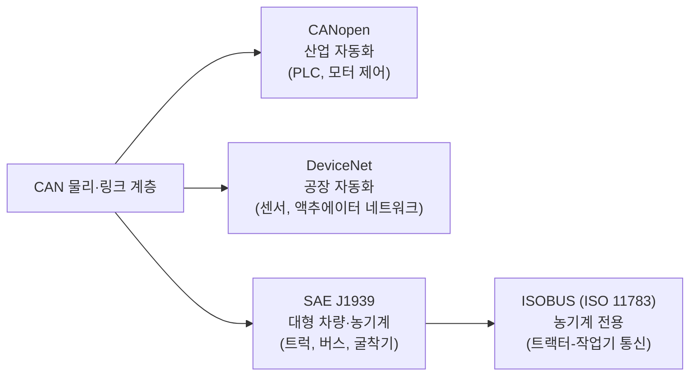
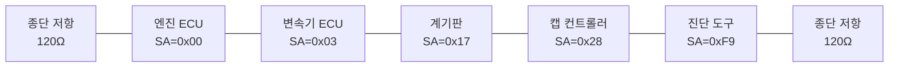
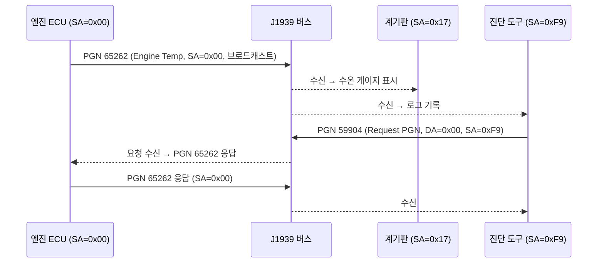

<Header />

[[toc]]

::: info 학습 목표
- CAN만으로 부족한 이유를 상위 프로토콜의 필요성과 연결해서 설명할 수 있다.
- CANopen, DeviceNet, J1939, ISOBUS의 위치와 차이를 구분할 수 있다.
- J1939의 29비트 CAN ID 구조(Priority, EDP, DP, PF, PS, SA)를 해석할 수 있다.
- J1939 네트워크에서 소스 어드레스(SA)의 역할을 이해한다.
- EDP·DP 조합으로 프레임이 ISO 11783 page 0·1인지, ISO 15765-2 프레임인지 판별할 수 있다.
- 주기·목적지 요구·독점 여부로 새 메시지의 PDU 형식과 PF 구간을 고를 수 있다.
- 주기 메시지 목록으로 버스 부하와 제조사 독점 메시지 비중(2% 권고)을 계산할 수 있다.
:::

# 1. 왜 CAN만으로는 부족한가

## CAN은 데이터 전달만 담당한다

CAN 프로토콜은 물리 계층과 데이터 링크 계층만 정의한다. 메시지를 버스에 올리고 내리는 것, 에러를 감지하는 것 — 여기까지가 CAN이 하는 일이다.

다음 기능들은 CAN 규격 어디에도 없다.

| 필요 기능 | CAN 2.0 지원 여부 |
|---|---|
| 노드별 고유 주소 관리 | 없음 (29비트 ID를 자유롭게 사용) |
| 메시지 의미 해석 (온도, 압력 등) | 없음 |
| 8바이트 초과 데이터 전송 프로토콜 | 없음 |
| 네트워크 진단 / 장치 검색 | 없음 |
| 타임아웃, 재전송 정책 | 없음 |

## 택배 트럭과 물류 시스템 비유

> "CAN은 택배 트럭이고, J1939은 물류 시스템이다."

```
CAN (택배 트럭)
  - 소포를 버스에서 목적지까지 운반
  - 어떤 소포인지, 배송 순서, 반품 정책은 모름

J1939 (물류 시스템)
  - 소포에 송장(PGN/SPN) 붙이기
  - 발송지(SA)/수신지(DA) 주소 관리
  - 큰 짐을 여러 소포로 나누는 규칙(Transport Protocol)
  - 배송 실패 처리, 재전송 정책
```

CAN 위에 상위 프로토콜을 올려야 비로소 실용적인 차량 네트워크가 완성된다.

# 2. 상위 프로토콜 지도

## OSI 7계층에서의 위치

CAN 기반 상위 프로토콜은 모두 OSI 모델의 3계층 이상을 담당한다.


## 프로토콜별 적용 도메인



> ISOBUS는 J1939을 기반으로 농기계 도메인에 특화한 확장 프로토콜이다. J1939을 이해하면 ISOBUS의 절반은 이해한 것이다.

# 3. J1939이란

SAE(Society of Automotive Engineers)가 정의한 <strong>대형 차량 및 작업 기계용 통신 상위 프로토콜</strong>이다.

```
표준명: SAE J1939
관리 기관: SAE International
기반 CAN: CAN 2.0B (29비트 확장 ID)
비트레이트: 250 kbps (표준) / 500 kbps (옵션)
주요 적용: 트럭, 버스, 굴착기, 트랙터, 농기계
```

J1939이 정의하는 것들:

- **PGN (Parameter Group Number)**: 메시지 종류 식별자
- **SPN (Suspect Parameter Number)**: 데이터 필드 내 개별 파라미터 식별자
- **소스/목적지 주소 관리**
- **Transport Protocol**: 8바이트 초과 데이터를 여러 프레임으로 분할 전송
- **네트워크 관리**: 주소 요청, 주소 충돌 감지

# 4. J1939과 CAN의 관계

## 29비트 CAN ID의 구조화

Classic CAN 2.0B는 29비트 확장 ID를 제공하지만, 이 ID를 어떻게 쓸지는 규정하지 않는다. J1939은 이 29비트를 다음과 같이 <strong>명확한 필드로 구조화</strong>한다.


| 필드 | 비트 수 | 설명 |
|---|---|---|
| **Priority** | 3 | 메시지 우선순위. 0이 최고, 7이 최저 |
| **EDP** | 1 | Extended Data Page. J1939에서는 보통 0 |
| **DP** | 1 | Data Page. PGN 공간을 두 배로 확장 |
| **PF** | 8 | PDU Format. 메시지 유형 결정 (PDU1 vs PDU2 구분) |
| **PS** | 8 | PDU Specific. PF < 240이면 목적지 주소, PF >= 240이면 그룹 확장 |
| **SA** | 8 | Source Address. 메시지를 보내는 노드의 주소 (0x00~0xFD) |

## 29비트 ID 예시 해석

hex → binary: 0x18FEE000 = 0001 1000 1111 1110 1110 0000 0000 0000 (32bit), 하위 29비트만 취해 필드로 분해하면 다음과 같다.


29비트 ID의 구조를 이해했으니, 이제 이 ID 체계 위에서 실제 J1939 네트워크가 어떻게 구성되는지 살펴보자.

# 5. J1939 네트워크 구성

## 소스 어드레스(SA) 할당

J1939은 노드마다 <strong>고유한 소스 어드레스(SA)</strong>를 부여한다. SAE J1939-81(네트워크 관리) 규격이 주소 요청/충돌 감지 절차를 정의한다.

예약된 주소 예시:

```
SA 0x00 (0)   : Engine #1
SA 0x03 (3)   : Transmission #1
SA 0x17 (23)  : Instrument Cluster #1
SA 0x28 (40)  : Cab Controller
SA 0xF9 (249) : Diagnostic Tool (오프보드)
SA 0xFE (254) : Null Address (아직 주소 없음)
SA 0xFF (255) : Global (브로드캐스트 목적지)
```

## 네트워크 토폴로지 예시



> J1939 버스는 단일 버스 토폴로지(daisy-chain 또는 stub 방식)로 구성하며, 양 끝에 120Ω 종단 저항을 달아야 한다. ISOBUS도 동일한 물리 구성을 따른다.

## J1939 통신 흐름 예시



::: tip 핵심 정리
- CAN은 물리·링크 계층만 담당하므로 주소 관리, 메시지 의미, 대용량 전송은 상위 프로토콜이 필요하다.
- CANopen(산업), DeviceNet(공장), J1939(대형 차량·농기계), ISOBUS(농기계 전용) 모두 CAN 위에 올라가는 상위 프로토콜이다.
- J1939은 CAN 2.0B의 <strong>29비트 ID</strong>를 Priority + EDP + DP + PF + PS + SA 필드로 구조화한다.
- <strong>SA(Source Address)</strong>로 버스 내 노드를 구분하며, 0x00~0xFD가 일반 노드에 할당된다.
- ISOBUS는 J1939을 농기계 도메인에 맞게 확장한 프로토콜이다.
:::

# 6. ISO 11783-3은 J1939를 어떻게 받아들였나

## 공동 개발된 문서

ISO 11783-3:2018(이하 Part 3)의 서문은 ISO 11783의 일부가 SAE J1939 문서에 기반한다고 밝힌다. 트럭·버스용 J1939 규격을 만족하는 전자 장치를 농업·임업 장비에서 최소한의 변경으로 쓸 수 있도록 공동 문서를 만들었다는 것이다. Part 3의 참고 문헌에는 J1939의 데이터 링크 계층 문서인 SAE J1939-21이 올라 있다.

Part 3이 스스로 정한 범위는 두 가지다(Part 3 1장).

- 응용 계층의 PDU(Protocol Data Unit, 프로토콜 데이터 단위)를 고전 CAN의 CEFF 데이터 프레임에 매핑하는 방법
- CEFF 프레임 하나에 담기지 않는 PDU를 위한 전송 계층 프로토콜(TP, ETP)과 그 CEFF 매핑

Part 3 4장은 데이터 링크 계층의 역할을 "물리 링크를 거쳐 데이터를 신뢰성 있게 옮기는 것"으로 정의한다. 고전 CAN 데이터 프레임을 동기화·순서 제어·에러 제어·흐름 제어와 함께 보내는 것이고, 흐름 제어는 일관된 메시지 프레임 형식으로 이룬다.

## OSI 계층으로 본 ISO 11783


Part 3 Figure 2를 다시 그린 것이다. 송신 CF는 Priority·PG(파라미터 그룹)·SP(파라미터)를 PDU로 묶는다. 8바이트 이하면 PDU가 곧바로 CEFF 프레임 하나가 되고, 9바이트 이상이면 BAM·TP·ETP가 여러 CEFF 프레임으로 나눈다. 표현·세션·네트워크 계층 칸은 이 경로에서 비어 있다. 물리 계층은 ISO 11783-2를 따르는 신호와 네트워크 부품이다.

눈여겨볼 점이 하나 있다. Figure 2는 TP를 전송 계층 칸에 그리지만, 본문은 TP를 "데이터 링크 계층의 일부로 기술한다"고 적는다(Part 3 5.10.1). 문서 구성상 데이터 링크 파트에 실려 있을 뿐, 하는 일은 OSI의 전송 계층에 가깝다고 읽으면 된다. 네트워크 계층(NIU)은 ISO 11783-4가 맡는다.

## Part 3이 J1939 위에 덧붙이거나 못박은 것

J1939-21 원문은 이 스터디의 근거 자료에 없다. 아래 표는 Part 3이 스스로 밝힌 J1939와의 관계, 그리고 Part 3이 명시한 ISO 11783 고유 규칙만 모은 것이다.

| 항목 | Part 3의 규정 | 근거 |
|---|---|---|
| TP(BAM, RTS/CTS) | SAE와 조화(harmonized)됨 | 5.10.1 |
| ETP(1785바이트 초과) | SAE와 조화되지 않음 | 5.10.1 |
| Acknowledgement의 Byte 5 | J1939와의 최대 호환을 위해 PS 필드를 복제 | 5.4.5 |
| CAN 규격과 충돌할 때 | Part 3이 우선 | 5.1.1 |
| 프레임 형식 | CEFF 필수, CBFF는 제조사 독점용 최소 규칙, FD 금지 | 5.1.1, 5.1.4 |
| EDP | 송신 시 항상 0 | 5.2.3 |
| EDP = 1, DP = 1 | ISO 15765-2(DoCAN) 프레임. ISO 11783 정의를 따르지 않음 | 5.1.2, 5.2.4 |
| 주소 자기 구성(self-configuring) | ISO 11783 컨트롤러는 지원해야 함(shall) | 5.9.2 |
| 2018년 4판의 변경 | CAN FD 배제 문구, BAM 패킷 10 ms 간격 허용, Request2 확장 식별자용 Acknowledgement | 머리말 |

주소 자기 구성 필수 조항은 [J1939 주소 체계](/study/isobus/10-j1939-address) 챕터의 주소 클레임 절차와 이어진다.

# 7. 데이터 페이지와 PGN 공간

## EDP·DP 조합

§4의 표는 EDP를 "보통 0", DP를 "PGN 공간을 두 배로 확장"이라고만 적었다. Part 3은 두 비트의 조합을 이렇게 정한다(Part 3 5.2.3, 5.2.4, Table 3).

| EDP | DP | 의미 |
|---|---|---|
| 0 | 0 | ISO 11783 page 0 PGN |
| 0 | 1 | ISO 11783 page 1 PGN |
| 1 | 0 | ISO 11783 예약 |
| 1 | 1 | ISO 15765-2가 정의하는 프레임 |

모든 ISO 11783 메시지는 EDP를 0으로 보내야 한다(shall, 5.2.3). 표준은 나중에 EDP를 써서 PDU 형식을 새로 정의하거나 Priority 필드·주소 공간을 넓힐 가능성을 열어 둔다. EDP와 DP가 모두 1이면 ISO 15765-2(DoCAN, CAN 위 진단 통신) 프레임이다. 이 프레임은 식별자의 나머지 비트가 ISO 11783 형식이 아니므로, 수신 측은 여기서 PGN이나 SA를 뽑아내면 안 되고 ISO 15765-2대로 처리해야 한다(5.1.2, Table 3 NOTE).

## 8672개의 PGN

PGN은 24비트다. 상위 6비트는 0, 그다음 10비트가 EDP·DP·PF, 마지막 8비트는 PF가 240 미만이면 0, 240 이상이면 PS다(Part 3 5.1.3). 이 규칙으로 만들 수 있는 PGN은 페이지당 240 + 16 × 256 = 4336개, 두 페이지 합계 8672개다(5.2.6 식 (1)). 2¹⁷ = 131072가지 비트 조합 중 대부분은 PDU1의 DA 자리라서 PGN이 되지 못한다.


Part 3 Table 2와 Table 7을 합쳐 그린 지도다. 칸의 폭은 보기 좋게 조정했고 개수에 비례하지 않는다. 구간별 개수로 정리하면 다음과 같다.

| 구간 | 페이지 0 | 페이지 1 |
|---|---|---|
| PDU1, PF 0~238 | 239개 | 239개 |
| PF 239 | Proprietary A 1개 | Proprietary A2 1개 |
| PDU2, PF 240~254 | 3840개 | 3840개 |
| PF 255 | Proprietary B 256개 | 256개 (아래 주의) |
| 합계 | 4336개 | 4336개 |

::: warning 원문 안의 차이 — 페이지 1의 PF 255
Table 7(PGN 템플릿)은 페이지 1의 PF 255(130816 ~ 131071)에도 "PDU2 Format - Proprietary B"라고 적는다. 그런데 Proprietary B의 PG 정의는 데이터 페이지 0, PGN 65280 ~ 65535뿐이고(5.4.6.4), Table 2는 페이지 1의 PDU2 4096개를 모두 ISO 할당으로 센다. 페이지 1의 PF 255를 제조사 독점용으로 써도 되는지는 원문만으로 확정할 수 없다(확인 필요). 독점 메시지는 PG 정의가 분명한 Proprietary A·A2·B를 쓰는 편이 안전하다.
:::

# 8. 새 메시지에 PDU 형식과 PGN 고르기

## 할당 기준

Part 3 5.9는 새 SA와 PGN을 배정하는 기준을 정한다. 대부분은 표준 위원회가 PGN을 배정할 때의 원칙이지만, 제조사 독점 메시지를 설계하거나 표준 PGN이 왜 그 자리에 있는지 이해할 때도 그대로 쓸 수 있다.

- PG는 PDU1과 PDU2 중 하나로만 배정하고, 정한 뒤에는 다른 형식을 쓸 수 없다. 특정 목적지로 보내야 하는 PG는 PDU1을 써야 한다(5.9.1).
- 배정할 때 따지는 특성은 우선순위, 갱신 주기, 다른 CF에게 그 데이터가 얼마나 중요한지, 데이터 길이 네 가지다(5.9.1).
- 목적지가 필요한 PGN은 "여러 특정 CF 중 하나를 직접 제어(명령)하는 파라미터"일 때만 배정한다. 그 밖에는 어느 CF든 데이터에 접근할 수 있도록 목적지 없는 PGN을 고른다(shall, 5.9.1).
- 반복 주기가 10 Hz 이상(100 ms 이하)인 메시지는 multi-packet이 허용되지 않는다(5.9.1, Table 7).
- 어떤 PGN이든 요청할 수는 있지만, 이미 주기적으로 브로드캐스트되는 메시지를 요청하는 것은 강하게 비권장된다(5.9.1).
- 데이터 필드는 8바이트를 다 쓰도록 관련 파라미터를 묶는다. 데이터 필드를 듬성듬성 쓰는 PG에는 강한 정당화가 필요하다(5.9.4).
- 주소 공간은 256개를 넘을 수 없고, 새 주소 배정은 엔진·변속기·브레이크처럼 대다수 사용자에게 쓸모 있는 기능으로 제한된다(5.9.2).

5.9.3은 세 통신 방법(PDU1, PDU2, 제조사 독점 PGN)을 언제 쓰는지 설명하고 판단 순서를 준다. 독점 정보이거나 일반적 관심사가 아니면 독점 방식, 일반적 관심사이고 특정 CF로 보낼 필요가 없으면 PDU2, 일반적 관심사인데 이 CF 또는 저 CF로 골라 보내야 하면 PDU1이다. 예로 드는 것은 엔진이 여럿인 차량의 토크 제어 메시지다. 원하는 엔진에만 보내야 하므로 목적지 지정 PG가 필요하다.


## PF 구간과 주기

PF 값 안에서도 자리가 정해져 있다(Part 3 5.3.2, 5.3.3, Table 7).

| 형식 | 주기 100 ms 이하(지연 중요) | 주기 100 ms 초과·요청 시·변경 시 |
|---|---|---|
| PDU1 | PF 0부터 증가 | PF 238부터 감소 |
| PDU2 | PF 240(GE 0)부터 증가 | PF 254(GE 255)부터 감소 |

두 방향은 가운데 경계(Table 7의 x, y)에서 만난다. PDU1 본문은 지연이 중요하지 않은 PG가 PF 239부터 줄어든다고 적지만(5.3.2), PF 239는 Proprietary A 자리라서 Table 7은 238부터 시작한다. 이 배치 덕분에 PF 값만 봐도 메시지의 성격을 어느 정도 짐작할 수 있다. 예컨대 PF 254 근처의 PDU2 메시지는 느린 주기이거나 요청·변경 시에만 오는 메시지일 가능성이 크다(추론).

# 9. 버스 대역폭을 계산해 보기

Part 3 Annex D(참고)는 ISO 11783 같은 개방형 시스템에서 메시지 수요가 네트워크 용량을 넘을 수 있다고 경고한다. 손잡이는 세 가지다.

- 제조사 독점 PG와 CBFF 통신의 사용 제한
- 주기 메시지의 주기를 실용적인 한도에서 최대한 느리게
- PG의 기본 Priority (Annex D의 권고표는 [CAN 중재와 우선순위](/study/isobus/05-can-arbitration) 챕터에서 다룬다)

강력 권고 사항은 두 가지다. 정상 운용 중 Proprietary A·A2·B의 합은 네트워크 용량의 2%를 넘지 않게 한다(Annex D). 5.4.6.1은 같은 권고를 "CF당" 합계로 적는다. 그리고 CBFF 트래픽은 서브넷으로 분리한다.

## 계산의 전제

| 전제 | 값 | 출처 |
|---|---|---|
| 비트레이트 | 250 kbit/s | [CAN 물리 계층](/study/isobus/03-can-physical) 챕터의 값. Part 2 소관이라 이 스터디의 원문 묶음으로는 확인하지 못했다 |
| 프레임 하나의 길이 | 150비트 | Part 3 Figure 1이 적은 CEFF 최대 길이(비트 스터핑 포함) |
| 버스 부하 | 초당 프레임 수 × 150 ÷ 250000 | 프레임 사이 간격은 무시한 근사 |

이 전제로 2% 예산은 초당 5000비트, 프레임으로는 초당 약 33개다.

## 예제 — 분무기 ECU의 메시지 설계 검토

분무기 ECU 하나가 다음 메시지를 내보내도록 설계됐다고 하자(예시 값).

| 메시지 | 주기 | 초당 프레임 |
|---|---|---|
| 표준 PGN 3개 | 각 100 ms | 30 |
| Proprietary B 2개 (자체 섹션 제어기용) | 각 20 ms | 100 |
| Proprietary A 1개 | 50 ms | 20 |

- 표준 메시지: 30 × 150 = 4500 bit/s, 버스의 1.8%
- 독점 메시지: 120 × 150 = 18000 bit/s, 버스의 <strong>7.2%</strong>로 2% 권고의 3.6배

고치는 방법은 Annex D의 손잡이 그대로다. Proprietary B를 100 ms, Proprietary A를 200 ms로 늦추면 독점 메시지는 초당 25프레임, 1.5%가 된다. 20 ms 제어 루프가 꼭 필요하다면 그 트래픽은 작업기 내부 네트워크로 옮겨 NIU 뒤에 두는 설계가 Annex D의 취지에 맞는다(추론).

TP도 같은 방식으로 계산할 수 있다. 1785바이트를 BAM으로 보내면 TP.DT가 255개다. BAM 패킷 간격은 10~200 ms이므로(Part 3 5.10.2.4), 가장 빠르게 보내면 2.55 s 동안 초당 100프레임, 즉 버스의 6%를 쓴다. 가장 느리면 51 s가 걸린다. 특정 목적지 RTS/CTS 전송은 패킷 간 최소 간격이 없어 순간 부하가 훨씬 커질 수 있다(5.13.3). CTS 하나에 허용하는 패킷 수와 TP 데이터의 Priority 7이 다른 메시지와 버스를 나눠 쓰는 장치가 되는 이유다(추론). 흐름 제어의 세부는 [J1939 Transport Protocol](/study/isobus/11-j1939-transport) 챕터에서 본다.

::: details 파이썬으로 검산 — PGN 개수, EDP·DP 판별, 버스 부하
```python
from collections import Counter

# 1) 5.1.3 규칙으로 만들 수 있는 PGN 전부 세기 (EDP = 0, 5.2.3)
pgns = set()
for dp in (0, 1):
    for pf in range(256):
        for ps in range(256):
            pgns.add((dp << 16) | (pf << 8) | (ps if pf >= 240 else 0))
assert len(pgns) == 8672


def region(pgn):
    dp, pf = (pgn >> 16) & 1, (pgn >> 8) & 0xFF
    if pf < 239:
        return f"p{dp} PDU1"
    if pf == 239:
        return f"p{dp} PF239"
    return f"p{dp} PDU2" if pf < 255 else f"p{dp} PF255"


cnt = Counter(region(p) for p in pgns)
assert cnt["p0 PDU1"] == cnt["p1 PDU1"] == 239
assert cnt["p0 PF239"] == cnt["p1 PF239"] == 1
assert cnt["p0 PDU2"] == cnt["p1 PDU2"] == 3840
assert cnt["p0 PF255"] == cnt["p1 PF255"] == 256


# 2) EDP·DP로 프레임 종류 판별 (Table 3)
def classify(can_id):
    edp, dp = (can_id >> 25) & 1, (can_id >> 24) & 1
    return {(0, 0): "ISO 11783 page 0", (0, 1): "ISO 11783 page 1",
            (1, 0): "ISO 11783 reserved", (1, 1): "ISO 15765-2"}[(edp, dp)]


assert classify(0x18FEEE00) == "ISO 11783 page 0"
assert classify(0x19EF8180) == "ISO 11783 page 1"
assert classify(0x1BFE1234) == "ISO 15765-2"

# 3) 버스 부하 (가정: 250 kbit/s, 프레임당 150비트)
BITRATE, FRAME_BITS = 250_000, 150
load = lambda fps: fps * FRAME_BITS / BITRATE * 100      # %
fps = lambda periods_ms: sum(1000 / ms for ms in periods_ms)

assert round(load(fps([100, 100, 100])), 2) == 1.8        # 표준 PGN 3개
assert round(load(fps([20, 20, 50])), 2) == 7.2           # 독점 메시지 (원안)
assert round(load(fps([100, 100, 200])), 2) == 1.5        # 독점 메시지 (개선안)
assert -(-1785 // 7) == 255 and load(100) == 6.0          # 1785바이트 BAM, 10 ms 간격
print("2% 예산 =", 0.02 * BITRATE / FRAME_BITS, "프레임/s")
```

마지막 줄은 `2% 예산 = 33.333333333333336 프레임/s`를 출력한다.
:::

::: tip 정리
- Part 3은 SAE J1939와 공동 개발된 문서다. TP는 SAE와 조화돼 있고 ETP는 아니다.
- EDP는 항상 0으로 보낸다. EDP = 1·DP = 1인 프레임은 ISO 15765-2 프레임이므로 PGN으로 해석하지 않는다.
- PGN은 두 페이지 합계 8672개다. 페이지 1의 PF 255는 원문 안에서 표기가 엇갈린다.
- 목적지가 필요한 PGN은 특정 CF를 직접 명령할 때만 쓴다. 100 ms 이하 주기는 구간 앞쪽에 두고 multi-packet을 쓰지 않는다.
- 제조사 독점 메시지는 버스 용량의 2% 이하로 유지하고, CBFF는 서브넷으로 분리한다.
:::

::: details 확인 문제
1. (판별형) 수신한 ID `0x1BFE1234`와 `0x19EF8180`의 EDP·DP를 읽고, 각각 어떻게 처리해야 하는지 말하라.
2. (설계형) 작업기의 섹션 상태 6바이트를 300 ms 주기로 여러 장치가 읽을 수 있게 내보내려 한다. PDU 형식, PF 구간, multi-packet 허용 여부, Annex D 기준 Priority를 고르라.
3. (계산형) 한 CF가 Proprietary B 메시지 4개를 각각 50 ms 주기로 보낸다. 250 kbit/s, 프레임당 150비트로 가정하면 2% 권고를 지키는가?

**답 가이드**
1. `0x1BFE1234`는 EDP = 1, DP = 1이므로 ISO 15765-2 프레임이다. PGN·SA로 해석하지 말고 ISO 15765-2 처리기로 넘긴다. `0x19EF8180`은 EDP = 0, DP = 1인 page 1 PGN이고, PF `0xEF`(239)이므로 Proprietary A2(126720), DA `0x81`, SA `0x80`이다(Part 3 Table 3, 5.4.6.3).
2. 여러 장치가 읽고 특정 CF를 명령하는 메시지가 아니므로 PDU2다. 100 ms 초과이므로 PF 254(GE 255)부터 감소하는 구간이고, 이 구간은 multi-packet이 허용되지만 6바이트라 필요 없다. 200~400 ms 주기이므로 Annex D 기준 Priority 5다(Part 3 5.9.1, 5.3.3, Table 7, Annex D).
3. 4 × 20 = 초당 80프레임, 80 × 150 = 12000 bit/s로 버스의 4.8%다. 2% 권고를 넘으므로 주기를 늦추거나 메시지를 묶거나 서브넷으로 옮겨야 한다(Part 3 5.4.6.1, Annex D).
:::

## 다음 챕터

- 다음 : [J1939 메시지 구조](/study/isobus/09-j1939-message)
