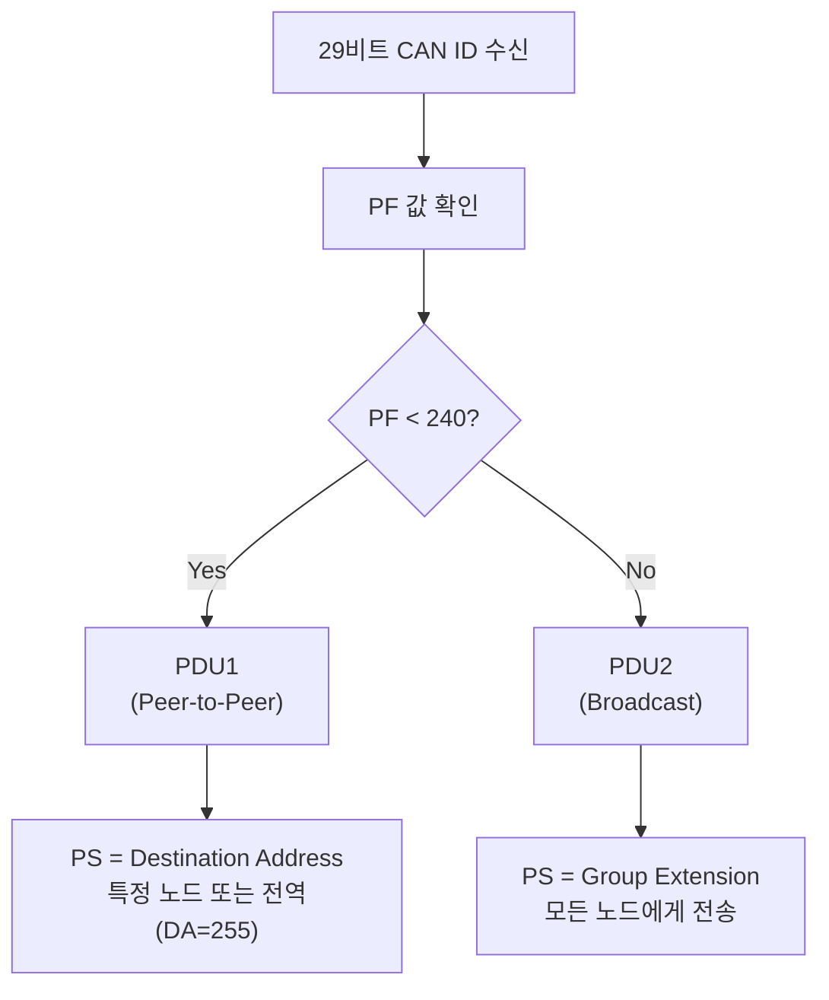

<Header />

[[toc]]

::: info 학습 목표
- J1939 29비트 ID의 각 필드(Priority, EDP, DP, PF, PS, SA)를 계산할 수 있다.
- PGN 계산 공식을 적용해 PF/PS 값으로 PGN을 도출할 수 있다.
- SPN의 개념과 데이터 필드 내 위치, 스케일/오프셋 적용 방법을 이해한다.
- PDU1과 PDU2의 차이를 PF 값으로 구분할 수 있다.
- 실제 CAN 메시지 문자열을 직접 파싱해 온도값을 추출할 수 있다.
- Acknowledgement(PGN 59392) 프레임을 control byte별로 디코딩하고, NACK을 보내야 할 때와 침묵해야 할 때를 구분할 수 있다.
- Request2와 Transfer 프레임을 바이트 단위로 만들고 디코딩할 수 있다.
- Tr·T3와 재시도 규칙으로 요청 측 타임아웃 로직을 설계할 수 있다.
:::

# 1. 29비트 ID 해부

## 필드별 상세 설명


| 필드 | 비트 위치 | 범위 | 설명 |
|---|---|---|---|
| **Priority** | 28~26 | 0~7 | 버스 중재 우선순위. **0이 최고, 7이 최저**. 기본값은 제어 지향 메시지 3, 그 외 6 |
| **EDP** | 25 | 0~1 | Extended Data Page. J1939에서는 0 고정 |
| **DP** | 24 | 0~1 | Data Page. 0: 기본 J1939, 1: 확장 PGN 공간 |
| **PF** | 23~16 | 0~255 | PDU Format. 메시지 종류 결정, PDU1/PDU2 구분 기준 |
| **PS** | 15~8 | 0~255 | PDU Specific. PF < 240이면 목적지 주소(DA), PF >= 240이면 그룹 확장 |
| **SA** | 7~0 | 0~253 | Source Address. 메시지 송신 노드 주소 |

각 필드가 차지하는 비트 위치는 위 그림의 눈금(28~0)과 표가 그대로 대응한다.

## 예제: 0x18FEEE00 분해

CAN 29비트 ID `0x18FEEE00`을 hex → binary로 풀면 `0001 1000 1111 1110 1110 1110 0000 0000`(32bit)이고, 하위 29비트만 취해 필드로 나누면 다음과 같다.


# 2. PGN (Parameter Group Number)

## PGN이란

PGN은 <strong>메시지의 종류(의미)</strong>를 식별하는 번호다. 같은 PGN을 가진 메시지는 항상 같은 형식의 데이터를 담는다.

```
PGN 65262 → Engine Temperature (엔진 온도 관련 파라미터들)
PGN 65265 → Cruise Control/Vehicle Speed
PGN 61444 → Electronic Engine Controller 1
```

## PGN 계산 공식

PGN 계산에는 PF 값이 핵심이다.

```
PF >= 240 (PDU2, 브로드캐스트):
  PGN = (EDP * 131072) + (DP * 65536) + (PF * 256) + PS

PF < 240 (PDU1, 목적지 지정):
  PGN = (EDP * 131072) + (DP * 65536) + (PF * 256)
  (PS는 목적지 주소이므로 PGN에 포함하지 않음)
```

> EDP는 J1939에서 보통 0이므로 EDP 항은 생략 가능.

## 계산 예제 1: PGN 65262 (Engine Temperature)

```
목표: PGN 65262 → PF, PS 값 역산

65262 / 256 = 254.9... → PF = 254 = 0xFE (>= 240이므로 PDU2)
65262 - (254 * 256) = 65262 - 65024 = 238 → PS = 238 = 0xEE

검증:
  PF = 0xFE = 254, PS = 0xEE = 238
  PGN = 254 * 256 + 238 = 65024 + 238 = 65262  ✓

CAN ID 구성 (Priority=6, DP=0, EDP=0, SA=0x00):
  0x18FEEE00
```

## 계산 예제 2: PGN 61444 (EEC1)

```
목표: PGN 61444 → PF, PS 역산

61444 / 256 = 240.0 → PF = 240 = 0xF0 (>= 240이므로 PDU2)
61444 - (240 * 256) = 61444 - 61440 = 4 → PS = 4 = 0x04

CAN ID (Priority=3, SA=0x00):
  Priority=3 → 0b011 → 0x0C000000 (비트 26~28)
  0x0CF00400
```

# 3. SPN (Suspect Parameter Number)

## SPN이란

SPN은 <strong>데이터 필드(8바이트) 내의 개별 파라미터</strong>를 식별하는 번호다. 하나의 PGN 메시지에 여러 SPN이 포함될 수 있다.

```
PGN 65262 (Engine Temperature) 내 SPN 목록:
  SPN 110 : Engine Coolant Temperature    (byte 1, 1byte)
  SPN 174 : Engine Fuel Temperature 1    (byte 2, 1byte)
  SPN 175 : Engine Oil Temperature 1     (byte 3~4, 2byte)
  SPN 176 : Engine Turbo Temperature     (byte 5~6, 2byte)
  SPN 1134: Engine Intercooler Temp      (byte 7, 1byte)
  SPN 1135: Engine Intercooler Coolant Temp (byte 8, 1byte)
```

::: tip 멀티바이트 파라미터는 LSB 먼저
SPN 175처럼 2바이트 이상인 파라미터는 데이터 필드에 <strong>LSB 먼저</strong>(리틀엔디언) 배치한다. 예를 들어 byte 3~4에 놓인 2바이트 파라미터는 byte 3이 LSB, byte 4가 MSB다(ASCII 등 별도 명시된 경우는 예외).
:::

## SPN 속성 (SPN 110 예시)

| 속성 | 값 |
|---|---|
| SPN 번호 | 110 |
| 이름 | Engine Coolant Temperature |
| PGN | 65262 |
| 데이터 위치 | byte 1 (offset 0) |
| 길이 | 1 byte |
| 분해능(Resolution) | 1 °C/bit |
| 오프셋(Offset) | -40 °C |
| 유효 범위 | -40 ~ 210 °C |
| 원시값 0xFF | Not Available (N/A) |

## SPN 값 변환 공식

```
실제값 = 원시값(raw) * 분해능 + 오프셋

SPN 110, raw = 0xB0 = 176:
  실제 온도 = 176 * 1 + (-40) = 136 °C
```

# 4. PDU1 vs PDU2

## 구분 기준: PF 값



## PDU1 (PF < 240): 목적지 지정 메시지

```
PS = DA (Destination Address)

예: 진단 도구(SA=0xF9)가 엔진 ECU(DA=0x00)에게 요청
  Priority = 6, EDP=0, DP=0
  PF = 0xEA (234, < 240 → PDU1)
  PS = DA = 0x00 (엔진 ECU)
  SA = 0xF9 (진단 도구)
  → CAN ID: 0x18EA00F9
```

PDU1이 특정 노드 전용은 아니다. DA에 전역 주소 255(0xFF)를 넣으면 PDU1 메시지도 모든 노드를 대상으로 브로드캐스트할 수 있다. 반면 PDU2는 목적지를 지정할 수 없는 <strong>전역 전용</strong>이다.

## PDU2 (PF >= 240): 브로드캐스트 메시지

```
PS = Group Extension (PGN의 일부)

예: 엔진 ECU(SA=0x00)가 Engine Temperature 브로드캐스트
  Priority = 6, EDP=0, DP=0
  PF = 0xFE (254, >= 240 → PDU2)
  PS = 0xEE (238, Group Extension → PGN의 일부)
  SA = 0x00 (엔진 ECU)
  → CAN ID: 0x18FEEE00
  → PGN = 254 * 256 + 238 = 65262
```

## 비교 표

| 항목 | PDU1 | PDU2 |
|---|---|---|
| PF 값 범위 | 0 ~ 239 (0x00 ~ 0xEF) | 240 ~ 255 (0xF0 ~ 0xFF) |
| PS 의미 | Destination Address | Group Extension (PGN의 일부) |
| 전송 방식 | 특정 노드 지정 (DA=255면 전역 전송) | 버스 전체 브로드캐스트 (전역 전용) |
| 주요 용도 | 요청/응답, 진단 | 센서 데이터 주기적 전송 |

# 5. PGN/SPN 디코딩 실습

## 대상 메시지

```
18FEEE00#B03204FFFFFFFFFF
```

## 파싱 단계

### 1단계: CAN ID와 데이터 분리

```
CAN ID   : 18FEEE00 (hex, 29비트)
데이터   : B0 32 04 FF FF FF FF FF (8바이트)
           [0][1][2][3][4][5][6][7]
```

### 2단계: 29비트 ID 분해

CAN ID `18FEEE00`을 binary로 풀어 필드별로 나누면 앞서 본 것과 동일하다 (PF = 0xFE = 254 → PDU2).


### 3단계: PGN 계산

```
PF = 254, PS = 238 (PDU2이므로 PS를 PGN에 포함)
PGN = DP * 65536 + PF * 256 + PS
    = 0 * 65536 + 254 * 256 + 238
    = 0 + 65024 + 238
    = 65262  → Engine Temperature
```

### 4단계: 데이터 필드 해석

![데이터 필드(8byte) 내 SPN 배치: byte[0]=SPN110→136°C, byte[1]=SPN174→10°C, byte[2~3]=SPN175(LSB/MSB), byte[4~5]=SPN176, byte[6]=SPN1134, byte[7]=SPN1135](/images/study-isobus/09-spn-byte-layout-light.png)
![데이터 필드(8byte) 내 SPN 배치: byte[0]=SPN110→136°C, byte[1]=SPN174→10°C, byte[2~3]=SPN175(LSB/MSB), byte[4~5]=SPN176, byte[6]=SPN1134, byte[7]=SPN1135](/images/study-isobus/09-spn-byte-layout-dark.png)

### 5단계: SPN 110 값 추출

```
SPN 110 (Engine Coolant Temperature):
  데이터 위치: byte 1 (offset 0) → byte[0] = 0xB0

  0xB0 = 176 (decimal)

  실제 온도 = 176 * 1 °C/bit + (-40 °C)
            = 176 - 40
            = 136 °C

결과: 엔진 냉각수 온도 = 136 °C
```

### 6단계: 전체 파싱 결과 요약

```
메시지   : 18FEEE00#B03204FFFFFFFFFF
Priority : 6
SA       : 0x00 (Engine ECU #1)
PGN      : 65262 (Engine Temperature)

SPN 110  Engine Coolant Temperature : 136 °C  (byte[0]=0xB0)
SPN 174  Engine Fuel Temperature 1  : 10 °C   (byte[1]=0x32, 50-40=10)
SPN 175  Engine Oil Temperature 1   : N/A     (byte[2~3]=0x04,0xFF → raw=0xFF04, N/A 영역)
SPN 176  Engine Turbo Temperature   : N/A
SPN 1134 Intercooler Temp           : N/A
SPN 1135 Intercooler Coolant Temp   : N/A
```

::: details Python 파싱 예제
## Python 파싱 예제

```python
def parse_j1939_message(can_id_hex: str, data_hex: str):
    """
    J1939 CAN 메시지를 파싱한다.

    Args:
        can_id_hex: 29비트 CAN ID (hex string, e.g. "18FEEE00")
        data_hex:   데이터 필드 (hex string, e.g. "B03204FFFFFFFFFF")
    """
    can_id = int(can_id_hex, 16)

    # 29비트 ID 분해
    sa       = (can_id >> 0) & 0xFF
    ps       = (can_id >> 8) & 0xFF
    pf       = (can_id >> 16) & 0xFF
    dp       = (can_id >> 24) & 0x01
    edp      = (can_id >> 25) & 0x01
    priority = (can_id >> 26) & 0x07

    # PGN 계산
    if pf >= 240:   # PDU2: PS는 Group Extension
        pgn = (edp << 17) | (dp << 16) | (pf << 8) | ps
    else:           # PDU1: PS는 목적지 주소
        pgn = (edp << 17) | (dp << 16) | (pf << 8)

    print(f"Priority : {priority}")
    print(f"SA       : 0x{sa:02X} ({sa})")
    print(f"PF       : 0x{pf:02X} ({pf})")
    print(f"PS       : 0x{ps:02X} ({ps})")
    print(f"PGN      : {pgn} (0x{pgn:05X})")

    # 데이터 파싱
    data = bytes.fromhex(data_hex)

    if pgn == 65262:  # Engine Temperature
        print("\n[PGN 65262: Engine Temperature]")
        spn110_raw = data[0]  # SPN 110: byte 1 (offset 0)
        if spn110_raw == 0xFF:
            print("  SPN 110 Engine Coolant Temp: N/A")
        else:
            spn110_val = spn110_raw * 1 + (-40)
            print(f"  SPN 110 Engine Coolant Temp: {spn110_val} °C (raw=0x{spn110_raw:02X})")

        spn174_raw = data[1]  # SPN 174: byte 2 (offset 1)
        if spn174_raw == 0xFF:
            print("  SPN 174 Engine Fuel Temp 1 : N/A")
        else:
            spn174_val = spn174_raw * 1 + (-40)
            print(f"  SPN 174 Engine Fuel Temp 1 : {spn174_val} °C (raw=0x{spn174_raw:02X})")


# 실행 예시
parse_j1939_message("18FEEE00", "B03204FFFFFFFFFF")
```

실행 결과:

```
Priority : 6
SA       : 0x00 (0)
PF       : 0xFE (254)
PS       : 0xEE (238)
PGN      : 65262 (0x0FEEE)

[PGN 65262: Engine Temperature]
  SPN 110 Engine Coolant Temp: 136 °C (raw=0xB0)
  SPN 174 Engine Fuel Temp 1 : 10 °C (raw=0x32)
```
:::

::: tip 핵심 정리
- 29비트 ID는 Priority(3) + EDP(1) + DP(1) + PF(8) + PS(8) + SA(8)로 구성된다.
- **PGN** = PF가 >= 240이면 PS 포함, PF < 240이면 PS 제외하여 계산한다.
- <strong>SPN</strong>은 PGN 데이터 필드 내 개별 파라미터이며, `실제값 = raw * 분해능 + 오프셋` 공식으로 변환한다.
- PDU1(PF < 240)은 목적지 지정이며 DA=255로 전역 전송도 가능하다. PDU2(PF >= 240)는 전역 전용 브로드캐스트다.
- `18FEEE00#B03204FFFFFFFFFF` 파싱 결과: Priority=6, PGN=65262, SA=0x00, 냉각수 온도=136°C.
:::

# 6. PDU 필드별 규정 — 송신 측과 수신 측

§1은 29비트 ID의 필드를 "무엇이 들어 있나"로 봤다. ISO 11783-3:2018(이하 Part 3) 5.2는 같은 필드를 "송신 측은 무엇을 지켜야 하고 수신 측은 어떻게 읽어야 하나"로 규정한다. PDU는 Priority, EDP, DP, PF, PS, SA, 데이터의 7개 필드이고, 고전 CAN 프레임 하나에 PDU는 정확히 하나다(Part 3 5.2.1).

| 필드 | 송신 측 규칙 | 수신 측 규칙 | 근거 |
|---|---|---|---|
| Priority | 기본값은 제어 3, 그 밖 6. PGN별로 재설정할 수 있어야 함 | 마스킹해 무시 | 5.2.2, Annex A |
| EDP | 항상 0 | 1이면 DP와 함께 판별(둘 다 1이면 ISO 15765-2 프레임) | 5.2.3, Table 3 |
| DP | 페이지 0·1 선택 | PGN 계산에 포함 | 5.2.4 |
| PF | PDU 형식과 PGN 결정. 8바이트를 다 쓰도록 파라미터를 묶는 것을 권장 | 240 미만 PDU1, 이상 PDU2 | 5.2.5, 5.3 |
| PS | PDU1이면 DA, PDU2면 GE | DA가 자기 주소도 전역(255)도 아니면 무시. 255면 모두 듣고 해당하면 대응 | 5.2.6 |
| SA | 네트워크에서 SA 하나는 CF 하나만 쓴다 | 송신자 식별, 응답의 목적지 | 5.2.7 |
| 데이터 | DLC 규칙, 여러 바이트 값은 LSB 먼저, 남는 바이트는 FF | PG 정의로 해석 | 5.2.8, 5.4.1 |

몇 가지는 풀어 둘 필요가 있다.

- <strong>Priority는 수신 측 판단에 쓰지 않는다.</strong> 같은 PGN이 다른 Priority로 와도 같은 메시지다. 필터 설정은 [CAN 중재와 우선순위](/study/isobus/05-can-arbitration) 챕터에서 다룬다.
- <strong>DA 비교는 집합으로 한다.</strong> 컨트롤러 하나가 여러 기능을 수행하면 주소를 여러 개 가질 수 있다(Part 3 Annex A NOTE 2). "내 주소는 값 하나"라고 가정하면 두 번째 CF 앞으로 온 메시지를 버린다.
- <strong>DA = 255는 "모두 들어라"이면서 "해당하면 대응하라"다.</strong> 전역 목적지 주소는 모든 컨트롤러에게 듣고 그에 맞게 응답하도록 요구한다(5.2.6). 무엇이 "맞게"인지는 §7의 요청 규칙이 정한다.
- <strong>GE는 PGN의 일부다.</strong> PF의 상위 4비트가 모두 1이면(PF ≥ 240) PS는 GE이고, GE와 PF의 하위 4비트가 합쳐 데이터 페이지당 4096개의 PG를 만든다(5.2.6 NOTE).

::: info PDU2는 정말 "전역 전용"인가
§4는 PDU2를 "목적지를 지정할 수 없는 전역 전용"이라고 했다. Part 3 5.3.3도 PDU2 형식을 고르면 그 PGN은 특정 목적지로 보낼 수 없다고 적는다. 단, 이것은 <strong>단일 프레임</strong>에 대한 이야기다. 8바이트를 넘는 PDU2 PGN은 TP로 보내는데, TP.CM 메시지 자체는 PDU1이라 DA를 가진다. 그래서 Part 3 Table 5는 8바이트를 넘는 PDU2 PGN을 특정 요청에 대해 RTS/CTS로 특정 목적지에 보낸다고 정리한다(§7).
:::

# 7. 메시지 타입과 요청·응답 규칙

## 다섯 가지 메시지 타입

Part 3 5.4.1은 현재 지원하는 메시지 타입을 다섯 가지로 든다. 타입은 할당된 PGN으로 구별한다.

| 타입 | 하는 일 | 근거 |
|---|---|---|
| Command | 특정 또는 전역 목적지에 동작을 지시한다. PDU1·PDU2 모두 쓸 수 있다. 원문의 예는 Transmission Control, Address Request, Torque/Speed Control | 5.4.2 |
| Request | 특정 또는 전역 목적지에 정보를 요청한다(PGN 59904) | 5.4.3 |
| Broadcast/Response | 비요청 브로드캐스트, 또는 명령·요청에 대한 응답 | 5.4.4 |
| Acknowledgement | 특정 명령·요청에 대한 ACK·NACK 등(PGN 59392) | 5.4.5 |
| Group Function | 첫 데이터 바이트 등으로 하위 기능을 고르는 PG 묶음 | 5.4.6 |

Part 3은 여기에 Request2(5.4.7)와 Transfer(5.4.8)를 더 정의한다. 리모트 프레임(RTR = 1)은 쓸 수 없고, 요청은 데이터 프레임인 Request PGN으로 한다(5.4.1). 그 이유는 [CAN 데이터 프레임](/study/isobus/04-can-data-frame) 챕터에서 봤다.

## Request (PGN 59904)

| 항목 | 값 |
|---|---|
| PF / PS | 234(`0xEA`) / DA (전역 또는 특정) |
| 데이터 길이 | 3바이트. 이 PG의 프레임은 DLC를 3으로 해야 한다(shall) |
| 기본 Priority | 6 |
| Byte 1~3 | 요청하는 PGN (LSB 먼저) |
| 송신 빈도 | 사용자 요구에 따르되 초당 2~3회 이하를 권장 |

(근거: Part 3 5.4.3)

예를 들어 VT(SA `0x26`)가 네트워크의 모든 CF에게 Address Claimed(PGN 60928 = `0x00EE00`)를 요청하는 전역 요청은 `18EAFF26#00EE00`이다. Priority 6, PF `0xEA`, DA `0xFF`, SA `0x26`이고 데이터는 PGN을 LSB부터 적은 `00 EE 00`이다.

## 응답의 목적지와 TP — Table 5를 규칙으로

Part 3 Table 5는 PDU 형식·데이터 길이·요청 방식의 조합마다 응답 목적지와 TP를 정리한다(전체 표는 [Part 3 정리 부록](/study/isobus/appendix-iso-part03)). 구현할 규칙으로 줄이면 다음과 같다.

1. 요청이 전역이면 응답도 전역이다. 8바이트를 넘으면 BAM으로 보낸다.
2. 요청이 특정 목적지면 응답도 그 요청자에게 보낸다. 8바이트를 넘으면 RTS/CTS로 보낸다.
3. 예외: PDU2 PGN이고 8바이트 이하면 DA 칸이 없으므로 특정 요청에도 전역으로 답한다.
4. 예외: Address Claim은 특정 요청을 받아도 전역으로 답한다(ISO 11783-5).
5. 요청 없이 보내는 주기·비요청 메시지는 송신자가 목적지를 고른다. PDU2 8바이트 이하는 전역만 가능하다.

Part 3 5.4.3 본문은 규칙 2를 "데이터 길이가 8바이트 이상이면 특정 주소 응답에 RTS/CTS를 써야 한다"고 적는다. 그러나 TP는 9바이트 이상에 쓰는 것이고(5.10.6.3) Table 5도 "8바이트 초과"로 나누므로, "8바이트 초과"로 읽는 것이 일관된다.

::: details 파이썬 — Table 5를 함수로
```python
GLOBAL = 0xFF


def response_plan(pdu, length, request_da):
    """(PDU 형식, 데이터 길이, 요청 DA) -> (응답 목적지, TP). Address Claim 예외는 제외."""
    if request_da == GLOBAL:
        return ("global", "BAM" if length > 8 else None)
    if pdu == 2 and length <= 8:
        return ("global", None)              # PDU2 단일 프레임에는 DA 칸이 없다
    return ("specific", "RTS/CTS" if length > 8 else None)


rows = [
    (1, 8, 0x00, ("specific", None)), (1, 8, GLOBAL, ("global", None)),
    (1, 9, 0x00, ("specific", "RTS/CTS")), (1, 9, GLOBAL, ("global", "BAM")),
    (2, 8, 0x00, ("global", None)), (2, 8, GLOBAL, ("global", None)),
    (2, 9, 0x00, ("specific", "RTS/CTS")), (2, 9, GLOBAL, ("global", "BAM")),
]
for pdu, length, da, expected in rows:
    assert response_plan(pdu, length, da) == expected
```
:::

## NACK을 보낼 때와 침묵할 때

요청을 받은 CF가 그 PG를 지원하지 않을 때의 동작은 요청 형식에 따라 정반대다.

| 받은 요청 | PGN 지원 | 응답 | 근거 |
|---|---|---|---|
| 특정 목적지 | 지원 | 요청된 데이터. Acknowledgement가 적절한 PG면 control 0(ACK), 2(Access Denied), 3(Cannot Respond) 중 하나 | 5.4.3 |
| 특정 목적지 | 미지원 | NACK(control 1) 필수 | 5.4.3 |
| 전역 | 지원 | 요청된 데이터를 전역으로. 이 PG를 쓰는 모든 CF가, 요청자 자신까지 응답 | 5.13.4 |
| 전역 | 미지원 | 침묵. 전역 요청에 NACK을 보내면 안 되고, Acknowledgement 자체가 허용되지 않음 | 5.4.3, 5.13.4 |

"지원하지 않는다"는 "그 PG를 송신하지 않는다"는 뜻이다(5.4.3 NOTE 2). 요청으로는 상대가 그 PG를 받았을 때 동작하는지(수신 기능)를 알 수 없다. PGN은 인식하지만 파라미터 값을 줄 수 없으면 NACK이 아니라 해당 데이터 값을 255(FF)로 채운 정상 응답을 보낸다. 명령이나 요청의 PGN을 목적지가 아예 인식하지 못해도 NACK을 보내는 것이 맞다(Annex C).

전역 요청에서 요청자가 자신에게도 답해야 하는 이유는 5.13.4가 적는다. 모든 CF가 응답하리라고 기대되는 상황에서 요청자가 답하지 않으면, 다른 CF들이 요청된 정보에 대해 잘못된 결론을 내릴 수 있다. 원문이 드는 예는 주소 요청이다. 요청자의 Address Claimed가 빠지면 다른 CF들은 그 주소를 쓰는 CF가 없다고 판단할 수 있다(추론).

## Annex C를 프레임으로

Part 3 Annex C는 엔진(SA `0x00`)을 예로 메시지 타입의 쓰임을 보여 준다. 요청자는 SA `0x03`, 명령자는 SA `0xF0`(240)이다. 원문의 숫자를 CAN 프레임으로 옮기면 다음과 같다.

| 장면 | ID | 데이터 | 해설 |
|---|---|---|---|
| 특정 요청 | `0x18EA0003` | `EB FE 00` | 엔진에게 Component ID(65259) 요청 |
| 응답 | — | — | Component ID 데이터. 8바이트를 넘으면 SA 3에게 RTS/CTS |
| 또는 NACK | `0x18E80300` | `01 FF FF FF 03 EB FE 00` | control 1, 주소 3, PGN 65259 |
| 전역 요청 | `0x18EAFF03` | `EB FE 00` | 응답은 전역(8바이트 초과면 BAM). 미지원이면 침묵 |
| 명령에 대한 ACK | `0x18E8F000` | `00 FF FF FF F0` + 명령 PGN | 명령 완료 |
| 명령에 대한 NACK | `0x18E8F000` | `01 FF FF FF F0` + 명령 PGN | 명령 수행 불가 |

원문은 응답 행을 PF 254·GE 235의 PDU2 한 프레임으로 그린다. 메시지 종류를 보여 주려는 단순화로 보이고, Component ID가 8바이트를 넘는다면 Table 5에 따라 특정 요청에는 RTS/CTS로 SA 3에게, 전역 요청에는 BAM으로 보내야 한다(추론).

명령에 대한 ACK은 필수가 아니다. 명령은 늘 성공 여부를 확인할 수단을 갖고 있고, 다른 수단이 있으면 ACK을 생략해 버스 트래픽을 줄인다. 원문의 예는 엔진 토크 명령이다. 엔진이 내보내는 토크 모드 비트와 토크 값으로 결과를 확인할 수 있다(Annex C NOTE).

# 8. Acknowledgement (PGN 59392)

## 정의와 바이트 배치

| 항목 | 값 |
|---|---|
| PF / PS | 232(`0xE8`) / DA |
| 데이터 길이 | 8바이트 |
| 기본 Priority | 6 |
| 송신 시점 | 이 형태의 확인 응답을 요구하는 PGN을 받았을 때 |

(근거: Part 3 5.4.5)


CAN 프레임의 ACK 슬롯이 "적어도 한 노드가 받았다"만 알려 준다면, 이 PG는 특정 명령·요청에 대해 응용 계층이 답하는 확인 응답이다. 두 형식의 차이는 [CAN 에러 처리](/study/isobus/06-can-error) 챕터에서 다뤘다.

## Control byte 읽는 법

정의된 control byte는 16개다(Part 3 5.4.5). 기본형 0~3과, Request2가 확장 식별자를 쓸 때만 쓰는 128~131, 144~147, 160~163이다. 값을 늘어놓으면 규칙성이 보인다.

| 종류 | 기본형 | 확장 1바이트 | 확장 2바이트 | 확장 3바이트 |
|---|---|---|---|---|
| ACK (Positive Acknowledgement) | 0 | 128 | 144 | 160 |
| NACK (Negative Acknowledgement) | 1 | 129 | 145 | 161 |
| Access Denied (지원하지만 보안상 거부) | 2 | 130 | 146 | 162 |
| Cannot Respond (지원하지만 바쁨, 나중에 다시 요청) | 3 | 131 | 147 | 163 |

이진수로 보면 Bit 8은 확장 식별자 사용 여부, Bit 6~5는 확장 식별자 길이에서 1을 뺀 값, Bit 2~1은 응답 종류다. 원문이 이렇게 설명하지는 않으므로 해석 코드를 짤 때의 관찰로만 쓴다. 나머지 값(4~127, 132~143, 148~159, 164~255)은 장래 표준을 위한 예약이다.

- Byte 2의 Group Function Value는 Group Function PG의 어느 하위 기능에 대한 응답인지 알려 준다. 값은 PG마다 고유하며 0~250을 쓰는 것이 바람직하고, 251~255는 ISO 11783-7의 관례를 따른다. 해당 사항이 없으면 FF다(5.4.5).
- Byte 5는 확인 응답을 받을 원래 요청자의 SA이고, PS(DA) 필드의 복제다. 원문은 SAE J1939와의 최대 호환을 위해서라고만 적는다. 데이터 필드만 남는 로그에서도 누구의 요청에 대한 응답인지 알 수 있다는 실용적 이점이 있다(추론).
- 예약 바이트(기본형의 Byte 3~4)는 FF로 보낸다(5.4.5).

## 해석 예제

로그 `18E82680#01FFFFFF26EBFE00`을 읽어 보자.

- ID: Priority 6, PF `0xE8`(Acknowledgement), DA `0x26`, SA `0x80`
- Byte 1 `01`: NACK, 기본형
- Byte 2~4 `FF FF FF`: Group Function Value 없음, 예약
- Byte 5 `26`: SA `0x26`의 요청에 대한 응답 (DA와 같다)
- Byte 6~8 `EB FE 00`: PGN 65259

결론: SA `0x80`은 SA `0x26`이 특정 요청한 Component Identification(65259)을 송신하지 않는다.

확장형 예로 데이터 `81 12 FF FF 26 00 EF 00`은 control 129(NACK, 확장 1바이트), 확장 식별자 `0x12`, PGN 61184(Proprietary A)다. "첫 데이터 바이트가 `0x12`인 Proprietary A 메시지는 보내지 않는다"는 뜻이다. 이런 요청을 만드는 Request2는 §10에서 본다.

::: details 파이썬 — Acknowledgement 해석기
```python
KIND = {0: "ACK", 1: "NACK", 2: "Access Denied", 3: "Cannot Respond"}
EXT_LEN = {0: 0, 128: 1, 144: 2, 160: 3}      # control byte 기준값 -> 확장 식별자 바이트 수


def decode_ack(data):
    cb = data[0]
    base = cb & 0xFC
    if base not in EXT_LEN:
        return {"control": cb, "kind": "reserved"}
    n = EXT_LEN[base]
    return {
        "kind": KIND[cb & 0x03],
        "group_function_value": None if n or data[1] == 0xFF else data[1],
        "extended_identifier": int.from_bytes(bytes(data[1:1 + n]), "little") if n else None,
        "address": data[4],
        "pgn": data[5] | (data[6] << 8) | (data[7] << 16),
    }


defined = [0, 1, 2, 3, 128, 129, 130, 131, 144, 145, 146, 147, 160, 161, 162, 163]
for cb in range(256):                           # 정의된 16개만 해석되고 나머지는 예약
    r = decode_ack([cb, 0xFF, 0xFF, 0xFF, 0x26, 0xEB, 0xFE, 0x00])
    assert (r["kind"] != "reserved") == (cb in defined)

r = decode_ack([0x01, 0xFF, 0xFF, 0xFF, 0x26, 0xEB, 0xFE, 0x00])
assert (r["kind"], r["address"], r["pgn"]) == ("NACK", 0x26, 65259)
r = decode_ack([0x81, 0x12, 0xFF, 0xFF, 0x26, 0x00, 0xEF, 0x00])
assert (r["kind"], r["extended_identifier"], r["pgn"]) == ("NACK", 0x12, 61184)
```
:::

# 9. Group function과 제조사 독점 메시지

## Group function

Group function은 PGN 하나에 여러 기능을 묶는 메시지 타입이다. 그룹은 PGN으로, 그룹 안의 기능은 데이터 구조(보통 데이터 필드의 첫 바이트)로 구별한다(Part 3 5.4.6.1). Part 3은 이를 쓰는 곳으로 제조사 독점 기능, multi-packet 전송 기능, 네트워크 관리(ISO 11783-5), VT(ISO 11783-6), TC(ISO 11783-10), FS(ISO 11783-13), SC(ISO 11783-14)를 든다. TP.CM의 control byte(RTS 16, CTS 17 …)도, VT 명령의 첫 바이트도 같은 원리다.

구현에 필요한 규칙은 세 가지다.

- 같은 group function PG는 CAN ID가 같으므로 데이터 길이를 하나로 고정한다(5.2.8.1).
- Group function은 Part 3의 Request·ACK·NACK이 부족하면 자체 요청·확인 메커니즘을 둘 수 있다(5.4.6.1). VT·TC가 자기 응답 메시지를 갖는 이유다.
- Request(59904)로 group function PG의 지원 여부를 물을 수 있다. 지원하면 Acknowledgement control 0(또는 2, 3), 지원하지 않으면 control 1이다. 여기서도 "지원하지 않음"은 송신하지 않는다는 뜻이고, 상대가 그 PG를 받아 동작하는지는 알 수 없다(5.4.6.1).

## Proprietary A·A2·B

| 이름 | PGN | 형식 | ID 예 (SA `0x80` → `0x81`) |
|---|---|---|---|
| Proprietary A | 61184 (`0x00EF00`) | PDU1, DP 0, PS = DA | `0x18EF8180` |
| Proprietary A2 | 126720 (`0x01EF00`) | PDU1, DP 1, PS = DA | `0x19EF8180` |
| Proprietary B | 65280 ~ 65535 (`0x00FF00` ~ `0x00FFFF`) | PDU2, PS = 제조사가 정하는 GE | `0x18FF1280` (GE `0x12`, 전역) |

세 PG 모두 기본 Priority 6이고, 데이터 길이는 0~1785바이트로 multi-packet을 지원한다(Part 3 5.4.6.2~5.4.6.4). 데이터 필드를 어떻게 쓸지, 독점 메시지를 쓸지 말지는 제조사가 정한다.

::: warning 같은 PGN, 다른 의미
Proprietary 메시지의 데이터 길이는 제조사마다 다르다. 두 제조사가 같은 GE 값을 쓰면서 DLC가 다를 수 있고, 수신 측은 두 제조사를 구별해야 한다(5.4.6.1). Proprietary B는 여러 SA가 같은 PGN 값을 서로 다른 목적으로 쓸 수 있어 특히 주의해야 한다(5.4.6.4). 구별 방법은 원문에 없다. 실무에서는 SA로 상대를 고르되, SA는 주소 클레임 결과에 따라 바뀔 수 있으므로 그 SA가 주소 클레임 때 보낸 NAME의 제조사 코드로 확인하는 편이 안전하다(추론, NAME은 [J1939 주소 체계](/study/isobus/10-j1939-address) 참고).
:::

Part 3은 정상 운용 중 독점 메시지 사용을 최소화하고, CF당 Proprietary A·A2·B의 합이 네트워크 용량의 2%를 넘지 않게 하라고 권한다(5.4.6.1). 계산 방법은 [SAE J1939 입문](/study/isobus/08-j1939-intro) 챕터에 있다.

# 10. Request2와 Transfer

## 왜 필요한가

CF 하나가 자기 데이터뿐 아니라 다른 CF들의 데이터까지 보고해야 하는 경우가 있다. Part 3이 드는 예는 ECU Identification, Component ID, Software Identification 같은 PGN이다. Request(59904)로는 "누구의 데이터인지"를 구별해 여러 개를 받을 방법이 없다. Request2는 응답에 Transfer PGN을 쓰라고 지정할 수 있고, Transfer는 데이터 세트마다 그 데이터의 주인을 표시한다(Part 3 5.4.7, 5.4.8). Request2 지원은 선택 사항이다(5.4.7).

## Request2 (PGN 51456)

| 항목 | 값 |
|---|---|
| PF / PS | 201(`0xC9`) / DA (전역 또는 특정) |
| 데이터 길이 | 8바이트 |
| 기본 Priority | 6 |
| 송신 빈도 | 초당 2~3회 이하 권장 |
| 지원하는 CF의 의무 | 특정 목적지로 요청된 PG를 지원하지 않으면 NACK 필수 |

(근거: Part 3 5.4.7)


Byte 4(특수 지시)의 비트는 이렇게 나뉜다(5.4.7).

| 비트 | 이름 | 값 |
|---|---|---|
| 8~6 | 예약 | — |
| 5~3 | 확장 식별자 종류 | 000 없음(Byte 5~7은 FF), 001 1바이트, 010 2바이트, 011 3바이트, 100~110 예약, 111 동작 안 함 |
| 2~1 | Transfer PGN 사용 | 00 No, 01 Yes, 10 Undefined, 11 Not Allowed |

확장 식별자는 "요청한 PGN의 데이터 첫 1~3바이트가 이 값인 것"을 고르는 필터다. 1바이트형이면 Byte 5가 요청 PGN의 data byte 1과 맞춰질 값이고, 2·3바이트형이면 Byte 6·7이 data byte 2·3과 맞춰진다. 쓰지 않는 바이트는 FF다(5.4.7). Group function PG의 특정 하위 기능을 요청할 때 쓴다. 확장 식별자를 쓴 Request2에 Acknowledgement로 답할 때는 §8의 control 128~163을 쓴다.

Use Transfer = 00이면 Request(59904)와 효과가 같고, 응답도 Transfer 없이 59904에 대한 응답과 똑같이 보낸다. 확장 식별자 종류 000은 "이 장치가 새 Request2 특수 지시 기능을 지원한다"는 표시도 겸한다(5.4.7).

## Request2 바이트 예제

VT(SA `0x26`)가 Software Identification(PGN 65242 = `0x00FEDA`)을 Transfer로 받으려고 전역 Request2를 보낸다.

`18C9FF26#DAFE00E1FFFFFFFF`

| 바이트 | 값 | 해석 |
|---|---|---|
| 1~3 | `DA FE 00` | 요청 PGN 65242 |
| 4 | `E1` = `111 000 01` | 예약 111, 확장 식별자 없음(000), Transfer 사용 Yes(01) |
| 5~7 | `FF FF FF` | 확장 식별자가 없으므로 FF |
| 8 | `FF` | 예약 |

5.4.7은 예약 비트·바이트의 값을 명시하지 않는다. 여기서는 Acknowledgement가 예약 바이트를 FF로 보내는 관례(5.4.5)를 따라 1로 채웠다(가정).

두 번째 예는 확장 식별자를 쓴 특정 요청이다. VT가 SA `0x80`에게 "첫 데이터 바이트가 `0x12`인 Proprietary A 메시지"를 요청한다. ID는 `0x18C98026`, 데이터는 `00 EF 00 E4 12 FF FF FF`다. Byte 4 `E4` = `111 001 00`(1바이트 확장 식별자, Transfer No)이고 Byte 5가 `0x12`다. SA `0x80`이 이 메시지를 보내지 않는다면 §8의 `81 12 FF FF 26 00 EF 00`(control 129)로 답한다.

## Transfer (PGN 51712)

| 항목 | 값 |
|---|---|
| PF / PS | 202(`0xCA`) / DA (특정 또는 전역) |
| 데이터 길이 | 9~1785바이트 (multi-packet) |
| 기본 Priority | 6 |
| 송신 시점 | "Use Transfer PGN" = 01인 Request2를 받았을 때 |

(근거: Part 3 5.4.8)

데이터는 a 하나 뒤에 (b, c, d)가 반복되는 구조다.

- a (Byte 1~3): Request2가 요청한 PGN
- b (1바이트): 이 데이터 세트의 길이. 길이 바이트 자신 + 신원 4바이트 + 데이터이므로 b = 5 + d의 길이
- c (4바이트): 이 데이터의 주인인 CF의 신원. ISO 11783-5 NAME의 바이트 5~8과 같은 배치다(Function Instance·ECU Instance, Function, Device Class, Self Configurable·Industry Group·Device Class Instance)
- d: 그 CF에 대한, 요청된 PGN의 데이터

규칙은 두 가지다. 응답하는 CF는 59904 요청을 받았을 때 보고했을 정보를 <strong>첫 데이터 세트</strong>로 보내야 한다. 데이터 세트가 하나뿐이어도 Transfer로 응답해야 한다(5.4.8).

## Transfer 바이트 예제 — Request2부터 BAM까지

위 전역 Request2에 SA `0x80`인 작업기 ECU가 답한다. 이 ECU는 자신과, 자신이 보고를 맡은 CF 하나의 소프트웨어 버전을 안다(아래 값은 예시).

| 세트 | c (신원) | d (데이터) | b |
|---|---|---|---|
| 1 (자신) | `00 81 08 A0` | `"SW1.0*"` = `53 57 31 2E 30 2A` | 5 + 6 = 11 (`0x0B`) |
| 2 (맡은 CF) | `08 81 08 A0` | `"SW2.3*"` = `53 57 32 2E 33 2A` | 11 |

c의 `00 81 08 A0`은 Function Instance 0·ECU Instance 0, Function `0x81`, Device Class 4(Byte 7 = 4 × 2 + 예약 비트 0), Self Configurable 1·Industry Group 2·Device Class Instance 0을 담은 예시 값이다. 두 번째 세트는 Function Instance만 1이다(`08`).

Transfer 데이터는 3 + 11 + 11 = 25바이트다. 요청이 전역이었으므로 Table 5에 따라 BAM으로 보낸다. 25바이트는 TP.DT 4개다.

| 프레임 | 데이터 |
|---|---|
| TP.CM_BAM | `20 19 00 04 FF 00 CA 00` (크기 25, 패킷 4, PGN 51712) |
| TP.DT 1 | `01 DA FE 00 0B 00 81 08` |
| TP.DT 2 | `02 A0 53 57 31 2E 30 2A` |
| TP.DT 3 | `03 0B 08 81 08 A0 53 57` |
| TP.DT 4 | `04 32 2E 33 2A FF FF FF` |

BAM과 TP.DT의 규칙은 [J1939 Transport Protocol](/study/isobus/11-j1939-transport) 챕터에서 자세히 다룬다. Part 3 5.4.8의 예도 같은 흐름이다. 엔진이 트랙터와 트레일러의 VIN을 둘 다 안다면, Use Transfer = 01인 전역 Request2에는 두 VIN을 Transfer에 담아 BAM으로 보내고, 00이었다면 트랙터 VIN만 Transfer 없이 BAM으로 보낸다.

::: details 파이썬으로 검산 — Request2 만들기, Transfer 만들고 풀기
```python
import math


def le(v, n):
    return [(v >> (8 * i)) & 0xFF for i in range(n)]


def request2(pgn, use_transfer, ext=None, ext_len=0):
    """예약 비트·바이트는 1(FF)로 채운다고 가정(5.4.7은 값을 명시하지 않음)."""
    b4 = (0b111 << 5) | (ext_len << 2) | (0b01 if use_transfer else 0b00)
    ext_bytes = (le(ext, ext_len) + [0xFF] * (3 - ext_len)) if ext_len else [0xFF] * 3
    return le(pgn, 3) + [b4] + ext_bytes + [0xFF]


assert request2(65242, True) == [0xDA, 0xFE, 0x00, 0xE1, 0xFF, 0xFF, 0xFF, 0xFF]
assert request2(61184, False, ext=0x12, ext_len=1) == [0x00, 0xEF, 0x00, 0xE4, 0x12, 0xFF, 0xFF, 0xFF]


def identity(func_inst, ecu_inst, function, dev_class, ind_group, dci, self_cfg):
    """NAME 바이트 5~8과 같은 배치 (Part 3 5.4.8, Part 5 Table 1). 예약 비트는 0."""
    return [(func_inst << 3) | ecu_inst, function, dev_class << 1,
            (self_cfg << 7) | (ind_group << 4) | dci]


def transfer(pgn, datasets):
    out = le(pgn, 3)
    for ident, payload in datasets:
        out += [5 + len(payload)] + ident + list(payload)
    return out


def decode_transfer(d):
    pgn, i, sets = d[0] | d[1] << 8 | d[2] << 16, 3, []
    while i < len(d):
        n = d[i]
        sets.append((bytes(d[i + 1:i + 5]).hex(" "), bytes(d[i + 5:i + n])))
        i += n
    return pgn, sets


tr = transfer(65242, [(identity(0, 0, 0x81, 4, 2, 0, 1), b"SW1.0*"),
                      (identity(1, 0, 0x81, 4, 2, 0, 1), b"SW2.3*")])
assert len(tr) == 25
assert decode_transfer(tr) == (65242, [("00 81 08 a0", b"SW1.0*"), ("08 81 08 a0", b"SW2.3*")])

bam = [0x20] + le(len(tr), 2) + [math.ceil(len(tr) / 7), 0xFF] + le(51712, 3)
assert bam == [0x20, 0x19, 0x00, 0x04, 0xFF, 0x00, 0xCA, 0x00]
for s in range(math.ceil(len(tr) / 7)):
    chunk = tr[s * 7:(s + 1) * 7]
    print(" ".join(f"{b:02X}" for b in [s + 1] + chunk + [0xFF] * (7 - len(chunk))))
```

출력되는 네 줄이 위 표의 TP.DT 1~4와 같다.
:::

# 11. PDU 처리 요구사항과 전형적 수신 루틴

## 100% 부하에서도 잃지 않는다

컨트롤러는 데이터 링크가 100% 사용률일 때도 메시지를 잃지 않을 만큼 빠르게 처리해야 한다(shall). 버스가 한산할 때 프레임이 연달아 와도 마찬가지다. 이것은 응답을 즉시 만들라는 뜻이 아니라, 새 메시지가 이전 메시지를 덮어쓰지 않게 하라는 뜻이다(Part 3 5.12). 갱신이 잦고 지연 요구가 엄격한 데이터는 가능하면 하드웨어 메시지 필터를 쓸 수 있게 설계하라는 권고도 있다(Part 3 5.13.1).

## Annex A의 수신 루틴

Part 3 Annex A(참고)는 CAN 칩이 프레임을 받았을 때 어디에 저장할지 정하는 전형적인 순서를 보여 준다.


이 루틴에서 읽어 낼 설계 원칙은 다음과 같다.

- <strong>인터럽트에서는 분류와 저장만 한다.</strong> 응답은 request queue를 나중에 처리하면서 만든다. 5.12가 "즉시 응답하라는 뜻이 아니다"라고 한 것과 맞물린다.
- <strong>Priority는 처음부터 버린다</strong>(Annex A NOTE 1).
- <strong>점프 테이블로 관심 PGN만 고른다.</strong> 관심 없는 PGN은 저장하지 않는다.
- <strong>SA에 따라 저장 방식을 나눈다.</strong> 원문은 특별 관심 SA의 데이터 8바이트는 전용 버퍼에, 나머지는 ID와 데이터 12바이트를 순환 큐에 넣는다. 최신값만 필요한 상대는 덮어쓰는 버퍼로, 순서와 개수가 중요한 메시지는 큐로 받는 구분으로 읽을 수 있다(추론).

Annex A의 의사코드는 Request가 아닌 PDU1 분기에서 DA를 내 주소와 비교하지 않는다. 그러나 5.2.6은 DA가 가리키지 않는 다른 컨트롤러는 그 메시지를 무시해야 한다고(should) 적으므로, 그림과 아래 코드처럼 DA가 내 주소 집합이나 전역일 때만 받도록 거르는 편이 맞다. 남의 메시지를 일부러 봐야 하는 NIU나 로거는 예외다(추론).

::: details 파이썬 — Annex A 수신 루틴
```python
REQUEST_PF, GLOBAL = 0xEA, 0xFF
MY_ADDRESSES = {0x80, 0x81}           # 한 컨트롤러가 주소를 여러 개 가질 수 있다 (Annex A NOTE 2)
PGN_OF_INTEREST = {65096, 61184, 59392}
SA_OF_SPECIAL_INTEREST = {0x1C}


def pgn_of(can_id):
    dp, pf, ps = (can_id >> 24) & 1, (can_id >> 16) & 0xFF, (can_id >> 8) & 0xFF
    return (dp << 16) | (pf << 8) | (ps if pf >= 240 else 0)


def on_receive(can_id, data):
    """Part 3 Annex A의 전형적 수신 루틴. Priority 비트는 보지 않는다."""
    pf, ps, sa = (can_id >> 16) & 0xFF, (can_id >> 8) & 0xFF, can_id & 0xFF
    if pf == REQUEST_PF:
        if ps == GLOBAL or ps in MY_ADDRESSES:
            return "request queue"             # ID 4바이트 + 데이터 3바이트
        return "ignore"
    if pf < 240 and ps != GLOBAL and ps not in MY_ADDRESSES:
        return "ignore"                        # 5.2.6: 다른 컨트롤러는 무시
    if pgn_of(can_id) not in PGN_OF_INTEREST:
        return "ignore"
    if sa in SA_OF_SPECIAL_INTEREST:
        return "dedicated buffer"              # 데이터 8바이트
    return "circular queue"                    # ID 4 + 데이터 8 = 12바이트


tests = [
    (0x18EA8126, "request queue"),     # 나(0x81)에게 온 특정 요청
    (0x18EA2726, "ignore"),            # 남(0x27)에게 온 특정 요청
    (0x18EAFF26, "request queue"),     # 전역 요청
    (0x0CFE481C, "dedicated buffer"),  # PDU2, 관심 SA
    (0x18FE481C, "dedicated buffer"),  # 같은 PGN, Priority만 다름
    (0x0CFE4823, "circular queue"),    # PDU2, 일반 SA
    (0x18EF8023, "circular queue"),    # Proprietary A, DA = 나(0x80)
    (0x18EF2723, "ignore"),            # Proprietary A, DA = 남
    (0x18EFFF23, "circular queue"),    # Proprietary A, 전역
    (0x18FEEE00, "ignore"),            # 관심 없는 PGN
]
for cid, expected in tests:
    assert on_receive(cid, [0] * 8) == expected, hex(cid)
```
:::

# 12. 응답 시간·재시도·필수 응답

## Tr과 T3

| 값 | 의미 | 근거 |
|---|---|---|
| Tr = 0.2 s | 응답을 요구받은 모든 컨트롤러는 이 시간 안에 응답해야 한다(shall) | 5.13.3 |
| T3 = 1.25 s | 응답을 기다리는 모든 컨트롤러는 포기하거나 재시도하기 전에 최소 이만큼 기다려야 한다(shall) | 5.13.3 |

특정 응용은 다른 값을 쓸 수 있다. 고속 제어 메시지라면 20 ms 응답을 기대할 수 있고, 그렇게 빨리 답하려면 버퍼에 쌓인 송신 메시지의 순서를 바꿔야 할 수도 있다. 최소 응답 시간 제한은 없다(5.13.3).

T3가 왜 1.25 s인지는 5.13.3의 예가 설명한다. 브리지 하나의 최대 전달 지연이 50 ms이고, 트랙터 1 + 트레일러 5 + 돌리 4로 브리지가 10개면 한 방향 네트워크 지연이 500 ms다. 여기에 타임아웃 마진 50 ms를 둔다. 원문은 합산식을 적지 않지만, 요청이 가는 500 ms + 응답 시간 Tr 200 ms + 응답이 오는 500 ms + 마진 50 ms를 더하면 정확히 1250 ms가 된다.


## 재시도

응답 타임아웃 안에 응답(PG 또는 Acknowledgement)이 없으면 같은 Request를 다시 보낼 수 있다. 재시도는 2회로 제한하는 것이 권장되므로 요청은 최대 3번이다. 그래도 응답이 없으면 같은 정보 요청을 포기하거나, 초가 아니라 분 단위로 오래 기다렸다가 다시 시도한다(5.4.3). Request2도 같은 규칙이다(5.4.7). T3 = 1.25 s를 적용하면 첫 요청부터 포기까지 최소 3.75 s다.

Cannot Respond(control 3)는 "지원하지만 지금은 바쁘니 나중에 다시 요청하라"는 뜻이다(5.4.5). 얼마 뒤에 다시 요청할지는 원문에 없다.

## 요청 스케줄링

- 요청하려던 정보가 요청을 보내기 전에 이미 들어왔다면 요청을 취소한다. 원문의 예는 요청 예정 시각 50 ms 전에 정보가 들어온 경우다(5.13.2).
- 브로드캐스트가 권장되는 PG는 요청하지 않는다. 권장 브로드캐스트 주기가 특별한 필요에 비해 너무 느린 경우는 예외다(5.13.2).
- 주기적으로 브로드캐스트하는 PGN은 대부분 전역 목적지로 보내는 것이 바람직하다(5.13.5).

::: details 파이썬 — 요청 재시도 타이밍
```python
T3, RETRIES = 1.25, 2


def request_outcome(response_delays):
    """시도별 응답 지연(초) 또는 None(무응답) -> (결과, 첫 요청부터 경과 시간)"""
    t = 0.0
    for attempt in range(1 + RETRIES):
        delay = response_delays[attempt] if attempt < len(response_delays) else None
        if delay is not None and delay <= T3:
            return (f"{attempt + 1}번째 요청에서 응답", round(t + delay, 3))
        t += T3
    return ("포기(또는 분 단위로 기다린 뒤 다시)", t)


assert request_outcome([0.15]) == ("1번째 요청에서 응답", 0.15)
assert request_outcome([None, 0.18]) == ("2번째 요청에서 응답", 1.43)
assert request_outcome([None, None, None]) == ("포기(또는 분 단위로 기다린 뒤 다시)", 3.75)

bridge = 50 * 10                                   # 편도 지연 (5.13.3 EXAMPLE)
assert bridge + 200 + bridge + 50 == 1250          # = T3
```
:::

::: warning 구현 함정 — 전역 요청 뒤의 침묵
전역 요청에는 NACK도 ACK도 오지 않는다(5.4.3, 5.13.4). 그래서 전역 요청 뒤 T3 동안 아무 응답이 없다는 것은 "그 PG를 송신하는 CF가 지금 없다"는 뜻이지 "요청이 거절됐다"는 뜻이 아니다. 반대로 특정 요청에 T3까지 아무것도 오지 않으면 상대가 규칙(미지원이면 NACK 필수)을 어겼거나 버스에 없다는 신호다. 두 경우의 재시도·진단 로직을 분리해 두는 것이 좋다(추론).
:::

::: tip 정리
- 수신 측은 Priority를 무시하고, DA는 내 주소 집합 또는 전역과 비교한다.
- 응답 목적지는 요청을 따른다. 전역 요청에는 전역(8바이트 초과면 BAM), 특정 요청에는 특정(8바이트 초과면 RTS/CTS)으로 답한다. PDU2 8바이트 이하와 Address Claim은 예외로 전역이다.
- 특정 요청에 미지원이면 NACK이 필수이고, 전역 요청에는 NACK·ACK을 보내지 않는다.
- Acknowledgement는 Byte 1 control, Byte 5 요청자 주소, Byte 6~8 PGN이다. 128~163은 Request2의 확장 식별자용이다.
- Request2와 Transfer로 한 CF가 여러 CF의 데이터를 신원 4바이트(NAME 바이트 5~8)와 함께 보고한다.
- 응답은 Tr 0.2 s 안에 하고, 기다리는 쪽은 T3 1.25 s 이상 기다리며, 재시도는 2회(총 3회)까지다.
:::

::: details 확인 문제
1. (디코딩) 로그 `18E82680#01FFFFFF26EBFE00`을 해석하라. 누가 누구에게, 무엇에 대해, 어떤 응답을 보냈는가?
2. (디코딩) VT가 `18C98026#00EF00E412FFFFFF`를 보냈고 곧바로 `18E82680#8112FFFF2600EF00`을 받았다. 두 프레임을 해석하라.
3. (시나리오) TC 클라이언트를 만들면서 부팅 직후 어떤 PGN을 전역으로 요청한다. 1초 기다려 응답이 없으면 "NACK도 없으니 실패"로 기록하고, 200 ms마다 같은 요청을 무기한 반복하도록 했다. 표준과 어긋나는 점을 모두 찾아라.

**답 가이드**
1. SA `0x80`이 SA `0x26`에게 보낸 Acknowledgement다. control 1 = NACK, Byte 5 `0x26`은 요청자 주소(DA와 같음), Byte 6~8은 PGN 65259다. `0x80`은 Component Identification을 송신하지 않는다는 뜻이다(Part 3 5.4.5).
2. 첫 프레임은 VT(`0x26`)가 SA `0x80`에게 보낸 특정 Request2다. 요청 PGN 61184(Proprietary A), Byte 4 `E4` = 확장 식별자 1바이트·Transfer No, 확장 식별자 `0x12`. 두 번째는 `0x80`의 Acknowledgement로 control 129 = 확장 1바이트형 NACK, 확장 식별자 `0x12`, 주소 `0x26`, PGN 61184다. 첫 바이트가 `0x12`인 Proprietary A 메시지는 보내지 않는다는 답이다(5.4.5, 5.4.7).
3. 전역 요청에는 NACK이 오지 않으므로 침묵을 "실패"로 볼 근거가 없다(5.4.3, 5.13.4). 기다림은 1초가 아니라 최소 T3 1.25 s여야 한다(5.13.3). 200 ms 간격 반복은 초당 5회로 "초당 2~3회 이하" 권고를 넘고(5.4.3), 재시도는 2회(총 3회)로 제한한 뒤 포기하거나 분 단위로 기다려야 한다(5.4.3).
:::

## 다음 챕터

- 다음 : [J1939 주소 체계](/study/isobus/10-j1939-address)
