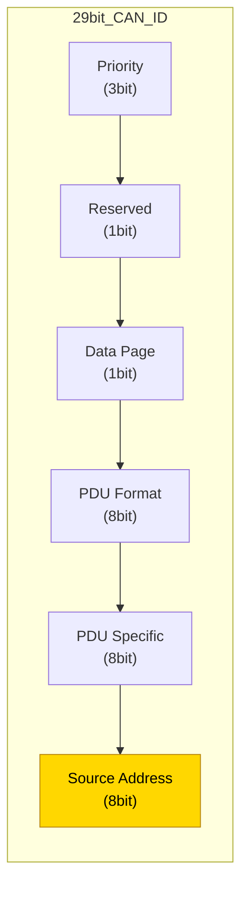
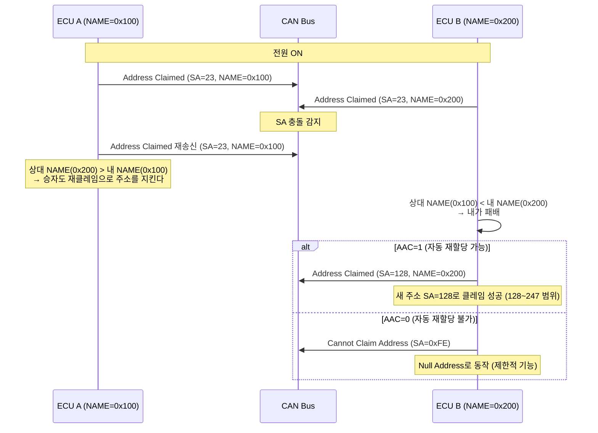
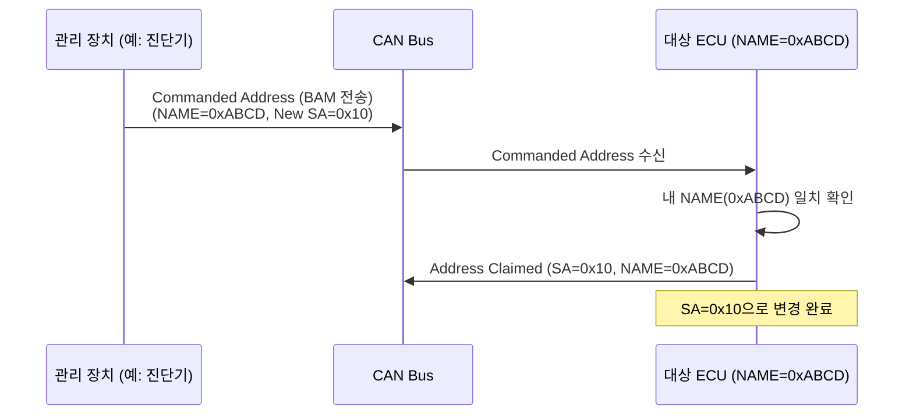

# J1939 주소 체계

::: info 학습 목표
- 소스 주소(SA)의 범위와 예약 주소의 의미를 설명할 수 있다.
- 64비트 NAME의 각 필드 구성과 역할을 이해한다.
- 주소 클레임 절차의 단계별 흐름과 충돌 해결 방식을 설명할 수 있다.
- Commanded Address(PGN 65240)의 동작 원리를 이해한다.
- Request for Address Claimed·Address Claimed·Commanded Address(BAM) 프레임의 CAN ID와 데이터 바이트를 조립하고 디코딩할 수 있다.
- NAME management(PGN 37632) 메시지의 모드·qualifier flag·checksum을 계산해 pending NAME 변경 절차를 설계할 수 있다.
- 주소 위반(SPN 2000+SA, FMI 31)과 클레임 실패가 찍힌 버스 로그를 보고 원인을 진단할 수 있다.
:::

## 1. 소스 주소 (SA)

J1939 네트워크에서 모든 ECU는 <strong>소스 주소(Source Address, SA)</strong>를 가진다. SA는 8비트 값으로, 29비트 CAN ID의 <strong>하위 8비트(비트 7~0)</strong>에 위치한다.


### SA 값 범위

| 범위 | 의미 |
|------|------|
| 0 ~ 127, 248 ~ 253 | Preferred address 영역 — 이 범위를 클레임하는 장치는 해당 주소에 정의된 기능을 실제로 수행해야 한다 |
| 128 ~ 247 | Self-configurable address 범위 — preferred address가 없거나 클레임에 실패한 장치가 사용 |
| 254 (0xFE) | Null Address — <strong>소스 주소로만</strong> 사용. 주소 클레임 전, 또는 클레임 실패 시 |
| 255 (0xFF) | Global Address — <strong>목적지 주소로만</strong> 사용 (브로드캐스트) |

### 예약된 주소 (일부)

| SA | 장치 |
|----|------|
| 0 (0x00) | Engine #1 |
| 3 (0x03) | Transmission #1 |
| 23 (0x17) | Instrument Cluster #1 |
| 33 (0x21) | Body Controller |
| 38 (0x26) | Virtual Terminal (ISOBUS) |
| 49 (0x31) | Cab Controller — Primary |
| 247 (0xF7) | Task Controller (ISOBUS) |

예약(preferred) 주소는 <strong>우선권</strong>을 가지지 않는다. 주소 클레임 경쟁에서 NAME 값이 작은 쪽이 이기며, 예약 주소라도 더 작은 NAME을 가진 장치가 있으면 양보해야 한다. 기능 판단도 SA가 아니라 반드시 NAME으로 해야 한다. 참고로 <strong>ISOBUS(ISO 11783) 적합 장치는 self-configurable address 능력이 필수</strong>이며, non-configurable 장치는 J1939·구판 호환을 위해 허용될 뿐이다.



### 범위별 세부 규칙 (Part 5 4.3.3, Part 1 6.6.4)

위 표의 경계마다 따라붙는 규정이 있다. 구현할 때 실제로 걸리는 것은 표의 숫자보다 이 규정들이다. 이 챕터에서 "Part 5"는 ISO 11783-5:2019를 가리키고, 파트 이름 없이 절 번호만 적은 근거는 Part 5의 절이다.

| 범위 | 붙어 있는 규정 | 근거 |
|---|---|---|
| 0~127, 248~253 (preferred) | 이 주소를 클레임한 CF는 그 주소에 배정된 기능을 실제로 수행해야 하고, 같은 기능을 NAME에도 적어야 한다. 이미 다른 CF가 쓰고 있으면 능력에 따라 다른 주소를 클레임하거나 Cannot Claim Address를 보낸다 | 4.3.3.2 |
| 128~247 (self-configurable) | preferred address가 없거나 그것을 얻지 못한 CF가 쓰는 120개다. 이 범위에서 주소를 고르는 CF는 self-configurable 능력을 갖춰야 한다 | 4.3.3.3, 4.2.3 |
| 128~247의 윗부분 | Industry Group 2(농업·임업) 기능의 preferred address로 정의된 주소가 섞여 있다. 그 기능에 잠긴 주소는 아니라서 어느 self-configurable CF든 쓸 수 있지만, 밀려나 새 주소를 고르는 CF는 아래쪽부터 시도하고 아래쪽이 다 찼을 때만 이 영역을 쓰도록 권장한다 | 4.3.3.3 |
| 128~237 | 연결된 작업기에서 쓰는 CF 수는 이 110개 주소 안으로 제한해야 한다 | ISO 11783-1:2017 6.6.4 |
| 254 (NULL) | 소스 주소로만 쓰고, 그것도 Request for Address Claimed와 Cannot Claim Address 두 메시지의 SA에서만 허용된다 | 4.3.3.5, 4.4.1 |
| 255 (Global) | 목적지 주소로만 쓴다 | 4.3.3.6 |

Part 5는 "윗부분"이 정확히 어디부터인지 적지 않는다. 다만 Part 1 6.6.4가 작업기 CF를 128~237로 묶고, Part 1의 토폴로지 예(Figure 3)가 TC를 247, TECU를 240에 두는 것을 보면, 238~247의 10개를 TC·TECU 같은 IG2 preferred 기능 몫으로 남겨 두는 구성으로 읽힌다(추론). 그 토폴로지는 [12장](/study/isobus/12-isobus-overview)에서 그림으로 다시 본다.

<strong>initial address</strong>(전원을 켤 때 처음 클레임을 시도하는 주소)에도 규칙이 있다. 생산 시점에는 preferred address로 설정하고, 시스템 구성을 위해 다시 프로그램할 수 있다. 그리고 주소 중재의 결과든 Commanded Address의 결과든 새 주소를 클레임하게 되면, 그 주소를 이후 모든 전원 인가에서 쓸 initial address로 저장해야 한다(4.3.3.4). preferred address를 배정받은 CF도 예외가 아니다.

::: warning 주소로 기능을 추론하지 않는다
4.3.3.2는 CF가 수행하는 기능을 SA만 보고 추론해서는 안 되며 기능은 NAME으로만 판단한다고 못 박는다. 1판(2001)은 주소와 기능의 관계를 강제하지 않았다는 각주도 붙어 있다. 그러니 "SA가 38이면 VT"처럼 주소 상수로 상대를 찾는 코드는 규정 위반이다. 상대의 NAME을 Address Claimed로 확인한 다음 그때의 SA를 쓴다.
:::

## 2. NAME (64비트)

<strong>NAME</strong>은 J1939 네트워크에서 ECU를 전 세계적으로 고유하게 식별하는 64비트 구조체이다. 주소 클레임 시 충돌이 발생하면 NAME 값을 비교해 우선순위를 결정한다. NAME 값이 **수치적으로 더 작은** 장치가 주소를 획득한다.

### NAME 필드 구성


| 필드 | 비트 수 | 위치 (MSB 기준) | 설명 |
|------|---------|-----------------|------|
| Arbitrary Address Capable (AAC) | 1 | bit 63 | 1이면 자동 주소 재할당 가능 |
| Industry Group (IG) | 3 | bit 62~60 | 0=Global, 2=Agricultural |
| Vehicle System Instance (VSI) | 4 | bit 59~56 | 동일 시스템 여러 개 구분 |
| Vehicle System (VS) | 7 | bit 55~49 | 시스템 유형 (예: 트랙터) |
| Reserved | 1 | bit 48 | 항상 0 |
| Function (F) | 8 | bit 47~40 | 장치 기능 (예: 엔진 제어) |
| Function Instance (FI) | 5 | bit 39~35 | 동일 기능 여러 개 구분 |
| ECU Instance (EI) | 3 | bit 34~32 | 동일 장치 내 ECU 구분 |
| Manufacturer Code | 11 | bit 31~21 | 제조사 코드 (SAE J1939 등록) |
| Identity Number | 21 | bit 20~0 | 제조사 내 일련번호 |

**NAME 예시 (16진수):**

NAME 값 `0x2000000000000000`은 Arbitrary Address Capable = 0, Industry Group = 2(Agricultural equipment), Function = 0(Engine), Manufacturer Code = 0, Identity Number = 0을 뜻한다. 최상위 바이트(Byte 8) `0x20`을 8비트로 분해하면 AAC·IG·VSI 값을 얻을 수 있다.


### ISO 11783-5의 필드 이름과 값 범위

위 표는 J1939식 이름(AAC, Vehicle System…)을 썼다. ISO 11783-5는 같은 자리를 다른 이름으로 부르므로, 표준 원문·데이터베이스·다른 챕터를 오갈 때 헷갈리지 않도록 대응을 정리한다. SPN과 바이트 위치까지 담은 전체 표는 [Part 5 부록](/study/isobus/appendix-iso-part05)에 있다.

| 이 절의 표기 | ISO 11783-5 이름 | 비트 | 값 범위 | 누가 정하나 / 무엇에 의존하나 |
|---|---|---|---|---|
| AAC | Self-configurable address | 1 | 0~1 | CF의 실제 능력. 언제나 알려진 값이어야 하고 능력과 맞게 설정해야 한다 |
| IG | Industry group | 3 | 0~7 | ISO가 정의·할당. 다른 필드에 의존하지 않는다 |
| VSI | Device class instance | 4 | 0~15 | 연결된 네트워크에서 같은 device class의 몇 번째인지. 해석은 industry group에 따른다 |
| VS | Device class | 7 | 0~127 | ISO가 정의·할당. industry group과 묶여야 "농업 장비의 파종기" 같은 뜻이 된다 |
| Reserved | Reserved | 1 | 0 | ISO 예약. 0으로 둬야 한다 |
| Function | Function | 8 | 0~255 | ISO가 정의·할당. 0~127은 다른 필드와 무관하고, 128~253은 device class에 따라 뜻이 달라진다 |
| FI | Function instance | 5 | 0~31 | 한 장치 시스템에서 같은 function의 몇 번째인지 |
| EI | ECU instance | 3 | 0~7 | 한 function에 딸린 ECU 무리 중 어느 ECU인지 |
| Manufacturer Code | Manufacturer code | 11 | 0~2047 | 위원회가 할당(Part 1의 데이터베이스). 다른 필드와 독립 |
| Identity Number | Identity number | 21 | 0~2,097,151 | ECU 제조사가 할당. manufacturer code에 의존 |

근거는 Part 5 Table 1과 4.3.2다. Table 1은 값 범위를 따로 적지 않으므로 값 범위 열은 비트 폭에서 계산한 것이다.

### Function 코드는 device class에 매인다

Function 필드 8비트는 값의 구간마다 뜻을 정하는 방식이 다르다(Table 1, Figure 2).

- <strong>0~127</strong>: 다른 어떤 필드와도 무관하게 정의된다. Annex A.1의 엔진(function 0)이 예다. 원문은 이 범위의 function(엔진 등)이라면 industry group 0이 아닌 다른 industry group에서도 쓰일 수 있다고 덧붙인다.
- <strong>128~253</strong>: device class에 따라 뜻이 정해진다. Annex A.2에서 129는 "트레일러(device class 2)의 ABS"다. 같은 129라도 device class가 다르면 다른 기능이다.
- <strong>254·255</strong>: Table 1은 뜻을 정의하지 않는다. 뒤 §8의 NAME management에서도 commanded function의 범위는 0~254다(4.4.3.3.4.5).

device class 자체가 industry group에 의존하므로, 128 이상인 function을 해석하려면 (industry group, device class, function) 세 값을 함께 봐야 한다. NAME을 사람이 읽는 이름으로 바꾸는 표시 기능을 만든다면, 조회 키는 function 하나가 아니라 이 세 값의 조합이어야 한다는 뜻이다.

Part 5 Figure 2가 그리는 필드 사이의 의존 관계를 표로 옮기면 다음과 같다.

| 필드 | 의존하는 필드 |
|---|---|
| Self-configurable address, Industry group, Reserved, Function 0~127, Manufacturer code | 없음(독립 필드) |
| Device class | Industry group |
| Device class instance | Device class (Table 1 문구로는 industry group) |
| Function 128~253 | Device class |
| Function instance | Function |
| ECU instance | Function instance |
| Identity number | Manufacturer code |

instance 필드를 운용하는 규칙도 4.3.2에 있다.

- instance 필드는 ECU를 설치할 때, 또는 네트워크에 같은 것이 여럿 있을 때 NAME management 메시지로 바꿔 다시 구성할 수 있다(§8).
- function instance의 해석은 제조사와 시스템 통합자가 합의해 정할 수 있다. 원문의 예는 엔진 2개·변속기 2개 구성에서 "엔진 instance 0은 변속기 instance 0과, 엔진 instance 1은 변속기 instance 1과 물리적으로 연결한다"고 합의하는 경우다. 위치나 특수 기능을 표시하는 데 쓰기도 한다.
- 한 function을 같은 네트워크의 ECU 두 개가 나눠 맡으면 첫째 ECU의 ECU instance를 0, 둘째를 1로 두는 것이 권장(should)이다.

### NAME 유일성 규칙

NAME 비교가 주소 중재의 유일한 기준이므로, NAME이 똑같은 두 CF 사이에서는 중재가 승패를 가르지 못한다(추론). 그래서 Part 5는 유일성을 여러 겹으로 요구한다.

1. 네트워크에서 메시지를 보내는 모든 CF는 유일한 NAME을 가져야 한다(4.3.1).
2. 그 유일성을 보장할 책임은 네트워크 통합자와 ECU 제조사에게 있다(4.3.2).
3. ECU 제조사는 NAME이 전원을 끊어도 바뀌지 않게(non-varying) 해야 한다(4.3.2). NAME은 비휘발성 저장소에 둬야 한다는 뜻이다.
4. 다른 필드가 모두 다른 CF와 같아질 수 있는 경우에는 identity number(제품 일련번호, 날짜·시각 코드 등)로 유일하게 만들어야 한다(4.3.2).
5. identity number는 최초 제조 후 바꾸지 않는다. NAME management로도 이 필드는 바꿀 수 없다(4.4.3.1).
6. ECU 하나가 CF 여러 개를 구현하면 CF마다 NAME이 따로 있고 각자 유일한 SA를 클레임한다. 주소 구성 능력도 CF마다 다를 수 있다(4.3.1).

중복 NAME이나 중복 클레임은 진단 툴이 Request for Address Claimed를 보내 응답을 모아 보면 찾아낼 수 있다(4.4.4.1).

::: warning 같은 제품 두 대 = 같은 NAME?
같은 제조사의 같은 모델 두 대를 한 버스에 물리면 identity number를 뺀 필드가 전부 같다. identity number를 일련번호에서 가져오지 않고 펌웨어 상수로 박아 두면 두 대의 NAME이 완전히 같아진다. 4번 규칙이 막으려는 것이 바로 이 경우다.
:::

### NAME은 Byte 1부터 버스에 실린다

NAME을 64비트 정수로 쓸 때 맨 앞(최상위)은 Self-configurable address 비트다. 그런데 Address Claimed의 데이터 필드에서 그 최상위 바이트는 <strong>Byte 8</strong>이고, 맨 먼저 전송되는 Byte 1은 identity number의 최하위 바이트다(Table 1, Figure 1). Table 1의 각주는 이를 비트 단위로 못 박는다. Byte 1의 bit 8은 DLC에 가장 가까운 비트, 곧 데이터 필드에서 처음 나가는 비트이고, Byte 8의 bit 1은 마지막으로 나가는 데이터 비트로 CRC에 가장 가깝다. 표준은 NAME을 숫자처럼 다룰 수 있게 이렇게 배치했다고 설명한다(Table 1 각주 a, ISO 11783-7과 같은 방식).

§5의 그린텍 컨트롤러로 확인해 보자. `NAME_A = 0xA00882000D27A120`은 수치 표기이고, 실제 Address Claimed 프레임의 데이터는 바이트 순서가 거꾸로다.

| 표기 | 바이트 열 |
|---|---|
| 64비트 수치(최상위 Byte 8부터) | `A0 08 82 00 0D 27 A1 20` |
| CAN 데이터 필드(Byte 1부터 전송 순서) | `20 A1 27 0D 00 82 08 A0` |

수신한 8바이트를 NAME 정수로 바꿀 때는 리틀 엔디언으로 읽어야 한다. 이렇게 읽은 정수를 그대로 비교하면 §5의 "NAME 비교 = 64비트 정수 비교"가 성립한다. 반대로 데이터 필드를 받은 순서대로(빅 엔디언으로) 정수화하면 identity number의 하위 바이트가 최상위로 올라가 승패 판정이 틀어진다.

::: details 파이썬으로 바이트 순서 검산
```python
NAME_A = 0xA00882000D27A120
wire = NAME_A.to_bytes(8, "little")              # Byte 1이 맨 앞
print(" ".join(f"{b:02X}" for b in wire))        # 20 A1 27 0D 00 82 08 A0
assert int.from_bytes(wire, "little") == NAME_A  # 수신 측 복원
assert wire[7] >> 7 == 1                         # Byte 8의 bit 8 = self-configurable address
```
:::

### Annex A로 NAME 조립하기

Part 5 Annex A는 NAME을 조립하는 예 세 가지를 이진수로 보여 준다. manufacturer code와 identity number는 제조사마다 달라 일반형(`mm…m`, `ii…i`)으로 두었으므로, 여기서는 상위 4바이트(Byte 8~5)만 16진수로 옮긴다.

| 예 | 조건 | Byte 8 | Byte 7 | Byte 6 | Byte 5 |
|---|---|---|---|---|---|
| A.1 단일 엔진 트랙터의 엔진 ECU | non-configurable, IG 0, device class 1(tractor), function 0(engine), instance 모두 0 | `00` | `02` | `00` | `00` |
| A.2 대형 도로용 트랙터의 첫 트레일러 ABS ECU | non-configurable, IG 0, device class 2(trailer), function 129(트레일러 ABS), instance 모두 0 | `00` | `04` | `81` | `00` |
| A.3 파종기 1, 1번 행, ECU 1 | self-configurable, IG 2, device class 4(planter), instance 모두 0 | `A0` | `08` | (미정) | `00` |

Byte 7이 `02`·`04`·`08`처럼 device class의 두 배로 나오는 것은 device class 7비트가 bit 8~2에 놓이고 bit 1이 Reserved(0)이기 때문이다.

A.3은 instance 필드 3종을 함께 쓰는 예라 구현자에게 특히 쓸모가 있다. 파종기 2대가 각각 8행을 따로 유도(row guidance)하고, 행마다 ECU가 2개다. 파종기는 농업 작업기이므로 self-configurable 비트를 1로 둔다. row guidance의 function 코드는 원문 작성 시점에 정의되지 않아 `ff…f`로 일반화되어 있다.

| 필드 | 무엇을 구분하나 | 값 |
|---|---|---|
| Device class instance | 파종기 1·2 | 0, 1 |
| Function instance | 행 1~8 | 0~7 |
| ECU instance | 행마다 ECU 1·2 | 0, 1 |
| Identity number | CF마다 다르게 | `ii…i`, `ii…i+n`, `ii…i+p`, … |

이 셋을 조합하면 2 × 8 × 2 = 32개 CF가 identity number 없이도 상위 4바이트만으로 모두 구분된다. Byte 5는 `(행 - 1) << 3 | (ECU - 1)`이 되어 파종기 1의 1행 ECU 1·2는 `00`·`01`, 2행은 `08`·`09`이고, 파종기 2의 8행은 `38`·`39`다. Byte 8은 파종기 1이 `A0`, 파종기 2가 `A1`이다.

::: details 파이썬으로 32개 NAME 검산
```python
FIELDS = [("aac", 1), ("ig", 3), ("dci", 4), ("dc", 7), ("rsvd", 1),
          ("func", 8), ("fi", 5), ("ei", 3), ("mfg", 11), ("ident", 21)]


def encode(**kw):
    v = 0
    for name, bits in FIELDS:
        assert 0 <= kw[name] < (1 << bits)
        v = (v << bits) | kw[name]
    return v


ROW_GUIDANCE = 0x80   # 예시 값: 원문에서 코드 미정(ff…f)
upper = set()
for planter in (0, 1):
    for row in range(8):
        for ecu in (0, 1):
            n = encode(aac=1, ig=2, dci=planter, dc=4, rsvd=0, func=ROW_GUIDANCE,
                       fi=row, ei=ecu, mfg=0, ident=0)
            upper.add(n >> 32)
assert len(upper) == 32          # identity number 없이도 32개가 모두 다르다

b = encode(aac=1, ig=2, dci=1, dc=4, rsvd=0, func=ROW_GUIDANCE,
           fi=7, ei=1, mfg=0, ident=0).to_bytes(8, "big")
print(f"파종기 2, 8행, ECU 2: Byte8={b[0]:02X} Byte7={b[1]:02X} Byte5={b[3]:02X}")  # A1 08 39
assert (encode(aac=0, ig=0, dci=0, dc=2, rsvd=0, func=129, fi=0, ei=0,
               mfg=0, ident=0) >> 32) == 0x00048100   # A.2의 상위 4바이트
```
:::

## 3. 주소 클레임 절차

J1939 장치는 네트워크에 연결되면 <strong>Address Claimed 메시지(PGN 60928, 0xEE00)</strong>를 브로드캐스트하여 주소를 선점한다. 같은 주소를 사용하려는 장치가 있으면 NAME 비교를 통해 충돌을 해결한다.

클레임에 앞서 <strong>주소 조회 시퀀스</strong>를 거치는 것이 표준 절차다. Request for Address Claimed(PGN 59904)를 Global 또는 자신의 초기 주소로 보내고, <strong>최소 250 ms + RTxD</strong>를 대기하면서 수신된 Address Claimed들로 사용 중인 주소를 파악한 뒤, 비어 있는 주소를 클레임한다. 여기서 <strong>RTxD(Random Transmit Delay)</strong>는 0~255 범위의 난수에 0.6 ms를 곱한 지연 시간으로, 여러 장치가 동시에 송신해 버스 오류를 일으키는 것을 막는다.



### 절차 단계 요약

1. **전원 ON** — ECU가 사용할 SA를 선택 (선호 주소 또는 저장된 초기 주소)
2. **주소 조회** — Request for Address Claimed(PGN 59904)를 보내고 250 ms + RTxD 대기하며 사용 중인 주소를 파악
3. **Address Claimed 전송** — 선택한 SA와 자신의 NAME을 PGN 60928으로 브로드캐스트
4. **충돌 감지** — 같은 SA로 다른 NAME이 수신되면 충돌
5. **NAME 비교** — 더 작은 NAME 값을 가진 장치가 해당 SA를 획득. <strong>승자도 자신의 NAME으로 Address Claimed를 재송신</strong>해 주소를 지켜야 한다
6. **패자 처리**
   - AAC=1: 128~247 범위에서 다른 SA를 선택하여 재클레임
   - AAC=0: Cannot Claim (SA=0xFE) 전송 후 수신 전용 동작 (RTxD 삽입 후 송신)

### 타이밍 규칙

| 항목 | 값 |
|------|----|
| 주소 조회(Request) 후 대기 | 최소 250 ms + RTxD |
| 클레임 성공 판정 | Address Claimed 송신 후 250 ms 동안 경합 클레임이 없어야 성공 |
| 일반 통신 시작 | 클레임 성공 후 250 ms 경과 전에는 일반 메시지 송신 금지 (Request 응답은 예외) |
| RTxD | 난수(0~255) × 0.6 ms |

## 4. Commanded Address

<strong>Commanded Address</strong>는 외부 장치가 특정 ECU에게 주소를 강제로 지정하는 메커니즘이다. <strong>PGN 65240 (0xFED8)</strong>을 사용하며, 지원 여부는 <strong>선택 사항</strong>이다.

### 메시지 구조


데이터가 9바이트라 단일 CAN 프레임(8바이트)에 담을 수 없으므로 <strong>BAM(Broadcast Announce Message) 전송 프로토콜로 Global(255)에 송신</strong>한다. 따라서 Commanded Address를 지원하는 장치는 BAM 수신도 지원해야 한다.

### 동작 방식



### 사용 사례

| 상황 | 설명 |
|------|------|
| 공장 설정 | 제조 라인에서 장치에 고정 SA 부여 |
| 네트워크 재구성 | 시스템 통합 시 주소 충돌 사전 방지 |
| 진단/유지보수 | 특정 SA로 장치를 강제 이동 |

Commanded Address를 수락한 ECU는 명령받은 주소를 새 SA로 하는 <strong>Address Claimed 메시지를 발행</strong>해야 하며, 이때 일반 주소 클레임 요구사항이 그대로 적용된다. 수신했지만 주소를 변경할 수 없는 ECU는 <strong>현재 SA를 클레임하는 Address Claimed로 응답</strong>한다.

::: tip 핵심 정리
- SA는 8비트이며 0~127·248~253은 preferred, 128~247은 self-configurable 범위, 254=Null(소스 전용), 255=Global(목적지 전용)이다.
- SA는 29비트 CAN ID의 하위 8비트에 위치한다.
- NAME은 64비트 구조체로 장치를 전 세계적으로 고유 식별하며, **값이 작을수록 우선순위가 높다.**
- 클레임 전에 주소 조회 후 250 ms + RTxD를 대기하고, 충돌 시 NAME 비교로 승자를 결정한다. 승자도 Address Claimed를 재송신해야 한다.
- AAC=1인 장치는 충돌 패배 후 128~247 범위의 다른 주소로 자동 재클레임할 수 있다. ISOBUS 적합 장치는 이 능력이 필수다.
- Commanded Address(PGN 65240)는 외부에서 ECU의 주소를 강제 지정하는 방법이며, 9바이트 데이터라 BAM으로 전송된다.
:::

## 5. 주소 클레임 따라가기

앞 절이 절차를 일반화해서 설명했다면, 여기서는 <strong>서로 다른 제조사의 작업기 ECU 2개가 같은 주소를 동시에 클레임해 충돌하고, NAME 비교로 승패가 갈린 뒤, 진 쪽이 다른 주소를 재클레임하는 전 과정</strong>을 시각(ms) 단위로 끝까지 따라간다.

### 등장인물 — 두 파종기 컨트롤러의 NAME

두 CF 모두 파종기(Device class 4, Planter — [부속서 ISO 11783-5](/study/isobus/appendix-iso-part05) Annex A.3에서 확인) 컨트롤러이고, 둘 다 ISOBUS 적합 장치라 self-configurable(AAC=1)이다. Industry Group(농업 장비)·Device class·Function까지 같아서, NAME이 갈리는 지점은 제조사 고유 필드(Manufacturer Code, Identity Number)뿐이다.

| 필드 | 비트 | CF A — 그린텍 파종기 컨트롤러 | CF B — 블루팜 파종기 컨트롤러 |
|------|------|------|------|
| Self-configurable address (AAC) | 1 | 1 (self-configurable) | 1 (self-configurable) |
| Industry Group (IG) | 3 | 2 (Agricultural) | 2 (Agricultural) |
| Vehicle System Instance (VSI) | 4 | 0 | 0 |
| Vehicle System (VS) | 7 | 4 (Planter) | 4 (Planter) |
| Reserved | 1 | 0 | 0 |
| Function | 8 | 130 | 130 |
| Function Instance (FI) | 5 | 0 | 0 |
| ECU Instance (EI) | 3 | 0 | 0 |
| Manufacturer Code | 11 | 105 (그린텍) | 320 (블루팜) |
| Identity Number | 21 | 500000 | 250000 |

Function·Manufacturer Code·Identity Number의 실제 등록값은 isobus.net 데이터베이스가 관리하며 이 스터디의 부속서에는 실려 있지 않다. 위 표의 값은 필드 인코딩·비교 방식을 보여주기 위한 예시다. 이 값을 64비트로 이어 붙이면 다음과 같다.

```
NAME_A = 0xA00882000D27A120   (바이트: A0 08 82 00 0D 27 A1 20)
NAME_B = 0xA00882002803D090   (바이트: A0 08 82 00 28 03 D0 90)
```

### 타임라인 — 충돌부터 재클레임까지

두 CF 모두 제조 시 저장된 initial address가 우연히 128(self-configurable 범위의 첫 주소)로 같다고 하자.

| 시각(ms) | 송신자 | 메시지 (PGN, 데이터) | 버스 상태 | 판정 |
|------|------|------|------|------|
| 0 | CF A, CF B (각자) | Request for Address Claimed (PGN 59904, DA=255, 데이터=PGN 60928 조회) | 정상 송신 | 사용 중 주소 조회 시작 — 각자 <strong>250 ms + RTxD</strong> 대기 진입 |
| 0~331.6 | CF A | (대기, RTxD_A = 136 × 0.6 ms = 81.6 ms) | 유휴 — SA=128 클레임 수신 없음 | SA=128을 빈 주소로 판단 |
| 0~332.2 | CF B | (대기, RTxD_B = 137 × 0.6 ms = 82.2 ms) | 유휴 — SA=128 클레임 수신 없음 | SA=128을 빈 주소로 판단 |
| 331.6 | CF A | Address Claimed (PGN 60928, CAN ID 0x18EEFF80, SA=128, DATA=NAME_A) | 정상 송신 | SA=128 클레임 시작 |
| 332.2 | CF B | Address Claimed (PGN 60928, CAN ID 0x18EEFF80, SA=128, DATA=NAME_B) | 정상 송신 — RTxD 차이가 0.6 ms뿐이라 A의 클레임을 반영하기 전에 이미 자신의 클레임 전송에 들어간 상태 | SA=128 중복 클레임 발생 |
| 332.2 | CF A, CF B | (서로의 Address Claimed 수신) | SA=128 충돌 감지 | NAME 비교: `0xA00882000D27A120`(A) `<` `0xA00882002803D090`(B) → <strong>A 승, B 패</strong> |
| 332.2 | CF A | Address Claimed 재송신 (PGN 60928, SA=128, NAME_A) | 정상 송신 | 승자도 재송신해야 SA=128을 지킨다 |
| 332.2 | CF B | Address Claimed (PGN 60928, CAN ID 0x18EEFF81, SA=129, NAME_B) | 정상 송신 | AAC=1이므로 128~247 범위의 다음 빈 주소(129)를 즉시 재클레임 |
| 582.2 | — | 250 ms 동안 SA=128·SA=129 모두 경합 클레임 없음 | 유휴 | CF A는 SA=128, CF B는 SA=129 <strong>클레임 성공 확정</strong> |
| 582.2 이후 | CF A, CF B | 일반 메시지 송신 시작 | 정상 | 클레임 성공 후 250 ms 경과 — 일반 통신 허용(Request 응답은 이 전에도 예외적으로 가능) |

### 승패 규칙 — NAME을 64비트 정수로 통째 비교

NAME 비교는 각 필드를 개별로 견주는 것이 아니라, <strong>address-claimed 데이터 필드(8바이트) 전체를 하나의 정수로 취급해 비교</strong>한다. AAC를 최상위 비트로 놓고 이어 붙이면, 상위 필드가 같을 때만 하위 필드가 승패를 가른다.

이번 예시에서는 AAC·IG·VSI·VS·Reserved·Function·FI·EI가 완전히 같아 NAME의 앞 4바이트(`A0 08 82 00`)까지 일치한다. 갈리는 지점은 5번째 바이트, 즉 <strong>Manufacturer Code</strong>의 상위 8비트부터다 — 그린텍은 `0x0D`(제조사 코드 105), 블루팜은 `0x28`(제조사 코드 320)이라 `0x0D < 0x28`이므로 그린텍(CF A)이 이긴다.

:::tip 핵심 통찰
NAME 비교는 상위 필드가 같으면 그대로 하위 필드로 내려가는 <strong>사전식(lexicographic) 비교</strong>다. 그리고 self-configurable 비트(AAC)가 NAME의 <strong>최상위 비트</strong>이므로, 다른 필드가 전부 같더라도 AAC=0(non-configurable)인 CF는 AAC=1(self-configurable)인 CF를 항상 이긴다.
:::

### 패자의 행동 — 재클레임 또는 Cannot Claim

패자(CF B)가 이후 무엇을 하는지는 <strong>AAC 값</strong>에 따라 갈린다.

| AAC | 패자의 행동 |
|------|------|
| 1 (self-configurable, 이번 시나리오) | 128~247 범위에서 다음 빈 주소를 골라 재클레임한다. 위 타임라인처럼 SA=129를 클레임하고, 250 ms 무경합을 확인하면 통신을 시작한다 |
| 0 (non-configurable) | 재클레임을 시도하지 않고 <strong>RTxD를 삽입한 뒤 Cannot Claim Address(PGN 60928, SA=254, 데이터=자신의 NAME)</strong>를 송신한다. 이후 Null Address 상태로 남아 request-for-address-claimed 응답과 commanded-address 처리 외에는 통신할 수 없다 |

이번 시나리오의 CF B는 ISOBUS 적합 장치라 AAC=1이므로 위 표의 첫 줄대로 SA=129를 재클레임한다.

### 타이밍 규정이 시나리오에 어떻게 적용되는가

이 타임라인에 실제로 반영된 [§3 타이밍 규칙](#_3-주소-클레임-절차)은 세 가지다.

- <strong>주소 조회 후 대기</strong>: t=0에서 Request for Address Claimed를 보낸 뒤 최소 250 ms + RTxD를 기다린 다음에야 Address Claimed를 송신했다(t=331.6ms, 332.2ms).
- <strong>클레임 성공 판정</strong>: A와 B 모두 마지막 Address Claimed(t=332.2ms) 이후 250 ms 동안 경합이 없어야 성공이 확정된다(t=582.2ms).
- <strong>일반 통신 시작</strong>: 클레임 성공 확정(t=582.2ms) 이전에는 일반 메시지를 보낼 수 없다.

:::details 파이썬으로 검산해 보기
```python
FIELDS = [  # (필드명, 비트 수) — AAC가 최상위
    ("aac", 1), ("ig", 3), ("vsi", 4), ("vs", 7), ("rsvd", 1),
    ("func", 8), ("fi", 5), ("ei", 3), ("mfg", 11), ("ident", 21),
]


def encode_name(**kw):
    val = 0
    for name, bits in FIELDS:
        v = kw[name]
        assert 0 <= v < (1 << bits)
        val = (val << bits) | v
    assert val.bit_length() <= 64
    return val


# CF A - 그린텍 파종기 컨트롤러
NAME_A = encode_name(aac=1, ig=2, vsi=0, vs=4, rsvd=0,
                      func=130, fi=0, ei=0, mfg=105, ident=500000)
# CF B - 블루팜 파종기 컨트롤러
NAME_B = encode_name(aac=1, ig=2, vsi=0, vs=4, rsvd=0,
                      func=130, fi=0, ei=0, mfg=320, ident=250000)

print(hex(NAME_A), NAME_A.to_bytes(8, "big").hex())   # 0xa00882000d27a120 a00882000d27a120
print(hex(NAME_B), NAME_B.to_bytes(8, "big").hex())   # 0xa00882002803d090 a00882002803d090
print("A < B:", NAME_A < NAME_B)                      # True -> CF A(그린텍) 승

a_bytes, b_bytes = NAME_A.to_bytes(8, "big"), NAME_B.to_bytes(8, "big")
for i, (x, y) in enumerate(zip(a_bytes, b_bytes)):
    if x != y:
        print(f"byte[{i}]에서 최초로 갈림: A=0x{x:02X} B=0x{y:02X}")  # byte[4]: A=0x0D B=0x28
        break

# RTxD(0~255 난수 x 0.6ms)로 만든 두 대기 시간
RTXD_A, RTXD_B = 136 * 0.6, 137 * 0.6
print("t_A =", 250 + RTXD_A, "ms /", "t_B =", 250 + RTXD_B, "ms")  # 331.6 / 332.2
```
:::

## 6. 주소 구성 능력 4종 (Part 5 4.2)

<strong>주소 구성 능력(address configuration capability)</strong>은 CF가 주소 클레임에 쓸 SA를 정하는 방식이다. §3~§5는 AAC 비트(0/1)로 두 가지만 나눴지만, Part 5는 기본 능력 2가지와 확장 능력 2가지를 정의한다(4.2.1).

| 능력 | 구분 | NAME에 드러나나 | 주소를 바꾸는 방법 | 원하는 주소를 못 쓰면 |
|---|---|---|---|---|
| Non-configurable | 기본 | Self-configurable address 비트 = 0 | 주소 클레임 과정에서 initial address를 바꿀 수 없다 | Cannot Claim Address 송신 |
| Self-configurable | 기본 | Self-configurable address 비트 = 1 | 독자 알고리즘으로 주소를 다시 계산해 재클레임 | 다른 주소를 골라 재클레임. 128~247이 전부 찼을 때만 Cannot Claim |
| Service-configurable | 확장 | 드러나지 않음 | "service" 동작 모드에서 서비스 기사가 독자 방법이나 Commanded Address로 변경. 서비스 툴을 쓸 수 있다 | Cannot Claim Address 송신 |
| Command-configurable | 확장 | 드러나지 않음 | Commanded Address로 언제든 변경. 서비스 툴이나 특수 모드가 필요 없지만, 명령을 보낼 CF가 네트워크에 있어야 한다 | Cannot Claim Address 송신 |

방법 열의 근거는 4.2.2~4.2.5이고, 마지막 열은 4.4.2.4와 4.5.3이다. 표에서 구현자가 놓치기 쉬운 점은 다섯 가지다.

1. <strong>ISO 11783 적합 CF는 self-configurable이어야 한다(shall).</strong> non-configurable CF는 1판(ISO 11783-5:2001)이나 SAE J1939 장비와 호환하려고 네트워크에서 "용인(tolerate)"될 뿐이다(4.2.1).
2. <strong>확장 능력은 NAME에 표시되지 않는다.</strong> Table 1에 그런 필드가 없다. 기본 능력과 별개로 CF는 확장 능력을 하나 이상 골라 구현할 수 있으므로(4.2.1), self-configurable이면서 command-configurable인 CF가 가능하다.
3. <strong>self-configurable CF가 initial address를 바꿔도 되는 때는 주소 중재에서 졌을 때뿐이다(4.2.3).</strong> 부팅할 때마다 새 주소를 고르는 구현은 이 규정에 어긋난다. 바꾼 주소는 다음 전원 인가부터 initial address로 쓰도록 저장한다(4.3.3.4, 4.5.1).
4. <strong>self-configurable CF가 쓸 수 있는 주소는 128~247이다.</strong> 단, 그 CF의 기능에 preferred address가 배정되어 있으면 그 주소도 쓸 수 있다(4.2.3). 새 주소를 고르는 알고리즘은 CF 고유(proprietary)이지만, 결과는 반드시 자기 preferred address이거나 128~247 안이어야 한다(4.5.1).
5. <strong>non-configurable끼리 같은 주소를 다투면 NAME이 가장 작은 CF만 주소를 얻고, 나머지는 클레임 불가를 알려야 한다(4.2.2).</strong> non-configurable이 self-configurable을 언제나 이긴다는 점은 §5의 핵심 통찰에서 봤다.

::: tip 능력별로 구현해야 할 것
- Non-configurable: Address Claimed, Cannot Claim, Request 응답. 클레임 전 Request for Address Claimed는 생략할 수 있지만 보내는 것이 권장된다(4.5.1).
- Self-configurable: 위 전부 + 주소 재계산 + 새 initial address 저장.
- Command-configurable: 위에 더해 Commanded Address 수신 처리. Commanded Address는 BAM으로 오므로 BAM 수신도 필수다(4.4.2.5).
- Service-configurable: service 모드에 들어가는 방법과 그 모드에서의 주소 변경 수단(독자 방법 또는 Commanded Address).
:::

## 7. 주소 관리 메시지 4종 — 프레임 단위로 보기 (Part 5 4.4.2)

§3·§4는 메시지의 역할을 설명했다. 이 절은 같은 네 메시지를 <strong>CAN ID·DLC·데이터 바이트</strong> 수준까지 내려가 다시 본다. 정의 전체는 [Part 5 부록](/study/isobus/appendix-iso-part05)에 있으니 여기서는 프레임을 실제로 조립할 때 필요한 값과 규칙에 집중한다.

### 네 메시지의 프레임 값

| 메시지 | PGN | 우선순위 | PF | PS | SA | DLC | 데이터 |
|---|---|---|---|---|---|---|---|
| Request for Address Claimed | 59904 (`0xEA00`) | 6 | 234 (`0xEA`) | DA: 255 또는 특정 주소 | 자기 SA. 클레임 전이면 254 | 3 | 요청 PGN 60928 → `00 EE 00` |
| Address Claimed | 60928 (`0xEE00`) | 6 | 238 (`0xEE`) | 255 | 0~253 | 8 | NAME (Byte 1부터) |
| Cannot Claim Address | 60928 (`0xEE00`) | 6 | 238 (`0xEE`) | 255 | 254 | 8 | NAME |
| Commanded Address | 65240 (`0xFED8`) | 6 | 254 (`0xFE`) | 216 (`0xD8`) | 명령하는 CF의 SA | 9바이트 → BAM | NAME + 새 SA |

근거는 Part 5 Table 2와 4.4.2.3~4.4.2.5이고, Request의 우선순위·DLC는 ISO 11783-3:2018 5.4.3이다. Address Claimed와 Cannot Claim은 PGN이 같고 SA(254인지)로만 구별된다. Commanded Address는 PF가 240 이상인 PDU2라 PS 216은 목적지가 아니라 PGN의 일부(group extension)다.

Request의 데이터 3바이트는 요청하는 PGN을 <strong>최하위 바이트부터</strong> 담는다(Part 3 5.1.3). 60928 = `0x00EE00`이므로 `00 EE 00`이다. 아직 주소가 없는 CF가 전체에 묻는 Request는 다음 한 프레임이다.

```
CAN ID 0x18EAFFFE  DLC 3  00 EE 00
         │ │ │ └─ SA 0xFE (254, NULL)
         │ │ └─── DA 0xFF (Global)
         │ └───── PF 0xEA (Request)
         └─────── 0x18 = 우선순위 6, R 0, DP 0
```

§5의 그린텍 컨트롤러가 SA 0x80을 클레임하는 Address Claimed는 `0x18EEFF80`, DLC 8, 데이터 `20 A1 27 0D 00 82 08 A0`이다(§2의 바이트 순서). 같은 CF가 클레임에 실패했다면 Cannot Claim은 `0x18EEFFFE`에 같은 8바이트를 싣는다.

### 받는 쪽의 응답 규칙

| 상황 | 해야 할 일 | 근거 |
|---|---|---|
| Global(255)로 온 Request for Address Claimed | Address Claimed로 응답한다. 클레임에 실패한 상태면 Cannot Claim으로 응답한다 | 4.4.2.2, 4.5.3 |
| 자기 주소로 온 Request for Address Claimed | 응답하되 목적지는 <strong>Global(255)</strong>로 한다 | 4.5.3 |
| 아직 클레임을 시도한 적 없는 CF | 어떤 Request에도 응답하지 않고 Cannot Claim도 보내지 않는다. 그 전에는 Request for Address Claimed 말고는 통신에 참여하지 않는다 | 4.4.2.2, 4.5.3 |
| 자기가 Global로 보낸 Request | 자기 요청에도 응답해야 한다 | 4.4.2.2 |
| 자기 SA를 클레임하는 Address Claimed 수신 | NAME을 비교해 이기면 자기 Address Claimed를 다시 보내고, 지면 새 주소를 클레임하거나 Cannot Claim을 보낸다 | 4.4.2.3 |
| Cannot Claim으로 응답할 때 | 트리거 메시지를 받은 뒤 RTxD만큼 기다렸다가 보낸다 | 4.4.2.4 |

셋째 줄과 넷째 줄은 함께 읽어야 한다. 클레임을 시도하기 전의 CF는 자기 요청에도 응답하지 않고(4.5.3), §10의 대기를 마친 뒤 Address Claimed를 보낸다.

둘째 줄이 대표적인 구현 함정이다. Part 3의 일반 규칙은 "특정 주소로 온 요청에는 특정 주소로 응답한다"인데, Address Claimed만은 요청이 특정 주소로 왔어도 Global로 보낸다. Part 3 5.4.3이 이 예외를 직접 적어 두었고, Part 5 4.5.2 b)도 "ISO 11783-3 요구사항의 예외"라고 밝힌다. 이유는 4.5.2 b)에 있다. 클레임 사실을 네트워크의 모든 CF에 알려야 하기 때문이다. 범용 Request 처리기에 PGN별 응답 함수를 붙이는 구조라면 PGN 60928만 따로 Global로 돌려야 한다.

### 주소를 못 얻은 CF가 할 수 있는 일

Cannot Claim을 보낸 CF의 송신 범위는 두 절이 나눠서 정한다.

- 4.4.2.4: Cannot Claim Address와 Request for Address Claimed 말고는 보내지 않는다. 다만 Commanded Address 같은 Global 메시지의 수신·처리는 계속할 수 있다.
- 4.5.5: Request for Address Claimed에 응답하는 Cannot Claim과 Commanded Address에 대한 응답 말고는 보내지 않는다. 전원을 다시 켜면 클레임을 다시 시도할 수 있다.

두 절을 합치면, 주소 없는 CF에게도 Commanded Address를 받아 새 주소로 클레임하는 길은 열려 있다. 4.5.3이 서비스 툴(일부 시스템에서는 브리지)에게 주소 클레임 실패를 감지·해결하는 역할을 기대하는 이유다. 서비스 툴은 Cannot Claim을 모니터링해 운용자에게 문제를 알릴 수 있다.

### Commanded Address를 프레임으로 조립하기

§4의 Commanded Address는 9바이트라 BAM으로 나간다. 서비스 툴(SA 0x9A, 예시 값)이 §5의 CF B(블루팜 파종기 컨트롤러, NAME_B)에게 SA 0x95(149)를 쓰라고 명령하는 경우를 프레임으로 풀면 다음과 같다. TP.CM·TP.DT의 일반 구조는 [11장](/study/isobus/11-j1939-transport)에서 다뤘다.

| 순번 | 프레임 | CAN ID | 데이터 | 의미 |
|---|---|---|---|---|
| 1 | TP.CM_BAM | `0x1CECFF9A` | `20 09 00 02 FF D8 FE 00` | Control `0x20`, 총 9바이트(`09 00`), 패킷 2개, 대상 PGN 65240(`D8 FE 00`) |
| 2 | TP.DT #1 | `0x1CEBFF9A` | `01 90 D0 03 28 00 82 08` | 순번 1 + NAME Byte 1~7 |
| 3 | TP.DT #2 | `0x1CEBFF9A` | `02 A0 95 FF FF FF FF FF` | 순번 2 + NAME Byte 8 + 새 SA `95` + `FF` 채움 |
| 4 | Address Claimed | `0x18EEFF95` | `90 D0 03 28 00 82 08 A0` | CF B가 새 주소 0x95로 클레임 |

TP.CM과 TP.DT는 운반하는 PGN과 상관없이 우선순위 7이라 CAN ID가 `0x1C`로 시작한다(Part 3 5.10.4, 5.10.5). 브로드캐스트 패킷 사이 간격은 10~200 ms다(Part 3 5.10.2.4, 5.13.3). 명령 대상은 Byte 1~8의 NAME으로 지정되므로, 수신 측은 9바이트를 다 모은 뒤 그 NAME이 자기 NAME과 같을 때만 Byte 9를 새 주소로 받아들이게 된다(해설).

4번 프레임 전후의 규칙은 다음과 같다(4.4.2.5).

- 명령을 받아들인 CF는 새 SA로 Address Claimed를 보내고, 일반 클레임 요구사항(4.5.2)이 그대로 적용된다. 250 ms 동안 경합이 없어야 하고 그 전에는 송신을 재개하지 않는다.
- 주소를 바꿀 수 없는 CF는 <strong>현재 SA를 클레임하는 Address Claimed</strong>로 응답한다. 그 뒤 운용자나 기사가 다른 방법으로 주소를 바꿀 수 있다. 서비스 툴은 응답 프레임의 SA가 명령한 0x95인지 원래 주소인지로 수락 여부를 가릴 수 있다(추론).
- ECU 제조사는 브리지·서비스 툴 외의 CF가 보낸 Commanded Address를 거부하거나, 수락 전에 보안 검증을 요구하도록 제품을 만들 수 있다.
- Commanded Address를 지원하는 CF는 BAM도 지원해야 한다.

::: info Annex A.4 — 주소-NAME 연관 표
Request for Address Claimed로 모은 응답으로 <strong>주소-NAME 연관 표</strong>를 만들 수 있다(Annex A.4). 원문의 예는 변속기가 보내는 토크·속도 제어 메시지가 올바른 목적지로 가도록, 구동계 엔진이 정말 주소 0에 있는지 표로 확인하는 경우다. 필요한 연관이 몇 개뿐이면 특정 주소로, 진단 툴처럼 네트워크 전체를 볼 때는 Global로 요청한다.

VT·TC 서버를 구현한다면 이 표를 상시 유지하는 편이 좋다. 4.5.3은 클레임에 실패한 CF와 통신하던 CF가, 그 CF의 Cannot Claim과 주소를 가로챈 상위 우선순위 CF의 Address Claimed를 지켜보고 상대가 "disabled"되었음을 알아챌 수 있어야 한다고 요구한다. 세션을 SA가 아니라 NAME에 묶어 두면, 같은 SA에 다른 NAME이 나타났을 때 이전 클라이언트가 사라졌음을 바로 판단할 수 있다.
:::

## 8. NAME management — 실행 중에 NAME 바꾸기 (Part 5 4.4.3)

§7까지는 NAME이 고정되고 주소만 바뀌는 세계였다. <strong>NAME management(NM)</strong>는 반대로 실행 중에 NAME의 필드를 바꾸는 방법이다(3.2). 같은 모델의 파종기 컨트롤러 두 대를 연결해 놓고 둘째를 "파종기 2"로 만들고 싶을 때처럼, 주로 instance 필드를 설치 현장에서 정하는 데 쓴다.

### current NAME과 pending NAME

| 용어 | 뜻 | 근거 |
|---|---|---|
| current NAME | CF가 지금 Address Claimed로 내보내는 NAME | 3.1 |
| pending NAME | 자격 있는 발신자의 NM 메시지를 받아 임시로 보관한 NAME. 채택 명령이 오기 전에는 효력이 없다 | 3.3, 4.4.3.4.1 |
| commanding CF | NM 명령을 보내는 쪽(서비스 툴, NIU 등) | 4.4.3.1 |
| target CF | NAME이 바뀌는 쪽 | 4.4.3.1 |

용도는 네 가지다(4.4.3.1). instance 필드 설정이 주 용도이고, 범용 ECU의 function 변경, 다른 방법으로 CF를 유일하게 식별할 수 없을 때, 수동 설정 단계나 Commanded Address와 함께 하는 네트워크 구성에도 쓴다. identity number를 뺀 모든 필드를 바꿀 수 있다.

지원 여부와 범위는 제조사 몫이다. NM 지원 자체가 선택(optional)이고, 지원하더라도 서비스 툴·NIU 외의 발신자를 거부하거나, 독자 보안 검증을 요구하거나, 바꿀 수 있는 필드를 instance 필드 등으로 제한할 수 있다(4.4.3.1). 다만 지원한다면 <strong>최소한 ECU instance와 function instance의 변경은 허용</strong>해야 한다(4.4.3.4.5). 명령은 SA를 향해 가므로, commanding CF는 명령 전에 대상 CF들의 SA를 정확히 파악해야 한다(4.4.3.1).

### 메시지 형식 — PGN 37632(0x9300)

| 항목 | 값 |
|---|---|
| PGN | 37632 (`0x009300`) |
| PF | 147 (`0x93`). PDU1이라 PS가 목적지 주소다 |
| 데이터 길이 | 8바이트 |
| 기본 우선순위 | 6 → CAN ID가 `0x1893`으로 시작 |
| 송신 주기 | 필요할 때 |
| 예약·미사용 비트 | 모두 1 |

PS(목적지)는 모드에 따라 정해진다(4.4.3.2).

| 모드 | PS(DA) |
|---|---|
| 0 | target CF의 SA |
| 1~4 (target이 보내는 응답) | commanding CF의 SA |
| 5~7 | target CF의 SA 또는 Global(`0xFF`) |
| 8 | Global(`0xFF`) |

데이터 8바이트는 NAME과 거의 같은 자리를 쓴다. 아래 그림처럼 Byte 8~4는 NAME과 비트 자리가 똑같은 commanded 필드이고, identity number가 있던 Byte 3 하위 5비트·Byte 2·Byte 1 자리에 제어 정보가 들어간다(Figure 3, Table 3). identity number를 실을 자리가 아예 없으니 NM으로 바꿀 수 없다는 규칙과도 맞아떨어진다.


| 위치 | 내용 | 쓰는 모드 |
|---|---|---|
| Byte 8~4 | commanded self-configurable address·industry group·device class instance·device class·function·function instance·ECU instance·manufacturer code 상위 8비트 | 0, 1, 2, 3, 8 |
| Byte 7 bit 1 | Reserved. NM 메시지에서는 1 | — |
| Byte 3 bit 8~6 | commanded manufacturer code 하위 3비트 | 0, 1, 2, 3, 8 |
| Byte 3 bit 5 | Reserved (1) | — |
| Byte 3 bit 4~1 | NM Control Mode Indicator (0~15) | 전 모드 |
| Byte 2 | qualifier flag 8개 — bit 8 self-configurable address, 7 industry group, 6 device class instance, 5 device class, 4 function, 3 function instance, 2 ECU instance, 1 manufacturer code | 0, 4, 8 |
| Byte 1 | Mode 0에서는 NAME checksum, Mode 4에서는 error code | 0, 4 |

::: warning Reserved 비트가 NAME과 반대다
NAME의 Reserved(Byte 7 bit 1)는 0이어야 하지만(4.3.2), NM 메시지에서는 같은 자리가 "예약·미사용 비트는 모두 1"이라는 규칙(4.4.3.2)을 따른다. 그래서 같은 NAME을 실어도 Address Claimed에서는 Byte 7이 `08`, NM 메시지에서는 `09`가 된다. NM 메시지의 Byte 3~8을 그대로 복사해 NAME을 만들면 Reserved가 1인 잘못된 NAME이 생긴다. NM → NAME으로 바꿀 때는 Reserved를 0으로 되돌리고, Byte 3 하위 5비트를 자기 identity number로 다시 채워야 한다.
:::

### 모드 9종 (Byte 3 하위 4비트)

| 모드 | 이름 | 보내는 쪽 | 유효 필드 | 요점 |
|---|---|---|---|---|
| 0 | Set Pending NAME | commanding | 전부 | flag가 0인 필드를 commanded 값으로 바꿔 pending NAME을 만든다. Byte 1에 target의 원래 NAME checksum |
| 1 | Pending NAME | target | commanded 필드 | pending NAME 조회에 대한 응답. pending NAME이 없거나 무효면 대신 Mode 4 |
| 2 | Current NAME | target | commanded 필드 | current NAME 조회에 대한 응답 |
| 3 | NAME ACK | target | commanded 필드 | 가장 최근 Set Pending을 수행했다는 응답. pending NAME을 싣는다 |
| 4 | NAME NACK | target | mode, error code, qualifier flag | 가장 최근 Set Pending 또는 Request Pending이 실패 |
| 5 | Request Pending NAME | commanding | mode만 | pending NAME을 보내 달라 |
| 6 | Request Current NAME | commanding | mode만 | current NAME을 보내 달라 |
| 7 | Adopt Pending NAME | commanding | mode만 | pending NAME을 current로 채택하고 그 NAME으로 주소 클레임을 다시 시작하라는 트리거. Global로 보내면 pending NAME을 가진 모든 CF가 대상 |
| 8 | Request NAME Address Claim | commanding | commanded 필드, qualifier flag | SA를 모르는 CF를 NAME 일부로 찾는다. Global 전용 |
| 9~15 | 예약 | — | — | — |

근거는 4.4.3.3.3.2~4.4.3.3.3.11이다. 쓰지 않는 필드는 전부 1로 채운다. 그래서 Mode 1~3 응답의 Byte 1·2(checksum, qualifier flag 자리)는 `FF FF`다.

### qualifier flag, checksum, error code

<strong>qualifier flag</strong>(Byte 2의 비트 8개)는 모드마다 뜻이 다르다(4.4.3.3.2, 4.4.3.3.4.1).

| 모드 | flag = 0 | flag = 1 |
|---|---|---|
| 0 Set Pending | 그 필드를 commanded 값으로 바꾼다 | 바꾸지 않는다. commanding CF는 해당 commanded 필드를 모두 1로 채운다 |
| 4 NACK (error 1·2) | 그 필드는 오류 원인이 아니다 | 그 필드가 오류를 일으켰다(바꿀 수 없다) |
| 4 NACK (그 밖의 error) | — | 모두 1 |
| 8 Request NAME Address Claim | 그 필드를 current NAME 매칭에 쓴다 | 매칭에서 뺀다. 해당 commanded 필드는 모두 1 |
| 그 밖의 모드 | — | 모두 1 |

표준이 이유를 적지는 않지만, flag가 따로 있는 것은 commanded 필드 값만으로는 "바꾸지 않음"을 나타낼 수 없기 때문으로 보인다. commanded industry group의 범위는 0~7이라 모두 1인 값 7도 정상 값이고, manufacturer code(0~2047)·function instance(0~31)·ECU instance(0~7)도 마찬가지다. 범위에서 모두 1인 값을 뺀 필드는 device class(0~126)와 function(0~254)뿐이다(4.4.3.3.4.2~4.4.3.3.4.9).

<strong>NAME checksum</strong>(Mode 0의 Byte 1)은 target CF의 <strong>원래 NAME 8바이트를 산술 합산해 하위 8비트만 남긴 값</strong>이다(4.4.3.3.1). commanding CF가 NAME 변경을 시작한 뒤 주소 중재로 target의 SA가 다른 CF에게 넘어갈 수 있는데, 그 SA로 간 명령을 엉뚱한 CF가 받아들이지 않게 하는 안전장치다(4.4.3.4.4). 다만 8비트 합이라 서로 다른 NAME의 checksum이 우연히 같을 수 있어 완전한 보장은 아니다(추론). 그래서 4.4.3.4.4는 명령 전에 대상 CF의 신원과 SA부터 검증하라고 요구한다.

<strong>error code</strong>(Mode 4의 Byte 1)는 다음과 같다(4.4.3.3.1).

| 코드 | 뜻 | qualifier flag |
|---|---|---|
| 0 | 보안 불충족. Adopt를 보낸 SA가 Set Pending을 보낸 SA와 다르다 | 모두 1 |
| 1 | 바꿀 수 없는 항목이 있다 | 원인 필드만 1 |
| 2 | 항목 충돌. 지정된 function을 수행할 수 없거나 self-configurable로 동작할 수 없는 등 | 원인 필드만 1 |
| 3 | checksum 불일치 | 모두 1 |
| 4 | pending NAME이 설정되지 않음 | 모두 1 |
| 5 | 기타 | 모두 1 |
| 6~254 | 예약 | — |
| 255 | 사용 불가(not available) | — |

### 절차 — 지원 확인부터 새 NAME 클레임까지


1. <strong>지원 확인</strong>(4.4.3.4.1): commanding CF는 NM 메시지(PGN 37632)에 대한 Request PGN을 target에게 보낼 수 있다. 지원하지 않는 CF는 Part 3에 따라 Acknowledgement(PGN 59392)의 NACK으로 답한다. 지원하는 CF는 NM 메시지로 답하는데, 유효한 pending NAME이 있으면 Mode 1(Pending NAME), 없으면 Mode 2(Current NAME)로 Byte 3~8에 그 NAME을 싣는다. 지원 여부와 현재 NAME을 한 번에 알아내는 방법이다.
2. <strong>Set Pending</strong>(4.4.3.4.2): Mode 0을 target의 SA로 보낸다. target은 바꾸라고 표시된 필드마다 그 동작을 실제로 할 수 있는지 확인한 뒤에만 받아들여야 한다(4.4.3.4.5). 받아들이면 바뀐 필드와 그대로인 필드를 합쳐 pending NAME을 만들고, Mode 3(ACK)에 pending NAME을 실어 commanding CF의 SA로 보낸다. 이때 발신 주소는 마지막으로 클레임에 성공한 자기 current SA다. 거부하면 Mode 4(NACK)에 error code를 싣는다.
3. <strong>pending 상태</strong>(4.4.3.4.1): ACK를 보낸 뒤에도 target은 current NAME으로 계속 송신할 수 있다. pending NAME은 채택 명령이 오기 전에는 효력이 없다.
4. <strong>Adopt</strong>(4.4.3.4.3): commanding CF가 필요한 Set Pending을 모두 마친 뒤 Mode 7을 보낸다. target은 pending NAME을 채택하고 필요한 "reset"을 하는데, 새 NAME으로 Address Claimed를 보내는 일이 여기에 들어간다. Mode 7은 Global로 보낼 수 있으므로 여러 CF를 하나씩 설정해 두었다가 한 번에 활성화할 수 있다.
5. <strong>재클레임</strong>(4.4.3.4.1): target은 새 NAME으로 주소 클레임에 성공한 뒤에야 송신을 시작·재개한다. 일반 클레임처럼 250 ms 규칙(4.5.2)이 적용된다.

target 쪽 검증 규칙이 하나 더 있다. Set Pending은 아무 CF에게서나 받아들여도 되지만, <strong>Adopt를 보낸 CF가 자기가 마지막으로 받아들인 Set Pending을 보낸 CF와 같은지</strong>는 확인해야 한다(4.4.3.4.5). error code 0의 정의가 바로 이 경우다.

### 바이트로 따라가기 — 블루팜 컨트롤러를 "파종기 2"로

§5의 CF B(블루팜 파종기 컨트롤러, SA 0x81, NAME_B = `0xA00882002803D090`)의 device class instance를 1로 바꿔 Annex A.3의 "파종기 2"로 만든다. 서비스 툴의 SA는 0x9A(예시 값)다.

| 단계 | 방향 | CAN ID | 데이터 | 해설 |
|---|---|---|---|---|
| 1 | 툴 → B | `0x18EA819A` | `00 93 00` | Request(DLC 3), 요청 PGN 37632 |
| 2 | B → 툴 | `0x18939A81` | `FF FF 12 28 00 82 09 A0` | Mode 2. pending이 없어 current NAME을 싣는다. Byte 3 `12` = MC 하위 3비트 `000` + Reserved 1 + Mode 2 |
| 3 | 툴 → B | `0x1893819A` | `B5 DF F0 FF FF FF FF F1` | Mode 0. checksum `B5`, flag `DF`(DCI만 0), Byte 8 `F1` = 바꾸지 않는 AAC·IG는 1로 채우고 DCI=1 |
| 4 | B → 툴 | `0x18939A81` | `FF FF 13 28 00 82 09 A1` | Mode 3 ACK. pending NAME의 Byte 8 = `A1` |
| 5 | 툴 → 전체 | `0x1893FF9A` | `FF FF F7 FF FF FF FF FF` | Mode 7 Adopt, Global |
| 6 | B → 전체 | `0x18EEFF81` | `90 D0 03 28 00 82 08 A1` | 새 NAME `0xA10882002803D090`으로 Address Claimed. 250 ms 뒤 송신 재개 |

checksum은 NAME_B의 8바이트 `A0 08 82 00 28 03 D0 90`을 더한 693(`0x2B5`)의 하위 8비트 `B5`다. 만약 2단계와 3단계 사이에 주소 중재가 일어나 SA 0x81을 그린텍 컨트롤러(NAME_A, checksum `1F`)가 차지했다면, 그 CF는 3단계 명령을 받아도 checksum이 맞지 않아 Mode 4, error code 3으로 거부한다. 그 응답 데이터는 `03 FF F4 FF FF FF FF FF`다.

target이 function 변경은 허용하지 않는 제품인데 Set Pending이 function을 바꾸라고 했다면, NACK은 error code 1에 function flag(bit 4)만 1로 세운 `01 10 F4 FF FF FF FF FF`가 된다.

Mode 8은 SA를 모를 때 쓴다. 예를 들어 "function이 130이고 device class instance가 1인 CF는 Address Claimed를 보내라"는 요청은 CAN ID `0x1893FF9A`, 데이터 `FF D7 F8 FF FF 82 FF F1`이다. flag `D7`은 device class instance(bit 6)와 function(bit 4)만 0이다. 조건에 맞는 CF는 current NAME으로 Address Claimed를 보내고, 맞지 않는 CF는 Address Claimed도 NACK도 보내지 않는다(4.4.3.3.3.10).

::: details 파이썬으로 NM 프레임 검산
```python
def name_fields(name):
    out, shift = {}, 64
    for key, bits in [("aac", 1), ("ig", 3), ("dci", 4), ("dc", 7), ("rsvd", 1),
                      ("func", 8), ("fi", 5), ("ei", 3), ("mfg", 11), ("ident", 21)]:
        shift -= bits
        out[key] = (name >> shift) & ((1 << bits) - 1)
    return out


def nm_frame(mode, cmd=None, flags=0xFF, byte1=0xFF):
    """cmd에 없는 commanded 필드는 모두 1로 채운다(4.4.3.2)."""
    cmd = cmd or {}

    def f(key, bits):
        return cmd.get(key, (1 << bits) - 1)

    mfg = f("mfg", 11)
    return bytes([
        byte1,                                                 # Byte 1: checksum / error
        flags,                                                 # Byte 2: qualifier flag
        ((mfg & 0x7) << 5) | (1 << 4) | (mode & 0xF),          # Byte 3: MC 하위3 | R=1 | mode
        mfg >> 3,                                              # Byte 4: MC 상위 8
        (f("fi", 5) << 3) | f("ei", 3),                        # Byte 5
        f("func", 8),                                          # Byte 6
        (f("dc", 7) << 1) | 1,                                 # Byte 7: DC | R=1
        (f("aac", 1) << 7) | (f("ig", 3) << 4) | f("dci", 4),  # Byte 8
    ])


def hx(bs):
    return " ".join(f"{b:02X}" for b in bs)


NAME_B = 0xA00882002803D090
checksum = sum(NAME_B.to_bytes(8, "big")) & 0xFF
assert checksum == 0xB5

current = {k: v for k, v in name_fields(NAME_B).items() if k not in ("rsvd", "ident")}
pending = dict(current, dci=1)
DCI_ONLY = 0xFF & ~(1 << 5)            # bit 6(DCI)만 0 -> 0xDF

assert hx(nm_frame(2, current)) == "FF FF 12 28 00 82 09 A0"
assert hx(nm_frame(0, {"dci": 1}, DCI_ONLY, checksum)) == "B5 DF F0 FF FF FF FF F1"
assert hx(nm_frame(3, pending)) == "FF FF 13 28 00 82 09 A1"
assert hx(nm_frame(7)) == "FF FF F7 FF FF FF FF FF"
assert hx(nm_frame(4, flags=0x10, byte1=1)) == "01 10 F4 FF FF FF FF FF"
assert hx(nm_frame(4, byte1=3)) == "03 FF F4 FF FF FF FF FF"
assert hx(nm_frame(8, {"func": 130, "dci": 1}, 0xD7)) == "FF D7 F8 FF FF 82 FF F1"

NEW_NAME = NAME_B | (1 << 56)          # DCI 필드(bit 59~56)의 최하위 비트
assert hx(NEW_NAME.to_bytes(8, "little")) == "90 D0 03 28 00 82 08 A1"
print("모든 NM 프레임 검산 통과")
```
:::

## 9. 네트워크 오류 관리 — 주소 위반 (Part 5 4.4.4)

<strong>네트워크 오류 관리</strong>는 주소와 관련된 특정 오류를 감지하는 일이다(4.4.4.1). Part 5가 CF에게 직접 요구하는 것은 두 가지다.

| 오류 | 정의 | CF가 할 일 | 근거 |
|---|---|---|---|
| 주소 확보 실패 (unable to claim) | SA 클레임에 실패 | Cannot Claim Address를 보내고 §7의 "주소를 못 얻은 CF" 규칙대로 동작 | 4.4.4.2, 4.5.5 |
| 주소 위반 (address violation) | 두 CF가 같은 SA를 쓰고 있음 | 아래 두 가지를 모두 한다 | 4.4.4.3 |

자기 SA를 소스로 쓰는 메시지를 받았는데 그것이 Address Claimed가 아니라면, 그 CF는

1. Global 주소로 Address Claimed를 보내야 하고,
2. <strong>SPN = 2000 + SA, FMI = 31</strong>인 진단 고장 코드(DTC)를 활성화해야 한다.

이 요구사항은 2판(ISO 11783-5:2011)에서 추가되었다(4.4.4.3 NOTE). FMI 31은 ISO 11783-12:2019의 "Condition exists"로, 적용할 다른 FMI가 없을 때 SPN이 가리키는 상황이 존재한다는 뜻이다(Part 12 E.3.22). 중복 클레임이나 중복 NAME 같은 그 밖의 주소 오류는 진단 툴이 Request for Address Claimed로 찾아낸다(4.4.4.1).

표준이 이유를 적지는 않지만, 1번은 상대를 주소 중재로 끌어들이는 효과가 있어 보인다. 상대가 규정대로 구현된 CF라면 자기 SA를 클레임하는 Address Claimed를 보고 NAME을 비교해 진 쪽이 물러난다(4.4.2.3). 상대가 클레임 없이 주소를 박아 쓰는 장비라면 중재가 일어나지 않으므로, 2번의 DTC가 운전자와 서비스 툴에게 문제를 알리는 통로가 된다.

### 예: SA 0x81에서 주소 위반 감지

CF B(SA 0x81 = 129)가 소스 주소가 0x81인 일반 메시지를 받았다면 DTC의 SPN은 2000 + 129 = <strong>2129</strong>(`0x851`), FMI는 31이다. Part 12의 DM1에서 DTC가 차지하는 4바이트(Byte 3~6)에 넣으면 다음과 같다(Part 12 B.6, 발생 횟수는 1로 가정).

| DM1 바이트 | 값 | 내용 |
|---|---|---|
| Byte 3 | `51` | SPN 하위 8비트 |
| Byte 4 | `08` | SPN 둘째 바이트 |
| Byte 5 | `1F` | SPN 상위 3비트 `000` + FMI `11111`(31) |
| Byte 6 | `01` | SPN 변환 방법 0 + 발생 횟수 1 |

DM1 메시지 전체의 구성과 송신 주기는 [14장](/study/isobus/14-isobus-network-mgmt)에서 다룬다.

::: warning 자기 프레임을 남의 프레임으로 오인하지 않기
4.5.2 c)는 CF가 다른 CF가 보낸 Address Claimed와 자기가 보낸 것을 구분해야 한다고 요구한다. 송신 프레임을 수신 큐로 되돌려 주는(에코) CAN 드라이버 설정에서 이 구분을 빠뜨리면, 자기 프레임을 보고 주소 위반이나 주소 경합으로 오판할 수 있다. 수신 경로에서 자기 송신 에코를 걸러 내는지 먼저 확인한다.
:::

## 10. 네트워크 초기화 — 시퀀스와 상태 (Part 5 4.5)

§3·§5는 초기화를 "조회 → 대기 → 클레임 → 250 ms"로 요약했다. 이 절은 Part 5 4.5가 정한 두 가지 주소 획득 시퀀스, 클레임 요구사항, 경합 유형별 메시지 시퀀스, 주소를 얻지 못한 CF의 동작을 차례로 짚는다.

### 두 가지 주소 획득 시퀀스 (4.5.1)

전원을 켠 뒤 다른 어떤 통신보다 먼저, CF는 네트워크에서 유일한 주소를 얻어야 한다. self-configurable CF는 다음 둘 중 하나를 쓴다.

| 방식 | 순서 | 특징 |
|---|---|---|
| a) 주소 표 만들기 | ① Request for Address Claimed를 Global로 보낸다 ② 최소 250 ms + RTxD 기다린다 ③ 그동안 받은 Address Claimed의 SA를 모두 저장한다 ④ 빈 주소를 클레임한다. initial address가 비어 있으면 그것을, 차 있으면 다른 빈 주소를 | 클레임한 모든 CF가 응답하므로 사용 중인 주소를 한 번에 파악한다 |
| b) 한 주소만 묻기 | ① initial address를 목적지로 Request를 보낸다 ② 최소 250 ms + RTxD 기다린다. 그 사이 initial address를 클레임하는 Address Claimed가 오면 새 initial address를 골라 ①로 돌아간다 ③ initial address를 클레임한다 | 그 주소를 가진 CF만 응답한다 |

시퀀스를 둘러싼 규칙은 다음과 같다.

- 이 획득 시퀀스는 2판(2011)에서 추가되었다(NOTE 1).
- 이 시퀀스는 두 CF가 같은 주소를 클레임할 위험을 줄일 뿐 없애지는 못한다. 유효한 주소만 쓰이도록 보장하는 것은 4.5.2·4.5.3의 요구사항이다(NOTE 2).
- 1판(2001)은 250 ms 대신 <strong>1.25 s</strong>를 기다리게 했다. 부팅 시간이 중요하지 않다면 250 ms보다 길게 기다리는 것이 좋은 관행으로 여겨진다(NOTE 3).
- self-configurable이 아닌 CF는 Request를 생략해도 되지만, 다른 통신 전에 Address Claimed는 반드시 보내야 한다. 그래도 클레임 전에 항상 Request를 보내는 것이 권장된다.
- 클레임에 성공한 주소는 이후 모든 전원 인가의 initial address로 저장한다. preferred address를 배정받은 CF도 같다.

RTxD는 0~255 × 0.6 ms라 최대 153 ms다. 대기 시간은 CF마다 250~403 ms 사이로 흩어진다. 3.4의 Note 1은 난수 시드로 NAME의 identity number 같은 CF 고유 정보를 쓸 수 있다고 적는다. 같은 펌웨어를 실은 CF들이 전원을 동시에 받아도 RTxD가 갈리게 하려면 이 권고를 따르는 편이 낫다(해석).

### 클레임 요구사항 4가지 (4.5.2)

1. 초기화할 때, 그리고 NAME이나 주소를 바꾸라는 명령에 응답할 때(Commanded Address 수락 확인 포함) 자기 주소를 클레임한다. 각 CF가 유효한 주소 확보를 스스로 책임지고, 자기 클레임을 다른 CF가 아직 못 받았을 때의 중재까지 하게 하려는 것이다.
2. Address Claimed의 목적지는 Global(255)이다(Part 3 요구사항의 예외).
3. 다른 CF가 보낸 Address Claimed와 자기가 보낸 것을 구분한다.
4. 주소 클레임에 성공한 뒤 250 ms가 지나기 전에는 송신을 시작·재개하지 않는다. Request for Address Claimed에 대한 응답만 예외다.

4번의 250 ms와 4.4.2.3의 "250 ms 동안 경합 클레임이 없어야 성공"은 Figure 4에서 하나의 구간으로 그려진다. Address Claimed를 보낸 시점부터 250 ms를 세고, 그 구간이 경합 없이 끝나면 곧바로 일반 메시지를 보낸다. §5의 타임라인이 332.2 ms 클레임 → 582.2 ms 송신 시작으로 계산한 것이 이 해석이다.

### 메시지 시퀀스 (4.5.4, 4.5.5)


그림의 a)는 Part 5 Figure 4, b)는 Figure 5, c)는 Figure 10을 옮긴 것이다. c)에서 CF는 다른 CF가 보낸 Request에 이어지는 응답들 속에서 자기 initial address X가 이미 클레임된 것을 본다. non-configurable이라 다른 주소를 고를 수 없으므로 RTxD 뒤 Cannot Claim(SA=254, 자기 NAME)을 보낸다.

두 self-configurable CF의 initial address가 같으면 초기화 중 세 경우가 생긴다(4.5.4.1).

| 경우 | 상황 | 해결 |
|---|---|---|
| a | 한쪽이 250 ms + RTxD를 먼저 마친다 | 경합 없이 풀린다. 늦은 쪽은 대기 중에 먼저 온 클레임을 보고 다른 주소를 고른다(그림의 b 흐름) |
| b | 동시에 마쳤지만 클레임 송신이 조금 어긋난다 | 주소 클레임 우선순위 판정(NAME 비교)으로 풀린다. §5의 시나리오가 이 경우다 |
| c | 동시에 마치고 클레임도 동시에 보낸다 | 네트워크 오류가 날 수 있다. 아래 "동일 식별자 충돌"의 절차로 푼다 |

경합 상대의 주소 구성 능력에 따라 해결 시퀀스도 달라진다(4.5.4.2, Figure 6~8).

| 조합 | 시퀀스 |
|---|---|
| self-configurable 2대 (Figure 6) | 둘 다 SA=X를 클레임 → NAME이 작은 A는 SA=X로 다시 클레임하고 통신, B는 SA=Y를 클레임하고 250 ms 뒤 통신 |
| non-configurable A + self-configurable B (Figure 7) | B가 SA=X를 먼저 클레임해 쓰고 있어도, 초기화를 마친 A가 SA=X를 클레임하면 B가 SA=Y로 옮긴다. A의 NAME이 언제나 작기 때문이다 |
| non-configurable 2대 (Figure 8) | 늦게 들어온 B가 SA=X를 클레임했을 때 A의 NAME이 더 작으면 A가 다시 클레임하고 B가 RTxD 뒤 Cannot Claim을 보낸다. B의 NAME이 더 작으면 먼저 쓰던 A가 RTxD 뒤 Cannot Claim을 보내고 물러난다 |

### 동일 식별자 충돌 (4.5.4.3)

Request for Address Claimed, Address Claimed, Cannot Claim은 서로 다른 CF가 <strong>CAN ID가 똑같은 프레임</strong>을 만들 수 있는 메시지다.

- 두 CF가 NULL 주소로 동시에 보내는 Request는 데이터(`00 EE 00`)까지 같아서 문제가 없다. 비트가 끝까지 같으니 버스에는 한 프레임으로 보인다(해설).
- 같은 주소를 다투는 CF들이 Address Claimed를 동시에 보내면 ID는 같은데 데이터(NAME)가 달라서 네트워크 오류가 날 수 있다. ID가 같으면 CAN 중재로 송신자가 갈리지 않은 채 데이터 필드까지 가기 때문이다([5장](/study/isobus/05-can-arbitration), [6장](/study/isobus/06-can-error)). NULL 주소에서 동시에 나가는 Cannot Claim도 같은 이유로 오류를 낼 수 있다.
- 데이터 링크 계층이 이런 오류를 감지·보고할 수 있다면, Address Claimed를 보낸 CF는 오류 정보를 지켜보다가 네트워크 오류가 나면 RTxD 뒤로 클레임 재송신을 미룬다. Figure 9는 동기화된 클레임이 거듭 충돌해 장치들이 Bus OFF까지 가는 상황과, 그 뒤 RTxD로 재송신 시점이 갈려 A는 SA=X, B는 SA=Y를 얻는 흐름을 그린다.
- Cannot Claim끼리 충돌한 경우에도 같은 절차를 쓴다(4.5.5).

이 절차를 구현하려면 CAN 컨트롤러의 송신 오류 정보(비트 오류 등)가 네트워크 관리 계층까지 올라와야 한다. 드라이버가 송신 실패를 자동 재전송만 하고 위로 알리지 않으면, 같은 ID·다른 데이터의 재충돌이 반복될 수 있다(해석).

### 구현용 상태 표

4.4.2와 4.5의 요구를 상태 기계로 옮기면 다음과 같다. 표준이 상태 이름을 정하지는 않으므로 아래 이름은 이 스터디가 붙인 것이다.

| 상태 | 들어오는 조건 | 보낼 수 있는 것 | 나가는 조건 |
|---|---|---|---|
| 미시도 | 전원 인가 | Request for Address Claimed만 | Request 송신 → 조회 대기. non-configurable은 바로 클레임 중으로 갈 수 있다 |
| 조회 대기 | Request 송신 | 없음. 남의 Request에도 응답하지 않는다 | 250 ms + RTxD 경과 → 빈 주소로 Address Claimed 송신, 클레임 중 |
| 클레임 중 | Address Claimed 송신 | Request에 대한 응답, 경합 시 재클레임 | 250 ms 무경합 → 정상. 경합에서 지면 self-configurable은 다른 주소로 다시 클레임 중, 그 밖은 주소 없음 |
| 정상 | 클레임 성공 + 250 ms | 모든 메시지 | 자기 SA로 더 작은 NAME의 클레임 수신 → 클레임 중 또는 주소 없음. Commanded Address 수락·NM Adopt → 클레임 중. 주소 위반 감지 시 Address Claimed 재송신과 DTC(§9) |
| 주소 없음 | Cannot Claim 송신 | Request에 대한 응답으로서의 Cannot Claim(RTxD 후), Request for Address Claimed, Commanded Address에 대한 응답 | Commanded Address 수락 → 클레임 중. 전원 재인가 → 미시도 |

::: tip 정리
- 기본 능력(non-/self-configurable)은 NAME 최상위 비트로 드러나고, 확장 능력(service-/command-configurable)은 NAME에 드러나지 않는다. ISO 11783 적합 CF는 self-configurable이어야 한다.
- Address Claimed의 데이터는 NAME을 Byte 1(identity number 최하위 바이트)부터 싣는다. 수신한 8바이트는 리틀 엔디언으로 정수화해 비교한다.
- 특정 주소로 온 Request에도 Address Claimed는 Global로 응답한다. Part 3 일반 규칙의 예외다.
- NAME management(PGN 37632)는 Set Pending → ACK → Adopt → 재클레임 순서로 NAME을 바꾼다. checksum은 원래 NAME 8바이트 합의 하위 8비트이고, NM 메시지의 Reserved 비트는 1이다.
- 자기 SA를 쓰는 남의 메시지를 받으면 Address Claimed를 Global로 다시 보내고 SPN 2000+SA, FMI 31 DTC를 켠다.
:::

::: details 확인 문제
1. (계산형) self-configurable CF B(NAME `0xA00882002803D090`, SA 0x81)의 function instance를 3으로 바꾸려 한다. 서비스 툴(SA 0x9A)이 보낼 Set Pending NAME 프레임의 CAN ID와 데이터 8바이트를 쓰라.
2. (디코딩형) 버스에서 `0x18939A81  FF FF 13 28 00 82 09 A1`을 잡았다. 누가 누구에게 보낸 어떤 메시지이고, 담긴 NAME 필드는 무엇인가? 이 데이터의 Byte 3~8을 그대로 Address Claimed의 Byte 3~8에 옮기면 어디가 틀리는가?
3. (진단형) 작업기를 연결한 뒤 VT 화면에서 작업기 UI가 몇 초마다 사라졌다 나타난다. 버스 로그에는 SA 0x85의 Address Claimed가 서로 다른 NAME 두 개로 번갈아 보이고, 작업기의 DM1에는 SPN 2133·FMI 31이 떠 있다. 무엇이 일어나고 있고, 무엇부터 확인하는가?

**답 가이드**
1. CAN ID는 `0x1893819A`(우선순위 6, PF 0x93, DA=target 0x81, SA=툴 0x9A)다. checksum은 NAME 8바이트 합 693의 하위 8비트 `B5`, qualifier flag는 function instance(bit 3)만 0이라 `FB`다. Byte 3은 manufacturer code를 바꾸지 않으므로 `111` + Reserved 1 + Mode 0 = `F0`, Byte 5는 FI=3(`00011`)과 바꾸지 않는 EI의 `111`을 붙인 `1F`다. 나머지 commanded 필드는 모두 1이다. 답은 `B5 FB F0 FF 1F FF FF FF`.
2. PF `0x93`이므로 NAME management(PGN 37632)이고, Byte 3 하위 4비트가 3이라 Mode 3 NAME ACK다. target CF(SA 0x81)가 commanding CF(SA 0x9A)에게 보낸 것이다. pending NAME은 self-configurable 1, IG 2, DCI 1, device class 4, function 130, FI 0, EI 0, manufacturer code 320(`0x28 << 3`)이다. 그대로 옮기면 Byte 7이 `09`가 되어 Reserved가 1이 되고(NAME에서는 0이어야 하므로 `08`), Byte 3 하위 5비트에 identity number 대신 Reserved+Mode(`1 0011`)가 들어간다. identity number는 NM 메시지에 없으므로 자기 값을 다시 채워야 한다.
3. SPN 2133 = 2000 + 0x85(133), FMI 31이므로 SA 0x85에서 주소 위반이 감지된 것이다. 같은 SA에 서로 다른 NAME의 클레임이 번갈아 나온다면 두 CF가 0x85를 놓고 반복해서 다투고 있다. 4.4.2.3·4.5.3에 따르면 NAME이 큰 쪽은 그 주소를 그만 쓰고 다른 주소를 클레임하거나 Cannot Claim을 보내야 한다. 따라서 ① 두 NAME을 리틀 엔디언 정수로 비교해 진 쪽을 찾고, ② 진 쪽이 다른 주소로 옮기는지 아니면 0x85로 계속 송신하는지 보고, ③ 진 쪽이 새 주소를 initial address로 저장하지 않아 재시작할 때마다 0x85로 돌아오는지 확인한다. UI가 사라지는 것은 VT가 SA 0x85의 NAME이 바뀌는 것을 보고 Working Set이 사라진 것으로 처리하기 때문으로 볼 수 있다(4.5.3의 disabled 감지, 추론).
:::

## 다음 챕터

- 다음 : [J1939 Transport Protocol](/study/isobus/11-j1939-transport)
