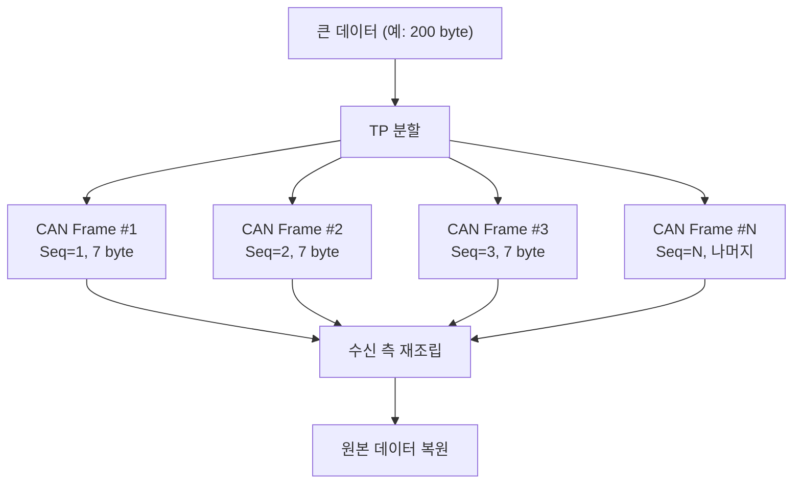
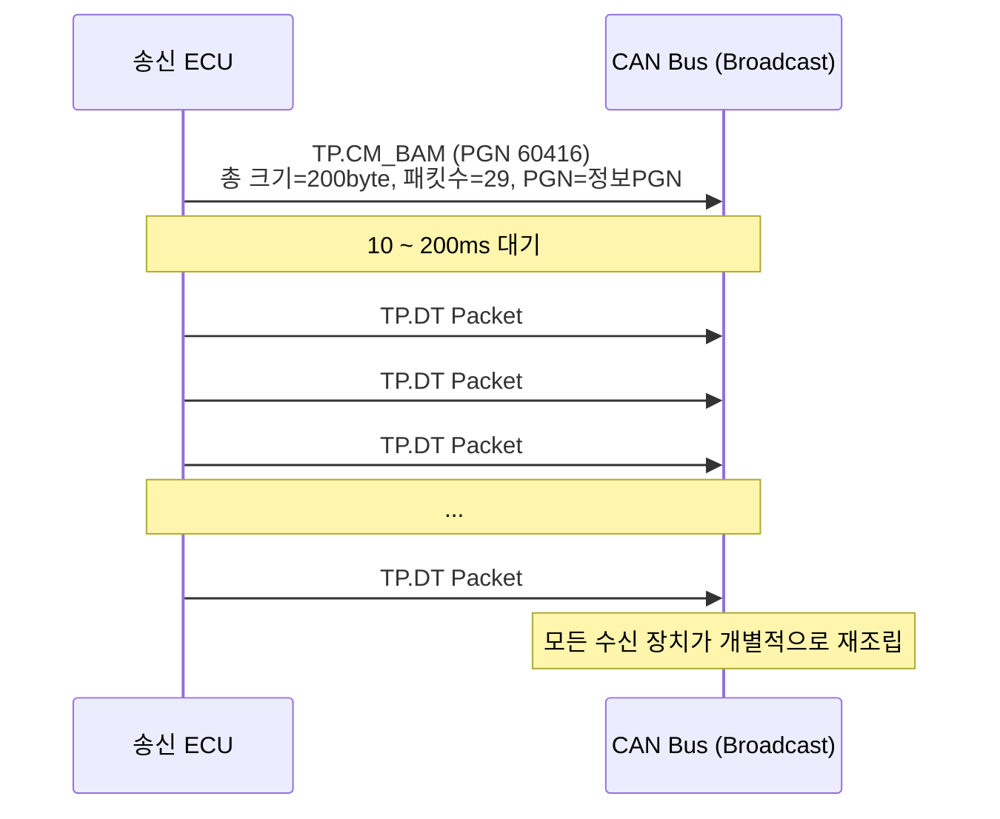
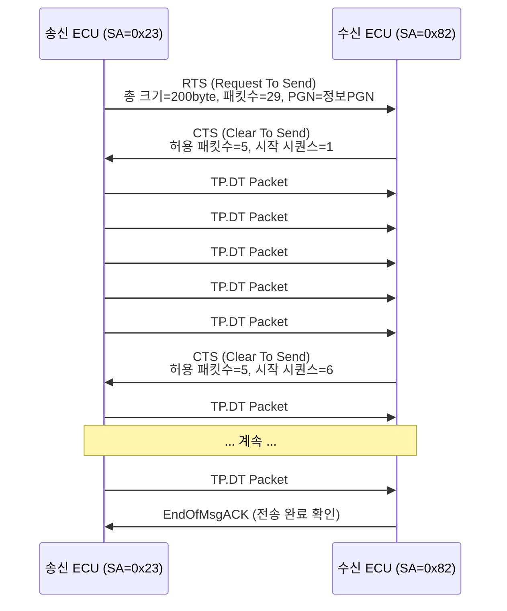
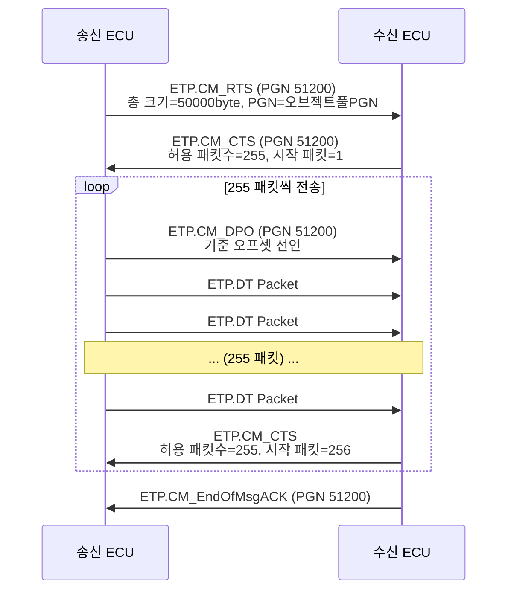
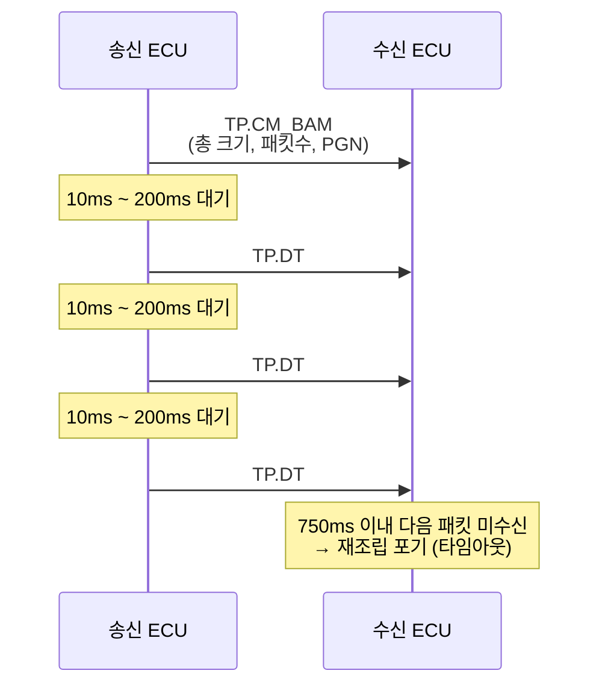
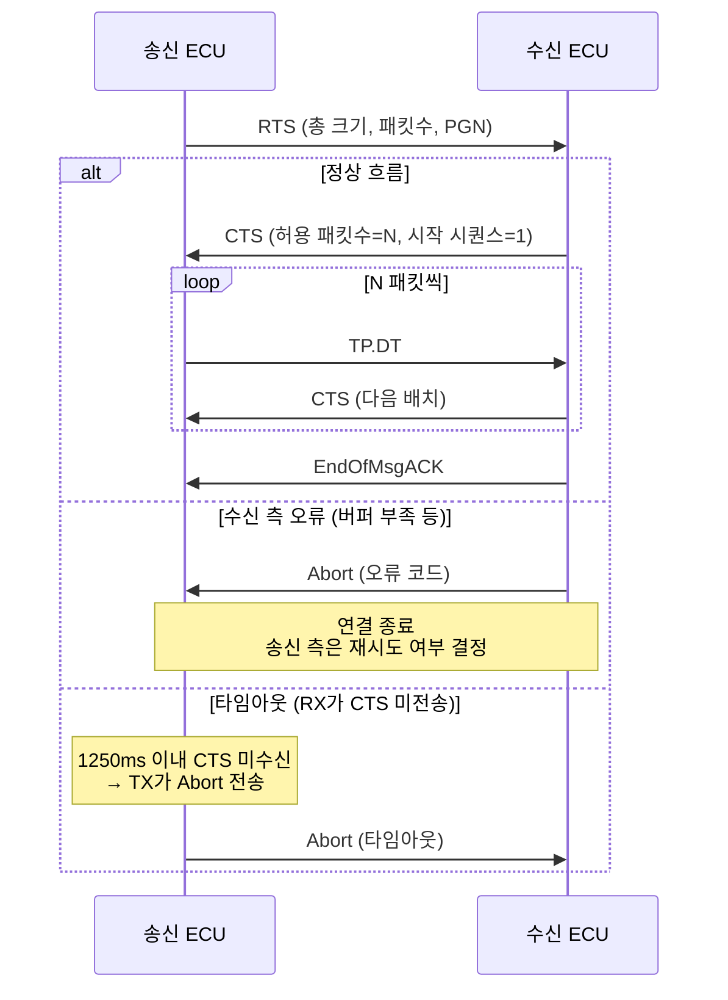

# J1939 Transport Protocol

::: info 학습 목표
- CAN 프레임의 8바이트 제한과 Transport Protocol의 필요성을 설명할 수 있다.
- BAM 방식과 CMDT 방식의 차이점과 적용 시나리오를 이해한다.
- TP.CM과 TP.DT 메시지의 역할과 PGN 번호를 안다.
- ETP가 필요한 상황과 TP와의 차이를 설명할 수 있다.
- 타임아웃 규칙을 이해하고 Abort 처리 흐름을 설명할 수 있다.
- TP/ETP 연결 관리 메시지(RTS·CTS·EndOfMsgACK·Abort·BAM·DPO)를 바이트 단위로 디코딩하고 값 범위 위반을 판별할 수 있다.
- Tr·Th·T1~T4 타이머와 성립·hold·닫힘 규칙으로 송신 측·수신 측 세션 상태 머신을 설계할 수 있다.
- 재전송 CTS·hold·Abort 사유 코드로 TP·ETP 실패 로그를 진단할 수 있다.
:::

## 1. 왜 Transport Protocol이 필요한가

CAN 프레임의 데이터 필드는 <strong>최대 8바이트</strong>이다. 단순한 센서 값이나 제어 신호는 8바이트 안에 담을 수 있지만, 다음과 같은 데이터는 그렇지 않다.

| 데이터 유형 | 일반 크기 |
|-------------|-----------|
| DM1 (진단 코드 목록) | 수십~수백 바이트 |
| VT 오브젝트 풀 (화면 정의) | 수십 KB ~ 수 MB |
| 소프트웨어 업데이트 펌웨어 | 수 KB ~ 수 MB |
| 제품 식별 정보(Product ID) | 수십 바이트 |

이런 데이터는 여러 CAN 프레임으로 <strong>분할(segmentation)</strong>하여 순서대로 전송해야 한다. 수신 측은 조각들을 모아 <strong>재조립(reassembly)</strong>한다. 이 역할을 담당하는 것이 <strong>J1939 Transport Protocol(TP)</strong>이다.



TP는 두 가지 모드를 제공한다.

- **BAM (Broadcast Announce Message)**: 1:N 브로드캐스트 전송
- **CMDT (Connection Mode Data Transfer)**: 1:1 연결 기반 전송 (흐름 제어 포함)

## 2. BAM (Broadcast Announce Message)

BAM은 특정 수신자를 지정하지 않고 <strong>버스 전체에 브로드캐스트</strong>하는 방식이다. 흐름 제어가 없으므로 수신자는 확인 응답(ACK)을 보내지 않는다. 구현이 단순하지만 재전송이 불가능하다.

### BAM 흐름



### TP.CM_BAM 메시지 구조 (8바이트)

| Byte | 내용 |
|------|------|
| Byte 1 | Control Byte = `0x20` (BAM 식별자) |
| Byte 2~3 | 총 데이터 크기 (Little-Endian, 9 ~ 1785 byte) |
| Byte 4 | 총 패킷 수 (2~255) |
| Byte 5 | `0xFF` (예약) |
| Byte 6~8 | 전송할 PGN (24bit, Little-Endian) |

(전체 8바이트 안에서 Control Byte가 차지하는 위치는 아래 §4 TP.CM 바이트 레이아웃 그림 참고)

### 타이밍 규칙

| 항목 | 값 |
|------|----|
| BAM 후 첫 TP.DT까지 대기 | 10ms ~ 200ms |
| TP.DT 패킷 간 간격 | 10ms ~ 200ms (최소 10ms는 수신 측이 CAN 하드웨어에서 메시지를 꺼낼 시간 보장) |
| 수신 측 타임아웃 | 750ms (패킷 미수신 시 재조립 포기) |

## 3. CMDT (Connection Mode Data Transfer)

CMDT는 **특정 수신자와 1:1 연결을 맺고** 흐름 제어를 포함한 데이터 전송을 수행한다. 수신자가 처리 가능한 패킷 수를 제어(CTS)할 수 있어 버퍼 오버플로를 방지한다.

### CMDT 흐름



### CMDT 제어 메시지 Control Byte 값

| 메시지 | Control Byte | 설명 |
|--------|-------------|------|
| RTS | 0x10 | 전송 요청 (총 크기, 패킷 수, CTS당 최대 패킷 수, PGN 포함) |
| CTS | 0x11 | 수신 준비 (허용 패킷 수, 시작 시퀀스 번호) |
| EndOfMsgACK | 0x13 | 전체 전송 완료 확인 |
| Abort | 0xFF | 연결 중단 (사유 코드 포함) |

몇 가지 세부 규칙이 있다.

- <strong>RTS Byte 5</strong>는 CTS 하나가 지정할 수 있는 최대 패킷 수의 제한이다(0xFF면 제한 없음). CTS의 허용 패킷 수는 RTS의 총 패킷 수(Byte 4)와 이 제한(Byte 5) 중 <strong>작은 값을 넘을 수 없다.</strong> 수신 측이 이 제한을 지키면 송신 측은 놓친 패킷을 항상 재전송할 수 있음이 보장된다.
- <strong>CTS(0)</strong> — 허용 패킷 수 0의 CTS는 연결을 유지한 채 흐름을 잠시 멈추는 hold다. 수 초간 멈춰야 하면 연결이 끊기지 않도록 <strong>Th(500 ms)마다 CTS(0)를 반복 송신</strong>해야 하고, 송신 측은 CTS(0) 후 <strong>T4(1050 ms)</strong> 안에 다음 CTS가 오지 않으면 연결을 닫는다.

### 연결 제약

- 하나의 송신 장치는 <strong>특정 목적지당 동시에 1개의 CMDT 연결</strong>만 시작할 수 있다. TP.DT에는 SA·DA만 있고 전송 중인 데이터의 PGN 정보가 없기 때문이다.
- 하나의 송신 장치는 <strong>동시에 1개의 BAM</strong>만 보낼 수 있다. 같은 상대에 대한 CMDT 1개 + BAM 1개는 DA(특정/Global)로 구분되므로 병행할 수 있다.

### Connection Abort 주요 사유 코드

| 코드 | 의미 |
|------|------|
| 1 | 이미 다른 세션 진행 중이라 추가 세션 불가 |
| 2 | 시스템 자원이 다른 작업에 필요해 세션 종료 |
| 3 | 타임아웃 발생 |
| 4 | 데이터 전송 중 CTS 수신 |
| 5 | 최대 재전송 요구 한도 도달 |
| 6~9 | 예기치 않은 패킷, 잘못된/중복 시퀀스 번호, 크기 초과 등 |

### BAM vs CMDT 비교

| 항목 | BAM | CMDT |
|------|-----|------|
| 수신 대상 | 브로드캐스트 (전체) | 특정 장치 (1:1) |
| 흐름 제어 | 없음 | 있음 (CTS) |
| 완료 확인 | 없음 | EndOfMsgACK |
| 재전송 | 불가 | 가능 (CTS로 누락 패킷부터 재요청, 2회 이하 권장) |
| 최대 크기 | 1785 byte | 1785 byte |

## 4. TP.CM과 TP.DT

Transport Protocol은 <strong>두 가지 PGN</strong>으로 동작한다.

### TP.CM (PGN 60416, 0xEC00) — Connection Management

연결 관리를 담당한다. BAM 공지, RTS/CTS 흐름 제어, EndOfMsg, Abort 메시지가 모두 이 PGN을 사용하며, <strong>Control Byte(Byte 1)</strong>로 메시지 종류를 구분한다.


### TP.DT (PGN 60160, 0xEB00) — Data Transfer

실제 데이터를 7바이트씩 분할하여 전송한다. **Byte 1은 시퀀스 번호(1~255)**, Byte 2~8이 페이로드이다. 마지막 패킷의 남는 바이트는 0xFF로 채운다.


**예시 — 16바이트 데이터 전송:**


## 5. ETP (Extended Transport Protocol)

TP는 최대 **1785 바이트**(255 패킷 × 7 바이트)까지 전송할 수 있다. ISOBUS VT 오브젝트 풀처럼 더 큰 데이터를 전송하려면 <strong>ETP(Extended Transport Protocol)</strong>를 사용한다.

### ETP vs TP 비교

| 항목 | TP | ETP |
|------|----|-----|
| CM PGN | TP.CM 60416 (0xEC00) | ETP.CM 51200 (0xC800) |
| DT PGN | TP.DT 60160 (0xEB00) | ETP.DT 50944 (0xC700) |
| 최대 데이터 크기 | 1785 byte | 117 440 505 byte ≒ 112 MB ((2^24 − 1) 패킷 × 7 byte) |
| 패킷당 데이터 | 7 byte | 7 byte |
| 연결 방식 | BAM 또는 CMDT | CMDT 전용 |

ETP는 제어 메시지가 하나 더 있다. <strong>ETP.CM_DPO(Data Packet Offset, Control Byte 22)</strong>다. ETP.DT의 시퀀스 번호는 TP와 같은 1바이트(1~255)뿐이므로, 송신 측이 CTS 묶음마다 DPO로 <strong>기준 오프셋</strong>을 먼저 선언하고 그 뒤 ETP.DT를 보낸다. 실제 패킷 번호는 `DPO 오프셋 + ETP.DT 시퀀스 번호`로 계산되며, DPO 다음의 첫 ETP.DT는 항상 시퀀스 번호 1이다. 참고로 수신 측이 CTS(0)(hold)를 보낸 경우에는 DPO로 응답하지 않는다.

### ETP CMDT 흐름



ETP는 <strong>CMDT 전용</strong>이다. BAM 방식의 ETP는 존재하지 않는다. 이는 대용량 데이터 전송 시 흐름 제어 없이는 수신 버퍼 오버플로가 발생할 수 있기 때문이다.

### ISOBUS VT 오브젝트 풀 전송

VT(Virtual Terminal)에 화면을 표시하려면 오브젝트 풀을 전송해야 한다. 오브젝트 풀은 수십 KB를 초과하는 경우가 많으므로 ETP를 통해 전송된다.

```
작업기 ECU → VT:
  ETP.CM_RTS (오브젝트 풀 PGN, 총 크기)
  → ETP.CM_CTS
  → ETP.CM_DPO + ETP.DT × N (CTS 묶음마다 반복)
  → ETP.CM_EndOfMsgACK
  → End of Object Pool 메시지 (ISO 11783-6:2018 C.2.4)
```

## 6. 시퀀스 다이어그램으로 보는 TP/ETP 흐름

### BAM 전체 흐름과 타임아웃



### CMDT 전체 흐름과 Abort 처리



### 타임아웃 규칙 요약

| 상황 | 타임아웃 값 | 처리 |
|------|------------|------|
| RTS 후 CTS 대기 | 1250ms (T3) | 송신 측 Abort |
| CTS 후 첫 TP.DT 대기 | 1250ms (T2) | 수신 측 Abort |
| TP.DT 패킷 간 간격 | 750ms (T1) | 수신 측 Abort |
| 마지막 패킷 송신 후 CTS/EndOfMsgACK 대기 | 1250ms (T3) | 송신 측 Abort |
| CTS(0) 후 다음 CTS 대기 | 1050ms (T4) | 송신 측 Abort |
| CTS(0) hold 반복 주기 | 500ms (Th) | 수신 측이 이 주기로 CTS(0) 재송신 |
| BAM TP.DT 패킷 간 | 750ms (T1) | 수신 측 재조립 포기 |

::: tip 핵심 정리
- CAN 프레임은 최대 8바이트이므로, 큰 데이터는 Transport Protocol로 분할 전송한다.
- **BAM**: 브로드캐스트, 흐름 제어 없음. TP.CM_BAM(PGN 60416) → TP.DT(PGN 60160).
- **CMDT**: 1:1 연결, CTS로 흐름 제어. RTS → CTS → TP.DT → EndOfMsgACK.
- TP.DT는 패킷당 7바이트 페이로드, Byte 1이 시퀀스 번호(1~255), 남는 바이트는 0xFF 패딩. BAM 패킷 간 간격은 10~200 ms.
- **ETP**: 1785 바이트 초과 시 사용. PGN 51200(ETP.CM, 0xC800), 50944(ETP.DT, 0xC700). CMDT 전용이며 DPO로 오프셋을 선언한다.
- 타임아웃 초과 시 Abort(Control Byte=0xFF)를 사유 코드와 함께 전송하여 연결을 종료한다.
:::

## 7. 20바이트를 직접 쪼개 보기

앞 절들이 BAM·CMDT의 흐름과 필드 정의를 다이어그램·표로 다뤘다면, 여기서는 <strong>20바이트짜리 데이터 하나를 BAM과 CMDT 두 방식으로 전송할 때 버스에 실제로 흐르는 모든 프레임의 8바이트</strong>를 끝까지 나열한다.

### 공통 설정 — 보낼 데이터와 목적 PGN

전송할 데이터는 Component Identification(<strong>PGN 65259</strong>, `0x00FEEB`) 20바이트로 정한다. 이 PGN은 부록(ISO 11783-3 정리) Annex B.1의 오류 없는 전송 예제와 Annex C의 BROADCAST/RESPONSE 예제에서 실제로 쓰인 PGN이다. Make·Model·Serial·Unit을 `*`로 구분한 ASCII 문자열을 데이터로 쓴다.

```
원본 문자열: "AGMO*TP100*SN0007*01"   (Make=AGMO, Model=TP100, Serial=SN0007, Unit=01)

hex(20 byte):
41 47 4D 4F 2A 54 50 31 30 30 2A 53 4E 30 30 30 37 2A 30 31
```

### 패킷 수 계산

TP.DT는 Byte 1이 시퀀스 번호이므로 <strong>페이로드는 프레임당 7바이트</strong>다(§4 TP.CM과 TP.DT 참고). 20바이트를 7바이트씩 나누면 다음과 같다.

```
20 byte ÷ 7 byte/packet = 2.86... → 올림하면 3 packet

Packet #1 (Seq=1): 7 byte 실데이터
Packet #2 (Seq=2): 7 byte 실데이터
Packet #3 (Seq=3): 6 byte 실데이터 + FF 1byte 패딩   ← 20 − 7×2 = 6 byte
```

<strong>총 패킷 수 = 3</strong>이며, 마지막 패킷은 남는 1바이트를 `FF`로 채운다.

### BAM 시퀀스 — 프레임 4개

목적지는 Global(브로드캐스트)이다. TP.CM_BAM(Control Byte `0x20`) 1프레임과 TP.DT 3프레임, 총 4프레임이 순서대로 나간다.

| 순번 | PGN | 8바이트 hex | 의미 |
|---|---|---|---|
| 1 | TP.CM (60416) | `20 14 00 03 FF EB FE 00` | BAM 공지 — Control=`0x20`, 총 크기=`14 00`(LE, 20byte), 총 패킷수=`03`, 예약=`FF`, 대상 PGN=`EB FE 00`(LE, 65259) |
| 2 | TP.DT (60160) | `01 41 47 4D 4F 2A 54 50` | Seq=`01`, 데이터 `"AGMO*TP"` |
| 3 | TP.DT (60160) | `02 31 30 30 2A 53 4E 30` | Seq=`02`, 데이터 `"100*SN0"` |
| 4 | TP.DT (60160) | `03 30 30 37 2A 30 31 FF` | Seq=`03`, 데이터 `"007*01"`(6byte) + `FF` 패딩 |

BAM 후 첫 TP.DT까지, 그리고 TP.DT 패킷 사이는 각각 <strong>10~200ms</strong> 대기해야 한다. 수신 측은 확인 응답을 보내지 않는다.

### CMDT 시퀀스 — 프레임 6개

목적지는 특정 CF다(예: 송신 SA=`0x23`, 수신 SA=`0x82`, §3 CMDT 흐름의 예시와 동일). RTS → CTS → TP.DT 3프레임 → EndOfMsgACK, 총 6프레임이 오간다. 20바이트·3패킷 정도는 CTS 한 번으로 전부 허용해도 되므로 CTS 묶음은 1회만 등장한다.

| 순번 | 메시지 (PGN) | 8바이트 hex | 의미 |
|---|---|---|---|
| 1 | RTS · TP.CM (60416) | `10 14 00 03 FF EB FE 00` | Control=`0x10`, 총 크기=`14 00`(20byte), 총 패킷수=`03`, CTS당 최대 패킷수=`FF`(제한 없음), 대상 PGN=65259 |
| 2 | CTS · TP.CM (60416) | `11 03 01 FF FF EB FE 00` | Control=`0x11`, 허용 패킷수=`03`, 시작 시퀀스=`01`, Byte4~5 예약=`FF FF`, 대상 PGN=65259 |
| 3 | TP.DT (60160) | `01 41 47 4D 4F 2A 54 50` | Seq=`01`, 데이터 `"AGMO*TP"` |
| 4 | TP.DT (60160) | `02 31 30 30 2A 53 4E 30` | Seq=`02`, 데이터 `"100*SN0"` |
| 5 | TP.DT (60160) | `03 30 30 37 2A 30 31 FF` | Seq=`03`, 데이터 `"007*01"`(6byte) + `FF` 패딩 |
| 6 | EndOfMsgACK · TP.CM (60416) | `13 14 00 03 FF EB FE 00` | Control=`0x13`, 총 크기=`14 00`(20byte), 총 패킷수=`03`, 예약=`FF`, 대상 PGN=65259 — 수신 완료 확인 |

CTS의 Byte 2(`03`)는 RTS의 Byte 4(총 패킷수 `03`)와 Byte 5(`FF`=제한 없음) 중 <strong>작은 값을 넘지 않는다</strong>는 규칙을 그대로 지킨 값이다.

### 두 방식 비교

| 항목 | BAM | CMDT |
|---|---|---|
| 총 프레임 수 | 4 (BAM 1 + DT 3) | 6 (RTS 1 + CTS 1 + DT 3 + EndOfMsgACK 1) |
| 목적지 | Global(브로드캐스트) | 특정 CF(destination-specific) |
| 패킷 간격 규정 | BAM→DT1, DT1→DT2, DT2→DT3 각각 10~200ms(3구간) | DT1→DT2, DT2→DT3 최대 200ms·최소 규정 없음(2구간) |
| 대략적 소요 시간(간격만) | 최소 30ms ~ 최대 600ms | 최소 0ms대 ~ 최대 약 400ms(+ RTS→CTS·EndOfMsgACK 응답 시간) |
| 완료 확인 | 없음 | EndOfMsgACK로 확인 |
| 재전송 | 불가 | 가능 — CTS로 누락 시퀀스부터 재요청 |

::: tip 핵심 통찰
같은 20바이트라도 <strong>CMDT가 프레임 수는 더 많다</strong>(6개 vs 4개). RTS·CTS·EndOfMsgACK라는 제어 오버헤드 3프레임이 붙기 때문이다. 대신 CMDT는 목적지가 명확하고 흐름 제어·재전송이 가능해 신뢰성이 필요한 1:1 전송에 쓰이고, BAM은 오버헤드 없이 여러 수신자에게 한 번에 뿌려야 할 때(Component ID 공지 등) 쓰인다. 어느 쪽이 항상 빠르거나 우월한 게 아니라, <strong>신뢰성이 필요한가 vs 여러 수신자에게 동시에 알려야 하는가</strong>가 선택 기준이다.
:::

:::details 파이썬으로 검산해 보기
```python
def tp_dt_frames(data: bytes):
    """7바이트씩 잘라 시퀀스 번호를 붙이고 마지막 패킷은 FF로 패딩한다."""
    frames = []
    for i in range(0, len(data), 7):
        chunk = data[i:i + 7]
        seq = i // 7 + 1
        payload = list(chunk) + [0xFF] * (7 - len(chunk))
        frames.append([seq] + payload)
    return frames


DATA = b"AGMO*TP100*SN0007*01"
PGN = 65259                      # Component Identification

assert len(DATA) == 20

total_size = len(DATA)
size_lo, size_hi = total_size & 0xFF, (total_size >> 8) & 0xFF
pgn_lo  = PGN & 0xFF
pgn_mid = (PGN >> 8) & 0xFF
pgn_hi  = (PGN >> 16) & 0xFF

dt_frames = tp_dt_frames(DATA)
num_packets = len(dt_frames)
assert num_packets == 3

bam = [0x20, size_lo, size_hi, num_packets, 0xFF, pgn_lo, pgn_mid, pgn_hi]
rts = [0x10, size_lo, size_hi, num_packets, 0xFF, pgn_lo, pgn_mid, pgn_hi]
cts = [0x11, num_packets, 1, 0xFF, 0xFF, pgn_lo, pgn_mid, pgn_hi]
eom = [0x13, size_lo, size_hi, num_packets, 0xFF, pgn_lo, pgn_mid, pgn_hi]

def show(label, frame):
    print(f"{label:14s}", ' '.join(f'{b:02X}' for b in frame))

show("TP.CM_BAM", bam)
for f in dt_frames:
    show(f"TP.DT#{f[0]}", f)

print()
show("RTS", rts)
show("CTS", cts)
for f in dt_frames:
    show(f"TP.DT#{f[0]}", f)
show("EndOfMsgACK", eom)

# BAM 프레임 4개, CMDT 프레임 6개인지 검산
assert 1 + len(dt_frames) == 4
assert 3 + len(dt_frames) == 6
```

실행 결과:
```
TP.CM_BAM      20 14 00 03 FF EB FE 00
TP.DT#1        01 41 47 4D 4F 2A 54 50
TP.DT#2        02 31 30 30 2A 53 4E 30
TP.DT#3        03 30 30 37 2A 30 31 FF

RTS            10 14 00 03 FF EB FE 00
CTS            11 03 01 FF FF EB FE 00
TP.DT#1        01 41 47 4D 4F 2A 54 50
TP.DT#2        02 31 30 30 2A 53 4E 30
TP.DT#3        03 30 30 37 2A 30 31 FF
EndOfMsgACK    13 14 00 03 FF EB FE 00
```
:::

## 8. 연결 관리 규칙 — 성립·hold·닫힘

§3과 §6이 RTS/CTS의 흐름과 타임아웃 값을 봤다면, 이 절은 ISO 11783-3:2018(이하 Part 3) 5.10.3~5.10.4가 정한 판정 규칙을 모은다. 구현에서 버그가 나는 곳은 대개 정상 흐름이 아니라 "이 상황에서 무엇을 보내야 하나"다.

### originating CF와 receiving CF

Part 3은 RTS를 보내는 쪽을 <strong>originating CF</strong>(이하 송신 측), CTS를 보내는 쪽을 <strong>receiving CF</strong>(이하 수신 측)라고 부른다(5.10.1). 메시지마다 누가 보내는지가 정해져 있다.

| 메시지 | 송신 측 | 수신 측 | 근거 |
|---|---|---|---|
| TP.CM_RTS, TP.CM_BAM, TP.DT | 보냄 | — | 5.10.4.2, 5.10.4.6, 5.10.5 |
| TP.CM_CTS, TP.CM_EndOfMsgACK | — | 보냄 | 5.10.4.3, 5.10.4.4 |
| TP.Conn_Abort | 보냄 | 보냄 | 5.10.4.5 |

가상 연결(virtual connection)은 PGN 하나로 기술되는 대형 메시지 하나를 옮기려고 두 CF가 잠시 맺는 관계다. 일대다인 BAM에는 흐름 제어도 닫기 절차도 없다(5.10.3.1).

### 연결이 "성립"하는 시점은 양쪽이 다르다

| 쪽 | 성립 시점 | 근거 |
|---|---|---|
| 송신 측 | RTS에 대응하는 CTS를 받았을 때 | 5.10.3.3 |
| 수신 측 | RTS에 대한 CTS를 성공적으로 보냈을 때 | 5.10.3.3 |

이 정의가 Abort를 언제 보내는지 가른다. 여기서 몇 가지 규칙이 나온다.

- 수신 측이 RTS를 보고 연결을 맺지 않기로 했다면 Connection Abort를 보내는 것이 좋다(should). 그래야 송신 측이 타임아웃을 기다리지 않고 다음 연결로 넘어간다(5.10.3.3, 5.10.4.5). 연결이 성립하기 전이라도 거절 Abort는 보낼 수 있다.
- 연결이 성립하지 않은 상태에서 CTS를 받으면 무시한다(shall, 5.10.4.3).
- 같은 SA에서 같은 PGN의 RTS가 여러 번 오면 가장 최근 RTS를 따르고 이전 것은 버린다. 이때 버린 RTS에 대해서는 Abort를 보내지 않는다(5.10.4.2).
- 연결이 성립한 뒤 CTS가 여러 개 오면 연결을 Abort해야 하고, 송신 측이 Abort할 때는 사유 4를 쓴다(5.10.4.3).


### CTS 규칙

- CTS의 패킷 수(Byte 2)는 RTS의 Byte 4(총 패킷 수)와 Byte 5(CTS당 최대 패킷 수) 중 작은 값을 넘을 수 없다(shall, 5.10.4.1, 5.10.4.3).
- 수신 측은 이전 CTS 구간의 마지막 데이터 패킷을 받았거나 타임아웃이 나기 전에는 다음 CTS를 보내면 안 된다(shall). 타임아웃이 났다면 Abort와 CTS 중 고를 수 있다(5.10.4.3).
- 수신 측은 받겠다고 한 패킷 수만큼 처리할 자원을 확보해야 한다(shall, 5.10.3.3).
- CTS는 흐름 제어이면서 "그 CTS가 요청하는 패킷 번호 앞까지는 다 잘 받았다"는 확인이다. 그래서 이전 CTS 구간의 데이터가 깨졌다면 다음 패킷으로 넘어가기 전에 깨진 구간을 다시 요청하는 CTS를 먼저 보내야 한다(shall, 5.10.4.3).

### hold — CTS(0)

수신 측이 연결을 연 채 흐름을 잠시 멈추려면 패킷 수 0의 CTS를 보낸다(shall, 5.10.3.4.2). 나머지 비트 필드는 모두 1("Don't care")이다. Annex B Figure B.1의 hold 프레임은 `11 00 FF FF FF` + PGN이다. 멈추는 시간이 길어지면 연결이 끊긴 것으로 오해받지 않도록 Th(0.5 s)마다 CTS(0)를 다시 보내야 한다(5.10.3.4.2). 송신 측은 CTS(0)를 받은 뒤 T4(1.05 s) 안에 다음 CTS가 오지 않으면 연결을 닫는다(5.10.3.5).

Th 0.5 s와 T4 1.05 s의 차이가 여유다. 수신 측이 0.5 s 주기를 지키면 송신 측의 1.05 s 타이머는 만료되지 않는다. 반복 CTS(0)가 하나 늦어지면 버틸 여유는 약 0.55 s뿐이다(계산에서 나온 해설).

### EndOfMsgACK와 닫힘

- 수신 측은 마지막 패킷을 받고 메시지 전체를 제대로 재조립했을 때 EndOfMsgACK를 한 번 보낸다(5.10.4.4). 이것이 연결을 닫는 신호이고, 연결을 다른 CF가 쓸 수 있게 풀어 준다(5.10.3.5).
- 수신 측은 마지막 데이터 전송 뒤 EndOfMsgACK를 바로 보내지 않고 연결을 열어 둘 수 있다. 필요하면 패킷을 다시 받으려는 것이다(5.10.4.4).
- 송신 측이 마지막 데이터 전송 전에 EndOfMsgACK를 받으면 무시한다(5.10.4.4).
- BAM에는 닫기 절차가 없다. 송신 측은 마지막 패킷을 보냈을 때, 수신 측은 마지막 패킷을 받았거나 T1이 지났을 때 닫힌 것으로 본다. BAM 수신 측은 Connection Abort를 보낼 수 없다(5.10.3.5).

### Abort를 받은 뒤

- 송신 측은 Connection Abort를 받으면 즉시 송신을 멈춰야 한다. 즉시가 불가능하면 멈출 때까지 데이터 패킷 32개, 50 ms를 넘지 않아야 한다(shall, 5.10.4.5).
- Connection Abort를 보내거나 받은 뒤에는 그 연결의 데이터 패킷을 모두 무시한다(5.10.4.5).
- 수신 측이 처리 자원이 없다고 판단하면 사유 2로 Abort할 수 있고, 이 메시지를 받으면 이미 넘어간 패킷은 버린다(5.10.3.5).
- 타임아웃을 포함해 어떤 이유로든 연결을 닫기로 하면 사유 3의 Connection Abort를 보낸다(shall, 5.10.3.5).

::: warning Abort 뒤에도 TP.DT가 더 올 수 있다
32패킷·50 ms 규정은 송신 측이 Abort를 받고도 이미 큐에 넣은 패킷을 더 내보낼 수 있다는 현실을 인정한 것이다. 수신 측은 Abort를 보낸 뒤에도 같은 SA·DA의 TP.DT가 최대 32개 더 올 수 있다고 보고, 이를 새 세션의 데이터로 오해하지 않게 버려야 한다(5.10.4.5에서 따라 나오는 구현 해설).
:::

## 9. 타이머와 TP.CM 값 검사

### 타이머가 놓이는 자리

§6의 타임아웃 표에 응답 시간 Tr을 더해 Annex B Figure B.1의 배치로 다시 그리면 다음과 같다.


| 타이머 | 값 | 재는 쪽 | 구간 | 근거 |
|---|---|---|---|---|
| Tr | 200 ms 이하 | 양쪽 | 응답·다음 송신까지의 상한(RTS → CTS, CTS → 첫 DT, DT 사이, 마지막 DT → EndOfMsgACK) | 5.13.3, Figure B.1 |
| Th | 500 ms 이하 | 수신 측 | CTS(0) 반복 주기 | 5.10.3.4.2 |
| T1 | 750 ms | 수신 측 | 패킷을 받은 뒤 다음 패킷을 기다리는 한도 | 5.10.3.5 |
| T2 | 1250 ms | 수신 측 | CTS를 보낸 뒤 데이터를 기다리는 한도 | 5.10.3.5 |
| T3 | 1250 ms | 송신 측 | RTS 또는 마지막 DT를 보낸 뒤 CTS·EndOfMsgACK를 기다리는 한도 | 5.10.3.5, 5.13.3 |
| T4 | 1050 ms | 송신 측 | CTS(0)을 받은 뒤 다음 CTS를 기다리는 한도 | 5.10.3.5 |

Part 3은 수신 측 타임아웃은 값으로, 송신 측 요구는 "이하"로 적었다고 설명한다(5.13.3). 그림에서 Tr이 양쪽에 나오는 이유가 여기 있다. 송신 측도 CTS를 받은 뒤 첫 DT까지, DT와 DT 사이를 200 ms 이내로 지켜야 수신 측의 T2·T1이 만료되지 않는다. 특정 목적지 전송의 패킷 간격은 0~200 ms이고 최소 간격은 없다(5.10.2.4, 5.13.3). BAM은 10~200 ms이며, 최소 10 ms는 수신 측이 CAN 하드웨어에서 메시지를 꺼낼 시간을 보장하려는 값이다(5.13.3).

### TP.CM 값 범위

Part 3 5.10.4.1은 TP.CM의 각 값에 허용 범위를 정한다. 수신 측이 RTS를 받자마자 검사할 항목이다.

| 값 | 허용 | 불허 |
|---|---|---|
| Total message size (2바이트) | 9 ~ 1785 | 0 ~ 8, 1786 ~ 65535 |
| Total number of packets | 2 ~ 255 | 0, 1 |
| Maximum number of packets (RTS Byte 5) | 2 ~ 255 (FF는 제한 없음) | 0, 1 |
| Number of packets that can be sent (CTS Byte 2) | 0 ~ 255 (0은 hold) | — |
| Next packet number to be sent | 1 ~ 255 | 0 |
| Sequence number | 1 ~ 255 | 0 |
| Control byte | 16, 17, 19, 32, 255 | 0~15, 18, 20~31, 33~254 (예약) |

원문이 직접 적지는 않지만, 마지막을 뺀 모든 패킷이 7바이트라는 패킷화 규칙(5.10.2.4)에 따라 총 패킷 수는 ceil(총 크기 ÷ 7)과 같아야 한다. 총 크기가 1785를 넘는 RTS를 위해서는 Abort 사유 9가 따로 있다(Table 8).

패킷의 순서 규칙도 함께 검사한다. 시퀀스 번호는 1부터 매기고, 패킷은 1번부터 오름차순으로 보내야 한다(shall, 5.10.2.3). 수신 측은 패킷을 시퀀스 번호 순서로 하나의 바이트열로 조립해 그 메시지를 맡은 응용에 넘긴다(5.10.2.5). 한 메시지의 데이터 패킷은 모두 같은 CAN 식별자를 가진다는 점도 수신 측이 알고 있어야 한다(5.10.2.4). 식별자로는 패킷을 구별할 수 없고 Byte 1의 시퀀스 번호만이 구별 수단이라는 뜻이다.

::: details 파이썬 — RTS·CTS 값 검사기
```python
import math


def check_rts(d):
    """TP.CM_RTS 값 범위 검사 (Part 3 5.10.4.1). 위반 목록을 돌려준다."""
    errs = []
    size = d[1] | d[2] << 8
    if size > 1785:
        errs.append("size > 1785 -> Abort 9")
    elif size < 9:
        errs.append("size 0~8 불허")
    if not 2 <= d[3] <= 255:
        errs.append("total packets 2~255")
    elif 9 <= size <= 1785 and d[3] != math.ceil(size / 7):
        errs.append("total packets != ceil(size/7)")
    if not 2 <= d[4] <= 255:
        errs.append("max packets per CTS 2~255 (FF=제한 없음)")
    return errs


def check_cts(d, rts):
    errs = []
    n, nxt = d[1], d[2]
    if n > min(rts[3], rts[4]):
        errs.append("CTS 패킷 수 > min(RTS Byte 4, Byte 5)")
    if n and nxt == 0:
        errs.append("next packet 0 불허")
    if n and nxt + n - 1 > rts[3]:
        errs.append("요청 범위가 총 패킷 수를 넘음")
    return errs


rts_b1 = [16, 23, 0, 4, 255, 0xEB, 0xFE, 0x00]          # Figure B.1
assert check_rts(rts_b1) == []
assert check_rts([16, 0x10, 0x07, 4, 255, 0, 0, 0]) == ["size > 1785 -> Abort 9"]   # 0x0710 = 1808
assert check_rts([16, 23, 0, 3, 255, 0, 0, 0]) == ["total packets != ceil(size/7)"]
rts_b4 = [16, 44, 0, 7, 5, 0xDA, 0xFE, 0x00]             # Figure B.4
assert check_cts([17, 5, 1, 0xFF, 0xFF], rts_b4) == []
assert check_cts([17, 7, 1, 0xFF, 0xFF], rts_b4) == ["CTS 패킷 수 > min(RTS Byte 4, Byte 5)"]  # Figure B.5
assert check_cts([17, 0, 0xFF, 0xFF, 0xFF], rts_b1) == []                                   # hold
```
:::

### Abort 사유 — 누가, 언제

§3은 사유 코드를 간추렸다. Table 8의 코드를 "어떤 상황에서 나오는가"로 다시 묶으면 다음과 같다. 전체 표는 [Part 3 정리 부록](/study/isobus/appendix-iso-part03)에 있다.

| 코드 | 의미 | 원문이 명시한 사용 상황 |
|---|---|---|
| 1 | 이미 연결 관리 세션 중이라 하나 더 받을 수 없음 | 세션을 더 감당할 수 없을 때, 또는 같은 SA·같은 목적지에서 진행 중인 세션과 다른 PGN의 RTS가 올 때 수신 측이 거절(5.10.6.1) |
| 2 | 시스템 자원이 다른 작업에 필요해 세션 종료 | 수신 측이 처리 자원이 없다고 판단할 때(5.10.3.5) |
| 3 | 타임아웃으로 세션을 닫음 | 어느 쪽이든 타임아웃을 포함한 이유로 닫을 때(5.10.3.5) |
| 4 | 데이터 전송 중 CTS 수신 | 연결 성립 후 CTS가 여러 개 올 때 송신 측이 보냄(5.10.4.3, Figure B.7) |
| 5 | 최대 재전송 요구 한도 도달 | 재전송 CTS가 한도(2회 권장)에 이르렀을 때(5.10.4.3) |
| 6 | 예기치 않은 데이터 전송 패킷 | 정의만 있음 |
| 7 | 잘못된 시퀀스 번호(소프트웨어가 복구 불가) | 정의만 있음 |
| 8 | 중복 시퀀스 번호(소프트웨어가 복구 불가) | 정의만 있음 |
| 9 | Total message size가 1785바이트 초과 | 정의만 있음 |
| 250 | 표에 없는 사유 | — |
| 251~255 | ISO 11783-7 정의를 따름 | — |

0과 10~249는 예약이다. Abort 프레임 자체는 Byte 1 = 255(`0xFF`), Byte 2 = 사유, Byte 3~5 = 예약(FF), Byte 6~8 = 운반하던 PGN이다(5.10.4.1). 예를 들어 §7의 Component ID 전송을 타임아웃으로 닫는 Abort는 `FF 03 FF FF FF EB FE 00`이다. TP.CM 다섯 메시지의 바이트 배치 전체는 [Part 3 정리 부록](/study/isobus/appendix-iso-part03)의 5.10.4 표에 있다.

::: warning 원문 안의 차이 — T1 만료 뒤의 Abort 사유
5.10.3.5는 타임아웃을 포함해 어떤 이유로든 연결을 닫으면 사유 3을 보내라고 한다. 그런데 5.10.4.3은 마지막 패킷까지 빠져 T1이 지난 경우 수신 측이 "CTS 또는 사유 4의 Abort" 중에서 고른다고 적는다. 사유 4의 정의(데이터 전송 중 CTS 수신)는 송신 측에서 일어나는 상황이므로 5.10.3.5의 사유 3이 더 일관된다. Abort를 해석하는 쪽은 이 상황에서 두 코드가 모두 올 수 있다고 보는 편이 안전하다(추론).
:::

## 10. 재전송과 Annex B 시퀀스

### 재전송 규칙

수신 측은 CTS로 재전송을 요청한다(Part 3 5.10.4.3).

- 빠지거나 깨진 패킷이 있는데 마지막 패킷은 받았다면, 빠진 패킷부터 다시 보내 달라는 CTS를 보낸다.
- 마지막 패킷을 포함해 빠져 T1이 지났다면 CTS를 보낼지 Abort를 보낼지 수신 측이 고른다.
- 재전송 요청은 2회 이하가 권장이고, 한도에 이르면 사유 5의 Abort를 보내야 한다. 5.13.3도 같은 한도(재요청 2회, 요청 총 3회)를 T3 산정의 전제로 든다.

송신 측이 언제든 재전송할 수 있으려면 이미 보낸 패킷을 갖고 있어야 한다. RTS Byte 5가 그 장치다. 송신 측이 Byte 5로 CTS 한 번의 크기를 제한하면, 수신 측이 이 제한을 지키는 한 송신 측은 마지막 CTS 구간 안의 어떤 패킷이든 다시 보낼 수 있다(5.10.4.2, 5.10.4.3).

### Annex B 사례 일곱 가지

Part 3 Annex B(참고)는 전송 시퀀스 예를 일곱 개 든다. 그림의 숫자를 control byte부터 읽으면 다음과 같다.

| 그림 | 상황 | 핵심 프레임 |
|---|---|---|
| B.1 | 오류 없는 전송, 중간에 hold | RTS `16, 23, 4, 255, 65259` → CTS `17, 2, 1` → DT 1, 2 → CTS `17, 0`(hold) → CTS `17, 2, 3` → DT 3, 4 → EoMA `19, 23, 4, 255, 65259` |
| B.2 | 패킷 2 손상 | CTS `17, 1, 2`(2번만 다시) → DT 2 → CTS `17, 2, 3`(1·2번 수신 확인 겸) → DT 3, 4 → EoMA |
| B.3 | BAM, PGN 65260 | BAM `32, 17, 3, 255, 65260` → DT 1~3. 간격 10~200 ms, 수신 측 T1 750 ms |
| B.4 | RTS Byte 5를 양쪽이 지킴 | RTS `16, 44, 7, 5, 65242` → CTS `17, 5, 1` → DT 1~5 → CTS `17, 2, 6` → DT 6, 7 → EoMA |
| B.5 | 수신 측이 Byte 5를 무시 | RTS `16, 46, 7, 5, 65227` → CTS `17, 7, 1` → 송신 측이 7개를 보냄 |
| B.6 | CTS 구간의 마지막 패킷 누락 | RTS 100바이트·15패킷·Byte 5 = 5 → CTS 5개씩 → DT 10 누락 → 수신 측 T1 만료 → CTS(1, 10) → DT 10 → CTS(5, 11) → DT 11~15 → EoMA |
| B.7 | 재전송 CTS와 송신 속도 | RTS `16, 80, 12, 12` → CTS `17, 12, 1` → DT 3부터 누락. 느린 송신 측은 Abort, 빠른 송신 측은 재전송 성공 |

그림을 읽을 때 알아 둘 원문의 오기가 있다. Figure B.1은 두 번째·네 번째 DT를 "TP.DT 1", "TP.DT 3"으로 적고, B.4·B.5는 DT 6의 데이터를 "38 to 42"(36 to 42가 맞다)로, B.5는 EoMA의 패킷 수를 1(7이 맞다)로, B.7 b)는 T3를 "1 750 ms"(1250 ms가 맞다)로 적는다.

B.5는 5.10.4.3의 규칙(CTS ≤ RTS Byte 5)을 지키지 않는 수신 측과의 상호 운용을 보여 준다. 이때 송신 측은 수신 측 CTS를 따라야 하므로 5개씩 보내고 싶어도 7개를 보낸다. Annex B는 주의도 준다. 7번 패킷까지 보낸 뒤 수신 측이 1번 패킷부터 다시 달라고 하면, 송신 측은 데이터를 다시 계산해야 할 수 있고, 그러면 두 번째 1번 패킷은 처음과 내용이 다를 수 있다. PGN 65227처럼 동적인 데이터는 바뀔 수 있고, PGN 65242처럼 정적인 데이터는 그대로다. 송신 측은 RTS를 보낼 때의 데이터를 세션이 끝날 때까지 그대로 보관해 두는 편이 안전하다(추론).

### B.7 — 같은 재전송 CTS, 다른 결말

B.7은 송신 측의 패킷 간격만 다른 두 경우를 비교한다. 수신 측은 DT 1, 2만 받고 DT 3부터 놓친다. 마지막으로 받은 DT 2에서 T1(750 ms)이 지나면 재전송 CTS(10개, 3번부터)를 보낸다. 그림은 축척이 맞지 않으므로 시각을 직접 계산하면 다음과 같다(DT 1 송신을 0 s로 둔다).

| 송신 측 DT 간격 | DT 12 송신 시각 | 재전송 CTS 시각 | 그때 송신 측 상태 | 결과 |
|---|---|---|---|---|
| 200 ms | 2.2 s | 0.95 s | DT 5까지 보내고 아직 전송 중 | 송신 측이 사유 4로 Abort |
| 50 ms | 0.55 s | 0.80 s | 전송을 마치고 T3(0.55 + 1.25 = 1.8 s까지) 대기 중 | 재전송 CTS를 받아 DT 3부터 다시 보냄 |

느린 송신 측에게 이 CTS는 "데이터 전송 중에 온 CTS"라서 사유 4의 Abort가 된다. 수신 측이 T1을 다 채우고서야 CTS를 보내도 송신 측이 느리면 여전히 전송 중일 수 있다. 이 상황을 줄이려면 RTS Byte 5나 CTS 크기를 작게 잡아 한 구간의 전송 시간을 T1보다 짧게 유지하는 방법을 생각할 수 있다(추론).

::: details 파이썬 — B.7 시각 계산
```python
T1, T3 = 0.750, 1.250


def b7(per_dt):
    sends = [i * per_dt for i in range(12)]          # DT 1~12 송신 시각 (DT 1 = 0 s)
    cts_at = sends[1] + T1                           # 마지막으로 받은 DT 2 뒤 T1 만료 -> 재전송 CTS
    last = sends[-1]
    sent = sum(1 for t in sends if t <= cts_at)      # CTS가 올 때까지 보낸 DT 수
    if cts_at < last:
        verdict = "Abort 4 (전송 중 CTS)"
    else:
        verdict = "재전송 수락" if cts_at <= last + T3 else "T3 만료"
    return round(cts_at, 3), round(last, 3), sent, verdict


assert b7(0.200) == (0.95, 2.2, 5, "Abort 4 (전송 중 CTS)")
assert b7(0.050) == (0.8, 0.55, 12, "재전송 수락")
```
:::

### CTS 한 번에 몇 패킷을 줄까

Part 3 5.13.6은 일반적인 작업기 운용 중에는 CTS당 최대 패킷 수를 16으로 두라고 권고한다. 원문은 이유를 적지 않는다. 앞의 규칙들로 보면 구간이 작을수록 송신 측이 재전송용으로 보관할 데이터가 작고, B.7 같은 "전송 중 CTS" 충돌 가능성이 줄며, 한 연결이 버스를 오래 붙잡지 않는다(추론). 대신 CTS 프레임이 늘어난다. 이 득실은 §13의 ETP 예제에서 숫자로 본다.

## 11. 동시 세션과 세션 식별

TP.DT에는 SA와 DA만 있고, 어떤 PGN의 데이터인지도, 어느 연결의 데이터인지도 없다. 동시 세션 규칙은 모두 여기서 나온다(Part 3 5.10.6.2).

| 규칙 | 근거 |
|---|---|
| CF는 한 목적지에 대해 특정 목적지 TP 연결을 동시에 하나만 시작할 수 있다 | 5.10.6.2 |
| ETP 세션은 TP 연결과 병행할 수 있다 | 5.10.6.2 |
| 송신 CF는 BAM을 동시에 하나만 보낼 수 있다 | 5.10.6.2 |
| 수신 측은 서로 다른 SA의 multi-packet 메시지들이 섞여서 오는 것을 받아 낼 수 있어야 한다 | 5.10.6.2 |
| 같은 SA로부터 RTS/CTS 세션 하나와 BAM 세션 하나를 동시에 지원해야 하고, 둘은 DA(특정 대 전역)로 구별한다 | 5.10.6.2 |
| 같은 SA라도 DA가 다른 TP.DT·ETP.DT를 구별해야 하고, 데이터는 SA와 DA로 관리한다 | 5.10.6.2 |
| 세션을 더 감당할 수 없으면 새 연결을 거절하고, 같은 SA·같은 목적지에서 진행 중인 세션과 다른 PGN의 RTS도 거절한다. 둘 다 사유 1의 Abort | 5.10.6.1 |
| 병렬 TP/ETP 세션의 송신자는 수신자가 세션 하나 또는 둘 다를 얼마든지 hold할 수 있어 어느 쪽이 먼저 끝날지 예측할 수 없음을 알아야 한다 | 5.10.6.2, 5.11.7 |

구현으로 옮기면 수신 측 세션 표의 키는 (SA, DA, 종류)다. BAM의 DA는 255이므로 같은 SA의 RTS/CTS 세션과 키가 겹치지 않는다. TP와 ETP는 CM·DT의 PGN이 달라 종류로 구별된다. 송신 측은 세션마다 타이머를 따로 둬야 한다.

같은 PG가 8바이트 이하일 때는 단일 프레임으로, 8바이트를 넘을 때는 TP로 보내질 수 있고, 두 형태가 동시에 오갈 수 있다. 단일 프레임은 세션이 아니므로 같은 PGN의 TP 세션을 닫지 않는다(5.10.6.4). "같은 PGN의 단일 프레임이 왔으니 진행 중인 TP 재조립을 버린다" 같은 로직은 틀렸다.

갱신이 잦고 지연 요구가 엄격한 데이터는 하드웨어 필터를 쓸 수 있게 하라는 권고(5.13.1)도 TP 수신과 맞닿아 있다. 특정 목적지 TP.DT는 연달아 올 수 있으므로, DA가 내 주소이거나 전역인 TP.CM·TP.DT만 하드웨어에서 통과시키면 소프트웨어 부담이 줄어든다(추론).

## 12. ETP 세부

### ETP는 TP를 기반으로 한다

Part 3 5.11.1은 5.10(TP)이 ETP 요구사항의 기반이라고 밝힌다. 5.10의 규칙은 ETP에도 그대로 적용되고 ETP 메시지로 구현한다. 예를 들어 TP.CM_CTS에 대한 요구는 ETP.CM_CTS에 대한 요구다. 타이밍도 TP와 같다(5.11.4.1). 그래서 §8~§11의 성립·hold·닫힘·재전송 규칙과 타이머는 ETP에도 적용된다. 모든 ETP.CM 메시지는 특정 목적지 메시지이고 BAM 형태는 없다(5.11.5.2).

### ETP.CM 바이트 배치

ETP.CM은 PGN 51200(`0x00C800`), PF 200, 기본 Priority 7이고, ETP.DT는 PGN 50944(`0x00C700`), PF 199, 기본 Priority 7이다(5.11.5.2, 5.11.6).


TP.CM과 비교하면 차이가 분명하다.

- <strong>RTS에 패킷 수 필드가 없다.</strong> TP.CM_RTS는 총 패킷 수(Byte 4)와 CTS당 최대 패킷 수(Byte 5)를 갖지만, ETP.CM_RTS는 Byte 2~5 전부가 바이트 수다. 송신 측이 CTS 크기를 제한하는 장치가 없으므로 CTS의 패킷 수(0~255)는 수신 측이 정한다.
- <strong>CTS의 다음 패킷 번호가 3바이트다.</strong> 패킷 번호는 1 ~ 16 777 215(2²⁴ − 1)까지 갈 수 있다. 다만 CTS의 패킷 수 + 다음 패킷 번호 − 1이 16 777 215를 넘으면 안 된다(5.11.5.2 NOTE 1).
- <strong>DPO(Data Packet Offset)가 새로 있다.</strong> 시퀀스 번호는 TP.DT와 같은 1바이트(1~255)이므로, 송신 측은 CTS 구간마다 DPO로 기준 오프셋을 먼저 알린다.

최대 메시지 크기는 (2²⁴ − 1) 패킷 × 7바이트 = 117 440 505바이트다(5.11.3). 십진 접두어로 약 117 MB, 이진 단위로 약 112 MiB다. Part 1 6.3이 "117 Megabyte"라고 쓰고 §5 표가 "≒ 112 MB"라고 쓴 것은 같은 값을 다른 단위로 적은 것이다.

::: warning 원문 안의 차이 — ETP.CM의 값 범위 목록
5.11.5.2의 값 범위 목록은 "Number of packets that can be sent"를 256 ~ 16 777 215(3바이트, 0~255 불허)로, "Total number of packets"도 같은 범위로 적는다. 그런데 바로 아래 ETP.CM_CTS 배치는 패킷 수를 Byte 2 하나(0 또는 1~255)로 정의하고, ETP.CM_RTS에는 총 패킷 수 필드가 아예 없다. 구현은 메시지 배치(Byte 2 = 0~255)를 따라야 한다. 값 범위 목록을 그대로 검사 코드로 옮기면 정상적인 CTS를 전부 거절하게 된다.
:::

### DPO의 동작

- DPO는 한 CTS 구간 안에서 패킷 번호가 매겨지는 기준을 정한다. 실제 패킷 번호 = DPO의 오프셋 + ETP.DT의 시퀀스 번호다(5.11.5.5).
- DPO 다음의 첫 ETP.DT는 언제나 시퀀스 번호 1이다(5.11.6).
- DPO의 오프셋은 대응하는 CTS의 다음 패킷 번호보다 항상 1 작다(5.11.5.2). 오프셋 + 시퀀스 번호는 16 777 215를 넘으면 안 된다(NOTE 3).
- DPO의 패킷 수(Byte 2)는 CTS의 Byte 2 이하여야 한다(shall). 더 작으면 수신 측은 DPO가 정의한 데이터 블록과 뒤따르는 ETP.DT를 받도록 세션을 조정해야 한다(5.11.5.2).
- CTS(0)에는 DPO로 답하지 않는다(5.11.5.4).
- 수신 측은 ETP.CM_RTS를 받으면 자원을 판단해 패킷 수 0의 CTS로 연결을 연 채 기다리게 하거나, Abort로 닫을 수 있다(5.11.5.7).

### ETP의 Abort 사유

ETP Abort는 Table 9의 사유를 쓴다. 1~8은 TP와 같지만 <strong>9부터는 의미가 다르다</strong>.

| 코드 | 의미 |
|---|---|
| 1~8 | TP(Table 8)와 같다 |
| 9 | 예기치 않은 EDPO(DPO) 패킷 |
| 10 | DPO의 PGN이 잘못됨 |
| 11 | DPO의 패킷 수가 CTS보다 큼 |
| 12 | 잘못된 DPO 오프셋 |
| 13 | 폐기(deprecated). 대신 250 사용 |
| 14 | CTS의 PGN이 잘못됨 |
| 15 | CTS가 요청한 패킷이 메시지 크기를 넘음 |
| 250 | 그 밖의 사유 |
| 251~255 | ISO 11783-7 정의를 따름 |

0과 16~249는 예약이다(Table 9). TP의 사유 9(총 크기 1785 초과)는 ETP에 대응 코드가 없고, 같은 숫자 9가 ETP에서는 "예기치 않은 DPO"다. 그래서 Abort 해석기는 사유 코드를 보기 전에 그 Abort가 TP.CM(60416)으로 왔는지 ETP.CM(51200)으로 왔는지 먼저 갈라야 한다.

::: warning 원문 안의 차이 — "표에 없는 사유"의 코드
5.11.5.7 본문은 Table 9에 없는 사유면 코드 254를 쓰라고 적는다. 그런데 Table 9는 250을 "그 밖의 사유"로 정의하고, 13번도 "250을 쓰라"고 안내한다. 254는 표에서 251~255(ISO 11783-7 정의) 범위에 든다. 표 쪽(250)이 TP의 Table 8과도 일관되므로 송신은 250으로 하고, 수신 측은 254도 "그 밖의 사유"로 받아들이는 편이 안전하다(추론).
:::

## 13. 4000바이트를 ETP로 보내 보기

§7에서 20바이트를 BAM과 CMDT로 보낸 작업기 ECU(SA `0x23`)가 이번에는 4000바이트짜리 오브젝트 풀을 VT로 보낸다. VT의 주소는 `0x26`이라고 가정한다.

### 설정

- 운반할 PGN: ECU to VT(PGN 59136 = `0x00E700`, ISO 11783-6:2018 C.1). Part 6은 오브젝트 풀 전송에 특정 목적지 메시지와 연결 관리를 쓰고, 1785바이트를 넘으면 Part 3의 ETP를 쓰라고 정한다(Part 6 C.2.1).
- 데이터 Byte 1: `0x11`(Object pool transfer, Part 6 C.2.3). 나머지 3999바이트는 검산용 패턴이다. n번째 바이트(1부터 셈)의 값을 (n − 1)의 하위 8비트로 채워, 바이트 값만 보고도 원본 위치를 되짚을 수 있게 했다.
- 패킷 수: ceil(4000 ÷ 7) = 572개. 마지막 패킷은 3바이트와 FF 4개다.
- ID: ETP.CM은 Priority 7, PF `0xC8`이므로 ECU → VT가 `0x1CC82623`, VT → ECU가 `0x1CC82326`이다. ETP.DT는 `0x1CC72623`이다. ECU to VT 메시지의 기본 Priority는 5지만(Part 6 C.1), 전송 프레임에는 ETP의 Priority 7이 붙는다.

VT는 CTS 하나에 255패킷씩 받기로 하고, 첫 구간 뒤에 객체를 해석하느라 한 번 hold한다.


### 바이트로 따라가기

| # | ID | 데이터 | 해석 |
|---|---|---|---|
| 1 | `1CC82623` | `14 A0 0F 00 00 00 E7 00` | ETP.CM_RTS. control 20, 크기 `A0 0F 00 00` = 4000, PGN 59136 |
| 2 | `1CC82326` | `15 FF 01 00 00 00 E7 00` | ETP.CM_CTS. 255패킷, 다음 패킷 1 |
| 3 | `1CC82623` | `16 FF 00 00 00 00 E7 00` | ETP.CM_DPO. 255패킷, 오프셋 0 |
| 4 | `1CC72623` | `01 11 01 02 03 04 05 06` | DT seq 1 = 패킷 1 (원본 1~7바이트) |
| | | … | DT seq 2~254 |
| 5 | `1CC72623` | `FF F2 F3 F4 F5 F6 F7 F8` | DT seq 255 = 패킷 255 (원본 1779~1785바이트) |
| 6 | `1CC82326` | `15 00 FF FF FF 00 E7 00` | CTS(0) hold. 나머지 필드는 FF |
| 7 | `1CC82326` | `15 FF 00 01 00 00 E7 00` | CTS. 255패킷, 다음 패킷 `00 01 00` = 256 |
| 8 | `1CC82623` | `16 FF FF 00 00 00 E7 00` | DPO. 오프셋 `FF 00 00` = 255 |
| 9 | `1CC72623` | `01 F9 FA FB FC FD FE FF` | DT seq 1 = 패킷 256 (원본 1786~1792바이트) |
| | | … | DT seq 2~254 |
| 10 | `1CC72623` | `FF EB EC ED EE EF F0 F1` | DT seq 255 = 패킷 510 (원본 3564~3570바이트) |
| 11 | `1CC82326` | `15 3E FF 01 00 00 E7 00` | CTS. 62패킷, 다음 패킷 `FF 01 00` = 511 |
| 12 | `1CC82623` | `16 3E FE 01 00 00 E7 00` | DPO. 62패킷, 오프셋 `FE 01 00` = 510 |
| 13 | `1CC72623` | `01 F2 F3 F4 F5 F6 F7 F8` | DT seq 1 = 패킷 511 (원본 3571~3577바이트) |
| | | … | DT seq 2~61 |
| 14 | `1CC72623` | `3E 9D 9E 9F FF FF FF FF` | DT seq 62 = 패킷 572 (원본 3998~4000바이트 + FF) |
| 15 | `1CC82326` | `17 A0 0F 00 00 00 E7 00` | ETP.CM_EOMA. 받은 바이트 4000 |

짚어 볼 점은 다음과 같다.

- 9번 행의 데이터 `F9 FA …`는 패턴상 원본 1786번째 바이트부터다. 시퀀스 번호는 다시 1이지만 DPO 오프셋 255를 더해 패킷 256이 되고, 바이트 위치는 (256 − 1) × 7 + 1 = 1786이다. 수신 측이 DPO를 놓치면 이 프레임을 패킷 1 자리에 덮어써 데이터가 조용히 깨진다.
- 마지막 CTS는 255가 아니라 남은 62패킷만 요청한다. 255를 요청하면 메시지 크기를 넘는 요청이 되고, 송신 측은 사유 15(CTS가 요청한 패킷이 메시지 크기 초과)로 Abort할 수 있다.
- hold 뒤의 CTS(7번 행)에는 DPO가 따르지만 hold 자체(6번 행)에는 따르지 않는다(5.11.5.4). hold가 0.5 s를 넘게 이어지면 VT는 Th마다 CTS(0)를 다시 보내야 하고, ECU는 T4(1.05 s) 안에 다음 CTS가 없으면 닫는다(5.11.1에 따라 TP 규칙 적용).
- 전체 프레임은 581개(CM 9개 + DT 572개)다. 5.13.6의 권고대로 CTS당 16패킷을 쓰면 CTS 구간이 36개로 늘어 CM 프레임이 74개(RTS 1 + CTS 36 + DPO 36 + EOMA 1, hold 제외)가 된다. 오버헤드는 늘지만 재전송 단위와 한 번에 버스를 붙잡는 시간이 줄어든다.
- 시퀀스 번호 20, 21, 22, 23은 ETP.CM의 control byte(RTS 20, CTS 21, DPO 22, EOMA 23)와 같은 값이다. 이 예제에서만 그런 DT가 12개 나온다. 수신 측은 첫 바이트가 아니라 PGN(PF `0xC8` 대 `0xC7`)으로 CM과 DT를 갈라야 한다.

::: details 파이썬으로 검산 — 4000바이트 ETP 송신과 DPO 재조립
```python
import math

PGN, SIZE = 59136, 4000                        # ECU to VT (ISO 11783-6), 4000바이트
CM_TO_VT, CM_TO_ECU, DT_TO_VT = 0x1CC82623, 0x1CC82326, 0x1CC72623


def le(v, n):
    return [(v >> (8 * i)) & 0xFF for i in range(n)]


# 원본: Byte 1 = 0x11(Object pool transfer), 나머지는 "위치 - 1"의 하위 8비트
data = bytes([0x11] + [i & 0xFF for i in range(1, SIZE)])
packets = math.ceil(SIZE / 7)
assert packets == 572

P = le(PGN, 3)
rts = [20] + le(SIZE, 4) + P
cts = lambda n, nxt: [21, n] + le(nxt, 3) + P
dpo = lambda n, off: [22, n] + le(off, 3) + P
hold = [21, 0, 0xFF, 0xFF, 0xFF] + P
eoma = [23] + le(SIZE, 4) + P


def dt(seq, pkt):
    chunk = list(data[(pkt - 1) * 7: pkt * 7])
    return [seq] + chunk + [0xFF] * (7 - len(chunk))


frames = [(CM_TO_VT, rts), (CM_TO_ECU, cts(255, 1))]
for i, (n, nxt) in enumerate([(255, 1), (255, 256), (62, 511)]):
    if i == 1:
        frames.append((CM_TO_ECU, hold))
    if i:
        frames.append((CM_TO_ECU, cts(n, nxt)))
    frames.append((CM_TO_VT, dpo(n, nxt - 1)))
    frames += [(DT_TO_VT, dt(s, nxt - 1 + s)) for s in range(1, n + 1)]
frames.append((CM_TO_ECU, eoma))

# 수신 측(VT): CM과 DT는 첫 바이트가 아니라 PGN(PF)으로 가른다
got, cts_n, cts_next, off, want = {}, 0, 0, 0, 1
for cid, d in frames:
    pf = (cid >> 16) & 0xFF
    if pf == 0xC8 and d[0] == 21 and d[1]:
        cts_n, cts_next = d[1], d[2] | d[3] << 8 | d[4] << 16
        assert cts_next - 1 + cts_n <= packets          # 넘으면 Abort 15
    elif pf == 0xC8 and d[0] == 22:
        assert d[1] <= cts_n                            # 넘으면 Abort 11
        off = d[2] | d[3] << 8 | d[4] << 16
        assert off == cts_next - 1                      # 어긋나면 Abort 12
        want = 1
    elif pf == 0xC7:
        assert d[0] == want                             # 어긋나면 Abort 7 / 8
        got[off + d[0]] = bytes(d[1:])
        want += 1
assert b"".join(got[k] for k in sorted(got))[:SIZE] == data

assert len(frames) == 581
assert sum(1 for c, d in frames if (c >> 16) & 0xFF == 0xC7 and d[0] in (20, 21, 22, 23)) == 12
assert 1 + 2 * math.ceil(packets / 16) + 1 == 74          # CTS당 16패킷일 때 CM 프레임 수
print(" ".join(f"{b:02X}" for b in frames[0][1]))         # RTS
```

마지막 줄은 RTS인 `14 A0 0F 00 00 00 E7 00`을 출력한다.
:::

::: tip 정리
- 연결 성립은 송신 측은 CTS를 받았을 때, 수신 측은 CTS를 보냈을 때다. 성립 전 CTS는 무시하고, 성립 후 중복 CTS에는 송신 측이 사유 4로 Abort한다.
- hold는 CTS(0)이고 Th 0.5 s마다 반복한다. 송신 측은 T4 1.05 s 안에 다음 CTS가 없으면 닫는다.
- Abort를 받은 송신 측은 32패킷·50 ms 안에 멈추고, 이후 그 연결의 데이터는 모두 버린다.
- 재전송은 CTS로 요청하며 2회까지 권장, 넘으면 사유 5로 Abort한다. 송신이 느리면 재전송 CTS가 사유 4의 Abort로 끝날 수 있다.
- 세션 키는 (SA, DA, 종류)다. TP.DT에는 PGN이 없으므로 같은 상대와의 특정 목적지 TP 세션은 하나뿐이다.
- ETP는 TP 규칙을 따르되 RTS에 패킷 수가 없고, CTS 구간마다 DPO로 오프셋을 알린다. 실제 패킷 번호 = 오프셋 + 시퀀스 번호다.
- Abort 사유 9 이상은 TP와 ETP가 다르다. 해석 전에 TP.CM인지 ETP.CM인지 먼저 가른다.
:::

::: details 확인 문제
1. (디코딩) `1CEC2326#1100FFFFFFDAFE00`을 해석하라. 이 프레임 뒤에 양쪽은 각각 무엇을 지켜야 하는가?
2. (진단) 송신 측이 RTS(80바이트, 12패킷, Byte 5 = 12)를 보내고 CTS(12, 1)를 받은 뒤 200 ms 간격으로 DT를 보내고 있었다. DT 5를 보낸 직후 수신 측에게서 CTS(10, 3)를 받았고, 송신 측은 Abort를 보냈다. Abort 사유는 무엇이고, 이 실패를 줄이려면 무엇을 바꿀 수 있는가?
3. (디코딩) ETP 세션 중 송신 측에게서 데이터가 `16 3E FE 01 00 00 E7 00`인 ETP.CM을 받았다. 다음에 오는 시퀀스 번호 1의 ETP.DT 7바이트는 원본 몇 번째 바이트부터인가? 이 DPO 직전에 수신 측이 보낸 CTS의 Byte 2~5는 어떤 값이어야 하는가(메시지 크기는 4000바이트)?

**답 가이드**
1. ID는 Priority 7, PF `0xEC`(TP.CM), DA `0x23`, SA `0x26`이다. 데이터는 control 17(CTS), 패킷 수 0이므로 hold이고, Byte 3~5는 Don't care(FF), PGN은 65242다. 수신 측(`0x26`)은 hold가 이어지는 동안 Th(0.5 s)마다 CTS(0)를 다시 보내야 하고, 송신 측(`0x23`)은 T4(1.05 s) 안에 다음 CTS가 없으면 사유 3의 Abort로 닫는다(Part 3 5.10.3.4.2, 5.10.3.5).
2. 사유 4(데이터 전송 중 CTS 수신)다. Figure B.7 a)와 같은 상황으로, 수신 측의 T1이 만료돼 보낸 재전송 CTS가 송신 측이 아직 DT를 보내는 중에 도착했다. 송신 측은 DT 간격을 줄여 T1 전에 구간을 끝내거나, RTS Byte 5를 작게 잡아 구간을 줄일 수 있다. 수신 측도 CTS 크기를 작게(5.13.6 권고 16 이하) 잡을 수 있다(대책은 추론).
3. 오프셋은 `FE 01 00` = 510이므로 시퀀스 번호 1은 패킷 511이고, 원본 (511 − 1) × 7 + 1 = 3571번째 바이트부터 3577번째까지다. 직전 CTS의 다음 패킷 번호는 오프셋 + 1 = 511(`FF 01 00`)이어야 하고, 패킷 수는 DPO의 62 이상이면서 남은 패킷 62를 넘을 수 없으므로 62(`3E`)다. 즉 Byte 2~5는 `3E FF 01 00`이다(Part 3 5.11.5.2, Table 9 사유 15).
:::

## 다음 챕터

- 다음 : [ISOBUS 개요](/study/isobus/12-isobus-overview)
