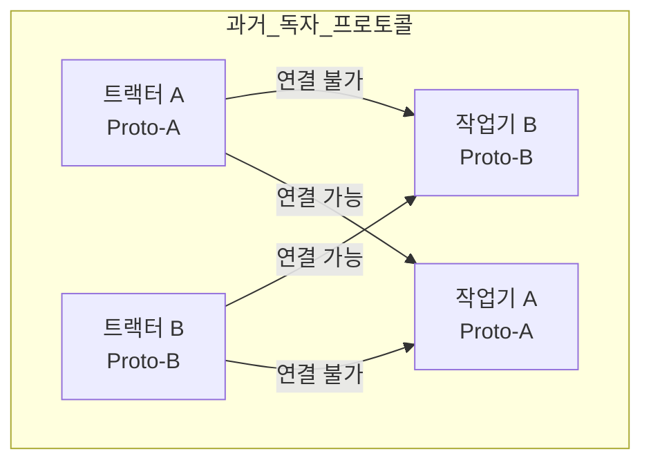
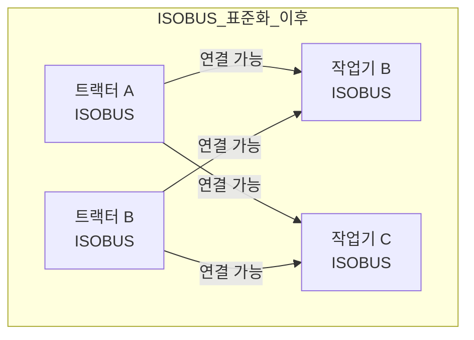
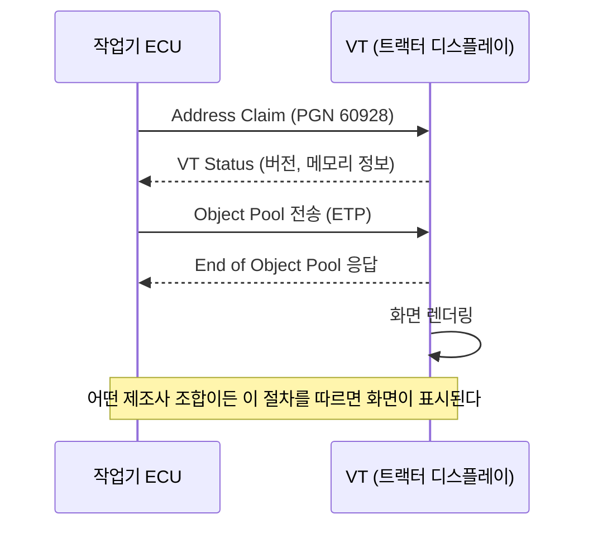
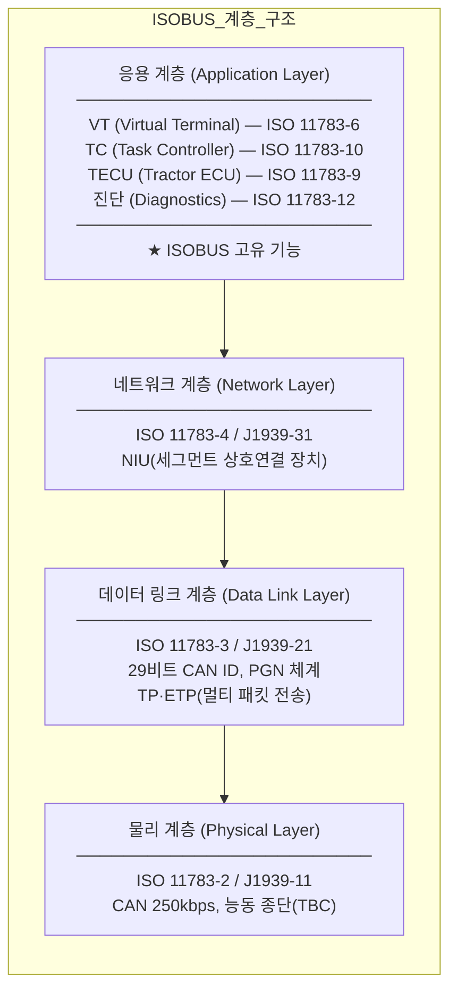

# ISOBUS (ISO 11783) 개요

::: info 학습 목표
- ISOBUS가 무엇이고 왜 농업 기계에 필요한지 설명할 수 있다.
- ISO 11783의 파트 구성을 알고 각 파트의 역할을 구분할 수 있다.
- J1939과 ISOBUS의 계층적 관계를 도식화할 수 있다.
- AEF와 적합성 인증의 의미를 이해한다.
- Part 1이 정의한 ECU·CF·node·functionality 같은 핵심 용어를 구분하고, WideString 바이트열과 그 길이를 계산할 수 있다.
- 트랙터 네트워크와 작업기 네트워크에 걸린 요구사항(shall/should)을 구분해 작업기 CF의 주소 계획을 설계할 수 있다.
- 새 manufacturer code나 PGN이 필요할 때 isobus.net 요청부터 SAE J1939 등록까지의 경로를 설명할 수 있다.
:::

## 1. ISOBUS란

<strong>ISOBUS</strong>는 농업·임업 기계를 위한 직렬 통신 표준이다. 공식 명칭은 다음과 같다.

> **ISO 11783 — Tractors and machinery for agriculture and forestry — Serial control and communications data network**

쉽게 말하면, 트랙터와 작업기(Implement) 사이에서 데이터를 주고받기 위한 규칙 모음이다. 속도, 엔진 RPM, GPS 위치, 작업기 상태 같은 정보를 표준화된 방식으로 교환한다.

핵심 목표는 <strong>상호운용성(Interoperability)</strong>이다. 어떤 제조사의 트랙터와 어떤 제조사의 작업기를 조합해도 동일한 방식으로 통신할 수 있어야 한다.

## 2. 왜 ISOBUS가 필요한가

### 과거의 문제

ISOBUS 이전에는 제조사마다 독자적인 통신 프로토콜을 사용했다. 트랙터 A의 커넥터와 작업기 B의 커넥터가 물리적으로 맞더라도, 프로토콜이 달라서 데이터를 교환할 수 없었다.



결과적으로 농민은 같은 제조사의 트랙터와 작업기만 조합할 수 있었고, 장비 구매 선택지가 크게 제한되었다.

### ISOBUS 도입 후

ISOBUS는 통신 규격을 표준화하여 제조사 간 장벽을 없앴다.



트랙터와 작업기가 모두 ISOBUS 인증을 받았다면, 제조사에 관계없이 조합이 가능하다. 농민은 최적의 장비를 자유롭게 선택할 수 있다.

### "프로토콜 준수"란 구체적으로 무엇인가

"ISOBUS를 준수한다"는 것은 ISO 11783에 정의된 메시지 형식, 절차, 전기 규격을 그대로 따른다는 뜻이다. 세 가지 대표 사례를 보자.

**사례 1 — 트랙터 속도 브로드캐스트**

TECU(Tractor ECU)는 PGN 65097(Ground-Based Speed and Distance)을 100ms마다 브로드캐스트해야 한다. 데이터 형식도 정해져 있다.


Byte 1-2 = 0x0FA0 = 4000 → 4000 × 0.001 m/s = 4.0 m/s (약 14.4 km/h)

John Deere 트랙터든 Fendt 트랙터든 같은 PGN, 같은 바이트 위치, 같은 분해능(0.001 m/s)으로 전송한다. 덕분에 어떤 제조사의 작업기를 연결해도 속도를 정확히 읽을 수 있다. 만약 제조사가 자체 PGN을 쓰거나 분해능을 바꾸면, 다른 제조사 장비가 속도를 잘못 읽거나 아예 못 읽는다.

**사례 2 — VT 화면 표시**

작업기 ECU가 트랙터 디스플레이에 UI를 표시하려면 Object Pool을 VT로 전송해야 한다. 이 절차도 표준으로 정해져 있다.



Kverneland 파종기를 John Deere 트랙터에 꽂아도, Fendt 트랙터에 꽂아도 같은 절차로 화면이 표시된다. 반면 자체 프로토콜을 사용하면 같은 제조사 디스플레이에서만 동작한다.

**사례 3 — TC 가변 살포 제어**

TC(Task Controller)가 처방 맵 기반으로 구획별 살포량을 조절할 때도, DDOP와 Process Data 형식이 표준이다. 어떤 제조사의 TC 소프트웨어에서 만든 처방 맵이든, ISOXML 형식을 따르면 어떤 살포기에서든 가변 살포가 동작한다.

**준수 vs 미준수 비교**

| 영역 | 준수 | 미준수 |
|------|------|--------|
| 메시지 형식 | 정해진 PGN/SPN/분해능으로 전송 | 자체 형식 사용 |
| 주소 관리 | Address Claim 절차 수행 | 하드코딩된 주소 사용 |
| VT 화면 | Object Pool로 UI 전송 | 전용 디스플레이에만 표시 |
| TC 제어 | DDOP + Process Data 표준 명령 | 자체 제어 프로토콜 |
| 물리 계층 | 250 kbps, 9핀 브레이크어웨이 커넥터(IBBC) | 다른 속도, 다른 커넥터 |

## 3. ISO 11783 파트 구성

ISO 11783은 14개의 파트(Part)로 구성된 표준이다.

| 파트 | 제목 | 주요 내용 |
|------|------|-----------|
| Part 1 | General | 표준의 범위, 용어 정의, 전체 구조 |
| Part 2 | Physical Layer | 전기적 특성, 케이블, 커넥터 (CAN 250kbps) |
| Part 3 | Data Link Layer | 프레임 형식, CAN 기반 데이터 링크 |
| Part 4 | Network Layer | 네트워크 상호연결 장치(NIU: 리피터·브리지·라우터·게이트웨이·TECU) |
| Part 5 | Network Management | 주소 클레임, CF(Control Function) 관리 |
| Part 6 | Virtual Terminal | 작업기 UI를 트랙터 화면에 표시 |
| Part 7 | Implement Messages | 작업기 기능 관련 PGN 정의 |
| Part 8 | Power Train Messages | 엔진·변속기 관련 PGN 정의 |
| Part 9 | Tractor ECU | 트랙터 정보(속도, PTO, 히치) 제공 ECU |
| Part 10 | Task Controller | 작업 계획·기록, 정밀 농업 |
| Part 11 | Mobile Data Element Dictionary | 데이터 사전(DDE/DDI 정의) |
| Part 12 | Diagnostics | 진단 메시지(DM), 고장 코드 |
| Part 13 | File Server | 파일 저장소 제공, 파일 접근 명령 |
| Part 14 | Sequence Control | 작업 순서 자동화 |

## 4. J1939과 ISOBUS의 관계

ISOBUS는 SAE J1939을 기반으로 농업 기계에 맞게 <strong>확장</strong>한 표준이다. 프로토콜 계층 관점에서 살펴보면 다음과 같다.



정리하면:
- **물리·데이터링크·네트워크 계층**: J1939과 조화(harmonized)된 공통 기반 사용
- **응용 계층**: VT, TC, TECU 등 ISOBUS 고유 기능이 추가됨

여기서 TP(Transport Protocol, 최대 1785바이트)와 ETP(Extended Transport Protocol, 최대 약 117MB)는 <strong>데이터 링크 계층인 Part 3</strong>에 정의된 멀티 패킷 전송 기능이다. 네트워크 계층(Part 4)은 전송 프로토콜이 아니라 세그먼트 간 메시지를 중계하는 NIU(Network Interconnection Unit)를 다룬다.

J1939을 이해했다면 ISOBUS의 하위 계층은 이미 알고 있는 것과 다름없다. ISOBUS 학습은 응용 계층의 고유 기능에 집중한다.

## 5. ISOBUS 생태계

### AEF (Agricultural Industry Electronics Foundation)

AEF는 ISOBUS의 실질적 표준화를 이끄는 국제 단체이다. ISO 표준은 문서 수준의 규격이지만, AEF는 실제 장비 간 상호운용성을 보장하기 위한 활동을 한다.

- **AEF Conformance Test**: 제조사가 장비를 ISOBUS 적합성 테스트에 제출
- **ISOBUS 인증 마크**: 테스트를 통과한 장비에 부여. 인증 마크가 있으면 상호운용성 보장
- **AEF Database**: 인증된 제품 목록 공개, 농민이 조합 가능한 장비 확인 가능

AEF는 인증을 장비 전체가 아니라 <strong>기능 단위</strong>로 부여한다. UT, AUX-N, TC-BAS/TC-GEO/TC-SC, TIM, ISB 같은 약어가 그 단위이며, 각 기능이 무엇이고 서로 어떤 관계인지는 [AEF 기능 카테고리](/study/isobus/appendix-aef-functionalities)에 정리했다.

### 주요 참여 제조사

John Deere, AGCO, CNH Industrial(케이스·뉴홀랜드), CLAAS, Fendt, Kverneland, Amazone, Horsch 등 전 세계 주요 농기계 제조사가 AEF 멤버로 참여하고 있다.

> **핵심 정리**
> - ISOBUS(ISO 11783)는 트랙터-작업기 간 통신을 표준화한 농업 전용 프로토콜이다.
> - J1939을 기반으로 하되, 응용 계층(VT, TC, TECU)이 ISOBUS 고유의 핵심 기능이다.
> - ISO 11783은 14개 파트로 구성되며, Part 6(VT)과 Part 10(TC)이 가장 핵심적이다.
> - AEF 적합성 인증을 통과한 장비끼리는 제조사에 관계없이 상호운용이 가능하다.

## 6. Part 1이 정하는 핵심 용어

ISO 11783-1:2017(이하 Part 1)은 시리즈 전체의 총론이다. Clause 3에서 시리즈가 함께 쓰는 용어 71개를 정의하고, OSI 대응(Clause 5), 네트워크 구조(Clause 6), 전자 데이터베이스(Clause 7)를 다룬다. 용어 전체 표는 [Part 1 부록](/study/isobus/appendix-iso-part01)에 있으니, 여기서는 구현하다 헷갈리기 쉬운 묶음만 짚는다. 괄호 안 숫자는 Part 1의 항 번호다.

### 장치와 기능의 단위

| 용어 | Part 1의 정의 요지 | 구현자가 볼 점 |
|---|---|---|
| ECU (3.19) | 물리적으로 독립된 전자 장치. CF를 하나 이상 담는다. 예: 작업기 컨트롤러, NIU, 운전자 단말 | 하드웨어 단위 |
| CF (3.10) | 장치 안에서 특정 기능을 수행하는 단위. 네트워크에서 <strong>유일한 주소 하나</strong>를 가진다 | 주소·NAME의 단위. ECU 하나에 CF가 여럿이면 주소도 NAME도 여럿 |
| node (3.40) | ECU가 네트워크에 물리적으로 접속하는 지점 | 세그먼트당 노드 수 제한(§8)의 셈 단위 |
| device (3.18) | 트랙터·트레일러·작업기 같은 기계 시스템, 또는 독립 센서 시스템 | |
| machine (3.33) | 기계 동력을 쓰거나 가하며, 정해진 기능으로 특정한 일을 하는 device | |
| tractor (3.64) | 연결된 시스템의 1차 동력원인 machine. 자주식 장비는 동력원을 내장한 것으로 본다 | |
| implement (3.30) | 특정 작업을 하며 보통 트랙터에 붙는 device 또는 machine | |
| equipment (3.20) | 특정 포장 작업을 하는 device 또는 machine. 트랙터일 수도, 트랙터에 붙은 작업기일 수도 있다 | |
| MICS (3.36) | ISO 11783 네트워크로 묶여 그 네트워크를 쓰는 device들 | "ISOBUS 시스템 전체"를 가리키는 공식 용어 |
| working set / working-set master (3.70, 3.71) | 하나의 애플리케이션을 분산 처리하는 CF들과 그 통신 조정자. master의 SA가 working set을 식별하고, 다른 CF는 그 SA로 working set과 통신한다 | VT·TC는 master의 SA로 working set을 상대한다([14장](/study/isobus/14-isobus-network-mgmt)) |

ECU와 CF를 구분해야 하는 실례가 Part 1 6.5에 있다. VT와 관리 게이트웨이를 한 ECU에 담으면, 그 ECU 안에 NAME과 주소가 둘씩 공존한다. §8의 토폴로지 그림에서 다시 본다.

### 기능성(functionality) 3단 구분

AEF 인증의 단위와 직결되는 용어다.

| 용어 | 정의 요지 | Part 1의 예 |
|---|---|---|
| functionality (3.26) | 시장의 최종 사용자에게 제공되는, 특정 기능(군)을 수행하는 MICS 구성 요소의 능력 | minimum control function, universal terminal(server), task controller basic(client), file server |
| functionality characteristic (3.27) | ISO 11783 개정 때문에 생기는 CF functionality 능력의 차이 | VT Ver 2 vs Ver 3, TECU Class1 Ver 1 vs Ver 2 |
| functionality generation (3.28) | CF의 functionality characteristic이 어느 수준(세대)인지의 표시 | |
| minimum control function (3.35) | Part 3·5·12에 특정된 functionality | |

minimum control function이 Part 3(데이터 링크)·Part 5(네트워크 관리)·Part 12(진단)로 정의된다는 점은 구현 순서의 힌트로 읽을 수 있다. 어떤 CF든 이 세 파트를 먼저 갖춘 뒤에 VT·TC 같은 상위 functionality를 얹는다는 뜻이다(해석). UT(3.65)는 Part 6 능력 중 보조 조작(auxiliary control)을 뺀 functionality이고, 보조 조작은 AUX-O(Type 1, 3.5)와 AUX-N(Type 2, 3.4)으로 따로 센다. 공용 보조 조작을 제공하는 auxiliary input unit(3.3)은 독립 CF이고, ECU 안에 있을 수도 VT 위에 있을 수도 있다. 인증 단위 전체 지도는 [AEF 기능 카테고리 부록](/study/isobus/appendix-aef-functionalities)에 있다.

### 메시지 구조 용어

PGN·PDU의 비트 구조는 [9장](/study/isobus/09-j1939-message)에서, 다중 패킷 전송은 [11장](/study/isobus/11-j1939-transport)에서 다뤘다. Part 1의 정의 중 구현에 바로 걸리는 문장만 옮긴다.

| 용어 | 정의 요지 |
|---|---|
| PG (3.43) | 단일·다중 패킷 메시지 안 데이터의 식별 단위. SA에 의존하지 않으므로 어느 발신자든 어떤 PG든 보낼 수 있다. 데이터뿐 아니라 명령·요청·ACK·NACK도 PG다 |
| PGN (3.44) | DP·EDP·PF·GE 필드를 3바이트(24비트)로 나타낸 번호 |
| EDP (3.21) | DP와 짝을 이루는 1비트. <strong>모든 ISO 11783 메시지는 송신 때 EDP를 0으로 둔다</strong> |
| PDU1 / PDU2 (3.47, 3.48) | PDU1은 PS에 목적지 주소(특정 또는 global), PDU2는 PS에 group extension이 들어간다 |
| SPN (3.58) | 19비트. PG 안의 개별 파라미터마다, 그리고 지금은 PG에 없지만 진단에 필요한 항목에도 부여된다 |
| message / packet (3.34, 3.42) | message는 같은 PGN의 정보를 나르는 CAN 데이터 프레임 1개 이상이고, packet은 다중 프레임 메시지의 프레임 하나다. 데이터가 프레임 하나에 다 들어가면 packet이 곧 message다 |
| multi-packet message (3.37) | 한 PGN의 데이터를 보내는 데 프레임이 여러 개 필요한 메시지. 프레임마다 CAN ID는 같고 데이터만 다르다 |
| ETP (3.22) | 데이터가 1786~117440512바이트인 PG의 전송 프로토콜. 상한은 Part 1 정의의 값이고, Part 3는 (2²⁴ − 1)패킷 × 7바이트 = 117 440 505바이트로 계산한다(ISO 11783-3:2018 5.11.3) |
| NACK (3.39) | 메시지를 이해하지 못했거나 요청된 동작을 할 수 없음을 알리는 응답 |

### 문자 인코딩 — WideChar와 WideString

VT·FS 등이 문자열을 주고받을 때 쓰는 원시 타입이다.

| 용어 | 정의 요지 |
|---|---|
| char (3.6) | 크기 1바이트인 문자 하나. 주로 ISO/IEC 8859 문자에 쓴다(ISO/IEC 8859-1에서 `0x41`이 "A") |
| character (3.7) | 알파벳 같은 문자 하나. 크기는 인코딩 방식에 따라 다르다 |
| WideChar (3.68) | <strong>리틀 엔디언 2바이트</strong>로 인코딩한 문자 하나. `41 00`이 "A"다. WideChar 두 개를 묶어 16비트를 넘는 코드를 나타낼 수 있다 |
| WideString (3.69) | WideChar 0개 이상으로 이뤄지고 <strong>항상 BOM `FEFF`가 앞에 붙는</strong> 문자열 |
| code plane (3.9) | 문자 코드 65536개의 묶음. Unicode/ISO/IEC 10646은 0~16번, 17개 code plane으로 문자를 정리한다 |
| surrogate pair (3.57) | 16비트 high + 16비트 low로 이뤄진 32비트 문자 코드. code plane 1~16 문자의 UTF-16 표현이다 |

Part 1의 예(3.69)는 "ABC"를 `FF FE 41 00 42 00 43 00`으로 적고, 이 WideString의 Length는 8바이트이며 표시되는 문자 수는 3이라고 덧붙인다. BOM `FEFF`가 리틀 엔디언이라 `FF FE`로 나가고, <strong>길이에는 BOM 2바이트가 들어가지만 문자 수에는 들어가지 않는다</strong>는 점이 구현 함정이다. 길이 필드를 "문자 수 × 2"로 계산하면 2바이트가 모자란다.

| 문자열 | WideString 바이트 | 바이트 수 | 표시 문자 수 |
|---|---|---|---|
| "ABC" | `FF FE 41 00 42 00 43 00` | 8 | 3 |
| "가" (U+AC00, code plane 0) | `FF FE 00 AC` | 4 | 1 |
| U+1F69C (code plane 1) | `FF FE 3D D8 9C DE` | 6 | 1 (WideChar 2개 = surrogate pair) |

::: details 파이썬으로 WideString 검산
```python
def widestring(text):
    return b"\xff\xfe" + text.encode("utf-16-le")   # BOM FEFF를 리틀 엔디언으로


def hx(bs):
    return " ".join(f"{b:02X}" for b in bs)


abc = widestring("ABC")
assert hx(abc) == "FF FE 41 00 42 00 43 00" and len(abc) == 8   # Part 1 3.69의 예
assert hx(widestring("가")) == "FF FE 00 AC"

plane1 = widestring("\U0001F69C")
assert hx(plane1) == "FF FE 3D D8 9C DE"                         # D83D DE9C = surrogate pair
assert len(plane1[2:]) // 2 == 2                                 # WideChar 2개
print("WideString 검산 통과")
```
:::

### 그 밖에 자주 나오는 용어

- <strong>TBC</strong>(3.63): 세그먼트 양 끝마다 필요한 회로. CAN_H·CAN_L에 바이어스 전압과 공통 모드 임피던스 종단을 준다. 물리 구조는 [3장](/study/isobus/03-can-physical)과 [13장](/study/isobus/13-isobus-architecture).
- <strong>safe state</strong>(3.52): 제어 시스템이 전부 또는 일부 고장 나도 운전자·주변인의 위험이 허용 수준인 운전 모드. §10의 safe mode와 이어진다.
- <strong>data mask·alarm mask·soft key mask</strong>(3.15, 3.2, 3.55): VT 화면을 이루는 오브젝트. data mask는 VT의 예약 영역에 표시·조작 오브젝트를 담는 최상위 UI 오브젝트다. [16장](/study/isobus/16-vt-object-pool).
- <strong>TC 계열</strong>(3.59~3.62): TC는 MICS에서 process data를 보내고 받고 기록하는 CF다. TC-BAS는 지리 참조가 필요 없는 능력, TC-GEO는 지리 참조가 필요한 능력, TC-SC는 구간 제어(section control) 사양이다. [18장](/study/isobus/18-tc-basics).
- <strong>DL</strong>(3.14): TC의 process data 프로토콜로 데이터 로깅을 하는 CF. 텔레메트리 시스템의 일부일 수도 있고, device description·process data에 더해 브로드캐스트되거나 요청할 수 있는 다른 PG까지 모으는 별도 CF일 수도 있다(Part 10에 정의).
- <strong>DD·DDE·DDI</strong>(3.11~3.13): DDI는 DDE를 유일하게 식별하는 16비트 번호이고, process data 메시지에서 값이나 명령의 대상 DDE를 지정한다. 목록은 isobus.net에 있다. [19장](/study/isobus/19-tc-process-data).
- <strong>client</strong>(3.8): 서버나 master의 서비스를 쓰는 CF. <strong>FS</strong>(3.24)는 파일 저장소와 파일 취급·접근 명령 집합을 제공하는 CF다.
- <strong>FMIS</strong>(3.23): 농민이나 작업 대행업자가 쓰는 농장 사무용 컴퓨터 시스템. 장부·급여, 기계·자재·인력 관리, 필지 관리, GIS, 의사결정 지원, 작업 관리 소프트웨어를 포함한다.

## 7. OSI 7계층과 ISO 11783 (Clause 5)

Part 1 Clause 5는 ISO/IEC 7498-1의 OSI 7계층 모델을 참조 틀로 쓴다. 핵심 문장은 두 가지다.

- OSI 모델을 바탕으로 한 표준이라도 7계층으로 명시적으로 나눌 필요는 없다. 근본 기능이 지원되면 된다.
- ISO 11783은 특정 산업의 특정 응용을 위한 통신 시스템이라 <strong>필요한 계층만</strong> 정의한다. 계층마다 별도 파트가 있고, 다른 파트들이 그 계층들의 기능을 받쳐 준다.

Clause 5의 계층 설명과 6.2~6.5의 파트 배정을 맞대면 다음과 같다.

| OSI 계층 | 계층의 역할 (Clause 5) | ISO 11783에서 | 근거 |
|---|---|---|---|
| 7 Application | 사용자에게 OSI 환경 접근과 분산 정보 서비스를 제공 | 각 응용 파트(Part 6~14)의 메시지 | 6.3 끝 문단, 6.7~6.14 |
| 6 Presentation | 데이터 표현(문법) 차이로부터 응용을 독립시킴 | Part 1이 따로 배정하지 않음 | Clause 5 |
| 5 Session | 협력하는 응용 사이의 세션 수립·관리·종료 | Part 1이 따로 배정하지 않음 | Clause 5 |
| 4 Transport | 종단 간 신뢰 전송·오류 복구·흐름 제어, 큰 메시지 분할·재조립 | TP·ETP | 6.3 |
| 3 Network | 연결 기술로부터 상위 계층을 독립시키고 연결을 수립·유지·종료 | Part 4 (NIU) | 6.4 |
| 2 Data link | 물리 계층 위의 신뢰성 있는 블록 전송(동기·오류·순서·흐름 제어) | Part 3 | 6.3 |
| 1 Physical | 물리 매체 위의 비트 스트림 전송 | Part 2 | 6.2 |

TP·ETP가 하는 일(큰 메시지의 분할·재조립)은 OSI로 보면 4계층의 일이지만, ISO 11783은 이를 데이터 링크 계층 문서에 둔다. Part 3:2018 5.11.1은 ETP 기능을 "데이터 링크 계층의 일부로" 기술한다고 적는다. §4의 계층 그림과 이 표의 4계층 행이 어긋나 보이는 이유다.

::: info Part 1(2017)과 Part 3(2018)의 ETP 소관 차이
Part 1 6.3은 Part 3가 1785바이트까지의 TP를, <strong>Part 6</strong>이 1786바이트~117 MB의 두 번째 전송 프로토콜을 규정한다고 적는다. 그런데 이 스터디가 근거로 쓴 ISO 11783-3:2018(FDIS)은 5.11에서 ETP를 직접 정의하고, ISO 11783-6:2018도 오브젝트 풀 전송(Annex C)에서 "ISO 11783-3에 규정된 extended transport protocol"을 참조한다. 판이 바뀌면서 ETP 규정이 Part 3로 옮겨진 것으로 보인다(추론). 이 스터디는 [11장](/study/isobus/11-j1939-transport)처럼 ETP를 Part 3 기준으로 다룬다.
:::

## 8. 네트워크 설명과 요구사항 (6.1~6.6)

### 브로드캐스트가 기본이다 (6.1)

ISO 11783 네트워크(트랙터 네트워크와 작업기 네트워크)에서는 많은 메시지가 브로드캐스트된다. 데이터를 특정 목적지로 보내지 않고 버스에 흘리므로, 어떤 CF든 추가 요청 메시지 없이 그 데이터를 쓸 수 있다. 특정 CF에게 보낼 때만 CAN ID 안에 목적지 주소를 넣는다. 그래서 메시지 형식은 global 목적지 형식과 destination-specific 형식 두 가지이고, 제조사 고유(proprietary) 통신도 두 형식 중 하나로 허용된다.

구현 관점에서는 "필요한 데이터는 대개 이미 버스에 흐르고 있다"는 뜻이다. §2 사례 1의 지면 속도(PGN 65097)처럼 주기적으로 브로드캐스트되는 값은 요청 없이 수신 필터만 걸어 읽는다(해석).

### 물리 계층 요약 (6.2)

Part 2 원문은 이 스터디의 근거 자료에 없으므로, 물리 계층 내용은 Part 1의 요약에 있는 것만 옮긴다.

- ECU 인터페이스는 ISO 11898-1:2015의 물리 시그널링 서브계층과 ISO 11898-2:2016의 물리 매체 접근 서브계층을 따라야 한다(shall).
- 네트워크는 각 ECU에 노드로 연결되는 <strong>선형 quad-twisted 케이블 하나</strong>로 이뤄진다. ECU마다 짧은 리드 케이블이 이 케이블로의 노드 연결을 만든다.
- 네트워크 세그먼트의 양 끝에는 능동 TBC를 둔다.
- Part 2는 커넥터 세 가지(작업기를 트랙터에 연결, 장비에 설치된 네트워크에 ECU 추가, 서비스 툴 연결)와 네트워크 동작에 필요한 전원과 그 연결도 규정한다.

### 데이터 링크 계층 요약 (6.3)

- ISO 11783 ECU는 ISO 11898-1:2015의 <strong>CAN Classical Extended Frame Format</strong>을 써야 하고, <strong>CAN FD 프레임 형식은 쓰면 안 된다</strong>(shall not). Part 3:2018의 Foreword도 이번 판의 첫 변경 사항으로 CAN FD 사용 배제를 적는다. [7장](/study/isobus/07-can-fd)의 CAN FD는 ISOBUS 버스에 올릴 수 없다는 뜻이다.
- Part 3는 8비트 PF, 8비트 PS, 2비트 data page 필드로 PDU를 식별한다. 메시지 오버헤드를 줄이려고 연관된 데이터 항목 여러 개를 한 PDU에 묶는다.
- 제조사 고유 메시지가 따로 정의되어 있다.
- 8바이트를 넘는 데이터는 multi-packet 메시지로 보낸다. TP는 1785바이트까지, ETP는 1786바이트부터 117 MB까지다(§7의 소관 차이 참고).
- 응용 메시지별 송신 주기, 데이터 프레임 길이, data page, PF, PS 또는 DA, 기본 우선순위는 그 응용을 규정하는 파트가 정한다.

### 네트워크 계층 요약 (6.4)

- 네트워크 구조가 다른 두 네트워크를 연결할 때, 연결 시스템의 통합자는 NIU(network interconnect unit)로 각 세그먼트를 서로 격리해야 한다(shall). NIU의 상세는 Part 4.
- 복잡한 시스템은 Part 2가 정한 세그먼트당 <strong>30노드</strong> 전기적 한계를 넘을 수 있다. 그런 경우 작업기 시스템 제조사가 NIU로 세그먼트를 나눠 전기적 부하 한계를 지켜야 한다(shall).

### 네트워크 관리 요약 (6.5)

[10장](/study/isobus/10-j1939-address)의 내용을 Part 1은 이렇게 요약한다.

- 통신하는 모든 CF는 SA가 필요하고, ECU 하나가 CF 여럿을 수행하면 CF마다 주소가 필요하다.
- CF를 유일하게 식별하려고 Part 5가 64비트 NAME을 규정하고, SA 결정과 주소 충돌 해소 절차도 Part 5가 정한다. SA는 미리 정해지거나(preset) 전원을 켤 때 컨트롤러마다 동적으로 클레임한다.
- 통신하는 모든 CF에 NAME을 배정해야 한다(shall). ECU 하나에 NAME·주소가 여럿 공존할 수 있다.
- isobus.net 데이터베이스가 NAME 필드용 코드를 관리한다. 네트워크 관리 규격을 쓰는 산업, 비특정 CF용 preset·preferred address, 농림업 장비용 initial address 할당, CF가 쓸 NAME, ECU 제조사 목록이다.

### 두 세그먼트와 권장 구성 (6.6)

ISO 11783은 세그먼트를 둘 이상 지원하고, 기본은 트랙터 네트워크와 작업기 네트워크다. 둘을 잇는 데 <strong>TECU가 필요</strong>하다(6.6.1). 세그먼트의 역할 구분은 [13장](/study/isobus/13-isobus-architecture)에서 다뤘으므로, 여기서는 Part 1이 두 세그먼트에 거는 요구 수준(shall/should)을 나란히 놓는다.

| 항목 | 트랙터 네트워크 (6.6.2) | 작업기 네트워크 (6.6.3) |
|---|---|---|
| 역할 | 트랙터의 구동계·섀시 CF 사이의 제어·데이터 통신 | 작업기 사이, 그리고 트랙터와 작업기 사이의 통신을 지원하도록 설계해야 한다(shall) |
| 통제 | 트랙터 제조사가 통제한다 | — |
| ISO 11783 요구 적용 | — | 해당 요구사항을 만족해야 한다(shall) |
| 물리 계층 | Part 2 준수를 권장(recommended) | 커넥터는 Part 2를 따라야 한다(shall) |
| CF 추가 접속 | 트랙터 제조사의 동의 없이는 CF를 연결하지 않는 것을 의도한다(intended) | — |
| 응용 메시지 | Part 8(구동계)·Part 7 메시지와 Part 3의 proprietary 메시지를 쓸 수 있다 | Part 7이 정의한다. 작업기 네트워크의 CF 주소도 Part 8 메시지를 쓸 수 있다 |
| 위치 | 두 네트워크 모두 트랙터에 통합될 수 있다 | 트랙터 위와 작업기 위 양쪽에 존재한다 |

<strong>권장 구성(6.6.4)</strong>은 주소 계획에 바로 쓰인다.

- 트랙터 네트워크의 CF는 isobus.net 데이터베이스의 preferred address를 쓰는 것이 권장된다.
- 연결된 작업기에서 쓰는 CF 수는 self-configurable address로 <strong>128~237의 110개 주소</strong> 안으로 제한해야 한다(shall). 작업기 여러 대를 연결할 때는 현실적 한계가 있다는 점도 원문이 함께 적는다.
- 작업기 주소는 Part 5의 절차로 배정해야 한다(shall).
- 작업기는 추가 작업기를 직렬로 이어 붙일 수 있도록 네트워크 연장 연결을 제공해야 한다(shall).
- ECU가 여러 개인 작업기는 network interconnection ECU로 추가 ECU를 작업기 네트워크에서 격리할 수 있다.

Part 1 Figure 3은 이 구성을 CF 주소와 함께 보여 준다. 아래는 그 구조를 다시 그린 것이다.


그림에서 세 가지를 본다.

1. <strong>ECU와 CF는 다른 단위다.</strong> ECU 6 하나에 VT(38)와 관리 컴퓨터 게이트웨이(37) 두 CF가 들어 있고, 각자 주소를 가진다.
2. <strong>TECU 위의 7은 ECU 번호이고 240이 주소다.</strong> 원문 그림의 NOTE 2는 노드 옆의 작은 숫자(TECU는 두 노드 사이 위쪽)가 그 CF를 담은 ECU의 번호이고, 반대편 숫자가 CF의 주소라고 설명한다. 트랙터 쪽 CF의 "주소 7"과 TECU의 "ECU 7"을 헷갈리지 않아야 한다.
3. <strong>작업기 CF의 주소 a1~a4는 self-configurable 주소다</strong>(NOTE 1). 6.6.4에 따라 128~237 안에서 Part 5 절차로 정해진다. TC(247)와 TECU(240)는 그 밖인 238~247에 있다.

## 9. 전용 ECU 기능 (6.7)

Part 1은 ECU 기능 네 가지를 따로 정의한다. 기능별 상세는 해당 파트와 챕터로 넘기고, 여기서는 Part 1이 그 기능에 거는 요구만 정리한다.

| 기능 | Part 1의 규정 | 상세 |
|---|---|---|
| VT (6.7.1) | 표준 메시지로 작업기나 트랙터의 운전자 인터페이스를 제공한다. 요구사항은 Part 6. VT는 작업기 네트워크에 붙는다. TECU나, 작업기 네트워크에 연결된 트랙터 안의 다른 ECU도 작업기 working set과 <strong>같은 방법으로</strong> VT를 쓸 수 있다 | [15장](/study/isobus/15-vt-basics) |
| TECU (6.7.2) | 트랙터 네트워크와 작업기 네트워크 사이에는 전기적 격리와 메시지 격리를 모두 보장하는 NIU를 둬야 한다(shall). TECU는 작업기 CF가 보낸 Part 7 메시지 요청을 받아 해석하고 트랙터 네트워크의 ECU들과 통신한다. 요청·명령한 ECU에 적절한 ACK나 응답을 줘야 하고(shall), Part 9에 따라 기본 정보를 제공하고 명령 메시지대로 동작해야 한다(shall) | [13장](/study/isobus/13-isobus-architecture) |
| TC (6.7.3) | ISO 11783 네트워크를 통해 작업기 기능을 스케줄 기반으로 제어한다. 동작과 메시지 형식은 Part 10, 데이터 요소 정의는 Part 11의 data dictionary | [18장](/study/isobus/18-tc-basics) |
| FMIS 인터페이스 (6.7.4) | 작업기 네트워크는 농장 관리 컴퓨터로의 게이트웨이를 포함할 수 있다. FMIS 쪽 게이트웨이의 물리 인터페이스는 ISO 11783이 규정하지 않는다. FMIS의 파일에서 나온 데이터를 FMIS 인터페이스에 제공할 때는 Part 10에 정의된 메시지를 써야 한다(shall) | [22장](/study/isobus/22-practice) |

VT 행의 "같은 방법으로"는 트랙터 쪽 기능도 VT 앞에서는 작업기 working set과 똑같은 클라이언트라는 뜻이다. VT Server를 에뮬레이션할 때 트랙터 쪽 클라이언트를 위한 별도 경로가 필요 없다는 근거가 된다(해석).

TC의 흐름은 6.7.3이 단계별로 적는다.


1. FMIS 인터페이스가 받은 작업(task) 데이터를 TC에 저장한다.
2. TC가 작업을 스케줄링하고, 실행할 CF에게 작업기 네트워크로 제어 메시지를 보낸다.
3. 작업이 진행되는 동안 CF들로부터 받은 데이터를 TC가 기록한다.
4. 기록한 데이터를 작업기 네트워크의 FMIS 인터페이스를 거쳐 FMIS로 보낸다.

## 10. 공통 서비스 (6.8~6.14)

| 절 | 서비스 | Part 1의 규정 요지 | 상세 |
|---|---|---|---|
| 6.8 | 진단 | 네트워크 오동작의 원인이 되는 고장을 찾는 데 쓸 메시지를 Part 12가 규정한다. 같은 메시지가 참조되는 다른 진단 표준에도 있다 | [14장](/study/isobus/14-isobus-network-mgmt) |
| 6.9 | File server | 데이터 파일 저장소를 제공하는 CF와, 네트워크의 CF가 그 파일을 읽고 쓰는 데 쓸 명령 집합을 Part 13이 규정한다 | [21장](/study/isobus/21-isobus-misc) |
| 6.10 | Sequence control | 트랙터나 다른 CF의 운전자 조작 기능 시퀀스를 여러 개 기록해 두었다가 운전자 명령으로 재생하는 메시지를 Part 14가 규정한다. 두렁 선회 관리(headland management) 같은 제어 시스템을 만든다 | [21장](/study/isobus/21-isobus-misc) |
| 6.11 | Process data | TC에서 CF 하나 이상으로 데이터를 보내는 메시지. 작업기 네트워크의 다른 CF로 보낼 때도 쓸 수 있다. 메시지 구조는 Part 10, 데이터 정의는 isobus.net의 data dictionary | [19장](/study/isobus/19-tc-process-data) |
| 6.12 | Working set | CF 집합을 특정 애플리케이션에 연관된 것으로 네트워크에 알리는 장치. 정의·운영 규칙·수립 메시지는 Part 6과 Part 7 | [14장](/study/isobus/14-isobus-network-mgmt) |
| 6.13 | Safe mode | 아래 경고 상자. 추가 safe mode 요구사항은 Part 9가 규정한다 | Part 9 |
| 6.14 | 파라미터·메시지 추가 | 트랙터-작업기 메시지는 Part 7, 트랙터 구동계 메시지는 Part 8이 규정한다. 특정 응용용으로 개발한 메시지 집합을 ISO 11783에 추가할 수 있고, 새 코드의 추가·갱신 요청은 데이터베이스에 게시된 code request form으로 유지관리 기관(MA)에 낸다 | §11 |

::: warning 안전 책임은 제조사에 있다 (6.13)
Part 1 6.13은 VT·보조 조작기·TC로 보내는 정보와 제어가 이 표준을 따르더라도, <strong>그곳에 요청하는 제어가 적용 가능한 안전 표준에 맞게 설계·제작되었음을 제조사가 보장해야 한다</strong>(shall)고 적는다. 컨트롤러가 제공하는 기능은 의도한 효과가 나되 상해 위험으로 이어지지 않게 설계해야 한다(shall). 통신 규격을 지켰다는 사실이 기능 안전을 보증하지 않는다는 뜻이다. 예를 들어 VT 버튼으로 작업기 유압이 움직이는 구조라면, 버튼 이벤트가 늦거나 빠지거나 중복될 때의 동작까지 제조사가 설계 책임을 진다(예시).
:::

## 11. 전자 데이터베이스와 코드 요청 (Clause 7, Annex A)

### 데이터베이스에 무엇이 있나

Part 1 2판(2017)의 가장 큰 변화는 1판(2007)의 Annex A~G에 있던 식별자(파라미터) 목록을 모두 전자 데이터베이스로 옮긴 것이다. 이제 PG·주소·identity 할당은 데이터베이스가 관리하고, SAE에 공식 등록되어 SAE J1939 권고 실무(recommended practice)의 일부가 된다(Foreword). 데이터베이스는 isobus.net에서 접근하며 다음 일곱 목록을 제공한다. 모두 SAE J1939에 공식 등록된 현행 목록이다(Clause 7).

| 목록 | 구현에서 쓰는 곳 |
|---|---|
| Parameter group assignments | PGN 정의 |
| Industry groups | NAME의 industry group |
| Industry group 0 preferred addresses | 전 산업 공통 preferred address |
| Industry group 2 initial addresses | 농림업 장비의 initial address |
| NAMEs | NAME의 device class·function 코드 |
| All industry NAMEs | 전 산업 공통 NAME |
| Manufacturer codes | NAME의 manufacturer code |

Part 1의 Scope는 이 데이터베이스가 응용 개발자에게 주소 할당·identity 할당·파라미터 정의의 현행 목록을 제공한다고 밝힌다. Part 5의 NAME 필드 표(Table 1)도 industry group·device class·function·manufacturer code의 수치를 Part 1로 미룬다. NAME을 조립하거나 PGN을 해석하는 코드의 상수표는 문서가 아니라 이 데이터베이스가 원본이라는 뜻이다. [10장](/study/isobus/10-j1939-address)의 예시 NAME이 등록값 대신 예시 값을 쓴 이유이기도 하다.

### 새 코드를 요청하는 흐름


1. 새 PG·주소·identity 할당을 받거나 기존 할당의 설명을 고치려면 isobus.net 데이터베이스에 있는 요청 양식(request form)을 쓴다(Annex A).
2. 요청은 ISO 기술관리이사회(ISO/TMB)가 지정한 유지관리 기관(MA)이 처리한다(Annex A). MA의 사무국은 DIN을 대신해 VDMA(독일기계공업협회)가 맡는다(Scope NOTE).
3. MA는 코드 등록을 SAE J1939 위원회와 동기화한다(Annex A).
4. 특정 응용용으로 개발한 메시지 집합도 같은 경로로 ISO 11783에 추가할 수 있다(6.14).

예를 들어 자체 ECU를 시장에 내놓으려는 제조사는 manufacturer code부터 필요하다. NAME의 manufacturer code(11비트)는 위원회가 할당하는 값이고(Part 5 Table 1), 그 목록이 이 데이터베이스의 Manufacturer codes다. 임의 값을 넣은 NAME은 다른 제조사의 코드와 겹칠 수 있다.

## 12. 이 스터디가 근거로 쓴 판

ISO 11783의 파트는 저마다 따로 개정된다. 같은 개념이라도 판에 따라 위치나 규정이 다를 수 있으므로(§7의 ETP 소관 차이가 한 예), 이 스터디가 근거로 쓴 판을 밝혀 둔다. 마지막 열은 각 판의 Foreword가 직접 밝힌 변경만 옮겼다.

| 파트 | 제목 | 근거로 쓴 판 | 발행 | 대체한 판 | Foreword의 주요 변경 |
|---|---|---|---|---|---|
| 1 | General standard for mobile data communication | 2판 | 2017-12 | 1판(2007) | 1판 Annex A~G의 식별자를 전자 데이터베이스로 이관 |
| 2 | Physical layer | — | — | — | 근거 자료에 없음. 물리 계층은 Part 1 6.2 요약만 사용 |
| 3 | Data link layer | 4판 FDIS | 2018 (투표 2018-08-09~2018-10-04) | 3판(2014) | CAN FD 사용 배제, BAM.TP를 10 ms로 송신 허용, Request2가 확장 식별자를 쓰면 Acknowledgement PG도 지원 |
| 4 | Network layer | 2판 | 2011-12-01 | 1판(2001) | 기술적 개정(항목 미기재) |
| 5 | Network management | 3판 | 2019-06 | 2판(2011) | 물리 요구사항을 Part 2로 이동 |
| 6 | Virtual terminal | 4판 | 2018-06 | 3판(2014) | VT version 6. Select Active Working Set 명령, Colour Palette·Graphic Data·Scaled Graphic·Working Set Special Controls 오브젝트 추가 |
| 7 | Implement messages application layer | 3판 + Amendment 1 | 2015-03-15, Amd 1 2018-06 | 2판(2009) | 기술적 개정(항목 미기재) |
| 8 | Power train messages | 1판 | 2006-02-01 | — | — |
| 9 | Tractor ECU | 2판 | 2012-02-01 | 1판(2002) | 기술적 개정(항목 미기재) |
| 10 | Task controller and management information system data interchange | 2판 | 2015-09-15 | 1판(2009) | 기술적 개정(항목 미기재) |
| 11 | Mobile data element dictionary | 2판 | 2011-07-01 | 1판(2007) | 소규모 개정(minor revision) |
| 12 | Diagnostics services | 3판 | 2019-01 | 2판(2014) | 모든 파라미터에 SPN 부여, CF functionality 파라미터를 온라인 데이터베이스로 이관, 참조 문서 갱신 |
| 13 | File server | 2판 | 2011-04-01 | 1판(2007) | 소규모 개정(minor revision) |
| 14 | Sequence control | 1판 | 2013-09-15 | — | — |

::: details 확인 문제
1. (구분형) VT와 관리 컴퓨터 게이트웨이가 한 ECU에 들어 있다. 이 ECU가 가져야 할 NAME과 주소는 각각 몇 개이고, 근거 절은 무엇인가?
2. (계산형) VT에 보낼 문자열 "AB가"를 WideString으로 인코딩한 바이트열과 그 Length(바이트 수)를 쓰라.
3. (설계형) CF가 각각 4개, 6개, 3개인 작업기 세 대를 한 트랙터에 직렬로 연결하려 한다. Part 1의 주소 범위 요구를 만족하는지 판단하고, 이 구성에 걸리는 shall 요구를 근거 절과 함께 나열하라.

**답 가이드**
1. 둘씩이다. 통신하는 모든 CF에 NAME을 배정해야 하고(6.5 shall), ECU가 CF 여럿을 수행하면 CF마다 주소가 필요하다(6.5). Part 1 Figure 3의 ECU 6(VT 38, 관리 게이트웨이 37)이 그 예다.
2. BOM `FF FE` + "A" `41 00` + "B" `42 00` + "가" `00 AC` = `FF FE 41 00 42 00 00 AC`. Length는 8바이트이고 표시 문자 수는 3이다.
3. CF 합계 13개는 128~237의 110개 안에 들어간다(6.6.4 shall). 이 밖에 작업기 주소는 Part 5 절차로 배정해야 하고(6.6.4), 작업기는 추가 작업기를 직렬로 이을 연장 연결을 제공해야 하며(6.6.4), 작업기 네트워크의 커넥터는 Part 2를 따라야 하고(6.6.3), 세그먼트가 30노드 전기적 한계를 넘으면 NIU로 나눠야 한다(6.4).
:::

## 다음 챕터

- 다음 : [ISOBUS 네트워크 아키텍처](/study/isobus/13-isobus-architecture)
