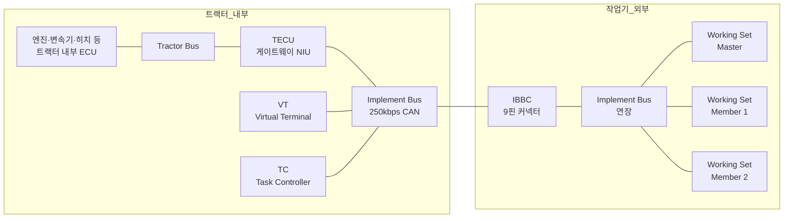
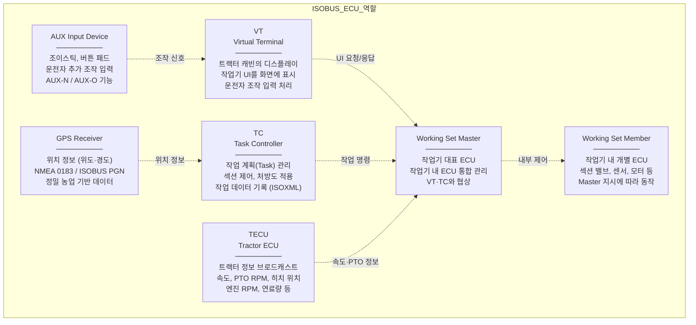
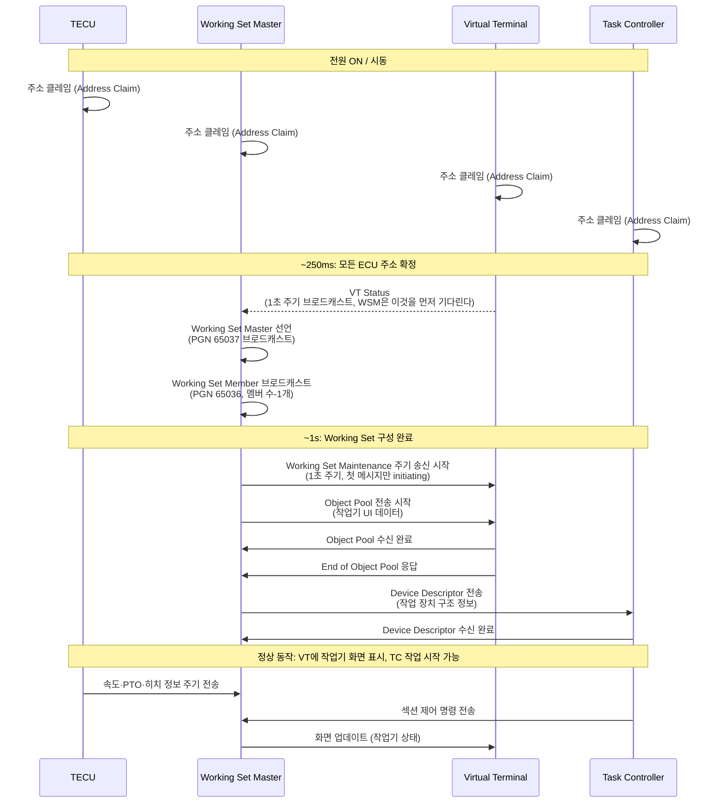

# ISOBUS 네트워크 아키텍처

::: info 학습 목표
- ISOBUS 네트워크가 트랙터 버스와 Implement 버스로 구분되는 이유와, 두 버스를 TECU가 연결하는 구조를 설명할 수 있다.
- IBBC(9핀 브레이크어웨이 커넥터)와 TBC(종단 바이어스 회로)의 역할을 구분할 수 있다.
- ISOBUS 상의 주요 ECU 종류와 각 역할을 구분할 수 있다.
- 장비 시동 후 ISOBUS 통신이 확립되기까지의 메시지 흐름을 순서대로 설명할 수 있다.
- NIU 유형(repeater·bridge·router·gateway·TECU)을 주소 공간·필터 모드 기준으로 비교하고, network message(PGN 60672) 프레임의 function code·port pair·PGN 엔트리를 디코딩할 수 있다.
- TECU 클래스 표기(예: class 2GP)를 보고 작업기가 트랙터에 보낼 수 있는 명령을 판단할 수 있다.
- 키 오프 뒤 Maintain power 메시지를 언제·어떤 바이트로 보내야 하는지 설계하고, Lighting command 프레임을 디코딩할 수 있다.
- ISO 11783-7 메시지의 원시 바이트에서 1·2·4바이트 무효값(FE·FF 계열)과 2비트 상태값을 가려내 물리값으로 디코딩할 수 있다.
- 작업기가 트랙터의 히치·PTO·밸브를 원격 제어할 때 limit status·request status·exit/reason code를 읽고 수락·운전자 개입·통신 이상을 진단할 수 있다.
- Heartbeat 시퀀스 번호와 전체 작업기 정지(ISB) 전이 횟수를 검증하는 수신 측 로직을 설계할 수 있다.
:::

## 1. 네트워크 토폴로지

ISOBUS 네트워크는 물리적으로 두 개의 네트워크 세그먼트로 구성된다.

- **트랙터 버스**(tractor network): 엔진, 변속기, 브레이크, 히치 컨트롤러 등 트랙터 구동계·섀시 ECU들이 연결되는 버스. 트랙터 제조사가 관리하며 내부 규격(J1939 등)을 쓸 수도 있다.
- **Implement 버스**(implement network): VT, TC, 작업기 ECU 등 작업기 관련 CF들이 연결되는 버스. 트랙터 위와 작업기 위에 걸쳐 존재하며 ISO 11783을 반드시 준수해야 한다.

두 버스는 <strong>TECU(Tractor ECU)</strong>가 연결한다. TECU는 두 세그먼트 사이의 게이트웨이 역할을 하는 특수 NIU(Network Interconnection Unit)다. VT와 TC는 물리적으로 트랙터 캐빈에 장착되지만 <strong>버스 소속은 Implement 버스</strong>이며, 외부 작업기는 <strong>IBBC(Implement Bus Breakaway Connector)</strong>를 통해 Implement 버스에 이어진다.



두 버스를 분리하는 이유는 <strong>트랙터 버스의 격리·보호</strong>다. TECU는 두 세그먼트 사이에서 전기적 격리와 메시지 격리(필터링)를 모두 제공해야 하며, 덕분에 외부 작업기의 전기적 문제나 과도한 트래픽이 트랙터 구동계 버스에 영향을 주지 않는다.

::: tip NIU의 다섯 가지 유형 (Part 4)
세그먼트를 연결하는 NIU에는 기능 수준에 따라 리피터(단순 forwarding), 브리지(+ 필터링), 라우터(+ 주소 변환), 게이트웨이(+ 메시지 재조합)가 있고, 트랙터 버스와 Implement 버스를 잇는 <strong>Tractor ECU</strong>가 다섯 번째 특수 유형으로 정의된다. 작업기 내부에 하위 네트워크를 둘 때도 NIU로 Implement 버스와 격리한다.
:::

## 2. IBBC 커넥터와 TBC 종단

<strong>IBBC(Implement Bus Breakaway Connector)</strong>는 트랙터와 작업기의 Implement 버스를 물리적으로 연결하는 9핀 커넥터이다. ISO 11783-2에 정의되어 있으며, 작업기가 분리(breakaway)되어도 트랙터 측 버스가 안전하게 유지되도록 설계된다.

<strong>TBC(Terminating Bias Circuit)</strong>는 커넥터가 아니라 <strong>종단 바이어스 회로</strong>다. 네트워크 세그먼트 양 끝단에 두어 CAN_H·CAN_L에 바이어스 전압과 공통 모드 임피던스 종단을 제공하는 능동 종단으로, 단순 120Ω 저항 종단(J1939-11)과 구별된다.

### 9핀 커넥터 신호 구성

IBBC의 9개 신호는 세 그룹으로 나뉜다.

| 그룹 | 신호 | 설명 |
|------|------|------|
| CAN | CAN_H, CAN_L | Implement 버스 신호선 1쌍 (트랙터 내부 버스는 커넥터를 지나지 않는다) |
| 전원 | PWR, GND, ECU_PWR, ECU_GND | 액추에이터용 전원(PWR)과 ECU 전자회로용 전원(ECU_PWR), 각각의 접지 |
| 종단 제어 | TBC_PWR, TBC_RTN, TBC_DIS | 종단 바이어스 회로(TBC)의 전원·리턴·비활성화 신호 |

### 전원 공급 구조

트랙터는 IBBC를 통해 작업기에 전원을 공급한다. 전원은 용도별로 두 계열로 나뉜다.

- <strong>ECU_PWR</strong>: 작업기 ECU·센서 등 전자회로용 전원 (12V 기준 최소 15A)
- <strong>PWR</strong>: 밸브·모터 등 액추에이터용 전원 (12V 기준 최소 50A)

두 전원의 분배 제어와 상태 메시지 송수신은 TECU(function instance 0)가 책임진다(ISO 11783-9). TBC_PWR은 ECU_PWR 또는 TECU 자체에서 급전되어, ECU 전원이 제어되는 상황에서도 버스 종단이 살아 있도록 한다. 작업기 자체 전원(배터리)이 없어도 트랙터에 연결하면 즉시 동작 가능하다.

## 3. ECU 종류

ISOBUS 네트워크 위에는 역할별로 명확히 구분된 ECU들이 존재한다.



### 각 ECU의 핵심 역할 요약

| ECU | 버스 소속 | 핵심 역할 |
|-----|------|-----------|
| VT (Virtual Terminal) | Implement 버스 (캐빈 장착) | 작업기 화면 표시, 운전자 UI |
| TC (Task Controller) | Implement 버스 (캐빈 장착) | 작업 계획·기록, 섹션 제어 |
| TECU (Tractor ECU) | 트랙터 버스 ↔ Implement 버스 | 두 버스 연결(게이트웨이), 트랙터 상태 정보 제공 |
| GPS Receiver | Implement 버스 | 위치 정보 제공 |
| AUX Input Device | Implement 버스 | 추가 조작 입력 |
| Working Set Master | Implement 버스 (작업기) | 작업기 대표, VT·TC와 통신 |
| Working Set Member | Implement 버스 (작업기) | 작업기 내부 개별 제어 |

### TECU 클래스

ISO 11783-9는 TECU가 Implement 버스에 제공해야 하는 최소 메시지 집합을 <strong>클래스</strong>로 구분한다.

| 클래스 | 의미 |
|--------|------|
| Class 1 | 기본 측정값 제공 (속도, 히치 위치, PTO 회전수 등. 신규 설계에는 비권장) |
| Class 2 | 측정 기능 전체 제공 (Class 1 + 주행 거리·방향, 견인력, 조명, 밸브 유량) |
| Class 3 | Implement 버스로부터의 제어 명령 수용 (히치·PTO·보조 밸브 명령) |

여기에 기능별 addendum이 붙는다: <strong>N</strong>(항법/GPS), <strong>F</strong>(전방 히치·PTO), <strong>G</strong>(조향 제어), <strong>P</strong>(속도·주행 전략 명령), <strong>M</strong>(발진 명령). 예를 들어 class 3GP는 조향과 속도 제어를 모두 수용하는 트랙터다. 작업기가 트랙터의 히치·PTO·보조 밸브를 명령하려면 Class 3이 필요하지만, 자동 조향(G)과 속도 제어(P)는 기본 클래스와 무관하게 붙는 addendum이다(예: class 2G, class 2P, ISO 11783-9:2012 4.4.2.7·4.4.2.8).

## 4. 네트워크 메시지 흐름

트랙터에 작업기를 연결하고 시동을 켠 후, ISOBUS 통신이 확립되기까지 일련의 단계가 순서대로 진행된다.



각 단계의 의미:

1. **주소 클레임**: 모든 ECU가 네트워크에서 고유한 주소를 확보한다 (J1939 방식과 동일).
2. **Working Set 구성**: 작업기를 대표하는 WSM이 Working Set Master 메시지(PGN 65037)로 멤버 수를, Working Set Member 메시지(PGN 65036)로 각 멤버의 NAME을 브로드캐스트한다. VT·TC 같은 서비스 제공자가 이를 수신해 Working Set을 인식한다.
3. **VT 연결**: WSM은 VT가 1초 주기로 브로드캐스트하는 VT Status를 먼저 확인한 뒤 Working Set Master·Member 메시지로 자신을 알리고, 그다음 Working Set Maintenance를 1초 주기로 보내기 시작한다. VT Status는 WSM의 요청에 대한 응답이 아니다(ISO 11783-6:2018 4.6.6.2).
4. **Object Pool 전송**: 작업기 UI 화면 데이터를 VT에 업로드한다.
5. **Device Descriptor 전송**: 작업기의 기능 구조를 TC에 알린다.
6. **정상 동작**: TECU 정보·TC 명령·VT 화면 업데이트가 주기적으로 이루어진다.

> **핵심 정리**
> - ISOBUS 네트워크는 트랙터 버스와 Implement 버스로 분리되며, 두 버스는 TECU(게이트웨이 NIU)가 연결한다. 외부 작업기는 IBBC 9핀 커넥터로 Implement 버스에 접속하고, 각 세그먼트 양 끝단은 TBC(종단 바이어스 회로)로 종단한다.
> - VT는 화면, TC는 작업 관리, TECU는 버스 연결과 트랙터 정보 제공, WSM은 작업기 대표 역할을 한다.
> - 시동 후 주소 클레임 → Working Set 구성 → VT 연결 → Object Pool 전송 순으로 통신이 확립된다.
> - Object Pool은 작업기 UI를 정의하는 데이터로, WSM이 VT에 전송하여 화면을 구성한다.

## 5. 네트워크 계층과 NIU의 기능 (Part 4)

1절의 tip에서 NIU 유형을 한 줄씩 소개했다. 5~8절은 ISO 11783-4:2011(Network layer)을 구현자 관점에서 세밀하게 내려간다. 네트워크 계층은 세그먼트가 여러 개인 네트워크에서 세그먼트 사이 메시지 전달을 관리하는 계층이고(ISO 11783-4:2011 4.2), 그 일을 하는 장치가 NIU다. 자주 나오는 용어부터 정리한다(3절).

| 용어 | 뜻 |
|---|---|
| NIU(Network Interconnection Unit) | 네트워크나 네트워크 세그먼트를 서로 잇는 ECU |
| port | NIU가 세그먼트에 붙는 인터페이스. NIU는 서로 다른 세그먼트에 붙은 포트를 2개 이상 가진다 |
| port pair | 포트 2개를 묶어 "어느 세그먼트에서 어느 세그먼트로" 흐르는지 나타낸 것 |
| virtual CF / actual CF | NIU가 다른 세그먼트의 실제 CF와 같은 NAME으로 세워 주는 겉보기 CF / ECU가 그 세그먼트에 직접 세운 CF |
| transparent | 서비스를 받는 CF가 그 서비스의 출처(중간의 NIU)를 몰라도 되는 상태 |

### NIU가 하는 네 가지 일과 성능 기준

NIU는 유형에 따라 다음 네 작업 중 하나 이상을 한다(Part 4 4.1.1.2). 어떤 작업을 하느냐가 6절의 유형을 가른다.

| 작업 | 하는 일 | 절 |
|---|---|---|
| forwarding | 한 포트에서 받은 프레임을 다른 포트로 내보낸다 | 6.1 |
| filtering | filter database에 따라 PGN 단위로 통과·차단한다 | 6.2 |
| address translation | look-up table로 주소를 바꿔, 세그먼트 하나를 주소 하나로 보이게 한다 | 6.3 |
| repackaging | 여러 메시지의 파라미터를 꺼내 새 메시지로 다시 묶는다 | 6.4 |

어떤 NIU가 응용에 맞는지는 세 가지 성능 기준으로 판단한다(4.1.1.3).

- 초당 forwarding 보장 메시지 수: 평균·피크 버스 부하가 이를 넘으면 메시지가 유실될 수 있다.
- 초당 filtering 보장 메시지 수: DB 엔트리가 많아 이를 넘으면 메시지가 과도하게 지연될 수 있다.
- 최대 transit delay: 한 CF가 보낸 메시지가 다른 세그먼트의 CF에 닿기까지의 최악 지연이다.

이 세 값은 7절의 NIU parametric 5·6·7로 NIU에서 직접 읽어 낼 수 있다. 선정 기준과 진단 수단이 짝을 이루는 셈이다.

NIU는 내부 데이터베이스에 접근·설정하는 기능(database management)도 가질 수 있다(4.1.2). 원문 EXAMPLE이 주소 공간 개념을 잘 보여 준다. bridge는 매체와 트래픽을 두 세그먼트로 나누지만, 주소 공간과 식별자 기준으로는 여전히 <strong>하나의 네트워크</strong>다. 반대로 NIU가 주소 공간까지 나누면 양쪽 세그먼트에서 같은 주소를 서로 다른 CF가 써도 된다(3.1 NOTE). NIU는 서브네트워크 CF를 대신해 address claim에 참여할 수도 있지만, 독점(proprietary) 서브네트워크용 router·gateway는 응용마다 달라 ISO 11783이 정의하지 않고 부품 제조사·OEM이 정한다(4.2 NOTE).

원문 Figure 1의 전형적 토폴로지를 말로 옮기면 이렇다. TECU는 P2 포트로 트랙터 네트워크(엔진·변속기·브레이크·히치 컨트롤러)에, P1 포트로 implement 네트워크에 붙는다. 작업기 안에서는 또 다른 NIU가 P1으로 implement 버스에, P2·P3로 "ISO 11783 또는 다른 규격" 서브네트워크(예: 조명 컨트롤러가 붙은 서브버스)에 붙는다. ISO 11783-1:2017 6.6.4도 ECU가 여러 개인 작업기는 NIU로 추가 ECU를 implement 네트워크에서 격리할 수 있다고 적는다.

### 요구사항: 우선순위 큐, 단일 경로, 주소 254개 (5.1~5.3)

NIU 일반 요구사항에는 shall과 should가 섞여 있다(5.1.1, 5.1.2).

| 수준 | 요구 |
|---|---|
| shall | filtering·forwarding 보장 속도를 제공한다 |
| shall | 최대 transit delay 값을 넘지 않는다 |
| shall | 한 포트에서 받아 다른 포트로 내보내는 순서는 메시지 우선순위를 따른다. 높은 우선순위를 먼저 보낸다 |
| shall | 같은 우선순위 안에서는 받은 순서대로 보낸다 |
| shall | 단순 FIFO 큐를 쓰지 않는다 |
| should | filter database를 읽고 고치는 기능을 제공한다 |
| should | bridge·router·gateway 관리를 위한 forwarding·filtering·주소 변환·재포장 설정에 표준 접근(database management)을 제공한다 |
| should | 동작 중에는 네트워크의 모든 CF에 transparent하다 |

FIFO를 금지하는 이유는 head-of-line blocking이다. 기본 우선순위 7인 TP.DT 패킷(ISO 11783-3:2018 5.10.5)이 큐에 줄지어 있을 때 우선순위 3인 Lighting command가 들어오면, FIFO는 앞의 TP.DT를 다 보낸 뒤에야 조명 명령을 보낸다. 표준은 이를 "특정 포트로 가는 메시지 전체가 과도하게 지연될 수 있다"고 표현한다(6.1).

::: warning 정렬 키를 식별자 전체로 잡으면 안 된다
요구사항을 문자 그대로 만족하려면 정렬 키는 (priority, 수신 순번)이어야 한다. 29비트 식별자 전체로 정렬하면 같은 priority 안에서 PGN·SA가 작은 프레임이 먼저 나가 "같은 우선순위는 받은 순서대로"(5.1.1 e)를 어긴다. CAN 컨트롤러의 송신 버퍼를 여러 개 쓰면 컨트롤러가 버퍼 사이를 식별자 순으로 중재해 같은 문제가 생길 수 있다. 표준이 다루지 않는 구현 주의점이다(해석).
:::

::: details 우선순위 forwarding 큐 검산 (Python)
```python
import heapq

def forward_order(frames):
    queue = []
    for seq, (priority, name) in enumerate(frames):
        heapq.heappush(queue, (priority, seq, name))
    return [heapq.heappop(queue)[2] for _ in range(len(queue))]

arrived = [(7, "TP.DT #1"), (7, "TP.DT #2"), (6, "Maintain power"),
           (3, "Lighting command"), (7, "TP.DT #3")]
assert forward_order(arrived) == [
    "Lighting command", "Maintain power", "TP.DT #1", "TP.DT #2", "TP.DT #3"]
```
:::

토폴로지 요구는 한 줄이다. CF 사이 경로는 <strong>단 하나</strong>여야 한다(5.2). 표준은 루프 감지나 메시지의 무한 복제 방지를 요구하지 않으며, 루프가 없게 만드는 것은 OEM 책임이다. 내결함성을 위한 중복 세그먼트는 써도 되지만, 경로를 감지·선택·자동 재구성하는 장치는 NIU 공급자가 책임진다(5.2 NOTE).

주소는 데이터 링크 계층이 256개 SA를 주고, null(254)과 global(255)을 빼면 이론상 254개다(5.3). 실제로는 ECU마다 버스에 주는 전기 부하가 노드 수를 먼저 제한한다. 같은 Part 4의 6.9.4 3)은 "세그먼트당 253개 CF 주소"라고 적어 두 수치가 1 다르다. 원문이 차이를 설명하지 않으므로 설계 한계는 보수적으로 작은 쪽을 잡는 편이 안전하다.

### Forwarding: 같은 주소 공간이면 원래 SA 그대로 (6.1)

repeater·bridge처럼 같은 주소 공간으로 내보낼 때 NIU는 <strong>원 발신자와 같은 주소</strong>로 프레임을 내보낸다. NIU는 메시지가 들어온 세그먼트로 되돌려 보내지 않고, ISO 11783 네트워크 안에서 주소는 유일하므로 보통 중재 문제가 생기지 않는다.

유일한 예외는 address claim이다. NIU가 넘긴 address claim과, 건너편 세그먼트에서 다른 CF가 같은 주소로 동시에 보낸 claim이 부딪히는 경우다. 두 프레임은 식별자가 같고(같은 PGN 60928, 같은 SA) 데이터(NAME)만 다르므로 CAN 중재로 가려지지 않고 데이터 필드에서 비트 에러가 난다([CAN 중재와 우선순위](/study/isobus/05-can-arbitration), [CAN 에러 처리](/study/isobus/06-can-error)). 컨트롤러가 자동 재전송을 계속하면 충돌이 되풀이돼 NIU가 bus off에 빠지고, 복구될 때까지 다른 모든 forwarding이 멈춘다. 그래서 표준은 이 낮은 확률의 상황에서 NIU가 CAN 칩의 자동 재전송을 멈추라고 권고한다(should).

나머지 규칙 두 가지:

- 주소 변환을 하지 않는 단순 repeater·bridge는 자기 주소를 claim하기 전에도 forwarding을 시작해도 된다. 반대로 주소 변환을 하려면 먼저 유효한 claimed address가 있어야 한다(6.3).
- NIU가 power-up 시퀀스를 끝내기 전에는 그 뒤의 서브네트워크 CF들이 다른 메시지를 받지 못한다(6.1 NOTE). NIU가 늦게 깨어나면 서브네트워크 CF는 그 사이의 메시지를 놓친다.

### Filtering: block 모드와 pass 모드 (6.2)

TP·ETP·Fast Packet 같은 패킷화 메시지는 <strong>안에 담긴 메시지의 PGN</strong>으로 필터링해야 한다(6.2.1, shall). TP.CM(RTS·CTS·BAM 등)은 Byte 6~8에 담긴 메시지의 PGN을 싣지만(Part 3 5.10.4.1) TP.DT에는 PGN이 없다. 그러니 NIU는 TP.CM으로 열린 세션(SA·DA 쌍)을 기억해 뒤따르는 TP.DT가 어느 PGN 소속인지 판단해야 한다(구현상 귀결, 해석). TP 구조는 [J1939 Transport Protocol](/study/isobus/11-j1939-transport)을 참고한다.

| 항목 | Block mode (0) | Pass mode (1) |
|---|---|---|
| 기본 동작 | 전부 forwarding | 전부 차단 |
| DB 엔트리의 뜻 | 막을 PGN | 통과시킬 PGN |
| 쓰임 | 세그먼트별 트래픽 감소. ISO 11783 bridge의 <strong>권장 모드</strong> | 특정 기능을 하는 서브네트워크를 잇는 포트. router·gateway의 전형적 설정(7.3, 7.4) |
| 엔트리 관리 | 보통 조립·초기 설정 때 넣고 비휘발성 메모리에 둔다 | 네트워크 전체 CF·기능을 미리 알거나 CF가 엔트리를 추가할 수 있어야 한다. DB가 크면 메모리·처리 능력이 더 든다 |
| 주의 | 세그먼트마다 트래픽이 늘 수 있지만, 허용 범위 안이면 필터링 알고리즘이 아예 필요 없다 | network management, 진단, global request는 항상 통과하도록 일부 엔트리를 영구로 둬야 한다 |

Part 4 6.6.2.1의 EXAMPLE이 TECU의 전형적 필터다. TECU는 엔진 데이터가 implement 세그먼트로 나가지 않게 막으면서, implement 세그먼트에서 오는 request는 트랙터 쪽으로 넘긴다. 방향마다 다른 규칙을 거는 것이 port pair의 존재 이유다.

### 주소 변환과 메시지 재포장 (6.3, 6.4)

<strong>Address translation</strong>은 한 세그먼트(작업기)를 주소 하나로 참조하게 해 준다. 작업기 안 조명 기능의 주소를 몰라도 작업기의 대표 주소 하나로 보내면 된다. 이를 위해 대응하는 SA·DA를 찾는 look-up table인 address translation database가 있어야 하고(shall), NIU는 이 서비스를 하기 전에 유효한 claimed address를 가져야 한다(6.3).

<strong>Message repackaging</strong>은 세그먼트를 건널 때 메시지를 다시 묶는다. 메시지당 쓸모 있는 파라미터를 늘려 버스 트래픽을 줄이고, 특정 CF가 받아야 하는 메시지 종류 수도 줄인다. 어떻게 묶을지 정하는 DB나 처리 루틴이 있는 것이 좋다(6.4, should). 9절에서 볼 TECU가 바로 이 일을 한다. 트랙터 버스의 여러 메시지에서 값을 모아 Part 7이 정한 메시지로 다시 만들고, 자기 SA로 implement 버스에 보낸다(ISO 11783-9:2012 4.2.2).

::: tip 정리
- NIU의 일은 forwarding·filtering·주소 변환·재포장 네 가지이고, 성능은 forwarding·filtering 처리량과 최대 transit delay로 판단한다.
- 큐는 (priority, 수신 순번)으로 정렬한다. 단순 FIFO는 shall not이다.
- 패킷화 메시지는 안에 담긴 PGN으로 필터링한다. bridge는 block 모드, router·gateway는 pass 모드가 전형이다.
:::

## 6. NIU 유형 비교 (Part 4 7절)

Part 4 7절은 5절의 네 작업 가운데 무엇을 하느냐로 NIU를 다섯 유형으로 나눈다. 아래 그림은 세그먼트 1에서 보낸 프레임이 각 NIU를 지나 세그먼트 2에 어떤 모습으로 나타나는지 비교한다.


| 유형 | 하는 작업 | 주소 공간·address claim | 지연 기준 | filter mode | DB 관리 | NIU Type 값 |
|---|---|---|---|---|---|---|
| Repeater (7.1) | forwarding만. 같은 데이터 속도의 세그먼트 사이에서 신호를 sub-bit-time 간격으로 재생, anti-loopback/lockout | 공유. 모든 메시지가 지나간다 | bit time의 10% 미만 권장(250 kbit/s에서 400 ns) | 필터 불가 | 정의 없음 | 1 |
| Bridge (7.2) | forwarding + filtering. 메시지를 저장했다 내보낸다 | 공유. address claim이 양쪽에 다 보인다(6.7.2.1) | 최대 10 ms 권장 | block(0) 권장 | should | 2 |
| Router (7.3) | + 주소 재매핑 | 분리. <strong>address claim이 통과하지 않는다</strong> | 명시 없음(변환·전달 지연이 있다) | pass(1) 전형 | 필수 아님, should | 3 |
| Gateway (7.4) | router 기능 + 파라미터 재포장 | 분리 | 명시 없음(변환·재포장·전달 지연) | pass(1) 전형 | 필수 아님, should | 4 |
| Tractor ECU (7.5) | 트랙터 버스와 implement 버스를 잇는 특수 NIU. 트랙터 네트워크를 격리·보호(shall, 5.1.3) | 트랙터 버스 정보를 자기 SA로 다시 보낸다(Part 9 4.2.2) | Part 4에 명시 없음 | 예: 엔진 데이터 차단(6.6.2.1) | 명시 없음 | 5 |

NIU Type 값은 7절 parametric 16의 값이다(Table 7). 0은 "그 port pair에 상호작용 없음", 250은 port pair마다 유형이 다른 NIU가 general parametric에 쓰는 "Multiple"이다. Repeater·Bridge 값은 그 장치가 통신용 주소를 claim했을 때만 쓸 수 있다. 원래 transparent한 장치라 다른 CF가 존재 자체를 모를 수 있기 때문이다(Table 7 NOTE).

::: info 동작 계층은 해석이다
표준은 NIU 유형에 OSI 계층을 지정하지 않는다. 동작 방식으로 대응시키면 repeater는 비트 신호를 재생하므로 물리 계층, bridge는 프레임을 저장해 PGN으로 거르므로 데이터 링크 계층, router는 주소를 바꾸므로 네트워크 계층, gateway는 파라미터를 다시 묶으므로 응용 계층에 가깝다. TECU는 Part 9 4.2.1이 말하듯 연결된 네트워크에 따라 gateway 또는 router처럼 동작한다.
:::

유형을 고를 때 볼 점:

- <strong>repeater의 10% 규칙</strong>: CAN 중재는 비트 단위로 일어나므로, 지연이 비트 시간의 일부에 그쳐야 repeater 양쪽 노드가 같은 중재에 참여할 수 있다(7.1). 지연이 큰 물리 계층은 repeater를 지원하지 못한다(7.1 NOTE 2). fault isolation을 제공한다면 세그먼트 버스 고장 때 해당 송신기를 끌 수 있다.
- <strong>bridge의 10 ms</strong>: Part 3 5.13.3은 응답 대기 시간 T3 = 1.25 s가 브리지를 거친 지연에도 불필요한 타임아웃이 나지 않게 하는 값이라고 설명하며, 브리지 10개(대당 최대 50 ms, 한 방향 500 ms)를 예로 든다. Part 4 권장치 10 ms의 bridge라면 같은 10단에서도 100 ms라 여유가 크다.
- <strong>router 너머의 CF</strong>: address claim이 넘어오지 않으니 router 뒤 CF는 보이지 않는다. 그 CF와 직접 대화하려면 router의 주소 변환에 맡기거나, 8절의 connection으로 virtual CF를 세운다.

## 7. Network message(PGN 60672)와 NIU 데이터베이스

### PGN 하나, function code 네 블록 (6.5)

NIU의 parametric·DB·토폴로지·connection은 모두 network message <strong>PGN 60672(0xED00)</strong> 하나로 다룬다(Part 4 6.5.1 Table 1). PF가 237(0xED)이라 PDU1이고 PS가 DA다. 기본 우선순위가 6이라 CAN ID는 `0x18ED<DA><SA>` 꼴이 된다. 데이터 길이는 가변이고 반복 전송은 초당 5회를 넘으면 안 된다.

동작 규칙(6.5.1):

- 특정 목적지로 보낸 request·command에는 응답이 반드시 와야 한다. 지원하지 않거나 수행할 수 없으면 그렇다는 acknowledgement라도 보낸다.
- CF는 응답이나 "no response" 타임아웃(Part 3)을 기다린 뒤에 다음 request·command를 보낸다. Part 3 5.13.3은 응답 측 Tr = 200 ms, 기다리는 측 T3 = 1.25 s를 정한다.
- 8바이트보다 짧으면 남는 바이트를 `FF`로 채우고, 8바이트를 넘으면 TP를 쓴다.

데이터 Byte 1이 function code다(6.5.2 Table 2). 표를 보면 기능군마다 64개 단위 블록을 차지한다.

| function code 범위 | 기능군 | 정의된 코드 | 상위 2비트 |
|---|---|---|---|
| 0~63 | filter database | 0~4, 6, 7 (5는 폐기) | `00` |
| 64~127 | 네트워크 토폴로지 | 64~67 | `01` |
| 128~191 | parametrics | 128~133 | `10` |
| 192~255 | connection | 192~195 | `11` |

상위 2비트로 기능군을 먼저 가르고 하위 비트로 세부 기능을 고르는 디스패치가 자연스럽다(표준이 이렇게 해석하라고 정하지는 않는다). 코드 전체 목록은 [부록 Part 4](/study/isobus/appendix-iso-part04)에 있다.

### Port 번호와 port pair 바이트 (6.5.3)

포트 번호는 니블(4비트) 하나다. 0은 local(메시지를 받은 그 포트), 1~14는 할당용, 15는 global(모든 포트)이다. local은 CF가 자기 쪽 포트 번호를 모를 때, global은 NIU의 포트 수를 모를 때 쓴다. port pair가 필요한 기능에서는 Byte 2의 상위 니블(bits 7~4)이 From, 하위 니블(bits 3~0)이 To다. 어느 한쪽이라도 global이면 NIU가 port pair마다 응답을 여러 개 보낼 수 있다.

TECU는 포트 번호가 고정돼 있다. port 1이 implement 버스, port 2가 트랙터 버스다(Part 9 4.1.2, shall). 따라서 트랙터 → implement 방향은 `0x21`, implement → 트랙터 방향은 `0x12`다.

::: warning 원문 Table 5 예시의 포트 방향
Part 4 Table 5의 EXAMPLE은 "implement로 가는 방향(port 1 → port 2)"이라며 port pair `0x12`를 쓰고, 그 방향에서 engine configuration(PGN 65251(0xFEE3))을 막고 있다고 해석한다. 그런데 Part 9 4.1.2와 Part 4 Figure 1(TECU의 P1이 implement 쪽, P2가 트랙터 쪽)을 따르면 `0x12`는 implement → 트랙터 방향이다. 트랙터 데이터를 implement 쪽으로 막는 필터라면 `0x21`이 맞다. 원문 예시가 포트 번호 규칙과 어긋나므로, TECU를 구현할 때는 Part 9 4.1.2를 따르고 진단 도구와 방향 해석을 맞춰야 한다.
:::

### 바이트 예제: TECU의 filter database 조회

Table 5의 시나리오를 프레임으로 옮긴다. 오프보드 진단 도구(SA 249 = `0xF9`)가 TECU(SA 240 = `0xF0`)에 filter database 사본을 요청한다.

```text
N.MFDB_Request   ID 0x18EDF0F9   00 12 FF FF FF FF FF FF
N.MFDB_Response  ID 0x18EDF9F0   01 12 00 E3 FE 00 FF FF
```

| 바이트 | 값 | 해석 |
|---|---|---|
| Byte 1 | `01` | function 1 = N.MFDB_Response |
| Byte 2 | `12` | From 1, To 2 |
| Byte 3 | `00` | filter mode 0 = block(기본은 전부 통과) |
| Byte 4~6 | `E3 FE 00` | PGN 엔트리 `0x00FEE3` = 65251. 데이터 필드 안의 PGN은 LSB부터 보낸다(Part 3 5.1.3) |
| Byte 7~8 | `FF FF` | 채움 |

이 방향에서는 engine configuration 하나만 막고 나머지는 모두 통과시킨다는 뜻이다.

::: details 디코딩 검산 (Python)
```python
def decode_mfdb_response(can_id, data):
    assert (can_id >> 16) & 0xFF == 0xED
    pgns, i = [], 3
    while i + 3 <= len(data) and data[i:i + 3] != b"\xff\xff\xff":
        pgns.append(int.from_bytes(data[i:i + 3], "little"))
        i += 3
    return {
        "da": (can_id >> 8) & 0xFF, "sa": can_id & 0xFF,
        "function": data[0], "from": data[1] >> 4, "to": data[1] & 0x0F,
        "mode": data[2], "pgns": pgns,
    }

frame = decode_mfdb_response(0x18EDF9F0, bytes.fromhex("011200E3FE00FFFF"))
assert frame == {"da": 0xF9, "sa": 0xF0, "function": 1, "from": 1, "to": 2,
                 "mode": 0, "pgns": [65251]}
```
:::

### filter database 바꾸기: Add, Create_Entry, Clear (6.6)

filter database는 세 방법으로 설정할 수 있다(6.6.2.1). 공급자가 고정 DB를 넣어 출고하거나(이후 네트워크 변경은 서비스 중 재설정 없이는 반영할 수 없다), 서비스 절차에서 진단 도구로 설정하거나, 네트워크의 아무 CF나 언제든 설정한다(보안 절차가 따로 필요할 수 있다). DB 값은 전원이 꺼져도 남도록 비휘발성 메모리에 두는 것이 좋다(6.6.1). 전원 상실 때 지워지는 별도 동적 DB는 표준이 정의하지 않는다.

엔트리 하나는 PGN, 통과·차단 구분, port pair(방향)로 이루어진다. 명령 사이의 차이가 구현 함정이다.

| 명령 | code | filter mode 포함 | 규칙 |
|---|---|---|---|
| N.MFDB_Add | 2 | 없음 | 보내는 CF가 그 port pair의 filter mode를 미리 알아야 한다. mode는 그 port pair의 DB를 clear하고 다시 만들지 않으면 바꿀 수 없다 |
| N.MFDB_Delete | 3 | 없음 | 엔트리를 지운다 |
| N.MFDB_Clear | 4 | 없음 | 지정한 port pair·방향의 DB를 비운다 |
| N.MFDB_Create_Entry | 6 | 있음 | 포함된 mode로 기존 port pair의 mode를 바꿀 수 없다. clear되지 않은 DB에 보내면 오류를 돌려주는 것이 권장이다. 만든 CF의 NAME이 엔트리에 붙고 같은 NAME만 지울 수 있다(진단 도구용 예외 수단은 둔다) |

6.6.2.3.6은 "Set_Mode 명령의 폐기"를 언급하고, Table 2의 code 5는 "Obsolete"로 비어 있다. 옛 판의 Set_Mode가 5번이었던 것으로 보인다(추론). mode를 바꾸는 명령을 없애 한 DB에 서로 다른 mode의 엔트리가 섞일 여지를 없앤 것이다.

명령에 대한 확인은 Acknowledgement(PGN 59392(0xE800))로 온다. Byte 1이 control byte(0 ACK, 1 NACK, 2 Access Denied, 3 Cannot Respond), Byte 5가 요청자 주소, Byte 6~8이 확인 대상 PGN이다(Part 3 5.4.5). 진단 도구가 TECU의 트랙터 → implement 방향을 block 모드로 다시 만드는 순서는 다음과 같다.

```text
1) N.MFDB_Clear         ID 0x18EDF0F9  04 21 FF FF FF FF FF FF
   Acknowledgement      ID 0x18E8F9F0  00 xx FF FF F9 00 ED 00
2) N.MFDB_Create_Entry  ID 0x18EDF0F9  06 21 00 E3 FE 00 FF FF
   Acknowledgement      ID 0x18E8F9F0  00 xx FF FF F9 00 ED 00
3) 이후 엔트리 추가      N.MFDB_Add      02 21 + PGN 3바이트씩
```

`xx`는 group function value 자리다. Part 3은 group function PG면 그 값을, 아니면 `FF`를 넣으라고 하지만, Part 4는 network message의 ACK에 function code를 넣을지 정하지 않는다. 수신 측은 Byte 1과 Byte 6~8로 판단하는 편이 안전하다(해석).

### NAME으로 거르는 엔트리: N.MFDBNQ_Add (6.6.2.3.7)

function 7은 PGN에 더해 <strong>보낸 쪽 NAME</strong>으로 거르는 엔트리를 만든다. 요청자가 64비트 desired NAME과 64비트 qualifier mask를 주면, NIU가 자기 SA·NAME 표에서 그 정체성에 맞는 SA를 찾아 연결한다. mask 비트 1은 "NAME의 그 비트가 일치해야 함", 0은 "상관없음"이다. SA는 address claim으로 바뀔 수 있지만 NAME은 장치의 정체성이므로, NAME 기준 필터는 주소가 바뀌어도 의미를 유지한다(해석). PDU2 메시지와 global로 보낸 PDU1 메시지를 bridge 너머로 거르는 데 쓴다.

선택 기능으로 data rate reduction이 있다. 원래 네트워크의 갱신 속도와 상관없이 넘겨 줄 최대 갱신 속도를 정하고, 넘길 때는 가장 최근 데이터를 써야 한다(shall). 예를 들어 100 ms(10회/s)로 오는 메시지를 서브버스에 2회/s로만 넘기려면 (t)를 2로 준다.

| 바이트 | 내용 |
|---|---|
| 1 | function = 7 |
| 2 | port pair |
| 3 | filter mode |
| 4 | 예약 |
| (t) 5 | 최대 전송 속도: 0 예약, 1~250 초당 메시지 수, 251~254 ISO 용도, 255 제한 없음 |
| (p) 6~8 | PGN |
| (d) 9~16 | desired source NAME |
| (n) 17~24 | NAME qualifier mask |

(t)(p)(d)(n) 20바이트 묶음이 엔트리 수만큼 반복되므로 길이는 4 + 20k바이트다. 엔트리 하나만 넣어도 24바이트라 이 명령은 항상 TP로 간다. 주소 공간이 다른 세그먼트에서 넘겨줄 때는, open connection이 없으면 NIU 자신의 주소를, 있으면 virtual CF의 SA를 SA로 쓴다.

### 토폴로지 조회: N.NT와 N.NTX (6.7)

이 표준을 따르는 NIU는 모두 transparent해야 한다. 그런데 DB를 제대로 설정하려면 토폴로지를 알아야 할 수 있어서, 빠진 정보를 얻는 메시지가 따로 있다(6.7.1).

| 메시지 | code | 언제 | 비고 |
|---|---|---|---|
| N.NT_Request / Response | 64 / 65 | port pair가 <strong>같은 주소 공간</strong>일 때(bridge). 어느 포트가 어느 세그먼트인지 알아낸다 | 신규 설계 비권장 |
| N.NTX_Request / Response | 66 / 67 | 조회할 세그먼트가 <strong>다른 주소 공간</strong>일 때(router). 요청자는 그쪽 address claim을 본 적이 없다 | global 포트로는 요청할 수 없다(0~14만) |

N.NTX_Response는 Byte 3에 쌍의 개수 n을 두고, 그 뒤로 SA 1바이트 + NAME 8바이트 = 9바이트 묶음을 n번 싣는다. 길이가 3 + 9n바이트라 CF가 하나만 있어도 12바이트로 TP가 필요하다. 응답에는 <strong>그 세그먼트에서 NIU 자신이 claim한 주소와 NAME도</strong> 들어간다(6.7.2.4, 6.9.4 11).

NIU가 여러 개면 응답 하나로는 어떤 SA가 어느 로컬 세그먼트에 있는지 확정할 수 없다. 그 SA가 원격 세그먼트에 있을 수 있으므로 NIU마다의 응답을 비교해 판별해야 한다. NIU는 먼저 request for address claim을 보내 포트별 SA 목록을 만든다(shall). 이때 응답 대기 시간으로 300 ms(NIU 1단 지연 + CF 응답 시간)를 쓴다(6.7.1 NOTE).

### Parametrics: NIU 상태·통계 읽기 (6.8)

NIU 전체에 적용되는 값은 general parametric(code 128~130)으로, 특정 port pair의 값은 specific parametric(code 131~133, Byte 2에 port pair)으로 읽는다. 규칙은 다음과 같다(6.8.1~6.8.4).

- 요청에 parametric 식별자(각 1바이트)를 오름차순으로 나열한다. 응답은 요청 순서대로 값을 담고, 길이가 고정이라 구분자가 없다.
- 한 주소에는 응답을 받은 뒤에 다음 요청을 보낸다. 요청 하나에 여러 parametric을 물을 수는 있다.
- <strong>parametric 0으로 요청하는 것이 권장</strong>이다. 전체 목록이 번호 순으로 온다.
- 응답 목록이 기대보다 짧으면 NIU가 목록에 나중에 추가된 항목을 모르고 아는 데까지만 보냈다는 뜻이다.
- 통계 리셋(code 130, 133)은 리셋 가능 항목(8~13)만 지우고 PGN 59392로 확인한다.

값의 길이는 parametric 1~13이 2바이트, 14(마지막 power-on reset 이후 uptime, 초)가 4바이트, 15(포트 수, 2~14)와 16(NIU Type)이 1바이트다. 2바이트 범위 0~64 255와 4바이트 범위 0~4 211 081 215가 어중간해 보이는 이유는 Part 7 3.3.3 Table 1의 유효 신호 범위(`0xFAFF`, `0xFAFFFFFF`)를 따르기 때문이다. 그 위 값은 오류·not available 표시로 예약돼 있다. 바이트 순서도 Part 7 3.3.1을 따라 LSB가 먼저다. parametric 14는 이전 판(2001)과 정의가 달라져 SAE J1939-31과 맞춘 항목이다(Table 6 각주).

```text
N.GP_Request   80 07 10 FF FF FF FF FF    parametric 7, 16 요청
N.GP_Response  81 0A 00 05 FF FF FF FF    7 = 0x000A → 최대 transit delay 10 ms, 16 = 5 → Tractor ECU
```

parametric 0으로 전체를 요청하면 응답 길이는 1 + 13×2 + 4 + 1 + 1 = 33바이트이고(specific은 port pair 1바이트가 더해져 34바이트) TP로 온다.

::: details parametric 응답 파서 검산 (Python)
```python
SIZES = {**{pid: 2 for pid in range(1, 14)}, 14: 4, 15: 1, 16: 1}

def parse_parametrics(payload, ids, start=1):
    values, i = {}, start
    for pid in ids:
        size = SIZES[pid]
        if i + size > len(payload):
            break
        values[pid] = int.from_bytes(payload[i:i + size], "little")
        i += size
    return values

response = bytes.fromhex("810A0005FFFFFFFF")
assert parse_parametrics(response, [7, 16]) == {7: 10, 16: 5}
assert 1 + sum(SIZES.values()) == 33
assert (0xFAFF, 0xFAFFFFFF) == (64255, 4211081215)
```
:::

## 8. Connection과 virtual CF (Part 4 6.9)

### 왜 connection이 필요한가

gateway나 router로 implement 서브네트워크를 붙이면, 서브네트워크는 메인 implement 네트워크와 <strong>분리된 주소 공간</strong>을 가진다. 그곳에는 센서·액추에이터·저성능 컨트롤러처럼 메인 세그먼트와 통신이 적은 CF가 놓인다(6.9.1). 그래도 서비스 도구가 한 연결점에서 여러 세그먼트를 진단하거나, 소프트웨어·캘리브레이션을 내려받거나, 서브네트워크의 CF가 메인 네트워크의 VT와 대화해야 할 때가 있다.

전형적 router는 address translation DB로 이 문제를 푼다. 6.9는 다른 방법을 정의한다. CF가 발견한 토폴로지와 NAME을 근거로 NIU에 <strong>connection</strong>을 동적으로 여는 router다. connection이 열리면 NIU가 메시지 전달을 알아서 처리하므로, 참여 CF는 초기 토폴로지 발견과 connection 열기 외에는 기존 단일·멀티패킷 destination-specific 메시지 코드를 바꿀 필요가 없다.

### 연결 수립 순서 (6.9.2)


그림의 주소는 예시 값이다.

1. CF A가 NIU B에 N.NTX_Request를 보내 network 2의 NAME 목록을 받는다. 목록에는 NIU B 자신과 C, D가 있다.
2. A가 C의 NAME을 담아 N.OC_Request를 보낸다.
3. NIU B는 전달 정보를 기록하고, network 1에 C의 NAME으로 주소를 claim해 virtual CF <strong>C^</strong>를 만든다. 이 주소는 C가 network 2에서 쓰는 주소와 같을 필요가 없고, network 1에서 비어 있는 self-configurable 주소 중에서 고른다.
4. NIU B는 network 2에도 A의 NAME으로 <strong>A^</strong>를 claim한다.
5. A는 C^의 address claim이 성공한 것을 보고, 자기 세그먼트의 여느 CF에게 하듯 C^로 destination-specific 메시지를 보낸다.
6. NIU B는 DA가 C^인 메시지를 받으면 network 2에 SA = A^, DA = C로 바꿔 다시 보낸다.
7. C는 A^가 보낸 메시지로 받아 평소대로 처리한다. 보안 접근 권한 평가, 하드웨어 동작, 응답·ACK·NACK이 모두 평소와 같다.

그림의 응답 DM2(PGN 65227(0xFECB), ISO 11783-12:2019 B.7)는 PF가 254인 PDU2 메시지라 DA가 없어 SA만 표시했다. N.OC_Response와 C^ claim의 선후는 원문이 정하지 않는다. A는 C^의 claim 성공을 확인한 뒤에 보내기 시작한다.

connection을 연 CF는, 다른 CF가 그 connection을 붙들고 있지 않으면 닫을 수 있다. 한 CF가 같은 connection을 여러 번 열어도 connection은 하나로 치고 close 한 번으로 닫힌다. 다중 connection은 이렇게 다룬다(6.9.3).

- A가 network 2의 D에도 연결하면 이미 있는 A^를 재사용하고 network 1에 D^만 새로 claim한다.
- network 1의 다른 CF F가 connection 없이 C^로 보내면 Access Denied로 거절된다. F가 C와 connection을 열면 network 2에 F^가 생기고 network 1의 C^는 재사용된다.
- 이미 claim된 주소는 connection을 추가로 열 때 다시 claim하지 않는다.
- 이 과정을 되풀이하면 network 2에 있는 또 다른 NIU 너머까지, 네트워크의 가장 먼 세그먼트까지 찾아갈 수 있다(Figure 5의 G^^·A^^).

### NIU가 지켜야 할 connection 규칙 (6.9.4)

| 주제 | 규칙 | 번호 |
|---|---|---|
| 수명 | 한 번 열린 connection은 현재 power cycle 동안, 또는 연 CF가 닫을 때까지 유지된다 | 1 |
| TP | TP가 필요한 메시지도 보낼 수 있다. NIU는 TP 세션 타이밍을 지킬 만큼 작은 지연으로 재전송한다(shall) | 2 |
| 개수·주소 범위 | NIU의 유지 능력과 세그먼트당 253개 CF 주소로만 제한된다. virtual CF에 쓸 self-configurable 주소는 128~247뿐이다 | 3 |
| virtual SA | virtual CF는 원본과 같은 NAME을 쓰되 SA는 같아도 달라도 된다 | 4 |
| 주소 변경 | 참여 CF의 주소가 어떤 이유로든 바뀌면 NIU가 추적해 connection 정보를 갱신한다 | 5 |
| NAME 변경 | 참여 CF가 NAME을 조금이라도 바꾸려면 먼저 자기 connection을 모두 닫는다. 안 닫으면 NIU가 예측 불가능하게 동작할 수 있다. 새 NAME·주소로 다시 연다 | 6 |
| claim 재송신 | 참여 CF가 address claim을 다시 보내면 NIU도 virtual CF 쪽 서브네트워크에 그 주소로 claim을 보낸다 | 7 |
| cannot claim | 참여 CF가 주소를 못 얻어 CANNOT claim을 보내면 NIU는 connection을 닫고 virtual 쪽에도 CANNOT claim을 보낸다 | 8 |
| 유일성 | 한 세그먼트에 한 CF의 virtual 표현은 하나뿐이다. 그 virtual CF가 여러 connection에 걸릴 수는 있다 | 9 |
| 해제 | connection을 닫아도 virtual CF는 바로 사라지지 않는다. 걸린 connection이 모두 닫힐 때까지 남는다 | 10 |
| 보고 | 다른 세그먼트의 NAME·주소 표를 보고할 때 그 세그먼트에서의 NIU 자신도 넣는다 | 11 |

규칙 3의 128~247은 Part 5의 self-configurable 주소 범위와 같다(ISO 11783-5:2019 4.2.3). 규칙 2는 Part 3의 TP 타이밍(Tr = 200 ms, T1 = 750 ms 등, Part 3 5.13.3)에 NIU 지연을 얹어도 넘지 않아야 한다는 뜻이다.

### 거절 프레임: Access Denied (6.9.4)

virtual CF는 다른 CF에게 보통 CF처럼 보이므로, connection을 열지 않은 actual CF도 말을 걸 수 있다. NIU는 그 virtual CF에 대한 open connection이 없는 CF가 보낸 메시지를 NACK해야 한다(shall). Acknowledgement의 control byte는 2(Access Denied)이고, Address Acknowledged(ADD_NACK) 자리에 virtual CF의 주소를 넣는다.

F(`0x88`)가 connection 없이 C^(`0x90`)에 DM2를 요청한 경우다.

```text
F → C^   Request(PGN 59904)  ID 0x18EA9088   CB FE 00
C^ → F   Acknowledgement     ID 0x18E88890   02 FF FF FF 90 CB FE 00
```

Request는 DLC 3에 요청 PGN 65227을 LSB부터 싣는다(Part 3 5.4.3). 거절 프레임을 NIU가 어떤 SA로 보내는지는 원문에 없어 virtual CF 주소로 가정했다.

::: warning Byte 5 해석이 Part 3과 다르다
Part 3 5.4.5는 Acknowledgement의 Byte 5에 <strong>요청을 보낸 CF의 주소</strong>(PS 필드의 복사)를 넣는다고 정한다. 위 예라면 `0x88`이다. Part 4 6.9.4는 같은 자리에 <strong>virtual CF의 주소</strong>(`0x90`)를 넣으라고 한다. 수신 측은 Byte 5만 보고 판단하지 말고 control byte와 Byte 6~8의 PGN으로 어떤 요청이 거절됐는지 가려야 한다(해석).
:::

### Connection 메시지 바이트 (6.9.5)

| 메시지 | 길이 | Byte 2(port pair) | 나머지 |
|---|---|---|---|
| N.OC_Request(열기 요청) | 10바이트, TP | To = 대상 CF 쪽 포트, From = 요청자 쪽 포트(local 0 권장) | Byte 3~10 = 연결할 CF의 NAME |
| N.CC_Request(닫기 요청) | 10바이트, TP | 위와 같다 | Byte 3~10 = 끊을 CF의 NAME. 연 CF만, 열 때와 같은 NAME으로 닫는다 |
| N.OC_Response / N.CC_Response | 8바이트 | To = 요청자 쪽(local 0), From = 대상 쪽 | Byte 3 bits 1~2 = 성공 01·실패 00, Byte 4 = 실패 사유, Byte 5~8 = `FF` |

실패 사유 코드는 0(그 NAME의 CF 없음), 1(그 NAME의 connection 수 초과), 2(NIU의 connection 수 초과), 3(Busy), 4(지원하지 않는 요청), 255(Not available)이다. 요청 CF는 N.NTX_Request로 대상 세그먼트의 CF를 먼저 파악해 고르는 것이 좋다. 이미 활성인 connection과 정확히 같은 열기 요청이 오면 응답은 평소대로 보내고 상태는 바꾸지 않는다.

예를 들어 network 2가 포트 2에 붙어 있으면 N.OC_Request는 `C0 02` 뒤에 C의 NAME 8바이트가 붙고, 10바이트라 TP.DT 2개(7바이트씩)로 간다. 응답은 `C2 20 01 FF FF FF FF FF` 꼴이 된다. 코드 194는 6.9.5.3 기준이고(아래 경고 참고), 성공일 때 Byte 4 값은 원문이 정하지 않아 255로 가정했다.

::: warning function code가 두 곳에서 다르다
Table 2(6.5.2)는 192 열기 요청, 193 열기 응답, 194 닫기 요청, 195 닫기 응답이다. 6.9.5의 개별 정의는 192 N.OC_Request, 193 N.CC_Request, 194 N.OC_Response, 195 N.CC_Response다. 193과 194의 뜻이 서로 바뀌어 있다. 견고하게 받으려면 방향(CF → NIU면 요청, NIU → CF면 응답)과 길이(10바이트면 요청, 8바이트면 응답)로 먼저 가르는 방법이 있다(해석). Byte 3도 예약 비트(3~8)를 어떻게 채울지 원문이 정하지 않으므로, Part 7 관례대로 1로 채우면 성공이 `FD`가 된다. 비교는 `status & 0x03`으로 한다.
:::

::: tip 정리
- 다른 주소 공간의 CF와 대화하려면 N.NTX로 NAME을 찾고 N.OC로 연다. NIU가 양쪽에 virtual CF(C^, A^)를 claim해 SA·DA를 바꿔 전달한다.
- connection 없이 virtual CF에 보내면 Access Denied(control byte 2)로 거절된다.
- 193·194 function code는 원문 안에서 뜻이 엇갈리니 방향·길이로 가린다.
:::

## 9. TECU 상세: 포트, 재포장, 클래스 (Part 9)

ISO 11783-9:2012(2판)는 TECU를 트랙터 버스와 implement 버스 사이의 게이트웨이이면서 다른 기능도 하는 CF로 정의하고, implement 버스에서 VT 같은 기능에 대해 <strong>트랙터를 대표하는 CF</strong>라고 덧붙인다(1 Scope와 NOTE). 2판에서 새로 생긴 요구는 version 2 TECU와 Working Set의 요구로 표시된다. 아래 표의 "v2"가 그 표시다.

### 포트 (4.1)

TECU는 implement 버스용 포트를 적어도 하나 가져야 하고, 트랙터에 implement 버스와 트랙터 버스가 둘 다 있으면 포트 두 개를 가져야 한다(4.1.1). 네트워크 메시지에서 포트를 가리킬 때는 port 1이 implement 버스, port 2가 트랙터 버스다(4.1.2). implement 버스 포트는 Part 2 물리 계층에 붙을 수 있게 설계해야 하고, 트랙터 버스 포트는 다른 물리 계층이어도 되지만 ISO 11783 물리 계층이 권장된다(4.1.3).

트랙터 버스는 트랙터 제조사가 관리하는 세그먼트다. 제조사의 동의 없이 CF를 붙이지 않는 것이 의도이고, Part 8·Part 7 메시지와 독점 메시지를 쓸 수 있다(ISO 11783-1:2017 6.6.2). 두 네트워크 사이에는 전기적 격리와 메시지 격리를 위해 NIU가 있어야 한다(Part 1 6.7.2).

### 메시지 방향별 규칙 (4.2)

TECU는 implement 버스에서 여느 CF와 똑같이 보여야 한다. 특히 트랙터가 VT에 접근하는 방식은 다른 작업기와 같아야 한다. TECU는 연결된 네트워크 종류에 따라 gateway 또는 router처럼 동작한다(4.2.1).

| 방향 | TECU가 하는 일 | 절 |
|---|---|---|
| 트랙터 버스 → implement 버스 | 자기 클래스에 해당하는 정보를 트랙터 버스나 직결 센서(ISO 11786 센서 등)에서 모두 모아, 클래스에 정해진 메시지에 담아 <strong>자기 SA</strong>로 다시 보낸다(shall) | 4.2.2 |
| implement 버스 → 트랙터 버스 | 클래스에 맞는 트랙터 제어 메시지(process data 포함)를 받아 트랙터 설계에 맞게 해석한 뒤, 트랙터 버스에 자기 SA로 global이나 특정 목적지로 보낸다(shall) | 4.2.3 |
| TECU 자신 → implement 버스 | 트랙터를 대표해 destination-specific 메시지를 직접 만든다. 예: VT에 트랙터 성능 화면 올리기 | 4.2.4 |

대역폭 규칙 두 개가 붙는다.

- 요청받은 정보를 implement 버스에 올릴 때는 global destination을 쓰는 것이 좋다. 같은 정보를 여러 CF가 요청해도 한 번에 끝나고, TECU의 filter database 부담도 준다(4.2.2, should).
- TECU가 이미 표준 PG로 보내는 데이터를 Process Data 메시지로 중복해 보내지 않는다. ISO 11783-10이 TC가 PG를 직접 받는 방법을 허용하기 때문이다(4.2.2).

구현 관점에서 보면 implement 버스에는 트랙터 버스 CF의 SA가 나타나지 않는다. 트랙터 속도든 히치 위치든 모두 TECU의 SA에서 온다. SIL 환경에서 트랙터를 흉내 낼 때도 트랙터 정보는 TECU 하나의 SA로 보내야 실제 배치와 같아진다(해석).

### Identity association: tractor set (4.3)

트랙터도 작업기 CF와 똑같이 implement 버스의 서비스(VT, TC, management computer gateway)를 쓸 수 있어야 한다. 서비스 쪽이 implement 버스용과 트랙터 버스용 네트워크 드라이버를 따로 두지 않도록, TECU가 트랙터 버스의 CF들을 "tractor set"의 멤버로 묶는다. 묶는 방식은 작업기 CF나 Working Set Master가 CF를 묶는 방식과 비슷한 구조여야 한다(4.3, shall). Working Set을 알리는 메시지는 [ISOBUS 네트워크 관리](/study/isobus/14-isobus-network-mgmt)에서 다룬다. Part 9는 tractor set을 메시지 수준에서 어떻게 알리는지까지는 적지 않는다.

### 클래스와 최소 지원 메시지 세트 (4.4)

3절의 "TECU 클래스" 표를 Part 9 4.4.2.2~4.4.2.4에 맞춰 기능 묶음 단위로 다시 펼치면 다음과 같다(O: 요구, O(v2): version 2부터 요구). 파라미터 이름 단위 목록은 [부록 Part 9](/study/isobus/appendix-iso-part09)에 있다.

| 기능 묶음 | Class 1 | Class 2 | Class 3 |
|---|---|---|---|
| 전원 관리: key switch state, maximum time of tractor power, maintain power 요청 처리 | O(v2) | O | O |
| 속도: wheel-based·ground-based machine speed, engine speed(100 ms, Part 8) | O | O | O |
| 리어 히치 위치·in-work, 리어 PTO 회전수·engagement | O | O | O |
| VT 초기화용 기본 언어 저장 | O(v2) | O | O |
| tractor facilities response | O(v2) | O | O |
| time/date, 주행 거리·방향(ground·wheel), rear draft, aux valve 추정·측정 유량 | | O | O |
| ISO 16154가 지역별로 요구하는 조명 메시지 세트 | | O(v2) | O |
| 명령: 리어 히치 위치, 리어 PTO 회전수 set point·engagement, aux valve | | | O |
| 명령 피드백: limit status·exit/reason code, PTO engagement request status | | | O(v2) |

Class 1은 기존 센서를 간단한 네트워크 ECU에 붙여 빨리 ISO 적합성을 얻게 하려는 등급이고, 신규 트랙터 설계에는 쓰지 않는 것이 좋다(4.4.2.2). Class 3 트랙터도 작업기의 명령을 negative-acknowledge로 거부할 수 있다(4.4.2.4).

클래스를 매기는 규칙(4.4.2.1):

- 번호 클래스를 쓰려면 4.4.2.2~4.4.2.4에 나열된 그 인터페이스의 메시지를 모두 acknowledge할 수 있어야 한다. 클래스는 누적이라 class 3이면 class 1·2 메시지까지다.
- 리어 히치나 PTO가 물리적으로 없으면 클래스는 유지하고, 그 기능의 파라미터를 "not available"로 응답한다.
- 기능은 달려 있는데 메시지를 만들 데이터·제어 수단이 없으면, 달린 기능이 아니라 <strong>실제로 내보내는 메시지</strong> 기준으로 클래스를 매긴다.
- 다음 클래스 전체를 채우지 않고 메시지를 더 제공하는 것은 괜찮다.

version 2부터는 다음이 붙는다.

- 모든 클래스가 ISOBUS compliance certification message, 특히 TECU class 파라미터를 지원한다([ISOBUS 네트워크 관리](/study/isobus/14-isobus-network-mgmt) 참고).
- 전원 인가 시와 요청 시에 tractor facility response를 보낸다. 내용은 작업기가 요구한 기능이 아니라 <strong>실제 설치된 기능</strong>이다.
- 작업기는 required tractor facilities 메시지로 필요한 기능의 송신을 켤 수 있다. 비트를 0으로 둔 기능은 TECU가 송신을 멈춰 대역폭을 아낄 수 있다. 여러 작업기에게서 받으면 모든 요구를 합친 응답 하나만 보낸다.
- facility response의 클래스 필드는 `00` = class 1, `01` = class 2, `10` = class 3, `11` = not available이다(Part 7 A.27.4). `00`이 "클래스 없음"이 아니라 class 1이라는 점이 함정이다. 메시지 전체 구조는 뒤의 트랙터-작업기 메시지 절에서 다룬다.
- Part 7(2015) B.24.3 NOTE에 따르면 3판부터 최소 조명 세트는 Class 1 요구가 아니라 Class 2 요구다. 위 표의 Part 9 배치와 맞는다.

### 클래스 표기 읽기: N, F, G, P, M (4.4.2.5~4.4.2.9)

| 문자 | 뜻 | 기본 클래스와의 관계 | 예 |
|---|---|---|---|
| N | GPS·DGPS 항법 메시지 제공(Part 7의 navigation location system messages) | 번호 뒤에 붙인다 | 3N |
| F | 전방(또는 보조) 히치·PTO 정보 제공 | 기본 클래스에 따라 범위가 늘어난다. 전방 <strong>명령</strong>은 class 3만 | 2F |
| G (v2) | 조향 상태·제어 파라미터 전부 제공 | 기본 클래스와 <strong>무관</strong> | 2G |
| P (v2) | 속도·주행 전략 명령 수용, 속도 상태·제어 파라미터 전부 제공 | 기본 클래스와 <strong>무관</strong> | 2P |
| M (v2) | 발진(전진·후진) 명령 수용. 메시지 세트는 "Part 7에서 정의될 예정"으로 적혀 있다 | 원문 명시 없음 | 3M |

문자는 여러 개 붙을 수 있다. class 3GP는 조향과 속도 제어를 모두 받는 class 3 트랙터다. 작업기 쪽 판단은 이렇게 갈린다. 조향 곡률 명령은 G가, 속도 set point는 P가 있으면 class 2에서도 보낼 수 있다. 리어 히치·PTO·aux valve 명령은 class 3이어야 한다.

P에서 주행 전략 제어와 정지(속도 0.0) 능력은 선택이고, 작업기는 tractor facilities response로 지원 여부를 확인한다. 제어에 쓰는 machine selected speed는 트랙터가 실제로 차속 제어에 쓰는 속도 소스여야 하며, 보통 wheel-based speed다. 제어 중 속도 소스가 바뀔 때 매끄럽게 넘기는 책임은 트랙터에 있다(4.4.2.8). 트랙터는 속도·토크·유량·압력·힘 같은 변수에 추가 제어 모드를 둘 수 있고, 각 모드의 제약을 스스로 판단해 적절할 때만 명령을 acknowledge한다(4.4.3). 조향·속도·히치·PTO 메시지의 바이트 배치는 뒤의 트랙터-작업기 메시지 절에서 다룬다.

### 복수 TECU와 function instance (4.4.2.1)

TECU 기능은 VT를 겸하는 디스플레이에 들어갈 수도 있다. 그래서 implement 버스에 TECU가 여럿일 수 있고, 규칙은 NAME의 function instance로 정한다.

1. function instance 0이 primary, 1이 secondary다.
2. 전원 관리, 조명 제어, language command 응답은 instance 0이 맡는다.
3. 높은 instance의 TECU는 낮은 instance가 이미 보내는 메시지를 보내면 안 된다.
4. instance가 0이 아닌 TECU는 낮은 instance들에게 facility response를 요청하고, 그들에게 <strong>없는</strong> 기능 비트만 설정한다.

예를 들어 instance 0 TECU에 ground-based speed·distance가 없으면, GPS 수신기에 붙은 디스플레이 내장 TECU가 그 메시지를 보낼 수 있다. 작업기 CF는 facility response 여러 개를 받아 처리할 수 있어야 한다.

## 10. 조명 제어 (Part 9 4.5, Part 7 B.18~B.20)

### TECU의 책임과 통신 장애 시 폴백 (4.5)

version 2부터 instance 0 TECU가 작업기 조명 제어를 책임진다. 수단은 Part 7의 Lighting command·Lighting data 메시지와 ECU_PWR·PWR 제어다. TECU는 운전자 조작과 차량 시스템 내부에서 나온 조명 명령, 키 스위치 상태를 감시하고, 트랙터가 운용될 지역의 램프별 규칙을 적용한다. 조명 명령은 트랙터 버스의 조명 메시지나 TECU에 들어오는 운전자 입력으로 감시한다. 그다음 implement 버스에 필요한 전원이 켜져 있게 하고 알맞은 조명 메시지를 보낸다. Part 9 Figure 2(ECU_PWR·PWR 제어 블록도)의 범례에도 key·light·work light·hazard·marker 스위치가 TECU와 함께 나온다.

implement 버스나 트랙터의 고장으로 implement 버스 통신을 믿을 수 없게 되면, TECU는 <strong>ECU_PWR을 끊고 PWR을 경고등 점멸 주기로 켰다 껐다</strong> 해야 한다(shall). 조명이 동기화된 연결 장비는 이 방식으로 비상등을 제어한다. CAN이 죽어도 전원선 자체의 점멸로 작업기 황색 경고등을 깜빡이게 하는 하드웨어 폴백이다. Figure 1의 구성 요소는 CAN 버스, twisted quad cable, 과부하 보호, double pole NC 릴레이, implement lighting ECU, 좌·우 황색 경고등이다. 원문 그림의 배선은 텍스트로 확인하지 못했지만, ECU_PWR이 끊기면 NC 릴레이가 경고등을 PWR에 바로 잇는 구성으로 읽힌다(추론). 점멸 주기 값은 Part 9에 수치로 없다.

### Lighting command (B.18)


| 항목 | 값 (ISO 11783-7:2015 B.18) |
|---|---|
| PGN | 65089(0xFE41), PF 254·PS 65 → PDU2 broadcast |
| 기본 우선순위 | 3 |
| 송신 | 트랙터 → 트랙터·작업기의 모든 조명 컨트롤러 |
| 주기 | 램프 ON/OFF가 바뀔 때마다. 메시지 간격 최대 1 s, 모든 램프를 합쳐 초당 10개 이하 |
| 필드 값 | 2비트: `00` Deactivate, `01` Activate, `10` Reserved, `11` Don't care |

점멸은 ON과 OFF를 번갈아 담은 메시지를 보내서 표현하고, 방향 지시등·비상등 점멸을 동기화하려고 주기적으로도 보낸다. 몇몇 필드는 정의에 주의가 필요하다. 방향 지시등은 트랙터와 연결된 모든 작업기의 램프에 대한 명령이다(A.22.21). rotating beacon은 저속 차량 표시등이고, 활성화되면 컨트롤러가 그 기능에 맞게 조명을 다뤄야 한다(A.22.39). alternate headlights는 로더·제설기처럼 주 전조등이 가려지는 경우용이다(A.22.5). Byte 8 bits 2·1(A.22.63)은 램프가 아니라 모든 조명 컨트롤러에 Lighting data를 요청하는 비트다.

야간 도로 주행 중 왼쪽 방향 지시등이 깜빡이는 순간을 프레임으로 보면 다음과 같다(TECU SA는 예시 값 `0xF0`).

```text
ID 0x0CFE41F0   13 44 00 55 00 00 0F 01   점멸 ON 단계 + Lighting data 요청
ID 0x0CFE41F0   13 04 00 55 00 00 0F 00   점멸 OFF 단계, 요청 비트 내림
```

| 바이트 | 값 | 비트 쌍(8·7 / 6·5 / 4·3 / 2·1) | 뜻 |
|---|---|---|---|
| Byte 1 | `13` | 00 / 01 / 00 / 11 | 상향등 끔, 하향등 켬, alternate 끔, 주간 주행등 don't care |
| Byte 2 | `44` → `04` | 01→00 / 00 / 01 / 00 | 좌측 지시등 켬→끔(점멸), 우측 끔, beacon 켬, 트랙터 전방 안개등 끔 |
| Byte 4 | `55` | 01 / 01 / 01 / 01 | 트랙터·작업기 marker와 clearance 모두 켬 |
| Byte 7 | `0F` | 00 / 00 / 11 / 11 | 작업기 전방 작업등 끔, OEM option 1·2 don't care |
| Byte 8 | `01` → `00` | 00 / 00 / 00 / 01→00 | 작업기 작업등 끔, Lighting data 요청 → 내림 |

Byte 3·5·6은 `00`이라 정지등·후진등과 트랙터 작업등이 모두 꺼진 상태다.

::: details Lighting command 디코더 검산 (Python)
```python
FIELDS = [
    ["High-beam headlights", "Low-beam headlights", "Alternate headlights", "Daytime running lights"],
    ["Left-turn signal lights", "Right-turn signal lights", "Rotating beacon lights", "Tractor front fog lights"],
    ["Left stop lights", "Right stop lights", "Centre stop lights", "Back-up lights and alarm horn"],
    ["Tractor marker lights", "Implement marker lights", "Tractor clearance lights", "Implement clearance lights"],
    ["Tractor rear high-mounted work lights", "Tractor rear low-mounted work lights",
     "Tractor underside-mounted work lights", "Rear fog lights"],
    ["Tractor front high-mounted work lights", "Tractor front low-mounted work lights",
     "Tractor side high-mounted work lights", "Tractor side low-mounted work lights"],
    ["Implement left forward work lights", "Implement right forward work lights",
     "Implement OEM option 1 light", "Implement OEM option 2 light"],
    ["Implement rear work lights", "Implement left-facing work lights",
     "Implement right-facing work lights", "Lighting data message request"],
]

def decode_lighting(data):
    return {name: (data[byte] >> (6 - 2 * pair)) & 0b11
            for byte, names in enumerate(FIELDS) for pair, name in enumerate(names)}

on = decode_lighting(bytes.fromhex("1344005500000F01"))
off = decode_lighting(bytes.fromhex("1304005500000F00"))
assert on["Low-beam headlights"] == 1 and on["Daytime running lights"] == 3
assert (on["Left-turn signal lights"], off["Left-turn signal lights"]) == (1, 0)
assert on["Rotating beacon lights"] == off["Rotating beacon lights"] == 1
assert (on["Lighting data message request"], off["Lighting data message request"]) == (1, 0)
assert sum(len(names) for names in FIELDS) == 32
```
:::

### Lighting data (B.19)

Lighting command의 요청 비트에 대한 응답이다. 트랙터와 작업기의 각 조명 컨트롤러는 요청받으면 이 메시지를 TECU에 보내야 하고, 트랙터는 이를 보고 어떤 조명 시스템이 동작하는지 판단한다. 램프 감지 기능이 있는 컨트롤러는 끊어진 전구도 보고해야 한다(shall). 원문 NOTE는 많은 지역에서 법적 요구라고 적는다.

| 항목 | 값 (B.19) |
|---|---|
| PGN | 65088(0xFE40), PF 254·PS 64 |
| 기본 우선순위 | 6 |
| 주기 | 요청받을 때 |
| 배치 | Lighting command와 같다. 단 Byte 8 bits 2·1은 예약 |
| 필드 값 | 2비트 측정값: `00` Deactivated, `01` Activated, `10` Fault detected, `11` Not available |

컨트롤러마다 자기 SA로 따로 응답하므로 TECU는 SA별로 모아 판단하게 되고, 컨트롤러에 없는 램프는 Part 7 3.3.3 Table 2의 뜻대로 `11`(not available 또는 not installed)이 된다(해석). 명령의 `10`은 Reserved지만 측정값의 `10`은 Fault detected라는 점도 주의한다.

### Background lighting level command (B.20)

계기판·스위치 같은 배경 조명의 밝기를 정하는 메시지다. 밝기가 바뀔 때마다, 그리고 최대 5 s 간격으로 보낸다.

| 항목 | 값 (B.20) |
|---|---|
| PGN | 53248(0xD000), PF 208 → PDU1, PS = DA(특정 목적지 또는 global) |
| 기본 우선순위 | 3 |
| Byte 1 | Background illumination level(A.22.64): 0.4 %/bit, offset 0, 0~100 % |
| Byte 2~8 | 예약 |

밝기 50 %는 50 / 0.4 = 125 = `0x7D`, 100 %는 250 = `0xFA`다. 1바이트 유효 범위 0~250과 정확히 맞는다(Part 7 Table 1). global로 보내면 `ID 0x0CD0FFF0`, 데이터 `7D FF FF FF FF FF FF FF` 꼴이다. B.20은 송신자를 명시하지 않으므로 SA `0xF0`(TECU)은 가정이다.

### Amd1(2018): 정식 인증 조명은 7핀 커넥터로

ISO 11783-7:2015/Amd.1:2018은 B.18의 셋째 문단을 바꿔, Lighting command가 조명 상태를 "제어(control)"한다는 표현을 "전달(communicate)"한다로 고쳤다. 그리고 넷째 문단을 새로 넣었다. 작업기의 <strong>정식 인증(homologated) 조명은 7핀 조명 커넥터로 제어해야 하고(shall), implement 버스의 Lighting command에 의존하면 안 된다.</strong> Lighting command는 인증 대상이 아닌 조명의 제어와 진단에 쓸 수 있다.

Part 9(2012)는 이 개정보다 먼저 나왔으므로, 지금 4.5를 읽을 때는 Amd1과 함께 봐야 한다. 공로 주행에 필요한 방향 지시등·정지등·차폭등은 7핀 배선이 1차 경로이고, ISOBUS 조명 메시지는 작업등·OEM 옵션 램프와 Lighting data를 통한 고장 진단에 쓰는 것으로 정리된다(해석).

## 11. 작업기 전원 제어와 키 오프 시퀀스 (Part 9 4.6, Part 7 B.4)

### TECU의 전원 책임과 전류 용량 (4.6.1~4.6.3)

2절에서 본 두 전원의 책임 규정을 세밀하게 보면 다음과 같다.

- version 2부터 instance 0 TECU가 브레이크어웨이 커넥터로 작업기에 가는 ECU_PWR 분배를 제어하고, 상태 메시지를 보내고, 제어 메시지를 받아 처리한다. ECU_PWR이 트랙터의 다른 곳에서 나와도 마찬가지다(4.6.1). PWR도 출처와 상관없이 같은 책임을 진다(4.6.2).
- TECU는 <strong>ECU_PWR을 켠 뒤에 address claim을 보낸다</strong>(shall). 작업기 ECU가 ECU_PWR로 깨어나 있어야 TECU의 claim을 듣고 자기 claim과 비교할 수 있기 때문으로 보인다(추론).
- VT처럼 트랙터에 붙어 implement 버스에 상시 연결된 ECU는 ECU_PWR에 연결하는 것이 좋다. bus extension connector로 붙은 트랙터 측 ECU를 ECU_PWR로 급전할지는 트랙터 제조사나 설치자가 정한다.
- TBC_PWR은 ECU_PWR이나 TECU 자체에서 받아야 하고, version 2부터는 TBC_PWR이 TBC_RTN이나 ECU_GND에 단락되는 경우를 막는 과부하 보호를 TBC_PWR과 ECU_PWR 연결부에 넣어야 한다.

| 전원 | 최소 전류 용량 | 근거 |
|---|---|---|
| 12 V ECU_PWR | 15 A | 4.6.1 |
| 12 V PWR | 50 A (version 2에서 바뀐 요구) | 4.6.2 |
| ECU_PWR + PWR 합계 | 연속 55 A (version 2에서 바뀐 요구) | 4.6.3 |

### 키 스위치 상태와 Maximum time of tractor power

키 오프 판단에 쓰는 두 값은 TECU가 100 ms마다 보내는 Wheel-based speed and distance 메시지(PGN 65096(0xFE48), Part 7 B.3)에 들어 있다. 이 메시지의 나머지 필드는 뒤의 트랙터-작업기 메시지 절에서 다룬다.

| 위치 | 파라미터 | 값 |
|---|---|---|
| Byte 7 | Maximum time of tractor power (A.12) | 현재 부하에서 남은 트랙터 전원 시간. 추정치여도 된다. 1 min/bit, 0~250 min |
| Byte 8 bits 4·3 | Key switch state (A.11) | `00` Key switch off, `01` not off, `10` error, `11` not available |

Key switch state는 엔진 시동 때 같은 <strong>예기치 않은 전원 순단을 나타내지 않는다</strong>(A.11). B.3은 키를 끄면 이 메시지를 2 s 더 보내도록 ECU_PWR과 PWR을 둘 다 유지해야 하며, 엔진 크랭킹 중에는 그럴 필요가 없다고 적는다. Part 9 4.6.4.1 NOTE도 시동 순단 중에는 key switch state 송신과 전원 유지 기능이 멈출 수 있다고 한다. CF는 key switch state가 `01`에서 `00`으로 바뀌는 것을 키 오프로 보고, 전원 순단 자체를 키 오프로 오인하지 않아야 한다.

### Maintain power 메시지 (B.4)

implement 버스의 어느 CF든 보낼 수 있는 메시지로, Wheel-based speed and distance로 키 오프를 알게 된 뒤 TECU에게 2 s 동안 전원을 끄지 말라고 요청한다. 연결된 작업기의 운용 상태도 함께 싣는다.

| 항목 | 값 (B.4) |
|---|---|
| PGN | 65095(0xFE47), PF 254·PS 71 |
| 기본 우선순위 | 6 → CAN ID `0x18FE47xx` |
| 주기 | 키가 ON → OFF로 바뀐 것을 받은 뒤 필요할 때, 또는 파라미터 상태가 바뀔 때 |

| 위치 | 파라미터 | 값 |
|---|---|---|
| Byte 1 bits 8·7 | Maintain ECU power (A.13) | `00` 더 필요 없음, `01` ECU_PWR 2 s 더, `10` 예약, `11` don't care |
| Byte 1 bits 6·5 | Maintain actuator power (A.14) | `00` 더 필요 없음, `01` PWR 2 s 더, `10` 예약, `11` don't care |
| Byte 1 bits 4~1 | 예약 | `1111` |
| Byte 2 bits 8·7 | Implement transport state (A.15) | `00` 운반 불가, `01` 운반 가능 |
| Byte 2 bits 6·5 | Implement park state (A.16) | `00` 분리 불가, `01` 분리 가능 |
| Byte 2 bits 4·3 | Implement ready-to-work state (A.17) | `00` 작업 준비 안 됨, `01` 준비됨 |
| Byte 2 bits 2·1 | Implement in-work state (A.33) | `00` 작업 중 아님, `01` 작업 중 |
| Byte 3~8 | 예약 | `FF` |

Byte 2의 네 상태는 `10`이 error, `11`이 not available이다. 예약 비트는 Part 7 3.3.3의 관례대로 모두 1로 보낸다. 그러면 Byte 1에서 자주 쓰는 값이 정해진다.

| Byte 1 | 뜻 |
|---|---|
| `5F` | ECU_PWR·PWR 둘 다 2 s 더 |
| `4F` | ECU_PWR만 2 s 더, PWR은 더 필요 없음 |
| `0F` | 둘 다 더 필요 없음 |
| `FF` | 전원 요청과 무관하게 작업기 상태만 알림(don't care) |

`FF`의 쓰임은 "파라미터 상태가 바뀔 때"라는 송신 조건과 `11` = don't care를 합쳐 읽은 것이다(해석).

### 키 오프 시퀀스와 시간 규정 (4.6.4)

System shutdown은 key switch state가 off를 가리킨 뒤 ECU_PWR이 <strong>적어도 2 s</strong> 유지되는 기간이다. PWR은 이 동안 ECU_PWR과 함께 유지될 수도, 아닐 수도 있다(4.6.4.1). 아래 그림은 Part 9 Figure 6, 즉 CF가 밸브 정리를 먼저 끝내고 데이터 저장을 이어 가는 경우다.


| 규정 | 값 | 근거 |
|---|---|---|
| key switch state 송신 주기 | 100 ms | Figure 3~6, B.3 |
| 키 오프 뒤 전원 유지 하한 | 요청이 없어도 2 s 이상 | 4.6.4.1, Figure 3, B.3 |
| 유지 요청 1회의 효력 | 다음 2 s | A.13, A.14 |
| 요청 반복 간격 | 1 s에 1회 이상(shall). 그림의 간격 표시는 2 s 미만 | 4.6.4.2 b), 4.6.4.3 b), Figure 4 |
| 마지막 요청 → 차단 | 2 s 이상 | Figure 4, 6 |
| 마지막 Key switch off 메시지 → 차단 | 100 ms 미만 | Figure 3~6 |
| Maximum time이 0 min | 요청과 무관하게 2 s 이상 뒤 마지막 메시지, 100 ms 안에 차단 | Figure 5 |

그림 속 3 min, 2 min은 예시 값이다. Maximum time은 부하에 따른 추정치이고 시간이 지나며 줄어든다. 그림에서 1 min이 지난 뒤 2 min으로 줄어드는 모습이 그것이다.

| 원문 그림 | 상황 | TECU 동작 |
|---|---|---|
| Figure 3 | 유지 요청 없음 | key off 메시지를 2 s 이상 보내고, 마지막 메시지 뒤 100 ms 안에 ECU_PWR·PWR을 함께 끈다 |
| Figure 4 | ECU_PWR·PWR 요청, Maximum time 안에 끝남 | 마지막 요청 뒤 2 s 이상 지나 마지막 key off를 보내고 100 ms 안에 둘 다 끈다 |
| Figure 5 | Maximum time 안에 못 끝냄 | Maximum time이 0 min이 되면 요청이 이어져도 2 s 이상 뒤 끈다 |
| Figure 6 | PWR 작업을 먼저 끝냄 | PWR을 먼저 끄고, ECU_PWR은 ECU 요청이 끝난 뒤 끈다 |

### CF 구현 절차 (4.6.4.2, 4.6.4.3)

키 오프 뒤 정리에 2 s가 넘게 걸리는 CF만 Maintain power를 보낸다. 2 s 안에 끝나는 일은 기본 유지 시간 안에 하면 된다.

1. Wheel-based speed and distance의 Byte 8 bits 4·3을 감시하다 `01` → `00` 전환을 잡는다.
2. 밸브·액추에이터를 셧다운 상태로 만드는 데 2 s 넘게 걸리면 Byte 1 = `5F`를 1 s에 1회 이상 보낸다. 끝나면 PWR 요청을 내린다(`4F` 또는 `0F`).
3. 설정·로그 저장에 2 s 넘게 걸리면 `4F`를 1 s에 1회 이상 보낸다. 끝나면 송신을 멈추거나 `0F`를 보낸다.
4. 그동안 Byte 7의 Maximum time을 보고 남은 시간이 충분한지 판단한다. 허용 시간 안에 못 끝낼 것 같으면 다음 전원 인가 때 운전자에게 알려 설정 확인, 밸브·액추에이터 상태 점검, 배터리 교체 같은 조치를 하게 하는 것이 권장된다.

원문 그림은 요청 CF가 하나인 경우만 보여 준다. 여러 CF가 동시에 요청하면 TECU는 아직 효력이 남은 요청이 하나라도 있는 동안 전원을 유지한다고 보는 것이 A.13·A.14의 "다음 2 s" 정의와 맞는다(해석).

::: details Maintain power 인코딩과 최소 차단 시각 검산 (Python)
```python
def maintain_power(ecu, pwr, transport=3, park=3, ready=3, in_work=3):
    byte1 = (ecu << 6) | (pwr << 4) | 0x0F
    byte2 = (transport << 6) | (park << 4) | (ready << 2) | in_work
    return bytes([byte1, byte2]) + b"\xff" * 6

def key_switch_state(wheel_speed_frame):
    return (wheel_speed_frame[7] >> 2) & 0b11

assert maintain_power(1, 1).hex(" ").upper() == "5F FF FF FF FF FF FF FF"
assert maintain_power(1, 0, 0, 0, 0, 0)[:2].hex(" ").upper() == "4F 00"
assert maintain_power(0, 0)[0] == 0x0F
assert key_switch_state(bytes([0, 0, 0, 0, 0, 0, 3, 0b11110001])) == 0b00

def earliest_off(key_off, ecu_requests, pwr_requests, max_time_s=None):
    pwr = max([key_off + 2.0] + [t + 2.0 for t in pwr_requests])
    ecu = max([key_off + 2.0, pwr] + [t + 2.0 for t in ecu_requests])
    if max_time_s is not None:
        deadline = key_off + max_time_s + 2.0
        pwr, ecu = min(pwr, deadline), min(ecu, deadline)
    return pwr, ecu

both = [0.5, 1.5, 2.5, 3.5, 4.5]
assert earliest_off(0.0, [], []) == (2.0, 2.0)
assert earliest_off(0.0, both, both) == (6.5, 6.5)
assert earliest_off(0.0, both + [5.5, 6.5, 7.5], both) == (6.5, 9.5)
assert earliest_off(0.0, [0.5 + i for i in range(400)],
                   [0.5 + i for i in range(400)], max_time_s=180) == (182.0, 182.0)
```

`earliest_off`는 Figure 3~6을 "이보다 먼저 끄면 안 되는 시각"으로 옮긴 해석 모델이다. 실제 차단은 이 시각 뒤 마지막 Key switch off 메시지로부터 100 ms 안에 일어난다.
:::

## 12. Safe mode와 파워트레인 메시지 규칙 (Part 9 4.7, Part 8)

### Safe mode (4.7)

트랙터와의 전원이나 통신이 끊기면 작업기는 페일세이프 상태로 들어가야 한다. 전원 공급의 중단, 중단 뒤 재개, 어떤 형태의 변동도 위험을 만들면 안 되고, 제어 로직의 결함이나 제어 회로의 고장·손상도 위험으로 이어지면 안 된다(4.7.1). 세부 요구는 모두 shall이다. 오른쪽 열은 그 요구를 소프트웨어로 지키는 방법의 예다(해석).

| 조항 | 요구 | 구현 관점의 예 |
|---|---|---|
| 4.7.2 | 작업기가 예기치 않게 기동하지 않는다 | 전원이 돌아온 뒤 액추에이터를 이전 상태로 자동 복귀하지 않고 운전자 확인을 받는다 |
| 4.7.3 | 정지 명령이 내려진 뒤 정지가 방해받지 않는다 | 정지 경로가 버스 통신 성공에 의존하지 않게 한다 |
| 4.7.4 | 작업기 부품이나 작업기가 쥔 물체가 떨어지거나 튕겨 나가지 않는다 | 전원이 없을 때 하중을 잡는 쪽이 기본 상태가 되게 밸브를 고른다 |
| 4.7.5 | 움직이는 부품의 자동·수동 정지가 방해받지 않는다 | 소프트웨어 인터록이 수동 정지를 막지 않게 한다 |
| 4.7.6 | 보호 장치가 완전한 효력을 유지한다 | 통신 장애 모드에서도 보호 기능을 끄지 않는다 |
| 4.7.7 | 운전자가 원격 제어하는 작업기는 감지 가능한 고장으로 원격 제어를 못 하게 되면 자동으로 멈춘다 | VT·TC·TECU 메시지의 수신 타임아웃을 고장으로 감지해 정지한다 |
| 4.7.8 | 운전자가 작업기 제어 시스템을 오버라이드할 수 있다 | 자동 제어 중에도 수동 조작이 우선하게 한다 |

이 요구는 작업기가 트랙터를 명령하는 Class 3·G·P 구성에서 특히 중요하다. 트랙터는 명령을 거부할 수 있고(4.4.2.4) 제약을 스스로 판단해 적절할 때만 acknowledge한다(4.4.3). 작업기는 명령이 거부되거나 통신이 끊기는 경우를 정상 경로로 다뤄야 한다. 통신 무결성을 확인하는 heartbeat 메시지는 뒤의 트랙터-작업기 메시지 절에서 다룬다.

### 파워트레인 메시지 적용 규칙 (Part 8)

ISO 11783-8:2006(1판)은 문서 전체가 세 쪽뿐인 짧은 파트다. 트랙터나 자주식 작업기의 파워트레인 모니터링·제어를 위한 메시지 세트를 다루지만(4.1), 메시지를 직접 정의하지 않고 규칙 두 개만 둔다.

- 파워트레인 제어에 필요한 <strong>파라미터</strong>는 SAE J1939-71의 정의를 쓴다. 단 Part 7에도 정의된 파라미터는 Part 7 정의를 따라야 한다(4.2, shall).
- <strong>파라미터 그룹</strong>도 같다. J1939-71의 정의를 쓰되 Part 7에도 있는 PG는 Part 7 정의를 따른다(4.3, shall).

다른 파트와의 연결은 세 군데다. 트랙터 네트워크는 Part 8·Part 7 메시지와 독점 메시지를 쓸 수 있고(Part 1 6.6.2), 파워트레인 메시지는 implement 네트워크의 CF도 쓸 수 있다(Part 1 6.6.3). Class 1 TECU가 보내는 engine speed가 Part 8 소관이며, 송신 주기 100 ms는 Part 9가 덧붙인 요구다(Part 9 4.4.2.2). 엔진 회전수 같은 파워트레인 메시지의 PGN과 바이트 배치는 ISO 11783 원문에 없으므로 J1939-71에서 확인해야 한다. 구현 순서는 "Part 7에 있으면 Part 7, 없으면 J1939-71"이다. Part 8 Introduction은 J1939 공동 문서의 목적을 트럭·버스용 J1939 규격을 만족하는 전자 장치를 농림 장비에 최소한의 변경으로 쓰게 하는 데 두는데, Part 8의 참조 규칙은 그 목적을 파워트레인 영역에서 실현하는 장치로 읽힌다(해석).

::: tip 정리
- TECU는 implement 버스에서 트랙터를 대표하는 하나의 CF다. 트랙터 정보는 모두 TECU의 SA로 나오고, 포트는 1이 implement, 2가 트랙터다.
- 클래스 숫자는 측정(1·2)과 명령 수용(3)을 가르고, G·P는 기본 클래스와 무관하다. facility response의 클래스 코드는 `00`이 class 1이다.
- 조명은 instance 0 TECU 책임이지만, Amd1 이후 정식 인증 조명은 7핀 커넥터가 1차 경로다.
- 키 오프 뒤 전원은 요청이 없어도 2 s 이상 유지되고, 그보다 오래 필요하면 Maintain power를 1 s에 1회 이상 보낸다. 마지막 Key switch off 뒤 100 ms 안에 전원이 끊긴다.
:::

## 13. 트랙터-작업기 메시지 개요 (ISO 11783-7)

앞의 §4 '네트워크 메시지 흐름' 절은 정상 동작 단계를 "TECU가 속도·PTO·히치 정보를 주기적으로 보낸다"는 한 줄로 요약했다. 그 한 줄의 실체가 <strong>ISO 11783-7(Implement messages application layer)</strong>이다. §3의 'TECU 클래스'와 §9 'TECU 상세' 절이 트랙터가 어떤 메시지 묶음을 제공해야 하는지 정한다면, Part 7은 메시지 하나하나의 PGN, 송신 주기, 바이트·비트 배치, 값의 의미를 정한다. 여기서는 현행 3판(ISO 11783-7:2015)과 Amendment 1(ISO 11783-7:2015/Amd.1:2018, 이하 Amd1)을 기준으로 구현자가 지켜야 하는 규칙을 따라간다. 파라미터 정의 전체는 [Part 7 부록](/study/isobus/appendix-iso-part07)에 있다.

Part 7은 본문(1~3장)이 몇 쪽뿐이고 실질 내용은 부속서에 있다. Annex A(규범)는 파라미터마다 길이·분해능·오프셋·범위와 SPN(Suspect Parameter Number, 파라미터 식별 번호)을 정하고, Annex B(규범)는 그 파라미터를 담는 PGN과 바이트 배치를 정한다. Annex C와 D는 참고(informative)다. 문서 첫머리에는 이 파트의 메시지로 작업기를 자동 제어할 때 주의하라는 안전 경고가 있고, 안전 모드 동작은 ISO 11783-9를 보라고 적혀 있다(ISO 11783-7:2015 Safety precautions).

### 기능별 메시지 지도

| 묶음 | 메시지(Annex B 절) | 주로 보내는 쪽 |
|---|---|---|
| 시간·위치 | Time/Date(B.1), 항법 위치(B.5) | TECU, GNSS 수신기 |
| 속도·거리 | Ground-based·Wheel-based speed and distance(B.2·B.3), Machine selected speed(B.28.1) | TECU |
| 히치·PTO | 상태(B.6~B.9), 명령(B.10) | 상태는 트랙터, 명령은 작업기 |
| 유압 밸브 | 보조 밸브(B.11~B.17), 범용 밸브(B.25) | 상태는 밸브 쪽, 명령은 작업기 |
| 트랙터 제어 | 기능 확인(B.24.3·B.24.4), 가이던스(B.26), 속도 명령(B.28.2), 구동 전략(B.31·B.32) | 양방향 |
| 시스템 설정 | Language command(B.21), 가변 반복 주기(B.22) | VT·TECU·TC, 메시지 사용자 |
| 안전 | 작업기 작동 상태(B.29), 전체 작업기 정지(B.30), Heartbeat(B.33), 운전자 상태(Amd1) | TECU, 정지 스위치 CF, 모든 CF |

전원 유지(B.4)와 조명(B.18~B.20)은 앞의 §11 '작업기 전원 제어와 키 오프 시퀀스'·§10 '조명 제어' 절에서, Working set 메시지(B.23)와 적합성 인증 메시지(B.27)는 [ISOBUS 네트워크 관리](/study/isobus/14-isobus-network-mgmt)에서 다룬다. PGN·우선순위·주기를 한데 모은 요약 표는 §19에 있다.

### Command와 Measured — 명령은 요청이다

Part 7의 파라미터는 모두 둘 중 하나로 분류된다(Part 7 3.3.2).

- <strong>Command</strong>: 보내는 CF가 원하는 상태나 설정값이다. 원문은 명령이 수행됐다는 확인이 반드시 보장되지는 않는다고 적는다. 솔레노이드를 켜라고 명령해도 실제로 켜졌는지는 측정하지 않을 수 있다는 예를 든다.
- <strong>Measured</strong>: 보내는 CF가 측정하거나 관찰한 현재 값이다.

트랙터는 받은 명령을 자동으로 실행하지 않는다. 제어 명령은 시스템에 운동이나 동력을 일으키고, 트랙터 안의 다른 시스템이 내는 명령과 동시에 들어올 수 있다. 그래서 각 명령은 다른 트랙터 제어·운전 조건과 함께 따져 보고, 트랙터 제어 시스템이 적절하다고 판단할 때만 실행한다(Part 7 3.3.2). 구현 결론은 하나다. 작업기는 명령을 보낸 뒤 짝이 되는 measured 메시지로 결과를 확인해야 한다. 히치 명령(B.10)의 결과는 히치 상태(B.6·B.7)에서, 밸브 명령(B.13)의 결과는 밸브 유량 메시지(B.11·B.12)에서 읽는다.

### 바이트 순서와 비트 번호 (3.3.1)

- 문자열은 왼쪽 문자부터 보낸다.
- 2바이트 이상인 수치 파라미터는 <strong>하위 바이트(LSB)부터</strong> 보내야 한다(shall). 리틀 엔디언이다.
- 파라미터가 바이트 경계에 걸치면 하위 비트를 낮은 번호 바이트에 넣고, 남은 상위 비트를 다음 바이트의 bit 1부터 채운다(Part 7 3.3.1, Figure 1).

바이트는 Byte 1부터, 비트는 바이트 안에서 bit 1(최하위)부터 bit 8(최상위)까지 센다. "Byte 8 bits 2,1"은 8번째 바이트의 최하위 2비트다. 원문 Figure 1은 높은 번호 바이트를 왼쪽에 그리고 'Big Endian'이라는 라벨을 달았는데, 이것은 그림을 그린 방향이다. 비트를 채우는 규칙은 위 문장 그대로 하위 비트가 낮은 바이트로 가는 방식이다.

이 규칙 덕분에 8바이트 데이터 필드 전체를 하나의 64비트 리틀 엔디언 정수로 보면, 어떤 필드든 시프트와 마스크 한 번으로 꺼낼 수 있다. 이후 예제는 모두 이 도우미를 쓴다.

```python
def get_bits(data: bytes, byte_no: int, bit_no: int, length: int) -> int:
    """Byte n(1부터), bit m(1=최하위)에서 시작하는 length비트 값을 꺼낸다."""
    word = int.from_bytes(data, "little")
    shift = (byte_no - 1) * 8 + (bit_no - 1)
    return (word >> shift) & ((1 << length) - 1)


# Figure 1 a)처럼 5비트 값이 Byte 7 bits 8..6과 Byte 8 bits 2..1에 걸친 경우
frame = bytes([0, 0, 0, 0, 0, 0, 0b101_00000, 0b000000_10])
assert get_bits(frame, 7, 6, 5) == 0b10101
```

### 값 범위와 무효값 (3.2·3.3.3·3.3.4)

수신 측은 숫자를 물리값으로 바꾸기 전에 그 값이 유효 범위인지부터 봐야 한다. Part 7 Table 1은 1·2·4바이트 파라미터의 최상위 바이트 하나로 범위를 가른다.

| 최상위 바이트 | 1 byte | 2 bytes | 4 bytes | 의미 |
|---|---|---|---|---|
| 0x00~0xFA | 0~250 | 0~64 255 | 0~4 211 081 215 | 유효 신호 |
| 0xFB | 251 | 64 256~64 511 | 0xFBxxxxxx | 파라미터별 지시값 |
| 0xFC~0xFD | 252~253 | 64 512~65 023 | 0xFCxxxxxx~0xFDxxxxxx | 향후 지시값용 예약 |
| 0xFE | 254 | 65 024~65 279 | 0xFExxxxxx | 오류 지시(error indicator) |
| 0xFF | 255 | 65 280~65 535 | 0xFFxxxxxx | 사용 불가·미설치·미요청·조치 없음 |

ASCII 파라미터만 규칙이 다르다. 1~254가 유효 문자이고 0이 오류, 255가 사용 불가다(Part 7 Table 1). 상태를 나타내는 2비트 파라미터는 measured와 command의 표가 따로 있다(Part 7 Table 2, Table 3).

| 값 | Measured(Table 2) | Command(Table 3) |
|---|---|---|
| 00 | 비활성(Off, passive) | 끄기 명령 |
| 01 | 활성(On, active) | 켜기 명령 |
| 10 | 오류 지시 | 예약 — 보내지 않는다 |
| 11 | 사용 불가·미설치 | 상관없음(현재 상태 유지) |

같은 11이라도 measured에서는 "그 기능이 없다", command에서는 "이 기능은 건드리지 마라"다. 한 메시지에 명령 필드가 여럿 들어 있는 B.10 같은 메시지에서 이 차이가 사고를 막는다.

오류 지시값을 쓰는 규칙은 세 줄이다(Part 7 3.3.3).

1. CF 고장으로 유효 데이터를 보낼 수 없으면, 그 파라미터 자리에 오류 지시값을 넣어야 한다.
2. 측정·계산 값이 유효하지만 정의된 범위를 넘으면 오류 지시값을 쓰면 안 된다. 최솟값이나 최댓값으로 잘라서 보낸다. 예를 들어 히치 위치가 계산상 101 %로 나오면 0xFE가 아니라 최댓값 0xFA(100 %)를 보낸다.
3. 센서가 값이 유효한지 판단할 수 없으면 오류 지시값을 보낸다.

예약 비트는 향후 호환을 위해 원칙적으로 모두 1(Not Available)로 채운다. 예외는 기능 지원 여부를 1비트씩 나열하는 Part 7 고유의 메시지다. 이런 메시지는 예약 자리를 0("지원 안 함")으로 두는 것이 기본값일 수 있으므로 메시지 정의를 따로 확인해야 한다(Part 7 3.3.3). 대표 예가 뒤에서 볼 Tractor facility response(B.24.3)다.

정의되지 않은 바이트는 나중에 새 파라미터로 바뀔 수 있다(Part 7 3.3.4). 실제로 Amd1이 B.11·B.13·B.21·B.25.2·B.26.2의 예약 자리를 새 파라미터로 채웠다. 그러니 수신 측이 예약 바이트가 0xFF가 아니라는 이유로 프레임을 버리면, 신판 송신기와 붙였을 때 정상 메시지를 잃게 된다(추론).

신호의 물리적 취득부터 송신까지 걸리는 시간은 그 데이터 반복 주기의 2배를 넘지 않는 것이 권고된다(Part 7 3.2). 100 ms 주기 메시지라면 실려 가는 값이 200 ms보다 오래되지 않아야 한다는 뜻이다. SIL 환경에서 센서 값을 재생하는 에뮬레이터도 같은 지연 예산을 잡으면 된다.

```python
def classify(raw: int, nbytes: int) -> str:
    """Part 7 Table 1 기준으로 1·2·4바이트 원시값을 분류한다."""
    top = raw >> (8 * (nbytes - 1))
    if top <= 0xFA:
        return "valid"
    return {0xFB: "parameter-specific", 0xFC: "reserved", 0xFD: "reserved",
            0xFE: "error", 0xFF: "not available"}[top]


assert classify(0xFA, 1) == "valid"              # 히치 위치 100 %
assert classify(0xFAFF, 2) == "valid"            # 속도 64.255 m/s
assert classify(0xFE12, 2) == "error"
assert classify(0xFFFF, 2) == "not available"
assert classify(0xFAFFFFFF, 4) == "valid"        # 거리 4 211 081.215 m
```

### 작업기 구성 오프셋과 기준점 (3.4)

Part 7 3.4는 한 문단이다. 트랙터·작업기의 연결 구성과 기준점 사이 오프셋은 항법 파라미터와 프로세스 데이터의 작업기 구성에 쓰이며, 자세한 것은 ISO 11783-10을 보라는 내용이다. Part 10은 기준점을 네 가지로 정의한다(ISO 11783-10:2015 8.7, Figure 13).

| 기준점 | 정의 |
|---|---|
| DRP(DeviceReferencePoint) | 장치 좌표계의 원점(0,0,0). 트랙터는 뒤 차축 중심, 바퀴 달린 작업기는 앞 차축 중심이고, 그 밖에는 자유롭게 정한다 |
| CRP(ConnectorReferencePoint) | 연결 장치(전·후방 3점 히치, 드로바 등)의 위치. 3점 히치는 하부 링크 연결점의 중심이다 |
| NRP(NavigationReferencePoint) | 항법 장치(타입이 Navigation인 DeviceElement)의 위치 |
| ERP(DeviceElementReferencePoint) | 장치 요소 하나(또는 묶음)의 중심. 예: 붐 중심 |

좌표계는 오른손 좌표계로, x축은 정상 주행 방향, y축은 주행 방향 기준 오른쪽, z축은 지면을 향한 아래쪽이 양수다. 오프셋은 Part 11 데이터 사전의 DDI로 정의된 값을 DeviceProperty나 DeviceProcessData로 TC에 알린다. 조향 차축처럼 기하가 바뀌는 장치는 새 DRP·CRP를 직접 계산해 동적 데이터로 보내야 한다(Part 10 8.7). Part 7 쪽 규칙도 하나 있다. 항법 메시지가 보고하는 위치는 NRP 기준이다. GNSS 수신기만 있으면 NRP가 안테나 위치일 수 있고, roll·pitch 보정을 했다면 그 아래 지면에 투영한 점일 수도 있다(Part 7 A.18 NOTE). DDOP에 오프셋을 적는 방법은 [TC 디바이스 디스크립션(DDOP)](/study/isobus/20-tc-ddop)에서 다룬다.

## 14. 시간·속도·위치 메시지 (B.1~B.3, B.5, B.28.1)

### Time/Date — 주기 메시지가 아니다 (B.1)

PGN 65254(0xFEE6)는 기본 우선순위 6이고 <strong>요청 시에만</strong> 보낸다(Part 7 B.1). 100 ms마다 들어오는 속도 메시지와 달리, 시각이 필요한 CF가 Request(PGN 59904, ISO 11783-3:2018 5.4.3)로 요청해야 받을 수 있다. Byte 1~3은 UTC 시각(초는 0.25 s/bit, 분, 시), Byte 4~6은 날짜(월, 일, 1985년 기준 연도), Byte 7·8은 지역 시각 오프셋(분, 시)이다. 두 오프셋은 모두 −125 오프셋이다(Part 7 A.1~A.4).

구현에서 틀리기 쉬운 곳은 네 군데다.

- 일(Byte 5)은 0.25일 단위다. 1~4가 첫째 날, 5~8이 둘째 날이고, 0은 null이다. 월 0도 null, 연도 0은 1985년이다(Part 7 A.2 NOTE). 날짜는 원시값을 4로 나눠 올림한다.
- Byte 8(Local hour offset)의 물리값 125, 즉 원시값 0xFA이면 Byte 1~6이 UTC가 아니라 <strong>지역 시각</strong>이다. 물리값 124(0xF9)는 UTC이지만 오프셋 미제공, −23~23(0x66~0x94)은 UTC + 지역 오프셋, 나머지 값은 시간 기준을 알 수 없다는 뜻이다(Part 7 A.4, Table A.1).
- Local minute offset은 시각이 UTC로 보고될 때만 의미가 있다(Part 7 A.3).
- 두 오프셋은 2004-10-15 기술 정오표로 SAE와 정의를 맞췄다. 그 전에는 분 오프셋이 0 오프셋(0~59 min), 시 오프셋이 −24 오프셋이었다(Part 7 A.3·A.4 NOTE). 오래된 장비가 섞인 시스템에서 시각이 몇 시간씩 어긋나면 이 차이를 먼저 의심한다.

```python
import math


def decode_time_date(d: bytes) -> dict:
    hour_raw, minute_raw = d[7], d[6]
    if hour_raw == 0xFA:
        basis = "local"                     # Byte 1~6이 지역 시각
    elif hour_raw == 0xF9 or 0x66 <= hour_raw <= 0x94:
        basis = "utc"
    else:
        basis = "unknown"
    offset_min = None
    if 0x66 <= hour_raw <= 0x94:
        offset_min = (hour_raw - 125) * 60 + (minute_raw - 125)
    return {
        "date": f"{d[5] + 1985:04d}-{d[3]:02d}-{math.ceil(d[4] / 4):02d}",
        "time": f"{d[2]:02d}:{d[1]:02d}:{d[0] * 0.25:05.2f}",
        "basis": basis,
        "offset_min": offset_min,
    }


# 2026-10-30 14:25:30 UTC, 지역 오프셋 +09:00
r = decode_time_date(bytes.fromhex("78190E0A78297D86"))
assert r == {"date": "2026-10-30", "time": "14:25:30.00", "basis": "utc", "offset_min": 540}
```

### Ground-based와 Wheel-based 속도·거리 (B.2·B.3)

둘 다 TECU가 100 ms마다 우선순위 3으로 방송한다. PGN은 Ground-based가 65097(0xFE49), Wheel-based가 65096(0xFE48)이다(Part 7 B.2·B.3). Ground-based는 휠 슬립의 영향을 받지 않는 센서로 잰 실제 대지 속도이고, Amd1은 그 예로 레이더, GPS, LIDAR, 고정 물체 추적을 든다(2015년판 본문은 "레이더 같은 센서"였다). Wheel-based는 바퀴나 테일샤프트 회전수로 계산한 값이다(Part 7 A.5·A.8, Amd1 A.5). 그래서 두 값의 차이는 주로 휠 슬립을 반영한다(추론).

| 항목 | Ground-based(B.2) | Wheel-based(B.3) |
|---|---|---|
| Bytes 1,2 | 속도, 0.001 m/s/bit | 같음 |
| Bytes 3~6 | 거리, 0.001 m/bit | 같음 |
| Byte 7 | 예약 | 남은 트랙터 전원 시간(1 min/bit, 0~250) |
| Byte 8 | bits 2,1 방향, 나머지 예약 | 운전석 반전·Start/Stop·Key switch·방향 |
| 정지 중 방향 | 다른 방향이 감지될 때까지 마지막 방향 유지 | 다른 방향이 감지되거나 선택·체결될 때까지 유지 |

- 속도 범위는 0~64.255 m/s이고, 상위 바이트만 놓고 보면 1이 0.256 m/s다. 거리는 4 211 081.215 m를 넘으면 0으로 돌아가 다시 누적한다(Part 7 A.5·A.6·A.9).
- 방향은 섀시 기준이다. 운전석을 뒤로 돌려도 Forward·Reverse가 바뀌지 않는다(Part 7 A.7 NOTE). 운전자 관점에서 반전됐는지는 B.3 Byte 8 bits 8,7(Operator direction reversed, A.31)이 따로 알려 준다.
- wheel-based 방향은 "선택·체결"로도 바뀐다. 정지한 채 후진을 넣고 체결하면 속도 0에서 방향이 Reverse로 바뀔 수 있다는 뜻으로 읽힌다(Part 7 A.10).
- 두 속도 모두 저속에서 정확도가 떨어지고, wheel-based는 저속에서 100 ms마다 갱신되지 않을 수 있다(Part 7 B.2·B.3 NOTE). 저속에서 같은 값이 몇 번 반복된다고 센서 고장으로 단정하면 안 된다.
- Byte 7(남은 전원 시간)과 Byte 8 bits 4,3(Key switch state)의 의미, 키를 끈 뒤 이 메시지를 2 s 더 보내는 규칙과 전원 유지 요청(B.4)은 앞의 §11 '작업기 전원 제어와 키 오프 시퀀스' 절에서 다뤘다.

### 바이트 디코딩 예제

TECU(SA는 예로 0xF0)가 보낸 CAN ID 0x0CFE48F0, 데이터 `C4 09 4E 61 BC 00 FF 15` 프레임을 풀어 보자. ID의 우선순위 3, PGN 0xFE48이 Wheel-based speed and distance다.


- Bytes 1,2 = 0x09C4 = 2500 → 2.500 m/s(9.0 km/h). 상위 바이트 0x09만 봐도 9 × 0.256 = 2.304 m/s라서 어림 검산이 된다.
- Bytes 3~6 = 0x00BC614E = 12 345 678 → 12 345.678 m.
- Byte 7 = 0xFF → 1바이트의 사용 불가 값이다. 이 트랙터는 남은 전원 시간을 제공하지 않는다.
- Byte 8 = 0x15 = 00 01 01 01 → 운전석 반전 아님, Start(작업기 작동 허용), 키 ON(not Off), 전진.

```python
def decode_wheel_speed(d: bytes) -> dict:
    spd = int.from_bytes(d[0:2], "little")
    dist = int.from_bytes(d[2:6], "little")
    return {
        "speed_mps": spd * 0.001 if classify(spd, 2) == "valid" else classify(spd, 2),
        "distance_m": dist * 0.001 if classify(dist, 4) == "valid" else classify(dist, 4),
        "max_power_min": d[6] if classify(d[6], 1) == "valid" else classify(d[6], 1),
        "operator_reversed": get_bits(d, 8, 7, 2),
        "start_stop": get_bits(d, 8, 5, 2),
        "key_switch": get_bits(d, 8, 3, 2),
        "direction": get_bits(d, 8, 1, 2),
    }


r = decode_wheel_speed(bytes.fromhex("C4094E61BC00FF15"))
assert abs(r["speed_mps"] - 2.5) < 1e-9
assert abs(r["distance_m"] - 12345.678) < 1e-6
assert r["max_power_min"] == "not available"
assert (r["operator_reversed"], r["start_stop"], r["key_switch"], r["direction"]) == (0, 1, 1, 1)


def distance_delta_m(prev_raw: int, cur_raw: int) -> float:
    """거리 카운터는 0xFAFFFFFF 다음에 0으로 돌아간다(A.9). 구간 거리는 모듈로로 구한다."""
    return ((cur_raw - prev_raw) % (0xFAFFFFFF + 1)) * 0.001


assert abs(distance_delta_m(0xFAFFFFF0, 0x00000010) - 0.032) < 1e-9
```

트랙터가 두 메시지를 모두 보내면 작업기는 같은 순간의 두 속도로 슬립을 어림할 수 있다. wheel-based 2.500 m/s, ground-based 2.430 m/s라면 (2.500 − 2.430) / 2.500 = 2.8 %다. 이 계산식은 표준이 정한 것이 아니라 응용이다.

### Machine selected speed (B.28.1)

PGN 61474(0xF022)는 100 ms마다 우선순위 3으로 나간다. 기계가 wheel·ground·navigation 기반 속도 가운데 지금 기계 속도를 가장 잘 나타낸다고 판단한 값 하나를 보낸다(Part 7 A.30.1, B.28.1). 속도·거리 스케일은 B.2·B.3과 같고, Byte 7 bits 6~1에 exit/reason code, Byte 8에 limit status(bits 8~6), 속도원(bits 5~3), 방향(bits 2,1)이 들어간다.

속도원 값은 000 wheel, 001 ground, 010 navigation, 011 blended, 100 simulated, 111 사용 불가다. Blended는 운전자나 제조사가 정한 논리로 여러 실제 속도원을 섞은 값이고, 원문은 ground 기반 속도가 0.5 m/s 미만이면 wheel 속도로 바꿔 보내는 예를 든다. Simulated는 기계가 실제로 움직이지 않을 때 작업기를 동작시키려고 시스템이 만든 속도다(Part 7 A.30.4). 면적당 살포량을 속도로 계산하는 작업기라면 simulated를 받으면 정지 상태에서도 토출하게 되므로, 속도원 필드를 보고 동작을 정해야 한다(추론).

속도 제어에 쓰는 속도원에 관한 Part 9 규칙(4.4.2.8)은 앞의 §9 'TECU 상세' 절에서 다뤘다.

```python
ms = bytes.fromhex("DC0510270000C005")
assert int.from_bytes(ms[0:2], "little") * 0.001 == 1.5     # 1.500 m/s
assert int.from_bytes(ms[2:6], "little") * 0.001 == 10.0    # 10.000 m
assert get_bits(ms, 7, 1, 6) == 0b000000                    # exit/reason: all clear
assert get_bits(ms, 8, 6, 3) == 0b000                       # limit status: not limited
assert get_bits(ms, 8, 3, 3) == 0b001                       # 속도원: ground-based
assert get_bits(ms, 8, 1, 2) == 0b01                        # 방향: forward
```

### 항법 위치 메시지 (B.5)

Part 7은 항법 위치 메시지를 직접 정의하지 않는다. ISO 11783 네트워크는 IEC 61162-3(NMEA 2000)의 항법 메시지를 써야 하고, 권장(최소) 메시지는 GNSS position data, Position delta high precision rapid update, COG & SOG rapid update, GNSS pseudo-range noise statistics 네 가지다. 여러 프레임이 필요한 메시지는 ISO 11783-3의 TP가 아니라 <strong>NMEA fast packet</strong> 프로토콜을 써야 한다(Part 7 B.5).

::: warning 구현 함정 — 항법 메시지는 TP로 오지 않는다
ISOBUS 스택의 [TP·ETP](/study/isobus/11-j1939-transport) 재조립기는 fast packet을 풀지 못한다. GNSS position data처럼 긴 메시지를 받으려면 fast packet 디코더가 따로 있어야 한다. 각 메시지의 PGN과 필드 정의는 IEC 61162-3에 있고, 이 스터디가 근거로 삼은 ISO 11783 원문 묶음에는 없다. 트랙터가 항법 정보를 제공하면 TECU 클래스에 'N'을 붙인다(Part 9 4.4.2.5).
:::

## 15. 히치·PTO·유압 밸브 메시지 (B.6~B.17, B.25)

### 상태 메시지의 공통 골격

Part 7의 상태 메시지는 거의 같은 뼈대를 공유한다. 측정값 뒤에 "원격 명령이 지금 어떤 상태인가"를 알려 주는 필드 두세 개가 붙는다. 이 골격을 한 번 익히면 히치, PTO, 밸브, 가이던스, 속도 제어, 구동 전략 메시지를 같은 방식으로 읽을 수 있다. 여기서 지속형(persistent) 명령은 히치 위치처럼 제한이 풀리면 목표를 향해 계속 움직이는 명령이고, 일회성(transient) 명령은 PTO 체결처럼 그 순간 들어줄 수 없으면 버려지는 명령이다(Part 7 Annex D).

| 필드 | 길이 | 대상 | 알려 주는 것 |
|---|---|---|---|
| limit status | 3 bits | 지속형 명령 | 명령이 제한 없이 반영되고 있는가 |
| request status | 2 bits | 일회성 명령 | 마지막 외부 요청을 받아들였는가 |
| exit/reason code | 6 bits | 원격 제어 전체 | 원격 명령을 받을 수 없는(또는 최근에 받기를 멈춘) 이유 |

limit status는 TECU가 지속형 명령에 지금 어떤 제한을 걸고 있는지 보고한다(Part 7 A.19.11).

| 값 | 의미 | 작업기 쪽 대응 |
|---|---|---|
| 000 Not limited | 명령이 그대로 반영된다 | 정상 |
| 001 Operator limited/controlled | 요청을 실행할 수 없다(운전자 쪽 제어) | 현재값으로 재일치하거나 운전자에게 해제를 요청 |
| 010 Limited High | 더 낮은 명령만 변화를 만든다 | 명령을 더 올리지 않는다 |
| 011 Limited Low | 더 높은 명령만 변화를 만든다 | 명령을 더 내리지 않는다 |
| 110 Non-recoverable fault | 작업기 관점에서 복구 불가 | 트랙터 쪽 운전자 조치를 기다린다 |
| 111 Not available | 파라미터 미지원 | 기능 확인(B.24.3)을 다시 본다 |

Limited High·Low는 일시적일 수 있다. 큰 설정값 변경이 램프 속도로 제한되는 동안 이 상태를 세워 두면, 응답 지연 때문에 작업기 제어기가 명령을 계속 키우는 windup과 그 뒤의 오버슈트를 막을 수 있다. Non-recoverable fault는 트랙터 안에서 운전자가 조치하면 Operator limited/controlled로 바뀔 수 있다(Part 7 A.19.11).

request status는 00 외부 요청 수락(이후 운전자 개입 없음), 01 control override(운전자나 트랙터 시스템 때문에 최근 외부 요청이 무시됨), 10 오류, 11 미지원이다(Part 7 A.20.19). exit/reason code는 공통 코드 000000(사유 없음)~001001(기능 고장)에 기능별 코드가 더해진다. 공통 코드에는 운전자 재석·주의 미감지(000001), 작업기의 제어 반납(000010), 운전자 override(000011), 원격 명령 타임아웃(000101), 원격 명령 범위 초과·무효(000110) 등이 있다. 기능별 코드는 히치의 010100(유압유 부족)·010101(히치 잠김), PTO의 010100(PTO 기어 무효), 보조 밸브의 010100(유압유 부족)·010101(밸브 잠김)이다. 110001~111101은 제조사 정의, 111110은 오류, 111111은 미지원이다(Part 7 A.19.13, A.20.27, A.21.16). 전체 코드 표는 [Part 7 부록](/study/isobus/appendix-iso-part07)에 있다.

### 히치·PTO 상태 디코딩 (B.6~B.9)

히치 상태는 전방(B.6, PGN 65094(0xFE46))과 후방(B.7, PGN 65093(0xFE45))이 대칭이고 100 ms마다 우선순위 3으로 나간다. Byte 1은 위치(0.4 %/bit, 0 % = 완전히 내림, 100 % = 완전히 올림), Byte 2는 in-work 표시(bits 8,7)와 limit status(bits 6~4), Byte 3은 하부 링크 힘(0.8 %/bit, −100 % 오프셋), Bytes 4,5는 견인력 draft(10 N/bit, −320 000 N 오프셋), Byte 6 bits 6~1은 exit/reason code다(Part 7 B.6·B.7, A.19). in-work 표시는 히치가 조정 가능한 임계값보다 아래(in-work)인지 위(out-of-work)인지이고, 임계값을 정하는 방법은 표준화되지 않은 제조사 재량이다(Part 7 A.19.5). draft의 양수는 트랙터의 전진 방향과 반대로 작용하는 힘이다. 2015년판은 "heading과 반대"라고 적었는데, Amd1이 섀시의 정상 주행 방향 기준이며 운전석 반전과 무관하다는 NOTE와 함께 문구를 바꿨다(Amd1 A.19.7·A.19.8).

후방 히치 상태 `A0 47 A6 40 7E C0 FF FF`를 풀면 다음과 같다.

```python
rh = bytes.fromhex("A047A6407EC0FFFF")
assert rh[0] * 0.4 == 64.0                                    # 위치 64 %
assert get_bits(rh, 2, 7, 2) == 0b01                          # in-work
assert get_bits(rh, 2, 4, 3) == 0b000                         # limit: not limited
assert abs(rh[2] * 0.8 - 100 - 32.8) < 1e-9                   # 하부 링크 힘 32.8 %
assert int.from_bytes(rh[3:5], "little") * 10 - 320000 == 3200  # draft 3 200 N
assert get_bits(rh, 6, 1, 6) == 0                             # exit/reason: all clear
```

PTO 상태는 전방(B.8, PGN 65092(0xFE44))과 후방(B.9, PGN 65091(0xFE43))이 대칭이다. Bytes 1,2가 축 회전수, Bytes 3,4가 현재 설정값(둘 다 0.125 r/min/bit)이고, Byte 5에 체결 상태(bits 8,7)·540/1 000 모드(6,5)·이코노미 모드(4,3)·체결 요청 상태(2,1), Byte 6에 모드 요청 상태(8,7)·이코노미 요청 상태(6,5)·속도 limit status(4~2), Byte 7 bits 6~1에 exit/reason code가 들어간다(Part 7 B.8·B.9). 540 r/min은 원시값 4320(`E0 10`), 1 000 r/min은 8000(`40 1F`)이다.

::: warning 구현 함정 — PTO 상태는 분리되면 조용해진다
PTO 상태 메시지의 주기는 "체결 중 100 ms, 그 외에는 요청 시"다(Part 7 B.8·B.9). PTO가 분리되면 주기 송신이 멈추므로, 수신 타임아웃을 고장으로 처리하면 안 된다. 분리 상태를 알고 싶으면 Request로 요청한다. 또 체결 클러치 앞에서 회전수를 재는 기존 트랙터는 PTO가 체결된 동안만 회전수가 유효하고, 분리되면 사용 불가 값을 보낸다(Part 7 A.20.1).
:::

### Hitch and PTO commands (B.10)

작업기나 TC가 트랙터로 보내는 명령이다. PGN 65090(0xFE42), 우선순위 3이고 활성일 때 100 ms마다 보낸다. Byte 1 전방 히치 위치 명령, Byte 2 후방 히치 위치 명령(0.4 %/bit), Bytes 3,4 전방 PTO 회전수 설정 명령, Bytes 5,6 후방 PTO 회전수 설정 명령(0.125 r/min/bit), Byte 7 bits 8,7·6,5 전방·후방 PTO 체결 명령, Byte 8 bits 8,7·6,5 전방·후방 PTO 모드 명령, bits 4,3·2,1 전방·후방 이코노미 모드 명령이다(Part 7 B.10).

::: warning 구현 함정 — 제어하지 않는 필드는 전부 1로 채운다
한 메시지에 전·후방 히치와 PTO 명령이 모두 들어 있다. 제어하지 않는 필드는 반드시 "요청 없음(Not requested, 전부 1)"으로 채워야 한다(Part 7 Annex D). 히치 명령 0x00은 "요청 없음"이 아니라 "0 %, 즉 히치를 끝까지 내려라"이고, PTO 체결 명령 00은 "분리하라"다. 송신 버퍼를 0으로 초기화하는 습관이 그대로 사고가 된다.
:::

```python
rear_hitch_only = bytes([0xFF, round(64 / 0.4), 0xFF, 0xFF, 0xFF, 0xFF, 0xFF, 0xFF])
assert rear_hitch_only.hex(" ").upper() == "FF A0 FF FF FF FF FF FF"

# 후방 PTO 540 r/min + 체결. Byte 7 = 전방 11(상관없음), 후방 01(체결), 예약 1111
rear_pto = bytes([0xFF, 0xFF, 0xFF, 0xFF]) + round(540 / 0.125).to_bytes(2, "little") \
    + bytes([0b11_01_1111, 0xFF])
assert rear_pto.hex(" ").upper() == "FF FF FF FF E0 10 DF FF"
```

Class 3 TECU는 후방 히치·PTO·보조 밸브 기본 명령을 처리해야 하지만, 명령을 거부(negative-acknowledge)할 수도 있다(ISO 11783-9:2012 4.4.2.4). 그래서 결과는 언제나 B.7·B.9의 상태 필드로 확인한다.

### 보조 밸브 — 번호와 PGN 규칙 (B.11~B.17)

보조 유압 밸브는 0번부터 장치의 최대 밸브 수까지 차례로 번호를 붙인다. 트랙터의 밸브에는 이 번호와 일치하는 라벨이 붙어 있어야 하고, 방송되는 밸브 번호는 작업기가 실제로 연결된 밸브의 라벨 번호와 같아야 한다. 번호는 밸브의 위치나 장착 방식과 무관하다. "power beyond" 기술을 쓰는 시스템에서는 0번이 power beyond 제어 밸브다(Part 7 A.21.1). power beyond 자체의 정의는 원문에 없다.

원문은 0번(B.11~B.13)과 15번(B.15~B.17) 메시지만 정의하고, 1~14번은 15번과 같은 정의에 밸브 번호만 다르다고 한다(Part 7 B.14). PGN은 밸브 번호에 비례해 배정된다. 모두 PF 254인 방송(PDU2) 메시지다.

| 메시지 | PGN 규칙 | 0번 | 15번 | 주기 |
|---|---|---|---|---|
| Estimated flow | 0xFE10 + n | 65040 | 65055 | 100 ms |
| Measured flow | 0xFE20 + n | 65056 | 65071 | 100 ms |
| Command | 0xFE30 + n | 65072 | 65087 | 활성 시 100 ms |

PGN 공간도 16개로 꽉 차 있다. 0xFE3F 다음 0xFE40은 Lighting data(B.19), 0xFE41은 Lighting command(B.18)다.

```python
def aux_valve_pgns(n: int) -> dict:
    """보조 밸브 n(0~15)의 estimated·measured·command PGN (Part 7 B.11~B.17)."""
    if not 0 <= n <= 15:
        raise ValueError("auxiliary valve number is 0..15")
    return {"estimated": 0xFE10 + n, "measured": 0xFE20 + n, "command": 0xFE30 + n}


assert aux_valve_pgns(0) == {"estimated": 65040, "measured": 65056, "command": 65072}
assert aux_valve_pgns(7)["command"] == 65079            # B.14 표의 65079(0xFE37)
assert aux_valve_pgns(15) == {"estimated": 65055, "measured": 65071, "command": 65087}
```

세 메시지의 역할은 다음과 같다.

- <strong>Estimated flow</strong>(B.11·B.15): extend·retract 포트 추정 유량(1 %/bit, −125 % 오프셋), fail safe mode(Byte 3 bits 8,7), 밸브 상태(Byte 3 bits 4~1), limit status(Byte 4 bits 8~6), exit/reason code(Byte 5 bits 6~1). 추정값은 밸브의 명령 위치로 계산할 수 있으므로 피드백 제어에 쓸 때 주의하라고 원문이 경고한다(Part 7 A.21.4).
- <strong>Measured flow</strong>(B.12·B.16): 측정 유량, extend·retract 포트 압력(2 bytes, 5 kPa/bit), 복귀 포트 압력(1 byte, 16 kPa/bit), limit status.
- <strong>Command</strong>(B.13·B.17): Byte 1 포트 유량 명령(0.4 %/bit, 0~100 %), Byte 3 fail safe mode 명령(bits 8,7)과 밸브 상태 명령(bits 4~1).

유량 부호에 주의한다. 측정·추정 유량은 포트별 값이고 0 % = 무유량, 100 % = 최대 유량, −100 % = 그 포트로 트랙터에 돌아오는 최대 유량이다. 명령 유량은 부호가 없고, 방향은 밸브 상태 명령(0001 Extend, 0010 Retract)이 정한다. 유체는 반대 포트로 돌아온다(Part 7 A.21.2·A.21.10). 밸브 상태는 0000 Block(밸브가 닫혀 흐름이 없고 압력은 걸려 있을 수 있음), 0001 Extend, 0010 Retract, 0011 Float(포트가 탱크에 직결돼 액추에이터가 미는 대로 유체가 드나듦)이고, 측정값의 1110은 오류, 1111은 사용 불가, 명령의 1111은 상관없음이다(Part 7 A.21.6·A.21.11). fail safe mode는 00 Block, 01 Float이다. 원문은 이 값의 이름과 코드만 정의하고, 어떤 조건에서 fail safe 상태로 들어가는지는 따로 적지 않는다(Part 7 A.21.12·A.21.13).

밸브 3번이 extend 쪽으로 움직이는 중인 측정 메시지 `AF 55 A0 0F FF FF 0A 1F`(PGN 65059)를 풀어 보자.

```python
vm = bytes.fromhex("AF55A00FFFFF0A1F")
assert vm[0] - 125 == 50 and vm[1] - 125 == -40       # extend +50 %, retract로 40 % 복귀
assert int.from_bytes(vm[2:4], "little") * 5 == 20000  # extend 포트 20 000 kPa
assert classify(int.from_bytes(vm[4:6], "little"), 2) == "not available"
assert vm[6] * 16 == 160                               # 복귀 포트 160 kPa
assert get_bits(vm, 8, 6, 3) == 0b000                  # limit status: not limited
```

Amd1은 1바이트 유량의 분해능(0.4 %/bit) 한계를 보완하는 고분해능 필드를 예약 자리에 넣었다(Amd1 A.21.51~A.21.56, B.11·B.13·B.15·B.17).

- 명령 메시지 Byte 2 bits 2,1의 Resolution mode: 00 표준 분해능만 유효, 01 확장·표준 둘 다 유효, 11 상관없음.
- 명령 메시지 Bytes 4,5의 Extended Resolution Command: 0.001 562 5 %/bit. 이 값이 사용 불가(전부 1)가 아니면 Byte 1의 저분해능 명령에도 항상 유효한 값을 함께 실어야 한다. 구형 수신기와 호환을 지키는 장치다.
- 추정 메시지 Bytes 7,8의 High resolution estimated flow: 0.004 %/bit, −125 % 오프셋. 포트별 두 값이 아니라 부호 있는 값 하나로, +100 %는 extend 포트 최대 유출, −100 %는 retract 포트 최대 유출이다. 사용 불가면 기존 저분해능 필드만 채워진 것이다.

Amd1은 0번과 15번만 고쳤지만, 1~14번은 15번과 정의가 같다는 B.14 규칙에 따라 같은 확장이 적용된다고 읽힌다(추론). 밸브 3번에 extend 60 %를 명령하는 메시지(PGN 65075)는 다음과 같다.

```python
lo = round(60 / 0.4)                 # 150 = 0x96
hi = round(60 / 0.0015625)           # 38400 = 0x9600
cmd = bytes([lo, 0b111111_01, 0b00_11_0001]) + hi.to_bytes(2, "little") + b"\xff\xff\xff"
assert cmd.hex(" ").upper() == "96 FD 31 00 96 FF FF FF"   # fail safe Block, Extend

# 37.3 %처럼 0.4 % 격자에 안 맞는 값에서 차이가 난다
assert round(37.3 / 0.4) * 0.4 == 37.2
assert abs(round(37.3 / 0.0015625) * 0.0015625 - 37.3) < 0.001
```

### 범용 밸브 (B.25)

General-purpose valve 메시지는 컨트롤러가 내장된 유압 밸브용이다. TECU를 거치거나, TECU가 master인 Working Set을 거치거나, 작업기 버스에서 통신하는 폐쇄 시스템을 거쳐 작업기 버스의 컨트롤러와 연결되는 폐쇄 시스템에서 쓴다(Part 7 B.25.1). 보조 밸브와 가장 큰 차이는 형식이다. 네 메시지 모두 PDU1, 즉 PS 자리가 목적지 주소(DA)인 destination-specific 메시지다.

| 메시지 | PGN | PF | 우선순위 | 주기 |
|---|---|---|---|---|
| Estimated flow(B.25.2) | 50688(0xC600) | 198 | 3 | 100 ms |
| Measured flow(B.25.3) | 50432(0xC500) | 197 | 3 | 100 ms |
| Command(B.25.4) | 50176(0xC400) | 196 | 3 | 활성 시 100 ms |
| Load sense pressure(B.25.5) | 1792(0x0700) | 7 | 6 | 활성 시 100 ms |

밸브 번호가 PGN에 들어가지 않으므로, 밸브는 송수신 주소로 구분된다고 보면 된다(추론). Load sense pressure 메시지는 밸브의 load sense 압력(work port A·B 중 최대 측정 압력, 5 kPa/bit)과 pilot 압력(16 kPa/bit)을 싣고, 밸브 어셈블리가 지원하면 어셈블리의 load sense 압력과 공급 압력도 싣는다(Part 7 B.25.5, A.21.45~A.21.48). Amd1은 추정 유량 메시지 Bytes 5~8에 extend·retract 포트 고분해능 추정 유량을, 명령 메시지 Bytes 4,5에 확장 분해능 명령을 넣었다(Amd1 B.25.2·B.25.4). 범용 밸브용 exit/reason code(5 bits, Amd1 A.21.60)도 새로 정의됐지만, Amd1은 이 값을 싣는 메시지 바이트를 지정하지 않았다.

### Amd1의 히치 자세 메시지

Amd1은 전·후방 3점 히치의 roll·pitch·yaw를 재고 명령하는 메시지 다섯 쌍을 추가했다(Amd1 B.6.2~B.6.6, B.7.2~B.7.6). 한쪽마다 roll·pitch 상태, roll·pitch 감도(sensitivity) 상태, roll·pitch 명령(감도 명령 포함), yaw 상태, yaw 명령이다. roll·pitch 각도는 0.002 °/bit(−64° 오프셋), yaw 각도는 1/128 °/bit(−200° 오프셋)이고, 감도는 제어 루프의 최대 게인 대비 백분율(0.4 %/bit)로 0 근처면 제어 루프가 반응하지 않을 수 있다. yaw 명령은 yaw actual control mode가 0101(자동 위치 제어)일 때만 유효하다(Amd1 A.19.15·A.19.27·A.19.32). 모두 PF 240 이상인 방송 메시지이고, 전체 PGN은 마지막 절의 요약 표에, SPN과 부호 규약은 [Part 7 부록](/study/isobus/appendix-iso-part07)에 있다.

## 16. 작업기가 트랙터를 제어하는 절차 (B.24, Annex C·D)

### 설계 원칙: 운전자가 만든 운용 범위 안에서만

Annex D의 첫 문장이 이 영역 전체의 성격을 정한다. 작업기 명령·원격 제어 메시지의 목적은 제어권을 운전자에게서 작업기로 넘기는 것이 아니라, 트랙터가 작업기 컨트롤러의 능력을 자기 전체 제어 체계 안에 포함시키게 하는 것이다(Part 7 Annex D). 이어지는 원칙은 세 가지다.

- 이 파라미터들을 작업기 컨트롤러의 고속 제어 루프 안에서 조정하지 않도록 권고한다. 설정값 변경에 대한 응답 시간은 CAN 버스 지연, 트랙터 내부 필터링·지연 등에 따라 시스템마다 다르다.
- 작업기의 히치 위치 명령은 트랙터가 운전자 설정·조작과 조율한 뒤에야 수행하는 "요청"이다. 운전자 조작과 설정이 작업기가 바꿀 수 있는 운용 범위(operating envelope)를 정한다. 히치에는 위치·상한·하한 설정이 있고, 대부분 시스템에는 현재 draft에 따라 위치나 하한을 계속 조정하는 draft-mix 설정이 있어 이 모두가 작업기 명령을 제한한다.
- 히치 명령은 지속형이라 제한이 풀리면(예: 운전자가 draft-mix를 넓히면) 목표를 향해 다시 움직인다. PTO 체결은 일회성이라, 캡 안에서 PTO가 비활성화돼 있을 때 온 체결 명령은 무시된다. 나중에 캡 조작이 허용으로 바뀌어도 작업기가 <strong>새 체결 명령</strong>을 보내기 전까지 PTO는 체결되지 않는다.

### 1단계 — 기능 확인 (B.24.3·B.24.4)

TECU는 Tractor facility response(PGN 65033(0xFE09), 우선순위 3)를 전원 인가 시 한 번, 이후 요청이 오면 보낸다(Part 7 B.24.3). 작업기나 TC는 Required tractor facilities(PGN 65032(0xFE08))로 원하는 클래스와 기능을 알린다(Part 7 B.24.4). 응답을 실제 설치 기능 기준으로 채우고 여러 요청을 하나로 합치는 Part 9 규칙은 앞의 §9 'TECU 상세' 절에서 다뤘으니, 여기서는 메시지 구조를 본다. 두 메시지는 같은 비트 배치를 쓴다. Byte 1 bits 8,7이 TECU 클래스(00 class 1, 01 class 2, 10 class 3)이고, 나머지 비트가 기능 하나씩을 나타낸다. Class 1 기능은 Byte 1·2, Class 2는 Byte 3, Class 3은 Byte 4, 항법(N)은 Byte 5, 전방(F)은 Byte 6과 Byte 7 bit 8, 가이던스와 구동 전략은 Byte 7 bits 2·1에 있다. 전체 비트 표는 [Part 7 부록](/study/isobus/appendix-iso-part07)에 있다.

::: warning 구현 함정 — 예약 비트가 0인 메시지와 판별 비트
이 메시지의 예약 비트는 일반 규칙과 반대로 0이어야 한다. 그래야 나중에 추가되는 기능을 1로 표시할 수 있다. 그런데 이전 판은 이 예외를 적지 않아 예약 비트가 관례대로 1로 채워져 있었다. 그래서 Byte 8 bit 1을 판별 비트(reserved bit indicator)로 쓴다. 0이면 예약 비트가 0이라는 뜻이고, 1이면 Byte 2 bits 1,2, Byte 4 bits 1~4, Byte 5 bits 1~5, Byte 7 bits 1~8, Byte 8 bits 2~8을 예약으로 간주해야 한다(Part 7 B.24.3). 이 처리를 빼면 구판 TECU가 가이던스(Byte 7 bit 2)와 구동 전략(Byte 7 bit 1)을 지원하는 것처럼 보인다. 참고로 A.27.6은 이 판별 파라미터의 길이를 2 bits로 적었지만 B.24.3은 Byte 8 bit 1 한 비트에 배치한다.
:::

```python
NEWER_BITS = {2: [1, 2], 4: [1, 2, 3, 4], 5: [1, 2, 3, 4, 5], 7: list(range(1, 9)),
              8: list(range(2, 9))}


def facility_supported(d: bytes, byte_no: int, bit_no: int) -> bool:
    """B.24.3 Tractor facility response의 기능 비트를 판별 비트까지 반영해 읽는다."""
    if get_bits(d, 8, 1, 1) == 1 and bit_no in NEWER_BITS.get(byte_no, []):
        return False                      # 구판 TECU: 이 자리는 예약(1로 채워짐)
    return get_bits(d, byte_no, bit_no, 1) == 1


old_tecu = bytes([0b10_111111, 0xFF, 0xFF, 0xFF, 0xFF, 0x00, 0xFF, 0xFF])
assert get_bits(old_tecu, 1, 7, 2) == 0b10                     # class 3
assert facility_supported(old_tecu, 7, 2) is False             # 가이던스 비트는 무시
assert facility_supported(old_tecu, 4, 8) is True              # 후방 히치 명령 지원
new_tecu = bytes([0b10_111111, 0b11111_1_00, 0xFF, 0b111111_00, 0xFF, 0x00, 0b0000000_10, 0x00])
assert facility_supported(new_tecu, 7, 2) is True              # 가이던스 지원
assert facility_supported(new_tecu, 7, 1) is False             # 구동 전략 미지원
```

### 2단계 — 현재값 일치로 제어 시작

원격 제어는 "작업기가 트랙터의 현재 상태를 그대로 따라 말하는 것"으로 시작한다. 지속형 기능인 후방 히치를 외부에서 제어하려면, 작업기는 먼저 Rear hitch status(B.7)의 위치와 <strong>같은 값</strong>을 Hitch and PTO commands(B.10)의 히치 명령에 담아 보내야 한다. 트랙터가 받아들이면 후방 히치 limit status를 000(Not limited)으로 바꿔 응답한다(Part 7 Annex D). 그 뒤부터 작업기가 바꾸는 명령값이 반영된다. 이렇게 하면 작업기가 운전자의 최신 조작을 반영한 상태에서 출발하므로, 요청값으로 매끄럽게 넘어간다(Part 7 C.1).

일회성 기능인 PTO도 비슷하다. 작업기가 트랙터 파라미터의 현재 값을 명령 PGN에 담아 보내고, 트랙터가 해당 request status에 "External request accepted"로 응답하면 이후 명령이 받아들여진다. 운전자 조작이나 다른 조건 때문에 외부 명령을 받을 수 없게 되면 트랙터가 request status에 "Driver control"이나 "Error"를 보고하도록 권고된다(should, Part 7 Annex D). Annex D가 말하는 "Driver control"은 A.20.19의 값 01(Control override)에 해당하는 것으로 읽힌다. 제어를 요청하지 않거나 반납할 때는 명령에 "Not requested"(전부 1)를 보내야 한다(shall).

C.1에는 "시동 후 먼저 전부 1을 보내 트랙터의 현재 명령값을 받아 온다"는 권고도 있다. 이것은 폐기된 B.24.1·B.24.2 맥락의 절차다. 히치·PTO는 B.7·B.9 상태 메시지가 현재값을 주기적으로 알려 주므로 그 값을 읽으면 된다(추론). 아래 그림은 기능 확인부터 반납까지의 흐름이다.


운전자가 작업기 요청을 막는 조작을 하면(예: 히치를 손으로 올려 깊이 제어 요청을 무시하게 만들면) 트랙터는 요청이 받아들여지지 않았고 상태가 Operator limited/controlled라고 알린다. 작업기는 제한을 받아들이고 풀릴 때까지 기다리거나, 자기 운전자 인터페이스로 해제를 요청할 수 있다. 트랙터가 Operator limited/controlled로 돌아간 뒤 원격 명령을 다시 시작하려면, 작업기는 다시 현재 트랙터 설정에 값을 맞춰야 한다(Part 7 C.1).

### 3단계 — 제어 중 상태 해석과 진단

| 관찰 | 의미 | 작업기 쪽 대응 |
|---|---|---|
| limit 001, exit 000011 | 운전자가 override했다 | 명령을 계속 밀지 말고 현재값으로 재일치하거나 VT로 해제를 요청 |
| limit 001, exit 000101 | 원격 명령 타임아웃 | 명령이 100 ms 주기로 나가는지, 버스 부하와 송신 지터를 확인 |
| limit 001, exit 000001 | 요구 수준의 운전자 재석·주의가 감지되지 않음 | 운전자 상태(Amd1)를 확인하고 운전자에게 알림 |
| limit 010 또는 011이 잠깐 | 램프 진행 중이거나 운전자가 정한 상·하한 도달 | 같은 방향으로 명령을 더 키우지 않는다(windup 방지) |
| limit 110 | 작업기 쪽에서는 복구 불가 | 운전자 조치로 001이 되면 재일치 |
| limit 111 | 이 트랙터가 해당 파라미터를 지원하지 않음 | B.24.3 기능 비트를 다시 확인 |
| request status 01 | 최근 일회성 요청이 override로 무시됨 | 조건이 풀린 뒤 새 명령을 보낸다 |

limit high·low는 물리적 한계나 운전자가 정한 한계(예: 히치 상한)에 닿았을 때 트랙터가 보낸다. 작업기는 그 방향으로의 추가 설정값 변경이 무시된다는 것을 알 수 있다. 설정값 변화율 제한 때문에 생긴 경우라면 램프가 목표에 도달하면 Not limited로 돌아오는 것이 권고된 동작이다(Part 7 C.1). 원문의 C.1은 폐기된 메시지에 딸린 참고 예시지만, 트랙터 설계자들이 실제 TECU 구현에 적용해 온 방식이라 성공 확률이 높다고 원문이 직접 밝힌다.

### 통신 이상과 안전

트랙터가 통신 이상을 감지하면 Operator limited/controlled로 바꾸거나 non-recoverable fault를 알리도록 권고된다(should). 원격 모드로 돌아가기 전에 트랙터 쪽 운전자 개입이 필요한 경우라면 non-recoverable fault를 보고하는 쪽이고, 어떤 개입이 필요한지는 트랙터 설계자가 정한다(Part 7 C.1). 작업기 쪽 안전 요구사항(Part 9 4.7)은 앞의 §12 'Safe mode' 절에서 다뤘다.

::: warning 원문이 정하지 않은 값 — 명령 타임아웃
Part 7은 명령 메시지의 주기("활성 시 100 ms")와 exit/reason code 000101(Remote command timeout)만 정의한다. 트랙터가 명령이 몇 ms 끊기면 타임아웃으로 볼지는 Part 7에도 Part 9에도 수치가 없다. 트랙터 설계에 달린 값이므로, 작업기는 100 ms 주기를 지터 없이 지키는 쪽으로 설계하고 실제 트랙터와의 연동 시험에서 확인해야 한다.
:::

### 가이던스 메시지 (B.26)

자동 조향(guidance) 시스템과 기계의 조향 시스템이 주고받는 메시지 한 쌍이다. 둘 다 PDU1(목적지 지정) 형식이고 100 ms마다 우선순위 3으로 나간다(Part 7 B.26).

- <strong>Guidance system command</strong>(B.26.1, PGN 44288(0xAD00), PF 173): 가이던스 시스템 → 조향 시스템(TECU가 대표). Bytes 1,2가 곡률 명령, Byte 3 bits 2,1이 curvature command status(00 조향 의도 없음, 01 조향 의도 있음)다. 이 메시지는 조향 명령이면서 두 시스템 사이의 heartbeat 역할도 한다.
- <strong>Guidance machine status</strong>(B.26.2, PGN 44032(0xAC00), PF 172): 조향 시스템 → 가이던스 시스템. Bytes 1,2 추정 곡률, Byte 3에 리셋 요청 상태(bits 8,7)·조향 입력 위치 상태(6,5)·기계적 잠금(2,1), Byte 4 bits 8~6 guidance limit status, Byte 5 bits 6~1 exit/reason code가 있고, Amd1이 Byte 5 bits 8,7에 원격 engage 스위치 상태를 넣었다(Amd1 B.26.2).

곡률은 순간 선회 반경의 역수이고, 전진하면서 운전자 기준 오른쪽으로 돌 때 양수다. 0.25 km⁻¹/bit, −8 032 km⁻¹ 오프셋이라 직진(곡률 0)이 원시값 32128(0x7D80)이다(Part 7 A.28.1·A.28.2). 반경 50 m 우회전은 1/0.05 km = 20 km⁻¹다.

```python
def curvature_raw(radius_m: float, right_turn: bool) -> int:
    c = (1000.0 / radius_m) * (1 if right_turn else -1)    # km^-1
    return round((c + 8032) / 0.25)


assert curvature_raw(50, True) == 0x7DD0                    # 반경 50 m 우회전
assert curvature_raw(100, False) == 0x7D58                  # 반경 100 m 좌회전
assert round(8032 / 0.25) == 0x7D80                         # 직진
cmd = (0x7DD0).to_bytes(2, "little") + bytes([0b111111_01]) + b"\xff" * 5
assert cmd.hex(" ").upper() == "D0 7D FD FF FF FF FF FF"    # 조향 의도 있음
assert 1000 / 0.25 == 4000                                  # 1 LSB = 반경 4 000 m
```

마지막 줄이 보여 주듯 분해능 0.25 km⁻¹는 반경 4 km에 해당한다. 반경 4 km보다 완만한 곡선은 0(직진)이나 0.25 km⁻¹로만 표현되고, 반경 1 km 근처에서도 한 단계가 800 m~1 333 m를 오간다(계산). 완만한 곡선을 따라가는 가이던스 구현이라면 이 양자화 오차를 제어 설계에 반영해야 한다(추론).

가이던스 시스템이 조향을 걸기 전에 볼 신호는 B.26.2에 모여 있다. 조향 입력 위치 상태(A.28.5)는 수동 조향(스티어링 휠)이 가이던스가 동작하기에 맞는 위치(예: 중립)인지, 조향 시스템 준비 상태(A.28.6)는 가이던스를 막는 결함이 없는지, 기계적 잠금(A.28.7)은 운전자가 자동 조향 기능을 끌 수 있게 하는 lockout 스위치의 상태를 알려 준다. 리셋 요청(A.28.4)은 조향 시스템이 가이던스 시스템에게 curvature command status를 "조향 의도 있음"에서 "없음"으로 되돌리라고 요구하는 신호다. 가이던스 전용 exit/reason code도 있다. 010101 유압유 온도 부족, 010110 변속 기어 상태가 원격 명령을 허용하지 않음(주차 등), 010111·011000 차속 과소·과대, 011001 다른 가이던스 시스템 활성, 011010 제어 유닛 진단 모드다(Part 7 A.28.9).

::: warning 원문 누락 — Steering system readiness의 자리
Part 7 원문 B.26.2의 바이트 표는 Byte 3 bits 8,7·6,5·2,1만 적고 bits 4,3을 비워 두었다. PDF 원본에서도 같다. 그런데 Steering system readiness(A.28.6, SPN 5242)는 Annex A에 정의돼 있고, Part 9는 'G' 클래스 트랙터가 이 파라미터를 제공해야 한다고 적는다(Part 9 4.4.2.7). Byte 3에 남은 자리가 bits 4,3뿐이므로 그 자리로 보는 것이 자연스럽지만, 원문 표에는 명시되지 않았다(확인 필요). 상대 구현과 이 비트 위치를 맞춰 두어야 한다.
:::

'G' 분류 규칙은 앞의 §9 'TECU 상세' 절에 있다. 라이브러리 수준 구현은 [AgIsoStack 스터디의 작업기 메시지 챕터](/study/agisostack/16-implement-messages)를 참고한다.

### 속도 명령과 구동 전략 (B.28.2, B.31·B.32)

<strong>Machine selected speed command</strong>(B.28.2, PGN 64835(0xFD43), 100 ms, 우선순위 3)는 작업기가 트랙터에 속도·방향을 명령하는 메시지다. Bytes 1,2는 선택된 속도원 기준의 속도 설정 명령, Bytes 3,4는 기계가 트랙터에 알리는 자신의 최대 허용 속도(set point limit), Byte 8 bits 2,1은 방향 명령이다(Part 7 B.28.2, A.30.5~A.30.7). 결과는 B.28.1의 limit status와 exit/reason code로 돌아온다. 방향 명령의 값 표는 다른 명령과 달리 10을 오류, 11을 사용 불가로 적는다(Part 7 A.30.6). 이 기능을 지원하는 트랙터는 클래스에 'P'를 붙인다(Part 9 4.4.2.8).

<strong>구동 전략(drive strategy)</strong>은 연비와 엔진 토크 여유 사이의 균형을 정하는 파워트레인 우선순위 구조다. 트랙터는 Drive strategy status(B.31, PGN 64717(0xFCCD), 500 ms, 우선순위 6)로 우선순위 1~4 슬롯(Bytes 1~4)의 현재 모드를 알리고, 작업기는 Drive strategy command(B.32, PGN 64718(0xFCCE), 우선순위 3)로 변경을 요청한다. B.32는 500 ms마다, 그리고 데이터가 바뀔 때 보내되 <strong>100 ms보다 빠르게 보내면 안 된다</strong>(Part 7 B.31·B.32).

| 모드 값 | 의미 |
|---|---|
| 0x00 | 최대 견인 동력 제어 |
| 0x01 | PTO 회전수 일정 제어 |
| 0x02 | 휠 속도/PTO 속도 비율 제어 |
| 0x03 | 최소 엔진 회전수 제어 |
| 0x04 | 엔진 이코노미 제어 |
| 0x05·0x06 | 최대 유압 동력·최대 전기 동력 제어 |
| 0xED~0xFC | 제조사 정의 모드 |
| 0xFD | 상태: 요청 모드 미지원, 요청: 예약 |
| 0xFE·0xFF | 오류(또는 예약)·사용 불가/상관없음 |

제조사 정의 모드는 표준 코드로 매핑되지 않은 트랙터 모드를 보고하고, 작업기가 그 모드에 맞출 수 있게 하려고 있다(Part 7 A.32.1). B.31 Byte 7 bits 8,7은 일회성 요청에 대한 request state(00 수락, 01 override로 무시)이고 Byte 8 bits 6~1이 exit/reason code다. B.32 Byte 8 bits 2,1의 Restore operator drive strategy setting request(01)는 자동화가 끝날 때 운전자가 쓰던 설정으로 되돌리라는 요청이다(Part 7 A.32.5·A.32.11).

```python
ds_cmd = bytes([0x04, 0x01, 0xFF, 0xFF, 0xFF, 0xFF, 0xFF, 0b111111_00])
assert ds_cmd.hex(" ").upper() == "04 01 FF FF FF FF FF FC"   # 1순위 이코노미, 2순위 PTO 일정
ds_status = bytes([0x04, 0x01, 0xFF, 0xFF, 0xFF, 0xFF, 0b00_111111, 0b11_000000])
assert get_bits(ds_status, 7, 7, 2) == 0b00                   # request state: 수락
assert get_bits(ds_status, 8, 1, 6) == 0                      # exit/reason: all clear
```

### 폐기된 메시지와 TIM

Tractor control mode command(B.24.1, PGN 65035(0xFE0B))와 Tractor control command tractor response(B.24.2, PGN 65034(0xFE0A))는 3판부터 deprecated이고 신규 설계에 써서는 안 된다(shall not). 이 메시지를 전제로 한 Annex C 예시도 더는 적용되지 않는다(Part 7 B.24.1·B.24.2, Annex C). 구판 장비를 해석해야 할 때 알아 둘 타이밍은 이렇다. 기본 주기는 100 ms이고 closed-loop cruise control에서는 10 ms까지 빠르게 보낼 수 있다. slip control 설정은 원문 표현으로 "1 s in 10 s"와 상태 변화 시에 보내고, 15 s 동안 갱신이 없으면 TECU가 no-slip control로 돌아간다(Part 7 B.24.1).

Amd1은 Annex D 끝에, AEF가 정의 중인 새 기능성 "Tractor-Implement Management"(TIM)가 이 문서의 트랙터 제어 메시지 일부를 대체하거나 불필요하게 만들 것이라는 문단을 더했다. 영향을 받을 가능성이 큰 메시지로 히치 roll·pitch 명령, Hitch and PTO commands, 보조 밸브 0·1~14·15 명령, Tractor control mode command, Guidance system command, Machine selected speed command, Drive strategy command를 든다(Amd1 Annex D). 즉 명령 계열 메시지 전반이 TIM으로 옮겨 갈 방향이다. 이 목록에 붙은 절 번호(B.9, B.13, B.16 등)는 2015년판 번호와 맞지 않으므로 메시지 이름으로 대조해야 한다.

## 17. 시스템 설정 메시지: 언어 명령과 가변 반복 주기 (B.21, B.22)

### Language command 바이트 배치 (B.21)

Language command(PGN 65039(0xFE0F), 우선순위 6)는 연결된 시스템이 쓸 언어, 날짜·시간 형식, 측정 단위를 버스의 모든 CF에 알리는 방송 메시지다. 시스템 초기화 시와 요청 시에 보낸다(Part 7 B.21). 아래 그림은 en-US 설정의 예다.


- Bytes 1,2: 언어 코드. ISO 639 두 글자 코드를 7비트 ISO Latin 1 문자로 싣는다(예: nl, fr, en, de). Amd1은 소문자라고 못박았다(Amd1 A.23.1.1). 문자열이므로 왼쪽 문자가 Byte 1이다.
- Byte 3: bits 8,7 소수점 기호(00 쉼표, 01 마침표, 11 조치 없음), bits 6,5 시간 형식(00 24시간, 01 12시간 am/pm, 11 조치 없음), bits 4~1 예약.
- Byte 4: 날짜 형식. 0 ddmmyyyy, 1 ddyyyymm, 2 mmyyyydd, 3 mmddyyyy, 4 yyyymmdd, 5 yyyyddmm, 6~250 예약.
- Byte 5: 거리·면적·부피·질량, Byte 6: 온도·압력·힘·단위계(units system). 각 2비트로 00 미터법, 11 조치 없음이다. 거리·면적·온도·압력·힘은 01이 Imperial/US 공통이고, 부피·질량·단위계만 01 Imperial과 10 US를 구분한다. 원문 값 설명이 Imperial gallon과 US gallon, long ton과 short ton을 나눠 적는다. 단위계는 앞의 일곱 항목에 없는 단위를 표시할 때 쓸 체계다(Part 7 A.23).
- Bytes 7,8: Amd1이 예약 자리에 넣은 국가 코드. ISO 3166-1 alpha-2 대문자이고, 두 문자 모두 전부 1이면 국가 코드 미지정이다. es-MX·es-AR처럼 방언을 구분할 때 쓴다(Amd1 A.23.1.2). 구판 송신기가 채우던 예약값 FF FF가 그대로 "미지정"으로 읽히므로 하위 호환이 자연스럽게 유지된다(추론).

```python
def build_language(lang, dec, tfmt, datefmt, units5, units6, country=None) -> bytes:
    b3 = (dec << 6) | (tfmt << 4) | 0x0F                      # bits 4~1 예약 = 1
    b5 = (units5[0] << 6) | (units5[1] << 4) | (units5[2] << 2) | units5[3]
    b6 = (units6[0] << 6) | (units6[1] << 4) | (units6[2] << 2) | units6[3]
    cc = country.encode("ascii") if country else b"\xff\xff"
    return lang.encode("ascii") + bytes([b3, datefmt, b5, b6]) + cc


de_de = build_language("de", 0b00, 0b00, 0, (0, 0, 0, 0), (0, 0, 0, 0), "DE")
assert de_de.hex(" ").upper() == "64 65 0F 00 00 00 44 45"
en_us = build_language("en", 0b01, 0b01, 3, (0b01, 0b01, 0b10, 0b10), (0b01, 0b01, 0b01, 0b10), "US")
assert en_us.hex(" ").upper() == "65 6E 5F 03 5A 56 55 53"
assert get_bits(en_us, 5, 3, 2) == 0b10                       # 부피: US gallon
```

### VT·TC·작업기가 이 값을 쓰는 방식

Part 7이 정한 기본 흐름은 이렇다. 시스템이 전원 인가와 주소 클레임을 마치면 <strong>VT가</strong> 이 메시지를 보내야 한다. 작업기 CF가 원하는 언어를 지원하지 않을 때를 대비해 TECU와 VT에 기본 언어가 저장돼 있어야 한다. VT는 운전자가 작업기(또는 작업기 묶음)의 지원 언어 목록을 보고 고를 방법을 제공해야 하고, 공장 출하 상태처럼 운전자가 언어를 고른 적이 없으면 TECU에서 기본 언어를 요청해 자기 기본값으로 저장한다. 운전자가 언어를 정한 뒤에는 VT의 Language command가 TECU 기본값보다 항상 우선하고, 선택은 다음 전원 인가 때 쓰도록 TECU나 VT(또는 둘 다)에 저장한다(Part 7 B.21). TECU가 여러 대일 때 Language command 응답을 function instance 0이 맡는다는 규칙은 앞의 §9 'TECU 상세' 절에 있다.

각 파트는 이 값을 "standard setups"(언어·형식·단위 설정 묶음)라 부르고 역할을 나눈다.

| 주체 | 규칙 |
|---|---|
| VT(ISO 11783-6:2018 4.6.5) | standard setups 메시지를 보내야 한다. Working Set들이 알려 준 언어와 VT가 지원하는 관련 언어로 상위 목록(superset)을 만들되 비휘발성 메모리에 저장하지 않는다. 운전자가 고른 언어·형식·단위를 전원 인가 시와 바뀔 때마다 보고한다. 설정 자체는 비휘발성 메모리에 저장한다. 전역 요청과 자기에게 온 요청 모두에 응답한다. 언어 코드와 국가 코드를 함께 보내는 것이 권고다 |
| Working Set(Part 6 4.6.5) | 자기 오브젝트 풀을 올리는 VT의 standard setups에 맞춘다. VT가 둘이면 VT마다 다른 설정을 쓸 수 있다. 지원하지 않는 설정이면 자체 방법으로 적절한 기본값을 고른다 |
| TC(ISO 11783-10:2015 6.5) | standard setups 메시지를 보내야 하고, 주 연결 VT(클라이언트 값을 표시하는 VT)에서 받은 설정을 쓴다. 설정을 비휘발성 메모리에 저장했다가 VT 연결 전 초기화 때 복원하고, VT 연결로 설정이 정해진 적이 없으면(공장 출하 상태) 제조사 기본값을 쓴다. 클라이언트 초기화 때와 설정이 바뀔 때 보고한다. 전역·직접 요청 응답은 TC 버전 4에서 추가된 요구다 |
| TC 클라이언트(Part 10 6.5) | DDOP를 올리는 TC의 설정에 맞춘다(버전 4부터. 버전 3 이전 클라이언트는 VT나 TECU를 따랐다). 지원하지 않는 언어면 자기 기본 언어를 쓴다 |

TC 쪽에는 바이트 수준의 연결점이 하나 더 있다. DDOP의 Localization label은 7바이트인데, Bytes 1~6이 Language command의 Bytes 1~6이고 Byte 7은 예약(0xFF)이다(Part 10 Table D.19). 위 en-US 설정이라면 라벨은 `65 6E 5F 03 5A 56 FF`가 된다. 클라이언트는 받은 Language command 바이트를 그대로 복사해 라벨을 만들면 되고, 필드를 직접 다시 조립하면 예약 비트 값이 달라져 라벨이 어긋날 수 있다(추론). 라벨의 쓰임은 [TC 디바이스 디스크립션(DDOP)](/study/isobus/20-tc-ddop)에서 다룬다.

::: warning 구현 함정 — Language command를 보내는 CF는 여럿이다
VT, TC, TECU가 모두 Language command를 보낼 수 있으므로 전역 요청을 보내면 설정이 서로 다른 응답이 여러 개 올 수 있다. Amd1은 서비스를 받고 있는 CF에게 <strong>destination-specific 요청</strong>을 보내라고 권고하고, Working Set이 VT를 여러 대 발견하면 자기 UI를 올린 VT의 SA에서 온 Language command를 쓰라는 예를 든다(Amd1 B.21). 수신 측은 "마지막으로 받은 Language command"가 아니라 "내가 연결한 VT의 SA가 보낸 Language command"를 저장해야 한다.
:::

### 가변 반복 주기 (B.22)

메시지 사용자가 필요에 맞게 버스 대역폭을 조정하는 장치다. 특정 PGN의 사용자가 원하는 송신 주기를 요청하면, 그 PGN을 보내는 쪽이 가능할 때 요청을 따른다(Part 7 B.22.1).

- <strong>Request for repetition rate</strong>(B.22.1): PGN 52224(0xCC00), PF 204인 PDU1, 우선순위 6. Bytes 1~3은 주기를 요청할 PGN(하위 바이트부터), Bytes 4,5는 원하는 주기(1 ms/bit, 0~64 255), Bytes 6~8은 예약이다. 주기 0은 기본 주기 요청, 65 535는 변경 요청 없음이다(Part 7 A.23.6).
- <strong>Response for repetition rate</strong>(B.22.2): PGN 65038(0xFE0E), 방송, 우선순위 6. 데이터 구조는 요청과 같고 Bytes 4,5에 송신자의 <strong>실제</strong> 주기가 실린다.

타이밍 규칙은 네 가지다(Part 7 B.22.1).

1. CF는 이 메시지를 감시할 의무가 없다. 고정 타이밍 제어 루프처럼 요청 주기를 쓸 수 없거나 쓰고 싶지 않은 CF는 무시해도 된다.
2. 요청자는 요청을 보낸 뒤 250 ms 안에 응답이 없으면 요청이 거절됐다고 간주해야 한다.
3. 새 주기를 받아들인 송신자는 응답을 보내고 250 ms를 기다린 뒤 새 주기로 바꿔야 한다.
4. 다른 주기 요청을 받은 뒤 250 ms 안에 기본 주기(0x0000) 요청도 받으면 기본 주기를 써야 한다.

뒤에서 볼 Heartbeat가 이 메시지로 켜진다. CF 0x81이 CF 0x80에게 Heartbeat(PGN 61668)를 100 ms 주기로 요청하고, 0x80이 받아들이는 교환은 다음과 같다.

```python
def rep_rate_request(pgn: int, rate_ms: int) -> bytes:
    return pgn.to_bytes(3, "little") + rate_ms.to_bytes(2, "little") + b"\xff\xff\xff"


req = rep_rate_request(61668, 100)
assert req.hex(" ").upper() == "E4 F0 00 64 00 FF FF FF"
assert (6 << 26) | (0xCC << 16) | (0x80 << 8) | 0x81 == 0x18CC8081   # 요청 CAN ID
assert (6 << 26) | (0xFE0E << 8) | 0x80 == 0x18FE0E80                 # 응답 CAN ID
assert rep_rate_request(65096, 0)[3:5] == b"\x00\x00"                 # 기본 주기로 되돌리기
```

## 18. 안전 관련 메시지: 작동 상태·전체 정지·Heartbeat (B.29, B.30, B.33)

### Implement operating state command (B.29)

TECU가 작업기 버스로 보내는, 현재 명령된 작업기 운용 상태다. PGN 64771(0xFD03), 우선순위 3이고 1 s마다와 상태가 바뀔 때 보낸다. Byte 8 bits 2,1에 00 field working 상태로, 01 transport 상태로, 10 park 상태로, 11 조치 없음이 실린다(Part 7 B.29, A.25.1). 작업기가 실제로 어떤 상태인지(transport·park·ready-to-work·in-work)는 앞의 Maintain power 절에서 본 B.4 Byte 2로 보고한다.

### All implements stop operations switch (B.30)

운전자가 연결된 모든 작업기를 한 번에 멈추는 스위치의 상태 방송이다. 원문은 이 메시지를 보내는 CF를 'ISB server'라 부르는데, ISB라는 약어의 풀이는 Part 7에 없다. AgIsoStack 같은 구현은 ISOBUS Shortcut Button이라는 이름을 쓴다. PGN 64770(0xFD02), 우선순위 3이고 1 s마다와 상태가 바뀔 때 보내며, 작업기 버스의 어떤 CF든 보낼 수 있다. Byte 7이 전이 횟수, Byte 8 bits 2,1이 스위치 상태(00 Stop implement operations, 01 Permit all implements to operation ON)다(Part 7 B.30, A.25.3·A.25.4).

원문의 의무 규칙은 이렇다(Part 7 B.30, A.25.3).

- 연결된 시스템의 <strong>운전자 위치마다</strong> 이 스위치가 최소 하나 있어야 하고, 운전자가 언제든 쓸 수 있어야 한다. 위치와 조작 방식은 ISO 15077을 따른다.
- 어떤 CF에서든 Stop 값을 받으면 모든 작업기는 전체 동작을 멈추는 절차를 시작해야 한다. 동작을 끄기 전에 failsafe 상태를 취해야 하고, PTO·보조 밸브·트랙터 이동 같은 자동화 모드로 동작 중이라면 TECU에 자동화 종료를 요청하기 전에 failsafe 상태로 들어갈 수 있다.
- 멈춘 뒤 Working Set Master는 이 스위치 때문에 멈췄다고 운전자에게 알려야 하고, 이 기능을 지원하면 홈 화면에 아이콘이나 기능 이름 같은 표시를 둬야 한다.
- 다시 Permit이 돼도 작업기가 <strong>바로 재시작하지 않는다</strong>. 재시작은 start/stop("Master ON/OFF") 스위치 같은 별도 수단으로만 한다. 이 Start/Stop 상태는 B.3 Byte 8 bits 6,5(A.25.2)로 방송된다.
- 작업기는 정지를 이 입력에만 의존하면 안 되고, 전용 start/stop 스위치, VT 소프트키, 정지 기능을 할당한 보조 입력 같은 정상 정지 수단을 따로 제공해야 한다.

전이 횟수(A.25.4)는 전원 인가 이후 Permit(01) → Stop(00) 전이가 일어난 횟수이고, 최댓값 255를 보고한 다음 전이에서 0으로 돌아간다. Working Set은 ISB 서버(이 메시지를 보내는 CF)마다 첫 메시지를 받은 시점부터 이 횟수를 추적해야 하고, 해당하는 상태 전이를 보지 못했는데 횟수만 늘었다면 오류로 보고 대응해야 한다(Part 7 B.30). 정지 버튼을 짧게 눌렀다 뗀 순간의 변화 시 메시지를 놓치면 상태 필드만으로는 정지가 있었는지 알 수 없으므로, 횟수가 그 공백을 메운다(추론).

```python
class IsbTracker:
    """B.30 전이 횟수 추적: ISB 서버(SA)별로 마지막 (상태, 횟수)를 기억한다."""

    def __init__(self):
        self.last = {}

    def feed(self, sa: int, state: int, count: int) -> str:
        prev = self.last.get(sa)
        self.last[sa] = (state, count)
        if prev is None:
            return "init"                       # 첫 메시지 기준으로 추적 시작
        p_state, p_count = prev
        step = (count - p_count) % 256
        if step == 0:
            return "ok"
        if step == 1 and p_state == 0b01 and state == 0b00:
            return "ok"                         # 관찰한 Permit -> Stop 전이와 일치
        return "error"                          # 놓친 정지 이벤트


t = IsbTracker()
assert t.feed(0x2A, 0b01, 3) == "init"
assert t.feed(0x2A, 0b00, 4) == "ok"
assert t.feed(0x2A, 0b01, 4) == "ok"
assert t.feed(0x2A, 0b01, 5) == "error"         # Stop을 못 봤는데 횟수가 늘었다
t.feed(0x2B, 0b01, 255)
assert t.feed(0x2B, 0b00, 0) == "ok"            # 255 다음은 0
```

라이브러리 수준의 ISB 송수신은 [AgIsoStack 스터디의 작업기 메시지 챕터](/study/agisostack/16-implement-messages)에 있다.

### Heartbeat (B.33)

Heartbeat는 ISO 25119에 적합한 시스템을 ISO 11783 프로토콜 위에 구현할 수 있도록 정의된 메시지다. 시퀀스 번호로 하드웨어 카테고리 2 시스템에서 중간 수준 진단 커버리지(DC medium)를 충족한다. 데이터 출처에서 소비자까지 중간에 다른 컨트롤러가 끼어도 끝에서 끝까지(end-to-end) 검증하고, 출처 CF 하나의 heartbeat를 여러 소비 CF가 함께 쓸 수 있다(Part 7 B.33). 구현 요구는 다섯 가지다(Part 7 B.33.1).

1. 안전 핵심 경로(safety critical path)의 각 서브시스템은 수신 측이 watchdog(반복 주기 기준 타임아웃 감시)을 할 수 있게 안전 관련 메시지를 보낸다.
2. 각 서브시스템은 요청을 받으면 시퀀스 번호가 든 Heartbeat를 보낸다.
3. 각 수신 시스템은 해당 데이터 출처의 Heartbeat를 검사한다.
4. 검사에 실패하면 수신 시스템은 안전 상태(safe state)에 도달해야 한다.
5. Heartbeat의 샘플 주기는 안전 관련 CAN 메시지의 샘플 주기 이상이어야 한다.

어떤 메시지든 안전 핵심 경로의 일부가 될 수 있으므로 <strong>네트워크의 모든 CF는 요청을 받으면 Heartbeat를 보낼 수 있어야 한다</strong>. 무엇이 안전 핵심 경로인지는 AEF 가이드라인이 정한다(Part 7 B.33.1).

메시지 정의는 단순하다. PGN 61668(0xF0E4), PF 240인 방송 메시지이고, 우선순위 3, 주기 100 ms, <strong>데이터 길이 1 byte</strong>다. Byte 1이 시퀀스 번호다(Part 7 B.33.2). 기본적으로 CF는 대역폭을 아끼려고 Heartbeat를 보내지 않는다. 소비 CF(A)가 B.22.1 Request for repetition rate로 100 ms 주기를 요청하면 제공 CF(B)가 송신을 시작하고 A가 검증을 시작한다. B가 요청을 따를 수 없으면 응답하지 않고, A는 250 ms 안에 응답이 없으면 거절로 보고 위험도 평가에 따라 대응한다. 이미 Heartbeat를 보내고 있는 CF에게는 다시 요청하지 않는다(Part 7 B.33.3.1).

::: warning 구현 함정 — DLC 1 프레임
데이터 길이가 8 바이트 이하인 PG는 CAN DLC를 정의된 데이터 길이로 설정한다(ISO 11783-3:2018 5.2.8.1). Heartbeat는 DLC 1인 프레임으로 온다. DLC 8 프레임만 받도록 필터를 짠 수신기는 Heartbeat를 통째로 놓친다.
:::

시퀀스 번호 규칙은 이렇다(Part 7 B.33.3.2, A.34). CF가 초기화될 때(전원 인가, 리셋, VT status 메시지 송신 시작 등) 한 번 251로 둔다. 이후 송신할 때마다 1씩 올려 0~250을 돌고, 250 다음은 0이다. 252·253은 예약, 254는 송신 측 오류, 255는 사용 불가이며 송신 CF가 shutdown 상태로 네트워크를 정상 이탈할 때 쓴다. 수신 측은 이전 번호를 기억해 다음 규칙으로 평가한다(Part 7 B.33.3.3). 이전 값이 250이나 251(초기화)이면 현재 값은 0이어야 한다.

| # | 조건 | 판정 |
|---|---|---|
| 1 | 현재 값이 이전 값과 같고 255가 아님 | Sequence Error |
| 2 | 현재 값이 252~253 | 메시지 무시 |
| 3 | 현재 값이 254 | Transmission Error |
| 4 | 현재 값이 251 | 송신 CF 리셋으로 보고 자기 기준값을 동기화 |
| 5 | 현재 값이 255이고 이전 값이 255가 아님 | Graceful Shutdown 시작 |
| 6 | 250에서 0으로 넘어가는 것을 감안해 증가폭이 3보다 큼 | Sequence Error |
| 7 | Sequence Error에 들어간 뒤 | 연속 8개의 올바른 순차 값을 받아야 정상 복귀 |

여기에 타이밍 검증이 더해진다. 수신 간격이 300 ms를 넘으면 통신 오류다(Part 7 B.33.3.4). 오류를 감지하면 위험도 평가에 따라 대응하며, 안전 상태 진입과 운전자 통지가 예로 나온다(Part 7 B.33.3.5).


::: warning 구현 함정 — 유실 허용 개수와 빠진 규칙
- 규칙 6의 문장은 "증가폭이 3보다 크면 오류"인데, 바로 뒤 해설은 "최대 3개 유실을 허용한다"고 적는다. 3개를 잃으면 증가폭이 4이므로 두 문장이 한 칸 어긋난다. 그런데 100 ms 주기에서 연속 3개를 잃으면 수신 간격이 약 400 ms라 300 ms 타이밍 규칙에 먼저 걸린다. 실질 허용치는 연속 2개 유실(증가폭 3, 간격 약 300 ms)이고, 이 경우도 간격이 300 ms 경계에 붙으므로 지터에 따라 타이밍 오류가 날 수 있다(계산·추론). 상대 구현과 시험 케이스로 맞춰 두는 것이 안전하다.
- 원문은 Transmission Error와 Graceful Shutdown 상태에서 빠져나오는 조건을 적지 않는다.
- VT는 VT status 송신을 시작할 때마다 시퀀스가 251로 초기화된다. VT 서버를 재시작하는 에뮬레이터라면 이 초기화를 빼먹기 쉽다.
:::

```python
class HeartbeatMonitor:
    """B.33.3.3 규칙 1~7과 B.33.3.4 타이밍(300 ms)을 구현한 수신 측 검증기."""

    def __init__(self):
        self.prev, self.state, self.good, self.last_t = None, "init", 0, None

    def feed(self, seq: int, t_ms: int) -> str:
        if seq in (252, 253):                            # 규칙 2
            return self.state
        late = self.last_t is not None and t_ms - self.last_t > 300
        self.last_t = t_ms
        prev, self.prev = self.prev, seq
        if seq == 254:                                   # 규칙 3
            self.state = "transmission_error"
        elif seq == 255:                                 # 규칙 5
            if prev != 255:
                self.state = "graceful_shutdown"
        elif seq == 251 or prev is None:                 # 규칙 4, 첫 수신
            self.state, self.good = "operational", 0
        else:
            if prev == 251:
                step = 1 if seq == 0 else 99             # 초기화 다음은 0이어야 한다
            elif prev > 250:
                step = 99
            else:
                step = (seq - prev) % 251                # 250 -> 0 롤오버
            if step == 0 or step > 3 or late:            # 규칙 1, 6, 타이밍
                self.state, self.good = "sequence_error", 0
            elif self.state == "sequence_error":         # 규칙 7
                self.good = self.good + 1 if step == 1 else 0
                if self.good >= 8:
                    self.state = "operational"
            else:
                self.state = "operational"
        return self.state

    def poll(self, now_ms: int) -> str:
        """메시지가 아예 끊기면 feed()가 불리지 않으므로 타이머로 따로 감시한다."""
        timed_out = self.last_t is not None and now_ms - self.last_t > 300
        if timed_out and self.state not in ("transmission_error", "graceful_shutdown"):
            self.state, self.good = "sequence_error", 0
        return self.state


m = HeartbeatMonitor()
for i, s in enumerate([251, 0, 1, 2]):
    assert m.feed(s, i * 100) == "operational"
assert m.feed(2, 400) == "sequence_error"                # 같은 값 반복
states = [m.feed(s, 500 + k * 100) for k, s in enumerate(range(3, 11))]
assert states[-1] == "operational" and states[-2] == "sequence_error"   # 8개째 복귀
assert m.feed(13, 1400) == "operational"                 # 2개 유실: 증가폭 3, 간격 200 ms
assert m.feed(17, 1500) == "sequence_error"              # 증가폭 4

m2 = HeartbeatMonitor()
m2.feed(249, 0)
assert m2.feed(250, 100) == "operational"
assert m2.feed(0, 200) == "operational"                  # 250 -> 0
assert m2.feed(1, 600) == "sequence_error"               # 간격 400 ms
assert m2.feed(254, 700) == "transmission_error"
assert m2.feed(255, 800) == "graceful_shutdown"

m3 = HeartbeatMonitor()
m3.feed(251, 0)
m3.feed(0, 100)
assert m3.poll(350) == "operational"                      # 마지막 수신 후 250 ms
assert m3.poll(401) == "sequence_error"                   # 301 ms 동안 수신 없음
```

위 그림과 코드는 타이밍 오류도 Sequence Error와 같은 상태로 묶고, 연속 8개 정상 수신으로 복귀시킨다. 원문은 타이밍 위반(B.33.3.4)을 "통신 오류 감지"라고만 적고 별도 상태 이름이나 복귀 조건을 두지 않으므로, 이 묶음은 구현 선택이다. 또 B.33.1이 수신 측에 watchdog(반복 주기 기준 타임아웃 감시)을 요구하므로, 간격 검사는 메시지가 도착할 때만이 아니라 `poll()`처럼 타이머로도 해야 한다. 그래야 송신이 완전히 멈춘 경우를 잡는다.

Heartbeat 시퀀스 번호(SPN 7345)의 진단에는 FMI 10(Abnormal Rate of Change), 11(Root Cause not Known), 12(Bad Intelligent Device or Component), 19(Received Network Data in Error)를 쓸 수 있고, 송신 측과 수신 측 모두 이 FMI로 오류 상태나 기능 저하의 이유를 표시할 수 있다(Part 7 A.34). 진단 메시지 자체는 [ISOBUS 네트워크 관리](/study/isobus/14-isobus-network-mgmt)에서 다룬다.

### Operator status (Amd1 B.33.3.6)

Amd1은 Heartbeat 절 뒤에 운전자의 재석(presence)과 주의(awareness) 상태를 방송하는 메시지를 더했다. 재석은 운전자가 기계를 조작하기에 올바른 위치에 있는 상태, 주의는 운전자가 기계를 안전하게 조작하는 데 필요한 일을 지금 할 수 있는 상태(깨어 있고 집중함)다(Amd1 B.33.3.6). 히치·PTO·밸브·가이던스의 exit/reason code 000001(요구 수준의 운전자 재석·주의 미감지)이 이 정보와 짝을 이룬다.

| 항목 | 값 |
|---|---|
| PGN | 64388(0xFB84), PF 251(방송), 우선순위 3 |
| 주기 | 1 000 ms마다, 그리고 재석·주의 상태가 바뀔 때. 단 200 ms보다 빠르게 보내지 않는다 |
| Byte 1 | Operator status sequence counter(A.35.1) |
| Byte 2 | bits 8~5 예약(1), bits 4,3 주의 상태, bits 2,1 재석 상태(00 아님, 01 맞음, 10 오류, 11 사용 불가) |
| Bytes 3~7 | 예약 |
| Byte 8 | 앞 56비트(Byte 1~7)의 CRC-8 체크섬(A.35.4) |

시퀀스 카운터는 Heartbeat와 같은 골격이다. 리셋 후 251(0xFB)로 시작해 0~250을 돌고, 252~253은 예약(수신 무시), 254는 송신 측 오류, 255는 이 메시지의 다른 SPN도 모두 사용 불가라는 뜻이다. 수신 측 규칙도 같은 값 반복, 254, 251, 255, 증가폭 3 초과, 연속 8개 복귀까지 Heartbeat의 1~7과 같다. 카운터는 송신자마다 독립이고, 수신 측은 처음 받은 값을 초깃값으로 삼는다. 이 카운터로 송신자가 유효한 네트워크 연결을 유지하는지, 그 SA로 이 메시지를 보내는 CF가 하나뿐인지 판단한다(Amd1 A.35.1). 체크섬이 틀린 메시지는 시퀀스 오류로 취급하고, 재석·주의 상태를 값 2(오류 지시)를 받은 것처럼 처리한다. 이때도 연속 8개 정상 메시지를 받아야 복귀한다(Amd1 A.35.4).

::: warning 원문이 덜 정한 부분 — 카운터 증가 조건과 CRC 파라미터
- 카운터는 "갱신된 데이터를 담은 메시지마다" 1씩 올린다고 적혀 있다(Amd1 A.35.1). 그런데 수신 규칙은 같은 값이 두 번 오면 오류로 본다. 상태가 그대로인 1 s 주기 메시지에서도 카운터를 올려야 수신 측 오류를 피할 수 있다고 읽는 것이 안전하다(추론).
- 원문은 CRC-8-CCITT 다항식(0x07, 반사 표기 0xE0, Koopman 표기 0x83)만 밝히고 초깃값·반사 여부·최종 XOR은 적지 않는다(확인 필요). 송수신 양쪽이 같은 파라미터를 쓰는지 시험 벡터로 맞춰야 한다.
:::

## 19. Part 7 메시지 요약과 Amd1 변경점

### 메시지 요약 표

방향은 원문 설명을 기준으로 적었고, 원문이 송신 주체를 밝히지 않은 경우에는 기능 비트와 메시지 성격으로 판단했다. PDU1은 PS가 목적지 주소인 메시지다.

| 절 | 메시지 | PGN | 우선순위 | 주기 | 방향 |
|---|---|---|---|---|---|
| B.1 | Time/Date | 65254(0xFEE6) | 6 | 요청 시 | 트랙터 → 작업기 |
| B.2 | Ground-based speed and distance | 65097(0xFE49) | 3 | 100 ms | 트랙터 → 작업기 |
| B.3 | Wheel-based speed and distance | 65096(0xFE48) | 3 | 100 ms | 트랙터 → 작업기 |
| B.4 | Maintain power | 65095(0xFE47) | 6 | 키 OFF 후 필요 시, 상태 변화 시 | 작업기 → 트랙터 |
| B.6 | Secondary or front hitch status | 65094(0xFE46) | 3 | 100 ms | 트랙터 → 작업기 |
| B.7 | Primary or rear hitch status | 65093(0xFE45) | 3 | 100 ms | 트랙터 → 작업기 |
| B.8 | Secondary or front PTO output shaft | 65092(0xFE44) | 3 | 체결 시 100 ms, 그 외 요청 시 | 트랙터 → 작업기 |
| B.9 | Primary or rear PTO output shaft | 65091(0xFE43) | 3 | 체결 시 100 ms, 그 외 요청 시 | 트랙터 → 작업기 |
| B.10 | Hitch and PTO commands | 65090(0xFE42) | 3 | 활성 시 100 ms | 작업기 → 트랙터 |
| B.11·B.15 | Auxiliary valve n estimated flow | 65040+n(0xFE10+n) | 3 | 100 ms | 트랙터 → 작업기 |
| B.12·B.16 | Auxiliary valve n measured flow | 65056+n(0xFE20+n) | 3 | 100 ms | 트랙터 → 작업기 |
| B.13·B.17 | Auxiliary valve n command | 65072+n(0xFE30+n) | 3 | 활성 시 100 ms | 작업기 → 트랙터 |
| B.18 | Lighting command | 65089(0xFE41) | 3 | 램프 상태 변화 시, 최대 1 s 간격 | 트랙터 → 조명 컨트롤러 |
| B.19 | Lighting data | 65088(0xFE40) | 6 | 요청 시 | 조명 컨트롤러 → 트랙터 |
| B.20 | Background lighting level command | 53248(0xD000), PDU1 | 3 | 변화 시, 최대 5 s 간격 | 지정 대상(DA)으로 |
| B.21 | Language command | 65039(0xFE0F) | 6 | 초기화 시, 요청 시 | VT(·TECU·TC) → 전체 |
| B.22.1 | Request for repetition rate | 52224(0xCC00), PDU1 | 6 | 요청 시 | 메시지 사용자 → 송신자 |
| B.22.2 | Response for repetition rate | 65038(0xFE0E) | 6 | 요청 시 | 송신자 → 전체 |
| B.23.2 | Working Set Master | 65037(0xFE0D) | 7 | 필요 시 | 작업기(WSM) → 전체 |
| B.23.3 | Working Set Member | 65036(0xFE0C) | 7 | 필요 시 | 작업기(WSM) → 전체 |
| B.24.1 | Tractor control mode command (폐기) | 65035(0xFE0B) | 3 | 기본 100 ms | 작업기 → 트랙터 |
| B.24.2 | Tractor control command tractor response (폐기) | 65034(0xFE0A) | 3 | 명령마다 | 트랙터 → 작업기 |
| B.24.3 | Tractor facility response | 65033(0xFE09) | 3 | 전원 인가 시, 요청 시 | 트랙터 → 작업기 |
| B.24.4 | Required tractor facilities | 65032(0xFE08) | 3 | 요청 시 | 작업기 → 트랙터 |
| B.25.2 | General-purpose valve estimated flow | 50688(0xC600), PDU1 | 3 | 100 ms | 밸브 → 지정 대상 |
| B.25.3 | General-purpose valve measured flow | 50432(0xC500), PDU1 | 3 | 100 ms | 밸브 → 지정 대상 |
| B.25.4 | General-purpose valve command | 50176(0xC400), PDU1 | 3 | 활성 시 100 ms | 제어 CF → 밸브 |
| B.25.5 | General-purpose valve load sense pressure | 1792(0x0700), PDU1 | 6 | 활성 시 100 ms | 밸브 → 지정 대상 |
| B.26.1 | Guidance system command | 44288(0xAD00), PDU1 | 3 | 100 ms | 가이던스 → 조향 시스템(TECU) |
| B.26.2 | Guidance machine status | 44032(0xAC00), PDU1 | 3 | 100 ms | 조향 시스템(TECU) → 가이던스 |
| B.27 | ISOBUS compliance certification | 64834(0xFD42) | 6 | 요청 시 | 각 CF → 요청자 |
| B.28.1 | Machine selected speed | 61474(0xF022) | 3 | 100 ms | 트랙터 → 작업기 |
| B.28.2 | Machine selected speed command | 64835(0xFD43) | 3 | 100 ms | 작업기 → 트랙터 |
| B.29 | Implement operating state command | 64771(0xFD03) | 3 | 1 s, 상태 변화 시 | 트랙터 → 작업기 |
| B.30 | All implements stop operations switch state | 64770(0xFD02) | 3 | 1 s, 상태 변화 시 | 정지 스위치 CF → 전체 |
| B.31 | Drive strategy status | 64717(0xFCCD) | 6 | 500 ms | 트랙터 → 작업기 |
| B.32 | Drive strategy command | 64718(0xFCCE) | 3 | 500 ms, 변화 시(100 ms 이상 간격) | 작업기 → 트랙터 |
| B.33.2 | Heartbeat | 61668(0xF0E4) | 3 | 요청받으면 100 ms | 각 CF → 소비 CF |
| Amd1 B.6.2·B.7.2 | Front·rear hitch roll and pitch | 61695(0xF0FF)·61697(0xF101) | 3 | 100 ms | 트랙터 → 작업기 |
| Amd1 B.6.3·B.7.3 | Front·rear hitch roll and pitch sensitivity | 64527(0xFC0F)·64526(0xFC0E) | 6 | 변화 시 100 ms, 무변화 시 1 s | 트랙터 → 작업기 |
| Amd1 B.6.4·B.7.4 | Front·rear hitch roll and pitch command | 61696(0xF100)·61698(0xF102) | 3 | 100 ms | 작업기 → 트랙터 |
| Amd1 B.6.5·B.7.5 | Front·rear hitch yaw | 64387(0xFB83)·64386(0xFB82) | 3 | 100 ms | 트랙터 → 작업기 |
| Amd1 B.6.6·B.7.6 | Front·rear hitch yaw command | 61758(0xF13E)·61759(0xF13F) | 3 | 100 ms | 작업기 → 트랙터 |
| Amd1 B.33.3.6 | Operator status | 64388(0xFB84) | 3 | 1 s, 상태 변화 시(200 ms 이상 간격) | 운전자 감지 CF → 전체 |

### Amd1(2018)의 주요 변경

| 영역 | 변경 | 구현 영향 |
|---|---|---|
| 속도 정의(A.5·A.6) | ground-based 센서 예에 GPS·LIDAR·고정 물체 추적 추가 | 레이더가 없는 트랙터도 GNSS 기반 값을 ground-based로 보낼 수 있다 |
| draft 부호(A.19.7~A.19.9) | "heading 반대" → "전진 주행 방향 반대", 운전석 반전과 무관하다는 NOTE | 운전석 반전 트랙터에서 부호를 뒤집지 않는다 |
| 히치 자세(A.19.15~A.19.50, B.6.2~B.7.6) | 전·후방 roll·pitch·yaw 측정·명령·감도 메시지 신설 | 새 PGN 10개 |
| 고분해능 유량(A.21.51~A.21.60) | 보조 밸브 0·15번과 범용 밸브에 2바이트 유량 추가 | 저분해능 필드도 계속 채워야 한다 |
| 언어(A.23.1, B.21) | 국가 코드(Bytes 7,8) 추가, destination-specific 요청 권고 | 예약 FF FF가 곧 "국가 미지정" |
| 가이던스(A.28.10, B.26.2) | 원격 engage 스위치 상태(Byte 5 bits 8,7) | 차량이 가이던스 engage 스위치를 직접 제공할 수 있다 |
| 운전자 상태(A.35, B.33.3.6) | Operator status 메시지 신설, 카운터와 CRC-8 | Heartbeat와 같은 검증 로직을 재사용한다 |
| 조명(B.18) | 형식승인 조명은 7핀 커넥터로 제어하고 Lighting command에 의존하면 안 된다는 문단 추가 | 앞의 §10 '조명 제어' 절 참조 |
| Annex D | TIM 예고와 영향받을 메시지 목록 | 명령 계열 메시지의 장기 대체 가능성 |

세부 SPN과 비트 배치는 [Part 7 부록](/study/isobus/appendix-iso-part07)의 Amendment 1 절에 정리돼 있다.

### 원문에서 발견되는 오기

원문을 옆에 두고 구현할 때 혼란을 주는 참조 오기와 누락이다. 모두 원문 자체의 문제이므로 메시지 이름과 SPN으로 대조하면 된다.

| 위치 | 원문 표기 | 실제로 맞는 참조 |
|---|---|---|
| B.15 Byte 4 | Auxiliary valve 15 estimated limit status (see A.21.49) | A.21.31(SPN 5191). A.21.49는 범용 밸브 파라미터다 |
| B.25.3 Byte 1 | General-purpose valve extend port measured flow (see A.21.18) | A.21.33. A.21.18은 보조 밸브 15번 파라미터다 |
| B.25.4 Byte 3 | fail safe mode (see A.21.44), state (see A.21.37) | 명령 메시지이므로 A.21.43·A.21.42가 맞다. 원문은 측정 파라미터를 가리킨다 |
| B.26.2 Byte 3 | bits 4,3 표기 없음 | Steering system readiness(A.28.6)의 자리로 보인다(확인 필요) |
| A.27.6 | Data length 2 bits | B.24.3은 Byte 8 bit 1 한 비트에 배치한다 |
| Amd1 B.21 | Country code (see A.23.1.1) | A.23.1.2. A.23.1.1은 언어 코드다 |
| Amd1 B.6.2 | Front hitch pitch angle (see A.19.19) | A.19.21. A.19.19는 roll 명령이다 |
| Amd1 A.19.32 | yaw 명령의 Type: Measured | 이름과 설명은 명령이다 |
| Amd1 Annex D | TIM 목록의 절 번호(B.9, B.13, B.16 …) | 2015년판 번호와 맞지 않아 메시지 이름으로 대조한다 |

::: tip 정리
- Part 7은 PGN, 주기, 바이트·비트 배치, 값의 의미를 정한다. 수치는 리틀 엔디언이고, 최상위 바이트가 0xFA 이하일 때만 유효값이다.
- 명령은 요청일 뿐이다. 결과는 짝이 되는 상태 메시지의 limit status·request status·exit/reason code로 확인한다.
- 원격 제어는 현재값 일치로 시작하고, 운전자 개입 뒤에는 다시 일치시키며, 반납할 때는 전부 1(Not requested)을 보낸다. 제어하지 않는 필드도 전부 1이다.
- Language command는 연결한 VT의 SA 기준으로 쓰고, DDOP Localization label은 그 Bytes 1~6을 복사해 만든다.
- 안전 경로의 수신 측은 Heartbeat 시퀀스(증가폭·반복·254·255)와 300 ms 간격을 함께 검증하고, ISB는 상태와 전이 횟수를 함께 본다.
:::

::: details 확인 문제
1. (디코딩) 진단 도구(SA `0xF9`)가 `ID 0x18EDF9F0`, 데이터 `01 21 00 E3 FE 00 FF FF`를 받았다. 어떤 NIU의 무엇을 알려 주는 응답이며, TECU 포트 규칙으로 보면 어느 방향의 필터인가?
2. (판단) TECU가 tractor facility response로 class 2GP를 알렸다. 작업기가 보낼 수 있는 명령은 조향 곡률 명령, 속도 set point, 리어 히치 위치 명령 중 무엇인가? facility response의 클래스 필드 값은 무엇이어야 하나?
3. (설계) 분무기 ECU는 키 오프 뒤 붐을 접는 데 5 s, 로그를 저장하는 데 4 s가 걸린다. 어떤 신호를 보고, 어떤 Maintain power 바이트를 언제 보내야 하나? TECU는 PWR과 ECU_PWR을 각각 언제부터 끌 수 있나?
4. (디코딩) VT(SA 0x26)가 보낸 Language command `65 6E 4F 00 40 10 47 42`를 받았다. 언어·국가, 소수점·시간·날짜 형식, 거리·부피·압력 단위를 디코딩하라. 이 VT에 오브젝트 풀을 올린 Working Set과, 같은 설정을 따르는 TC 클라이언트는 이 값을 각각 어떻게 써야 하는가? TC 클라이언트의 DDOP Localization label 7바이트는 무엇인가?
5. (진단) 작업기가 Hitch and PTO commands(B.10)로 후방 히치 64 %를 100 ms마다 보내는데, Rear hitch status(B.7)의 limit status가 계속 001이고 exit/reason code가 000011이다. 무엇이 일어났고 작업기는 어떻게 해야 하는가? 같은 메시지의 Byte 1을 0x00으로 보내고 있었다면 어떤 문제가 생기는가?
6. (설계) Heartbeat를 100 ms로 요청한 소비 CF가 시각 0, 100, 200, 400, 800 ms에 시퀀스 번호 249, 250, 0, 2, 6을 받았다. 각 수신 시점의 판정은 무엇인가? 제공 CF의 메시지가 연속 3개 빠지면 B.33.3.3의 시퀀스 규칙과 B.33.3.4의 타이밍 규칙 중 무엇에 먼저 걸리는가?

**답 가이드**
1. PF `0xED`라 network message(PGN 60672)이고, SA `0xF0`의 NIU가 DA `0xF9`에 보냈다. Byte 1 = 1은 N.MFDB_Response, Byte 2 = `0x21`은 From 2 → To 1, Byte 3 = 0은 block 모드(기본 전부 통과), 엔트리 `E3 FE 00`은 PGN 65251(engine configuration)이다. TECU라면 port 2가 트랙터 버스, port 1이 implement 버스이므로 트랙터 → implement 방향에서 engine configuration만 막는 필터다.
2. G와 P는 기본 클래스와 무관하므로 조향 곡률 명령과 속도 set point는 보낼 수 있다(정지·주행 전략 제어는 선택이라 facility로 확인한다). 리어 히치 위치 명령은 class 3이 필요하므로 이 트랙터에는 보낼 수 없다. 클래스 필드는 `01`(class 2)이다.
3. Wheel-based speed and distance(PGN 65096) Byte 8 bits 4·3이 `01` → `00`으로 바뀌는 것을 본다. 붐을 접는 약 5 s 동안 Byte 1 = `5F`를 1 s에 1회 이상, 이어서 로그 저장 약 4 s 동안 `4F`를 1 s에 1회 이상 보내고, 끝나면 멈추거나 `0F`를 보낸다. Byte 7의 Maximum time이 필요한 시간보다 큰지도 확인한다. TECU는 PWR을 마지막 `5F`로부터 2 s 이상 지난 뒤에 끌 수 있고, ECU_PWR은 마지막 `4F`로부터 2 s 이상 지나 마지막 Key switch off를 보낸 뒤 100 ms 안에 끈다.
4. Bytes 1,2 = 'e','n' → 영어, Bytes 7,8 = 'G','B' → 영국(Amd1 국가 코드)이다. Byte 3 = 0x4F = 01 00 1111 → 소수점은 마침표, 시간은 24시간, 하위 4비트는 예약이다. Byte 4 = 0 → ddmmyyyy다. Byte 5 = 0x40 = 01 00 00 00 → 거리만 Imperial/US(마일)이고 면적·부피·질량은 미터법이다. Byte 6 = 0x10 = 00 01 00 00 → 압력만 Imperial/US(psi)이고 온도·힘·단위계는 미터법이다. Working Set은 자기 풀을 올린 VT(SA 0x26)의 설정에 맞춰 문자열·단위·스케일을 바꾸고, 지원하지 않는 설정이면 자체 기본값을 쓴다(Part 6 4.6.5). TC 클라이언트는 TC가 알리는 설정을 따르고, Localization label은 Bytes 1~6에 Byte 7 = 0xFF를 붙인 `65 6E 4F 00 40 10 FF`다(Part 10 6.5, Table D.19). 전역 요청으로 받은 다른 CF의 Language command가 아니라 연결한 VT의 SA에서 온 값을 써야 한다(Amd1 B.21).
5. 운전자가 캡에서 히치를 직접 조작해 원격 명령을 override했고, 트랙터는 Operator limited/controlled 상태다. 작업기가 64 %를 계속 미는 것은 의미가 없다. B.7의 현재 위치를 읽어 그 값을 B.10에 그대로 실어 재일치하고, limit status가 000으로 돌아온 뒤 목표값으로 움직인다. 필요하면 VT 화면으로 운전자에게 해제를 요청한다. Byte 1의 0x00은 "전방 히치 0 %(끝까지 내림)" 명령이다. 전방 히치를 제어하지 않을 때는 0xFF(Not requested)여야 한다.
6. 249 → 첫 수신(기준값). 250 → +1로 정상. 0 → 250 다음 0이라 정상. 2 → 증가폭 2(1개 유실), 간격 200 ms로 정상. 6 → 증가폭 4(3개 유실)로 규칙 6의 Sequence Error이고, 간격 400 ms라 타이밍 오류이기도 하다. 이후 연속 8개의 올바른 값을 받아야 복귀한다. 연속 3개가 빠질 때 수신 간격을 타이머로 감시하면 마지막 정상 수신 후 300 ms가 지나는 순간 타이밍 규칙이 먼저 걸린다. 시퀀스 규칙은 다음 메시지가 도착해야 판정할 수 있기 때문이다. 도착 시점에만 간격을 재는 구현은 두 규칙이 동시에 걸리고, 송신이 완전히 멈추면 아예 오류를 못 잡는다. B.33.1이 watchdog을 요구하는 이유다. 원문의 "최대 3개 유실 허용" 해설과 규칙 6 문장이 한 칸 어긋난다는 점도 함께 짚는다.
:::

## 다음 챕터

- 다음 : [ISOBUS 네트워크 관리](/study/isobus/14-isobus-network-mgmt)
