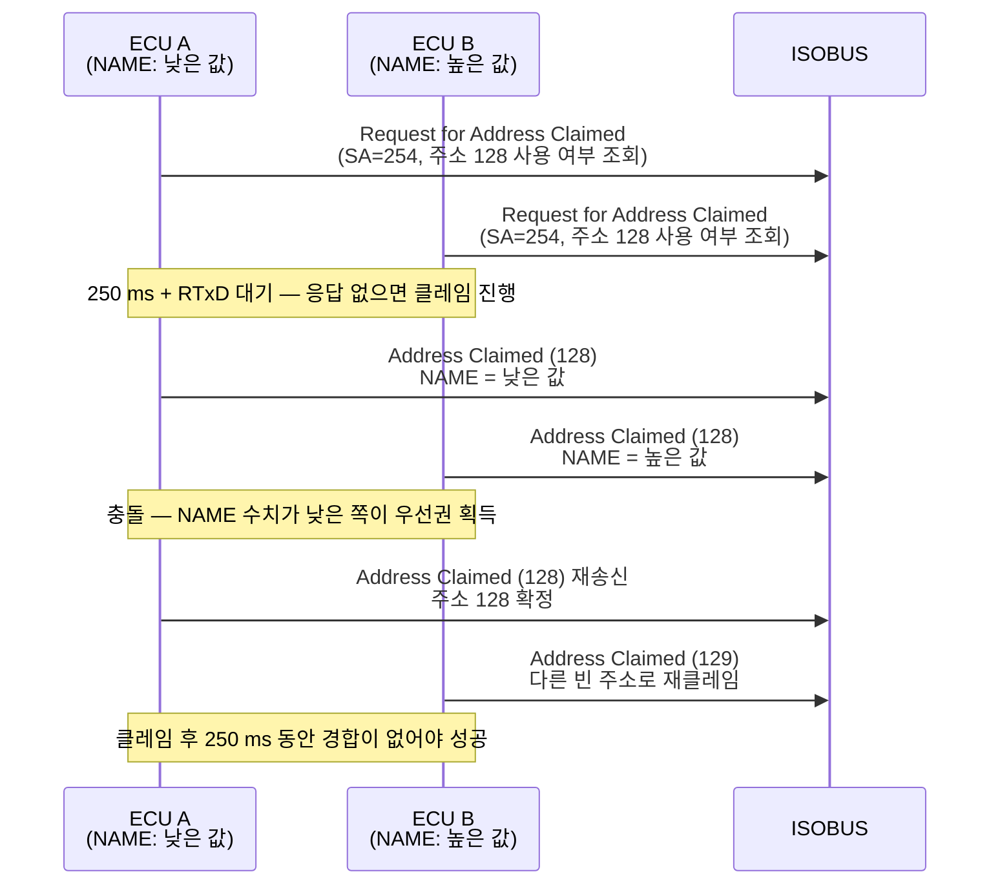
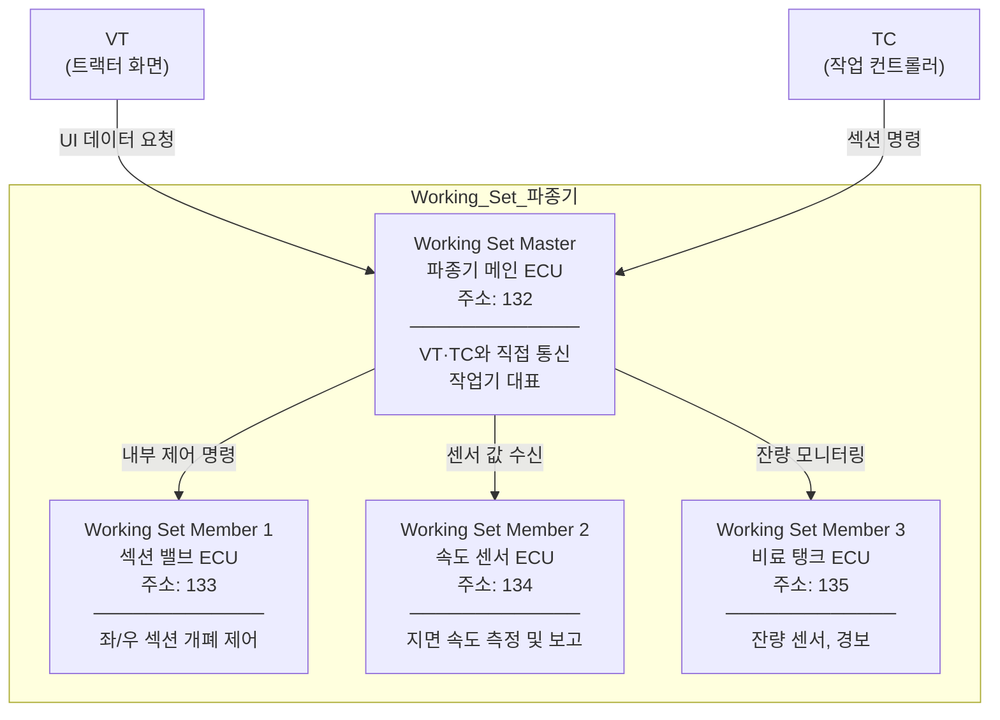
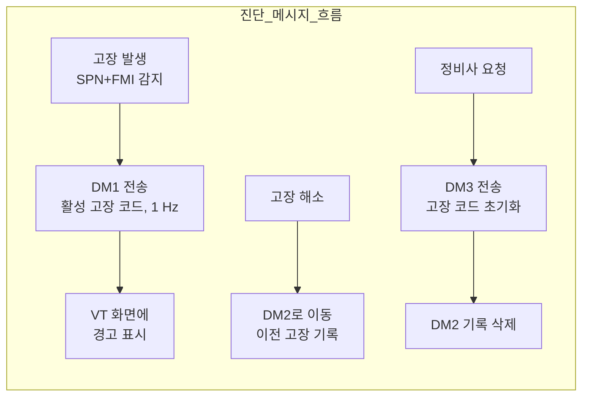
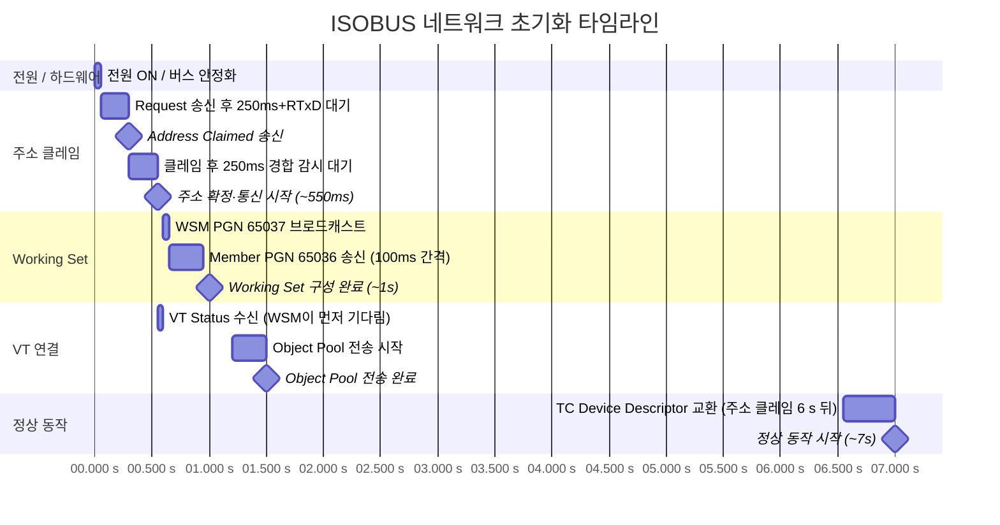

# ISOBUS 네트워크 관리

::: info 학습 목표
- ISOBUS의 주소 클레임 방식과 CF(Control Function) 개념을 설명할 수 있다.
- Working Set Master와 Member의 관계를 도식으로 이해한다.
- DM1~DM3 진단 메시지의 역할과 SPN+FMI 조합을 구분할 수 있다.
- 전원 ON부터 통신 완료까지의 시간 흐름을 설명할 수 있다.
- Working Set 정의가 빠졌을 때 service provider가 재요청하고 포기하는 로직을 설계할 수 있다.
- DM1·DM2 바이트에서 SPN·FMI·OC를 디코딩하고, DM1을 언제 보내야 하는지 판단할 수 있다.
- ECU identification·functionalities·compliance certification 메시지를 바이트 단위로 인코딩·디코딩할 수 있다.
:::

## 1. 주소 클레임 (ISOBUS 방식)

ISOBUS의 주소 클레임은 J1939의 방식을 기반으로 하되, 농업 기계에 맞게 확장된 규칙을 적용한다.

### CF (Control Function)

ISOBUS에서는 네트워크에 참여하는 모든 통신 주체를 <strong>CF(Control Function)</strong>라고 부른다. 하나의 물리적 ECU가 여러 CF를 포함할 수도 있다. 각 CF는 독립적인 주소를 가진다.

### 주소 범위

| 주소 범위 | 용도 |
|-----------|------|
| 0 ~ 127 | Preferred 주소 영역 (특정 기능에 할당) |
| 128 ~ 247 | **Self-Configurable 주소** (동적 협상) |
| 248 ~ 253 | Preferred 주소 영역 (특정 기능에 할당) |
| 254 | Null Address (소스 주소 전용 — 클레임 전·실패 시 네트워크 관리 메시지에 사용) |
| 255 | Global Address (목적지 주소 전용 — 브로드캐스트) |

ISOBUS 작업기 ECU는 대부분 **128~247** 범위의 Self-Configurable 주소를 사용한다. 이 범위의 주소는 여러 장치가 동시에 원할 경우 NAME 값의 우선순위로 자동 협상된다. ISO 11783-5는 적합 CF에 <strong>self-configurable 능력을 필수</strong>로 요구하며, non-configurable CF는 구판·SAE J1939 호환을 위해 허용될 뿐이다.

### 주소 클레임 흐름



Request for Address Claimed는 "주소를 원한다"는 요구가 아니라 <strong>해당 주소(또는 전체)의 클레임 상태를 조회</strong>하는 메시지다. 클레임 전의 CF는 SA를 NULL(254)로 하여 보내고, 최소 <strong>250 ms + RTxD</strong>(0~255 난수 × 0,6 ms)를 기다린 뒤 클레임을 진행한다.

Address Claimed 송신 후 <strong>250 ms 동안</strong> 경합 클레임이 없어야 성공이며, 이 250 ms가 지나기 전에는 일반 메시지 송신을 시작할 수 없다(request-for-address-claimed에 대한 응답은 예외). Self-configurable CF는 중재에서 지면 위 다이어그램처럼 다른 빈 주소를 재클레임하면 되고, <strong>Cannot Claim Address</strong>는 쓸 수 있는 주소가 하나도 없을 때 NULL 주소(SA=254)로 보내는 실패 보고 메시지다. 이를 보낸 CF는 이후 cannot-claim-source-address와 request-for-address-claimed 외에는 아무 메시지도 보내지 않는다.

## 2. Working Set

작업기(Implement)는 내부에 여러 ECU를 포함할 수 있다. 예를 들어 파종기(Seeder)는 메인 제어 ECU, 섹션 밸브 ECU, 속도 센서 ECU를 각각 가질 수 있다. 이 ECU들을 하나의 논리적 단위로 묶는 것이 <strong>Working Set</strong>이다.

### 마스터-멤버 관계



### Working Set 선언 메시지 (PGN 65037)

WSM은 네트워크에 참여한 후 <strong>PGN 65037 (Working Set Master)</strong>를 브로드캐스트하여 자신이 마스터임을 선언한다. 이 메시지에는 Working Set에 속한 멤버 수(마스터 자신 포함)가 포함된다.

멤버 식별용 <strong>PGN 65036 (Working Set Member)</strong> 메시지도 멤버가 아니라 <strong>마스터가</strong> 송신한다. 마스터는 멤버 수 − 1개의 Member 메시지를 각 멤버의 NAME을 담아 <strong>100 ms 간격</strong>으로 보내고, 수신 측은 마지막 Member 메시지 후 350 ms가 지나면 Working Set 정의가 완료된 것으로 간주한다.

VT와 TC는 이 메시지들을 수신하여 작업기의 구조를 파악하고, Working Set 대상 통신 대부분을 WSM의 주소로 보낸다. 특히 TC의 명령은 WSM에게만 전달되며, 마스터가 멤버에게 명령을 전파하는 방법은 각 Working Set의 고유(proprietary) 설계 영역이다.

## 3. 진단 메시지

ISOBUS는 ISO 11783-12를 통해 표준화된 진단 메시지를 정의한다. SAE J1939-73의 DM 메시지 체계를 가져와 농기계 환경에 맞게 요구사항을 좁힌 구조다.

### 고장 코드 구조: SPN + FMI

모든 고장은 <strong>SPN(Suspect Parameter Number)</strong>과 <strong>FMI(Failure Mode Identifier)</strong>의 조합으로 식별한다.

- **SPN**: 어떤 파라미터에 문제가 생겼는지 (예: SPN 100 = 엔진 오일 압력)
- **FMI**: 어떤 종류의 고장인지 (예: FMI 1 = 데이터 낮음, FMI 3 = 전압 높음)

### 주요 진단 메시지

| 메시지 | PGN | 이름 | 설명 |
|--------|-----|------|------|
| DM1 | 65226 | Active Diagnostic Trouble Codes | 현재 발생 중인 활성 고장 코드 목록. 상태 변화 시 즉시 + 활성 고장이 있는 동안 <strong>1초에 1회(1 Hz)</strong> 주기 전송 |
| DM2 | 65227 | Previously Active Diagnostic Trouble Codes | 이전에 발생했다가 해소된 고장 코드. <strong>요청(request) 시에만</strong> 전송하며 주기 전송은 없다 |
| DM3 | 65228 | Diagnostic Data Clear | 저장된 이전 고장 코드(DM2) 초기화 요청. 활성 고장(DM1) 데이터에는 영향 없음 |



### FMI 주요 값

| FMI | 의미 |
|-----|------|
| 0 | 데이터는 유효하나 정상 범위보다 높음 (most severe) |
| 1 | 데이터는 유효하나 정상 범위보다 낮음 (most severe) |
| 2 | 데이터 불안정 / 간헐적 / 부정확 |
| 3 | 전압 높음 / 단락 (High) |
| 4 | 전압 낮음 / 단락 (Low) |
| 5 | 전류 낮음 / 단선 |
| 6 | 전류 높음 / 단락 (GND) |
| 12 | 지능형 장치·컴포넌트 내부 고장 (ECU 교체 필요) |
| 19 | 수신 네트워크 데이터 오류 |

## 4. 네트워크 관리 타임라인

전원을 켠 순간부터 ISOBUS 통신이 완전히 확립될 때까지의 시간 흐름이다.



### 타임라인 요약

| 시점 | 이벤트 |
|------|--------|
| 0 ms | 전원 ON, 버스 전압 안정화 |
| ~50 ms | 각 ECU가 Request for Address Claimed 송신, 250 ms + RTxD 대기 시작 |
| ~300 ms | Address Claimed 송신 |
| ~550 ms | 250 ms 동안 경합 없음 확인 — 주소 확정, 일반 통신 시작 |
| ~550 ms | VT Status 수신 시작 — WSM은 이것을 기다린 뒤에 Working Set을 VT에 알린다(ISO 11783-6:2018 4.6.6.2) |
| ~600 ms | WSM Working Set 선언 (PGN 65037) 후 Member 메시지(PGN 65036)를 100 ms 간격 송신 |
| ~1,000 ms | Working Set 구성 완료 |
| ~1,500 ms | Object Pool 전송 완료, 화면 표시 시작 |
| ~7,000 ms | TC Device Descriptor 완료, 전체 통신 확립. TC와 클라이언트는 주소 클레임 뒤 6 s를 기다린 다음에야 연결을 시작한다(ISO 11783-10:2015 6.6.1 b, 6.6.2 b) |

> **실제 현장에서의 차이**: Object Pool 크기, ECU 수, 버스 부하에 따라 타임라인은 달라진다. 복잡한 작업기의 경우 Object Pool 전송만 수 초가 걸릴 수 있다.

> **핵심 정리**
> - ISOBUS에서 ECU는 CF(Control Function)라 불리며, Self-Configurable 주소(128~247)를 NAME 우선순위로 동적 협상한다.
> - Working Set은 작업기 내 여러 ECU를 하나의 논리 단위로 묶으며, WSM이 Master/Member 메시지(PGN 65037/65036)를 모두 송신해 구성을 선언하고 VT·TC와의 통신을 대표한다.
> - DM1은 현재 활성 고장(활성 중 1 Hz 전송), DM2는 이전 고장 이력(요청 시에만 전송), DM3는 이전 고장 기록(DM2) 초기화 명령이다.
> - 전원 ON 후 약 2초 안에 주소 클레임 → VT Status 확인 → Working Set → VT 연결(Object Pool)까지 끝난다. TC 연결은 주소 클레임 뒤 6초 대기를 거쳐 그 뒤에 이루어진다.

## 5. Working Set 구성 따라가기

2절이 Working Set의 개념을 다뤘다면, 여기서는 <strong>ECU 3개로 이루어진 작업기가 Working Set을 선언하는 과정</strong>을 메시지 하나하나 끝까지 따라간다. 대상은 스프레이어(방제기) 작업기이며, 메인 컨트롤러가 좌·우 두 분무 섹션 컨트롤러를 거느린다.

### 구성

세 CF 모두 §1의 절차로 <strong>이미 주소 클레임을 마친 상태</strong>에서 이 절이 시작된다. 즉 여기서 다루는 건 클레임 이후, Working Set을 선언하는 단계만이다.

| CF | 역할 | SA (주소) | Working Set에서의 위치 |
|---|---|---|---|
| 메인 컨트롤러 | 스프레이어 전체 제어, VT·TC와 통신 | 0x90 (144) | Working Set Master |
| 좌측 섹션 컨트롤러 | 좌측 분무 섹션 개폐 | 0x91 (145) | Member 1 |
| 우측 섹션 컨트롤러 | 우측 분무 섹션 개폐 | 0x92 (146) | Member 2 |

### 타임라인

Working Set 정의에는 두 메시지가 필요하다 — 크기를 알리는 <strong>Working Set Master 메시지(PGN 65037)</strong>와 멤버를 식별하는 <strong>Working Set Member 메시지(PGN 65036)</strong>다. <strong>둘 다 master가 보낸다.</strong>

| t (ms) | 송신 CF | 메시지 (PGN, 8바이트 데이터) | 의미 |
|---|---|---|---|
| 0 | 메인 컨트롤러 (SA 0x90) | PGN 65037, `03 FF FF FF FF FF FF FF` | Working Set 크기 선언 — 멤버 3명(마스터 자신 포함) |
| 100 | 메인 컨트롤러 (SA 0x90) | PGN 65036, `00 00 A8 82 00 80 0C A0` | 좌측 섹션 컨트롤러의 NAME 통지 |
| 200 | 메인 컨트롤러 (SA 0x90) | PGN 65036, `00 00 A8 82 01 80 0C A0` | 우측 섹션 컨트롤러의 NAME 통지 |
| 550 | (없음 — 수신측 타임아웃) | — | 마지막 member 메시지 후 <strong>350 ms</strong> 경과, Working Set 구성 완료로 판정 |

t=100과 t=200 사이의 100ms 간격은 규격이 정한 값이다. 반면 t=0(마스터 메시지)에서 t=100(첫 member 메시지)까지의 간격은 표준에 규정이 없다 — 위 표는 이해를 돕기 위해 같은 100ms 주기를 그대로 이어 쓴 예시일 뿐이다.

### 메시지 바이트 뜯어보기

**Working Set Master 메시지 (PGN 65037)**

| Byte | 값 | 의미 |
|---|---|---|
| 1 | `03` | Working Set 멤버 수 — <strong>마스터 자신을 포함</strong>한 값. "멤버 2명 + 마스터"이므로 `2`가 아니라 `3`이다 |
| 2~8 | `FF FF FF FF FF FF FF` | Reserved |

**Working Set Member 메시지 (PGN 65036)**

| Byte | 값 | 의미 |
|---|---|---|
| 1~8 | 해당 멤버의 NAME (8바이트) | 그 멤버가 주소를 클레임할 때 쓴 것과 동일한 NAME |

NAME은 Byte 1이 최하위 바이트다(ISO 11783-5:2019 4.3.2 Table 1). 좌측 `00 00 A8 82 00 80 0C A0`을 풀면 다음과 같다. Byte 8 `A0`은 self-configurable 1, industry group 2(농업 장비), device class instance 0이다. Byte 7 `0C`는 device class 6(Sprayers, ISO 11783-10:2015 Table F.1)과 예약 비트 0이다. Byte 6 `80`은 function 128이고, Byte 5 `00`은 function instance 0과 ECU instance 0이다. 우측은 Byte 5만 `01`(ECU instance 1)로 다르다. 한 function을 ECU 두 개가 맡으면 ECU instance를 0과 1로 두라는 Part 5 4.3.2의 권고와 Annex A.3의 예를 따른 것이다. function 128은 예시 값이다. 128 이상의 function 코드는 device class에 따라 뜻이 달라지고, 실제 코드는 isobus.net 데이터베이스가 관리한다. Byte 1~4의 identity number와 manufacturer code도 예시 값이다.

마스터가 보내는 member 메시지의 개수는 <strong>멤버 수 − 1</strong>, 즉 3 − 1 = 2개다. 마스터 자신의 NAME은 별도 메시지 없이 마스터의 address claim에서 이미 알 수 있으므로 다시 보내지 않는다.

여기서 CAN ID를 보면 흥미로운 점이 하나 있다. PGN 65037 메시지와 두 PGN 65036 메시지 모두 <strong>Source Address가 0x90(메인 컨트롤러)으로 동일</strong>하다. 두 member 메시지는 PGN·데이터는 다르지만 ID의 SA는 완전히 같다 — 송신자가 항상 마스터이기 때문이다.

### 타이밍 규정

- member 메시지 간격: <strong>100 ms</strong>
- 완료 판정: 마지막 member 메시지 후 <strong>350 ms</strong> 경과 시 수신측(service provider)은 마스터가 모든 멤버 NAME 송신을 마쳤다고 간주한다
- 실패 시: 정확한 개수의 member 메시지를 받지 못한 service provider는 마스터에게 PGN 65037을 재요청해야 하고, 마스터는 요청을 받으면 master 메시지 + member 메시지 전체를 다시 보낸다. 응용 계층에 별도 규정이 없다면 <strong>최소 3회</strong> 완전한 멤버 목록 확보에 실패한 service provider는 해당 Working Set을 무시할 수 있다

### 흔한 오해 정정

member 메시지를 <strong>각 멤버 ECU가 직접 보낸다</strong>고 생각하기 쉽지만, 실제로는 <strong>마스터가 대신 보낸다</strong>. 위 타임라인의 세 프레임 — PGN 65037 1개, PGN 65036 2개 — 모두 SA 0x90(메인 컨트롤러)에서 나간다. 좌·우 섹션 컨트롤러(SA 0x91, 0x92)는 이 과정에서 <strong>아무 메시지도 보내지 않는다.</strong> 이들의 존재는 오직 마스터가 실어 보내는 NAME 바이트를 통해서만 네트워크에 드러난다.

::: tip 핵심 통찰
Working Set Master 메시지의 Byte 1은 "멤버 수(마스터 포함)"이지 "마스터 아닌 멤버 수"가 아니다. 그리고 이어지는 member 메시지의 개수는 그 값에서 1을 뺀 값이며, 두 메시지 모두 <strong>마스터의 SA</strong>로 나간다. 이 두 가지를 헷갈리면 Working Set 구성 로직이 어긋난다.
:::

:::details 파이썬으로 검산해 보기
```python
PRIORITY = 7                     # ISO 11783-7 B.23.2/B.23.3 — 두 메시지 모두 priority 7
PF_MASTER, PS_MASTER = 0xFE, 0x0D  # PGN 65037 (0x00FE0D) — Working Set Master
PF_MEMBER, PS_MEMBER = 0xFE, 0x0C  # PGN 65036 (0x00FE0C) — Working Set Member


def can_id(priority, pf, ps, sa):
    return (priority << 26) | (pf << 16) | (ps << 8) | sa


MASTER_SA = 0x90                 # 메인 컨트롤러
MEMBER_SAS = [0x91, 0x92]        # 좌측·우측 섹션 컨트롤러 (참고용 — 메시지 자체엔 SA가 실리지 않음)
NUM_MEMBERS = 1 + len(MEMBER_SAS)  # 마스터 자신 포함 = 3

NAME_LEFT  = [0x00, 0x00, 0xA8, 0x82, 0x00, 0x80, 0x0C, 0xA0]
NAME_RIGHT = [0x00, 0x00, 0xA8, 0x82, 0x01, 0x80, 0x0C, 0xA0]


def name_fields(name):           # ISO 11783-5 Table 1, Byte 1이 최하위 바이트
    v = int.from_bytes(bytes(name), "little")
    return (v >> 63, v >> 60 & 7, v >> 49 & 0x7F, v >> 48 & 1, v >> 40 & 0xFF, v >> 35 & 0x1F, v >> 32 & 7)


# (self-config, industry group, device class, 예약 비트, function, function instance, ECU instance)
assert name_fields(NAME_LEFT) == (1, 2, 6, 0, 128, 0, 0)
assert name_fields(NAME_RIGHT) == (1, 2, 6, 0, 128, 0, 1)

wsm_id   = can_id(PRIORITY, PF_MASTER, PS_MASTER, MASTER_SA)
wsm_data = [NUM_MEMBERS] + [0xFF] * 7          # Byte1=멤버 수, Byte2~8=Reserved

wsmem_id = can_id(PRIORITY, PF_MEMBER, PS_MEMBER, MASTER_SA)  # SA는 두 메시지 모두 master!

frames = [
    (0,   wsm_id,   wsm_data),
    (100, wsmem_id, NAME_LEFT),
    (200, wsmem_id, NAME_RIGHT),
]

for t, cid, data in frames:
    print(f"t={t:>4}ms  ID=0x{cid:08X}  DATA={' '.join(f'{b:02X}' for b in data)}")

assert wsm_data[0] == NUM_MEMBERS                       # Byte1 = 3 (마스터 포함)
assert len(frames) - 1 == NUM_MEMBERS - 1                # member 메시지 수 = 멤버 수 - 1 = 2
assert all(cid == wsmem_id for _, cid, _ in frames[1:])  # 모든 member 메시지가 master SA에서 나감

completion_ms = frames[-1][0] + 350                       # 마지막 member 메시지 + 350ms
print("Working Set 구성 완료 판정 시각:", completion_ms, "ms")

# 출력:
# t=   0ms  ID=0x1CFE0D90  DATA=03 FF FF FF FF FF FF FF
# t= 100ms  ID=0x1CFE0C90  DATA=00 00 A8 82 00 80 0C A0
# t= 200ms  ID=0x1CFE0C90  DATA=00 00 A8 82 01 80 0C A0
# Working Set 구성 완료 판정 시각: 550 ms
```
:::

## 6. Working Set 메시지 규정 (Part 7 B.23)

2절과 5절은 Working Set이 만들어지는 흐름을 따라갔다. 이 절은 그 두 메시지를 정의한 ISO 11783-7:2015 B.23을 규정 단위로 읽는다. 등장인물은 셋이다. Working Set Master, Working Set member, 그리고 <strong>service provider</strong>다. service provider는 그 Working Set 바깥에서 Working Set과 통신하는 CF를 말한다. VT·TC가 전형적인 service provider이고, 다른 Working Set의 master나 member여도 상관없다(B.23.4). 2018년 Amendment 1은 B.23을 고치지 않았다.

### 두 메시지의 정의

| 항목 | Working Set Master (B.23.2) | Working Set Member (B.23.3) |
|---|---|---|
| PGN | 65037 (0xFE0D) | 65036 (0xFE0C) |
| DP / PF / PS | 0 / 254 / 13 | 0 / 254 / 12 |
| 기본 priority | 7 | 7 |
| 데이터 길이 | 8 byte | 8 byte |
| 전송 주기 | As required (주기 없음) | As required |
| Byte 1 | 멤버 수, master 포함 (A.24.1, SPN 2409, 1~250) | NAME 시작 |
| Byte 2~8 | Reserved | NAME 나머지 (A.24.2, SPN 2845) |
| 송신자 | master | master |

- 두 PGN은 PF가 254(240 이상)인 PDU2 형식이다. CAN ID에 목적지 칸이 없으니 언제나 전역으로 나간다. service provider가 master에게 지정 주소로 Request를 보내도 응답은 전역이다(ISO 11783-3:2018 5.4.3 Table 5). 그래서 한 service provider의 재요청으로 나간 재정의를 버스의 다른 service provider도 함께 받는다.
- 전송 주기가 "As required"라 주기 송신이 없다. 나중에 켜진 service provider는 정의를 본 적이 없는 채로 시작하므로, 아래 규칙 a)의 Request로 받아 오면 된다(추론 — 원문은 늦게 합류한 경우를 따로 다루지 않는다).
- Byte 2~8의 Reserved에는 값이 적혀 있지 않다. Part 7 3.3의 일반 규칙이 "메시지 정의에 따로 적지 않았으면 예약 비트는 모두 1"이므로 `FF`로 채운다. 5절의 `03 FF FF FF FF FF FF FF`가 이 규칙을 따른 값이다.
- member 메시지에 싣는 NAME은 그 member가 주소를 claim할 때 쓴 NAME과 같아야 한다(A.24.2). Working Set 자체는 master의 NAME으로 식별하고, NAME 기준으로 어떤 member도 동시에 두 Working Set에 속할 수 없다(A.24.1).
- 멤버 수의 범위는 1~250이다(A.24.1). 그런데 아래 규칙 d)는 Working Set이 더 필요 없을 때 멤버 수 0을 보내라고 한다. 두 규정을 함께 읽으면 0은 범위 밖의 특수값, 즉 삭제 통지다. 1~250만 받는 파서는 삭제 통지를 버리게 된다. 반대로 251~255는 Part 7 3.3 Table 1에서 1 byte 파라미터의 유효 범위 밖(지시자·예약·오류·미가용)이므로 멤버 수로 받아들이지 않는다.

### 누가 누구에게 보내는가 (B.23.1)

- master의 주소는 Working Set 전체를 향하는 "전역의 부분집합" 목적지다. service provider는 Working Set 몫의 데이터 대부분을 master의 SA로 보낸다.
- member도 직접 메시지를 보낼 수 있다. 원문 예는 파종기다. master 하나에 줄(row)마다 member가 하나씩 있고, VT는 master와 각 member의 명령을 모두 받아들이며, member는 자기 줄의 화면을 갱신한다.
- member가 보낸 Request의 응답은 service provider가 그 member에게 보낸다(shall). 그래서 TP(Transport Protocol) 응답도 member가 직접 받는다.
- member는 다른 member 앞으로 온 지정 메시지를 지켜볼 의무가 없다.
- 다른 CF는 master에게 보내도 되고, 필요하면 member에게 직접 보내도 된다. member에게서 온 메시지는 그 Working Set의 것으로 해석해야 한다(shall).
- 원문은 이 메시지의 실제 쓰임이 응용 계층마다 다르고 더 좁을 수 있다고 적어 둔다. VT 쪽은 [15장](/study/isobus/15-vt-basics), TC 쪽은 [18장](/study/isobus/18-tc-basics)과 함께 읽는다.

### 응용 규칙 a)~h) (B.23.4)

| 규칙 | 요지 | 구현 포인트 |
|---|---|---|
| a) | master 메시지 뒤에는 항상 (멤버 수 − 1)개의 member 메시지가 온다. 개수가 맞지 않으면 service provider는 master에게 PGN 65037을 Request해야 하고(shall), master는 master 메시지와 member 메시지 전부를 다시 보내야 한다(shall). 응용 계층 문서에 다른 규정이 없으면, 최소 3회 실패한 뒤에는 그 Working Set을 무시해도 된다(may). | 개수 검사, 재요청, 포기 카운터 |
| b) | Working Set은 member의 NAME으로 정의한다. member 메시지 간격은 100 ms다. member 메시지 뒤로 350 ms를 넘기면 수신 측은 master가 NAME을 다 보냈다고 본다(shall). | member마다 350 ms 타이머를 다시 건다 |
| c) | member도 독립된 CF다. 고장 메시지는 각자의 SA로 나가고, 고장표 클리어·파라미터 프로그래밍 같은 명령은 대상 CF의 SA로 보내야 한다(shall). master 앞으로 온 프로그래밍을 member 전원이 받아들이지 않도록 만들어야 한다(shall). 여러 member에 공통 데이터를 한 번에 넣으려면 그런 응용 소프트웨어가 따로 있어야 한다(NOTE 1). | DM1은 member SA별로 모으고, DM3는 member SA로 보낸다(10절) |
| d) | CF 하나는 Working Set 하나에만 속한다(shall not). 기존 master가 새 master 메시지를 보내면 service provider는 옛 정의를 새 정의로 바꾼다(shall). 바꿀 일이 생기면 master가 다시 정의하고, 더 필요 없으면 멤버 수 0을 보낸다(shall). | master 메시지 수신 = 정의 새로 시작 |
| e) | master가 NAME을 바꾸면 새 Working Set을 만든다(shall). 옛 정의는 멤버 수 0 메시지로 정리될 때까지 service provider 메모리에 남을 수 있다. 중복 member를 찾아 고치는 책임은 service provider에 있다. NOTE 2는 중복이나 안 쓰는 Working Set을 주기적으로 점검해 메모리를 회수하라고 권한다. | 중복 검사, 주기 정리 |
| f) | master의 SA가 바뀌어도 정의는 그대로다. service provider는 새 address claim을 보고 SA와 NAME의 연결을 고치고(shall), member는 Working Set 통신을 받으려고 보던 주소를 바꾼다(shall). | 재정의 없음 |
| g) | member의 SA가 바뀌면 service provider는 새 SA를 해당 Working Set에 연결한다(shall). NAME이 그대로면 address claim만 보고 처리할 수 있다. | 재정의 없음 |
| h) | member NAME 전부를 챙기는 책임은 master에 있다. member가 네트워크에 들어오거나 나가면 master가 정의를 고친다(shall). service provider는 메시지에 적힌 멤버 수로 Working Set을 만든 뒤, member가 주소를 claim할 때마다 SA를 채운다(shall). | NAME 먼저, SA는 나중 |

### 다시 선언하는 경우

| 상황 | master | service provider | 근거 |
|---|---|---|---|
| member 메시지 개수가 모자람 | Request를 받으면 master·member 메시지를 전부 다시 보낸다 | master에게 PGN 65037 Request. 최소 3회 실패 뒤에는 무시해도 된다 | a) |
| member 합류·이탈 | 정의를 고쳐 다시 보낸다 | 새 정의로 바꾼다 | h), d) |
| Working Set 종료 | 멤버 수 0을 보낸다 | 정의를 지운다 | d) |
| master NAME 변경 | 새 Working Set을 만든다 | 옛 정의는 정리될 때까지 남을 수 있다 | e) |
| master 또는 member SA 변경 | 다시 보내지 않는다 | address claim을 보고 SA만 고친다 | f), g) |


그림은 member 메시지 하나가 유실된 경우다. 마지막 member 메시지 뒤로 350 ms가 지났는데 member가 하나뿐이니, VT는 master에게 Request(PGN 59904, 데이터 `0D FE 00`)를 보낸다. master는 Part 3 5.13.3의 응답 시간 Tr(200 ms) 안에 master 메시지부터 다시 보내고, member 메시지 두 개를 100 ms 간격으로 잇는다.

::: warning 수신 측에서 흔히 틀리는 곳
- 350 ms 타이머는 member 메시지가 올 때마다 다시 건다. 원문의 기준점이 "a working-set-member message"이기 때문이다. master 메시지에서 첫 member까지의 간격, 그리고 member가 하나도 오지 않을 때 언제 포기할지는 원문에 없다. 아래 코드는 master 메시지 시각부터 같은 350 ms를 잰다(구현 선택).
- 새 master 메시지가 오면 받던 정의를 버리고 처음부터 센다(d). 이전 정의에 member를 이어 붙이면 개수가 틀어진다.
- Working Set의 키는 master의 NAME이다. SA를 키로 쓰면 master가 주소를 바꾸는 순간(f) Working Set을 잃는다.
- 멤버 수 0은 범위(1~250) 밖이지만 유효한 삭제 통지다.
:::

::: details Python으로 service provider 수신기 만들어 보기
```python
class WorkingSetTracker:
    def __init__(self, name_of, request_master):
        self.name_of, self.request_master = name_of, request_master
        self.sets, self.pending, self.requests_sent = {}, {}, {}

    def on_master(self, t, sa, size):
        key = self.name_of(sa)
        if size == 0:
            self.sets.pop(key, None)
            self.pending.pop(key, None)
            return
        self.pending[key] = {"sa": sa, "size": size, "names": [], "last": t}

    def on_member(self, t, sa, member_name):
        p = self.pending.get(self.name_of(sa))
        if p is not None:
            p["names"].append(member_name)
            p["last"] = t

    def tick(self, t):
        for key, p in list(self.pending.items()):
            if t - p["last"] <= 350:
                continue
            del self.pending[key]
            if len(p["names"]) == p["size"] - 1:
                self.sets[key] = p["names"]
                self.requests_sent[key] = 0
            elif self.requests_sent.get(key, 0) < 3:
                self.requests_sent[key] = self.requests_sent.get(key, 0) + 1
                self.request_master(t, p["sa"])


claims = {0x90: "NAME_M", 0xA0: "NAME_X"}       # address claim으로 알게 된 SA -> NAME
requests = []
vt = WorkingSetTracker(claims.get, lambda t, sa: requests.append((t, sa)))
L, R = "00 00 A8 82 00 80 0C A0", "00 00 A8 82 01 80 0C A0"


def run(start, stop):
    for t in range(start, stop, 10):
        vt.tick(t)


vt.on_master(0, 0x90, 3)                          # NAME_L 프레임은 유실됐다
vt.on_member(200, 0x90, R)
run(0, 600)
assert requests == [(560, 0x90)]                  # 200 + 350 ms를 넘긴 첫 tick에서 재요청

vt.on_master(600, 0x90, 3)
vt.on_member(700, 0x90, L)
vt.on_member(800, 0x90, R)
run(600, 1200)
assert vt.sets["NAME_M"] == [L, R]

for start in (2000, 3000, 4000, 5000):            # member가 끝내 오지 않는 Working Set
    vt.on_master(start, 0xA0, 2)
    run(start, start + 600)
assert [sa for _, sa in requests].count(0xA0) == 3 and "NAME_X" not in vt.sets

claims[0x95] = claims.pop(0x90)                   # master가 0x95로 다시 claim (규칙 f)
assert vt.sets["NAME_M"] == [L, R]                # 키가 NAME이라 정의는 그대로다
vt.on_master(6000, 0x95, 0)                       # 멤버 수 0 = 삭제 (규칙 d)
assert "NAME_M" not in vt.sets
print("재요청:", [(t, hex(sa)) for t, sa in requests])
# 재요청: [(560, '0x90'), (2360, '0xa0'), (3360, '0xa0'), (4360, '0xa0')]
```

"최소 3회"를 보수적으로 읽어, Request를 세 번 보내고도 완성하지 못했을 때 포기하게 했다.
:::

::: tip 정리
- Working Set Master·Member 메시지는 PDU2·priority 7·8 byte이고, 주기 없이 필요할 때 master가 보낸다.
- service provider는 member 개수를 세고, 모자라면 master에게 PGN 65037을 Request해야 한다. 최소 3회 실패한 뒤에는 무시해도 된다.
- 재선언은 개수 부족·member 변동·종료(멤버 수 0)·master NAME 변경 때 일어나고, SA 변경만으로는 일어나지 않는다.
:::

## 7. Part 12 진단 요구사항 지도

ISO 11783-12:2019(3판)는 본문이 짧고 규정 대부분이 부속서에 있다. 절별 요약은 [Part 12 정리 부록](/study/isobus/appendix-iso-part12)에 있으니, 여기서는 구현자 관점의 두 질문에 답한다. CF는 무엇을 반드시 지원해야 하나? 요청이 오면 무엇을 어떤 방식으로 돌려줘야 하나?

### 필수 메시지 (6.1)

- 1판에 있던 진단 level 0·level 1 구분은 폐기됐다.
- 모든 CF는 Annex B의 진단 정보 메시지 전부와, 거기서 파생되는 요구사항을 지원해야 한다(shall). DM1·DM2·DM3는 고를 수 있는 선택지가 아니라 셋 다 필수다. Part 12에 나오는 DM은 이 셋뿐이고, DM11·DM22 같은 다른 DM 번호는 나오지 않는다.
- 운전자나 정비사가 문제를 진단할 <strong>진단 사용자 인터페이스</strong>(diagnostic user interface, 이하 진단 UI)가 있어야 한다. VT가 맡아도 되고 다른 UI 장치여도 된다. 6.2~6.5의 정보는 이 UI를 거쳐 사람에게 보여야 한다(shall).

CF가 받을 수 있는 Request와 응답 방식을 한 표로 모으면 다음과 같다. Request(PGN 59904)는 요청할 PGN을 LSB부터 담은 3 byte 메시지다(Part 3 5.4.3).

| 메시지 (근거 절) | PGN | Request 데이터 | 길이 | 응답 방식 |
|---|---|---|---|---|
| ECU identification (B.1) | 64965 (0xFDC5) | `C5 FD 00` | 가변 | 대개 8 byte 초과. 전역 요청이면 BAM, 지정 요청이면 RTS/CTS |
| Software identification (B.2) | 65242 (0xFEDA) | `DA FE 00` | 가변 | 위와 같다 |
| ISOBUS certification (B.3 → Part 7 B.27) | 64834 (0xFD42) | `42 FD 00` | 8 byte | 단일 프레임, 항상 전역 |
| NAME (B.4 → Part 5) | 60928 (0xEE00) | `00 EE 00` | 8 byte | address claim으로 답한다. 항상 전역 |
| Diagnostic protocol (B.5) | 64818 (0xFD32) | `32 FD 00` | 8 byte | 단일 프레임, 항상 전역 |
| DM1 (B.6) | 65226 (0xFECA) | `CA FE 00` | 가변 | DTC 0~1개면 단일 프레임, 2개 이상이면 BAM 또는 RTS/CTS |
| DM2 (B.7) | 65227 (0xFECB) | `CB FE 00` | 가변 | DM1과 같다. 지원하지 않으면 NACK |
| DM3 (B.8) | 65228 (0xFECC) | `CC FE 00` | 없음 | 지정 요청이면 ACK/NACK(PGN 59392), 전역 요청이면 응답 없음 |
| Functionalities (B.9) | 64654 (0xFC8E) | `8E FC 00` | 8 byte 이상 | 8 byte면 단일 프레임, 넘으면 BAM 또는 RTS/CTS |
| Product identification (B.10) | 64653 (0xFC8D) | `8D FC 00` | 가변 | ECU identification과 같다 |

주소 클레임을 빼면 위 PGN은 모두 PF가 240 이상인 PDU2다. 그래서 응답이 8 byte 이하면 요청이 지정 주소로 왔어도 전역으로 나간다. 8 byte를 넘으면 요청 방식이 TP 방식을 정한다. 전역 요청이면 BAM, 지정 요청이면 RTS/CTS다(Part 3 Table 5). TP 자체는 [11장](/study/isobus/11-j1939-transport)에서 다뤘다. address claim은 지정 주소로 요청받아도 전역으로 답하는 예외다(Part 3 5.4.3, Part 5 4.5.3).

요청과 응답의 일반 규칙도 진단 UI 설계에 바로 걸린다(Part 3 5.4.3, 5.13.3).

- 지정 요청을 받은 CF는 반드시 답한다. 요청받은 PG를 보내거나, 지원하지 않으면 NACK(control byte 1)을 보낸다. 전역 요청에는 NACK을 보내면 안 된다.
- 응답은 200 ms(Tr) 안에 해야 한다(shall). 요청한 쪽은 최소 1.25 s(T3)를 기다린 뒤 다시 요청한다. 재시도는 2회, 즉 총 3회로 제한하라는 것이 권고다(should).
- Request PG의 전송 주기는 "보통 초당 두세 번 이하"가 권고다. CF 수십 개에 메시지 열 종류를 물어야 하는 진단 UI라면, 한꺼번에 쏟기보다 순서를 정해 하나씩 돌리는 편이 이 권고에 맞는다(추론).

### 진단 UI가 모으는 정보 (6.2, 6.4)

| 요구 | 내용 | 얻는 방법 |
|---|---|---|
| 6.2 a) | ECU part number·serial number·제조사명 | B.1 ECU identification 요청 |
| 6.2 b) | 각 CF의 NAME | address claim 감시 (B.4) |
| 6.2 c) | 소프트웨어 버전 | B.2 Software identification 요청 |
| 6.2 d) | 적합성 시험 데이터 (시험소, 인증 데이터, 시험 연도) | Part 7 B.27 메시지 요청 (9절) |
| 6.2 e) | 제품 식별 | B.10 Product identification 요청 |
| 6.4 a) | CF의 진단 프로토콜 | B.5 Diagnostic protocol 요청 |
| 6.4 b)·c) | active / previously active DTC (SPN·FMI) | DM1 수신·요청 / DM2 요청 |
| 6.4 d) | 고장 발생 횟수 (있으면) | DTC의 OC 필드 |
| 6.4 끝 | previously active DTC 클리어 (요구되는 경우) | DM3 |

진단 UI는 address claim 과정을 지켜보며 NAME과 SA를 얻고, 나머지는 CF에 요청해 얻는다(6.2). 같은 ECU 안의 CF는 모두 같은 ECU identification을 보내야 하므로(6.2, B.1), 진단 UI는 이 문자열이 같은 CF끼리 묶어 "ECU 한 대에 CF 몇 개"를 그릴 수 있다. Annex D.1 예시 화면이 그렇게 생겼다. 제조사·part number·serial number가 같은 VT·TECU·두 번째 VT CF 셋이 트랙터 ECU 하나에, Rate Control CF 셋이 작업기 ECU 하나에 들어 있다. Product identification도 제품 안에서 같아야 하므로(B.10) 그 위에 "제품" 단위 묶음을 하나 더 만들 수 있다. 중복 주소 클레임이나 중복 NAME 같은 주소 오류는 진단 툴이 request-for-address-claimed로 찾아낼 수 있다(ISO 11783-5:2019 4.4.4.1).

### 네트워크 통계 (6.3)

- 네트워크 상태를 보여 주는 진단 UI는 자기 연결로 버스 통계를 직접 재야 한다. 하드웨어가 지원하면 최소한 bus load, 송수신 중 검출한 CAN 에러, 네트워크 메시지 수를 보여야 한다(shall).
- 하드웨어가 허락하면 250 ms~5 s 동안의 평균 버스 전압도 넣는 것이 권고다(should).
- Annex D.2 예시 화면에는 CAN_H·CAN_L 전압, bus load(%), 메시지 수와 함께 Stuff·Form·Ack·Bit 1·Bit 2·CRC 에러 카운트가 있다. 에러 이름은 [6장](/study/isobus/06-can-error)에서 본 CAN 에러 검출 메커니즘(Bit·Stuff·CRC·Form·ACK)과 같다. 예시 화면은 Bit 에러를 Bit 1·Bit 2 두 칸으로 나눠 보여 주는데, 원문은 둘의 차이를 설명하지 않는다.
- bus load를 어떤 식으로 계산하는지는 Part 12가 정하지 않는다.

### 서비스 툴과 진단 커넥터 (6.6, Annex C)

진단 화면에서 문제가 특정 ECU의 특정 CF로 좁혀지면, 그 CF가 B.5로 알린 프로토콜을 쓰는 서비스 툴을 ISO 11783-2의 진단 커넥터에 연결해 표시된 DTC를 바탕으로 문제를 푼다(6.6). Part 12의 진단 메시지가 맡는 일은 어느 유닛이 고장 났는지 좁히는 데까지다(5절, 6.6).

Annex C(규범)의 그림 C.1은 진단 체계가 지원해야 하는 네트워크 구성 예다. 트랙터(제품 1) 안에 tractor bus와 ISO 11783 bus가 있고, tractor ECU가 두 버스에 함께 연결돼 있다. ISO 11783 bus에는 CF 두 개를 가진 OEM ECU, 별개 제품인 애프터마켓 ECU(제품 2), 커넥터 너머의 작업기 CF가 붙는다. 진단 커넥터는 두 버스에 모두 닿는 자리에 있다. 커넥터와 그 설치는 ISO 11783-2를 따른다(C.2).

## 8. CF 정보 메시지를 바이트로 읽기 (Part 12 B.1·B.2·B.5·B.10)

ECU identification, Software identification, Product identification은 가변 길이 문자열을 `*`로 끊어 싣는다. 형식은 단순하지만 구분자 규칙 하나만 놓쳐도 필드가 한 칸씩 밀린다.

### 문자열 공통 규칙 (Annex A, 6.7)

- 문자 하나가 1 byte이고, 허용 값은 32~126과 160~255다(A.1 등). 6.7은 이 191개를 "ASCII"라고 부른다. ISO/IEC 8859-1(Latin 1)의 그래픽 문자 191개이며, 나머지 65개(0~31, 127~159)는 제어 문자라 쓸 수 없다.
- 필드 값에는 `*`를 쓸 수 없다(구분자). Software identification은 `#`도 금지이고(A.4), ECU hardware ID는 `#`를 향후 용도로 예약해 두었다(A.13).
- 길이 상한은 ECU part number·serial number·location·type·manufacturer name이 각 200자, ECU hardware ID가 200 byte, software identification 전체가 200자, product identification의 세 필드가 각 50자다.
- 인코딩은 Latin 1 그대로다. 문자열을 UTF-8로 내보내면 `ü`가 `C3 BC` 두 바이트가 된다. 두 바이트 모두 160~255 안이라 범위 검사도 통과하지만, 받는 쪽 화면에는 `ü`가 찍힌다.

### ECU identification (B.1, PGN 64965)

DP 0·PF 253·PS 197, priority 6, 요청이 올 때만 보낸다. 필드 여섯 개를 아래 순서로 놓고 각 필드 뒤에 `*`를 붙인다. 마지막 필드 뒤에도 붙는다.

| 순서 | 필드 | 정의 |
|---|---|---|
| 1 | ECU part number | A.1, SPN 2901 |
| 2 | ECU serial number | A.2, SPN 2902 |
| 3 | ECU location — 트랙터·작업기 위의 설치 위치 | A.7, SPN 2903 |
| 4 | ECU type — I/O 같은 능력 분류 | A.8, SPN 2904 |
| 5 | ECU manufacturer name | A.5, SPN 4304 |
| 6 | ECU hardware ID — 하드웨어 버전과 적합성 시험 성적서를 잇는 값 | A.13, SPN 6714 |

같은 ECU 안의 CF는 모두 같은 내용을 보내야 한다(shall). 예를 들어 `HC-2210-04*250930117*Right boom*Section I/O*Example Agri*HW 3.1*`(가상의 값)는 64 byte라 TP 패킷 10개로 나간다.

### Software identification (B.2, PGN 65242)

- DP 0·PF 254·PS 218, priority 6, On request다.
- Byte 1은 software identification 필드 수다(A.3, 0~250, 운용 범위 0~125). 문자열은 Byte 2부터 온다.
- 필드 사이는 `*`로 나누고, 필드가 하나뿐이어도 마지막에 `*`를 붙여야 한다(A.4).
- 한 필드 안의 소프트웨어 모듈은 `#`로 나눈다. 마지막 모듈 뒤의 `#`는 붙여도 되고 안 붙여도 되므로 파서는 둘 다 받아야 한다.
- 예: 앱과 오브젝트 풀 버전을 한 필드에, 부트로더를 다른 필드에 넣으면 `02` + `APP 3.2.1#VTPOOL 1.7*BOOT 1.04*`다.
- 원문 예시 2의 `LG-LK123–20050421`에 찍힌 대시는 원문 텍스트에서 en dash(U+2013)다. Latin 1에 없는 문자라 그대로는 인코딩되지 않으니, 테스트 벡터로 옮길 때는 하이픈(`0x2D`)으로 읽는다(원문 의도에 대한 추론). 원문 예시 1은 [부록](/study/isobus/appendix-iso-part12)에 옮겨 두었다.

### Product identification (B.10, PGN 64653)

- DP 0·PF 252·PS 141, priority 6, On request다. `code*brand*model*` 순서로 싣는다.
- code는 형식판(type plate)에 적힌 번호다. 차량이면 VIN과 같을 수 있고, VT 같은 단독 시스템이면 ECU 식별 번호와 같을 수 있다(A.14). code와 brand의 조합은 전 세계에서 유일해야 하고(shall), model은 brand 안에서 제품을 가린다(A.16).
- 같은 제품에 속한 CF는 Request에 모두 같은 값으로 답해야 한다(shall).
- 앞으로 `*` 필드가 늘 수 있다고 원문이 예고한다(B.10). 파서는 네 번째 이후 필드를 오류로 보지 말고 건너뛴다.
- 원문 예시는 설명에 model 1926i라고 적고 바이트열에는 `1962i`를 썼다. 둘 중 하나는 원문 오기다.

### Diagnostic protocol (B.5, PGN 64818)

DP 0·PF 253·PS 50, priority 6, 8 byte, On request다. 각 CF는 이 메시지로 자기가 지원하는 진단 프로토콜을 알려야 한다(shall).

| Byte 1 값 | 뜻 (A.6) |
|---|---|
| `0x00` | ISO 11783 외의 추가 진단 프로토콜 없음 |
| `0x01` | SAE J1939-73 |
| `0x02` | ISO 14230 (KWP 2000, ISO 15765-3 TP 사용) |
| `0x04` | ISO 14229-3 (UDS on CAN) |
| `0x08`~`0x80` | ISO 할당 예약 |

- 값이 비트 하나씩 배정돼 있으니, 여러 프로토콜을 지원하면 비트를 함께 켠다. J1939-73과 UDS on CAN이면 `0x05`다. 원문에 조합 예는 없다(추론).
- Byte 2~8은 "ISO 할당 예약"이고 채울 값은 Part 12에 적혀 있지 않다. Part 7 3.3의 일반 규칙을 따르면 `FF`다(추론).
- 6.5의 마지막 문장은 이 메시지가 진단 전용이며, CF가 런타임 동작을 구성하는 데 쓰면 안 된다고 못박는다(shall not). 문장은 Functionalities 절(6.5) 끝에 놓여 있지만 문언이 지목하는 대상은 diagnostic protocol 메시지다.

::: details Python으로 문자열 메시지 만들고 되읽기
```python
GRAPHIC = set(range(32, 127)) | set(range(160, 256))      # 6.7: Latin 1 그래픽 문자
assert len(GRAPHIC) == 191 and 256 - len(GRAPHIC) == 65


def field(text, forbidden="*", limit=200):
    raw = text.encode("latin-1")
    assert len(raw) <= limit and set(raw) <= GRAPHIC
    assert not any(ch in text for ch in forbidden)
    return raw


def star_join(fields, limit=200):
    return b"".join(field(f, "*", limit) + b"*" for f in fields)


def star_split(payload):
    parts = payload.decode("latin-1").split("*")
    assert parts[-1] == ""                    # 마지막 필드 뒤에도 '*'가 있어야 한다
    return parts[:-1]


def software_identification(fields):
    body = b"".join(b"#".join(field(m, "*#") for m in modules) + b"*" for modules in fields)
    assert len(body) <= 200
    return bytes([len(fields)]) + body


ecu_id = star_join(["HC-2210-04", "250930117", "Right boom", "Section I/O",
                    "Example Agri", "HW 3.1"])
sw_id = software_identification([["APP 3.2.1", "VTPOOL 1.7"], ["BOOT 1.04"]])
product = star_join(["SPR-0042-K", "Brand B", "Sprayer 24"], limit=50)
diag_protocol = bytes([0b00000101]) + b"\xFF" * 7          # J1939-73 + UDS on CAN

for name, pgn, payload in [("ECU identification", 64965, ecu_id),
                           ("Software identification", 65242, sw_id),
                           ("Product identification", 64653, product),
                           ("Diagnostic protocol", 64818, diag_protocol)]:
    packets = -(-len(payload) // 7) if len(payload) > 8 else 0
    print(f"{name:24} PGN {pgn} (0x{pgn:04X}) {len(payload):3} byte  TP 패킷 {packets}")

assert star_split(ecu_id)[4] == "Example Agri" and len(star_split(ecu_id)) == 6
assert sw_id == b"\x02" + b"APP 3.2.1#VTPOOL 1.7*BOOT 1.04*"
modules = [[m for m in f.split("#") if m] for f in star_split(sw_id[1:])]
assert modules == [["APP 3.2.1", "VTPOOL 1.7"], ["BOOT 1.04"]]
assert star_split(product + b"Extra*")[:3] == ["SPR-0042-K", "Brand B", "Sprayer 24"]

utf8 = "Güllefass".encode("utf-8")                          # ü -> C3 BC
assert set(utf8) <= GRAPHIC                                 # 범위 검사로는 못 잡는다
assert utf8.decode("latin-1") == "Güllefass"               # 받는 쪽 화면
assert "Güllefass".encode("latin-1") == b"G\xfcllefass"     # 올바른 1 byte 인코딩

# ECU identification       PGN 64965 (0xFDC5)  64 byte  TP 패킷 10
# Software identification  PGN 65242 (0xFEDA)  32 byte  TP 패킷 5
# Product identification   PGN 64653 (0xFC8D)  30 byte  TP 패킷 5
# Diagnostic protocol      PGN 64818 (0xFD32)   8 byte  TP 패킷 0
```
:::

## 9. ISOBUS compliance certification 메시지 (Part 7 B.27)

Part 12 6.2 d)가 요구하는 적합성 시험 데이터는 Part 12가 아니라 ISO 11783-7:2015 B.27의 메시지로 나간다(Part 12 B.3). 특정 ECU의 적합성 인증 상태를 알리는 메시지다. 2018년 Amendment 1은 B.27과 A.29를 고치지 않았다.

| 항목 | 값 |
|---|---|
| PGN | 64834 (0xFD42) |
| DP / PF / PS | 0 / 253 / 66 |
| 기본 priority | 6 |
| 데이터 길이 | 8 byte |
| 전송 주기 | On request |


### 필드 (3판 이후 형식)

| 필드 | 비트 수 | 위치 | 정의 |
|---|---|---|---|
| 시험 프로토콜 발행 연도 (A.29.1, SPN 4313) | 6 | Byte 1 bit 6~1 | 1년/bit, 오프셋 2000 → 2000~2061 |
| 시험 프로토콜 개정 (A.29.2, SPN 4314) | 5 | 비트 2~1은 Byte 1 bit 8~7, 비트 3은 Byte 2 bit 1, 비트 5~4는 Byte 2 bit 5~4 | 같은 해에 시험 프로토콜 개정이 여럿이면 연도에 붙는 번호. 0~30 |
| 시험소 종류 (A.29.3, SPN 4315) | 2 | Byte 2 bit 3~2 | `00` 비인증 시험소·자가 인증, `01` AEF 인증 시험소, `10` 예약, `11` 미가용(인증 안 됨) |
| 시험소 ID (A.29.4, SPN 4316) | 11 | 하위 3비트는 Byte 2 bit 8~6, 상위 8비트는 Byte 3 | 시험을 수행한 시험소의 manufacturer code. 자가 인증이면 그 CF의 address claim에 든 manufacturer code와 같다 |
| 예약 | 23 | Byte 4~5, Byte 6 bit 7~1 | 0으로 보낸다 |
| 메시지 개정 (A.29.19, SPN 7446) | 1 | Byte 6 bit 8 | `0` 2판 형식, `1` 3판 이후 형식 |
| 인증 참조 번호 (A.29.18, SPN 4330) | 16 | Byte 7~8, LSB 먼저 | 시험소가 부여한 번호, 0~64 255. 시험소 ID·CF 제조사 ID와 함께 시험소의 시험 파일을 유일하게 가린다 |

- 바이트 경계를 넘는 필드는 Part 7 3.3.1의 일반 규칙대로 하위 비트가 앞 바이트에, 상위 비트가 다음 바이트의 bit 1부터 들어간다. 시험소 ID는 `(Byte3 << 3) | (Byte2 >> 5)`로 복원한다.
- 예약 비트가 1이 아니라 0이다. Part 7 3.3은 예약 비트를 기본적으로 1로 채우게 하지만, 메시지 정의가 따로 적으면 그것을 따른다. 3.3은 일부 메시지가 앞으로의 호환을 위해 0을 기본값으로 쓰고, 그런 메시지에서 0은 "지원 안 함"을 뜻한다고 설명한다.
- 진단 UI는 6.2 d)의 적합성 시험 데이터를 이 메시지에서 얻는다. 다만 메시지에 실리는 연도는 시험을 한 해가 아니라 시험 프로토콜의 발행 연도다(A.29.1).

### 2판 형식과의 차이

- 2판 형식에서 개정은 3비트였다. `000` 첫 개정(접미사 없음), `001` 둘째(접미사 A), `010` 셋째(B), `011` 넷째(C), `111` 미가용이다(A.29.2). 위치는 Byte 1 bit 8~7과 Byte 2 bit 1로, 지금의 비트 1~3 자리와 같다. 3판은 예약이던 Byte 2 bit 5~4를 비트 4~5로 붙여 5비트로 넓혔고, 알파벳 접미사 대신 번호를 쓴다.
- 2판의 Byte 4~5는 인증 종류 비트였다. Byte 4는 bit 8부터 Minimum CF, TECU Class 1, TECU Class 2, TECU Class 3, Class 3 ECU, VT, VT working set master, VT working set member이고, Byte 5는 bit 8부터 TC, TC working set master, TC working set member, File server, GPS receiver다. 3판은 이 비트를 모두 deprecated로 돌리고(A.29.5~A.29.17), functionality 정보를 Part 12의 functionalities 메시지(12절)로 옮겼다.
- 2판의 Byte 6은 전부 예약(0)이었다. 그래서 옛 장치가 보낸 메시지는 Byte 6 bit 8이 0이고, 수신 측은 이 비트 하나로 형식을 가른다.
- 시험소 종류는 2판에서 3비트 파라미터(`000` 비인증·자가 시험, `001` EU 인증 시험소, `010` NA 인증 시험소, `111` 미가용)로 정의됐다(A.29.3의 Note). 그런데 같은 2판 메시지 배치에는 Byte 2 bit 3~2의 2비트 자리만 있다. 원문 안에서 어긋나는 부분이라 확인이 필요하다.

::: details Python으로 인코딩·디코딩 검산
```python
LEGACY_BITS = {                       # 2판 형식 Byte 4~5 (3판에서 deprecated)
    (4, 8): "Minimum CF", (4, 7): "TECU Class 1", (4, 6): "TECU Class 2", (4, 5): "TECU Class 3",
    (4, 4): "Class 3 ECU", (4, 3): "VT", (4, 2): "VT WS master", (4, 1): "VT WS member",
    (5, 8): "TC", (5, 7): "TC WS master", (5, 6): "TC WS member", (5, 5): "File server",
    (5, 4): "GPS receiver",
}


def encode_cert(year, revision, lab_type, lab_id, reference):
    assert 2000 <= year <= 2061 and 0 <= revision <= 30
    assert 0 <= lab_type <= 3 and 0 <= lab_id < 2 ** 11 and 0 <= reference <= 64255
    b1 = (revision & 0b11) << 6 | (year - 2000)
    b2 = (lab_id & 0b111) << 5 | (revision >> 3) << 3 | lab_type << 1 | (revision >> 2) & 1
    return bytes([b1, b2, lab_id >> 3, 0x00, 0x00, 0x80, reference & 0xFF, reference >> 8])


def decode_cert(d):
    third = d[5] >> 7                                   # A.29.19 메시지 개정 비트
    revision = d[0] >> 6 | (d[1] & 1) << 2
    if third:
        revision |= ((d[1] >> 3) & 0b11) << 3
    return {
        "format": "3판 이후" if third else "2판",
        "year": 2000 + (d[0] & 0x3F),
        "revision": revision,
        "lab_type": (d[1] >> 1) & 0b11,
        "lab_id": d[2] << 3 | d[1] >> 5,
        "reference": d[6] | d[7] << 8,
        "legacy_types": None if third else
            [name for (byte, bit), name in LEGACY_BITS.items() if d[byte - 1] >> (bit - 1) & 1],
    }


def hx(b):
    return " ".join(f"{x:02X}" for x in b)


msg = encode_cert(year=2017, revision=2, lab_type=0b01, lab_id=0x123, reference=1234)  # 가상의 값
print(hx(msg), decode_cert(msg))
assert msg == bytes.fromhex("91 62 24 00 00 80 D2 04")

for rev in range(31):
    for lab in (0, 1, 0x123, 0x7FF):
        back = decode_cert(encode_cert(2020, rev, 0b01, lab, 7))
        assert (back["revision"], back["lab_id"]) == (rev, lab)

legacy = bytes([0x4C, 0x60, 0x24, 0b10000010, 0b01000000, 0x00, 0xD2, 0x04])
print(decode_cert(legacy))
assert decode_cert(legacy)["revision"] == 1                       # 001 = 접미사 A
assert decode_cert(legacy)["legacy_types"] == ["Minimum CF", "VT WS master", "TC WS master"]
```
:::

## 10. DM1·DM2·DM3 바이트와 송신 규칙 (Part 12 B.6~B.8)

3절에서 DM1~DM3의 역할을 봤다. 여기서는 바이트 배치, 언제 보내는가, 클리어가 됐는지 어떻게 아는가를 원문 수준으로 내려간다. DTC(Diagnostic Trouble Code)는 SPN·FMI·발생 횟수를 4 byte로 묶은 고장 코드다.

### DTC 4 byte 패킹


| 위치 | 내용 |
|---|---|
| Byte 1, 2 | Reserved, `FF` |
| Byte 3 | SPN 하위 8비트 |
| Byte 4 | SPN 둘째 바이트 |
| Byte 5 bit 8~6 | SPN 상위 3비트 |
| Byte 5 bit 5~1 | FMI (5비트, 0~31) |
| Byte 6 bit 8 | SPN conversion method(CM). 0으로 설정 |
| Byte 6 bit 7~1 | Occurrence count(OC). 모르면 `7F` |

- SPN은 19비트라 0~524 287을 담는다. 하위 바이트부터 놓는 순서는 Part 7 3.3.1의 일반 규칙과 같다. FMI 5비트의 범위 0~31은 Annex E가 정의한 FMI 범위와 같다.
- 활성 고장이 없으면 Byte 3~6을 0으로 채운다. 즉 `FF FF 00 00 00 00`이다.
- Byte 1·2는 Part 12에서 파라미터가 하나도 없는 예약 바이트다. 램프 상태 같은 필드는 Part 12에 정의돼 있지 않다. 같은 PGN을 쓰는 SAE J1939-73 장치의 메시지까지 함께 받는 도구라면 이 두 바이트를 값 검사 없이 건너뛰는 편이 안전하다(추론 — J1939-73 원문은 이 자료에 없다).
- DM1은 활성 DTC가 2개 이상이면 TP를 써야 한다(shall). DM2는 한 프레임에 안 들어갈 때만 TP를 쓴다. TP로 보낼 때 Byte 1·2는 맨 앞에 한 번만 오고 DTC마다 4 byte가 반복되므로, DTC n개의 데이터 길이는 2 + 4n이다.
- DTC가 0~1개라 6 byte인 메시지는 DLC 8인 단일 프레임으로 보낸다. 멀티 패킷이 가능한 PG라도 이번에 보낼 데이터가 9 byte 미만이면 단일 프레임이기 때문이다(Part 3 5.2.8.2). 남는 Byte 7~8은 Not Available 값인 `FF`로 채운다.
- DM1은 PF 254(PDU2)다. 주기·이벤트 송신은 전역이라 TP가 필요하면 BAM을 쓰고, 지정 요청에 대한 응답이 8 byte를 넘으면 RTS/CTS로 요청자에게 보낸다(7절 표). SA `0x90`이 보내는 DM1의 CAN ID는 `0x18FECA90`이다.

::: warning FMI 31과 채움 바이트
FMI 31은 SPN이 not available이면 "not available"을 뜻한다. 데이터를 다 보낸 뒤 패킷 나머지를 1로 채운 경우가 그렇다(E.3.22). `FF FF FF FF`를 DTC로 디코딩하면 SPN 524 287(0x7FFFF), FMI 31, CM 1, OC 127이 나오는데, 이것은 고장이 아니라 채움이다. TP의 전체 메시지 크기(2 + 4n)까지만 DTC로 자르면 이 함정을 피한다.
:::

그림의 `60 08 1F 01`은 주소 위반 DTC다. CF가 자기 SA를 쓴 메시지(address claim 제외)를 받으면 address claim을 전역으로 다시 보내고, SPN = 2000 + SA, FMI = 31인 DTC를 활성화해야 한다(Part 5 4.4.4.3, 2011년 2판부터). SA가 `0x90`(144)이면 SPN 2144(0x860)다. 주소 클레임 절차 자체는 [10장](/study/isobus/10-j1939-address)에서 다룬다.

::: details Python으로 DTC와 DM1 프레임 만들기
```python
def pack_dtc(spn, fmi, oc=0x7F, cm=0):
    assert 0 <= spn < 2 ** 19 and 0 <= fmi < 32 and 0 <= oc <= 0x7F
    return bytes([spn & 0xFF, (spn >> 8) & 0xFF, (spn >> 16) << 5 | fmi, cm << 7 | oc])


def unpack_dtc(b):
    return {"spn": b[0] | b[1] << 8 | (b[2] >> 5) << 16,
            "fmi": b[2] & 0x1F, "cm": b[3] >> 7, "oc": b[3] & 0x7F}


def dm_payload(dtcs):
    body = b"".join(pack_dtc(*d) for d in dtcs) or bytes(4)    # 고장 없음 = Byte 3~6이 0
    return b"\xFF\xFF" + body


def frames(pgn, payload, sa):
    if len(payload) <= 8:                                       # 단일 프레임, DLC 8
        return [((6 << 26) | (pgn << 8) | sa, payload.ljust(8, b"\xFF"))]
    n = -(-len(payload) // 7)
    bam = bytes([0x20, len(payload) & 0xFF, len(payload) >> 8, n, 0xFF,
                 pgn & 0xFF, (pgn >> 8) & 0xFF, pgn >> 16])
    out = [((7 << 26) | (0xECFF << 8) | sa, bam)]               # TP.CM_BAM
    for i in range(n):
        chunk = payload[i * 7:(i + 1) * 7].ljust(7, b"\xFF")
        out.append(((7 << 26) | (0xEBFF << 8) | sa, bytes([i + 1]) + chunk))   # TP.DT
    return out


def hx(b):
    return " ".join(f"{x:02X}" for x in b)


SA = 0x90
hitch = (1873, 3, 1)          # SPN 1873 rear hitch position, FMI 3 (E.1의 예)
violation = (2000 + SA, 31, 1)  # Part 5 4.4.4.3 주소 위반 DTC
big = (0x5A3C1, 12, 0x7F)     # 상위 3비트를 보이려고 고른 가상의 SPN, OC 미상

assert hx(pack_dtc(*hitch)) == "51 07 03 01"
assert hx(pack_dtc(*violation)) == "60 08 1F 01"
assert hx(pack_dtc(*big)) == "C1 A3 AC 7F"
assert unpack_dtc(pack_dtc(*big)) == {"spn": 0x5A3C1, "fmi": 12, "cm": 0, "oc": 0x7F}
assert unpack_dtc(b"\xFF\xFF\xFF\xFF") == {"spn": 0x7FFFF, "fmi": 31, "cm": 1, "oc": 0x7F}

for label, dtcs in [("고장 없음", []), ("DTC 1개", [violation]), ("DTC 2개", [hitch, violation])]:
    print(f"[{label}]")
    for cid, data in frames(65226, dm_payload(dtcs), SA):
        print(f"  ID=0x{cid:08X}  {hx(data)}")

# [고장 없음]
#   ID=0x18FECA90  FF FF 00 00 00 00 FF FF
# [DTC 1개]
#   ID=0x18FECA90  FF FF 60 08 1F 01 FF FF
# [DTC 2개]
#   ID=0x1CECFF90  20 0A 00 02 FF CA FE 00
#   ID=0x1CEBFF90  01 FF FF 51 07 03 01 60
#   ID=0x1CEBFF90  02 08 1F 01 FF FF FF FF
```

DTC 2개짜리 DM1은 10 byte라 TP.CM_BAM(제어 바이트 `0x20`, 크기 10, 패킷 2개, PGN `CA FE 00`) 뒤에 TP.DT 두 개로 나간다. TP.CM·TP.DT의 기본 priority는 7이다(Part 3 5.10).
:::

### DM1을 언제 보내나 (B.6)

1. DTC가 활성이 되는 순간 보내고, 그 뒤로는 1초에 한 번 보낸다.
2. 1초 이상 활성이던 고장이 비활성이 되면, 그 상태 변화를 반영한 DM1을 보내야 한다(shall). 그 뒤로 그 고장은 DM1에서 빠진다.
3. 1초 주기 사이에 다른 DTC의 상태가 바뀌면 새 DM1을 바로 보낸다.
4. 아주 빠른 간헐 고장 때문에 메시지가 쏟아지지 않도록, DTC 하나의 상태 변화는 초당 한 번 넘게 보내지 않는 것이 권고다(should). 1초 안에 두 번 켜졌다 꺼진 DTC는 활성을 알리는 메시지 한 번, 다음 주기 송신에서 비활성을 알리는 한 번으로 끝난다.
5. 오류가 하나라도 활성인 동안에는 가능하면 매초 보내고, 요청에도 응답해야 한다(shall). ISO 11783-3의 타이밍 제약 때문에 보낼 수 없으면 다음 1초 간격에 시작한다. 예를 들어 한 CF는 BAM을 한 번에 하나만 보낼 수 있으므로(Part 3 5.10.6.2), 다른 PGN의 BAM이 진행 중이면 DM1의 BAM을 바로 시작할 수 없다(두 규정을 겹쳐 읽은 추론).
6. 활성 고장이 없으면 주기 송신 의무도 없다. 요청이 오면 Byte 3~6이 0인 DM1로 답한다.


- 0 s: A가 활성이 되자마자 `{A}`를 보낸다. 1 s, 2 s는 주기 송신이다.
- 2.4 s: B가 활성이 된다. 다른 DTC의 상태 변화이므로 주기를 기다리지 않고 `{A,B}`를 보낸다(규칙 3).
- 3.3 s: A가 풀린다. 1초 넘게 활성이었으니 곧바로 `{B}`를 보낸다(규칙 2).
- 4.2 s: C가 활성이 되어 `{B,C}`를 보낸다. 4.5·4.6·4.8 s의 변화는 C의 직전 보고(4.2 s)에서 1초가 안 지났으니 바로 보내지 않는다. 5 s 주기 송신이 C의 최종 상태(비활성)를 `{B}`로 반영한다(규칙 4).
- 5.6 s: B가 풀린다. 고장 없음 DM1 `FF FF 00 00 00 00 FF FF`를 한 번 보내고 주기 송신을 멈춘다(규칙 2, 6).

원문이 정하지 않아 구현이 골라야 하는 점이 둘 있다. 하나는 이벤트 송신 뒤에 1초 주기를 다시 세느냐다. 그림과 아래 코드는 첫 활성 시점 기준의 격자를 그대로 유지했다. 다른 하나는 미뤄 둔 상태 변화를 실어 줄 주기 송신이 없는 경우, 즉 다른 활성 고장이 없는 경우다. 코드는 미뤄 둔 변화가 남아 있으면 다음 1초 격자에서 한 번 보낸다.

::: details Python으로 DM1 송신 시점 시뮬레이션
```python
EVENTS = {                                  # 100 ms 단위 시각: (DTC, 활성 여부)
    0: ("A", True), 24: ("B", True), 33: ("A", False),
    42: ("C", True), 45: ("C", False), 46: ("C", True), 48: ("C", False),
    56: ("B", False),
}


def simulate(events, end=70):
    active, last_reported, pending, sent = set(), {}, set(), []
    origin = None
    for t in range(end):
        trigger = None
        if t in events:
            dtc, on = events[t]
            if on:
                active.add(dtc)
            else:
                active.discard(dtc)
            if origin is None and on:
                origin = t
            if t - last_reported.get(dtc, -99) >= 10:   # 이 DTC의 직전 보고가 1 s 이상 전
                trigger, last_reported[dtc] = "event", t
            else:
                pending.add(dtc)                        # 1회/s 권고: 다음 송신으로 미룬다
        on_grid = origin is not None and t != origin and (t - origin) % 10 == 0
        if trigger is None and on_grid and (active or pending):
            trigger = "periodic"
        if trigger:
            for d in pending:
                last_reported[d] = t
            pending.clear()
            sent.append((t / 10, trigger, "".join(sorted(active))))
    return sent


for row in simulate(EVENTS):
    print(row)

assert simulate(EVENTS) == [
    (0.0, "event", "A"), (1.0, "periodic", "A"), (2.0, "periodic", "A"),
    (2.4, "event", "AB"), (3.0, "periodic", "AB"), (3.3, "event", "B"),
    (4.0, "periodic", "B"), (4.2, "event", "BC"), (5.0, "periodic", "B"),
    (5.6, "event", ""),
]
```
:::

### DM2 (B.7)

- 요청이 올 때만 보내고, 주기 송신은 없다. PGN을 지원하지 않으면 NACK을 보내야 한다(Part 3 PGN 59392).
- 보낼 때는 OC가 0이 아닌 previously active DTC를 하나도 빠짐없이 담아야 한다(shall).
- 바이트 배치는 DM1과 같다. "고장이 없으면 Byte 3~6을 0으로"라는 문장도 DM1과 같은 표현("no active faults")으로 적혀 있다.

### DM3 클리어 절차 (B.8)

- DM3(PGN 65228)는 데이터가 없는 PG다. Request(PGN 59904)로 이 PGN을 요청하는 것 자체가 클리어 명령이다.
- 요청을 받으면 previously active DTC(DM2)에 관한 진단 정보를 모두 지운다(shall). active DTC에 딸린 데이터는 건드리지 않는다.
- 클리어를 마쳤거나 지울 고장이 없으면 positive ACK를, 수행할 수 없으면 NACK을 보낸다(PGN 59392).
- 전역 주소로 온 요청에는 ACK도 NACK도 보내지 않는다. Part 3 5.4.3도 전역 요청에 NACK을 금지한다.

Acknowledgement(PGN 59392)는 PF 232인 PDU1 메시지로, 8 byte다(Part 3 5.4.5).

| Byte | ACK | NACK |
|---|---|---|
| 1 | `00` Positive Acknowledgement | `01` Negative Acknowledgement |
| 2 | Group Function Value, 해당 없으면 `FF` | 같음 |
| 3~4 | `FF FF` | 같음 |
| 5 | 요청한 쪽의 주소 | 같음 |
| 6~8 | 대상 PGN, LSB부터. DM3면 `CC FE 00` | 같음 |

Part 3에는 control byte `2`(Access Denied)와 `3`(Cannot Respond — 지원하지만 지금 바빠서 못 함)도 있다. Part 12 B.8은 "수행할 수 없음"에 negative acknowledgement를 지정하고, 원문 예시 2도 NACK으로 답한다.

진단 UI(SA `0x26`)가 ECU(SA `0x90`)의 기록을 지우는 교환을 바이트로 보면 다음과 같다. `0x26`(38)은 Annex D.1 예시 화면의 VT 주소를 빌려 온 값이다.

```
UI  -> ECU  Request(DM3)   ID=0x18EA9026 DLC=3  CC FE 00
ECU -> UI   ACK            ID=0x18E82690 DLC=8  00 FF FF FF 26 CC FE 00
ECU -> UI   NACK           ID=0x18E82690 DLC=8  01 FF FF FF 26 CC FE 00
UI  -> ECU  Request(DM2)   ID=0x18EA9026 DLC=3  CB FE 00
UI  -> all  Request(DM3)   ID=0x18EAFF26 DLC=3  CC FE 00
```

- Working Set의 member도 독립 CF이므로, member의 고장 기록을 지우려면 master가 아니라 그 member의 SA로 요청해야 한다(Part 7 B.23.4 c).
- 전역 DM3에는 아무도 답하지 않으니 진단 UI는 성공 여부를 알 수 없다. 확인이 필요하면 CF마다 DM2를 지정 요청해 비었는지 보거나, 처음부터 CF마다 지정 DM3를 보내 ACK를 받는다(추론).

::: tip 정리
- DTC는 4 byte다. SPN 19비트는 Byte 3·4와 Byte 5 상위 3비트에, FMI는 Byte 5 하위 5비트에, CM(0)과 OC는 Byte 6에 들어간다. Byte 1·2는 `FF` 예약이다.
- DM1은 활성·해제 순간과 활성 중 1초마다 보낸다. DTC 하나의 상태 변화는 초당 한 번 넘게 보내지 않는 것이 권고다.
- DM3는 Request 자체가 명령이다. 지정 요청에는 ACK/NACK이 오고 전역 요청에는 아무것도 오지 않는다.
:::

## 11. FMI 해석 (Part 12 Annex E)

3절 표는 자주 쓰는 FMI만 보였다. 전체 정의와 SPN 611~615(System Diagnostic Code)의 쓰임은 [부록](/study/isobus/appendix-iso-part12)에 있다. 여기서는 구현자가 FMI를 고를 때 따지는 세 가지를 정리한다. 값이 어느 영역에 있나, 그 파라미터의 방송 값을 어떻게 하나, 논리 판정(rationality) 고장인가.

### 신호 범위 영역 (E.2, 그림 E.1)

값 축을 낮은 쪽부터 놓으면 아래 순서다. region a는 전자 모듈이 잴 수 있는 전체 범위이고, region b는 응용이 정한 물리적으로 가능한 범위(d부터 e까지)다.

| 영역 (낮은 쪽부터) | 뜻 | FMI |
|---|---|---|
| f | 물리적으로 가능한 범위보다 낮음. low 쪽 단락을 뜻한다 | 4 (전압) / 5 (전류) |
| d | 정상 미만, most severe | 1 |
| j | 정상 미만, moderately severe | 18 |
| h | 정상 미만, least severe | 17 |
| c | 정상 | 해당 없음 |
| i | 정상 초과, least severe | 15 |
| k | 정상 초과, moderately severe | 16 |
| e | 정상 초과, most severe | 0 |
| g | 물리적으로 가능한 범위보다 높음. high 쪽 단락을 뜻한다 | 3 (전압) / 6 (전류) |

- 한 SPN에 모든 FMI가 맞지는 않는다. 원문 예는 SPN 1873(rear hitch position)이다. 이 입력을 전압으로 진단하는 CF는 FMI 3·4를 쓰고 FMI 5·6은 쓰지 않는다(E.1).
- FMI 3~6은 범위 이탈만 뜻하지 않는다. CF가 low로 명령했는데 high로 남은 외부 신호(FMI 3), high로 명령했는데 low인 신호(FMI 4), on으로 명령했는데 전류가 없는 신호(FMI 5), off로 명령했는데 전류가 흐르는 신호(FMI 6)도 포함한다(E.3.4~E.3.7의 b).
- FMI 8은 주파수나 PWM 신호가 region b를 벗어난 경우다. 원문은 FMI 4·5인 경우에 함께 고려하라고 적는다(E.3.9).
- E.3.2(FMI 1)의 본문은 "least severe level limits"라고 적었지만, 제목과 region d의 정의는 most severe다. 오기로 보이며 region d·most severe로 읽는다(추론).

### 방송 값을 어떻게 하나

FMI마다 그 파라미터를 계속 방송하는 값을 어떻게 할지가 함께 정해져 있다.

| 방송 처리 | FMI |
|---|---|
| 실제 값을 계속 보낸다 | 0, 1, 10, 15, 16, 17, 18 |
| error indicator로 바꿔 보낸다 | 2, 3, 4, 5, 6, 8, 11, 12(해당하면) |
| 원문이 "방송 값과 직접 관련될 수도 있고 아닐 수도 있다"고만 적음 | 7, 9, 14, 19, 31 |
| 언급 없음 | 13 |

error indicator 값은 Part 7 3.3.3 Table 1에 있다. 1 byte 파라미터는 `FE`, 2 byte는 `FExx`, 4 byte는 `FExxxxxx`, 문자열은 `00`이다. 3.3.3은 반대쪽 경우도 정한다. 값이 유효한데 파라미터 범위만 넘으면 error indicator를 쓰지 말고 최솟값이나 최댓값으로 보낸다. 측정이 유효하면 값을 숨기지 않는다는 점에서 FMI 0·1·15~18의 "실제 값 유지"와 같은 쪽이다(해석).

### 헷갈리는 FMI 쌍

- FMI 2와 FMI 10은 둘 다 값이 이상하게 변하는 경우다. FMI 2는 현실에서 불가능한 속도로 변하는 값, 즉 측정 장치나 연결의 이상이고 방송 값을 error indicator로 바꾼다. FMI 10은 값 자체는 유효한데 변화율이 정상 시스템의 한계를 벗어난 경우이고 값을 계속 보낸다(E.3.3, E.3.11).
- FMI 9는 스마트 센서·액추에이터에서 네트워크로 받는 데이터가 기대하거나 요구하는 갱신 주기로 오지 않을 때다. CF 자신이 시스템이 요구하는 주기로 보내지 못하는 오류도 포함한다(E.3.10).
- FMI 19는 네트워크로 받은 값이 error indicator(`FE`)로 와 있을 때다(E.3.20). 실제 센서는 그 값을 보낸 모듈에 물려 있으므로 고장 위치는 받은 쪽이 아니라 보낸 쪽이다. 예를 들어 작업기가 트랙터에서 받은 속도 파라미터가 `FExx`로 오면, 작업기는 그 파라미터의 SPN에 FMI 19를 걸고 원인은 트랙터 쪽 DTC에서 찾는다(예시는 원문에 없는 추론).
- FMI 31은 SPN이 가리키는 상태가 존재한다는 뜻이다. 맞는 FMI가 없거나, SPN 이름 자체가 컴포넌트와 비표준 고장 모드를 다 말해 줄 때 쓴다(E.3.22). Part 5의 주소 위반 DTC(SPN 2000 + SA)가 FMI 31을 쓰는 것이 이 경우다.

원문이 rationality 고장에 적용된다고 표시한 FMI는 2, 7, 9, 10, 12, 13, 14, 31이다. 전기 신호의 범위가 아니라 다른 정보와의 모순, 기계의 응답, 갱신 주기, 캘리브레이션처럼 논리로 판정하는 고장이다.

## 12. Control function functionalities 메시지 (Part 12 B.9)

CF가 어떤 functionality(UT, AUX-N, TC-GEO처럼 AEF가 정의한 기능 단위)를 몇 세대(generation)로, 어떤 옵션과 함께 지원하는지 알리는 메시지다. 기능 단위 자체는 [AEF Functionality 부록](/study/isobus/appendix-aef-functionalities)에 정리돼 있다.

| 항목 | 값 |
|---|---|
| PGN | 64654 (0xFC8E) |
| DP / PF / PS | 0 / 252 / 142 |
| 기본 priority | 6 |
| 데이터 길이 | 가변, 최소 8 byte |
| 전송 주기 | On request |

### 구조

| Byte | 내용 |
|---|---|
| 1 | `FF` 고정. 수신자는 `FF`가 아니면 메시지를 처리하지 않는다(shall not) |
| 2 | 이 메시지에 담긴 functionality 수 N (A.9, 1~255) |
| 3 | 첫 functionality 코드 (A.10, 0~255) |
| 4 | 그 generation (A.11, 1~255) |
| 5 | 뒤따르는 option byte 수 k (A.12, 0~255) |
| 6 ~ 5+k | option byte |
| 그다음 | 두 번째 functionality부터 같은 묶음 반복 |

- 8 byte를 넘으면 TP로 보내고, 8 byte보다 짧으면 남는 바이트를 `FF`로 채운다(shall).
- option byte 뒤쪽의 0 바이트(trailing zero)는 모두 빼고 개수에도 세지 않는다. option이 없으면 k = 0이다(A.12).

### 코드와 option

3판부터 functionality 코드와 option 비트의 정의는 표준 본문이 아니라 ISOBUS 온라인 데이터베이스(www.ISOBUS.net)의 Functionality/Option list가 관리한다(서문, A.10). 원문 예시에 나오는 코드만 모으면 다음과 같다.

| 코드 | 원문 표기 | 나오는 곳 |
|---|---|---|
| `0x00` | Minimum CF | 예시 1·2·3 |
| `0x01` | UT | 예시 1 (VT가 보고) |
| `0x02` | UT | 예시 2 (Working Set Master가 보고) |
| `0x06` | AUX-N | 예시 2 |
| `0x08` | TC-BAS | 예시 2 |
| `0x0A` | TC-GEO | 예시 2 |
| `0x0E` | TECU | 예시 2 |

UT가 `0x01`과 `0x02`로 두 번 나온다. 원문은 차이를 설명하지 않는다. 하지만 `0x01`은 VT(서버)가, `0x02`는 Working Set Master(클라이언트)가 보고하므로 서버용과 클라이언트용 코드가 따로 있는 것으로 보인다(추론, 코드표는 ISOBUS.net에서 확인 필요). AEF가 서버와 클라이언트를 따로 인증한다는 점([AEF Functionality 부록](/study/isobus/appendix-aef-functionalities))과도 맞는다.

option byte는 비트 플래그일 때도 있고 값일 때도 있다. 예시 2에서 AUX-N의 option `00000101`은 function type 0과 2를, TECU의 `00001001`은 Class 1과 Navigation을 뜻한다. 반면 TC-GEO의 option `0x04`는 control channel이 4개라는 값이다. option byte는 functionality마다 따로 해석해야 한다.

예시 1의 제목은 "Diagnostic protocol and functionality message"이고, 예시 2는 Byte 1에 "(See A.6)"을 달아 두었다. 3판의 Byte 1은 그냥 `FF` 고정이니, 이 흔적은 이전 판 구조가 남은 것으로 보인다(추론). Byte 1에 diagnostic protocol 비트를 넣으면 안 된다.

### 하위 호환 파싱 (B.9)

- ISO 할당 예약 코드도 오류 없이 파싱해야 한다(shall).
- 어떤 functionality의 option byte 수가 이 문서의 정의보다 많으면, 모르는 option byte는 무시하고 아는 것만 파싱한다(shall).
- 두 규칙 모두 "Byte 5의 k를 믿고 건너뛰라"는 뜻이다. functionality별 option byte 수를 상수로 박아 둔 파서는 새 판의 메시지를 받으면 다음 functionality부터 한 칸씩 어긋난다.

### 무엇을 보고하나 (6.5)

- 활성 functionality와 그 generation·option을 모두 보고한다(shall).
- ECU에 있지만 지금 시스템에서 쓸 수 없는 functionality는 보고한다(shall). 예를 들어 TC-SC 서버가 없는 트랙터에 붙은 작업기의 TC-SC가 그렇다.
- ECU에 있지만 CF에서 비활성화된 functionality는 보고하지 않는다(shall not). 예를 들어 고객이 사지 않아 꺼 둔 TC-SC가 그렇다.
- Annex D.4·D.5의 예시 화면에서 트랙터 쪽 UT가 4세대, 작업기 쪽이 3세대일 때 연결된 시스템의 generation은 3으로, AUX-N은 4세대와 2세대에서 2로 표시된다. 연결된 시스템은 양쪽 중 낮은 세대로 표시된 것으로 읽힌다(informative 그림에서 읽은 관찰이며 규정은 아니다).

::: details Python으로 원문 예시 세 개 검산
```python
def encode(functionalities):
    out = bytearray([0xFF, len(functionalities)])
    for code, generation, options in functionalities:
        opts = bytes(options).rstrip(b"\x00")          # A.12: 뒤쪽 0 option byte는 뺀다
        out += bytes([code, generation, len(opts)]) + opts
    return bytes(out.ljust(8, b"\xFF"))                # 8 byte 미만이면 FF로 채운다


def decode(data, known_option_bytes=None):
    if data[0] != 0xFF:                                # Byte 1이 FF가 아니면 처리하지 않는다
        return None
    known = known_option_bytes or {}
    result, i = [], 2
    for _ in range(data[1]):
        code, generation, n = data[i], data[i + 1], data[i + 2]
        options = data[i + 3:i + 3 + n]
        result.append((code, generation, bytes(options[:known.get(code, n)])))
        i += 3 + n                                     # 모르는 option byte도 k만큼 건너뛴다
    return result


def hx(b):
    return " ".join(f"{x:02X}" for x in b)


ex1 = encode([(0x00, 1, []), (0x01, 2, [])])
ex2 = encode([(0x02, 3, []), (0x06, 1, [0b00000101]), (0x08, 1, []),
              (0x0A, 1, [0x04]), (0x0E, 1, [0b00001001]), (0x00, 1, [])])
ex3 = encode([(0x00, 1, [])])
for name, msg in (("예시 1", ex1), ("예시 2", ex2), ("예시 3", ex3)):
    print(f"{name} ({len(msg):2} byte): {hx(msg)}")

assert ex1 == bytes.fromhex("FF 02 00 01 00 01 02 00")
assert ex3 == bytes.fromhex("FF 01 00 01 00 FF FF FF")
assert len(ex2) == 23 and ex2[8] == 0b00000101 and ex2[15] == 0x04   # 원문 Byte 9, Byte 16
assert encode([(0x0E, 1, [0x09, 0x00])]) == encode([(0x0E, 1, [0x09])])

newer = bytes.fromhex("FF 02 0E 01 02 09 80 00 01 00")   # TECU option이 2 byte로 늘어난 가상의 새 판
assert decode(newer, known_option_bytes={0x0E: 1}) == [(0x0E, 1, b"\x09"), (0x00, 1, b"")]
assert decode(bytes.fromhex("00 02 00 01 00 01 02 00")) is None

# 예시 1 ( 8 byte): FF 02 00 01 00 01 02 00
# 예시 2 (23 byte): FF 06 02 03 00 06 01 01 05 08 01 00 0A 01 01 04 0E 01 01 09 00 01 00
# 예시 3 ( 8 byte): FF 01 00 01 00 FF FF FF
```
:::

::: details 확인 문제
1. (디코딩·장애 진단) SA `0x90`인 CF가 단일 프레임 DM1 `FF FF 60 08 1F 01 FF FF`를 보내기 시작했다. SPN·FMI·OC를 구하고, 이 CF에 무슨 일이 있었는지와 다음에 확인할 것을 말하라.
2. (시나리오) VT가 SA `0x90`에서 멤버 수 4인 Working Set Master 메시지를 받았다. 이어서 member 메시지가 두 개만 왔고, 마지막 것으로부터 350 ms가 지났다. VT는 무엇을 해야 하나? 같은 일이 계속 되풀이되면? 나중에 master가 SA `0x95`로 주소를 다시 claim했다면 정의를 다시 받아야 하나?
3. (설계) 진단 UI가 모든 CF의 고장 이력을 지우려고 전역 주소로 DM3를 요청했는데 응답이 하나도 없다. 성공한 것인가? 확인하려면 어떻게 하나? Working Set member의 이력은 어떻게 지우나?

**답 가이드**
1. `SPN = 0x60 | 0x08 << 8 | (0x1F >> 5) << 16 = 0x860 = 2144`, `FMI = 0x1F & 0x1F = 31`, CM = 0, OC = 1이다. 2144 = 2000 + 0x90이므로 Part 5 4.4.4.3의 주소 위반 DTC다. 이 CF는 address claim이 아닌 메시지 중 자기 주소 `0x90`을 SA로 쓴 프레임을 받았다. 즉 다른 CF가 같은 주소를 쓰고 있다. 이 CF는 address claim을 전역으로 다시 보냈을 것이다. 진단 툴은 request-for-address-claimed를 전역으로 보내 `0x90`을 claim하는 NAME이 둘인지 확인한다(Part 5 4.4.4.1).
2. member 메시지가 3개(4 − 1)여야 하는데 2개뿐이므로, VT는 master(`0x90`)에게 PGN 65037을 지정 Request(데이터 `0D FE 00`)해야 한다. master는 master 메시지와 member 메시지 3개를 전부 다시 보낸다(B.23.4 a). 응용 계층에 다른 규정이 없으면 최소 3회 실패한 뒤에는 그 Working Set을 무시해도 된다. master의 SA가 바뀌어도 정의는 바뀌지 않는다(f). address claim을 보고 SA와 NAME의 연결만 고치면 되고, Working Set을 master의 NAME으로 관리했다면 다시 받을 필요가 없다.
3. 알 수 없다. 전역 요청에는 ACK도 NACK도 보내지 않는 것이 규정이라(B.8, Part 3 5.4.3) 무응답은 성공도 실패도 뜻하지 않는다. 확인하려면 CF마다 DM2를 지정 요청해 Byte 3~6이 0인지 보거나, 처음부터 CF마다 지정 DM3를 보내 ACK·NACK을 받는다. Working Set member는 독립 CF이므로 master가 아니라 각 member의 SA로 요청해야 한다(Part 7 B.23.4 c).
:::

## 다음 챕터

- 다음 : [Virtual Terminal 기초](/study/isobus/15-vt-basics)
