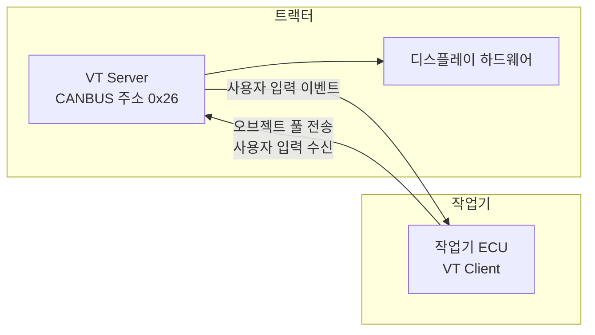
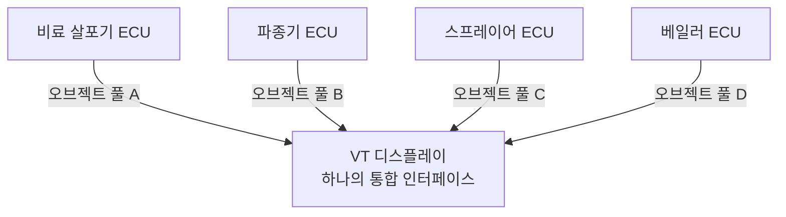
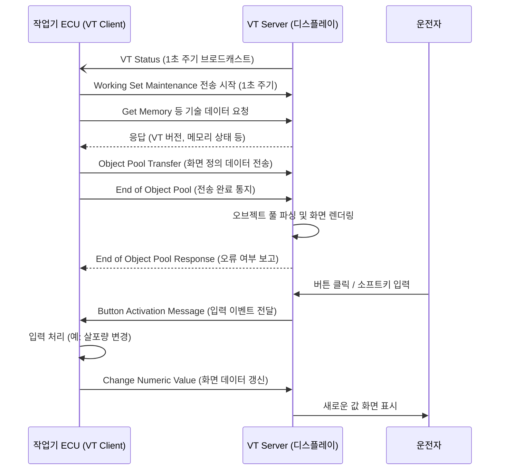
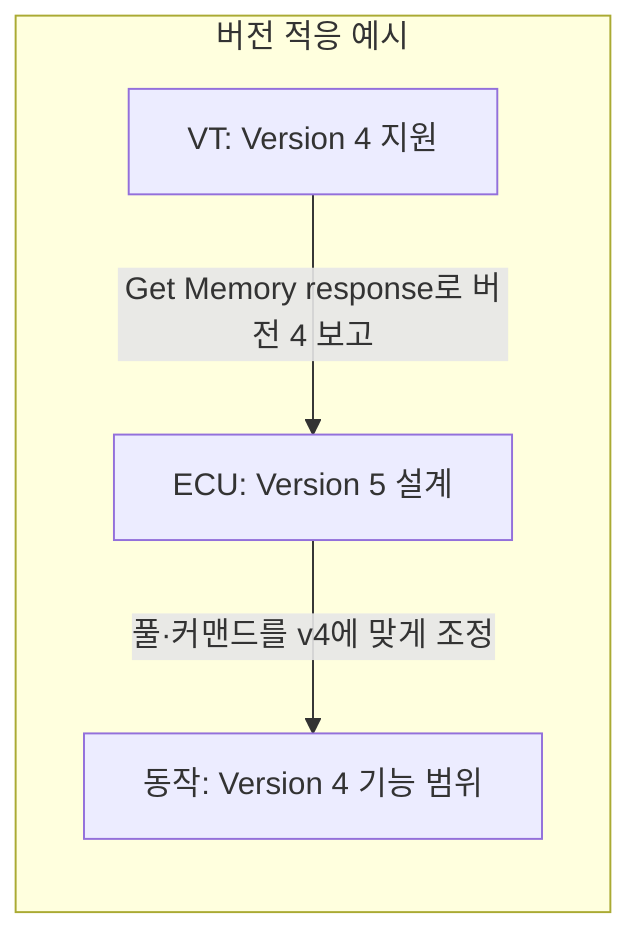
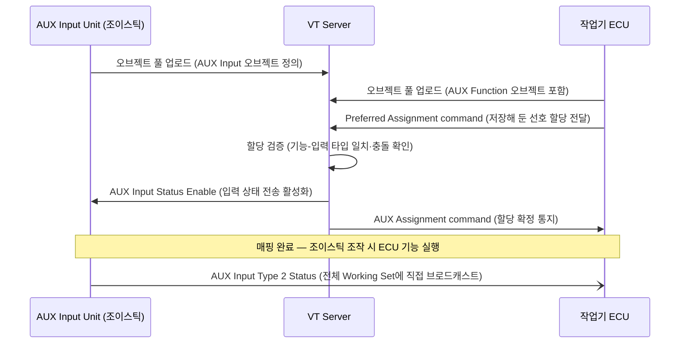

# Virtual Terminal (VT) 기초

::: info 학습 목표
- Virtual Terminal(VT)이 무엇이며 어떤 문제를 해결하는지 설명할 수 있다.
- VT의 동작 원리와 오브젝트 풀의 역할을 이해한다.
- VT 버전별 주요 기능 차이를 비교할 수 있다.
- AUX(보조 입력) 장치의 개념과 Preferred Assignment를 설명할 수 있다.
- VT Status·Working Set Maintenance 프레임을 바이트·비트 단위로 디코딩해 소유 WS, busy 상태, WS 버전을 판정할 수 있다.
- 기술 데이터 조회 → 저장 풀 로드 또는 전체 업로드 → Store Version으로 이어지는 클라이언트 초기화를 상태 머신으로 설계할 수 있다.
- Maintenance가 끊긴 상황에서 VT가 unexpected shutdown 경보를 띄워야 하는지 진단할 수 있다.
:::

## 1. VT란 무엇인가

<strong>Virtual Terminal(VT)</strong>은 ISO 11783-6에 정의된 표준 사용자 인터페이스 시스템이다. 트랙터 운전석에 장착된 디스플레이에 **작업기의 UI를 표시하고 사용자 입력을 받는** 인터페이스 역할을 한다.

VT 시스템은 두 주체로 구성된다.

| 역할 | 장치 | 담당 |
|------|------|------|
| **VT Server** | 트랙터 캐빈 디스플레이 | 화면 렌더링, 입력 처리 |
| **VT Client** | 작업기 ECU | 화면 내용(오브젝트 풀) 정의, 데이터 갱신 |

즉, <strong>디스플레이 하드웨어는 트랙터가 제공</strong>하고, <strong>화면에 무엇을 보여줄지는 작업기 ECU가 결정</strong>한다. 트랙터와 작업기의 역할이 명확히 분리되어 있는 것이 핵심이다.



VT 화면은 <strong>Data Mask 영역</strong>(작업기 UI가 표시되는 정사각형 영역, 최소 200 × 200 픽셀, version 6부터 최소 480 × 480)과 <strong>Soft Key Mask 영역</strong>(소프트키 라벨 영역, version 6부터 키당 최소 60 × 60 픽셀)으로 구성된다.

## 2. 왜 VT가 혁신적인가

### VT 이전: 전용 디스플레이 시대

VT 표준이 없던 시절, 각 작업기 제조사는 <strong>전용 디스플레이 패널</strong>을 함께 납품했다.

- 비료 살포기 → 비료 살포기 전용 컨트롤 박스
- 파종기 → 파종기 전용 모니터
- 스프레이어 → 스프레이어 전용 디스플레이

운전석에 작업기가 늘어날수록 디스플레이도 늘어났다. 배선은 복잡해지고, 운전자는 여러 개의 서로 다른 UI를 익혀야 했다.

### VT 이후: 통합 디스플레이

VT는 이 문제를 <strong>스마트폰 앱 스토어 모델</strong>로 해결했다.

```
스마트폰(VT Server) = 하드웨어 플랫폼
앱(오브젝트 풀)     = 작업기 ECU가 제공하는 UI 정의
```

하나의 VT 디스플레이에 어떤 제조사의 작업기를 연결해도, 작업기가 자신의 UI 정의를 VT로 전송하면 VT가 화면을 렌더링한다. 운전자는 <strong>하나의 디스플레이로 모든 작업기를 조작</strong>할 수 있다.



## 3. VT 동작 원리

VT와 작업기 ECU 사이의 동작은 크게 세 단계로 나뉜다.

1. **오브젝트 풀 전송**: 작업기 ECU가 화면 정의 데이터를 VT로 업로드
2. **렌더링**: VT가 오브젝트 풀을 해석해 화면에 표시
3. **상호작용**: 사용자 입력 → VT → ECU, ECU 데이터 갱신 → VT 화면 업데이트



연결 유지는 두 주기 메시지가 담당한다. VT는 <strong>VT Status message</strong>를 1초 주기로 전체 브로드캐스트하고(요청-응답이 아니다), 각 Working Set은 <strong>Working Set Maintenance message</strong>를 1초 주기로 VT에 보낸다. 어느 쪽이든 <strong>3초간</strong> 끊기면 상대의 셧다운으로 판정한다 — 작업기 ECU는 안전 상태(safe state)로 진입하고, VT는 unexpected shutdown을 운전자에게 경보한 뒤 해당 풀을 휘발성 메모리에서 삭제한다.

## 4. VT 버전

ISO 11783-6은 지속적으로 개정되어 왔으며, VT Server와 Client가 지원하는 <strong>버전(Version)</strong>에 따라 사용 가능한 기능이 달라진다.

| 버전 | 주요 특징 |
|------|-----------|
| **Version 2** | 초판(2004) 기준 기본 기능 — 기본 오브젝트 타입, 256색 표준 팔레트, 구형 AUX(Type 1) |
| **Version 3** | 2판(2010) — 새 AUX 프로토콜(Type 2, AUX-N) 도입, initiating bit 등 연결 관리 보강 |
| **Version 4** | 2판(2010) — Window Mask·Key Group(여러 Working Set 동시 표시), Graphics Context, 커맨드 응답을 발신자에게 직접 전송 |
| **Version 5** | 3판(2014) — Animation, External Object(Working Set 간 오브젝트 참조), Extended Version 명령, Auxiliary Capabilities, Unsupported VT Function message |
| **Version 6** | 4판(2018) — Data Mask 최소 480×480·소프트키 최소 60×60, Colour Palette·Graphic Data·Scaled Graphic 오브젝트, AUX 입력 잠금(lock) 상태 |

VT Server와 Client가 서로 다른 버전을 지원할 경우 별도의 협상 절차는 없다. 클라이언트가 <strong>Get Memory response 등 기술 데이터 메시지</strong>로 VT의 버전을 확인한 뒤, 자신이 VT 버전에 맞춰 오브젝트 풀과 사용 커맨드를 조정하는 <strong>일방향 적응</strong>이다. 낮은 버전 VT에 높은 버전 메시지를 보내서는 안 되며, 반대로 VT가 더 높은 버전이면 하위 호환으로 그대로 동작한다. Working Set Maintenance message에 보고하는 버전은 Working Set이 설계된 버전이며, VT에 맞춘 런타임 적응 때문에 바뀌지 않는다.



### 버전 번호가 오가는 두 필드

VT 버전과 Working Set 버전은 서로 다른 메시지로, 서로 다른 인코딩으로 오간다. 둘을 같은 정수로 다루면 버그가 난다.

| 방향 | 필드 | 값 |
|---|---|---|
| VT → WS | Get Memory response Byte 2 (ISO 11783-6:2018 D.3) | 0 = Hannover Agritechnica 2001 한정 기능판, 1 = 2002 FDIS, 2 = 2004 초판, 3·4 = 2010 2판, 5 = 2014 3판, 6 = 2018 4판 |
| WS → VT | Working Set Maintenance Byte 3 (G.3) | 3~6 = 해당 버전 준수, `FF` = version 2 이하 준수, 0~2·7~`FE` = 예약 |

- 3과 4는 같은 2판(2010)에서 함께 도입됐다. 판(edition)과 버전 번호가 1:1이 아니다.
- WS 쪽에는 "2"라는 값이 없다. version 2 이하 WS는 `FF`를 보낸다. VT가 이 바이트를 그대로 정수 비교하면 v2 WS를 "버전 255", 즉 가장 새로운 WS로 오판한다.
- 버전은 하위 호환이라 버전 N용 WS가 N보다 높은 VT를 따로 다룰 필요는 없다. 원문은 낮은 버전을 구현하더라도 최신 판 문서를 기준으로 삼으라고 권한다(D.3).

Table A.5의 "VT version" 칸은 각 메시지가 처음 도입된 버전이다(뒤 판에서 내용이 바뀐 메시지도 있다). WS는 Get Memory response로 읽은 VT 버전보다 높은 메시지를 보내면 안 된다(4.6.2).

| 도입 버전 | 기술 데이터·비휘발성 메모리·상태 메시지(VT function) |
|---|---|
| 2 | Get Memory(`0xC0`), Get Number of Soft Keys(`0xC2`), Get Text Font Data(`0xC3`), Get Hardware(`0xC7`), Get Versions(`0xDF`, 응답 `0xE0`), Store·Load·Delete Version(`0xD0`~`0xD2`), VT Status(`0xFE`), Working Set Maintenance(`0xFF`) |
| 4 | Get Supported Widechars(`0xC1`), Get Window Mask Data(`0xC4`), Get Supported Objects(`0xC5`), Identify VT(`0xBB`) |
| 5 | Extended Get·Store·Load·Delete Version(`0xD3`~`0xD6`), Unsupported VT Function·VT Unsupported VT Function(`0xFD`) |
| 6 | Screen Capture(`0xC6`) |

### version 6가 하드웨어에 요구하는 것

4.1.1은 version 6 VT에 하드웨어·파싱 요구를 따로 건다. VT 특성은 Annex D 기술 데이터 메시지로 드러나므로, "어느 응답의 어느 바이트에 무엇이 보여야 하는가"로 바꿔 읽으면 VT 서버 에뮬레이터의 점검표가 된다. 각 응답의 바이트 배치는 §9에서 본다.

| 4.1.1 요구 | 드러나는 곳 | v6 VT가 보고할 값 |
|---|---|---|
| 물리 Soft Key 최소 60 × 60(정사각형 권장) | Get Number of Soft Keys response Byte 5·6 | 둘 다 60(`0x3C`) 이상 |
| small·large 폰트 크기 전부 | Get Text Font Data response Byte 6·7 | 각각 `0x7F`(bit 0~6 전부, bit 7은 예약) |
| font style 전부 | 같은 응답 Byte 8 | bit 0~6 전부 1. bit 7(비례 폰트 렌더링)이 "모든 font style"에 들어가는지는 원문이 따로 밝히지 않는다(확인 필요) |
| 최소 256색, 16bit 이상 권장 | Get Hardware response Byte 3 | 2(256 colour). 16bit 하드웨어인지는 이 필드로 드러나지 않는다. VT는 하드웨어에 맞춰 표현을 낮출 수 있다(예: 24bit PNG를 16bit로) |
| Data Mask 최소 480 × 480 | Get Hardware response Byte 5~8 | X·Y 모두 480(`E0 01`) 이상 |
| Window Mask·Key Group: 완전 파싱, 표시는 선택 | Get Supported Objects 목록 | 목록에 없어도 파싱은 해야 한다(4.6.28) |
| Graphics Context: 표시까지 완전 지원 | Get Supported Objects 목록 | 표시를 지원해야 하므로 목록에 type 36이 들어가는 것이 자연스럽다(추론) |

## 5. AUX (보조 입력)

<strong>AUX(Auxiliary Input)</strong>는 조이스틱, 추가 버튼 패드, 풋 페달 등 VT 디스플레이 외부의 보조 입력 장치를 ISOBUS에 통합하는 메커니즘이다. ISO 11783-6 Annex J에 정의되어 있다.

현재 표준에서 사용되는 버전은 **AUX-N**(New AUX, 표준의 Type 2, version 3 이상)으로, 기존 AUX-O(Old AUX, Type 1, version 2)를 대체했다. 두 프로토콜은 서로 호환되지 않는다.

### AUX 구성 요소

| 구성 요소 | 설명 |
|-----------|------|
| **AUX Input Unit** | 물리적 입력 장치 (조이스틱, 버튼 등) |
| **AUX Function** | 작업기 ECU가 정의하는 논리적 기능 (예: "살포 시작") |
| **Assignment** | 입력 유닛의 특정 입력과 ECU 기능을 연결하는 매핑 |

### Preferred Assignment

AUX의 핵심 개념 중 하나는 <strong>Preferred Assignment</strong>이다. 사용자가 한 번 입력 장치와 기능의 매핑을 설정하면, <strong>기능을 제공하는 Working Set(작업기 ECU)</strong>이 그 할당을 선호 할당으로 저장한다. 다음에 같은 작업기를 연결하면 Working Set이 Preferred Assignment command로 저장된 할당을 VT에 전달하고, VT가 이를 검증한 뒤 적용해 <strong>이전 매핑이 자동으로 복원</strong>된다.



할당이 완료되면 입력값은 VT를 거치지 않는다. AUX Input Unit이 <strong>Auxiliary Input Type 2 Status message</strong>를 초당 1회(값 변경 시 즉시, 최대 20 Hz)로 전체 브로드캐스트하면, 할당된 기능의 Working Set이 이를 직접 수신해 실행한다. 입력 유닛은 별도로 Auxiliary Input Type 2 Maintenance message를 100 ms 주기로 브로드캐스트하며, 300 ms 동안 끊기면 VT와 기능 측 Working Set이 그 유닛의 할당을 제거한다. 다중 VT 환경에서 할당·검증은 <strong>function instance 0 VT</strong>만 수행한다.

::: tip 핵심 정리
- VT는 ISO 11783-6에 정의된 표준 디스플레이 인터페이스로, 트랙터 디스플레이(VT Server)와 작업기 ECU(VT Client)로 구성된다.
- 작업기 ECU는 오브젝트 풀을 VT로 전송하고, VT는 이를 렌더링한다. 연결은 VT Status·Working Set Maintenance(각 1초 주기, 3초 타임아웃)로 유지된다.
- VT는 버전(2~6)에 따라 지원 기능이 다르며, 클라이언트가 기술 데이터 메시지로 확인한 VT 버전에 맞춰 풀·커맨드를 조정한다(일방향 적응).
- AUX-N은 조이스틱 등 보조 입력 장치를 ISOBUS에 통합하며, 매핑 설정은 기능을 제공하는 Working Set이 Preferred Assignment로 저장했다가 VT에 전달해 복원한다. 할당된 입력값은 VT를 거치지 않고 전체 브로드캐스트된다.
:::

## 6. VT 연결 따라가기

§3~§4는 절차를 다이어그램으로만 봤다. 여기서는 그 흐름을 <strong>메시지 단위로 실제 바이트까지</strong> 따라간다. 예제로 쓰는 오브젝트 풀은 [CH16 §5](/study/isobus/16-vt-object-pool)의 "엔진 온도: 85°C" 화면이며, 그 풀을 이루는 5개 오브젝트(Working Set·Data Mask·Font Attributes·Output String·Output Number)의 바이트 구성은 [CH16 §6](/study/isobus/16-vt-object-pool#_6-오브젝트-레코드를-바이트로-보기)에서 계산한다. 여기서는 그 결과(총 98바이트)가 VT에 오르기까지의 <strong>메시지 흐름</strong>만 본다.

### 타임라인

방향 표기는 작업 지시 그대로 <strong>VT→ECU는 PGN 58880(0xE600)</strong>, <strong>ECU→VT는 PGN 59136(0xE700)</strong>이다. 시각은 설명 편의상 붙인 예시값이며 표준이 규정하는 절대 시각이 아니다(주기·타임아웃 규정 자체는 §3에 정리돼 있다). ECU(작업기) 소스 주소는 예시로 `0x81`을 쓴다.

| 시각 | 방향 | PGN | 데이터(hex) | 의미 |
|---|---|---|---|---|
| t=0.000s | VT→ECU | 0xE600 | `FE FF FF FF FF FF 00 FF` | VT Status — 소유 WS 없음(Byte2=FF), busy 없음. 요청 없이 매초 브로드캐스트 |
| t=0.000s | ECU→VT | 0xE700 | `FF 01 04 FF FF FF FF FF` | Working Set Maintenance 최초 전송 — Byte2 bit0=Initiating(1), Byte3=Version 4 |
| t=0.050s | ECU→VT | 0xE700 | `C0 FF 62 00 00 00 FF FF` | Get Memory — Memory Required = 98(0x62)바이트(풀 전체 크기), Byte1=함수코드 0xC0 |
| t=0.060s | VT→ECU | 0xE600 | `C0 04 00 FF FF FF FF FF` | Get Memory response — Version=4, Status=0(메모리 가능) |
| t=0.070s~ | ECU→VT | 0xE700 | (TP 다중 프레임 — 총 99바이트: 함수코드 `11` + 오브젝트 레코드 98바이트) | Object Pool Transfer — 5개 오브젝트 레코드 전송(TP/ETP 분해는 [CH11](/study/isobus/11-j1939-transport) 참고) |
| t=0.900s | ECU→VT | 0xE700 | `12 FF FF FF FF FF FF FF` | End of Object Pool — 전송 완료 통지 |
| t=0.901s | VT→ECU | 0xE600 | `FE FF FF FF FF FF 10 FF` | VT Status — Byte7 bit4(parsing)=1, 파싱 중 |
| t=1.9~3.9s | VT→ECU | 0xE600 | `FE FF FF FF FF FF 10 FF` ×3(매초) | 파싱이 끝나지 않아 parsing 비트 1 유지 — VT는 End of Object Pool response를 보낼 때까지 이 비트를 1로 둔다(Part 6 C.2.2) |
| t=3.910s | VT→ECU | 0xE600 | `12 00 FF FF FF FF 00 FF` | End of Object Pool response — Byte2 Error Codes=0(오류 없음), 결함 오브젝트 없음(FFFF) |
| t=3.920s | VT→ECU | 0xE600 | `FE 81 01 00 FF FF 00 FF` | VT Status — Byte2=0x81(ECU가 소유), Byte3,4=Data Mask ID 1, Byte5,6=Soft Key Mask 없음(FFFF, 이 풀은 `soft_key_mask="65535"`). 화면 표시 완료 |

Working Set Maintenance는 표에는 최초 1회만 적었지만 연결 내내 1초 주기로 계속 나간다. Get Memory 메시지의 Byte2·7~8과 응답의 Byte4~8은 원문이 `Reserved, set to FF16`으로 정한 예약 바이트라 `FF`로 채웠다(Part 6 D.2·D.3).

### 왜 이 순서인가

- <strong>VT Status는 요청-응답이 아니다.</strong> 타임라인 첫 줄부터 VT가 먼저 말을 걸고, ECU가 아직 아무것도 안 보냈는데도 계속 브로드캐스트된다. ECU 입장에서는 이 메시지의 존재 자체가 "VT가 살아 있다"는 유일한 신호다.
- Get Memory로 <strong>버전과 메모리 여유를 먼저 확인</strong>한 뒤에야 풀을 올린다 — 무효 풀을 먼저 보내고 나중에 고치는 방식은 허용되지 않는다([CH16 §4](/study/isobus/16-vt-object-pool) "전송 완료 대기와 오류 처리" 참고).
- End of Object Pool 이후의 대기는 <strong>폴링이 아니라 패턴 관찰</strong>이다. VT Status의 parsing 비트가 0인 상태가 연속 3번 나온 뒤에도 response가 없어야 "메시지가 VT에 안 갔다"고 확정한다 — 이미 큐에 있던 이전 Status가 파싱 상태를 잘못 반영하는 경쟁 상태를 피하기 위해서다.
- 마지막 VT Status는 이전 상태들과 <strong>Byte2~6이 다르다</strong>. 이 변화(소유자·활성 마스크 지정)가 바로 "화면이 떴다"는 것을 ECU가 확인하는 방법이다.

::: tip 핵심 통찰
- VT Status·Working Set Maintenance는 연결 전 과정에서 요청 없이 계속 흐르는 <strong>배경 신호</strong>다. Object Pool Transfer·Get Memory 같은 "용건이 있는" 메시지들은 이 배경 신호 위에 얹혀 지나갈 뿐이다.
- End of Object Pool response를 기다리는 조건은 <strong>"parsing=0 상태가 연속 3번"</strong>이지 "N초가 지났다"가 아니다. 파싱이 오래 걸리는 큰 풀일수록 이 규칙의 의미가 커진다.
:::

:::details 파이썬으로 바이트 구성 검산해 보기
```python
def le(v, n):
    return v.to_bytes(n, "little")


# VT Status — 소유 WS 없음
vt_status_idle = bytes([0xFE, 0xFF]) + b"\xFF" * 4 + bytes([0x00, 0xFF])
assert vt_status_idle.hex(" ").upper() == "FE FF FF FF FF FF 00 FF"

# Working Set Maintenance — 최초 전송(Initiating=1), Version 4
wsm_first = bytes([0xFF, 0b00000001, 4]) + b"\xFF" * 5
assert wsm_first.hex(" ").upper() == "FF 01 04 FF FF FF FF FF"

# Get Memory — Memory Required = CH16 §6에서 계산한 풀 전체 크기
memory_required = 10 + 20 + 8 + 31 + 29  # Working Set + Data Mask + Font Attr + Output String + Output Number
assert memory_required == 98
get_memory = bytes([0xC0, 0xFF]) + le(memory_required, 4) + b"\xFF\xFF"
assert get_memory.hex(" ").upper() == "C0 FF 62 00 00 00 FF FF"

# VT Status — parsing 비트(Byte7 bit4) = 1
vt_status_parsing = bytes([0xFE, 0xFF]) + b"\xFF" * 4 + bytes([0b00010000, 0xFF])
assert vt_status_parsing.hex(" ").upper() == "FE FF FF FF FF FF 10 FF"

# End of Object Pool response — 오류 없음
eop_resp = bytes([0x12, 0x00]) + b"\xFF\xFF\xFF\xFF" + bytes([0x00, 0xFF])
assert eop_resp.hex(" ").upper() == "12 00 FF FF FF FF 00 FF"

# VT Status — 연결 완료, ECU(0x81)가 소유, Data Mask ID=1, Soft Key Mask 없음
vt_status_final = bytes([0xFE, 0x81]) + le(1, 2) + le(0xFFFF, 2) + bytes([0x00, 0xFF])
assert vt_status_final.hex(" ").upper() == "FE 81 01 00 FF FF 00 FF"

print("모든 프레임 검증 통과")
```
:::

## 7. 표시 영역과 Soft Key 배치

§1은 화면이 Data Mask 영역과 Soft Key Mask 영역으로 나뉜다고만 했다. 4.5는 두 영역의 크기·배치와, Soft Key가 물리 키보다 많을 때 VT가 페이지를 넘기는 규칙까지 정한다. VT Server를 구현한다면 이 절이 화면 레이아웃 명세다.

### Data Mask 영역 — 왜 정사각형인가

- VT는 Data Mask와 Alarm Mask를 그릴 영역을 따로 예약해야 한다(4.5.2).
- 원문이 이유를 밝힌다. VT마다 화면 방향(가로·세로)이 다르므로 어느 방향에서도 같은 풀이 제대로 보이도록 정사각형을 골랐고, 이 종횡비는 엄격히 강제된다.
- 최소 크기는 200 × 200, version 6 이상은 480 × 480이다. 그보다 크면 어떤 정사각형이든 된다(240, 320, 600, 800, 1024 …).
- 최소값은 "쓸 수 있는 Data Mask 영역"에 대한 것이지 물리 해상도를 제한하지 않는다. 남는 화면은 차량 데이터·VT 통계 같은 독자 정보에 쓰라고 권한다.
- WS는 Get Hardware response Byte 5~8(X-Pixels·Y-Pixels)로 실제 크기를 알고, 풀을 설계한 크기와 다르면 위치·크기·폰트를 스케일한다(4.6.6.2 7단계). 스케일 규칙은 [CH16 §4](/study/isobus/16-vt-object-pool)에 있다.

::: warning VT 에뮬레이터 구현 함정
Get Hardware response의 Y-Pixels는 "Data Mask가 정사각형이므로 항상 X와 같다"(D.9). 개발 PC의 직사각형 창 크기를 그대로 X·Y로 보고하면 표준 위반이다. 창이 직사각형이면 짧은 변에 맞춘 정사각형을 Data Mask로 쓰고 나머지는 독자 영역으로 둔다.
:::

### Soft Key Mask 영역과 designator

- Soft Key 라벨 영역(Soft Key Mask area)은 Data Mask 영역과 따로 예약한다. 붙어 있어도, 떨어져 있어도 되지만 Data Mask 영역의 일부여서는 안 된다(4.5.3.1).
- 키마다 라벨을 그리는 칸이 <strong>Soft Key designator</strong>다. 화면 방향과 무관하게 최소 60 × 32 픽셀이고 version 6 이상은 60 × 60이다. 텍스트·그래픽·둘 다 넣을 수 있다.
- designator 사이에는 눈에 띄는 구분(예: 1픽셀 선)을 둬야 하고, 그 선은 designator 영역 <strong>밖</strong>에 그린다. 최소 크기를 지킬 수 없을 때만 경계 위에 그어도 된다.
- 실제 designator 크기는 Get Number of Soft Keys response Byte 5·6으로 보고된다(D.5). Working Set object의 descriptor도 이 크기 안에 들어가야 하고 넘치는 부분은 잘린다(4.6.8).

### 물리·가상·내비게이션 Soft Key

4.5.3은 Soft Key를 세 가지 "개수"로 나눈다. 셋의 관계는 <strong>내비게이션 < 물리 ≤ 가상</strong>이다.

- <strong>물리 Soft Key</strong>: VT가 active WS에 상시 내주는 키의 개수다. 실제 버튼일 필요는 없고 터치스크린 위 버튼이어도 된다. version 4 이상은 최소 6개, version 3 이하는 개수 요구가 없다(4.5.3.2).
- <strong>가상 Soft Key</strong>: Soft Key Mask 하나에 담을 수 있는 키 수다. version 4 이상은 정확히 64, version 3 이하는 최대 64이면서 최소한 보고한 물리 키 수만큼은 지원한다(4.5.3.3).
- <strong>내비게이션 Soft Key</strong>: 물리 키 가운데 페이지 넘김에 쓰는 개수다. 물리 키 수보다 작아야 하고, 물리 키를 쓰지 않는 전용 넘김 수단이 있으면 0으로 보고한다(4.5.3.4).

물리 키 번호는 배치 방향으로 정해진다. 세로 배치는 키 1이 오른쪽 맨 위이고 아래로 늘어나며, 첫 열이 차면 다음 열은 <strong>왼쪽</strong>에 붙는다. 가로 배치는 키 1이 맨 윗줄 왼쪽이고 오른쪽으로 늘어나며, 줄이 차면 아래 줄로 내려간다. 터치스크린 매트릭스처럼 방향이 애매하면 세로 배치 규칙을 따른다(4.5.3.2).

### 페이지 넘김 계산

WS가 Soft Key Mask에 물리 키보다 많은 키를 넣으면 VT가 넘김 수단을 제공한다(4.5.3.5).

1. 키 수 ≤ 물리 키 수이면 모든 키가 물리 키로 바로 닿아야 하고, VT는 넘김 수단을 두면 <strong>안 된다</strong>.
2. 키 수가 더 많으면 <strong>스크롤이 아니라 그룹 단위 페이지</strong>로 넘긴다. 한 그룹 = 물리 키 수 − 내비게이션 키 수다.
3. 내비게이션 키는 모든 페이지에서 같은 물리 위치에 있어야 한다. 특정 페이지에서 비활성화할 수는 있지만 없앨 수는 없다.
4. 마지막 페이지는 다 차지 않을 수 있고, 남는 designator는 쓰지 않는다.
5. NULL Object ID(`0xFFFF`)를 가리키는 Pointer는 자리를 예약해 빈칸을 만든다. 단 목록 끝에 몰린 NULL Pointer는 자리를 예약하지 않고 페이지 계산에서도 빠진다.

아래 그림은 원문 예와 같은 VT(물리 6, 가상 64, 내비게이션 1 → 그룹 5)에 13칸짜리 목록을 올린 경우다. 끝의 NULL 둘이 빠져 11칸이 남고, 5·5·1칸으로 세 페이지가 된다. 6번 물리 키는 모든 페이지에서 "다음 그룹" 키다.


::: details 페이지 나누기를 코드로 검산하기
```python
def soft_key_pages(keys, physical, navigation):
    """keys: Soft Key Mask 목록. None은 NULL Object ID를 가리키는 Pointer."""
    keys = list(keys)
    while keys and keys[-1] is None:       # 끝의 NULL은 자리를 예약하지 않는다
        keys.pop()
    if len(keys) <= physical:              # 다 들어가면 넘김 수단을 두지 않는다
        return [keys]
    group = physical - navigation
    return [keys[i:i + group] for i in range(0, len(keys), group)]


mask = ["K1", "K2", None, "K3", "K4", "K5", "K6", "K7", None, "K8", "K9", None, None]
assert soft_key_pages(mask, physical=6, navigation=1) == [
    ["K1", "K2", None, "K3", "K4"],
    ["K5", "K6", "K7", None, "K8"],
    ["K9"],
]
# 끝 NULL을 빼면 물리 키 수 이하 → 한 페이지, 넘김 키 없음
assert soft_key_pages(["K1", "K2", None, "K3", None, None, None], 6, 1) == [["K1", "K2", None, "K3"]]
print("페이지 계산 검증 통과")
```
가운데 NULL은 자리를 예약하므로(4.5.3.5) 키 수에 넣었다.
:::

Soft Key를 눌렀을 때 오가는 Soft Key Activation 메시지는 [CH17](/study/isobus/17-vt-commands)에서 다룬다.

::: tip 정리
- Data Mask는 정사각형이 강제되고(v6 최소 480), 실제 크기는 Get Hardware response Byte 5~8로 읽는다.
- designator 크기는 Get Number of Soft Keys response Byte 5·6, 가상·물리 키 수는 Byte 7·8, 넘김 키 수는 Byte 2다.
- 페이지는 "물리 − 내비게이션" 단위로 나뉜다. 끝 NULL은 계산에서 빠지고 가운데 NULL은 빈칸을 만든다.
:::

## 8. 오브젝트 풀과 Working Set 규칙

4.6.1~4.6.5는 풀을 다루는 기본 규칙, WS를 이루는 CF(Control Function, 제어 기능)들의 역할 분담, 비슷한 장비를 구분하는 법, 언어·단위 처리를 정한다. 오브젝트 하나하나의 정의는 [CH16](/study/isobus/16-vt-object-pool)이 다룬다.

### 오브젝트 풀 규칙(4.6.1)

- 풀은 한 WS의 운전자 인터페이스 정의 전체를 이루는 오브젝트 집합이고, 초기화 때 Annex C 절차로 VT에 올라간다.
- Object ID는 <strong>한 WS의 풀 안에서만</strong> 유일하면 된다. 서로 다른 WS의 풀은 같은 ID를 써도 되므로, VT 쪽 저장 구조는 WS마다 ID 공간을 따로 둬야 한다.
- `0xFFFF`(65535)는 NULL Object ID다. 그리기 문맥에서 NULL은 "그 자리에 아무것도 그리지 않는다"는 뜻이다(4.6.1.2).
- 오브젝트는 마스크에서 활성화되기 <strong>전에</strong> 완전히 기술돼 있어야 한다. 풀이 하나도 없을 때 VT가 무엇을 보여 줄지는 VT 독자 사항이다.
- VT는 버전 라벨이 다르면 같은 WS의 풀 여러 개를 비휘발성 메모리에 둘 수 있다. 원문 예는 "언어만 다른 풀들"이다(§10).

<strong>처리 순서와 계층 깊이(4.6.1.3)</strong>. 부모가 나열한 순서대로 depth-first로 처리한다. 자식이 또 자식을 가지면 그 가지를 끝까지 처리한 뒤 부모로 돌아온다. version 5 이상 VT는 계층 깊이를 최소 30까지 지원해야 하고, version 4 이하는 규정이 없다. 깊이는 Data Mask·Alarm Mask·Window Mask·Soft Key Mask·Key Group에서 시작해 자식으로 한 단계 내려갈 때마다 1씩 는다. Object Pointer가 가리키는 대상은 자식으로 세고, 속성 칸에 ID만 적힌 "참조"는 세지 않는다(원문 예: Working Set object가 속성으로 갖는 Data Mask).

```text
Data Mask 1000                  시작
└─ Container 2000               +1
   └─ Object Pointer 2100       +2
      └─ Output Number 3000     +3  ← Pointer의 대상도 자식으로 센다
         (Font Attributes 4000)     세지 않음 — 속성 칸에 ID로 적힌 참조
```

Font Attributes는 원문 예와 같은 속성 참조로 보아 세지 않았다. 마스크 자신을 0으로 셀지 1로 셀지는 원문이 숫자로 못 박지 않았으므로, WS는 30단계에 여유를 두고 설계하는 편이 안전하다(추론).

### Working Set의 역할 분담(4.6.2)

여러 CF가 한 작업기를 이루면 그 묶음이 Working Set이다(Working Set Master 메시지 PGN 65037(0xFE0D)은 [CH14 §2](/study/isobus/14-isobus-network-mgmt)).

- WS마다 CF 하나가 Working Set Master다. Master는 VT 사용권을 확보하고, 초기 풀을 제공하고, 멤버들의 NAME을 Working Set Master/Member 메시지로 VT에 알린다.
- Member가 Master 전용 명령을 보내거나, WS 멤버로 식별되지 않은 CF가 WS 전용 명령을 보내면 VT는 Acknowledgement(NACK)로 답한다(Part 3).
- 풀이 로드된 뒤에는 어느 멤버든 데이터를 주고 속성을 바꿀 수 있다. 다만 운전자가 입력 필드에 넣은 값은 <strong>항상 Master</strong>에게 간다.
- VT는 멤버를 가질 수 없고 Working Set Master/Member 메시지를 보내서도 안 된다.

<strong>응답은 누구에게 가나(Table 1)</strong>. VT 응답의 목적지는 WS 버전(Working Set Maintenance)과 VT 버전(Get Memory response)의 조합으로 정해지고, 이 규칙이 "응답은 WS Master에게만"이라는 Part 1 규정보다 우선한다.

| WS 버전 | VT 버전 | 명령 응답의 목적지 |
|---|---|---|
| 3 이하 | 무관 | WS Master |
| 4 이상 | 3 이하 | WS Master |
| 4 이상 | 4 이상 | 명령을 보낸 CF(originator) |

앞의 두 조합에서는 Member가 자기 명령의 응답을 찾으려고 VT가 Master에게 보내는 destination-specific 메시지를 모두 엿들어야 하고, Master는 짝을 모르는 응답을 받는다. 마지막 조합에서야 TP로 오는 응답(예: Get Supported WideChars response)을 Member가 직접 받을 수 있다. 판정은 한 줄이다.

```python
def response_destination(ws_ver: int, vt_ver: int, originator_sa: int, master_sa: int) -> int:
    return originator_sa if (ws_ver >= 4 and vt_ver >= 4) else master_sa
```

<strong>하위 호환 규칙</strong>.

- WS는 낮은 버전 VT에 높은 버전 메시지를 보내면 안 되고(예: version 4 명령을 version 2 VT에), VT도 낮은 버전 WS에 높은 버전 메시지를 보내면 안 된다. 받은 쪽의 반응은 예측할 수 없다 — NACK를 줄 수도, 무시할 수도 있다.
- 연결된 VT가 WS의 기능 요구를 못 맞추면(필요한 version 4 기능이 없는 version 2 VT, 쓸모없을 만큼 작은 Data Mask 등) WS는 <strong>최소 호환 풀</strong>을 보내 운전자에게 비호환을 알려야 한다.
- version 5 이상 VT와 WS는 각각 VT Unsupported VT Function / Unsupported VT Function 메시지를 지원해야 한다. 그래서 모르는 기능에 대한 반응이 예측 가능해진다(§12).

### 비슷한 Working Set 여러 대 — Instance와 표시 번호(4.6.3·4.6.4)

같은 제조사의 겉모습이 비슷한 WS가 한 네트워크에 여럿 붙으면(같은 제조사 스프레이어 2대, 비슷한 보조 입력 장치 2대 이상) 운전자는 화면의 WS가 어느 장비인지 알 수 없다. 표준은 두 가지를 요구한다.

1. <strong>NAME의 Instance 필드로 구분한다</strong>(4.6.3). 왼쪽→오른쪽, 그다음 앞→뒤, 그다음 아래→위 순으로 낮은 instance부터 배치하라고 권한다. 제조사는 구성 수단을 줘야 한다. instance를 보고 위치를 찾게 하거나(장비 라벨에 instance 표시, 하네스 배선이 위치에 따라 instance를 자동 설정), 위치를 보고 instance를 정하게 한다(장비의 instance 스위치, Data Mask 위 설정 화면, 서비스 툴의 commanded name 메시지(Part 5)).
2. <strong>WS 번호를 화면에 보인다</strong>(4.6.4). Working Set object(descriptor)에는 반드시, 보이는 마스크에는 가능하면 번호를 표시한다. 번호 규칙은 제조사가 정하되 Function Instance·Device Class Instance·ECU Instance와 엮으라고 권하고(예: 번호 = Function Instance + 1), 같은 제조사의 비슷한 장비는 모두 같은 규칙을 써야 한다.

VT는 WS를 운전자에게 나타낼 때마다 descriptor를 쓴다(통신 알람, 보조 입력 할당 화면 등, 4.6.8). 번호가 없으면 할당 화면에서 두 스프레이어가 똑같이 보인다. NAME에서 Function Instance는 Byte 5의 bit 8~4, ECU Instance는 bit 3~1이다(Part 5 Table 1).

| 장비 | NAME Byte 5 | Function Instance | 표시 번호(FI + 1) |
|---|---|---|---|
| 스프레이어 A | `0x00` | 0 | 1 |
| 스프레이어 B | `0x08` | 1 | 2 |

### 언어·형식·단위(4.6.5, Annex I)

Annex I는 VT가 Part 7 메시지 일부를 지원·생성하도록 요구하고 그 대표로 PGN 65039(0xFE0F) <strong>Language command</strong>를 든다. 이 메시지가 언어, 소수점·날짜·시간 형식, 단위계를 실어 나른다. VT 쪽 의무의 핵심은 세 가지다(4.6.5).

- 표준 언어·형식·단위 메시지("standard setups")를 전원 인가 때와 운전자가 바꿀 때마다 보낸다. standard setups는 비휘발성 메모리에 저장했다가 초기화 때 복원한다.
- 모든 WS가 알려 온 언어와 VT가 지원하는 관련 언어의 <strong>합집합 목록</strong>을 만들어 운전자가 고르게 한다. 이 목록은 비휘발성 메모리에 저장하면 안 되고, WS가 떠나면 줄여도 된다. 고른 언어를 VT 자신이 지원하지 않으면 독자 방법으로 적절한(또는 기본) 언어로 바꾼다.
- 글로벌로 온 요청과 자기에게 온 요청 모두에 Language command로 답한다. 언어 코드(ISO 639-1)와 국가 코드(ISO 3166-1)를 함께 싣는 것이 권장된다.

바이트 배치는 다음과 같다(Part 7 B.21, 국가 코드는 Part 7 Amd1의 B.21·A.23.1.2). 각 값의 뜻은 [부록 Part 7](/study/isobus/appendix-iso-part07)의 A.23 표에 있다.

| Byte | 내용 |
|---|---|
| 1~2 | Language code — ISO 639 두 글자, 소문자(예: `de` = `64 65`) |
| 3 | bit 8·7 소수점 기호(00 쉼표, 01 점), bit 6·5 시간 형식(00 24시간, 01 12시간), bit 4~1 예약 |
| 4 | 날짜 형식(0 = ddmmyyyy … 5 = yyyyddmm) |
| 5 | bit 8·7 거리, 6·5 면적, 4·3 부피, 2·1 질량 단위 |
| 6 | bit 8·7 온도, 6·5 압력, 4·3 힘, 2·1 Units system |
| 7~8 | Country code — ISO 3166-1 alpha-2, 대문자(예: `DE` = `44 45`). 두 글자 모두 all 1이면 국가 코드 없음 |

독일어·독일, 쉼표 소수점, 24시간, ddmmyyyy, 전부 미터법이면 `64 65 0F 00 00 00 44 45`다. Byte 3의 예약 비트 4개는 Part 7의 일반 규칙(예약 비트는 all 1, Part 7 3.3)대로 1로 채워 `0x0F`가 된다.

<strong>WS가 Language command를 받았을 때 할 일</strong>

1. <strong>어느 송신원의 값을 쓸지 고른다.</strong> Language command를 보내는 CF는 여럿일 수 있다(VT 여러 대, TECU). Part 7 Amd1(B.21)은 서비스를 받는 CF에 destination-specific으로 요청하고, 자기 UI를 게시하는 VT의 SA에서 온 값을 쓰라고 권한다.
2. <strong>풀을 고친다.</strong> 문자열 교체, 단위 선택, 오프셋·스케일 변경으로 풀을 선택된 언어·단위에 맞춘다(4.6.5). 런타임 변경 명령은 [CH17](/study/isobus/17-vt-commands)에 있다. 언어만 다른 풀을 서로 다른 라벨로 저장해 두고 맞는 것을 Load하는 방법도 4.6.1의 예와 맞는다(§10).
3. <strong>지원하지 않으면 기본값으로.</strong> 고른 언어·형식·단위를 지원하지 않으면 독자 방법으로 적절한(또는 기본) 설정을 고른다(shall).
4. <strong>VT마다 따로 맞춘다.</strong> standard setups는 풀을 게시하는 VT 기준으로 구성하므로 VT마다 다를 수 있다(예: 보조 입력 오브젝트는 Function Instance 0 VT에, 나머지 풀은 다른 VT에).
5. <strong>언제든 다시 온다.</strong> VT는 운전자가 바꿀 때마다 보내므로 초기화 때 한 번 읽고 끝내면 안 된다.

WS의 지원 언어 목록은 처음에 Working Set object로 알리고, Working Set Special Controls object로 대체할 수 있다(언어 + 국가 코드). 초기화 중 언어 메시지를 아직 못 받았고 표현이 언어·단위에 의존하면 VT에 요청할 수 있다(4.6.6.2 6단계). 요청은 PGN 59904(0xEA00) Request 메시지에 PGN 65039를 리틀엔디언 3바이트로 실은 `0F FE 00`이다. Request는 VT↔ECU PGN이 아니라 Part 3 메시지이고 DLC가 3으로 정해져 있어 §13의 FF 패딩 대상이 아니다(Part 3 5.4.3).

::: details NAME·Language command 검산
```python
def function_instance(name: bytes) -> int:
    return name[4] >> 3                      # Byte 5의 bit 8~4


assert function_instance(bytes([0, 0, 0, 0, 0x00, 0, 0, 0])) + 1 == 1
assert function_instance(bytes([0, 0, 0, 0, 0x08, 0, 0, 0])) + 1 == 2

decimal_comma, time_24h, reserved = 0b00, 0b00, 0b1111
byte3 = decimal_comma << 6 | time_24h << 4 | reserved
lang = b"de" + bytes([byte3, 0, 0x00, 0x00]) + b"DE"
assert lang.hex(" ").upper() == "64 65 0F 00 00 00 44 45"

request = (65039).to_bytes(3, "little")
assert request.hex(" ").upper() == "0F FE 00"
print("NAME·Language command 검증 통과")
```
:::

::: tip 정리
- Object ID는 WS의 풀 안에서만 유일하다. NULL은 `0xFFFF`이고, v5 이상 VT는 깊이 30 이상을 처리한다.
- 응답 목적지는 WS·VT가 모두 v4 이상일 때만 originator이고, 나머지는 WS Master다.
- 비슷한 장비는 NAME Instance로 구분하고 descriptor에 번호(예: FI + 1)를 보인다.
- Language command(`0xFE0F`)는 자기 풀을 게시하는 VT의 값을 쓰고, 운용 중에도 다시 올 수 있다.
:::

## 9. 기술 데이터 메시지(Annex D)

초기화 7단계에서 WS가 VT의 능력을 묻는 메시지들이다. 모두 ECU→VT PGN 59136(0xE700) 요청과 VT→ECU PGN 58880(0xE600) 응답의 쌍이고 destination-specific이다(Annex C). 공통 규칙은 다음과 같다(D.1).

- 매크로 안에서 쓸 수 없다. WS Master·Member뿐 아니라 어떤 CF든 보낼 수 있다.
- 응답 값은 VT 버전에 따라 달라질 수 있지만 WS 버전에 맞춰 바꾸지 않는다. VT가 아직 WS 버전을 모를 수 있기 때문이다.
- Byte 1 상위 니블 `1100`이 Get Technical Data 계열이라 코드가 `0xC0`~`0xC7`에 모여 있다.
- 요청 대부분은 Byte 1만 의미가 있고 Byte 2~8은 `FF`다(예: Get Hardware = `C7 FF FF FF FF FF FF FF`). 예외는 Get Memory(Byte 3~6), Get Supported Widechars(Byte 2~6), Screen Capture(Byte 2~3)다.

| 코드 | 메시지 | 응답에서 읽는 것 |
|---|---|---|
| `0xC0` | Get Memory | VT 버전, 메모리 여유 |
| `0xC2` | Get Number of Soft Keys | designator 크기, 키 개수 |
| `0xC3` | Get Text Font Data | 폰트 크기·스타일 비트마스크 |
| `0xC7` | Get Hardware | 부팅 시간, 색 모드, 입력·오디오 장치, Data Mask 크기 |
| `0xC1` | Get Supported Widechars | 코드 플레인별 지원 문자 범위(v4 이상) |
| `0xC4` | Get Window Mask Data | User-Layout 배경색(v4 이상) |
| `0xC5` | Get Supported Objects | 지원 오브젝트 타입 목록(v4 이상) |
| `0xC6` | Screen Capture | 화면 캡처 결과(v6 이상) |

### Get Memory(`0xC0`) — 버전과 메모리

| Byte | 요청 | 응답 |
|---|---|---|
| 1 | `C0` | `C0` |
| 2 | `FF` | Version Number(§4 표) |
| 3 | Memory Required(uint32, LE) 시작 | Status: 0 = 메모리가 충분할 수 있다, 1 = 부족하다(풀 전송 금지) |
| 4~6 | Memory Required 계속 | `FF` |
| 7~8 | `FF` | `FF` |

- <strong>버전만 알고 싶으면 Memory Required = 0</strong>으로 보낸다(should). 응답의 버전으로 실제 필요량을 계산해 다시 보내면 된다. 이 메시지로 메모리를 할당하는 VT라면, 값이 0이거나 보낸 CF가 아직 WS Master로 식별되지 않았을 때는 할당하지 말아야 한다(D.2).
- Memory Required는 version 3 이하에서 풀의 바이트 수다. Graphics Context를 지원하는 version 4 이상에서는 여기에 Graphics Context 오브젝트(GCO)마다의 추정 저장량을 더한다. GCO 하나는 `RoundUp(width ÷ PixelsPerByte) × height`로 어림하고, PixelsPerByte는 Graphic Type이 0(모노)이면 8, 1(16색)이면 2, 2(256색)면 1이다. 실제로는 알린 양보다 적게 보내도 된다.
- Status 0이 "충분하다"가 아니라 "충분할 <strong>수 있다</strong>"인 이유를 원문이 밝힌다. 오브젝트 저장에는 오버헤드가 있어 풀 내용을 정확히 알기 전엔 단정할 수 없다(D.3 각주). 실제 부족은 End of Object Pool response Byte 2 bit 1(전송 중 메모리 고갈)로 드러난다(C.2.5).
- Status 1이면 WS Master는 풀을 보내면 안 된다(shall not). 기능을 줄인 풀 크기로 다시 물을 수 있다(C.2.2).

예: §6의 98바이트 풀에 200 × 100 Graphics Context 하나를 더해 16색 VT에 올린다고 하자. GCO도 풀 안의 오브젝트이므로 풀 자체가 먼저 커진다. GCO 레코드 34바이트(Table B.59는 Transparency colour에서 끝나고 macro 필드가 없다)와, 이 GCO를 담는 Data Mask의 자식 참조 6바이트(Object ID 2 + X 2 + Y 2)가 더해져 풀은 98 + 34 + 6 = 138바이트다. 여기에 GCO 저장량 `RoundUp(200 ÷ 2) × 100 = 10 000`을 더하면 Memory Required = 10 138 = `0x279A`, 요청은 `C0 FF 9A 27 00 00 FF FF`다.

### Get Number of Soft Keys(`0xC2`)

응답 `C2 01 FF FF 50 50 40 06`을 읽어 보자(D.5).

| Byte | 값 | 필드 | 뜻 |
|---|---|---|---|
| 2 | `01` | Navigation Soft Keys | 넘김에 쓰는 물리 키 1개. version 3 이하 VT는 `FF`(예약)이므로 255개로 읽으면 안 된다 |
| 3~4 | `FF FF` | 예약 | |
| 5·6 | `50 50` | X Dots·Y Dots | designator 80 × 80 픽셀 |
| 7 | `40` | Virtual Soft Keys | 64개(version 4 이상은 항상 64, version 3 이하는 6~64) |
| 8 | `06` | Physical Soft Keys | 물리 키 6개 |

80 × 80 designator와 물리 키 6개이므로 version 6 요구(60 × 60 이상, §4)와 version 4 이상 요구(물리 6 이상)를 모두 만족한다. §7 그림의 VT가 이 응답을 보내는 VT다.

### Get Text Font Data(`0xC3`)

응답 Byte 2~5는 `FF`이고, Byte 6~8에 비트마스크 세 개가 온다(D.7).

- Byte 6 small 크기: bit 0~6 = 8 × 8, 8 × 12, 12 × 16, 16 × 16, 16 × 24, 24 × 32, 32 × 32. 6 × 8은 기본 폰트라 비트가 없어서 `0x00`이면 "6 × 8만 지원"이다.
- Byte 7 large 크기: bit 0~6 = 32 × 48, 48 × 64, 64 × 64, 64 × 96, 96 × 128, 128 × 128, 128 × 192.
- Byte 8 스타일: bit 0~6 = Bold, Crossed out, Underlined, Italics, Inverted, Flash inverted, Flash hidden. bit 7 = 비례 폰트 렌더링으로, version 4에서 생겼지만 비트마스크라 version 3 이하 WS에게도 보낼 수 있다. WS는 모르는 비트를 무시하면 된다.

예: `C3 FF FF FF FF 1F 01 1F` → small 8 × 8·8 × 12·12 × 16·16 × 16·16 × 24(+ 기본 6 × 8), large 32 × 48, 스타일 Bold·Crossed out·Underlined·Italics·Inverted다. 이 VT가 version 6를 보고한다면 4.1.1(크기·스타일 전부) 위반이다.

### Get Hardware(`0xC7`)

응답 `C7 1E 02 31 E0 01 E0 01`을 읽어 보자(D.9).

| Byte | 값 | 필드 | 뜻 |
|---|---|---|---|
| 2 | `1E` | Boot time | 전원 인가·리셋부터 첫 VT Status까지 최대 30초. 모르면 `FF`. version 4에서 도입됐고 이전 버전도 써도 된다 |
| 3 | `02` | Graphic Type | 0 = 모노크롬(색 0·1), 1 = 16색(0~15), 2 = 256색(0~255, 모든 Picture Graphic 형식) |
| 4 | `31` | Hardware | `0011 0001` → bit 0 터치스크린 + Pointing Event, bit 4 물리 Soft Key 동시 활성(모든 조합), bit 5 Button 동시 활성(모든 조합) |
| 5~6 | `E0 01` | X-Pixels | Data Mask 가로 480 |
| 7~8 | `E0 01` | Y-Pixels | 세로 480(항상 X와 같음) |

Byte 4의 나머지 비트는 bit 1 포인팅 장치 + Pointing Event, bit 2 다중 주파수 오디오, bit 3 음량 조절 오디오, bit 6 드래그를 Pointing Event로 보고(bit 0 또는 1이 있어야 함), bit 7 드래그 중간 좌표(bit 6이 있어야 함)다. bit 4~7은 version 4 이상에만 있다. Boot time은 다중 VT 환경에서 "선호 VT를 얼마나 기다릴지"를 정하는 데 쓴다(§13).

### Get Supported Widechars(`0xC1`, version 4 이상)

WideString(UTF-16)에서 VT가 실제로 그릴 수 있는 문자 범위를 묻는다(D.10·D.11).

- 요청: Byte 2 = 코드 플레인(0~16), Byte 3~4 = 첫 WideChar, Byte 5~6 = 마지막 WideChar(첫 ≤ 마지막), Byte 7~8 = `FF`. 한 메시지는 플레인 하나만 묻는다.
- 응답(가변 길이): Byte 2 = 코드 플레인, Byte 3~6 = 물은 범위 반향, Byte 7 = Error Codes(bit 0 하위 범위 255개 초과, bit 1 코드 플레인 오류, bit 4 기타), Byte 8 = 범위 개수(오류면 0), Byte 9~ = {첫, 마지막} WideChar 쌍(쌍당 4바이트). 8바이트를 넘으면 TP로 온다. 큰 범위 하나 대신 작은 범위로 여러 번 물으면 응답 프레임을 줄일 수 있다.
- 꼭 물어야 하는 메시지는 아니다. VT는 미지원 문자가 섞여도 WideString을 표시하고, 코드 플레인 0 응답에는 WideChar 최소 문자 집합(Table K.8)이 들어간다.

D.11의 예(최소 문자 집합만 지원하는 VT에 `0x0000`~`0x3FFF`를 물은 경우)의 앞부분은 다음과 같다.

```text
요청  C1 00 00 00 FF 3F FF FF
응답  C1 00 00 00 FF 3F 00 0F | 20 00 7E 00 | A0 00 7E 01 | … (범위 15개)
      헤더: 플레인 0, 범위 반향, 오류 0, 범위 15   0x0020~0x007E  0x00A0~0x017E
```

### Get Window Mask Data(`0xC4`)·Get Supported Objects(`0xC5`)

<strong>Get Window Mask Data</strong>는 Window Mask를 지원하는 version 4 이상 VT에만 쓴다(D.12·D.13). 응답 Byte 2 = User-Layout Data Mask 배경색, Byte 3 = User-Layout Soft Key Mask의 Key Cell 배경색, Byte 4~8 = `FF`다. Free Form이 아닌 Window Mask는 배경색·투명도를 VT가 정하므로, WS가 창 내용을 VT 배경에 맞춰 설계할 때 이 값을 쓴다(4.7.15.1).

<strong>Get Supported Objects</strong>는 VT가 지원하는 오브젝트 타입 목록을 묻는다(D.14·D.15).

- 응답 Byte 2 = 뒤따르는 바이트 수다. 원문은 "미래 호환을 위해 타입 개수와 같다고 보장하지 않는다"고 못 박는다.
- Byte 3~ = 지원 타입을 <strong>오름차순</strong>으로 1바이트씩 나열한다. 파싱 중 `FF`를 만나면 목록 끝이고 뒤는 무시한다. Table A.1이 오브젝트 타입 255를 "D.14 참고"와 함께 예약해 둔 것도 이 종결자와 겹치지 않게 하려는 것으로 보인다(추론).
- VT는 필수 타입 전부와 지원하는 선택 타입 전부를 넣는다. 독점 타입은 접속한 WS에 따라 달리 넣거나 아예 빼도 되고, 넣었더라도 그 타입이 든 풀을 거부할 수 있다. Auxiliary Input Type 1·Auxiliary Function Type 1은 넣으면 안 된다.
- 원문은 Data length를 8 bytes로 적지만, 목록이 6개만 넘어도 한 프레임에 들어가지 않는다. 수신 측은 TP로 오는 가변 길이 응답까지 받을 준비를 하는 편이 안전하다(추론).

목록에 없다고 그 오브젝트를 풀에서 빼야 하는 것은 아니다. VT는 목록에 없는 비독점 오브젝트도 <strong>파싱은</strong> 해야 하므로(기능은 지원하지 않아도 됨) WS는 같은 풀을 여러 VT에 쓸 수 있다(4.6.28). 다만 그런 오브젝트를 겨냥해 명령을 보내면 VT는 0이 아닌 Error Code로 답하고, 그 값은 VT 설계에 따른다. 원문 예는 Graphics Context를 목록에 넣지 않은 VT에 그 오브젝트를 겨냥한 Change Background Colour를 보내 오류 응답을 받는 경우다.

### Screen Capture(`0xC6`, version 6 이상)

VT에 무손실 화면 캡처를 요청한다(D.16·D.17). 주로 시험 시스템용이라 VT는 기본 비활성으로 두고 독자 조작으로만 켜게 할 수 있다.

- 요청: Byte 2 = Item(0 = 화면 이미지, 240~255 제조사 독점), Byte 3 = Path(1 = VT가 접근하는 저장소·이동식 미디어, 240~255 제조사 독점), Byte 4~8 = `FF`. 매크로에서 쓸 수 없다.
- 응답: Byte 2~3 = 요청 반향, Byte 4 = Error Codes(bit 0 비활성, bit 1 전송 버퍼 사용 중, bit 2 Item 미지원, bit 3 Path 미지원, bit 4 이동식 미디어 가득 참·없음, bit 5 기타). 오류가 없고 Path = 1이면 Byte 5~6 = 이미지 번호(uint16)다.
- VT는 이미지 번호를 파일 이름에 넣고(예: `IMG00001.PNG`) 캡처마다 늘린다. 파일 시스템 상태에 따라 1부터 시작하지 않을 수 있다.

VT 화면을 자동으로 확인해야 하는 SIL 검증 환경이라면, 실 VT에서 회귀 비교용 화면을 얻는 데 이 명령을 쓸 수 있다(활용 예).

::: details 기술 데이터 응답 디코딩 코드
```python
import math

SMALL = ["8x8", "8x12", "12x16", "16x16", "16x24", "24x32", "32x32"]
LARGE = ["32x48", "48x64", "64x64", "64x96", "96x128", "128x128", "128x192"]
STYLE = ["Bold", "Crossed out", "Underlined", "Italics", "Inverted",
         "Flash inverted", "Flash hidden", "Proportional"]


def bits(mask, names):
    return [n for i, n in enumerate(names) if mask >> i & 1]


def decode_soft_keys(f):
    assert f[0] == 0xC2
    return {"navigation": None if f[1] == 0xFF else f[1], "x_dots": f[4],
            "y_dots": f[5], "virtual": f[6], "physical": f[7]}


def decode_font(f):
    assert f[0] == 0xC3
    return {"small": ["6x8"] + bits(f[5], SMALL), "large": bits(f[6], LARGE),
            "style": bits(f[7], STYLE)}


def decode_hardware(f):
    assert f[0] == 0xC7
    return {"boot_s": None if f[1] == 0xFF else f[1], "graphic": f[2], "hw": f[3],
            "x": int.from_bytes(f[4:6], "little"), "y": int.from_bytes(f[6:8], "little")}


def parse_supported_objects(f):
    assert f[0] == 0xC5
    types = []
    for b in f[2:2 + f[1]]:
        if b == 0xFF:                       # 목록 끝
            break
        types.append(b)
    return types


assert decode_soft_keys(bytes.fromhex("C2 01 FF FF 50 50 40 06")) == {
    "navigation": 1, "x_dots": 80, "y_dots": 80, "virtual": 64, "physical": 6}

font = decode_font(bytes.fromhex("C3 FF FF FF FF 1F 01 1F"))
assert font["small"] == ["6x8", "8x8", "8x12", "12x16", "16x16", "16x24"]
assert font["large"] == ["32x48"]
assert font["style"] == ["Bold", "Crossed out", "Underlined", "Italics", "Inverted"]

hw = decode_hardware(bytes.fromhex("C7 1E 02 31 E0 01 E0 01"))
assert hw == {"boot_s": 30, "graphic": 2, "hw": 0x31, "x": 480, "y": 480}
assert [i for i in range(8) if hw["hw"] >> i & 1] == [0, 4, 5]

# 설명용으로 줄인 목록: Working Set(0)·Data Mask(1)·Alarm Mask(2)만 지원하는 VT
assert parse_supported_objects(bytes.fromhex("C5 03 00 01 02 FF FF FF")) == [0, 1, 2]

pool = 98 + 34 + 6                          # §6 풀 + GCO 레코드(B.59) + Data Mask 자식 참조
gco = math.ceil(200 / 2) * 100              # 16색 VT의 200x100 Graphics Context 저장량
req = bytes([0xC0, 0xFF]) + (pool + gco).to_bytes(4, "little") + b"\xFF\xFF"
assert pool == 138 and pool + gco == 10_138
assert req.hex(" ").upper() == "C0 FF 9A 27 00 00 FF FF"
print("기술 데이터 디코딩 검증 통과")
```
:::

## 10. 비휘발성 메모리 명령(Annex E)

풀이 크면 업로드에 오래 걸린다. TP·ETP로 보내야 하고, 다른 풀을 받는 중인 VT는 CTS의 패킷 수를 0으로 보내 오래 기다리게 할 수도 있다(C.2.2). Annex E는 VT가 풀을 비휘발성 저장소에 저장해 두었다가 다음 연결에서 메시지 하나로 복원하게 한다.

### 공통 규칙(E.1)

- 저장·복원 단위는 WS의 풀 전체다(모든 오브젝트 정의 포함).
- WS는 <strong>WS Master의 NAME 전체</strong>로 식별되고, VT는 저장 풀을 특정 WS에 유일하게 묶는 방법을 가져야 한다. SA가 아니라 NAME이 기준이므로 다음 전원 사이클에 SA가 바뀌어도 같은 WS로 인식된다. 반대로 Identity Number가 다른 교체 ECU는 이전 풀을 찾지 못한다(추론).
- 각 WS Master는 <strong>자기 버전만</strong> 다룰 수 있고, 이 부속서의 명령은 <strong>Master만</strong> 보낼 수 있다(Member 불가). 매크로 안에서도 쓸 수 없다.
- Annex D의 특성(예: Data Mask 크기)을 바꿀 수 있는 VT는 저장 풀을 특성 묶음과 연결하거나 저장 풀을 지우는 내부 방법을 가져야 한다.
- WS당 풀을 하나만 관리하는 VT도, 여러 개를 관리하는 VT도 있다. 각 풀은 version label로 구분한다(should).
- 비휘발성 연산은 얼마나 걸릴지 알 수 없어 응답이 늦어질 수 있다. 그동안 VT Status가 바쁨을 반영하고, VT는 연산을 마친 뒤에만 응답한다.
- WS는 저장된 버전을 조회해, 자기 현재 소프트웨어 버전에 맞는 것이 있는지 확인한 뒤에 복사를 요청해야 한다(shall).

### 버전 라벨 형식

| VT 버전 | 라벨 | 쓰는 메시지 |
|---|---|---|
| 4 이하 | 7자 8-bit string만 | Get Versions·Store·Load·Delete Version(E.1.2) |
| 5 이상 | 7자 또는 32자 | 7자는 위 메시지, 32자는 Extended 계열(E.1.3) |

- 라벨은 운전자에게 표시되거나 파일 이름으로 쓰일 수 있다. 그래서 font type 0(ISO 8859-1 Latin 1)의 보이는 문자로만 만들고, 정해진 길이까지 뒤를 공백(`0x20`)으로 채운다.
- 다음 11개 문자는 쓸 수 없다: `\`(`0x5C`) `"`(`0x22`) `'`(`0x27`) `` ` ``(`0x60`) `/`(`0x2F`) `:`(`0x3A`) `*`(`0x2A`) `<`(`0x3C`) `>`(`0x3E`) `|`(`0x7C`) `?`(`0x3F`).
- 특수 라벨이 둘 있다. <strong>전부 공백</strong>이면 "마지막으로 저장한 버전"이다 — Store는 그것을 덮어쓰고(저장된 것이 없으면 오류), Load는 그것을 읽고, Delete는 그것을 지운다(반복하면 직전 것부터 차례로 지운다). <strong>`*` + 공백</strong>(7자면 공백 6개, 32자면 31개)은 Delete에서 와일드카드로, 요청한 WS 소유의 같은 길이 라벨 풀을 전부 지운다(version 6 이상). `*`가 라벨 금지 문자라 실제 라벨과 겹칠 일이 없다(추론).

### 메시지와 바이트

| 코드 | 방향 | 메시지 | 데이터 |
|---|---|---|---|
| `0xDF` | WS→VT | Get Versions | Byte 2~8 `FF` |
| `0xE0` | VT→WS | Get Versions response | Byte 2 = 라벨 수 N, Byte 3~ = 7바이트 라벨 N개. 없으면 N = 0, 나머지 `FF` |
| `0xD0`·`0xD1`·`0xD2` | WS→VT | Store·Load·Delete Version | Byte 2~8 = 7자 라벨 |
| `0xD3` | 양방향 | Extended Get Versions·response | 요청 Byte 2~8 `FF`. 응답 Byte 2 = N, Byte 3~ = 32바이트 라벨 N개 |
| `0xD4`·`0xD5`·`0xD6` | WS→VT | Extended Store·Load·Delete Version | 33바이트: Byte 1 + 32자 라벨 |
| `0xD0`~`0xD6` | VT→WS | 각 명령의 response | 8바이트: Byte 2~5 `FF`, Byte 6 Error Codes, Byte 7~8 `FF` |

::: warning 구현 함정 두 가지
- <strong>Get Versions만 응답 코드가 다르다.</strong> 요청은 `0xDF`, 응답은 `0xE0`이다(Table A.5). 나머지 비휘발성 명령은 요청·응답 코드가 같고, Extended Get Versions도 `0xD3`으로 같다. "응답 코드 = 요청 코드"로 짝을 맞추는 파서는 Get Versions 응답을 놓친다.
- <strong>8바이트를 넘는 경우.</strong> 7자 명령은 1 + 7 = 8바이트라 단일 프레임이지만, Extended 명령은 33바이트라 TP(CMDT)로 보내야 한다. Get Versions 응답도 라벨이 하나만 있어도 2 + 7 = 9바이트라 TP로 온다. 라벨이 없을 때만 `E0 00 FF FF FF FF FF FF` 한 프레임이다.
:::

### 오류 코드(response Byte 6)

| bit | Store(`0xD0`·`0xD4`) | Load(`0xD1`·`0xD5`) | Delete(`0xD2`·`0xD6`) |
|---|---|---|---|
| 0 | 예약 | 파일 시스템 오류·풀 데이터 손상(7자 Load는 version 4 이상) | 예약 |
| 1 | 라벨이 올바르지 않음 | 라벨이 올바르지 않거나 모르는 라벨 | 라벨이 올바르지 않거나 모르는 라벨 |
| 2 | 메모리 부족 | 메모리 부족 | 예약 |
| 3 | 기타 오류 | 기타 오류 | 기타 오류 |

값 0은 성공이다. Delete는 와일드카드 삭제를 수행했을 때도 0이다.

### 명령별 동작과 VT Status busy 비트

- <strong>Store</strong>: 언제든 보낼 수 있고, 같은 라벨이 있으면 덮어쓴다. 모든 오브젝트를 <strong>현재 상태 그대로</strong>(현재 속성·입력값 포함) 저장하므로, 운용 중 값이 바뀐 뒤 저장하면 그 값이 다음 Load 때의 초깃값이 된다. 처리 중에는 VT Status Byte 7 bit 1(비휘발성 메모리에 저장 중)이 이름 그대로 대응한다. bit 2(명령 실행 중)와 Byte 8을 함께 쓰는지는 원문이 정하지 않았다(확인 필요).
- <strong>Load</strong>: 이미 로드된 풀이 있으면 덮어쓴다. 긍정 응답을 받으면 WS는 "모든 오브젝트를 정상 전송한 것처럼" 진행해도 된다. End of Object Pool을 따로 보내지 않는다. VT는 Load를 받은 때부터 파싱을 마치고 응답을 보낼 때까지 VT Status Byte 7 <strong>bit 4(parsing)를 1</strong>로 둔다. WS Master는 parsing = 0인 VT Status를 <strong>연속 3번</strong> 받을 때까지 응답을 기다리고, 그때도 응답이 없으면 명령이 VT에 닿지 않았다고 본다. 3번을 기다리는 이유는 이미 송신 큐에 들어 있던 VT Status가 파싱 상태를 잘못 반영하는 경쟁 상태를 피하려는 것이다(E.6). Extended Load도 같다(E.14).
- <strong>Delete</strong>: 비휘발성 저장소에만 작용한다. 같은 버전이 휘발성 메모리에 올라가 있어도 그쪽은 남는다. 휘발성 풀을 지우는 것은 Delete Object Pool(`0xB2`, F.44)이다.

원문이 명령별 busy 비트를 명시한 것은 Load의 parsing 비트뿐이고, Delete·Get Versions 처리 중 어느 비트를 켤지는 정해져 있지 않다. 또 Byte 7에서 즉시 송신을 일으키는 것은 bit 6뿐이므로(§12), WS는 busy 비트 변화를 다음 주기 메시지에서야 볼 수도 있다.

### 라벨 설계 예

라벨에 "이 풀이 어느 소프트웨어 버전·화면 조건에서 만든 것인가"를 넣어 두면, 4.6.6.2 8단계의 "맞는 버전 확인"을 문자열 비교로 끝낼 수 있다. 아래는 설계 예이며 표준이 정한 형식이 아니다.

- 7자: `P` + 풀 CRC 앞 6자리 16진수 — `P3A9F1C`
- 32자: 장비·풀 버전·Data Mask 크기·언어 — `SPRAYER-UI-2.3.1-480-de` 뒤를 공백으로 채움

Data Mask 크기를 넣는 이유는 WS가 VT 크기에 맞춰 풀을 스케일해 올리기 때문이다(§7). 다른 크기 조건에서 저장한 풀은 맞지 않는다. 언어를 넣으면 4.6.1의 예처럼 언어별 풀을 따로 저장해 두고 Language command에 맞는 것을 고를 수 있다.

::: details 라벨 만들기·검사 코드
```python
FORBIDDEN = set('\\"\'`/:*<>|?')


def version_label(text: str, size: int = 7) -> bytes:
    if len(text) > size:
        raise ValueError("라벨이 너무 길다")
    for c in text:
        if c in FORBIDDEN or not 0x21 <= ord(c) <= 0x7E:
            raise ValueError(f"쓸 수 없는 문자: {c!r}")
    return text.ljust(size).encode("latin-1")


store = bytes([0xD0]) + version_label("TEMP_V1")
assert store.hex(" ").upper() == "D0 54 45 4D 50 5F 56 31"

ext_store = bytes([0xD4]) + version_label("SPRAYER-UI-2.3.1-480-de", 32)
assert len(ext_store) == 33                         # 8바이트 초과 → TP(CMDT)

wildcard7 = bytes([0xD2]) + b"*" + b" " * 6         # v6 이상: 7자 라벨 풀 전부 삭제
assert wildcard7.hex(" ").upper() == "D2 2A 20 20 20 20 20 20"

for bad in ("V1/2", "A:B", "X*"):
    try:
        version_label(bad)
    except ValueError:
        continue
    raise AssertionError(f"금지 문자를 통과시켰다: {bad}")
print("라벨 검증 통과")
```
`0x21`~`0x7E`로 제한한 것은 설계 선택이다. 원문은 font type 0의 보이는 문자를 허용하므로 Latin-1 상위 문자도 쓸 수 있지만, 파일 이름 호환을 생각하면 ASCII가 무난하다.
:::

::: tip 정리
- 7자 라벨은 모든 버전, 32자 라벨(Extended)은 version 5 이상이다. 와일드카드 삭제는 version 6 이상이다.
- Get Versions 응답만 코드가 `0xE0`으로 다르다. Extended 명령과 라벨이 있는 Get Versions 응답은 TP로 오간다.
- Load는 parsing 비트와 "parsing = 0 연속 3번" 규칙으로 기다린다. Store는 현재 값까지 저장한다.
:::

## 11. 클라이언트 초기화 전체 흐름

§6은 "처음 연결 + 전체 업로드"의 최소 경로를 바이트로 따라갔다. 4.6.6은 그 앞뒤까지 포함한 전체 절차를 VT 쪽 4단계, WS 쪽 10단계로 정한다. 여기서는 그 절차를 상태 머신으로 정리하고, 저장된 풀로 다시 붙는 두 번째 전원 사이클을 바이트로 따라간다.

### VT 쪽 초기화(4.6.6.1)

1. Part 5에 따라 주소 클레임을 마치고, 글로벌 주소(255)로 address claim 요청도 보낸다.
2. VT Status 송신을 시작한다. 리셋·복구로 다시 시작할 때는 이전 마지막 VT Status와 새 첫 VT Status 사이에 <strong>3초 넘는</strong> 간격을 보장해야 한다. 표준이 이유를 적지는 않지만, WS들의 3초 타임아웃(4.6.9)이 반드시 한 번 터지게 해서 이전 연결 상태를 버리고 처음부터 초기화하게 하려는 것으로 보인다.
3. 운전자가 언어를 고른 적이 없으면 TECU에 기본 언어를 요청하거나 운전자에게 고르게 한다.
4. WS들이 초기화하고 풀을 올리게 한다.

### Working Set 쪽 초기화(4.6.6.2)

| 단계 | 할 일 | 수준 | 메시지 |
|---|---|---|---|
| 1 | 보조 입력 기능이 있으면 휘발성 메모리의 할당을 모두 지운다 | shall | — |
| 2 | Master·Member 주소 클레임 | shall | Address Claimed(Part 5) |
| 3 | VT가 VT Status를 보내기 시작할 때까지 기다린다 | shall | VT Status(`0xFE`) |
| 4 | 자신과 멤버를 VT에 알린다 | shall | PGN 65037(0xFE0D) Working Set Master, PGN 65036(0xFE0C) Working Set Member |
| 5 | Working Set Maintenance 주기 송신 시작, 첫 메시지만 Initiating | shall | Working Set Maintenance(`0xFF`) |
| 6 | 언어·형식 메시지를 아직 못 받았고 표현이 언어·단위에 의존하면 요청 | can | Request(요청 대상 PGN 65039) |
| 7 | VT 능력을 묻고, 그 결과에 맞춰 풀을 스케일·폰트·색에 맞게 조정 | 질의 can, 조정 shall | Annex D |
| 8 | 자기 풀이 이미 비휘발성 메모리에 있는지 묻는다 | can | (Extended) Get Versions |
| 9 | 풀 전송을 시작해 끝낸다 — 비휘발성 메모리에서 로드하거나 Annex C로 전송 | shall | Load Version 또는 Object Pool Transfer·End of Object Pool |
| 10 | 풀이 지원하는 언어를 알린다 | can | — |

몇 단계는 순서 자체가 규칙이다.

- <strong>3단계</strong>: VT Status가 오기 전에는 VT와 데이터 통신을 시작하면 안 된다(G.2).
- <strong>4단계</strong>: 단일 ECU WS라면 Working Set Master 메시지는 `01 FF FF FF FF FF FF FF`(Byte 1 = 멤버 수, Master 포함)이고 Member 메시지는 없다(Part 7 B.23). 초기화 뒤에 멤버를 바꾸려면 두 메시지를 다시 보내면 되고 재초기화는 필요 없다. §6 타임라인은 이 단계를 생략했지만, 실제로는 첫 Working Set Maintenance 앞에 이 메시지가 나가야 한다.
- <strong>5단계의 NACK 해제 조건</strong>: VT가 이 WS의 셧다운을 감지해 Maintenance에 NACK를 보내던 중이라면, 다음 두 경우에만 NACK를 멈춘다. (I) Maintenance가 version 3 이상 준수를 표시하고 Initiating 비트가 1이며, 직전 Maintenance 이후 Working Set Master 메시지를 받았을 때. (II) version 2 이하 준수를 표시하고, 직전 Maintenance 이후 Working Set Master 메시지를 받았을 때. 재접속하는 WS가 Working Set Master 메시지를 빼먹거나 Maintenance보다 늦게 보내면 VT는 계속 NACK를 보낸다.
- <strong>7단계</strong>: 능력 질의는 선택(can)이지만, 그 결과에 따른 풀 조정은 의무(shall)다.

### 상태 머신

10단계를 WS 구현의 상태로 묶으면 아래와 같다. 그림에는 "연결 완료"에서만 VT Status 끊김을 그렸지만, 실제로는 3단계 이후 어느 상태에서든 VT Status가 3초 끊기면 안전 상태로 간다(4.6.9).


| 상태 | 나가는 조건 | 다음 상태 |
|---|---|---|
| 기술 데이터·저장 버전 조회 | Get Versions 응답에 맞는 라벨이 있음 | Load Version |
| 〃 | 라벨이 없음(N = 0) 또는 저장 기능을 쓰지 않음 | 전체 업로드 |
| Load Version | 응답 Error Codes = 0 | 연결 완료 |
| 〃 | 오류 응답, 또는 parsing = 0인 VT Status 3연속 동안 무응답 | 전체 업로드(또는 Load 재시도) |
| 전체 업로드 | Get Memory Status = 1 | 기능을 줄인 풀 크기로 다시 질의(C.2.2) |
| 〃 | End of Object Pool 무응답 | End of Object Pool 최대 3회 재시도 뒤 VT 셧다운으로 처리(C.2.2) |
| 〃 | End of Object Pool response 오류 없음 | Store Version(선택) → 연결 완료 |
| 〃 | End of Object Pool response 오류 | 안전 상태(C.2.5). 풀이 지워졌다면 기능을 줄인 풀로 재시도할 수 있다 |
| 연결 완료 | VT Status 3초 끊김 | 안전 상태 → 재연결하는 설계면 초기화 재시작 |

Load 실패 뒤 전체 업로드로 가는 천이는 원문이 직접 적은 것이 아니다. 9단계("비휘발성 메모리 로드 또는 Annex C 전송으로 전송을 끝낸다")를 다른 방법으로 마치는 것이다.

### 두 번째 전원 사이클을 바이트로 따라가기

§6의 ECU(SA `0x81`)가 첫 연결을 마친 직후 풀을 저장하고, 다음 전원 사이클에 Load Version으로 다시 붙는 흐름이다. 라벨은 "TEMP_V1"(`54 45 4D 50 5F 56 31`), VT는 version 4다. 시각은 §6처럼 설명용 예시값이다.

<strong>첫 사이클 끝 — 저장</strong>(§6의 t=3.920s 화면 표시 직후)

| 시각 | 방향 | PGN | 데이터(hex) | 의미 |
|---|---|---|---|---|
| t=3.930s | ECU→VT | 0xE700 | `D0 54 45 4D 50 5F 56 31` | Store Version "TEMP_V1" |
| t=4.920s | VT→전체 | 0xE600 | `FE 81 01 00 FF FF 02 FF` | 주기 VT Status — Byte 7 bit 1(비휘발성 메모리 저장 중) = 1 |
| t=5.300s | VT→ECU | 0xE600 | `D0 FF FF FF FF 00 FF FF` | Store Version response — Byte 6 = 0, 저장 성공 |
| t=5.920s | VT→전체 | 0xE600 | `FE 81 01 00 FF FF 00 FF` | 주기 VT Status — busy 비트 모두 0 |

bit 6을 뺀 busy 비트의 변화는 즉시 송신 조건이 아니다(G.2). 그래서 이 예에서는 bit 1이 켜진 것이 다음 주기(t=4.920s)에야 보인다.

<strong>다음 사이클 — 저장된 풀로 연결</strong>

| 시각 | 방향 | PGN | 데이터(hex) | 의미 |
|---|---|---|---|---|
| t=0.000s | VT→전체 | 0xE600 | `FE FF FF FF FF FF 00 FF` | VT Status — 소유 WS 없음 |
| t=0.010s | ECU→전체 | 0xFE0D | `01 FF FF FF FF FF FF FF` | Working Set Master — 멤버 1(자신) |
| t=0.020s | ECU→VT | 0xE700 | `FF 01 04 FF FF FF FF FF` | Working Set Maintenance — Initiating = 1, Version 4 |
| t=0.030s | ECU→VT | 0xE700 | `C0 FF 00 00 00 00 FF FF` | Get Memory — Memory Required = 0, 버전만 확인 |
| t=0.040s | VT→ECU | 0xE600 | `C0 04 00 FF FF FF FF FF` | Get Memory response — Version 4, Status 0 |
| t=0.050s | ECU→VT | 0xE700 | `C7 FF FF FF FF FF FF FF` | Get Hardware |
| t=0.060s | VT→ECU | 0xE600 | `C7 1E 02 31 E0 01 E0 01` | Get Hardware response — §9의 480 × 480 VT |
| t=0.070s | ECU→VT | 0xE700 | `DF FF FF FF FF FF FF FF` | Get Versions |
| t=0.080s~ | VT→ECU | 0xE600 | TP 9바이트 `E0 01 54 45 4D 50 5F 56 31` | Get Versions response — 라벨 1개 "TEMP_V1" |
| t=0.200s | ECU→VT | 0xE700 | `D1 54 45 4D 50 5F 56 31` | Load Version "TEMP_V1" |
| t=1.000s | VT→전체 | 0xE600 | `FE FF FF FF FF FF 10 FF` | 주기 VT Status — parsing = 1 |
| t=1.020s | ECU→VT | 0xE700 | `FF 00 04 FF FF FF FF FF` | 두 번째 Maintenance — Initiating = 0 |
| t=1.300s | VT→ECU | 0xE600 | `D1 FF FF FF FF 00 FF FF` | Load Version response — 성공 |
| t=1.310s | VT→전체 | 0xE600 | `FE 81 01 00 FF FF 00 FF` | VT Status — `0x81` 소유, Data Mask 1. Byte 2~4가 바뀌어 즉시 송신 |

- 두 번째 Maintenance의 Initiating은 0이다. 1을 또 보내면 VT는 이를 WS 재시작, 즉 unexpected shutdown으로 판정한다(G.3).
- Get Memory를 Memory Required = 0으로 보낸 것은 버전만 확인하려는 것이다. Load가 실패해 전체 업로드로 넘어가면 그때 실제 크기로 다시 묻는다(C.2.2 a).
- Load가 실패하면 응답은 예를 들어 `D1 FF FF FF FF 02 FF FF`(bit 1, 모르는 라벨)로 온다. 상태 머신대로 전체 업로드로 넘어가 §6 흐름을 밟는다. bit 0(파일 시스템 오류·데이터 손상)이었다면 업로드 뒤 같은 라벨로 Store해 손상된 사본을 덮어쓰는 것이 자연스럽다(추론).

::: details 두 경로의 프레임 검산
```python
def le(v, n):
    return v.to_bytes(n, "little")


label = "TEMP_V1".ljust(7).encode("latin-1")
frames = {
    "store": bytes([0xD0]) + label,
    "status_saving": bytes([0xFE, 0x81]) + le(1, 2) + le(0xFFFF, 2) + bytes([0b0000_0010, 0xFF]),
    "store_resp": bytes([0xD0]) + b"\xFF" * 4 + bytes([0x00]) + b"\xFF" * 2,
    "ws_master": bytes([0x01]) + b"\xFF" * 7,
    "wsm_first": bytes([0xFF, 0x01, 0x04]) + b"\xFF" * 5,
    "wsm_next": bytes([0xFF, 0x00, 0x04]) + b"\xFF" * 5,
    "get_memory_ver": bytes([0xC0, 0xFF]) + le(0, 4) + b"\xFF\xFF",
    "get_versions": bytes([0xDF]) + b"\xFF" * 7,
    "get_versions_resp": bytes([0xE0, 0x01]) + label,
    "load": bytes([0xD1]) + label,
    "status_parsing": bytes([0xFE, 0xFF]) + b"\xFF" * 4 + bytes([0b0001_0000, 0xFF]),
    "load_resp": bytes([0xD1]) + b"\xFF" * 4 + bytes([0x00]) + b"\xFF" * 2,
}
expect = {
    "store": "D0 54 45 4D 50 5F 56 31",
    "status_saving": "FE 81 01 00 FF FF 02 FF",
    "store_resp": "D0 FF FF FF FF 00 FF FF",
    "ws_master": "01 FF FF FF FF FF FF FF",
    "wsm_first": "FF 01 04 FF FF FF FF FF",
    "wsm_next": "FF 00 04 FF FF FF FF FF",
    "get_memory_ver": "C0 FF 00 00 00 00 FF FF",
    "get_versions": "DF FF FF FF FF FF FF FF",
    "get_versions_resp": "E0 01 54 45 4D 50 5F 56 31",
    "load": "D1 54 45 4D 50 5F 56 31",
    "status_parsing": "FE FF FF FF FF FF 10 FF",
    "load_resp": "D1 FF FF FF FF 00 FF FF",
}
for name, hexstr in expect.items():
    assert frames[name].hex(" ").upper() == hexstr, name
assert len(frames["get_versions_resp"]) == 9          # 8바이트 초과 → TP
print("초기화 프레임 검증 통과")
```
:::

## 12. 연결 감시·셧다운·활성 마스크

연결 유지의 기본(1초 주기, 3초 타임아웃)은 §3에서 봤다. 여기서는 두 주기 메시지의 바이트 전체, 끊겼을 때 VT·WS가 각각 무엇을 판정하는지, 키를 끌 때와 WS가 active/inactive로 바뀔 때의 규칙을 본다(4.6.7~4.6.9, Annex G).

### VT Status 메시지(G.2)


| Byte | 내용 |
|---|---|
| 1 | `0xFE`(VT function 254) |
| 2 | VT를 "소유"한 — 화면에 보이면서 입력 포커스도 가진 — active WS Master의 SA. 소유자가 없으면 `FF`·`FE`·VT 자신의 SA 중 하나 |
| 3~4 | active WS의 보이는 Data/Alarm Mask Object ID(LE). 소유자가 없으면 `FFFF` |
| 5~6 | 보이는 Soft Key Mask Object ID. 소유자가 없거나 Soft Key Mask가 없으면 `FFFF` |
| 7 | busy 비트: bit 0 보이는 마스크 갱신 중, bit 1 비휘발성 메모리에 저장 중, bit 2 명령 실행 중, bit 3 매크로 실행 중, bit 4 풀 파싱 중(v3 이상), bit 5 예약(0), bit 6 보조 입력 learn 모드(v3 이상), bit 7 메모리 부족 |
| 8 | 실행 중인 명령의 VT function 코드. bit 2나 bit 3이 1일 때만 유효하고, 실행 중인 것이 없으면 `FF` |

- 소유자 없음 값(`FF`·`FE`·VT SA)과 빈칸 채움값(`FF`·`FFFF`)은 version 6에서 명문화됐지만 이전 버전 VT도 써도 된다(G.2 각주).
- <strong>송신 시점</strong>: Byte 2~6 또는 Byte 7 bit 6이 바뀌면 즉시, 그리고 초당 1회 보낸다. 최대 초당 5회다. 다른 busy 비트의 변화는 즉시 송신 조건이 아니다.
- <strong>목적지</strong>: 본문(G.2, 4.6.8 Table 2·3)은 글로벌 주소(255)로 보내라고 하고, 메시지 정의 표의 PGN 칸만 "Destination-Specific"으로 적혀 있다. 구현은 DA = `0xFF`로 보낸다.
- VT를 소유하는 것과 연결이 살아 있는 것은 다르다. Byte 2가 자기 SA가 아니어도 VT Status가 계속 오는 한 연결은 살아 있다.

<strong>Byte 2의 version 6 규칙</strong>(마스크가 가려질 때)

- Data Mask가 완전히 가려졌거나 아예 안 보이면(예: VT 독자 화면) Byte 2를 `FF`·`FE`·VT SA로 바꾼다. 가린 것이 그 마스크의 입력 수단(팝업 편집기·키보드)이면 예외다.
- <strong>일부만</strong> 가려졌다면 WS 버전에 따라 다르다. version 3 이하 WS에는 SA를 유지해 계속 갱신하게 한다. version 4 이상 WS에는 (1) "소유자 없음"으로 바꾸되 VT On User-Layout Hide/Show(Shown)를 보내 계속 갱신하게 하거나, (2) SA를 유지한다.
- Alarm Mask가 보이면 Byte 2는 그 Alarm Mask를 가진 WS의 SA다. 가린 것이 active WS의 문맥 안이면(예: Input String 입력 대화상자) 소유자는 그대로고, 문맥 밖이면(예: 화면 대부분을 오래 덮는 비디오 앱) 바꿔야 한다. 새 WS 연결을 잠깐 알리는 작은 표시는 바꾸지 않는다.

| 프레임 | 해석 |
|---|---|
| `FE 81 05 00 10 00 04 A8` | `0x81`이 소유, Data Mask 5, Soft Key Mask 16. bit 2 = 명령 실행 중이고, 실행 중인 명령은 `0xA8`(Change Numeric Value) |
| `FE 26 FF FF FF FF 40 FF` | VT 자신(`0x26`)이 "소유" = WS 소유자 없음. bit 6 = 보조 입력 learn 모드(이 비트가 바뀌어 즉시 송신됐다) |
| `FE FE FF FF FF FF 80 FF` | 소유자 없음(`FE`), bit 7 = VT 메모리 부족. 지금 풀을 올리면 실패할 가능성이 크다(추론) |

### Working Set Maintenance 메시지(G.3)

| Byte | 내용 |
|---|---|
| 1 | `0xFF`(VT function 255) |
| 2 | version 3 이상: bit 0 = Initiating(초기화 중 한 번만 1), bit 1~7 = 0. version 2 이하: `FF` |
| 3 | WS가 준수하는 버전: 3~6, `FF` = version 2 이하, 0~2·7~`FE` 예약 |
| 4~8 | `FF` |

version 6 WS라면 첫 메시지는 `FF 01 06 FF FF FF FF FF`, 이후 매초 `FF 00 06 FF FF FF FF FF`다. version 2 WS는 처음부터 끝까지 `FF FF FF FF FF FF FF FF`다.

- Initiating 비트가 두 메시지 이상에서 보이면 WS가 정상 셧다운 없이 초기화를 다시 시작했다는 뜻이고, VT는 unexpected shutdown으로 처리한다.
- 보고하는 버전은 WS(Master와 멤버)가 <strong>설계된</strong> 버전이다. 낮은 VT에 맞춰 동작을 낮춰도 바꾸지 않는다. VT는 이 값을 진단용으로 보여 줄 수 있지만, 이를 이유로 통신이나 풀을 거부하면 안 된다.
- Member는 자기 버전을 알릴 수단이 없으므로 모든 멤버가 Master가 보고한 버전을 따라야 한다. Master는 예컨대 WS 안에서 가장 낮은 장치의 버전을 보고하고, 서로의 호환성은 독점 메시지로 확인할 수 있다.

::: warning VT 구현 함정 — version 2 WS의 Byte 2
version 2 WS의 Byte 2는 `FF`라서 bit 0도 1이다. Byte 3을 보지 않고 "Byte 2 bit 0 = Initiating"으로 읽으면 v2 WS가 매초 Initiating을 보내는 것으로 보이고, 두 번째 메시지부터 unexpected shutdown이 난다. Byte 3이 `FF`인지 먼저 확인한다.
:::

<strong>Unsupported VT Function(G.4·G.5, version 5 이상)</strong>은 모르는 VT function을 받은 쪽이 "지원하지 않는다"고 알리는 메시지다. WS→VT와 VT→WS가 같은 형식이다. Byte 1 = `0xFD`(253), Byte 2 = 받은 메시지의 Byte 1, Byte 3~8 = `FF`. destination-specific으로 받은 메시지에만 보내고, 글로벌로 온 모르는 메시지는 조용히 무시한다. 이 메시지에는 응답이 없고 두 메시지는 서로의 응답도 아니다. 예를 들어 version 5 VT가 version 6 명령인 Screen Capture(`0xC6`)를 받으면 `FD C6 FF FF FF FF FF FF`로 답한다.

### 끊김 판정과 경보(4.6.9)

<strong>WS 쪽</strong>은 VT Status를 3초 동안 못 받으면 VT 셧다운으로 판정하고 <strong>안전 상태</strong>에 들어가야 한다. 안전 상태는 VT 인터페이스에 의존하는 모든 기능이 운전자와 기계를 위험에 빠뜨리지 않는 알려진 상태다. 다시 연결하도록 설계된 WS는 초기화 절차를 처음부터 다시 밟는다.

<strong>VT 쪽</strong>은 Working Set Maintenance를 3초 동안 못 받거나, Initiating 비트가 켜진 메시지를 두 번째로 받으면 WS Master의 unexpected shutdown으로 판정한다. 원문 Figure 6이 두 경우를 그린다. WS가 Maintenance 타임아웃 안에 재부팅해 Initiating 비트를 다시 켜는 경우(풀은 아직 VT 휘발성 메모리에 있다)와, WS가 통신을 그냥 끊는 경우다. 앞의 경우를 3초를 기다리지 않고 잡아내는 장치가 Initiating 비트다. 판정 뒤 경보 여부는 아래 흐름으로 가린다.


- 경보하지 않는 경우는 셋이다. WS가 Delete Object Pool로 풀을 지우게 한 뒤 Maintenance를 멈춘 경우(WS가 조용히 빠지는 정상 방법), VT가 키 상태를 알 수 있고 키가 off로 보고된 경우, 그 WS가 휘발성 메모리에 올린 풀이 없는 경우다.
- 그 밖에는 운전자에게 경보하고(방식은 VT 독자) 그 WS의 풀을 휘발성 메모리에서 지운다. 보이던 WS라면 그 WS의 모든 표시(Data Mask, Window Mask 등)가 사라지고, active Alarm Mask는 VT가 자동으로 해제한다. VT는 다른 WS나 VT 독자 화면에 제어를 넘길 수 있고 VT Status를 갱신해야 한다. 그 WS에 묶인 보조 입력 할당도 지운다.
- unexpected shutdown을 감지한 WS에서 Initiating이 없는 Maintenance가 오면 VT는 그 WS Master에게 PGN 59392(0xE800) Acknowledgement(NACK)를 보낸다. WS `0x81`이면 `01 FF FF FF 81 00 E7 00`이다. Byte 1 = 1(NACK), Byte 2 = Group Function Value(해당 없으면 `FF`, Maintenance의 VT function도 `0xFF`라 어느 쪽이든 `FF`), Byte 3~4 = `FF`, Byte 5 = NACK 대상, 즉 원래 메시지를 보낸 CF의 SA, Byte 6~8 = 그 메시지의 PGN 59136(0xE700)이다(Part 3 5.4.5). NACK가 멈추는 조건은 §11의 5단계 설명과 같다.

### 키 off와 시스템 셧다운(4.6.7)

"System Shutdown"은 키 스위치는 off인데 ECU 전원은 아직 살아 있는 기간이다(액추에이터 전원은 살아 있을 수도, 아닐 수도 있다). 장치마다 반응이 다르다. 즉시 통신을 끊는 장치, 정돈된 종료를 위해 전원 유지를 요청하는 장치, 키 상태를 무시하고 전원이 끊길 때까지 도는 장치가 섞여 있다. 그래서 4.6.7은 권장 관행으로 쓰여 있다.

키 상태는 PGN 65096(0xFE48) Wheel-based speed and distance의 Byte 8 bit 4·3(00 = Key switch Off, 01 = not Off, 10 = 오류, 11 = 정보 없음)으로, 남은 트랙터 전원 시간은 같은 메시지 Byte 7(1분/bit, 0~250)로 읽는다. 전원 유지 요청은 PGN 65095(0xFE47) Maintain power다(Part 7 B.3·B.4·A.11·A.12, Annex I). 메시지 상세는 [CH13](/study/isobus/13-isobus-architecture)에 있다.

| 주체 | 키가 "not Off → Off"로 바뀔 때 권장 동작 |
|---|---|
| VT | ① unexpected shutdown 감지를 끈다. 어떤 앱은 바로 꺼지고 다른 앱은 3초 넘게 ECU 전원을 붙잡을 수 있어, 쓸데없는 경보를 막으려는 것이다. ② 키 off 동안, 그리고 휘발성 메모리에 풀을 올린 ECU들의 마지막 "Maintain ECU Power" 요청 뒤 최소 2초간 서비스를 유지한다. ③ 키가 다시 켜지면 재초기화하고, VT Status를 멈췄었다면 표준 초기화(§11)를 밟는다 |
| WS | ① Maintain Power 메시지로 자기 상태를 알리고, 필요하면 전원 유지를 요청한다. ② "Maximum time of tractor power"를 전원 관리에 쓴다. ③ Delete Object Pool을 보내 unexpected shutdown 경보 가능성을 없앤다. ④ VT Status가 끊겨도 VT의 unexpected shutdown으로 보지 않고, 다른 VT로 연결을 시도하지도 않는다. ⑤ 키가 다시 켜지면 재초기화한다 |

version 3 이하 VT는 셧다운 동작이 규정되지 않아 VT Status를 포함한 모든 통신을 끊을 수 있다(4.6.7.2 NOTE). WS ④는 다중 VT 환경에서 특히 중요하다. "다른 VT로 넘어가기" 로직(§13)을 키 상태와 묶지 않으면, 주 VT가 먼저 꺼지는 순간 WS가 아직 살아 있는 다른 VT로 풀을 옮기게 된다.

### Working Set object와 active mask(4.6.8)

- 초기 풀에서 각 WS Master는 Working Set object를 <strong>정확히 하나</strong> 제공해 descriptor, active mask, 지원 언어를 정한다. descriptor는 Soft Key designator 크기 안에 들어가야 하고 밖으로 나간 부분은 잘린다.
- <strong>active</strong> WS는 입력 포커스를 독점하고 화면에 보인다. <strong>inactive</strong> WS도 보일 수는 있지만 포커스가 없다. active는 한 번에 하나뿐이고, 고르는 수단은 VT가 운전자에게 준다.
- WS는 자기가 안 보일 때 자기 마스크를 억지로 띄울 수 없고, 다른 WS가 active일 때 자신을 active로 만들 수 없다. 예외는 active mask를 <strong>Alarm Mask</strong>로 바꾸는 경우로, 이러면 그 WS가 active가 된다. 단 현재 active WS의 active mask가 같거나 더 높은 우선순위의 Alarm Mask면 예외가 적용되지 않는다(알람 처리는 [CH17](/study/isobus/17-vt-commands)).
- inactive 상태에서도 Change Active Mask로 active mask를 바꿀 수 있다. 나중에 보이게 될 때 알맞은 마스크가 뜨게 하려는 것이다.

version 4 이상 VT는 inactive WS를 함께 보여 줄 수 있다. 이때 WS는 VT Status만으로는 자기가 보이는지 알 수 없으므로 VT On User-Layout Hide/Show 메시지를 함께 본다(G.2). 전이마다 WS가 받는 신호는 다음과 같다(Table 3).

| 전이 | WS가 받는 것 |
|---|---|
| active → inactive(보임) | VT Status(소유자 변경) + Hide/Show(Shown) |
| inactive(보임) → active | Hide/Show(Hidden, 이 전이 전용의 특수한 쓰임) → VT Status(소유자 = 자신) |
| hidden ↔ active | VT Status |
| inactive(보임) ↔ hidden | Hide/Show(Hidden / Shown) |

한 WS가 active가 되면서 다른 WS가 inactive가 될 때 VT Status는 두 번이 아니라 <strong>한 번만</strong>, 새 active WS를 담아 보낸다(Table 2·3 각주). inactive이면서 보이는 마스크에 대해 WS가 Hidden으로 응답하면, VT는 그 WS가 이 기능을 지원하지 않는다고 보고 표시가 갱신되지 않을 수 있다고 운전자에게 알린다.

::: details VT Status·Maintenance·NACK 디코딩 검산
```python
BUSY = ["마스크 갱신", "NVM 저장", "명령 실행", "매크로 실행", "풀 파싱", "예약", "AUX learn", "메모리 부족"]


def parse_vt_status(f: bytes, vt_sa: int):
    assert f[0] == 0xFE
    return {
        "owner": None if f[1] in (0xFF, 0xFE, vt_sa) else f[1],
        "mask": int.from_bytes(f[2:4], "little"),
        "soft_key_mask": int.from_bytes(f[4:6], "little"),
        "busy": [n for i, n in enumerate(BUSY) if f[6] >> i & 1],
        "running": f[7] if f[6] & 0b0000_1100 else None,   # bit 2·3일 때만 유효
    }


def parse_wsm(f: bytes):
    assert f[0] == 0xFF
    version = 2 if f[2] == 0xFF else f[2]
    return version, version >= 3 and bool(f[1] & 0x01)


def display_state(vt_status: bytes, my_sa: int, shown_by_hide_show: bool) -> str:
    if vt_status[1] == my_sa:
        return "active"
    return "inactive+visible" if shown_by_hide_show else "hidden"


s = parse_vt_status(bytes.fromhex("FE 81 05 00 10 00 04 A8"), vt_sa=0x26)
assert s == {"owner": 0x81, "mask": 5, "soft_key_mask": 16, "busy": ["명령 실행"], "running": 0xA8}
s = parse_vt_status(bytes.fromhex("FE 26 FF FF FF FF 40 FF"), vt_sa=0x26)
assert s["owner"] is None and s["busy"] == ["AUX learn"] and s["running"] is None
s = parse_vt_status(bytes.fromhex("FE FE FF FF FF FF 80 FF"), vt_sa=0x26)
assert s["owner"] is None and s["busy"] == ["메모리 부족"]

assert parse_wsm(bytes.fromhex("FF 01 06 FF FF FF FF FF")) == (6, True)
assert parse_wsm(bytes.fromhex("FF 00 06 FF FF FF FF FF")) == (6, False)
assert parse_wsm(bytes.fromhex("FF FF FF FF FF FF FF FF")) == (2, False)   # bit 0이 1이어도 Initiating 아님

assert display_state(bytes.fromhex("FE 81 01 00 FF FF 00 FF"), 0x81, False) == "active"
assert display_state(bytes.fromhex("FE 90 07 00 FF FF 00 FF"), 0x81, True) == "inactive+visible"

nack = bytes([0x01, 0xFF, 0xFF, 0xFF, 0x81]) + (59136).to_bytes(3, "little")
assert nack.hex(" ").upper() == "01 FF FF FF 81 00 E7 00"
print("상태 메시지 검증 통과")
```
:::

## 13. 다중 VT·독점 수단·패킷 패딩

### VT Number와 primary VT(4.6.25, D.18)

- VT는 공장 출하 때 Function Instance 0이고, 운전자가 바꾼 값은 유지한다.
- 같은 instance의 VT가 둘 이상이거나 instance 0인 VT가 없는 충돌을 풀려고, VT는 디스플레이에서 instance를 바꾸는 독자 수단을 제공해야 한다. 이 수단은 VT끼리 instance가 겹치지 않게 보장해야 하고, 새 instance는 VT를 재초기화한 뒤에만 쓴다.
- instance 0인 VT가 <strong>primary VT</strong>다.
- 운전자에게는 instance가 아니라 <strong>VT Number</strong>로 보인다. VT Number = Function Instance + 1이고 범위는 1~32(instance 0~31)다. +1은 0부터 세는 데 익숙지 않은 운전자를 위한 것이다. 제조사가 달라도 번호 체계가 같아야 운전자가 primary·secondary VT를 일관되게 고른다.

<strong>Identify VT(`0xBB`, version 4 이상)</strong>는 `BB FF FF FF FF FF FF FF`다. 받은 VT는 Alarm Mask가 active가 아닐 때만 VT Number를 3초 동안 표시한다. 글로벌 전송을 의도한 메시지라 한 번에 모든 VT가 번호를 띄우고, destination-specific으로 받았을 때만 같은 모양의 응답(`BB FF FF FF FF FF FF FF`)을 보낸다. 매크로에서는 쓸 수 없다.

### WS가 VT를 고르고 옮기는 법(4.6.6.3)

네트워크에 VT가 둘 이상이면 WS Master는 "다른 VT로 옮기기"(Move to another VT) 기능을 가져야 한다. 예를 들어 "Next VT" Soft Key나 Button을 Identify VT와 함께 쓴다. 이 기능은 VT를 둘 이상 감지했을 때만 켜지고, 누르면 다음 순서를 밟는다.

1. 안전 상태로 들어간다. 또는 안전 상태가 아닐 때는 이 기능이 켜지지 않게 막는다.
2. 지금 VT에 Delete Object Pool(`B2 FF FF FF FF FF FF FF`)을 보내고 응답(Byte 2 Error Codes = 0이면 삭제 성공)을 기다린다.
3. 그 VT로 Working Set Maintenance를 멈춘다.
4. 다른 VT와 초기화를 시작한다.
5. 새 VT를 다음 전원 사이클의 <strong>선호 VT</strong>로 저장한다.

2·3단계의 순서가 §12의 "경보하지 않는 경우"와 맞물린다. 풀을 지운 뒤 Maintenance를 멈추면 이전 VT는 unexpected shutdown 경보를 띄우지 않는다.

다음 전원 사이클에는 선호 VT를 먼저 기다리고, 일정 시간 안에 나타나지 않으면 다른 VT와 연결해도 된다. 기다릴 시간은 운전자가 정하게 하거나 선호 VT의 Get Hardware response Byte 2(boot time)에서 얻는다. 그 VT가 아직 켜지지 않은 시점이므로 이전 연결 때 받아 둔 값을 쓰게 된다(추론). VT 후보의 instance는 address claim으로 받은 NAME의 Byte 5 bit 8~4에서 읽는다(§8). 보조 입력 오브젝트는 Function Instance 0 VT에, 나머지 풀은 다른 VT에 게시하는 식으로 VT를 나눠 쓰는 구성도 가능하다(4.6.5).

### 독점 수단(4.6.24)

VT는 독점 오브젝트(타입 240~254), 독점 이벤트(240~254), 독점 색(232~255), 독점 명령(VT function 96~127, `0x60`~`0x7F`), 독점 폰트를 지원할 수 있다(Annex A).

- WS와 VT의 제조사가 다르면 쓰지 말라고 권한다. 독점 항목은 제조사가 공지 없이 바꿀 수 있다. 제조사 코드는 NAME에 있으므로, VT NAME의 Manufacturer code가 자기와 같을 때만 독점 명령을 쓰게 구현할 수 있다(Table A.5 각주 b).
- 정의를 모르는 독점 오브젝트는 파싱할 수 없어 VT가 풀 전체를 거부할 수 있다.
- 낮은 버전 VT·WS가 높은 버전에서 표준화된 기능을 주고받는 것은 표준 위반이 아니다(예: version 2 VT가 version 4에서 표준화된 Font type 5 Cyrillic 지원). 하지만 낮은 버전 입장에서는 정의가 없으므로 <strong>독점 수단으로 본다</strong>. 상대가 지원하는지는 독점 수단으로 확인해야 하고, 지원한다고 가정하면 안 된다.
- VT는 풀에 지원하지 않는 기능이 있으면 풀을 거부해야 하고(shall), 표시와 메시지 동작을 모두 완전히 지원할 때만 받아들일 수 있다.

### 패킷 패딩(4.6.26)

정확히 8데이터 바이트로 정의되지 않은 VT↔ECU 메시지는 모두 `FF`로 8바이트 경계까지 채워야 한다.

- 짧은 가변 길이 메시지는 8바이트까지 `FF`로 채운다. 라벨이 없는 Get Versions response `E0 00 FF FF FF FF FF FF`가 그 모양이다(E.3이 직접 요구하기도 한다).
- 8바이트를 넘어 TP로 가는 메시지는 마지막 TP.DT 패킷의 빈 바이트를 `FF`로 채운다(Part 3 5.10.5). TP 메시지 크기 자체를 8의 배수로 늘릴 필요는 없다. C.1이 같은 규칙을 "계산한 데이터 길이가 8바이트 미만인 메시지를 8바이트까지 `FF`로 채운다"로 적기 때문이다(C.1).
- 패딩 `FF`는 파서와도 맞물린다. Get Supported Objects는 `FF`를 목록 끝으로 읽으므로 패딩이 곧 종결자다. 수신 측은 프레임 길이가 아니라 메시지 안의 길이 필드(바이트 수, 라벨 수, 범위 수)로 내용을 자른다.
- VT↔ECU PGN이 아닌 메시지는 이 규칙의 대상이 아니다. 예를 들어 Request(PGN 59904)는 Part 3이 DLC를 3으로 정한다(§8).

::: tip 정리
- 운전자는 VT Number(= Function Instance + 1)로 VT를 고르고, Identify VT(`0xBB`)를 보내면 모든 VT가 번호를 3초간 띄운다.
- VT를 옮길 때는 안전 상태 → Delete Object Pool → Maintenance 중단 → 새 VT 초기화 → 선호 VT 저장 순서다.
- 독점 수단은 같은 제조사끼리만 쓰고, 짧은 VT 메시지는 `FF`로 8바이트를 채운다.
:::

::: details 확인 문제
1. (진단) VT 에뮬레이터 로그에 Working Set Maintenance `FF FF FF FF FF FF FF FF`가 매초 들어오는데, VT가 두 번째 메시지부터 unexpected shutdown 경보를 띄운다. 무엇이 잘못됐고 어떻게 고치는가?
2. (계산) 16색 version 4 VT에 Graphics Context 두 개(100 × 50, 101 × 40)가 든 12 000바이트 풀(GCO 레코드 포함)을 올린다. Get Memory의 Memory Required 값과 요청 프레임을 구하라.
3. (디코딩·진단) 저장된 풀로 붙는 WS가 Load Version을 보냈다. 그 뒤 `FE FF FF FF FF FF 00 FF`가 세 번 연속 왔는데 응답이 없다. WS는 무엇을 해야 하고, 이 프레임의 Byte 8은 판단에 쓸 수 있는가?

**답 가이드**
1. Byte 3이 `FF`이면 version 2 이하 WS이고, 이때 Byte 2(`FF`)는 Initiating 비트마스크가 아니다(G.3). 에뮬레이터가 Byte 3을 보지 않고 bit 0을 Initiating으로 읽어 "Initiating 재수신 = unexpected shutdown"으로 판정한 것이다. Byte 3이 `FF`면 Initiating 판정을 하지 않게 고친다(§12).
2. 12 000바이트에는 GCO 레코드가 이미 들어 있으므로 저장량만 더한다. GCO1 = RoundUp(100 ÷ 2) × 50 = 2 500, GCO2 = RoundUp(101 ÷ 2) × 40 = 51 × 40 = 2 040이다. 합계 12 000 + 2 500 + 2 040 = 16 540 = `0x409C`이므로 요청은 `C0 FF 9C 40 00 00 FF FF`다(D.2).
3. parsing 비트(Byte 7 bit 4)가 0인 VT Status가 세 번 연속 왔으므로 Load 명령이 VT에 닿지 않은 것으로 본다(E.6). Load를 다시 보내거나, 9단계를 Annex C 전체 업로드로 끝낸다(§11 상태 머신). Byte 8은 bit 2(명령)나 bit 3(매크로)이 1일 때만 유효한데 이 프레임은 Byte 7이 0이므로 쓸 수 없다(G.2).
:::

## 다음 챕터

- 다음 : [VT 오브젝트 풀](/study/isobus/16-vt-object-pool)
