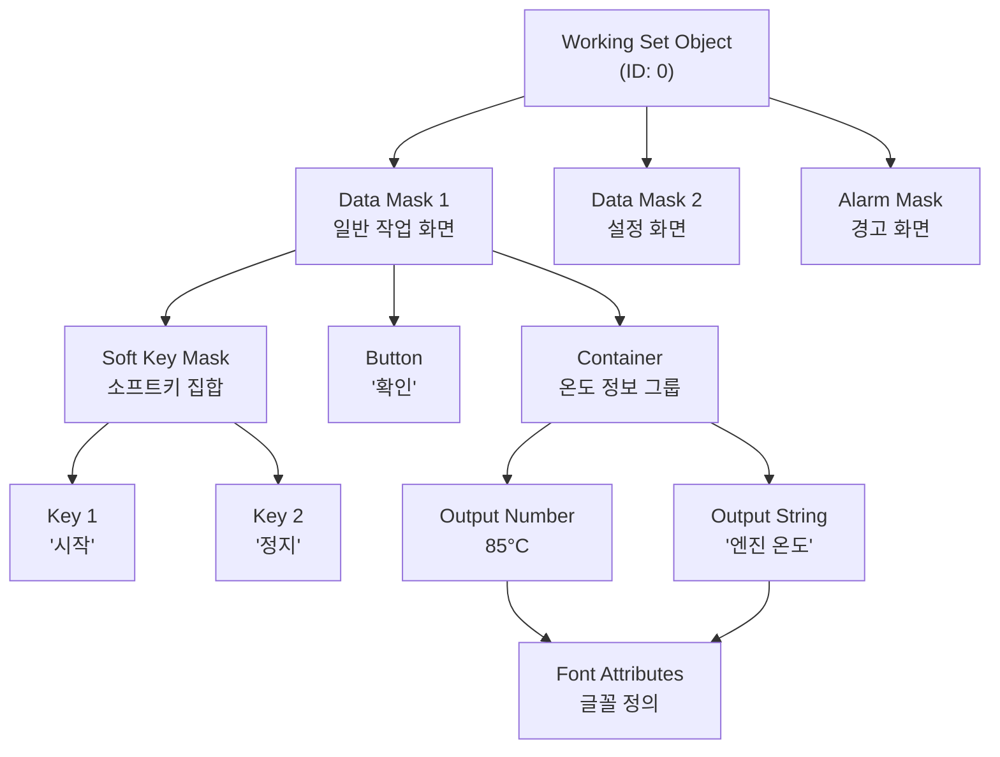
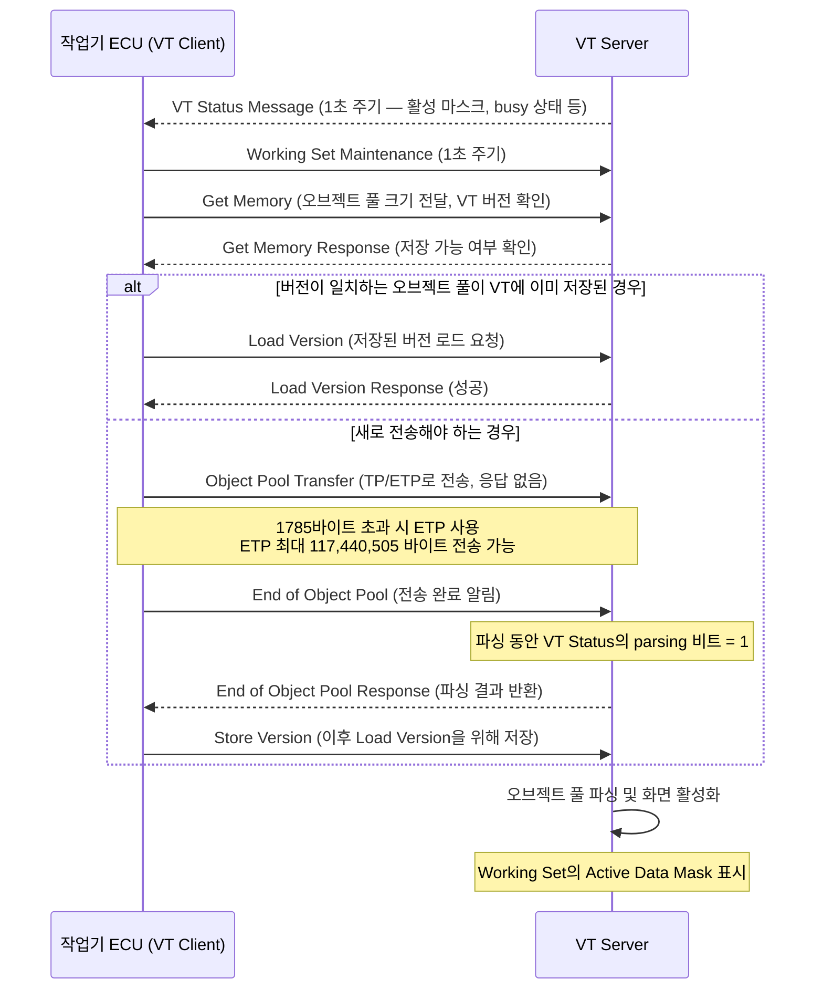

# VT 오브젝트 풀 (Object Pool)

::: info 학습 목표
- 오브젝트 풀의 개념과 바이너리 구조를 설명할 수 있다.
- 주요 오브젝트 타입의 역할을 구분할 수 있다.
- 오브젝트 간 계층 관계(Working Set → Data Mask → 자식 오브젝트)를 이해한다.
- 오브젝트 풀 전송 과정의 각 단계를 순서대로 설명할 수 있다.
- 간단한 화면을 XML(IOP) 형태로 구성할 수 있다.
- 오브젝트 레코드 바이트열을 Annex B 규칙으로 디코딩하고, 이벤트와 Change Attribute로 바꿀 수 있는 AID를 짚을 수 있다.
- End of Object Pool response의 오류 바이트로 결함 오브젝트와 원인을 진단할 수 있다.
- VT의 해상도·색 깊이·문자 집합에 맞춰 풀(스케일·색·WideString·User-Layout 참여)을 설계할 수 있다.
:::

## 1. 오브젝트 풀이란

<strong>오브젝트 풀(Object Pool)</strong>은 VT 화면 전체를 정의하는 <strong>바이너리 데이터 구조</strong>이다. 작업기 ECU의 플래시 메모리에 저장되어 있다가, VT 연결 시 VT로 전송된다.

각 오브젝트는 세 가지 요소로 구성된다.

```
[Object ID: 16bit] [Object Type: 8bit] [속성(Attribute) 목록...]
```

- **Object ID**: 0x0000 ~ 0xFFFE 범위의 고유 식별자(한 Working Set의 풀 안에서만 유일하면 된다). 0xFFFF는 NULL Object ID로 예약
- **Object Type**: 오브젝트 종류를 나타내는 1바이트 코드
- **속성**: 오브젝트 타입에 따라 위치, 크기, 색상, 자식 오브젝트 목록 등

### 설계부터 전송까지

```
IOP XML 파일 설계
       ↓
바이너리 변환 (툴체인 사용)
       ↓
ECU 플래시에 저장
       ↓
VT 연결 시 전송
       ↓
VT가 화면 렌더링
```

XML(IOP 형식)로 화면을 설계하고 빌드 시 바이너리로 변환하는 방식이 일반적이다. 이를 통해 설계 시점에는 가독성을, 런타임에는 크기 효율성을 모두 확보한다.

## 2. 오브젝트 타입 총정리

ISO 11783-6에는 40여 가지 오브젝트 타입이 정의되어 있다(v6 기준 Type 코드 0~48). 역할별로 분류하면 다음과 같다.

### 컨테이너 및 화면 구조

| 타입 이름 | Type 코드 | 역할 |
|-----------|-----------|------|
| **Working Set Object** | 0 | 오브젝트 풀의 루트. 작업기 전체를 대표 |
| **Data Mask** | 1 | 일반 화면(마스크). 실제 UI가 표시되는 단위 |
| **Alarm Mask** | 2 | 경고/알람 전용 화면. 우선순위로 Data Mask 위에 표시 |
| **Container** | 3 | 여러 오브젝트를 묶는 그룹. 가시성 토글 가능 |
| **Window Mask** | 34 | Version 4+. 복수 윈도우 지원 |

### 소프트키 및 버튼

| 타입 이름 | Type 코드 | 역할 |
|-----------|-----------|------|
| **Soft Key Mask** | 4 | Data Mask에 연결되는 소프트키 버튼 집합 |
| **Key** | 5 | 소프트키 개별 버튼 |
| **Button** | 6 | 화면 내 일반 버튼 오브젝트 |
| **Key Group** | 35 | Version 4+. 키 그룹 |

### 입력 오브젝트

| 타입 이름 | Type 코드 | 역할 |
|-----------|-----------|------|
| **Input Boolean** | 7 | 체크박스 등 불리언 입력 |
| **Input String** | 8 | 문자열 입력 필드 |
| **Input Number** | 9 | 숫자 입력 필드 |
| **Input List** | 10 | 목록 선택 입력 |

### 출력 오브젝트

| 타입 이름 | Type 코드 | 역할 |
|-----------|-----------|------|
| **Output String** | 11 | 문자열 출력 |
| **Output Number** | 12 | 숫자 출력 (변수 참조 가능) |
| **Output Line** | 13 | 선 그리기 |
| **Output Rectangle** | 14 | 사각형 그리기 |
| **Output Ellipse** | 15 | 타원 그리기 |
| **Output Polygon** | 16 | 다각형 그리기 |
| **Output Meter** | 17 | 미터 게이지 |
| **Output Linear Bar Graph** | 18 | 선형 막대 그래프 |
| **Output Arched Bar Graph** | 19 | 호형 막대 그래프 |
| **Picture Graphic** | 20 | 비트맵 이미지 |
| **Output List** | 37 | 목록 출력 (Version 4+) |

### 속성 오브젝트

| 타입 이름 | Type 코드 | 역할 |
|-----------|-----------|------|
| **Font Attributes** | 23 | 폰트 크기, 색상, 스타일 정의 |
| **Line Attributes** | 24 | 선 색상, 두께, 스타일 정의 |
| **Fill Attributes** | 25 | 채우기 색상, 패턴 정의 |
| **Input Attributes** | 26 | 입력 필드의 유효 문자 목록 |

### 기타

| 타입 이름 | Type 코드 | 역할 |
|-----------|-----------|------|
| **Number Variable** | 21 | 공유 숫자 변수 |
| **String Variable** | 22 | 공유 문자열 변수 |
| **Object Pointer** | 27 | 다른 오브젝트를 참조하는 포인터 |
| **Macro** | 28 | 이벤트 기반 자동화 명령 목록 |
| **External Object Pointer** | 43 | 다른 Working Set의 오브젝트 참조 (Version 5+) |

### 직접 눌러 보기

아래는 오브젝트 타입별로 화면에 어떻게 그려지는지, 그리고 운전자가 누를 때 VT가 어떤 메시지를 내보내는지를 재현한 시뮬레이터다. 오브젝트를 누르면 해당 타입 설명과 실제 8바이트 메시지가 함께 표시된다.

<VtObjectPoolDemo />

출력 오브젝트(Output String·Output Number·Output Meter 등)는 눌러도 메시지가 나가지 않는다. 입력 오브젝트와 Button·Key만 운전자 조작을 Working Set에 통지한다. 메시지 종류와 바이트 배치는 [CH17 VT 명령어](/study/isobus/17-vt-commands)에서 더 자세히 다룬다.

## 3. 오브젝트 간 계층 관계

오브젝트들은 트리 구조로 조직된다. <strong>Working Set Object</strong>가 루트이며, 모든 화면과 요소가 그 아래에 위치한다.



계층의 핵심 규칙:

- <strong>Data Mask</strong>는 Working Set에서 active mask로 지정되어야 화면에 표시된다.
- <strong>Soft Key Mask</strong>는 Data Mask에 연결되어 함께 활성화된다.
- **속성 오브젝트**(Font, Line, Fill Attributes)는 여러 오브젝트에서 공유할 수 있다.
- <strong>Container</strong>는 가시성(visible/hidden) 속성으로 동적으로 표시/숨김이 가능하다.

## 4. 오브젝트 풀 전송 과정

작업기 ECU가 VT에 처음 연결될 때 오브젝트 풀을 전송하는 절차는 다음과 같다.



### VT 능력 질의와 스케일링

전송 전에 Working Set Master는 Get Memory 외에도 기술 데이터(Technical data) 메시지 — <strong>Get Number of Soft Keys</strong>, <strong>Get Text Font Data</strong>, <strong>Get Hardware</strong> 등 — 로 VT의 소프트키 수, 지원 폰트·스타일, 색상 모드, Data Mask 픽셀 크기를 질의할 수 있다. Master는 이 응답에 맞춰 풀을 조정해야 한다.

- **위치·크기**: VT의 Data Mask 영역·designator 크기에 맞춰 오브젝트의 위치와 크기를 스케일한다.
- **폰트**: 정의된 영역에 best-fit 알고리즘으로 폰트를 선택한다. 최소 폰트는 6×8이며, 스케일 결과가 그보다 작으면 6×8을 쓴다.
- <strong>Picture Graphic</strong>은 VT가 오브젝트의 width 속성에 따라 자동 스케일한다.

### 전송 완료 대기와 오류 처리

End of Object Pool message를 보낸 뒤 VT는 파싱을 마칠 때까지 VT Status message의 parsing 비트를 1로 유지한다. Working Set Master는 parsing 비트가 0인 VT Status message가 <strong>연속 3번</strong> 수신될 때까지 End of Object Pool response를 기다려야 하고, 그때까지 응답이 없으면 메시지 미도달로 간주해 최대 3회 재시도할 수 있다(Load Version도 같은 대기 규칙을 쓴다).

End of Object Pool response가 오류(풀 오류, 메모리 고갈 등)를 담으면 VT는 풀을 휘발성 메모리에서 삭제하고 Working Set 중단을 운전자에게 알람으로 알린다. 이 응답을 받은 ECU는 장치의 안전한 셧다운 절차를 제공하는 fail-safe 운전 모드로 들어가야 한다.

### 버전 관리 (Store/Load Version)

오브젝트 풀이 크면 전송에 수 초가 걸릴 수 있다. 이를 개선하기 위해 VT는 오브젝트 풀을 <strong>버전 라벨(7문자 문자열, Version 5+는 32문자 확장 라벨도 지원)</strong>과 함께 비휘발성 저장소에 저장할 수 있다. 다음 연결 시 **Load Version** 명령만으로 저장된 풀을 즉시 복원하여 전송 시간을 절약한다.

## 5. 간단한 화면 구성 실습

"엔진 온도: 85°C"를 표시하는 화면을 구성해 보겠다.

### 필요한 오브젝트 구성


### IOP XML 예시

:::info IOP는 표준 용어가 아니다
ISO 11783-6 원문에는 "IOP"라는 표기가 없다. 표준은 이것을 그냥 <strong>object pool</strong>이라 부르며, `.iop`는 오브젝트 풀을 설계·빌드하는 툴체인이 관례적으로 쓰는 파일 확장자다. 아래 XML도 표준이 정의한 형식이 아니라 툴이 쓰는 중간 표현이며, 실제로 버스에 오르는 것은 이를 변환한 바이너리 레코드다.
:::

```xml
<objectpool>

  <!-- Working Set: 오브젝트 풀의 루트 -->
  <workingset id="0"
              background_colour="1"
              selectable="true"
              active_mask="1">
    <!-- active_mask="1" → Data Mask ID 1이 초기 화면 -->
  </workingset>

  <!-- Font Attributes: 검정, 24×32 픽셀 폰트 -->
  <fontattributes id="30"
                  font_colour="0"
                  font_size="6"
                  font_style="0" />
  <!-- font_colour 0 = 검정(VT 표준 팔레트 기준. 1 = 흰색) -->
  <!-- font_size 6 = 24×32 픽셀 -->

  <!-- Data Mask: 실제 화면 영역 -->
  <datamask id="1"
            background_colour="1"
            soft_key_mask="65535">
    <!-- soft_key_mask 65535 = 소프트키 없음 -->
    <include_object id="10" pos_x="10" pos_y="20" />
    <include_object id="11" pos_x="130" pos_y="20" />
  </datamask>

  <!-- Output String: "엔진 온도:" 레이블 -->
  <outputstring id="10"
                width="120"
                height="30"
                font_attributes="30"
                justification="0"
                value="엔진 온도:" />

  <!-- Output Number: 실시간 온도 값 -->
  <outputnumber id="11"
                width="80"
                height="30"
                font_attributes="30"
                variable_reference="65535"
                value="85"
                offset="0"
                scale="1.0"
                number_of_decimals="0"
                format="true"
                justification="0" />
  <!-- value="85": 초기값 85°C -->
  <!-- ECU가 Change Numeric Value 명령으로 실시간 갱신 -->

</objectpool>
```

### 런타임 데이터 갱신

화면이 표시된 후, ECU는 실측 온도가 바뀔 때마다 `Change Numeric Value` 명령으로 Output Number의 값을 갱신한다. VT 명령은 ECU→VT 방향 PGN 0xE700(59136)으로 보내고, VT의 응답은 VT→ECU 방향 PGN 0xE600(58880)으로 돌아온다. VT는 별도의 오브젝트 풀 재전송 없이 해당 오브젝트만 업데이트하여 화면에 반영한다.

```
ECU → VT: Change Numeric Value
  Object ID: 0x000B (Output Number ID 11)
  New Value : 92    (92°C로 갱신)
```

::: tip 핵심 정리
- 오브젝트 풀은 VT 화면 전체를 정의하는 바이너리 구조이며, 각 오브젝트는 ID + 타입 + 속성으로 구성된다.
- Working Set → Data Mask → Container/Output/Input → 속성 오브젝트 순의 계층 구조를 가진다.
- 오브젝트 풀 전송 시 TP/ETP를 사용하며(1785바이트 초과 시 ETP), Store/Load Version으로 재전송 시간을 절약한다.
- 화면 초기화 후 ECU는 Change Numeric Value 등의 명령어로 특정 오브젝트만 실시간 갱신한다.
:::

## 6. 오브젝트 레코드를 바이트로 보기

§2의 타입 표는 이름과 역할을 보여줄 뿐, 실제로 버스에 오를 때 바이트가 어떻게 배치되는지는 보여주지 않는다. Annex B의 공통 규칙은 <strong>모든 오브젝트 레코드가 Object ID(2바이트, 리틀엔디언) + Object Type(1바이트) + 타입별 속성</strong> 순으로 이어진다는 것이다. §5의 "엔진 온도: 85°C" 화면을 이루는 세 오브젝트(Font Attributes, Output String, Output Number)를 실제 바이트로 펼쳐본다.

::: info 정확도 표기
아래 표의 값 중 §5 XML에 명시된 속성(width, height, font_attributes, justification, value, font_colour, font_size, font_style 등)은 ISO 11783-6 Annex B 정의를 그대로 적용한 <strong>확정값</strong>이다. XML에 없는 속성(background colour, Options, 일부 Font type)은 "(가정)"으로 표시했고, 실제 툴체인 결과와 다를 수 있다.
:::

### Font Attributes(ID 30) — 8바이트

Output String·Output Number가 공유 참조하는 오브젝트부터 본다.

| 오프셋 | 바이트(hex) | 크기 | XML 속성 | 설명 |
|---|---|---|---|---|
| 0 | `1E 00` | 2 | `id="30"` | Object ID = 30, 리틀엔디언 |
| 2 | `17` | 1 | — | Object Type = 23(0x17) = Font Attributes |
| 3 | `00` | 1 | `font_colour="0"` | 검정 |
| 4 | `06` | 1 | `font_size="6"` | 24×32 픽셀(고정폭 크기 6) |
| 5 | `00` (가정) | 1 | (미지정) | Font type — XML에 없는 속성. 0 = ISO 8859-1(Latin 1)로 가정(Table K.1) |
| 6 | `00` | 1 | `font_style="0"` | 일반 텍스트(Bold·Italic 등 비트 없음) |
| 7 | `00` | 1 | — | Number of macros to follow = 0 — 매크로가 없어도 이 바이트는 있다(B.14.2) |

### Output String(ID 10) — 31바이트

| 오프셋 | 바이트(hex) | 크기 | XML 속성 | 설명 |
|---|---|---|---|---|
| 0 | `0A 00` | 2 | `id="10"` | Object ID = 10 |
| 2 | `0B` | 1 | — | Object Type = 11(0x0B) = Output String |
| 3 | `78 00` | 2 | `width="120"` | 120픽셀 |
| 5 | `1E 00` | 2 | `height="30"` | 30픽셀 |
| 7 | `01` (가정) | 1 | (미지정) | Background colour — Data Mask와 같은 흰색으로 가정 |
| 8 | `1E 00` | 2 | `font_attributes="30"` | Font Attributes ID 30 참조 |
| 10 | `00` (가정) | 1 | (미지정) | Options — 불투명·Auto-Wrap 없음으로 가정 |
| 11 | `FF FF` | 2 | (미지정, 추정) | Variable reference — XML에 없지만 `value`가 직접 있으므로 스펙상 NULL(65535) 확정 |
| 13 | `00` | 1 | `justification="0"` | 좌측 정렬 |
| 14 | `0E 00` | 2 | (계산값) | Length = 14바이트(아래 Value 참고) |
| 16 | `FF FE D4 C5 C4 C9 20 00 28 C6 C4 B3 3A 00` | 14 | `value="엔진 온도:"` | WideString(UTF-16LE) — BOM(`FF FE`) + "엔"(U+C5D4)"진"(U+C9C4)" "(U+0020)"온"(U+C628)"도"(U+B3C4)":"(U+003A) |
| 30 | `00` | 1 | — | Number of macros to follow = 0 — 가변 길이 Value 뒤에 온다(B.9.2) |

`value` 속성이 한글을 담고 있어 8-bit 인코딩(Annex K의 ISO 8859 문자 집합)으로는 표현할 수 없다. 그래서 실제 바이너리 변환 시 이 Value는 <strong>WideString</strong>으로 인코딩된다 — 첫 2바이트가 `FF FE`(BOM)로 시작하는 것으로 VT가 WideString임을 판별한다(Part 6 4.6.19.7의 "첫 2바이트가 FF16 FE16이면 WideString" 규칙). XML 자체에는 이를 나타내는 플래그가 없고, 바이너리 변환 도구가 문자열 내용을 보고 결정한다.

### Output Number(ID 11) — 29바이트

| 오프셋 | 바이트(hex) | 크기 | XML 속성 | 설명 |
|---|---|---|---|---|
| 0 | `0B 00` | 2 | `id="11"` | Object ID = 11 |
| 2 | `0C` | 1 | — | Object Type = 12(0x0C) = Output Number |
| 3 | `50 00` | 2 | `width="80"` | 80픽셀 |
| 5 | `1E 00` | 2 | `height="30"` | 30픽셀 |
| 7 | `01` (가정) | 1 | (미지정) | Background colour — 위와 동일하게 가정 |
| 8 | `1E 00` | 2 | `font_attributes="30"` | Font Attributes ID 30 참조 |
| 10 | `00` (가정) | 1 | (미지정) | Options — 불투명·선행0 없음·0도 표시·반올림으로 가정 |
| 11 | `FF FF` | 2 | `variable_reference="65535"` | NULL — Value 속성 직접 사용 |
| 13 | `55 00 00 00` | 4 | `value="85"` | 원시값 85(unsigned 32bit, LE) |
| 17 | `00 00 00 00` | 4 | `offset="0"` | Offset(signed 32bit) |
| 21 | `00 00 80 3F` | 4 | `scale="1.0"` | Scale — IEEE-754 단정밀도 부동소수 1.0(LE) |
| 25 | `00` | 1 | `number_of_decimals="0"` | 소수점 이하 0자리 |
| 26 | `01` (가정) | 1 | `format="true"` | Format(0=고정소수/1=지수 표기) — XML의 `true` 표기가 이 0/1 enum과 정확히 어떻게 대응하는지 이 챕터 범위에서는 확정할 수 없어 1로 가정 |
| 27 | `00` | 1 | `justification="0"` | 좌측 정렬 |
| 28 | `00` | 1 | — | Number of macros to follow = 0(B.9.3) |

표시값 계산식 `(value + Offset) × Scale = (85 + 0) × 1.0 = 85`로, XML 주석의 "초기값 85°C"와 일치한다.

### Object Pool Transfer에 실리는 순서

Annex C.2.3에 따르면 Object Pool Transfer message는 <strong>Byte 1 = 함수코드 `0x11`</strong> 뒤에 오브젝트 레코드가 그대로 이어지는 구조다. §5 화면의 풀 전체를 구성하면 다음과 같다.

| 순서 | 오브젝트 | 바이트 수 | 비고 |
|---|---|---|---|
| 1 | Working Set(ID 0) | 10 | designator 오브젝트 0개로 단순화한 크기. Annex B.1은 <strong>Soft Key designator용 오브젝트를 최소 1개</strong> 포함해야 한다고 규정하지만 §5 XML은 이를 생략했으므로, 실제 툴체인이 만드는 정확한 바이트 수는 이보다 클 수 있다 |
| 2 | Data Mask(ID 1) | 20 | 자식 오브젝트 2개(Output String 10, Output Number 11) 포함 |
| 3 | Font Attributes(ID 30) | 8 | 위 표 참고 |
| 4 | Output String(ID 10) | 31 | 위 표 참고 |
| 5 | Output Number(ID 11) | 29 | 위 표 참고 |
| 합계 | | <strong>98</strong> | Object Pool Transfer message 전체 길이 = 1(함수코드) + 98 = 99바이트 |

이 98바이트가 [CH15 §6](/study/isobus/15-vt-basics#_6-vt-연결-따라가기) 타임라인의 Get Memory 메시지에 그대로 들어가는 Memory Required 값이다.

### ETP가 필요해지는 지점

§4에서 "1785바이트 초과 시 ETP"라고 했다. 이번 예제 풀은 98바이트라 TP 한 세션이면 충분하다. 하지만 오브젝트 5개의 평균 크기가 98 ÷ 5 ≈ 19.6바이트인 것을 기준으로 보면, <strong>1785 ÷ 19.6 ≈ 91개</strong> — 이 정도 크기의 오브젝트 90여 개만 모여도 ETP 임계값을 넘는다. 실제 작업기 화면은 여러 Data Mask에 버튼·라벨·컨테이너가 수십~수백 개씩 들어가는 경우가 흔하고, Picture Graphic처럼 원시 비트맵 데이터를 통째로 담는 오브젝트(§2 "Picture Graphic")가 하나만 있어도 크기가 급격히 커진다. 풀이 조금만 커져도 ETP 경로를 타게 되는 이유다.

:::details 파이썬으로 바이트 구성 검산해 보기
```python
def le(v, n):
    return v.to_bytes(n, "little", signed=False)


# Font Attributes(ID 30)
font_attr = le(30, 2) + bytes([23, 0, 6, 0, 0, 0])
assert font_attr.hex(" ").upper() == "1E 00 17 00 06 00 00 00"
assert len(font_attr) == 8

# Output String(ID 10) — Value는 WideString(BOM + UTF-16LE)
text = "엔진 온도:"
value = b"\xFF\xFE" + text.encode("utf-16-le")
assert value.hex(" ").upper() == "FF FE D4 C5 C4 C9 20 00 28 C6 C4 B3 3A 00"
assert len(value) == 14

output_string = (
    le(10, 2) + bytes([11])
    + le(120, 2) + le(30, 2)
    + bytes([0x01])          # background colour(가정)
    + le(30, 2)               # font attributes
    + bytes([0x00])           # options(가정)
    + le(0xFFFF, 2)            # variable reference(NULL)
    + bytes([0])               # justification
    + le(len(value), 2)
    + value
    + bytes([0])               # number of macros to follow
)
assert len(output_string) == 31

# Output Number(ID 11)
import struct
scale = struct.pack("<f", 1.0)
assert scale.hex(" ").upper() == "00 00 80 3F"

output_number = (
    le(11, 2) + bytes([12])
    + le(80, 2) + le(30, 2)
    + bytes([0x01])            # background colour(가정)
    + le(30, 2)
    + bytes([0x00])            # options(가정)
    + le(0xFFFF, 2)
    + le(85, 4)                 # value
    + (0).to_bytes(4, "little", signed=True)  # offset
    + scale
    + bytes([0, 1, 0])          # decimals, format(가정=1), justification
    + bytes([0])                # number of macros to follow
)
assert len(output_number) == 29

pool_size = len(font_attr) + len(output_string) + len(output_number) + 10 + 20  # + Working Set(10) + Data Mask(20)
assert pool_size == 98
print("풀 전체 크기:", pool_size, "바이트 — Get Memory의 Memory Required와 일치")
```
:::

::: tip 핵심 정리
- 오브젝트 레코드는 항상 Object ID(2바이트 LE) + Type(1바이트) + 속성 순이며, 값의 크기·순서는 오브젝트 타입마다 Annex B가 고정한다.
- IOP XML의 속성 이름은 사람이 읽기 위한 것이고, 바이너리에서는 고정된 오프셋의 바이트 값일 뿐이다. XML에 없는 속성도 바이너리에는 반드시 존재한다(위 예제의 "(가정)" 항목들).
- 문자열에 비-ASCII 문자가 있으면 8-bit 인코딩 대신 WideString(BOM + UTF-16LE)으로 바뀐다 — XML에는 이를 나타내는 표시가 없다.
- Object Pool Transfer message는 함수코드 `0x11` 뒤에 오브젝트 레코드가 그대로 이어지는 단순한 구조이며, 풀이 커질수록(오브젝트 수·이미지 데이터) TP의 1785바이트 한계를 넘어 ETP가 필요해진다.
:::

## 7. 오브젝트 레코드의 공통 구조

§6에서 세 오브젝트를 바이트로 펼쳤다. Annex B에는 이런 표가 오브젝트마다 하나씩, 40개 넘게 있다(ISO 11783-6:2018 Annex B). 표를 하나씩 외우기 전에 모든 레코드가 공유하는 뼈대를 잡아 두면 처음 보는 오브젝트도 같은 순서로 읽힌다.


### 머리: Object ID와 Type

- <strong>Object ID</strong>(2바이트)는 0~65534다. 65535(`FF FF`)는 NULL Object ID다(Part 6 3.3). 풀 안에서 유일해야 한다(Annex B 각 표의 첫 행).
- <strong>Type</strong>(1바이트)은 Table A.1의 타입 번호다. 0~48이 표준 오브젝트, 240~254가 제조사 정의 오브젝트이고 49~239와 255는 예약이다(A.1).
- 1바이트보다 큰 값은 모두 리틀엔디언으로 보낸다(C.2.1).
- 레코드에는 <strong>전체 길이 필드가 없다</strong>. 파서는 Type을 보고 그 타입의 표대로 필드를 읽어야 다음 레코드가 어디서 시작하는지 안다. 기능을 지원하지 않는 오브젝트도 VT가 반드시 파싱해야 한다는 규칙(A.1.1, 4.6.28)은 이 구조와 맞물린다 — 한 레코드라도 못 읽으면 그 뒤 레코드 전체의 경계를 잃는다. 표준이 이 연결을 직접 적지는 않지만, Working Set Special Controls(B.29)에 "Number of bytes to follow"를 둔 이유를 "모르는 확장 속성을 건너뛰고 다음 오브젝트를 찾게 하려는 것"이라고 밝힌 데서 같은 문제의식을 읽을 수 있다.

### 고정 속성과 AID

- <strong>AID</strong>(Attribute ID)는 속성 번호다. 1바이트이고 255는 NULL AID다(3.4). AID 0은 언제나 Type이다.
- Annex B 표에서 AID가 `[n]`처럼 대괄호로 싸여 있으면 읽기 전용이라 Get Attribute Value로만 읽는다. 대괄호가 없으면 Change Attribute 명령으로 바꿀 수 있다(A.1.2).
- AID가 아예 없는 필드(목록 개수, Length, 문자열 Value, 비트맵 데이터)는 Change Attribute로 바꿀 수 없다. 문자열은 Change String Value, 목록 항목은 Change List Item 같은 전용 명령을 쓰거나 레코드를 다시 보낸다(§12). Change Attribute는 문자열에 쓸 수 없다(F.38).
- <strong>AID 번호와 바이트 순서는 다르다</strong>. Output Number의 Value는 AID `[12]`인데 바이트로는 Offset(AID 7)보다 앞인 Byte 14~17에 있다(B.9.3). AID를 레코드 오프셋으로 착각하면 엉뚱한 바이트를 고친다.
- 버전에 따라 늘어난 AID도 있다. Button의 Options(AID 6)는 v4부터 있다(B.7).

### 가변 목록 세 가지

| 목록 | 항목 크기 | 쓰는 오브젝트 |
|---|---|---|
| 위치 있는 자식 목록 | 6바이트: Object ID + X(signed) + Y(signed) | Working Set, Data Mask, Alarm Mask, Container, Key, Button, Window Mask(free form) |
| 위치 없는 참조 목록 | 2바이트: Object ID | Soft Key Mask(나열 순서가 곧 키 배치), Input List·Output List(목록 항목), Key Group, Window Mask(type 1 이상의 필수 참조) |
| 매크로 목록 | 2바이트: Event ID + Macro ID | 마스크·키·입출력 필드·Attribute 오브젝트·Picture Graphic 등 대부분 |

매크로 참조에는 두 형식이 있다(4.6.22.3).

- <strong>8비트 참조</strong>: `Event ID, Macro ID`. v4 이하 VT에서 Macro Object ID는 0~255뿐이다(4.6.11.4).
- <strong>16비트 참조</strong>(v5+): `FF, Macro ID 하위, Event ID, Macro ID 상위` — 2바이트 그룹 두 개를 이어 쓴다. Event ID 255는 이벤트가 아니라 "Use Extended Macro Reference" 표지다(Table A.3). 이 4바이트는 "Number of macros to follow"에서 <strong>2개로 센다</strong>(각 오브젝트 표의 설명).

배치 순서와 위치에도 함정이 있다.

- 자식(또는 참조) 목록을 모두 나열한 뒤 매크로를 나열한다. Working Set은 그 뒤에 언어 코드(2바이트씩)가 더 이어진다(B.1).
- 개수 바이트 두 개(objects, macros)는 보통 고정 속성 끝에 나란히 있다. 예외가 둘이다. Output String은 가변 길이 Value <strong>뒤에</strong> 매크로 개수가 온다(B.9.2) — §6의 원래 표가 빠뜨렸던 바이트가 이것이다. Picture Graphic은 매크로 개수가 Byte 17에 고정돼 있지만 매크로 쌍은 비트맵 데이터 뒤에 온다(B.12.1).
- 매크로 목록이 아예 없는 오브젝트도 있다. Number Variable, String Variable, Object Pointer, Macro, Colour Map, Colour Palette, Working Set Special Controls다(B.13, B.15~B.17, B.26, B.29). 이들의 이벤트에는 매크로를 걸 수 없다.

### 자주 쓰는 레코드의 길이

Annex B 표에서 유도한 식이다. n은 자식·항목 수, m은 매크로 개수 바이트 값, L은 문자열 바이트 수, D는 비트맵 데이터 바이트 수, r은 참조 수다.

| 오브젝트(Type) | 길이(바이트) | 오브젝트(Type) | 길이(바이트) |
|---|---|---|---|
| Working Set(0) | 10 + 6n + 2m + 2·언어 수 | Output String(11) | 16 + L + 1 + 2m |
| Data Mask(1) | 8 + 6n + 2m | Output Number(12) | 29 + 2m |
| Alarm Mask(2) | 10 + 6n + 2m | Picture Graphic(20) | 17 + D + 2m |
| Container(3) | 10 + 6n + 2m | Number Variable(21) | 7 |
| Soft Key Mask(4) | 6 + 2n + 2m | String Variable(22) | 5 + L |
| Key(5) | 7 + 6n + 2m | Font·Line·Fill Attributes(23~25) | 8 + 2m |
| Button(6) | 13 + 6n + 2m | Object Pointer(27) | 5 |
| Input Number(9) | 38 + 2m | Macro(28) | 5 + 명령 바이트 수 |
| Input List(10) | 13 + 2n + 2m | Colour Map(39) | 5 + 2·16·256 중 하나 |
| Window Mask(34) | 17 + 2r + 6n + 2m | Colour Palette(45) | 6 + 4·색 수 |
| Key Group(35) | 10 + 2n + 2m | Working Set Special Controls(47) | 5 + Number of bytes to follow |

## 8. 자주 쓰는 오브젝트 레코드 — 바이트·이벤트·AID

§5 화면에 "살포 목표량 설정" 기능을 붙인다고 가정하고 자주 쓰는 오브젝트 레코드를 바이트로 만든다. 오브젝트끼리는 아래 ID로 서로 참조한다. 레코드에 등장하는 Output String(24, 25, 43, 51, 71)은 풀 어딘가에 있다고 보고 생략한다. 표의 Byte 번호는 원문처럼 1부터 센다(§6 표의 오프셋은 0부터였다).

| ID | 오브젝트 | ID | 오브젝트 |
|---|---|---|---|
| 20 | Container(설정 묶음) | 31, 32 | Line·Fill Attributes |
| 21 | Input Number(목표량) | 40, 41 | Soft Key Mask, Key("설정") |
| 22 | Input List(살포 모드) | 50 | Button |
| 23 | Number Variable(목표량 원시값) | 60 | Macro |
| 26 | Object Pointer | 70 | Alarm Mask |
| 80 | Picture Graphic | 100, 120 | Window Mask, Key Group(§10) |

각 오브젝트마다 <strong>이벤트</strong>(Annex B 이벤트 표)와 <strong>Change Attribute로 바꿀 수 있는 AID</strong>를 함께 적는다. 이벤트 이름과 Event ID의 대응, 매크로 실행 규칙은 [CH17](/study/isobus/17-vt-commands)에서 다룬다.

### Container(Type 3) — 22바이트

| Byte | hex | 필드 | 값 |
|---|---|---|---|
| 1~3 | `14 00 03` | Object ID, Type | 20, Container |
| 4~7 | `C8 00 3C 00` | Width `[1]`, Height `[2]` | 200 × 60 |
| 8 | `00` | Hidden `[3]` | 0 = 보임 |
| 9~10 | `02 00` | 자식 수, 매크로 수 | 2, 0 |
| 11~16 | `15 00 0A 00 05 00` | 자식 1 | Input Number 21 @ (10, 5) |
| 17~22 | `16 00 6E 00 05 00` | 자식 2 | Input List 22 @ (110, 5) |

- 이벤트: On Show, On Hide, On Refresh, On Change Child Location, On Change Child Position, On Change Size(Table B.7). On Show·On Hide는 이미 그 상태여도 Hide/Show 명령이 오면 발생하고, Hide/Show response는 명령으로 일어났을 때만 나간다.
- AID: Width `[1]`, Height `[2]`, Hidden `[3]` — 모두 읽기 전용이고, Container의 허용 명령 목록에는 Change Attribute가 없다. 표시는 Hide/Show Object, 크기는 Change Size로 바꾼다(B.4).
- Container는 그려지지 않는 논리 묶음이다. Width·Height는 겹침 판정과 클리핑 경계로만 쓰인다. 숨기면 VT는 그 영역을 마스크 배경색으로 다시 그린다(Table B.7).
- 입력 필드에는 숨김 속성이 없다. 입력 필드를 숨기려면 Container나 Object Pointer에 담는다(B.8.1).

### Soft Key Mask(Type 4) 10바이트와 Key(Type 5) 15바이트

| Byte | hex | 필드 | 값 |
|---|---|---|---|
| 1~3 | `28 00 04` | Object ID, Type | 40, Soft Key Mask |
| 4 | `07` | Background colour(AID 1) | 7 = Silver |
| 5~6 | `02 00` | 객체 수, 매크로 수 | 2, 0 |
| 7~10 | `29 00 2A 00` | Key 목록(위치 없음) | Key 41, Key 42 |

| Byte | hex | 필드 | 값 |
|---|---|---|---|
| 1~3 | `29 00 05` | Object ID, Type | 41, Key |
| 4 | `07` | Background colour(AID 1) | 7 |
| 5 | `01` | Key code(AID 2) | 1 |
| 6~7 | `01 01` | 자식 수, 매크로 수 | 1, 1 |
| 8~13 | `2B 00 04 00 08 00` | 자식 | Output String 43 @ (4, 8) |
| 14~15 | `18 3C` | 매크로 | On Key Press(24) → Macro 60 |

- 이벤트: Soft Key Mask는 On Show, On Hide, On Change Background Colour, On Change Attribute(Table B.9). Key는 On Key Press·On Key Release(Soft Key Activation message가 나간다), On Change Background Colour, On Change Child Location·Position, On Change Attribute, On Input Field Selection·De-selection(Table B.11).
- AID: Soft Key Mask는 Background colour(1). Key는 Background colour(1), Key code(2).
- Key에 좌표가 없는 이유는 <strong>나열 순서대로 물리 Soft Key에 배정</strong>되기 때문이다. NULL을 가리키는 Object Pointer는 자리를 예약해 뒤의 Key가 당겨지지 않게 하고, 목록 끝의 NULL 포인터는 표시도 페이징 계산도 하지 않는다(B.5).
- Key code 0은 ACK 수단용으로 예약돼 있어 1~255만 쓴다(B.6). Key의 자식 좌표는 Soft Key designator 좌상단 기준이고 designator 밖은 잘린다. Key의 배경색이 Soft Key Mask 배경색보다 우선한다(B.5).

### Button(Type 6) — 19바이트

| Byte | hex | 필드 | 값 |
|---|---|---|---|
| 1~3 | `32 00 06` | Object ID, Type | 50, Button |
| 4~7 | `64 00 28 00` | Width(1), Height(2) | 100 × 40 |
| 8~9 | `07 08` | Background colour(3), Border colour(4) | Silver, Grey |
| 10 | `02` | Key code(5) | 2 |
| 11 | `01` | Options(6, v4+) | bit 0 = latchable |
| 12~13 | `01 00` | 자식 수, 매크로 수 | 1, 0 |
| 14~19 | `33 00 00 00 00 00` | 자식 | Output String 51 @ (0, 0) |

Options 비트는 0 latchable(런타임에 바꾸려 하면 VT가 무시), 1 현재 latch 상태, 2 Suppress border, 3 Transparent background, 4 Disabled, 5 No border이고 6~7은 예약이다(B.7).

- 이벤트: On Enable·On Disable, On Input Field Selection·De-selection, On Key Press·On Key Release, On Change Background Colour, On Change Size, On Change Child Location·Position, On Change Attribute(Table B.13). Button Activation message는 운전자가 누르고 뗄 때만 나간다. latchable Button의 상태를 Change Attribute로 바꿔도 On Key Press·Release 이벤트(즉 매크로)는 일어나지만 메시지는 없다.
- AID: Width(1), Height(2), Background colour(3), Border colour(4), Key code(5), Options(6, v4+). 모두 쓰기 가능하다.
- 자식이 놓이는 곳은 Button Area가 아니라 <strong>Button Face</strong>다. Face는 Area보다 가로·세로 8픽셀 작고, Face의 오프셋은 (0, 0)~(8, 8) 사이에서 VT가 정한다. 자식 좌표는 Face 좌상단 기준이고 Face 밖은 잘린다. No border(bit 5)를 켜야 Face = Area, 오프셋 (0, 0)이 된다(B.7). 위 100 × 40 버튼에서 확실히 그려지는 영역은 92 × 32뿐이다. 픽셀 단위로 배치해야 하면 No border를 쓴다.
- momentary Button에 bit 2·3·5를 조합하고 외형을 실시간으로 바꾸면 라디오 버튼처럼 쓸 수 있다(B.7 NOTE).

### Input Number(Type 9) 38바이트와 Number Variable(Type 21) 7바이트

| Byte | hex | 필드 | 값 |
|---|---|---|---|
| 1~3 | `15 00 09` | Object ID, Type | 21, Input Number |
| 4~7 | `5A 00 1E 00` | Width(1), Height(2) | 90 × 30 |
| 8 | `01` | Background colour(3) | White |
| 9~10 | `1E 00` | Font attributes(4) | Font Attributes 30 |
| 11 | `00` | Options(5) | 불투명, 선행 0 없음, 0 표시, 반올림 |
| 12~13 | `17 00` | Variable reference(6) | Number Variable 23 |
| 14~17 | `00 00 00 00` | Value `[14]` | 참조가 있으므로 쓰지 않는다 |
| 18~21 | `00 00 00 00` | Min value(7) | 0 |
| 22~25 | `88 13 00 00` | Max value(8) | 5000 |
| 26~29 | `00 00 00 00` | Offset(9) | 0 |
| 30~33 | `0A D7 23 3C` | Scale(10) | 0.01(float) |
| 34~35 | `02 00` | Number of decimals(11), Format(12) | 2자리, 고정소수 |
| 36 | `06` | Justification(13) | 수평 오른쪽(2) + 수직 가운데(1 × 4), 수직은 v4+ |
| 37 | `01` | Options 2 `[15]` | Enabled, 실시간 편집 꺼짐 |
| 38 | `00` | 매크로 수 | 0 |

Number Variable 23은 `17 00 15 C4 09 00 00`이다. Object ID 23, Type 21, Value `[1]` = 2500이고 매크로 목록이 없다(B.13.2).

표시값과 입력 판정은 B.8.4의 식을 따른다.

- 표시값 = (Value + Offset) × Scale = (2500 + 0) × 0.01 = 25.00. 변수 참조가 NULL이 아니면 레코드의 Value 대신 Number Variable의 값을 쓴다.
- 운전자가 Enter를 누르면 (Min + Offset) × Scale ≤ 입력값 ≤ (Max + Offset) × Scale, 즉 0 ≤ 입력값 ≤ 50일 때만 받는다. 범위 밖이면 Enter를 무시하고 입력 상태를 유지한다.
- 받은 값은 입력값 ÷ Scale − Offset으로 되돌려 저장한다. 32.5를 입력하면 3250이 Number Variable 23에 들어가고, VT는 이 원시값을 WS에 보고한다.
- WS는 풀 업로드나 Change Numeric Value로 Min·Max 밖의 값도 넣을 수 있다(B.8.4 NOTE). 범위 제한은 운전자 입력에만 걸린다.

- 이벤트: On Refresh, On Enable·On Disable, On Input Field Selection·De-selection, On ESC, On Change Background Colour, On Change Value, On Entry of Value(Enter — 값이 같아도), On Entry of New Value(값이 바뀌었을 때. 알림 메시지는 On Entry of Value 쪽에서 이미 나갔다), On Change Attribute, On Change Size(Table B.15).
- AID: Width(1)부터 Justification(13)까지 13개가 쓰기 가능하다. Value `[14]`와 Options 2 `[15]`는 읽기 전용이라 값은 Change Numeric Value로, Enabled 비트는 Enable/Disable Object로 바꾼다. Number Variable의 Value `[1]`도 Change Numeric Value로만 바꾼다.
- Number Variable을 Output Meter와 Output Number가 함께 참조하면 Change Numeric Value 한 번으로 둘 다 갱신된다. 변수의 On Change Value가 참조하는 표시 오브젝트를 모두 다시 그리기 때문이다(4.6.11.3, Table B.42).

::: warning 구현 함정 — float Scale 0.01
Scale은 32비트 float라 0.01을 정확히 담지 못한다(실제 값 0.009999999776…). 그래서 원시값 2500의 표시값은 24.9999994…가 된다. 반올림(Options bit 3 = 0)이면 "25.00"이지만 Truncate(bit 3 = 1)를 켜면 <strong>"24.99"</strong>가 보인다. 최대값 판정의 (5000 + 0) × Scale도 50이 아니라 49.9999988…이라, VT가 이 값을 그대로 비교하면 운전자가 넣은 "50.00"이 범위 밖으로 거부된다. 표준은 계산식과 "배정밀도로 계산하라"는 권고(should)만 두고 비교 정밀도는 정하지 않는다(B.8.4). 다음은 추론에 따른 구현 조언이다 — WS는 0.5·0.25·0.125처럼 2진수로 정확한 Scale을 쓰거나 Truncate를 피하고, VT는 Number of decimals 자릿수로 맞춘 값끼리 비교하는 편이 안전하다.
:::

### Input List(Type 10) — 19바이트

| Byte | hex | 필드 | 값 |
|---|---|---|---|
| 1~3 | `16 00 0A` | Object ID, Type | 22, Input List |
| 4~7 | `50 00 1E 00` | Width(1), Height(2) | 80 × 30 |
| 8~9 | `FF FF` | Variable reference(3) | NULL → Value 사용 |
| 10 | `00` | Value `[4]` | 0번 항목 선택 |
| 11 | `03` | Number of list items | 3(런타임에 바꿀 수 없다) |
| 12 | `01` | Options `[5]` | Enabled |
| 13 | `00` | 매크로 수 | 0 |
| 14~19 | `18 00 19 00 FF FF` | 항목 | Output String 24, 25, NULL |

- Value는 0~254가 항목 인덱스, 255가 "선택 없음"이다. 운전자는 255나 범위 밖 인덱스를 고를 수 없다. 다만 Number Variable을 다른 입력과 공유하면 범위 밖 값이 들어올 수 있다(B.8.5).
- 빈 항목은 두 종류다. 항목 ID 자체가 NULL이면(위 예의 2번) 보이지도 선택되지도 않지만 인덱스 번호는 차지한다. NULL을 가리키는 Object Pointer나 숨긴 Container는 목록에 자리를 차지하고 선택도 되지만 내용이 안 보인다.
- 인덱스가 255이거나 범위 밖이거나, 선택된 항목이 NULL·NULL 포인터·숨긴 Container면 VT는 아무것도 그리지 않는다(B.8.5).
- 이벤트: Input Number와 같은 목록에서 On Change Background Colour만 빠진다(Table B.19). Input List는 Change Background Colour 명령 대상이 아니다.
- AID: Width(1), Height(2), Variable reference(3). Value `[4]`·Options `[5]`는 읽기 전용이다. 인덱스는 Change Numeric Value, 항목 교체는 Change List Item으로 바꾼다.

### Object Pointer(Type 27) 5바이트와 String Variable(Type 22)

Object Pointer 26은 `1A 00 1B 14 00`이다. Object ID 26, Type 27, Value `[1]` = 20(Container 20)이다.

- 이벤트: On Change Value 하나다. 이전 오브젝트를 숨기고 새 오브젝트를 그린 뒤 부모를 refresh한다(Table B.54).
- AID: Value `[1]`이 읽기 전용이라 가리키는 대상은 Change Numeric Value로 바꾼다.
- 가리킬 수 있는 타입은 부모에 따라 다르며, 포인터를 거쳐도 부모의 포함 규칙(Table A.2)을 어길 수 없다(A.1.3 NOTE 3). 다른 Object Pointer를 가리킬 수 있고, NULL을 가리키면 아무것도 그리지 않는다(4.6.11.5).
- 런타임에 잘못된 대상을 가리키게 하면 VT는 즉시 Change Numeric Value response에 "invalid value"를 담아 알리거나, 그 포인터를 담은 마스크를 활성화할 때 Change Active Mask response(또는 VT Change Active Mask message)로 알리고 풀을 지울 수 있다(4.6.11.5). 어느 쪽인지는 VT마다 다르다.

String Variable은 `ID(2) + Type 22 + Length(2) + Value(Length바이트)`로 끝나고 매크로 목록이 없다. Length는 정의한 뒤 바꿀 수 없고 짧은 문자열은 공백으로 채운다. 값은 Change String Value로 바꾸며 WS가 8비트 문자열과 WideString을 오갈 수 있다(B.13.3).

### Macro(Type 28) — 21바이트

| Byte | hex | 필드 | 값 |
|---|---|---|---|
| 1~3 | `3C 00 1C` | Object ID, Type | 60, Macro |
| 4~5 | `10 00` | Number of bytes to follow | 16 |
| 6~13 | `A0 14 00 01 FF FF FF FF` | 명령 1 | Hide/Show Object — Container 20 보이기 |
| 14~21 | `AF 20 00 02 0E 00 00 00` | 명령 2 | Change Attribute — Fill Attributes 32의 AID 2(Fill colour) = 14(Yellow) |

- 명령은 Annex F 형식 그대로 8바이트 단위로 넣는다. 8바이트보다 짧은 명령은 `FF`로 채운다(B.16). Annex F 중 매크로 허용으로 표시된 명령만 넣을 수 있고, 기술 데이터 메시지(Annex D)와 비휘발성 메모리 명령(Annex E)은 매크로에 넣을 수 없다(4.6.11.4, D.1, E.1).
- Object ID 범위는 v4 이하 0~255, v5+ 0~65534다(B.16). 8비트 참조로 걸 수 있는 매크로는 0~255뿐이므로 256 이상이면 §7의 16비트 참조를 쓴다.
- 매크로 안 명령에는 응답 메시지가 나가지 않는다. 예를 들어 매크로의 Change Active Mask는 VT Status message는 일으키지만 Change Active Mask response는 보내지 않는다(4.6.11.4). 순환 참조는 금지다.
- AID는 Type `[0]`뿐이고, 허용 명령은 Execute Macro, Execute Extended Macro, Get Attribute Value다. 매크로가 실행되기 전에 풀과 맞는지(없는 오브젝트를 참조하지 않는지) 확인하는 것은 WS 책임이다(B.16).

### Alarm Mask(Type 2) — 20바이트, 16비트 매크로 참조 포함

| Byte | hex | 필드 | 값 |
|---|---|---|---|
| 1~3 | `46 00 02` | Object ID, Type | 70, Alarm Mask |
| 4 | `0C` | Background colour(1) | 12 = Red |
| 5~6 | `FF FF` | Soft Key Mask(2) | NULL → designator를 비우는 것이 권고 |
| 7 | `00` | Priority(3) | 0 = High(운전자 위험·긴급 고장) |
| 8 | `00` | Acoustic signal(4) | 0 = 최고 우선순위 음 |
| 9~10 | `01 02` | 자식 수, 매크로 수 | 1, 2(16비트 참조 하나를 2로 센다) |
| 11~16 | `47 00 0A 00 50 00` | 자식 | Output String 71 @ (10, 80) |
| 17~20 | `FF 58 03 1B` | 매크로(v5+) | On Show(3) → Macro 7000(0x1B58) |

- Priority는 0 High, 1 Medium(일반 알람·기계 고장), 2 Low(정보)이고 Acoustic signal은 0~2가 우선순위 음, 3이 무음이다(B.3).
- 이벤트: On Show(배경색 → 자식 순서대로 그리기 → 연결된 Soft Key Mask 표시, VT Status message), On Hide, On Refresh, On Change Background Colour, On Change Child Location·Position, On Change Priority, On Change Soft Key Mask, On Change Attribute(Table B.5). On Change Priority에서 VT는 WS 사이의 알람 우선순위를 다시 평가한다.
- AID: Background colour(1), Soft Key Mask(2), Priority(3), Acoustic signal(4) — 모두 쓰기 가능하다. 알람 처리 흐름은 [CH17](/study/isobus/17-vt-commands)에서 다룬다.

### Line Attributes(Type 24)·Fill Attributes(Type 25) — 각 8바이트

- Line Attributes 31: `1F 00 18 00 02 FF FF 00` → Line colour(1) = 0(Black), Line width(2) = 2픽셀, Line art(3) = `0xFFFF`(실선), 매크로 0.
- Fill Attributes 32: `20 00 19 02 07 FF FF 00` → Fill type(1) = 2(Fill colour로 채움), Fill colour(2) = 7(Silver), Fill pattern(3) = NULL, 매크로 0.

- Line art는 16비트 패턴이다. 1 비트는 선 색으로 칠하고 0 비트는 건너뛰며, 비트 하나가 붓 한 칸 크기다(B.14.3). Line width가 0인 선은 그리지 않는다(B.10.1).
- Fill type은 0 없음, 1 선 색, 2 Fill colour, 3 패턴(Picture Graphic)이다(B.14.4).
- Fill type을 3으로 바꿀 때는 <strong>Fill pattern을 먼저, Fill type을 나중에</strong> 바꿔야 한다. 순서를 어기면 VT 동작은 예측할 수 없다. Fill type 3인데 패턴이 NULL이면 채우지 않는다(B.14.4).
- 패턴용 Picture Graphic은 남는 비트가 없어야 한다. 단색이면 폭이 8의 배수, 16색이면 2의 배수여야 하고, 어기면 End of Object Pool response나 VT Change Active Mask message로 오류가 온다(B.14.4).
- 이벤트: On Change Line(Fill) Attributes, On Change Attribute — 이 속성을 참조하며 화면에 있는 오브젝트를 모두 다시 그린다(Table B.47, B.49).
- AID: Line은 Line colour(1), Line width(2), Line art(3). Fill은 Fill type(1), Fill colour(2), Fill pattern(3).
- §6의 Font Attributes도 같은 계열이다. AID는 Font colour(1), Font size(2), Font type(3), Font style(4)이다. 다만 Change Attribute로 크기·스타일을 VT가 지원하지 않는 조합으로 바꾸면 풀이 무효가 될 수 있다. 크기·스타일을 한 번에 바꾸는 Change Font Attributes 명령을 쓰면 이 문제를 피할 수 있다(B.14.2).

### Picture Graphic(Type 20) — raw 25바이트, RLE 19바이트

16 × 4 단색 그림(모든 픽셀이 색 1)을 목표 폭 32로 표시한다. 두 값이 있는 칸은 raw / RLE 순이다.

| Byte | hex | 필드 | 값 |
|---|---|---|---|
| 1~3 | `50 00 14` | Object ID, Type | 80, Picture Graphic |
| 4~5 | `20 00` | Width(1) | 목표 폭 32 → 높이는 VT가 비율로 계산(8) |
| 6~9 | `10 00 04 00` | Actual width `[4]`, Actual height `[5]` | 16 × 4 |
| 10 | `00` | Format `[6]` | 0 = 단색(1비트/픽셀) |
| 11 | `00` / `04` | Options(2) | raw / bit 2 = RLE |
| 12 | `01` | Transparency colour(3) | 1(Options bit 0이 1일 때만 쓰인다) |
| 13~16 | `08 00 00 00` / `02 00 00 00` | 데이터 바이트 수 | 8 / 2 |
| 17 | `00` | 매크로 수 | 0 |
| 18~ | `FF FF FF FF FF FF FF FF` / `08 FF` | 데이터 | raw 8바이트 / (8회, `FF`) |

- 픽셀은 줄 단위로 왼쪽에서 오른쪽, 위에서 아래로 놓인다. 단색은 1바이트에 8픽셀(MSB가 왼쪽), 4비트 색은 2픽셀(상위 니블이 왼쪽), 8비트 색은 1픽셀이다. 줄 끝의 남는 비트는 0으로 채우고 VT는 무시한다. 10 × 2 흰색 단색이면 `FF C0 FF C0`이다(B.12.2).
- 데이터가 모자라면 VT는 End of Object Pool response나 VT Change Active Mask message로 오류를 알리고, 남으면 무시한다(B.12.2).
- RLE는 (반복 횟수, 값) 바이트 쌍이다. 원문 예는 `00 00 00 00 00 00 03 03 03 01 01 02` → `06 00 03 03 02 01 01 02`이고, 횟수가 0인 쌍의 값은 무시한다. 복잡한 그림은 오히려 커진다 — 위 10 × 2 예를 RLE로 바꾸면 4바이트가 `01 FF 01 C0 01 FF 01 C0` 8바이트가 된다. 그럴 땐 raw를 쓰라고 권한다(B.12.2).
- RLE일 때 Byte 13~16에 압축 전·후 어느 길이를 넣는지 원문은 따로 밝히지 않는다(속성 이름은 "Number of bytes in raw data"). 레코드에 실제로 실린 바이트 수여야 그 뒤 매크로 쌍의 위치를 찾을 수 있으므로 위 예에서는 압축 후 길이 2로 적었다(추론, 확인 필요).
- 스케일은 VT가 Width(목표 폭) 기준으로 하고 높이는 비율로 계산한다(4.6.16.4). 픽셀 단위 정확도가 필요하면 Width = Actual width로 둬 스케일을 막는다(4.6.20). 채우기 패턴으로 쓸 때는 Width와 무관하게 원본 그대로 쓴다(4.6.21).
- 이벤트: On Refresh(불투명·투명, 깜빡임 옵션 비트가 바뀔 때 등), On Change Attribute(Table B.40).
- AID: Width(1), Options(2), Transparency colour(3). Options bit 2(RLE)는 런타임에 바꿔도 VT가 무시한다. Actual width `[4]`, Actual height `[5]`, Format `[6]`은 읽기 전용이다.

### AID 요약

§6과 §8의 오브젝트를 한 표로 모은다. "전용 명령"은 AID가 없거나 읽기 전용인 값을 바꾸는 수단이다(명령 바이트 배치는 [CH17](/study/isobus/17-vt-commands)).

| 오브젝트(Type) | Change Attribute로 바꿀 수 있는 AID | 읽기 전용 AID | 전용 명령 |
|---|---|---|---|
| Working Set(0) | 없음 | Background colour `[1]`, Selectable `[2]`, Active mask `[3]` | Change Active Mask, Change Background Colour |
| Data Mask(1) | Background colour 1, Soft Key Mask 2 | — | Change Soft Key Mask |
| Alarm Mask(2) | 1~4(배경색, Soft Key Mask, Priority, Acoustic) | — | Change Priority |
| Container(3) | 없음(Change Attribute 미허용) | Width `[1]`, Height `[2]`, Hidden `[3]` | Hide/Show Object, Change Size |
| Soft Key Mask(4) | Background colour 1 | — | — |
| Key(5) | Background colour 1, Key code 2 | — | — |
| Button(6) | Width 1 ~ Options 6 | — | Enable/Disable Object(v4+) |
| Input Number(9) | 1~13 | Value `[14]`, Options 2 `[15]` | Change Numeric Value, Enable/Disable Object |
| Input List(10) | Width 1, Height 2, Variable reference 3 | Value `[4]`, Options `[5]` | Change Numeric Value, Change List Item |
| Output String(11) | 1~7(Width ~ Justification) | — | Change String Value |
| Output Number(12) | 1~11(Width ~ Justification) | Value `[12]` | Change Numeric Value |
| Picture Graphic(20) | Width 1, Options 2, Transparency colour 3 | Actual width `[4]`, Actual height `[5]`, Format `[6]` | — |
| Number Variable(21) | 없음 | Value `[1]` | Change Numeric Value |
| Font Attributes(23) | 1~4 | — | Change Font Attributes |
| Line·Fill Attributes(24·25) | 1~3 | — | Change Line·Fill Attributes |
| Object Pointer(27) | 없음 | Value `[1]` | Change Numeric Value |

§6의 Output String·Output Number 이벤트는 On Refresh, On Change Background Colour, On Change Value, On Change Attribute, On Change Size이고(Table B.21), Font Attributes는 On Change Font Attributes, On Change Attribute다(Table B.45).

:::details 파이썬으로 §8 레코드와 레코드 경계 검산해 보기
```python
import struct

NULL = 0xFFFF
u8 = lambda v: bytes([v])
u16 = lambda v: v.to_bytes(2, "little")
s16 = lambda v: v.to_bytes(2, "little", signed=True)
u32 = lambda v: v.to_bytes(4, "little")
hx = lambda b: b.hex(" ").upper()
head = lambda oid, otype: u16(oid) + u8(otype)
children = lambda items: b"".join(u16(i) + s16(x) + s16(y) for i, x, y in items)
refs = lambda ids: b"".join(u16(i) for i in ids)
macro8 = lambda event, mid: u8(event) + u8(mid)
macro16 = lambda event, mid: u8(0xFF) + u8(mid & 0xFF) + u8(event) + u8(mid >> 8)

container = head(20, 3) + u16(200) + u16(60) + u8(0) + u8(2) + u8(0) \
    + children([(21, 10, 5), (22, 110, 5)])
skm = head(40, 4) + u8(7) + u8(2) + u8(0) + refs([41, 42])
key = head(41, 5) + u8(7) + u8(1) + u8(1) + u8(1) + children([(43, 4, 8)]) + macro8(24, 60)
button = head(50, 6) + u16(100) + u16(40) + u8(7) + u8(8) + u8(2) + u8(0x01) \
    + u8(1) + u8(0) + children([(51, 0, 0)])
input_number = head(21, 9) + u16(90) + u16(30) + u8(1) + u16(30) + u8(0) + u16(23) \
    + u32(0) + u32(0) + u32(5000) + (0).to_bytes(4, "little", signed=True) \
    + struct.pack("<f", 0.01) + u8(2) + u8(0) + u8(0x06) + u8(0x01) + u8(0)
num_var = head(23, 21) + u32(2500)
input_list = head(22, 10) + u16(80) + u16(30) + u16(NULL) + u8(0) + u8(3) + u8(0x01) \
    + u8(0) + refs([24, 25, NULL])
obj_ptr = head(26, 27) + u16(20)
cmds = bytes([0xA0]) + u16(20) + u8(1) + b"\xFF" * 4 \
    + bytes([0xAF]) + u16(32) + u8(2) + u32(14)
macro = head(60, 28) + u16(len(cmds)) + cmds
alarm = head(70, 2) + u8(12) + u16(NULL) + u8(0) + u8(0) + u8(1) + u8(2) \
    + children([(71, 10, 80)]) + macro16(3, 7000)
line_attr = head(31, 24) + u8(0) + u8(2) + u16(0xFFFF) + u8(0)
fill_attr = head(32, 25) + u8(2) + u8(7) + u16(NULL) + u8(0)


def rle(data):
    out, i = bytearray(), 0
    while i < len(data):
        n = 1
        while i + n < len(data) and data[i + n] == data[i] and n < 255:
            n += 1
        out += bytes([n, data[i]])
        i += n
    return bytes(out)


def picture(oid, width, aw, ah, fmt, options, data):
    # 매크로 개수(Byte 17)는 데이터 앞, 매크로 쌍은 데이터 뒤에 온다
    return head(oid, 20) + u16(width) + u16(aw) + u16(ah) + u8(fmt) + u8(options) \
        + u8(1) + u32(len(data)) + u8(0) + data


raw = bytes([0xFF] * 8)                          # 16x4 단색, 한 줄 2바이트
pg_raw = picture(80, 32, 16, 4, 0, 0x00, raw)
pg_rle = picture(80, 32, 16, 4, 0, 0x04, rle(raw))
window = head(100, 34) + u8(1) + u8(1) + u8(1) + u8(0) + u8(0x01) \
    + u16(101) + u16(102) + u16(103) + u8(2) + u8(0) + u8(0) + refs([104, 105])
key_group = head(120, 35) + u8(0x03) + u16(121) + u16(NULL) + u8(1) + u8(0) + refs([122])

assert hx(container) == "14 00 03 C8 00 3C 00 00 02 00 15 00 0A 00 05 00 16 00 6E 00 05 00"
assert hx(skm) == "28 00 04 07 02 00 29 00 2A 00"
assert hx(key) == "29 00 05 07 01 01 01 2B 00 04 00 08 00 18 3C"
assert hx(button) == "32 00 06 64 00 28 00 07 08 02 01 01 00 33 00 00 00 00 00"
assert len(input_number) == 38 and hx(input_number[29:33]) == "0A D7 23 3C"
assert hx(num_var) == "17 00 15 C4 09 00 00"
assert hx(input_list) == "16 00 0A 50 00 1E 00 FF FF 00 03 01 00 18 00 19 00 FF FF"
assert hx(obj_ptr) == "1A 00 1B 14 00"
assert hx(macro) == "3C 00 1C 10 00 A0 14 00 01 FF FF FF FF AF 20 00 02 0E 00 00 00"
assert hx(alarm) == "46 00 02 0C FF FF 00 00 01 02 47 00 0A 00 50 00 FF 58 03 1B"
assert hx(line_attr) == "1F 00 18 00 02 FF FF 00" and hx(fill_attr) == "20 00 19 02 07 FF FF 00"
assert hx(pg_rle) == "50 00 14 20 00 10 00 04 00 00 04 01 02 00 00 00 00 08 FF"
assert len(pg_raw) == 25 and len(pg_rle) == 19
assert rle(bytes([0, 0, 0, 0, 0, 0, 3, 3, 3, 1, 1, 2])) == bytes([6, 0, 3, 3, 2, 1, 1, 2])
assert rle(bytes.fromhex("FF C0 FF C0")) == bytes.fromhex("01 FF 01 C0 01 FF 01 C0")
assert hx(window) == "64 00 22 01 01 01 00 01 65 00 66 00 67 00 02 00 00 68 00 69 00"
assert hx(key_group) == "78 00 23 03 79 00 FF FF 01 00 7A 00"

# 레코드에는 전체 길이 필드가 없다 — Type별 규칙을 알아야 다음 레코드를 찾는다
LENGTH = {
    2: lambda r: 10 + 6 * r[8] + 2 * r[9],       # Alarm Mask
    3: lambda r: 10 + 6 * r[8] + 2 * r[9],       # Container
    4: lambda r: 6 + 2 * r[4] + 2 * r[5],        # Soft Key Mask
    5: lambda r: 7 + 6 * r[5] + 2 * r[6],        # Key
    6: lambda r: 13 + 6 * r[11] + 2 * r[12],     # Button
    9: lambda r: 38 + 2 * r[37],                 # Input Number
    10: lambda r: 13 + 2 * r[10] + 2 * r[12],    # Input List
    20: lambda r: 17 + int.from_bytes(r[12:16], "little") + 2 * r[16],  # Picture Graphic
    21: lambda r: 7,                             # Number Variable
    24: lambda r: 8 + 2 * r[7],                  # Line Attributes
    25: lambda r: 8 + 2 * r[7],                  # Fill Attributes
    27: lambda r: 5,                             # Object Pointer
    28: lambda r: 5 + int.from_bytes(r[3:5], "little"),                 # Macro
    34: lambda r: 17 + 2 * r[14] + 6 * r[15] + 2 * r[16],              # Window Mask
    35: lambda r: 10 + 2 * r[8] + 2 * r[9],      # Key Group
}

pool = b"".join([container, skm, key, button, input_number, num_var, input_list, obj_ptr,
                 macro, alarm, line_attr, fill_attr, pg_raw, window, key_group])
pos, ids = 0, []
while pos < len(pool):
    rec = pool[pos:]
    ids.append(int.from_bytes(rec[:2], "little"))
    pos += LENGTH[rec[2]](rec)                   # 모르는 Type이면 KeyError — 더 못 읽는다
assert ids == [20, 40, 41, 50, 21, 23, 22, 26, 60, 70, 31, 32, 80, 100, 120]
assert pos == len(pool)
print("레코드", len(ids), "개,", len(pool), "바이트 — 경계 검산 통과")
```
:::

::: tip 정리
- 모든 레코드는 Object ID(2) + Type(1) + 고정 속성 + 목록 개수 + 목록 순이고, 전체 길이 필드가 없어 Type별 규칙으로만 끝을 찾는다.
- AID의 대괄호는 읽기 전용 표시다. 값·표시·활성 상태처럼 대괄호가 붙은 속성은 Change Numeric Value·Hide/Show·Enable/Disable 같은 전용 명령으로 바꾼다.
- 매크로 개수는 16비트 참조 하나를 2로 세고, Output String·Picture Graphic은 매크로 목록 위치가 가변 데이터에 따라 움직인다.
:::

## 9. 배치·그리기 규칙

VT가 오브젝트를 어디에, 어떤 순서로, 어디까지 그리는지 정하는 규칙이다. "같은 풀이 VT마다 다르게 보인다"는 문제는 대부분 여기서 나온다.

### 좌표계와 상대 위치

- 단위는 따로 밝히지 않는 한 물리 픽셀이다. x는 오른쪽, y는 아래쪽으로 커지고, 좌표는 부호 있는 값이며, 원점 (0, 0)은 <strong>부모 오브젝트의 좌상단</strong>이다(4.4).
- 위치는 자식 레코드가 아니라 <strong>부모 레코드의 자식 목록</strong>에 들어 있다(4.6.12). 그래서 같은 Container를 여러 마스크의 여러 위치에 넣어 재사용할 수 있다(4.6.11.1).
- 화면상 절대 위치는 조상들의 위치를 더한 값이다. Data Mask 안 (20, 40)에 놓인 Container 속 (10, 5)의 Input Number는 절대 (30, 45)에 그려진다.
- 좌표가 signed라 음수도 쓸 수 있고, 부모 영역 밖으로 나간 부분은 잘린다(아래 클리핑).
- 런타임에 위치를 바꾸는 명령은 Change Child Location과 Change Child Position이다([CH17](/study/isobus/17-vt-commands)).


### 겹침과 그리는 순서

- 두 오브젝트가 같은 자리를 차지하는 마스크를 VT는 반드시 지원해야 한다(shall, 4.6.13). <strong>목록에서 나중에 나온 오브젝트가 위에</strong> 그려진다.
- 오브젝트가 바뀌면 그 위에 겹쳐 있다가 손상된 오브젝트도 다시 그린다(refresh event). 모든 오브젝트가 명시적이거나 암시된 직사각형 크기를 갖는 것도 겹침 판정을 쉽게 하려는 것이다(4.6.13).
- Container를 숨기면 VT는 그 영역을 부모 마스크 배경색으로 채우고, 그 과정에서 영향받은 다른 오브젝트를 다시 그린다. 이 중간 화면이 운전자 눈에 보이지 않게 구현해도 된다(4.6.13 EXAMPLE).
- v6에서 Colour Palette로 알파값을 바꾸면 겹친 영역을 합성한다. 합성색 = 위 색 × α/255 + 아래 색 × (255 − α)/255이고, 맨 아래부터 한 겹씩 계산해 그 결과를 다음 겹의 "아래 색"으로 쓴다. 흰 배경(255) 위의 50 % 회색(128, α = 128)은 191, 검정(0) 위에서는 64가 된다. 불투명한 오브젝트를 반투명 오브젝트 위에 올리면 섞이지 않는다(4.6.13).

### 클리핑

- 크기가 정해진(또는 암시된) 오브젝트는 그 밖에 그려지는 것을 <strong>픽셀 단위로</strong> 잘라낸다. 텍스트·숫자도 자동 줄바꿈 여부와 상관없이 같다(4.6.15).
- 클리핑 경계가 되는 영역은 Container의 Width·Height(B.4), Button Face(B.7), Soft Key designator(Key의 자식과 Working Set 식별 오브젝트, B.6·B.1), Window Mask 영역(4.7.5)이다.
- 출력 도형에서 선 두께가 1보다 크면 두께가 안쪽·바깥쪽·가운데 중 어디로 자랄지는 VT 재량이다. 그래도 선이 잘리지 않게 오브젝트 영역 안에 들어가야 한다(B.10.1).

### 스케일링 — 누가 하나

§4에서 본 대로 기본 책임은 Working Set에 있다. 대상별로 정리하면 다음과 같다.

| 대상 | 스케일하는 쪽 | 근거 |
|---|---|---|
| 일반 오브젝트의 위치·크기 | WS | 4.6.16.2 |
| 폰트(best-fit 선택, VT 지원 확인) | WS | 4.6.16.3 |
| Soft Key designator 안 오브젝트(Key 자식, Working Set 식별 오브젝트) | WS | 4.6.16.2, B.1 |
| Picture Graphic | VT(Width 기준) | 4.6.16.4 |
| Window Mask type 0(free form)과 그 자식 | WS | 4.7.6 |
| Window Mask type 1 이상 | VT(Window Icon·Button은 WS가 미리 스케일하고 VT가 더 스케일할 수 있다) | 4.7.6 |
| Key Group의 자식 | WS | 4.7.11 |

- 시점은 전송 전·후 어느 쪽이든 된다. 단 전송한 풀이 그 VT에서 무효여서는 안 된다 — 흑백 VT에 컬러 오브젝트를 보내 놓고 나중에 흑백으로 고치는 식은 허용되지 않는다(4.6.16.1, C.2.1).
- 예: 200 × 200 기준으로 설계한 풀을 Data Mask가 480 × 480인 VT(Get Hardware response로 확인)에 맞추면 배율은 2.4다. (10, 20)에 놓인 120 × 30 오브젝트는 (24, 48)의 288 × 72가 된다.
- 폰트도 같은 배율이면 24 × 32가 57.6 × 76.8 영역이 된다. 표준은 best-fit 알고리즘을 정의하지 않으므로 여기서는 "폭·높이를 넘지 않는 가장 큰 지원 폰트"로 고른다고 가정한다. 그러면 48 × 64(Font size 9)이고, VT가 Get Text Font Data response에서 32 × 32까지만 보고했다면 32 × 32다. 반대로 480 기준 풀을 200 VT로 줄이면 12 × 16이 5 × 6.7이 되어 하한인 6 × 8을 쓴다. 이때 글자가 필드 가장자리에서 잘리거나 이웃 글자와 겹칠 수 있다(4.6.16.3).
- Soft Key designator 크기는 Get Number of Soft Keys response의 X Dots·Y Dots로 알 수 있고(D.5, [CH15](/study/isobus/15-vt-basics)), 최소 60 × 32(v6+는 60 × 60)다(4.5.3). Data Mask와 달리 정사각형이 아니라 X·Y 배율이 다를 수 있다. 60 × 32 기준 디자인을 80 × 80 designator에 맞추면 1.33배와 2.5배다. 표준은 이때 축을 따로 스케일할지 정하지 않고, 크기와 폰트를 따로 스케일하면 잘림·겹침이 생길 수 있다고만 경고한다(4.6.16.3). 두 배율 중 작은 쪽으로 맞추는 편이 안전하다(추론).

### 폰트 렌더링

- 고정폭 폰트는 Font size 0 = 6 × 8부터 14 = 128 × 192까지 15종이다(B.14.2). VT에 꼭 있어야 하는 것은 6 × 8 normal뿐이고, 나머지 크기와 스타일은 Get Text Font Data response의 Byte 6·7(크기 비트마스크)과 Byte 8(스타일)로 확인한다(4.6.19.3, D.7).
- 스타일을 켜도 글자는 폰트 상자를 넘으면 안 된다. 8 × 10 폰트의 bold italic도 8 × 10 안에 들어가야 한다(4.6.19.3).
- Font style 비트는 0 Bold, 1 Crossed out, 2 Underlined, 3 Italic, 4 Inverted, 5 반전 깜빡임, 6 숨김 깜빡임(5보다 우선), 7 비례폭 렌더링(v4+)이다(B.14.2).
- <strong>비례폭(proportional)</strong>은 v4+ VT의 선택 기능이다. Font style bit 7이 1이면 Font size는 크기 코드가 아니라 높이 픽셀 값(8~N)이 되고, 폭은 글자마다 다르다. N은 Get Text Font Data response가 보고한 가장 큰 고정폭 폰트의 높이다. 예를 들어 Byte 6 = `10`(16 × 24), Byte 7 = `02`(48 × 64)이면 비례폭 높이는 8~64를 1픽셀 단위로 쓸 수 있다(4.6.19.4). 비례폭을 지원하지 않는 VT에 비례폭 Font Attributes가 든 풀을 보내면 풀이 거부되고, Change Font Attributes로 요청하면 오류 응답이 온다. 그래서 WS는 쓰기 전에 지원 여부를 먼저 물어야 한다(shall).
- 정렬(Justification)의 bit 0~1은 수평(0 왼쪽, 1 가운데, 2 오른쪽), bit 2~3은 수직(0 위, 1 가운데, 2 아래, v4+)이다. v4부터는 픽셀 단위로 정렬한다(4.6.19.2).
  - 왼쪽: 앞 공백을 지우지 않는다. 자동 줄바꿈이 없으면 넘친 부분이 오른쪽에서 잘린다.
  - 가운데: 앞뒤 공백을 모두 지우고 픽셀 단위로 가운데 맞춘다. 넘치면 양쪽이 잘린다.
  - 오른쪽: 뒤 공백을 지운다. 넘치면 왼쪽이 잘린다.
  - 자동 줄바꿈이면 줄마다 같은 규칙을 쓰고 빈 줄은 지우지 않는다. 입력 중에는 VT가 정렬을 미뤄도 된다.
- 자동 줄바꿈(Options bit 1, 4.6.19.5)은 공백(`0x20`), soft hyphen(`0xAD` — 그 자리에서 실제로 줄이 나뉠 때만 보인다), hyphen(`0x2D` — Wrap on Hyphen 비트가 켜졌을 때)에서 끊을 곳을 찾는다. 없으면 마지막으로 온전히 보이는 글자 뒤에서 끊는다. 다음 줄 첫머리의 공백은 지운다. NBSP(`0xA0`)는 일반 글자처럼 다룬다.
- 제어 문자(v4+, 4.6.19.6): CR, LF, CRLF는 한 번의 줄 끝이고 LFCR은 줄 끝 두 번이다. BS처럼 Annex K에서 표시 대상이 아닌 문자는 무시한다. `0x00`(WideString은 `0x0000`)을 만나면 정의된 길이보다 앞이어도 거기서 표시를 끝낸다.
- 렌더링 정확도(4.6.20): Output Meter의 바늘 모양, 막대그래프의 눈금, 비스듬한 선의 그리기 알고리즘은 VT 재량이라 VT마다 픽셀 단위로 같지 않다. 픽셀 단위 일치가 필요하면 Width = Actual width인 Picture Graphic을 쓴다.

### 선과 채우기

- 점은 정사각형 붓(점이 붓의 왼쪽 위)이나 선 방향으로 돌린 붓으로 찍고, 안티에일리어싱도 허용된다(B.10.1).
- 라인 아트 패턴을 꼭짓점을 지나며 이어 갈지(continuous) 새로 시작할지(restarting)는 VT가 고른다. 시작점은 일관되게 잡는 것이 권고다 — 다각형은 첫 점, 사각형은 좌상단, 타원은 시작 각이다(4.6.21).
- 채우기는 flood fill·boundary fill이 아니라 <strong>scan-line 방식이어야 한다</strong>(shall). 겹친 오브젝트가 경계를 끊을 수 있고 성능도 나쁘기 때문이다. 테두리에 해당하는 픽셀은 빼고 내부만 채운다(4.6.21).
- 패턴 채우기는 Picture Graphic 원본을 스케일 없이 쓰고, 패턴 좌상단을 VT의 물리 Data Mask(또는 해당 designator, User-Layout Window Mask) 좌상단에 고정해 가로·세로로 반복한다. 그래서 서로 다른 오브젝트의 무늬가 어긋나지 않고 이어진다. 투명·깜빡임 옵션은 무시한다(4.6.21).

### 지원하지 않는 오브젝트

- 원칙은 <strong>"파싱은 하되 기능은 지원하지 않는다"</strong>이다. VT는 Table A.1의 오브젝트를 기능 지원 여부와 상관없이 파싱할 수 있어야 하고(A.1.1), v4+ VT는 지원 목록에 없는 비고유 오브젝트도 파싱해야 한다. 덕분에 WS는 같은 풀을 여러 VT에 그대로 쓸 수 있다(4.6.28).
- 다만 WS가 보낼 수 있는 오브젝트는 Get Memory response가 보고한 VT 버전과 호환되는 것까지다(4.6.28). v4 VT에 v6 오브젝트인 Colour Palette(Type 45)를 보내면 안 된다.
- WS는 지원하지 않는 오브젝트에 명령을 보내지 않는 것이 권고다(should). 보내면 VT는 0이 아닌 오류 코드로 응답하며, 구체적인 값은 VT 설계에 따라 다르다. 원문의 예는 Graphics Context를 지원하지 않는 VT에 Change Background Colour를 보내 오류 응답을 받는 경우다(4.6.28).
- 지원 목록은 Get Supported Objects(D.14)로 묻는다([CH15](/study/isobus/15-vt-basics)).
- 개별 규칙도 있다. 지원하지 않는 window type의 Window Mask는 파싱한 뒤 무시하고 오류를 내지 않는다(4.7.1.2). Graphics Context를 지원하지 않는 VT는 그것을 NULL을 가리키는 Object Pointer처럼 다룬다 — 그리지 않지만 열린 Input List에서 선택할 수 있는 자리는 차지한다(B.18). 제조사 정의 오브젝트(240~254)는 제조사 코드가 다른 VT에 보내지 않는 것이 권고다(A.1).

:::details 파이썬으로 좌표·합성·스케일 계산 검산해 보기
```python
import math

# 4.6.12 상대 좌표 → 절대 좌표: 위치는 부모 레코드에 들어 있다
chain = [(20, 40), (10, 5)]          # Data Mask 안 Container 위치, Container 안 Input Number 위치
assert tuple(map(sum, zip(*chain))) == (30, 45)


# 4.6.13 알파 합성(v6): 아래에서 위로 한 겹씩 계산한다
def blend(src, dst, alpha):
    return src * alpha / 255 + dst * (255 - alpha) / 255


assert int(blend(128, 255, 128)) == 191     # 흰 배경 위 50 % 회색
assert int(blend(128, 0, 128)) == 64        # 검정 사각형 위 50 % 회색
assert blend(0, 191, 255) == 0              # 불투명한 위 오브젝트는 섞이지 않는다

# 4.6.16 스케일링: 200x200으로 설계한 풀을 480x480 VT에 맞춘다
k = 480 / 200
assert (round(10 * k), round(20 * k), round(120 * k), round(30 * k)) == (24, 48, 288, 72)

FONTS = [(6, 8), (8, 8), (8, 12), (12, 16), (16, 16), (16, 24), (24, 32), (32, 32),
         (32, 48), (48, 64), (64, 64), (64, 96), (96, 128), (128, 128), (128, 192)]


def best_fit(w, h, supported):
    """예시 규칙(표준은 알고리즘을 정하지 않는다): 폭·높이를 넘지 않는 가장 큰 폰트."""
    fits = [f for f in supported if f[0] <= w and f[1] <= h]
    return max(fits, key=lambda f: f[0] * f[1]) if fits else (6, 8)  # 6x8 하한


assert best_fit(24 * k, 32 * k, FONTS) == (48, 64)                    # Font size 9
assert best_fit(24 * k, 32 * k, FONTS[:8]) == (32, 32)               # 큰 폰트 미지원 VT
assert best_fit(12 * 200 / 480, 16 * 200 / 480, FONTS) == (6, 8)     # 축소 시 6x8 하한

# Soft Key designator: 60x32로 설계 → VT가 80x80을 보고(X·Y 배율이 다르다)
assert (round(80 / 60, 3), 80 / 32) == (1.333, 2.5)

# 4.7.5 Window Cell 크기(내림)와 4.7.15.3 Window Icon 영역(셀 높이의 90 %, 내림)
for side, cell, icon in [(200, (100, 33), 29), (480, (240, 80), 72), (800, (400, 133), 119)]:
    c = (side // 2, side // 6)
    assert c == cell
    assert math.floor(c[1] * 0.9) == icon
assert (100 * 2, 33 * 2) == (200, 66)        # 200x200에서 2x2 Window Mask

# 4.7 Figure 30: Key 안 구현체 식별 아이콘 = designator 높이의 60 %(내림), 정사각형
assert math.floor(32 * 0.6) == 19 and math.floor(80 * 0.6) == 48

print("배치·스케일 계산 검산 통과")
```
:::

## 10. 여러 Working Set을 한 마스크에 — User-Layout

평소 VT 화면에는 활성 WS 하나의 Data Mask만 보인다. User-Layout은 운전자가 여러 WS의 작은 창(Window Mask)과 키 묶음(Key Group)을 골라 한 화면에 모아 보는 기능이다(4.7). 예를 들어 파종기의 작업 속도와 분무기의 탱크 잔량을 한 화면에 나란히 놓을 수 있다.

### 최소 요구와 참여 방법

- 4.7 전체가 v4+ 전용이고 선택 기능이다. 그래도 v4+ VT는 지원 여부와 상관없이 Window Mask와 Key Group을 <strong>파싱해야 한다</strong>. 지원한다면 최소한 free form(type 0) Window Mask는 지원해야 하고 나머지 window type은 선택이다. 지원하지 않는 type의 Window Mask는 파싱한 뒤 무시하며 오류를 내지 않고, 운전자 선택 목록에도 띄우지 않는다(4.7.1.2).
- 참여하려는 WS는 Window Mask·Key Group을 풀에 넣어 올리기만 하면 된다. 지원하지 않는 VT는 파싱 후 버리므로 풀을 VT별로 고칠 필요가 없다(4.7.1.2, 4.7.4).

### User-Layout Data Mask와 Window Cell

- User-Layout Data Mask는 <strong>VT가 소유한</strong> 특수 Data Mask다. 개수 제한은 없고, VT는 운전자가 이 화면들로 들어갈 수단을 제공해야 한다. 크기는 표준 Data Mask와 같고 2열 × 6행의 Window Cell 격자로 나뉜다(4.7.2).
- 셀 크기는 폭 = Data Mask 폭 ÷ 2, 높이 = Data Mask 높이 ÷ 6이고 둘 다 내림한다(4.7.5). 200 × 200이면 100 × 33, 480 × 480이면 240 × 80, 800 × 800이면 400 × 133이다.
- Window Mask의 픽셀 크기는 차지한 셀 크기와 정확히 같아야 한다(4.7.3). 200 × 200에서 2 × 2 Window Mask는 200 × 66이다(4.7.6). 레코드의 Width(1~2)·Height(1~6)는 픽셀이 아니라 <strong>셀 칸 수</strong>이고 type 0일 때만 쓰인다(B.19.1).
- 배치는 운전자가 VT 고유 매핑 화면에서 정한다. VT는 셀에 맞지 않는 Window Mask를 고르지 못하게 막고, 고른 배치를 비휘발성 메모리에 저장했다가 다음 전원 투입 때 복원한다. 그 Window Mask를 제공한 WS가 없으면 셀은 배경색으로 비운다(4.7.4).
- Options bit 0(Available)이 0이면 매핑 목록에 나오지 않고, 이미 배치돼 있었다면 셀을 비운다. 이 상태는 런타임에 바뀔 수 있다(4.7.4, B.19.1).
- VT는 Window Mask의 바깥 1픽셀 둘레에 테두리를 그릴 수 있고, 그 테두리는 Window Mask 영역 <strong>안쪽</strong>에 그린다(그릴지는 VT 재량). 그래서 type 0이면 자식을 가장자리 1픽셀에 붙이지 않는 것이 권고다. 영역 밖 픽셀은 잘린다(4.7.5).


### Window Mask 레코드 — type 1 예제

window type 0은 WS가 자식을 직접 배치하는 free form이고, 1~18은 VT가 배치와 모양을 정하는 표준 창이다(B.19.2). type 1(1 × 1 Numeric Output Value with Units)은 참조 2개(#1 Output Number = 값, #2 Output String = 단위)를 받고, VT는 제목 11자·값 5자·단위 5자를 보여 줘야 한다(B.19.2.2).

| Byte | hex | 필드 | 값 |
|---|---|---|---|
| 1~3 | `64 00 22` | Object ID, Type | 100, Window Mask(34) |
| 4~5 | `01 01` | Width, Height(셀 수) | type 0에서만 쓰인다 |
| 6 | `01` | Window Type | 1 |
| 7 | `00` | Background Colour(AID 1) | type 1 이상이면 VT가 무시 |
| 8 | `01` | Options(AID 2) | bit 0 Available = 1, bit 1 Transparent = 0 |
| 9~10 | `65 00` | Name(AID 3) | Output String 101 — 매핑 화면에 쓰는 이름(VT는 20자 이상 표시) |
| 11~12 | `66 00` | Window Title | Output String 102 — type 0이면 NULL이어야 한다 |
| 13~14 | `67 00` | Window Icon | Picture Graphic 103 — type 1 이상이면 필수 |
| 15 | `02` | 참조 수 | 2 |
| 16 | `00` | 자식 수 | type 1 이상이면 0 |
| 17 | `00` | 매크로 수 | 0 |
| 18~21 | `68 00 69 00` | 참조 | Output Number 104, Output String 105 |

- 이벤트: On Show·On Hide(VT On User-Layout Hide/Show message에 Show·Hide를 담아 보낸다), On Refresh, On Change Background Colour, On Change Child Location·Position, On Change Attribute, On Pointing Event press·release(free form만)(Table B.60).
- AID: Background Colour(1), Options(2), Name(3).
- type 1 이상에서 VT는 배치·색·폰트를 직접 정하고 참조 오브젝트의 서식 속성을 무시할 수 있다. 그래도 숫자·문자열 필드의 최소 글자 수는 보여야 하고, 숫자의 스케일·서식 속성(Options bit 1~3, 변수 참조, Value, Offset, Scale, Number of decimals, Format)은 지켜야 한다(4.7.15.4). Window Title과 Window Icon 중 적어도 하나는 반드시 표시한다(4.7.15.2).
- Window Icon 영역은 셀 높이의 90 %(내림)인 정사각형이다. 200 × 200이면 29 × 29, 480 × 480이면 72 × 72다. WS는 아이콘을 이 크기로 미리 스케일하거나 런타임에 Width로 맞춘다. 아이콘이 영역보다 크면 VT가 가운데 맞추고 잘라내며, 작으면 VT가 원하는 곳에 놓는다(가로·세로 따로 판단, 4.7.15.3). 셀·아이콘 계산은 §9의 검산 코드에 함께 넣었다.
- 바 그래프가 든 표준 창(type 7, 16)에서 VT는 Min·Max가 표시 단위라고 가정할 수 없으므로 눈금에 값을 적지 않는 것이 권고다(B.19.2).

### Key Group과 User-Layout Soft Key Mask

- User-Layout Data Mask마다 User-Layout Soft Key Mask가 정확히 하나 있다. Key Cell 수는 VT가 정하되 최대 64개이고, 물리 Soft Key보다 많으면 Soft Key Mask와 같은 페이징을 제공한다. Key Cell 하나는 일반 Soft Key designator와 같은 크기다(4.7.8, 4.7.10).
- Key Group은 Key(또는 Key를 가리키는 Object Pointer) 1~4개의 묶음이다. 포인터를 따라간 뒤 Key가 4개를 넘으면 안 된다. 운전자는 묶음을 쪼개 배치할 수 없고 페이지 경계를 넘겨서도 안 된다(B.20).
- 레코드 예: `78 00 23 03 79 00 FF FF 01 00 7A 00` → Object ID 120, Type 35, Options(1) = `03`(Available + Transparent), Name(2) = Output String 121, Key Group Icon = NULL(VT 고유 표현), Key 수 1, 매크로 0, Key 122.
- Transparent(bit 1)를 켜면 VT는 자식 Key들의 배경색을 무시하고 스스로 정한다. 모든 키의 배경을 통일하려는 것이라 투명이 권고다. 반대로 Key Group Icon에는 투명 배경을 쓰지 않는 것이 권고다 — 매핑 화면의 배경색을 설계자가 모르기 때문이다(B.20).
- 키가 어느 WS 것인지 알아보게 해야 한다. 같은 화면에 "STOP" 키가 셋이면 운전자가 헷갈린다. 원문은 designator 높이의 60 %(내림) 크기 정사각형 식별 아이콘을 왼쪽 아래에 두는 배치를 권한다 — 60 × 32 designator면 19 × 19, 80 × 80이면 48 × 48이다(4.7.9 Figure 30).
- 이벤트는 On Change Attribute 하나이고(Table B.62), AID는 Options(1), Name(2)이다. 자식 Key의 스케일은 WS 몫이다(4.7.11).
- Window Mask는 특정 Key Group이 화면에 있다고 가정하면 안 된다. 무엇을 배치할지는 운전자가 정하기 때문이다(4.7.9).

### 입력과 화면 갱신

- User-Layout Data Mask가 표시 중이면 어느 WS가 보낸 Select Input Object 명령도 실행되지 않고 오류 응답이 간다. 마스크 소유자가 VT이기 때문이다. 내비게이션 순서는 VT가 정한다(4.7.13).
- 입력 오브젝트 이벤트에 걸린 매크로는 실행된다. 하지만 그 WS가 활성 WS가 아니므로 눈에 보이는 효과가 없을 수 있다 — 예를 들어 매크로의 Change Active Mask는 효과가 없다(4.7.13).
- 운전자가 Window Mask 안의 입력 오브젝트를 활성화하면 VT는 VT Status message의 Byte 2를 `FF`, `FE` 또는 VT 자신의 SA로 바꾸고, VT On User-Layout Hide/Show message로도 WS에 알린다(4.7.13).
- 값 갱신은 WS 책임이다. 무엇이 화면에 보이는지는 VT Status가 아니라 <strong>VT On User-Layout Hide/Show message</strong>(H.20)로 안다. VT는 Window Mask·Key Group이 나타나거나 사라질 때마다 오브젝트별로 이 메시지를 보낸다. WS가 타임아웃되면 VT는 그 WS의 Window Mask·Key Group을 화면에서 지운다(4.7.14).
- VT는 Window Mask·Key Group을 User-Layout 밖의 비VT 화면·영역에서도 쓸 수 있다. 그래서 WS는 VT Status의 SA와 상관없이 Hide/Show message를 보고 보이는 것을 갱신해야 한다(4.7.7, 4.7.12).

### 새 Window Mask·Key Group을 올릴 때

런타임에 같은 타입의 새 오브젝트를 올리는 것은 Annex C가 허용한다(§12). Window Mask·Key Group을 교체하면 VT는 4.7.16 Table 7에 따라 화면과 저장된 매핑을 고친다. 요점은 다음과 같다.

| 바뀐 내용 | VT 동작 |
|---|---|
| 외형만(배경색·옵션·자식 등) 또는 window type | 보이면 다시 그린다 |
| Available → not available | 보이면 그 영역을 배경색으로 비운다 |
| Window Mask 크기 축소 | 다시 그리고, 비게 된 셀은 비우고 저장된 매핑을 고친다 |
| Window Mask 크기 확대 | 지금 자리에서 늘어난 칸이 비어 있으면 매핑을 넓히고, 아니면 매핑에서 빼고 원래 셀을 비운다 |
| Key Group의 Key 수 감소 | 다시 그리고, 남는 키 자리를 비우고 매핑을 고친다 |
| Key Group의 Key 수 증가 | 같은 페이지에서 위치를 바꾸지 않고 들어갈 빈 자리가 있으면 넓히고, 없으면 매핑에서 빼고 원래 자리를 비운다 |

어떤 경우에도 다른 Key Group의 위치는 바뀌지 않는다(4.7.16).

## 11. 색 제어

오브젝트의 색 속성(배경색·글자색·선 색 등)과 비트맵 픽셀 값은 RGB가 아니라 <strong>팔레트 인덱스</strong>다(A.3). 인덱스가 실제 색이 되기까지 단계가 몇 개 있고, WS는 그중 두 곳을 바꿀 수 있다(4.8).


### 표준 팔레트

- 256칸이고 그중 232~255의 24칸은 VT 고유다(4.8, A.3).
- 0~15는 이름 있는 16색이다. 0 Black, 1 White, 2 Green(`009900`), 3 Teal, 4 Maroon, 5 Purple, 6 Olive, 7 Silver(`CCCCCC`), 8 Grey(`999999`), 9 Blue(`0000FF`), 10 Lime, 11 Cyan, 12 Red(`FF0000`), 13 Magenta, 14 Yellow(`FFFF00`), 15 Navy(`000099`)다(Table A.4).
- 16~231은 웹 안전색 큐브(성분값 `00 33 66 99 CC FF`, 6 × 6 × 6 = 216색)를 오름차순으로 늘어놓은 것이다(A.3). 그래서 인덱스 = 16 + 36·r + 6·g + b(r, g, b는 0~5단계)로 계산된다 — 표의 배열에서 유도한 식이다. 예를 들어 64는 (1, 2, 0)이라 `33 66 00`이다.
- 앞 16색이 큐브 안에 한 번 더 나오므로 256색 모드도 고유한 색이 256개는 아니다(A.3 NOTE).
- v6부터 모든 칸에 알파가 있고 기본값은 255(불투명)다. 그래서 v5 이하와 그대로 호환된다(A.3).

### 색 깊이별 처리

- 색 모드는 셋이다. 단색(유효 코드 0~1), 16색(0~15), 256색(0~255). 상위 모드를 지원하는 VT는 하위 모드도 지원해야 한다(A.3).
- VT의 모드는 Get Hardware response의 Byte 3(Graphic Type)으로 안다. 0이면 색 코드 0·1과 단색 Picture Graphic만, 1이면 0~15와 단색·16색 Picture Graphic, 2이면 모든 색과 모든 Picture Graphic 형식을 지원한다(D.9).
- 따라서 16색 VT에 보내는 풀에는 색 코드 16 이상이나 Format 2(8비트) Picture Graphic이 있으면 안 된다. 전송 전에 VT에 맞춘 "깨끗한" 풀을 만들어야 하고, 무효 색이 든 풀을 보낸 뒤 명령으로 고치는 방식은 허용되지 않는다(C.2.1).
- v5 이하 VT는 16색·256색 모드를 회색조로 구현해도 된다(A.3).

### Colour Map — 인덱스 간접 참조(Type 39, B.17)

- v4·v5에서는 선택, v6에서는 필수다. 색 인덱스를 다른 인덱스로 바꾸는 표다. 풀에 여러 개 둘 수 있고, 로드 직후 VT는 기본 Colour Map을 쓴다. 바꾸려면 Select Colour Map or Palette 명령(F.60)을 보낸다(B.17, [CH17](/study/isobus/17-vt-commands)).
- 항목 수는 2, 16, 256 중 하나이고 VT 능력보다 적으면 안 된다. 많은 것은 괜찮다 — 256칸 맵을 단색 VT에 보내면 VT는 0·1번만 쓴다(B.17).
- 레코드 예(16색 VT용, 0과 1을 맞바꿔 화면을 반전): `5A 00 27 10 00` + `01 00 02 03 04 05 06 07 08 09 0A 0B 0C 0D 0E 0F` → Object ID 90, Type 39, 항목 수 16, 0번 → 1, 1번 → 0, 나머지는 그대로. 원문 Figure 32의 시나리오다.
- 이 WS의 풀에만 적용되고 다른 WS 화면은 바뀌지 않는다(4.8). 허용 명령은 Get Attribute Value뿐이라 맵 내용을 바꾸려면 오브젝트를 다시 보낸다.

### Colour Palette — ARGB 재정의(Type 45, B.26, v6)

- 0번부터 N개(최대 256)의 색을 ARGB로 다시 정의한다. 일부만 바꿀 수도 있지만 항상 0번부터 센다. 값은 리틀엔디언이라 바이트 순서가 <strong>B, G, R, A</strong>다(B.26).
- 레코드 예(0~2번 재정의, 2번 Green을 50 % 투명): `5B 00 2D 00 03 00` + `00 00 00 FF` + `FF FF FF FF` + `00 99 00 80` → Object ID 91, Type 45, Options 0(예약), 색 3개 = 불투명 검정, 불투명 흰색, α = `80`인 `009900`. 18바이트다.
- 풀 갱신으로 새 Colour Palette가 오면 VT는 그 WS의 팔레트를 먼저 표준 팔레트로 되돌린 뒤 새 값을 적용한다(B.26).
- AID는 Options(1, 예약)이고, 허용 명령은 Change Attribute와 Get Attribute Value다.
- 아래에 무엇이 깔릴지 설계자가 모르는 곳에는 투명을 쓰지 않는 것이 권고다. Data Mask 배경(그 아래 색을 모른다), External Object Pointer로 다른 WS 화면에 참조될 수 있는 Button이 그 예다(B.26).

### Working Set Special Controls — 초기 선택(Type 47, B.29, v6)

- 풀에 0개 또는 1개 둔다. 지정한 Colour Map과 Colour Palette를 풀을 처음 그리기 전에 활성화한다. NULL이면 각각 Colour Map 없음, 표준 팔레트다(B.29).
- "Number of bytes to follow"로 확장할 수 있게 설계됐다. 이 오브젝트나 AID 2 이상의 속성이 없으면 VT는 NULL과 같은 값으로 처리한다.
- 언어·국가 코드 쌍을 넣으면 Working Set 오브젝트의 언어 목록은 무시된다.
- 레코드 예: `5C 00 2F 09 00 5A 00 5B 00 01 6B 6F 4B 52` → Object ID 92, Type 47, 뒤따르는 9바이트, Colour Map 90, Colour Palette 91, 언어 쌍 1개 "ko"·"KR".
- v6 VT가 Select Colour Map or Palette 명령을 처리하면 이 오브젝트의 속성도 그에 맞게 갱신된다(F.60).

### 투명을 만드는 세 가지 장치

| 장치 | 효과 | 근거 |
|---|---|---|
| Options의 Transparent 비트 | 오브젝트 배경을 칠하지 않아 아래가 비친다. Input String·Input Number·Output String·Output Number의 bit 0, Button bit 3, Window Mask bit 1 | B.7~B.9, B.19 |
| Picture Graphic의 Transparency colour | Options bit 0이 1일 때 이 인덱스의 픽셀만 아래가 비친다 | B.12.1 |
| 팔레트 알파(v6) | 색 자체가 반투명이라 겹친 영역이 섞인다(§9 합성식) | 4.6.13, B.26 |

Key Group의 Transparent 비트는 이름은 같지만 뜻이 다르다. 아래가 비치는 것이 아니라 VT가 자식 Key의 배경색을 무시하고 직접 정한다(B.20). 채우기 패턴으로 쓰인 Picture Graphic은 투명 옵션을 무시한다(4.6.21).

:::details 파이썬으로 팔레트·Colour Map·Colour Palette 검산해 보기
```python
LEVELS = [0x00, 0x33, 0x66, 0x99, 0xCC, 0xFF]
NAMED = ["000000", "FFFFFF", "009900", "009999", "990000", "990099", "999900", "CCCCCC",
         "999999", "0000FF", "00FF00", "00FFFF", "FF0000", "FF00FF", "FFFF00", "000099"]


def standard_rgb(i):
    """A.3 표준 팔레트(알파는 기본 FF). 232~255는 VT 고유라 None."""
    if i < 16:
        return NAMED[i]
    if i <= 231:
        r, g, b = (i - 16) // 36, (i - 16) // 6 % 6, (i - 16) % 6
        return "%02X%02X%02X" % (LEVELS[r], LEVELS[g], LEVELS[b])
    return None


# Table A.4에서 몇 칸을 골라 대조
assert standard_rgb(16) == "000000" and standard_rgb(21) == "0000FF"
assert standard_rgb(64) == "336600" and standard_rgb(128) == "9900CC"
assert standard_rgb(192) == "CCFF66" and standard_rgb(231) == "FFFFFF"
assert standard_rgb(232) is None
# 앞 16색은 큐브 안에 다시 나온다(NOTE: 256색 모드도 256개 고유색이 아니다)
assert all(NAMED[i] in {standard_rgb(j) for j in range(16, 232)} for i in range(16))


u16 = lambda v: v.to_bytes(2, "little")
argb = lambda a, r, g, b: bytes([b, g, r, a])   # 리틀엔디언 → B, G, R, A 순

# Colour Map(ID 90): 16색 VT용, 0과 1을 맞바꾼다(Figure 32)
cmap = [1, 0] + list(range(2, 16))
colour_map = u16(90) + bytes([39]) + u16(len(cmap)) + bytes(cmap)
assert colour_map.hex(" ").upper() == (
    "5A 00 27 10 00 01 00 02 03 04 05 06 07 08 09 0A 0B 0C 0D 0E 0F")

# Colour Palette(ID 91, v6): 0~2번만 다시 정의, 2번(Green)을 50 % 투명으로
entries = [argb(0xFF, 0, 0, 0), argb(0xFF, 0xFF, 0xFF, 0xFF), argb(0x80, 0x00, 0x99, 0x00)]
palette = u16(91) + bytes([45, 0]) + u16(len(entries)) + b"".join(entries)
assert palette.hex(" ").upper() == (
    "5B 00 2D 00 03 00 00 00 00 FF FF FF FF FF 00 99 00 80")
assert len(palette) == 6 + 4 * 3

# Working Set Special Controls(ID 92, v6): 처음부터 Colour Map 90·Palette 91, 언어 ko-KR
body = u16(90) + u16(91) + bytes([1]) + b"ko" + b"KR"
wssc = u16(92) + bytes([47]) + u16(len(body)) + body
assert wssc.hex(" ").upper() == "5C 00 2F 09 00 5A 00 5B 00 01 6B 6F 4B 52"


def resolve(index, colour_map=None, ws_palette=None):
    """오브젝트 색 속성 → (Colour Map) → (WS 팔레트) → ARGB"""
    if colour_map is not None:
        index = colour_map[index]
    if ws_palette and index in ws_palette:
        return ws_palette[index]
    return "FF" + standard_rgb(index)


assert resolve(0) == "FF000000"
assert resolve(0, colour_map=cmap) == "FFFFFFFF"                  # 0이 흰색으로 보인다
assert resolve(2, ws_palette={2: "80009900"}) == "80009900"       # 2번만 반투명
print("색 계산 검산 통과")
```
:::

## 12. 오브젝트 풀 전송 심화 — Annex C

§4에서 전송 순서와 End of Object Pool response 대기 규칙을 봤다. 여기서는 구현할 때 부딪히는 세부를 Annex C 원문으로 채운다. 기술 데이터 메시지(Get Memory 등)의 바이트 배치와 연결 초기화는 [CH15](/study/isobus/15-vt-basics), 명령 메시지는 [CH17](/study/isobus/17-vt-commands)에서 다룬다.

### Object Pool Transfer 메시지 다시 보기

- Byte 1은 `0x11`(Command `0001` = Object Pool Transfer, Parameter `0001` = Object Pool Transfer)이고 Byte 2부터 레코드가 이어진다(C.2.3).
- 이 메시지에는 <strong>응답이 없다</strong>. 그래서 단일 패킷에 들어가는 작은 오브젝트 하나라도 단일 패킷으로 보내지 않는 것이 권고다(C.2.3 NOTE). Object Pointer(5바이트)나 Number Variable(7바이트)은 `0x11`과 합쳐도 8바이트 안에 들어가지만, 그렇게 보내면 VT가 받았는지 알 길이 없다.
- Annex C의 메시지는 Working Set Master만 보낼 수 있다(Member 불가). 그리고 응답을 받기 전에는 다음 Annex C 메시지를 보내지 않는다(C.1).
- VT는 파싱하다가 이미 있는 Object ID를 다시 만나면 새 레코드를 <strong>교체</strong>로 받아들인다(C.2.1). 같은 전송 안에서도 뒤에 온 레코드가 이긴다.

### 여러 세션으로 나눠 보내기

풀 하나를 꼭 한 세션으로 보낼 필요는 없다(C.2.2 b).

- 단일 패킷·TP·ETP 세션을 몇 개든, 섞어서 보낼 수 있다. End of Object Pool을 보내기 전까지 계속 이어 보내면 된다. 세션 하나하나가 Object Pool Transfer 메시지이므로 각 세션은 `0x11`로 시작한다.
- 각 세션 안의 레코드는 <strong>완결돼야 한다</strong>. 레코드 하나를 두 세션에 걸쳐 쪼개면 안 되고, 레코드가 하나도 없는 세션도 안 된다.
- 나누는 이유는 WS의 버퍼 크기, 그리고 전송 전에 스케일·조정을 해야 하는 경우다.
- 예: 레코드 6개, 합계 3000바이트(예시 값)를 TP(세션당 최대 1785바이트)로 보내면 `0x11` 1바이트를 더해 [700, 650] → 1351바이트(TP.DT 193패킷), [500, 400, 350, 400] → 1651바이트(236패킷) 두 세션이 된다. ETP 한 세션이면 3001바이트(429패킷)다.
- 레코드 하나가 1784바이트를 넘으면(큰 Picture Graphic 등) 쪼갤 수 없으므로 그 레코드는 ETP 세션으로 보내야 한다. 원문이 직접 적은 문장은 아니고, "쪼개기 금지"와 TP 한계에서 따라 나오는 결론이다.
- 다른 풀을 받는 중인 VT는 CTS의 패킷 수를 0으로 보내 오래 기다리게 할 수 있다(C.2.2 b). 이것을 TP 타임아웃이나 연결 실패로 오판하지 않아야 한다(TP 동작은 [CH11](/study/isobus/11-j1939-transport)).

### End of Object Pool response 읽기

End of Object Pool은 `12 FF FF FF FF FF FF FF`다. 최초 전송 뒤뿐 아니라 운영 중에 오브젝트를 바꾸거나 더한 뒤에도 보낸다(C.2.4). VT의 응답은 파싱이 끝날 때까지 미뤄지고 다음 배치로 온다(C.2.5).

| Byte | 내용 |
|---|---|
| 1 | `0x12` |
| 2 | Error Codes(0 = 오류 없음). bit 0 = 풀에 오류가 있다(Byte 3~8 참조), bit 1 = 전송 중 VT 메모리 부족, bit 4 = 기타 오류. bit 2·3·5~7은 예약(0) |
| 3~4 | 결함 오브젝트의 <strong>부모</strong> Object ID. 풀 오류가 없으면 `FF FF` |
| 5~6 | 결함 오브젝트의 Object ID. 풀 오류가 없으면 `FF FF` |
| 7 | Object Pool Error Codes(0 = 오류 없음). bit 0 = VT가 지원하지 않는 방법·속성, bit 1 = 알 수 없는 오브젝트 참조(없는 오브젝트), bit 2 = 기타 오류, bit 3 = 풀을 휘발성 메모리에서 지웠음. bit 4~7은 예약 |
| 8 | 예약(`FF`) |

디코딩 예는 다음과 같다.

- `12 00 FF FF FF FF 00 FF` — 오류 없음. [CH15](/study/isobus/15-vt-basics) 타임라인의 정상 응답이다.
- `12 01 01 00 0B 00 0A FF` — Byte 2 bit 0: 풀 오류. 부모는 Data Mask 1, 결함 오브젝트는 Output Number 11. Byte 7 = `0A`는 bit 1(알 수 없는 참조)과 bit 3(풀 삭제)이다. §6 풀이라면 Output Number 11이 참조하는 Font Attributes 30이 빠졌다고 의심할 수 있다 — 예를 들어 세션을 나누다 그 레코드를 빠뜨린 경우다.
- `12 02 FF FF FF FF 00 FF` — 전송 중 메모리 부족. 더 작은 축소 기능 풀로 Get Memory부터 다시 하는 것이 원문이 드는 대응이다(C.2.2 c).

오류 응답을 받았을 때의 동작은 수준이 다르다.

- VT는 어떤 오류든 응답에 담았다면 풀을 휘발성 메모리에서 지우고, 알람 방식으로 WS가 중단됐다는 것과 그 이유를 운전자에게 알리는 것이 권고다(should, C.2.5).
- 응답을 받은 책임 ECU는 장치 전체를 안전하게 끄는 절차를 제공하는 fail-safe 모드로 들어가는 것이 권고다(should, C.2.5). VT가 무효 풀로 계속 가기로 해도 WS는 오류 표시를 받으면 안전 상태로 갈 수 있다(C.2.1).
- VT는 무효 풀을 바로 알리지 않고 나중에, 예를 들어 무효 참조를 담은 Data Mask를 활성화할 때 VT Change Active Mask message의 오류로 알려도 된다(C.2.1). 응답이 `00`이었다고 끝까지 안심할 수는 없다는 뜻이다.

### End of Object Pool 이후의 부분 갱신

풀을 올린 뒤에도 오브젝트를 바꾸거나 더할 수 있다. 초기 업로드와 같은 메시지·절차를 쓴다(C.2.6).

1. Get Memory를 보낸다. Memory Required는 원래 풀에 갱신분을 더한 값이 아니라 <strong>이번 갱신분 크기</strong>다.
2. 바꿀 레코드만 Object Pool Transfer로 보낸다. 같은 ID면 교체, 새 ID면 추가다. 나머지 오브젝트는 VT 메모리에 그대로 있다.
3. End of Object Pool을 보내고, 응답은 C.2.2 c와 같은 규칙으로 기다린다(§4).

예: §6의 Output String 10을 "엔진 냉각수 온도:"로 늘리고 폭을 200으로 넓힌다. Value가 22바이트(BOM 2 + 10글자 × 2)라 레코드는 16 + 22 + 1 = 39바이트다. Get Memory는 `C0 FF 27 00 00 00 FF FF`, Object Pool Transfer는 `0x11`을 더해 40바이트라 TP로 가고, 이어서 `12 FF FF FF FF FF FF FF`를 보낸다.

지켜야 할 규칙은 다음과 같다.

- 교체는 <strong>같은 타입끼리만</strong> 된다. Output String을 Output Number로 바꿀 수는 없다(4.6.10.3).
- 오브젝트 하나만 지우는 방법은 없다. Delete Object Pool로 풀 전체를 지우고 그 오브젝트를 뺀 풀을 다시 올려야 한다(4.6.10.3).
- 크기를 키우면 VT 메모리가 모자랄 수 있다(4.6.10.3). 크기·값만 바꿀 거라면 Annex F 명령이 더 빠르다 — 예를 들어 Change Size가 새 크기의 레코드를 다시 올리는 것보다 빠르다(C.2.6).
- VT는 End of Object Pool을 받을 때까지 새 오브젝트를 원래 풀과 따로 두었다가, 응답을 보내기 전에 합친다. End of Object Pool을 보낸 뒤 응답을 받기 전에 새 오브젝트를 건드리는 명령을 보내면 원래 풀과 갱신된 풀 중 어느 쪽에 적용될지 알 수 없다. 응답을 받은 뒤 보내는 것이 권고다(C.2.6).
- 갱신 중에도 VT는 그 WS의 명령과 매크로를 처리한다. 운전자가 갱신 중에 Soft Key를 누르면 갱신 완료를 기다리지 않고 바로 실행한다(C.2.6).
- 갱신에 오류가 있으면 VT는 갱신분만이 아니라 <strong>갱신 전 원래 풀까지</strong> 휘발성 메모리에서 지운다(C.2.6). 부분 갱신이 실패하면 처음부터 다시 올려야 한다.

버전에 따라 따라붙는 조건도 있다.

- 갱신으로 보내는 오브젝트도 Get Memory response가 보고한 VT 버전과 호환돼야 한다(4.6.28).
- v4+ Window Mask·Key Group을 교체하면 VT가 §10의 Table 7 규칙대로 매핑과 화면을 고친다(4.7.16).
- v6 Colour Palette를 교체하면 VT는 팔레트를 표준으로 되돌린 뒤 새 값을 적용한다(B.26).
- Store Version은 명령을 받은 시점의 풀을 현재 속성·입력값까지 그대로 저장한다(E.4). 따라서 부분 갱신을 다음 Load Version에도 반영하려면 갱신 뒤 Store Version을 다시 보내야 한다(추론). 버전 라벨 규칙은 [CH15](/study/isobus/15-vt-basics)에서 다룬다.

:::details 파이썬으로 세션 분할·응답 디코딩·갱신 크기 검산해 보기
```python
import math

TP_MAX = 1785                      # TP 한 세션의 최대 데이터 바이트


def split_sessions(record_sizes, limit=TP_MAX):
    """레코드를 쪼개지 않고 TP 세션에 담는다. 세션마다 맨 앞에 0x11 1바이트."""
    sessions, cur = [], []
    for size in record_sizes:
        if size + 1 > limit:
            raise ValueError("이 레코드는 TP에 안 들어간다 — ETP 세션으로 보낸다")
        if cur and 1 + sum(cur) + size > limit:
            sessions.append(cur)
            cur = []
        cur.append(size)
    if cur:
        sessions.append(cur)
    return sessions


records = [700, 650, 500, 400, 350, 400]          # 합계 3000바이트(예시 값)
s = split_sessions(records)
assert s == [[700, 650], [500, 400, 350, 400]]
lengths = [1 + sum(x) for x in s]
assert lengths == [1351, 1651]
assert [math.ceil(n / 7) for n in lengths] == [193, 236]   # TP.DT 패킷 수
assert math.ceil((1 + sum(records)) / 7) == 429            # ETP 한 세션이면


def decode_eop_response(frame):
    b = bytes.fromhex(frame)
    assert b[0] == 0x12
    err = b[1]
    out = {
        "pool_error": bool(err & 0x01),
        "out_of_memory": bool(err & 0x02),
        "other_error": bool(err & 0x10),
        "parent_id": int.from_bytes(b[2:4], "little"),
        "object_id": int.from_bytes(b[4:6], "little"),
    }
    pe = b[6]
    out["pool_codes"] = [name for bit, name in [
        (0, "method/attribute not supported"), (1, "unknown object reference"),
        (2, "any other error"), (3, "pool deleted")] if pe >> bit & 1]
    return out


ok = decode_eop_response("12 00 FF FF FF FF 00 FF")
assert not (ok["pool_error"] or ok["out_of_memory"] or ok["other_error"])
assert ok["parent_id"] == ok["object_id"] == 0xFFFF

bad = decode_eop_response("12 01 01 00 0B 00 0A FF")
assert bad["pool_error"] and (bad["parent_id"], bad["object_id"]) == (1, 11)
assert bad["pool_codes"] == ["unknown object reference", "pool deleted"]

oom = decode_eop_response("12 02 FF FF FF FF 00 FF")
assert oom["out_of_memory"] and not oom["pool_error"]


# C.2.6 런타임 갱신: Output String 10을 더 긴 글자로 교체(같은 타입, 폭 200)
le = lambda v, n: v.to_bytes(n, "little")
value = b"\xFF\xFE" + "엔진 냉각수 온도:".encode("utf-16-le")
new_os = (le(10, 2) + bytes([11]) + le(200, 2) + le(30, 2) + bytes([1]) + le(30, 2)
          + bytes([0]) + le(0xFFFF, 2) + bytes([0]) + le(len(value), 2) + value + bytes([0]))
assert len(value) == 22 and len(new_os) == 39
get_memory = bytes([0xC0, 0xFF]) + le(len(new_os), 4) + b"\xFF\xFF"
assert get_memory.hex(" ").upper() == "C0 FF 27 00 00 00 FF FF"   # 갱신분 크기만
assert len(bytes([0x11]) + new_os) == 40                          # 8바이트를 넘어 TP로
print("전송 계산 검산 통과")
```
:::

## 13. 문자 집합 — Annex K

§6의 Output String은 한글 때문에 WideString이 됐다. 문자열이 VT에서 어떻게 해석되는지는 두 갈래다. 8비트 문자열은 Font type이 고르는 ISO 8859 계열 표로, WideString은 유니코드로 해석된다(4.6.19.7, Annex K).

### 8비트 문자열과 Font type

- 8비트 문자열의 인코딩은 그 문자열이 쓰는 Font Attributes의 Font type이 정한다(Table K.1). 0 = ISO 8859-1(Latin 1), 1 = ISO 8859-15(Latin 9), 2 = ISO 8859-2(Latin 2), 4 = ISO 8859-4(Latin 4), 5 = ISO 8859-5(키릴), 7 = ISO 8859-7(그리스)이다. 3·6·8~239는 예약, 240~255는 제조사 고유다.
- v3 이하 VT에는 2·4·5·7과 240~254가 정의돼 있지 않았다. Font type으로 쓸 수 있는 값은 0, 1, 255뿐이었다(Table K.1, B.14.2).
- Latin 1과 Latin 9는 8칸만 다르다 — `A4`(¤ → €), `A6`(¦ → Š), `A8`(¨ → š), `B4`(´ → Ž), `B8`(¸ → ž), `BC`(¼ → Œ), `BD`(½ → œ), `BE`(¾ → Ÿ). 8비트 문자열에 유로 기호가 필요하면 Font type 1을 쓴다. v2 이하 VT의 ISO 8859-15 표에는 `A6`·`A8`·`B4`·`B8` 네 칸에 오류가 있었고 v3에서 고쳐졌다(Table K.3 NOTE).
- 두 표 공통으로 LF(`0x0A`)·CR(`0x0D`)은 §9의 줄 끝 규칙을 따르고, `0x00`은 표시를 끝내며, 그 밖의 제어 코드는 표시하지 않는다. NBSP(`0xA0`)에는 줄바꿈 규칙이 적용되지 않는다(Table K.2 범례).

### WideString

- v4+에서 쓸 수 있다. UTF-16 <strong>리틀엔디언</strong>이고 항상 BOM(U+FEFF)으로 시작하므로 바이트로는 `FF FE`로 시작한다. BOM은 표시되는 글자가 아니고 문자열에 포함되지도 않는다(4.6.19.7, 3.12).
- VT는 첫 두 바이트가 `FF FE`이면 WideString, 아니면 8비트 문자열로 판별한다. WideString에는 Font type이 무시된다(4.6.19.7).
- Length 속성은 언제나 바이트 수다. 글자 수 = Length ÷ 2 − 서로게이트 쌍 수 − 1(BOM)이다. "엔진 온도:"는 Length 14라 14 ÷ 2 − 0 − 1 = 6글자다. Length가 홀수면 마지막 바이트는 무시한다(4.6.19.7).
- U+FFFF를 넘는 글자는 32비트 서로게이트 쌍으로 쓴다. S = 코드 − `0x10000`, 상위 = `0xD800` + (S >> 10), 하위 = `0xDC00` + (S의 하위 10비트)다. U+1F69C(트랙터 그림 문자)는 `D83D DE9C`라 BOM을 포함한 바이트열이 `FF FE 3D D8 9C DE`가 된다. 유니코드 최댓값 U+10FFFF는 `DBFF DFFF`다(4.6.19.7).
- VT는 지원하지 않는 글자가 섞여 있어도 WideString을 표시해야 하며, 그 글자는 표시 가능한 대체 문자로 바꾼다. 대체 문자의 모양은 VT가 정한다(4.6.19.7).
- Input String이 WideString을 담고 있으면 VT가 보내는 VT Change String Value message도 WideString이어야 한다. VT는 문자열 형식을 바꾸지 않는다. 반면 WS는 8비트와 WideString을 오갈 수 있다(4.6.19.7, B.8.3). Input Attributes(8비트)·Extended Input Attributes(WideString)도 값과 형식이 맞아야 입력 검증이 일어난다(B.8.3).
- WideString의 배치는 유니코드 렌더링 엔진에 맡겨지므로 4.6.19의 줄바꿈·비인쇄 문자 규칙과 다를 수 있다. 정렬은 유지될 것으로 기대한다. 유니코드 제어 코드가 오브젝트 속성과 충돌하면 (지원하는 경우) 제어 코드가 이긴다(4.6.19.1).

### 최소 문자 집합과 Get Supported WideChars

v4+ VT가 WideString에서 반드시 표시해야 하는 글자는 Table K.8의 최소 집합이다. D.11의 예시 응답이 그 범위를 보여 준다 — 기본 라틴(U+0020~007E), 라틴-1 보충과 라틴 확장-A(U+00A0~017E), 발음 구별 기호류(U+02C6~02DD 중 일부), 그리스 문자(U+037E~03CE 중 일부), 키릴 문자(U+0401~045F 중 일부), 유로 기호(U+20AC).

<strong>한글 음절(U+AC00~D7A3)은 최소 집합에 없다.</strong> §5·§6의 "엔진 온도:"는 한글을 지원하지 않는 VT에서 대체 문자로 보인다. 한국어 화면을 만드는 WS는 다음 순서로 대응한다.

1. Get Supported WideChars(D.10, v4+)로 묻는다. 요청 하나는 코드 플레인 하나의 범위만 다룬다. 한글 음절이면 코드 플레인 0, U+AC00~U+D7A3이라 `C1 00 00 AC A3 D7 FF FF`다. 응답은 (첫 글자, 끝 글자) 범위의 배열이고, 하위 범위가 255개를 넘으면 "Too many ranges" 오류가 오므로 범위를 나눠 다시 묻는다(D.11). 응답 바이트 배치는 [CH15](/study/isobus/15-vt-basics)에서 다룬다.
2. 지원하지 않으면 다른 언어·인코딩으로 보내거나 글자를 Picture Graphic으로 그린다. 원문이 직접 드는 대안이다(4.6.19.1).
3. 지원하더라도 작은 폰트에서는 획이 많은 글자가 뭉개져 읽히지 않을 수 있다. 원문은 고해상도 표의문자를 예로 들어 이 점을 경고한다(4.6.19.1 Figure 16).

이 질의는 의무가 아니다. VT가 지원하지 않는 글자가 섞인 WideString도 대체 문자로 표시하기 때문이다(D.11). 다만 운전자가 읽어야 하는 경고 문구라면 확인하지 않고 보내는 것은 위험하다.

:::details 파이썬으로 Latin 1/9 차이·WideString 길이·서로게이트 쌍 검산해 보기
```python
# Annex K: Font type 0(ISO 8859-1)과 1(ISO 8859-15)이 다른 칸
diff = [b for b in range(0xA0, 0x100)
        if bytes([b]).decode("latin-1") != bytes([b]).decode("iso8859-15")]
assert [hex(b) for b in diff] == ["0xa4", "0xa6", "0xa8", "0xb4", "0xb8", "0xbc", "0xbd", "0xbe"]
assert bytes([0xA4]).decode("iso8859-15") == "€"      # 유로 기호
assert "1.000 €".encode("iso8859-15") == b"1.000 \xa4"


def wide(text):
    """4.6.19.7 WideString: BOM(FEFF)을 리틀엔디언으로 붙인 UTF-16LE"""
    return b"\xFF\xFE" + text.encode("utf-16-le")


def wide_char_count(data):
    length = len(data) - len(data) % 2           # 홀수 길이면 마지막 바이트는 버린다
    units = [int.from_bytes(data[i:i + 2], "little") for i in range(0, length, 2)]
    pairs = sum(1 for u in units if 0xD800 <= u <= 0xDBFF)
    return length // 2 - pairs - 1               # number of WideChar = length/2 - 서로게이트 쌍 - 1


assert wide_char_count(wide("엔진 온도:")) == 6
assert wide_char_count(wide("ABC")) == 3 and len(wide("ABC")) == 8   # 3.12의 예


def surrogate(cp):
    s = cp - 0x10000
    return 0xD800 + (s >> 10), 0xDC00 + (s & 0x3FF)


assert surrogate(0x1F69C) == (0xD83D, 0xDE9C)               # U+1F69C(트랙터 그림 문자)
assert surrogate(0x10FFFF) == (0xDBFF, 0xDFFF)              # 최댓값
tractor = wide(chr(0x1F69C))
assert tractor.hex(" ").upper() == "FF FE 3D D8 9C DE"
assert wide_char_count(tractor) == 1

# 8비트 문자열과 구분: 첫 두 바이트가 FF FE인가
assert wide("A")[:2] == b"\xFF\xFE" and b"Speed"[:2] != b"\xFF\xFE"

# Get Supported WideChars(D.10)로 한글 음절(U+AC00~U+D7A3) 지원 여부를 묻는 요청
req = bytes([0xC1, 0x00]) + (0xAC00).to_bytes(2, "little") + (0xD7A3).to_bytes(2, "little") + b"\xFF\xFF"
assert req.hex(" ").upper() == "C1 00 00 AC A3 D7 FF FF"
print("문자 집합 검산 통과")
```
:::

::: tip 핵심 정리(§7~§13)
- 레코드는 Object ID + Type + 고정 속성 + 목록이며 전체 길이 필드가 없다. AID의 대괄호는 읽기 전용이고, 그런 값은 전용 명령으로 바꾼다.
- 그리기는 부모 좌상단 기준 상대 좌표, 나중에 나열된 것이 위, 정해진 크기 밖은 픽셀 단위로 잘림이 원칙이다. 스케일은 Picture Graphic과 표준 창(type 1 이상)을 빼면 WS 몫이다.
- User-Layout은 v4+ 선택 기능이지만 Window Mask·Key Group 파싱은 의무이고, 보이는 것은 VT On User-Layout Hide/Show message로 안다.
- 색은 인덱스 → Colour Map → WS 팔레트(표준 또는 v6 Colour Palette) 순으로 풀리며, VT 색 깊이를 넘는 색·그림은 풀에 넣으면 안 된다.
- End of Object Pool response는 Byte 2·3~6·7로 원인을 짚고, 부분 갱신이 실패하면 원래 풀까지 지워진다.
- 한글은 WideString 최소 집합 밖이다. Get Supported WideChars로 확인하고, 없으면 Picture Graphic 같은 대안을 쓴다.
:::

::: details 확인 문제
1. (디코딩) 다음 레코드는 무엇이고 화면에는 무엇이 보이는가? 운전자가 고를 수 있는 항목은 몇 개인가?
   `16 00 0A 50 00 1E 00 FF FF FF 03 01 00 18 00 19 00 FF FF`
2. (장애 진단) §8의 풀을 올렸더니 End of Object Pool response가 `12 01 14 00 15 00 02 FF`로 왔다. 무엇이 문제이고 어디부터 확인하는가? 풀은 VT에 남아 있는가?
3. (설계) 200 × 200, 256색 VT를 기준으로 만든 풀을 Data Mask 480 × 480, 16색(Graphic Type 1)인 v4 VT에 올리려 한다. 풀에는 Format 2(8비트) Picture Graphic과 색 코드 200을 쓰는 Fill Attributes, 그리고 Colour Palette(Type 45)가 있다. 전송 전에 무엇을 바꿔야 하는가?

**답 가이드**
1. Type `0A` = Input List(ID 22), 80 × 30, 변수 참조 NULL이라 레코드의 Value를 쓴다. Value가 `FF`(255) = "선택 없음"이라 화면에는 아무것도 그리지 않는다(B.8.5). 항목은 3개로 세지만 세 번째가 NULL 자리표시자라 보이지도 선택되지도 않는다. 운전자가 고를 수 있는 것은 0번(Output String 24)과 1번(Output String 25) 두 개이고, 255는 운전자가 고를 수 없다. Options `01`이라 활성 상태다.
2. Byte 2 bit 0 = 풀 오류. 부모 = `14 00` = Container 20, 결함 오브젝트 = `15 00` = Input Number 21. Byte 7 = `02` = bit 1, 알 수 없는 오브젝트 참조다. Input Number 21이 참조하는 Number Variable 23이나 Font Attributes 30의 레코드가 어느 세션에서도 전송되지 않았는지(또는 ID가 어긋났는지) 먼저 확인한다. Byte 7 bit 3이 0이므로 VT가 풀을 지웠다고 알린 것은 아니다. 그래도 WS는 오류를 받은 이상 안전 상태로 갈 수 있고, 고친 풀을 다시 올려야 한다(C.2.1, C.2.5).
3. ① 위치·크기를 2.4배로 스케일하고 폰트를 VT가 보고한 크기 중에서 best-fit으로 다시 고른다(4.6.16). Picture Graphic의 크기는 VT가 Width로 스케일하므로 Width만 맞추면 된다. ② 16색 VT는 Format 2 그림을 지원하지 않으므로 Format 1(4비트) 이하로 바꾸고, 색 코드 200은 0~15 중 하나로 바꾼다(D.9, A.3). 무효 색을 보낸 뒤 명령으로 고치는 것은 허용되지 않는다(C.2.1). ③ Colour Palette는 v6 오브젝트라 v4 VT에 보내면 안 된다(4.6.28). 색 배치를 바꾸고 싶다면 Colour Map(16칸)을 쓰되, v4·v5에서는 선택 기능이므로 Get Supported Objects로 지원 여부부터 확인한다(B.17).
:::

## 다음 챕터

- 다음 : [VT 명령어와 상호작용](/study/isobus/17-vt-commands)
