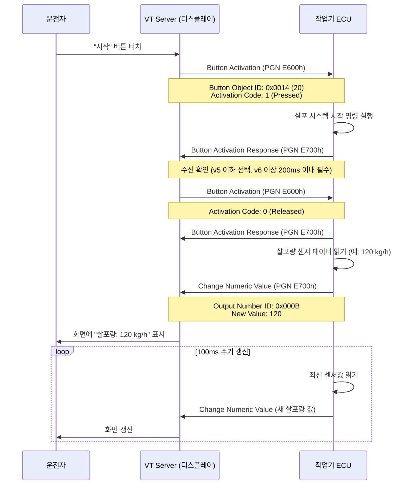
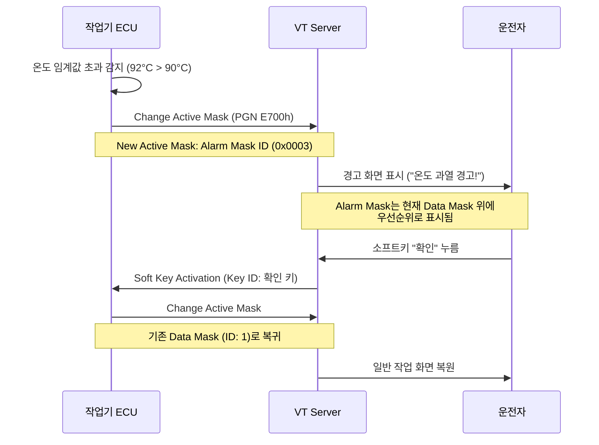

# VT 명령어와 상호작용

::: info 학습 목표
- VT → ECU 방향과 ECU → VT 방향 명령어의 차이를 구분할 수 있다.
- 주요 명령어의 이름, PGN, 용도를 설명할 수 있다.
- 매크로의 개념과 이벤트 바인딩 방식을 이해한다.
- 버튼 클릭부터 화면 갱신까지 전체 상호작용 흐름을 추적할 수 있다.
- Annex F 명령의 응답 프레임에서 오류 코드 비트를 찾아 해석하고, 응답 목적지·대기·재시도 규칙으로 통신 장애를 진단할 수 있다.
- Macro 레코드와 이벤트-매크로 참조(8비트·16비트)를 바이트로 인코딩할 수 있다.
- AUX-N 할당 시퀀스(Preferred Assignment → Status Enable → Assignment)를 메시지 단위로 설계하고, 할당이 풀리는 원인을 진단할 수 있다.
:::

## 1. VT → ECU 명령어

VT Server가 사용자 입력이나 화면 상태 변화를 작업기 ECU(VT Client)에게 알리는 메시지이다. ECU는 이 메시지를 수신해 작업 제어 로직을 실행한다.

모든 VT→ECU 메시지는 **목적지 지정(destination-specific)** 방식으로 전송되며, PGN <strong>0xE600</strong>(58880)을 사용한다. 반대 방향인 ECU→VT 메시지에는 별도의 PGN <strong>0xE700</strong>(59136)이 예약되어 있다.

| 명령어 이름 | PGN | 트리거 조건 | 주요 데이터 |
|-------------|-----|-------------|-------------|
| **Soft Key Activation** | E600h | 소프트키(Key 오브젝트) 누름/뗌 | Key Object ID, 활성화 코드 (Pressed/Released/Held) |
| **Button Activation** | E600h | Button 오브젝트 누름/뗌 | Button Object ID, 활성화 코드 |
| **Pointing Event** | E600h | 터치스크린 탭/드래그 | X 좌표, Y 좌표, 터치 타입 |
| **VT Select Input Object** | E600h | 입력 필드 포커스 변경 (운전자 조작·ESC에 의한 것만. ECU가 Select Input Object 명령으로 요청한 변경은 통지하지 않음) | Input Object ID |
| **VT ESC Message** | E600h | ESC 키 입력 (입력 취소) | Input Object ID |
| **VT Change Numeric Value** | E600h | 운전자가 Input Number·Input List·Input Boolean 등에 숫자 값 입력 완료 | Object ID, 새 값 |
| **VT Change String Value** | E600h | 운전자가 Input String에 문자열 입력 완료 | Object ID, 새 문자열 |
| **VT Change Active Mask** | E600h | 표시하려는 마스크·Key Group에서 누락 오브젝트 참조나 오류 감지 시 (심각한 오류면 풀 삭제까지 통지) | 마스크 Object ID, 에러 코드, 오류 오브젝트 ID |
| **VT On User-Layout Hidden or Shown** | E600h | 사용자 레이아웃 표시 상태 변경 | Object ID, 상태 |

운전자가 입력 필드에 값을 넣으면 <strong>VT Change Numeric Value / VT Change String Value message</strong>가 새 값을 ECU에 전달한다. 버튼 이벤트와 함께 사용자 입력이 ECU에 도달하는 핵심 경로다. 입력 오브젝트가 변수(Variable)를 참조하면 메시지에는 입력 오브젝트가 아니라 <strong>변수 오브젝트의 Object ID</strong>가 실린다. 한편 화면 전환 상태를 알고 싶다면 VT Change Active Mask(오류 통지용)가 아니라 <strong>VT Status message</strong>(활성 Working Set과 표시 중인 마스크 ID를 담아 초당 1회 브로드캐스트)를 참조해야 한다.

### Activation Code 상세

Button Activation과 Soft Key Activation의 `활성화 코드`는 다음 값을 가진다.

| 코드 | 의미 |
|------|------|
| 0 | Released (눌렀다 뗌) |
| 1 | Pressed (누름) |
| 2 | Held (길게 누르는 중, 반복 전송) |
| 3 | Aborted (누르다 취소) |

홀드 중에는 activation 메시지가 <strong>200 ms</strong>마다 반복 전송되며, Working Set은 메시지 간격이 300 ms를 넘으면 키가 릴리스된 것으로 처리해야 한다. 메시지에는 Object ID·활성화 코드 외에 Parent Object ID(표시 중인 마스크 또는 Key Group)와 key code(소프트키 코드 0은 알람 ACK 전용)도 실린다.

### Activation 응답 규칙과 TAN

Activation 메시지에는 ECU가 같은 내용을 반향(echo)하는 response가 정의되어 있다. v5 이하 조합에서는 응답이 선택이지만, <strong>v6 이상에서는 200 ms 이내 응답이 필수</strong>다. 300 ms 안에 응답이 없으면 VT는 최대 3회 재시도하고, 그래도 응답이 없으면 해당 Working Set의 unexpected shutdown으로 취급한다. v6부터는 메시지에 실리는 4비트 <strong>TAN(Transaction Number)</strong>으로, 빠르게 연속 발생할 수 있는 메시지-응답 쌍을 짝맞춘다.

## 2. ECU → VT 명령어

작업기 ECU(VT Client)가 VT Server로 전송하는 명령어이다. 센서 데이터 갱신, 화면 전환, 오브젝트 속성 변경 등에 사용된다.

ECU → VT 명령어는 <strong>PGN 0xE700</strong>(59136) 목적지 지정 메시지로 전송된다. 모든 명령에는 에러 코드를 담은 response가 정의되어 있으며, 송신자는 응답을 받은 뒤 다음 명령을 보내는 것이 원칙이다. 단, <strong>1.5초</strong> 안에 응답이 없으면 다음 명령을 보낼 수 있다.

### 값 갱신 명령어

| 명령어 이름 | 대상 오브젝트 | 설명 |
|-------------|---------------|------|
| **Change Numeric Value** (A8h) | Output Number, Input Number, 변수 등 | 숫자 값을 새 값으로 갱신 |
| **Change String Value** (B3h) | Output String, Input String | 문자열 값을 새 값으로 갱신 |
| **Change List Item** (B1h) | Input List, Output List | 목록의 특정 항목을 변경 |

### 화면 전환 명령어

| 명령어 이름 | 설명 |
|-------------|------|
| **Change Active Mask** (ADh) | Working Set의 활성 Data Mask 또는 Alarm Mask를 교체 |
| **Change Soft Key Mask** (AEh) | Data Mask에 연결된 Soft Key Mask를 교체 |

### 속성 변경 명령어

| 명령어 이름 | 설명 |
|-------------|------|
| **Change Attribute** (AFh) | AID(Attribute ID)가 부여된 속성(배경색, 폭·높이 등)을 런타임에 변경. 위치는 Change Child Location/Position, 문자열은 Change String Value를 사용 |
| **Change Priority** (B0h) | Alarm Mask의 우선순위를 변경 |
| **Change Size** (A6h) | 오브젝트의 너비/높이를 변경 |
| **Change Child Location** (A5h) | 부모 오브젝트 내 자식 오브젝트의 위치를 상대 이동 |
| **Change Child Position** (B4h) | 부모 오브젝트 좌상단 기준 절대 좌표로 자식 오브젝트의 위치를 변경 (Parent Object ID 함께 지정) |

### 표시 제어 명령어

| 명령어 이름 | 설명 |
|-------------|------|
| **Hide/Show Object** (A0h) | Container 오브젝트의 표시/숨김 제어. 개별 오브젝트를 숨기려면 Container로 묶어야 한다 |
| **Enable/Disable Object** (A1h) | 입력 오브젝트의 활성화/비활성화 |

### Change Numeric Value 메시지 구조 예시


Byte 5~8의 값 크기는 대상 오브젝트 타입에 따라 다르다 — Input Boolean은 1바이트, Meter·Bar Graph류는 2바이트, Input/Output Number·Number Variable은 4바이트이며 미사용 바이트는 0으로 채운다. 위 예시는 4바이트(32bit) 오브젝트 기준이다.

## 3. 매크로 (Macro)

<strong>매크로(Macro)</strong>는 오브젝트 풀에 사전 정의된 **이벤트 기반 자동 동작** 목록이다. 특정 이벤트가 발생하면 VT가 자동으로 매크로를 실행한다. ECU에 메시지를 보내지 않고도 VT 레벨에서 화면 변화를 처리할 수 있어, ECU 부하를 줄이고 반응 속도를 높일 수 있다. 매크로 안에서 실행된 명령에 대해서는 VT가 CAN 버스에 응답(response)을 보내지 않으므로 버스 트래픽도 줄어든다.

### 이벤트 종류

| 이벤트 이름 | 발생 조건 |
|-------------|-----------|
| **On Show** | 오브젝트가 화면에 표시될 때 |
| **On Hide** | 오브젝트가 화면에서 숨겨질 때 |
| **On Enable** | 입력 오브젝트가 활성화될 때 |
| **On Disable** | 입력 오브젝트가 비활성화될 때 |
| **On Change Active Mask** | 활성 마스크가 변경될 때 |
| **On Change Soft Key Mask** | Soft Key Mask가 변경될 때 |
| **On Key Press** | Key 또는 Button이 눌릴 때 |
| **On Key Release** | Key 또는 Button이 해제될 때 |
| **On Change Attribute** | 오브젝트 속성이 변경될 때 |
| **On Change Value** | Change Numeric/String Value 명령으로 값이 변경될 때 |
| **On Input Field Selection** | 입력 필드가 선택될 때 |
| **On ESC** | ESC 이벤트 발생 시 |
| **On Activate / On Deactivate** | Working Set이 활성/비활성이 될 때 |

### 매크로 바인딩 XML 예시

아래는 "설정 화면" 버튼을 누를 때 Active Mask를 ID 2(설정 화면)로 변경하는 매크로이다.

```xml
<!-- 매크로 정의: Active Mask를 ID 2로 변경 -->
<macro id="50">
  <change_active_mask working_set_id="0" new_active_mask="2" />
</macro>

<!-- Button에 이벤트 바인딩 -->
<button id="20"
        width="100" height="40"
        background_colour="7"
        border_colour="8"
        key_code="1">
  <macro_ref event_id="24" macro_id="50" />
  <!-- event_id 24 = On Key Press -->
  <outputstring id="21" ... value="설정" />
</button>
```

매크로 내에서는 여러 명령을 순차적으로 나열할 수 있다.

```xml
<macro id="51">
  <!-- 순차 실행: 경고 컨테이너 표시 후 Output String 21의 배경색(AID 3)을 빨강(12)으로 변경 -->
  <show_hide_object object_id="60" value="show" />
  <change_attribute object_id="21"
                    attribute_id="3"
                    value="12" />
</macro>
```

## 4. VT 상호작용 시퀀스

사용자가 VT의 "시작" 버튼을 클릭했을 때, 살포 시스템이 시작되고 화면의 상태값이 갱신되는 전체 흐름이다.



### Alarm Mask 전환 예시 (경고 발생 시)



::: tip 핵심 정리
- VT → ECU 메시지는 사용자 입력 이벤트(버튼, 소프트키, 터치, ESC)와 입력값(VT Change Numeric/String Value message)을 ECU에 전달한다.
- ECU → VT 명령어는 화면 값 갱신(Change Numeric/String Value), 화면 전환(Change Active Mask), 속성 변경에 사용되며, 응답을 받은 뒤 다음 명령을 보낸다(1.5초 타임아웃).
- VT→ECU 메시지는 PGN E600h(58880), ECU→VT 명령어는 PGN E700h(59136) — 모두 목적지 지정(destination-specific) 방식이다.
- 매크로는 오브젝트 풀에 사전 정의된 이벤트 기반 자동 동작으로, ECU 개입 없이 VT 레벨에서 실행된다.
- 버튼 클릭 → Button Activation → ECU 처리 → Change Numeric Value → 화면 갱신이 기본 상호작용 패턴이다.
:::

## 5. 운전자 조작 따라가기

앞 절들이 명령어를 개별 항목으로 나열했다면, 여기서는 운전자가 화면을 실제로 조작할 때 오가는 메시지를 <strong>시간순으로 8바이트까지</strong> 끝까지 따라간다. 시나리오는 4단계로 이루어진다.

1. 운전자가 소프트키를 누른다
2. 그 소프트키에 연결된 동작으로 작업기가 화면을 전환한다
3. 운전자가 입력 필드에 숫자를 입력한다
4. 작업기가 표시값을 갱신한다

Object ID는 §3의 매크로 예시(`working_set_id="0"`, `new_active_mask="2"`)와 §4의 다이어그램(Output Number ID `0x000B`, "살포량" 표시값)에서 쓴 값을 그대로 이어받는다. 운전자가 소프트키로 설정 화면을 연 뒤, 입력 필드에 살포량 목표치 <strong>150</strong>을 입력해 확정하면 작업기가 같은 Output Number(`0x000B`)를 150으로 갱신하는 흐름이다.

### 1) 운전자가 소프트키를 누른다

소프트키 Object ID는 `0x0032`(50), 부모는 현재 표시 중인 Data Mask `0x0001`(1), 소프트키 코드는 `5`다. v6 이상이므로 Byte 8의 상위 니블에 TAN이 실린다.

| 시각 | 방향 | PGN | 8바이트 hex | 의미 |
|---|---|---|---|---|
| t=0 ms | VT→ECU | E600h | `00 01 32 00 01 00 05 1F` | Soft Key Activation, code=1(Pressed), Key ID=0x0032, TAN=1 |
| t=5 ms | ECU→VT | E700h | `00 01 32 00 01 00 05 1F` | 응답 — 명령 필드 그대로 반향 |
| t=180 ms | VT→ECU | E600h | `00 00 32 00 01 00 05 2F` | Soft Key Activation, code=0(Released), TAN=2 |
| t=185 ms | ECU→VT | E700h | `00 00 32 00 01 00 05 2F` | 응답 |

누름부터 뗌까지 180 ms로 <strong>200 ms 홀드 반복 주기</strong>보다 짧기 때문에 code=2(Still held) 프레임은 한 번도 나오지 않는다. 릴리스는 상태 변화(code 0)로 명시적으로 통지되며, TAN이 1에서 2로 바뀐 것도 "새 상태 변화 이벤트"이기 때문이다 — 같은 상태를 재전송(재시도)할 때는 TAN을 바꾸지 않는다.

### 2) 작업기가 화면을 전환한다

작업기는 소프트키 릴리스 응답을 받은 뒤 이 소프트키에 매크로가 아니라 직접 로직으로 바인딩된 동작을 실행한다고 가정한다 — Working Set `0x0000`의 Active Mask를 설정 화면(`0x0002`)으로 바꾼다.

| 시각 | 방향 | PGN | 8바이트 hex | 의미 |
|---|---|---|---|---|
| t=190 ms | ECU→VT | E700h | `AD 00 00 02 00 FF FF FF` | Change Active Mask 명령, WS ID=0x0000, 새 Active Mask=0x0002 |
| t=195 ms | VT→ECU | E600h | `AD 02 00 00 FF FF FF FF` | 응답 — 새 Active Mask 반향(Byte 2,3), Error Code=0(Byte 4) |

여기서 방향이 뒤집힌다는 점이 핵심이다. 1)단계는 VT가 보내는 <strong>message</strong>라 E600h를 쓰지만, 2)단계는 ECU가 보내는 <strong>command</strong>라 E700h를 쓴다. 같은 function code(0xAD)가 명령(E700h)과 응답(E600h)에 함께 쓰이므로, 명령인지 응답인지는 어느 PGN(방향)에 실렸는지로 갈린다. 두 PGN은 Annex가 아니라 방향(VT→ECU, ECU→VT)에 배정되어 있다(Part 6 C.1, Table A.5).

### 3) 운전자가 입력 필드에 숫자를 입력한다

설정 화면의 Input Number 오브젝트(`0x0028`)를 운전자가 탭해 포커스·편집을 열고, 150을 입력해 확정한 뒤 다른 곳으로 포커스를 옮겨 닫는다.

| 시각 | 방향 | PGN | 8바이트 hex | 의미 |
|---|---|---|---|---|
| t=4000 ms | VT→ECU | E600h | `03 28 00 01 01 FF FF 3F` | VT Select Input Object, Object ID=0x0028, Selection=1(선택), Byte5 bit0=1(입력용으로 열림), TAN=3 |
| t=4005 ms | ECU→VT | E700h | `03 28 00 01 01 FF FF 3F` | 응답 |
| t=8500 ms | VT→ECU | E600h | `05 28 00 4F 96 00 00 00` | VT Change Numeric Value, Object ID=0x0028, TAN=4, 값=150(0x96, 4바이트 LE) |
| t=8505 ms | ECU→VT | E700h | `05 28 00 4F 96 00 00 00` | 응답 — 값을 그대로 반향 |
| t=8510 ms | VT→ECU | E600h | `03 28 00 00 00 FF FF 5F` | VT Select Input Object, Selection=0(선택 해제), TAN=5 |
| t=8515 ms | ECU→VT | E700h | `03 28 00 00 00 FF FF 5F` | 응답 |

VT Change Numeric Value는 "값이 실제로 바뀌었는지와 무관하게" 확정 시점에 전송된다. 입력을 취소했다면 이 메시지 대신 VT ESC message(function 4)가 나갔을 것이다. Select Input Object가 열림→닫힘 두 번 나오는 이유는 §H.8의 규칙대로 이 메시지가 포커스 획득·상실을 각각 알리기 때문이며, 운전자가 값을 입력하는 동안(=닫히기 전)에는 편집이 끝나지 않은 상태다.

### 4) 작업기가 표시값을 갱신한다

작업기는 입력이 확정된 것을 확인한 뒤(Select 닫힘 응답까지 받은 뒤), §4에서 다루었던 Output Number `0x000B`를 새 값 150으로 갱신한다.

| 시각 | 방향 | PGN | 8바이트 hex | 의미 |
|---|---|---|---|---|
| t=8520 ms | ECU→VT | E700h | `A8 0B 00 FF 96 00 00 00` | Change Numeric Value 명령, Object ID=0x000B, Byte4 Reserved=FF, 값=150 |
| t=8525 ms | VT→ECU | E600h | `A8 0B 00 00 96 00 00 00` | 응답 — Error Code=0(Byte 4), 값 반향 |

::: tip 이 흐름에서 확인되는 규칙
- <strong>방향이 PGN을 정한다</strong>: 표의 왼쪽 절반(1·3단계, VT가 발신)은 항상 E600h, 오른쪽 절반(2·4단계, ECU가 발신)은 항상 E700h다. Soft Key Activation(0x00)과 VT Select Input Object(0x03)·VT Change Numeric Value(0x05)는 Annex H의 message이고, Change Active Mask(0xAD)·Change Numeric Value(0xA8)는 Annex F의 command다 — 같은 "명령-응답" 짝이라도 어느 Annex에 속하는지에 따라 발신 방향과 PGN이 고정된다.
- <strong>명령-응답 규칙</strong>: 표의 모든 프레임에 응답이 따라붙고, 다음 프레임은 그 응답 이후에만 나간다. Annex F 명령(2·4단계)은 1,5 s 안에 응답이 없으면 다음 명령을 보낼 수 있고, Annex H activation(1·3단계, v6 이상)은 200 ms 이내 응답이 필수이며 300 ms 안에 안 오면 최대 3회 재시도한다.
- <strong>TAN</strong>은 Annex H message에만 실린다 — Soft Key Activation은 Byte 8의 상위 니블, VT Select Input Object도 Byte 8의 상위 니블, VT Change Numeric Value는 Byte 4의 상위 니블이다. Annex F 명령·응답(2·4단계)에는 TAN이 없다 — 이 쌍은 애초에 겹쳐 발생할 일이 드물고 순차적으로 처리되기 때문이다.
- <strong>홀드·릴리스</strong>: 1)단계처럼 누름-뗌 간격이 200 ms 미만이면 "Still held(code 2)" 프레임 없이 곧바로 릴리스로 끝난다. 반대로 200 ms를 넘겨 누르고 있으면 그 사이 code=2 프레임이 200 ms 간격으로 반복되고, Working Set은 이 반복이 300 ms 넘게 끊기면 릴리스로 간주해야 한다.
:::

:::info 원문 대조: 꼬리 니블과 예약 바이트
TAN을 싣는 바이트의 <strong>하위 4비트</strong>는 Soft Key Activation(H.2)뿐 아니라 VT Select Input Object(H.8)·VT Change Numeric Value(H.12)에서도 원문이 "Bits 3~0 Reserved, set to F16"으로 규정한다. 위 표의 `Fh`는 이 규정을 따른 값이다. Change Active Mask 명령·응답의 꼬리 바이트도 F.34(Byte 6~8)·F.35(Byte 5~8)에 Reserved FF16으로 명시되어 있다.
:::

:::details 파이썬으로 14개 프레임 검산해 보기
```python
def tan_byte(tan, low_nibble=0xF):
    return ((tan & 0xF) << 4) | (low_nibble & 0xF)

def le(value, nbytes):
    return [(value >> (8 * i)) & 0xFF for i in range(nbytes)]

def hx(bs):
    return " ".join(f"{b:02X}" for b in bs)


# 1) Soft Key Activation (H.2~H.3, VT function=0)
key_obj, parent_mask, key_code = 0x0032, 0x0001, 0x05

press = [0x00, 0x01] + le(key_obj, 2) + le(parent_mask, 2) + [key_code, tan_byte(1)]
release = [0x00, 0x00] + le(key_obj, 2) + le(parent_mask, 2) + [key_code, tan_byte(2)]

# 2) Change Active Mask (F.34~F.35, VT function=173=0xAD)
ws_obj, new_mask = 0x0000, 0x0002
cam_cmd = [0xAD] + le(ws_obj, 2) + le(new_mask, 2) + [0xFF, 0xFF, 0xFF]
cam_resp = [0xAD] + le(new_mask, 2) + [0x00] + [0xFF, 0xFF, 0xFF, 0xFF]

# 3) VT Select Input Object (H.8~H.9, function=3) + VT Change Numeric Value (H.12~H.13, function=5)
input_obj, new_val = 0x0028, 150
sel_open = [0x03] + le(input_obj, 2) + [0x01, 0x01, 0xFF, 0xFF, tan_byte(3)]
cnv_msg = [0x05] + le(input_obj, 2) + [tan_byte(4)] + le(new_val, 4)
sel_close = [0x03] + le(input_obj, 2) + [0x00, 0x00, 0xFF, 0xFF, tan_byte(5)]

# 4) Change Numeric Value command (F.22~F.23, VT function=168=0xA8)
disp_obj = 0x000B
cnv_cmd = [0xA8] + le(disp_obj, 2) + [0xFF] + le(new_val, 4)
cnv_cmd_resp = [0xA8] + le(disp_obj, 2) + [0x00] + le(new_val, 4)

frames = [press, press, release, release, cam_cmd, cam_resp,
          sel_open, sel_open, cnv_msg, cnv_msg, sel_close, sel_close,
          cnv_cmd, cnv_cmd_resp]

for f in frames:
    assert len(f) == 8
print(hx(press))      # 00 01 32 00 01 00 05 1F
print(hx(cam_cmd))    # AD 00 00 02 00 FF FF FF
print(hx(cnv_msg))    # 05 28 00 4F 96 00 00 00
print(hx(cnv_cmd))    # A8 0B 00 FF 96 00 00 00
print("14 frames, all 8 bytes: OK")
```
:::

## 6. 명령-응답 공통 규칙

2절은 명령의 이름과 용도를 나열했다. VT Client를 구현하거나 VT Server를 에뮬레이션해 보면, 명령 하나하나의 세부보다 <strong>모든 명령에 공통으로 걸리는 규칙</strong>에서 먼저 틀리기 쉽다. 이 절은 그 공통 틀을 잡고, 7절에서 명령별 세부로 내려간다. 메시지 전체의 바이트 표는 [ISO 11783-6 부록](/study/isobus/appendix-iso-part06)에 있고, 여기서는 학습 흐름과 구현 함정 위주로 본다. 근거는 ISO 11783-6:2018(이하 Part 6)이다.

### 첫 바이트는 VT function 코드다

VT 메시지의 Byte 1은 항상 <strong>VT function</strong> 코드다. 원문 표는 이 바이트를 상위 4비트(Command)와 하위 4비트(Parameter)로 나눠 적는다. Change Numeric Value는 168 = `0xA8`, 즉 Command `1010`·Parameter `1000`이다(Part 6 F.22). 코드 공간은 대략 다음처럼 나뉜다(Part 6 Table A.5).

| Byte 1 범위 | 메시지 묶음 | 정의 위치 |
|---|---|---|
| `00`~`0A` | VT가 먼저 보내는 activation 메시지와 그 응답 | Annex H |
| `11`, `12` | Object pool transfer, End of Object Pool | Annex C |
| `20`~`27` | Auxiliary control | Annex J |
| `60`~`7F` | 제조사 고유 명령(제조사가 다르면 쓰지 않도록 권고) | Table A.5 |
| `90`, `92`, `A0`~`BA`, `BC`~`BE` | Working Set이 보내는 명령과 그 응답 | Annex F |
| `BB`, `C0`~`C7` | 기술 데이터 메시지(Identify VT 포함) | Annex D |
| `D0`~`D6`, `DF`, `E0` | 비휘발성 메모리 | Annex E |
| `FD`~`FF` | 상태 메시지 | Annex G |

같은 function 코드가 명령과 응답에 함께 쓰인다는 점이 중요하다. `0xAD`는 Change Active Mask 명령(ECU→VT, PGN 59136(0xE700))이면서 그 응답(VT→ECU, PGN 58880(0xE600))이기도 하다. 그래서 수신 측은 Byte 1만 보고 분기하면 안 되고, <strong>PGN(방향)과 Byte 1을 함께</strong> 봐야 한다.

두 PGN은 Group Function 메시지다. 첫 바이트에 모르는 코드나 예약 코드가 오면, v5부터는 받은 쪽이 Unsupported VT Function 메시지(G.4, WS→VT)나 VT Unsupported VT Function 메시지(G.5, VT→WS)로 알려야 한다. v4 이하에서는 이 동작이 정의되지 않았다(Part 6 C.1). 두 PGN의 기본 우선순위는 5이고, v5 이하 문서에는 7로 적혀 있었다(C.1). VT↔ECU 메시지 중 8바이트로 정의되지 않은 것은 모두 `FF`로 8바이트까지 채운다(4.6.26).

### 응답은 상태가 아니라 명령을 비춘다

Annex F의 공통 규칙은 F.1 한 절에 모여 있다.

- Working Set Master뿐 아니라 member도 Annex F 명령을 보낼 수 있다. 반면 Annex C의 오브젝트 풀 전송 명령은 Master만 보낼 수 있다(C.1).
- VT는 그 Working Set의 오브젝트 풀이 아직 로드되지 않았어도 Annex F 명령에 응답해야 한다.
- 응답에 명령과 같은 필드가 있으면 그 값은 <strong>명령에서 받은 값 그대로</strong> 돌려준다. 응답은 오브젝트의 현재 상태가 아니라 받은 명령을 비춘다.

원문 예가 이 규칙을 잘 보여 준다. disable할 수 없는 상태의 오브젝트에 Enable/Disable Object(disable)를 보내면 오브젝트는 enabled로 남는다. 그래도 응답 Byte 4는 0(disable)이고, Error Code가 실패 원인을 알린다.

::: warning 응답 값으로 화면 상태를 미러링하지 않는다
응답의 값 필드를 그대로 받아 내부 상태를 갱신하면, 실패한 명령도 성공한 것처럼 반영된다. 상태는 Error Code가 0일 때만 반영한다. 지금 값이 정말 필요하면 v4부터 있는 Get Attribute Value(F.58)로 묻는다.
:::

### 오류 코드 바이트 읽는 법

명령을 실행하다 오류를 찾으면, VT는 응답에 해당하는 오류 코드를 최소 1개 실어야 한다(shall). 오류를 여러 개 찾았으면 전부 싣는 것이 권고다(should)(4.6.29). 오류 코드는 응답의 한 바이트에 비트마스크로 실리고, 0이면 오류가 없다는 뜻이다.

구현에서 걸리는 지점은 두 가지다. 첫째, 오류 바이트의 <strong>위치</strong>가 명령마다 다르다. 응답이 반향하는 필드 바로 뒤에 오기 때문이다. 둘째, "기타 오류(Any other error)" 비트가 대부분 Bit 4지만 예외가 많다.

| 명령(코드) | 오류 바이트 | 기타 오류 비트 | 비고 |
|---|---|---|---|
| Hide/Show Object(`A0`), Enable/Disable Object(`A1`), Select Input Object(`A2`) | Byte 5 | Bit 4 | |
| Change Numeric Value(`A8`), Change Size(`A6`), Change Active Mask(`AD`) | Byte 4 | Bit 4 | |
| Change Font Attributes(`AA`) | Byte 4 | <strong>Bit 5</strong> | Bit 4는 Invalid style |
| Change String Value(`B3`) | <strong>Byte 6</strong> | <strong>Bit 3</strong> | Bit 4는 예약 |
| Change List Item(`B1`) | Byte 7 | Bit 4 | |
| Change Polygon Scale(`B7`) | Byte 8 | Bit 4 | |
| Execute Macro(`BE`) | Byte 3 | <strong>Bit 2</strong> | Execute Extended Macro는 Byte 4 |
| Lock/Unlock Mask(`BD`) | Byte 3 | <strong>Bit 7</strong> | Bit 4~6은 unsolicited 해제 사유 |
| Select Active Working Set(`90`) | Byte 2 | <strong>Bit 7</strong> | |

그래서 오류 해석은 "Byte 4를 읽는다" 같은 고정 규칙이 아니라 function 코드별 표로 구현해야 한다. 7절 끝의 Python 예제가 그 형태다.

v4·v5에서 "값 사용 중(입력 열림)"을 뜻하던 비트는 v6에서 deprecated되어 예약(0)이 되었다. Change Numeric Value의 Bit 2, Change String Value의 Bit 4, Change Attribute와 Change List Item의 Bit 3이 그렇다(F.23·F.25·F.39·F.43 각주, 4.6.10.2). v6 Working Set이라도 v5 이하 VT와 붙으면 이 비트를 받을 수 있으니, 이 비트가 서 있으면 실패로 처리한다.

VT가 지원하지 않는 오브젝트로 명령을 보내도 0이 아닌 오류 코드가 돌아온다. 이때 어느 비트를 세울지는 VT 설계에 달렸다(4.6.28). 원문 예는 Graphics Context 오브젝트를 지원하지 않는 VT에 그 오브젝트로 Change Background Colour를 보내는 경우다.

### 기다림과 재전송


명령을 보낸 쪽은 응답을 받은 뒤에 다음 명령을 보내야 한다(shall). 따로 정하지 않은 한 <strong>1,5 s</strong> 안에 응답이 없으면 다음 명령을 보낼 수 있다(F.1). 이전 명령은 재전송해도 되고 보통 3회를 넘기지 않는다. 다만 재전송이 누적 효과를 내는 명령은 조심해야 한다. 원문이 직접 드는 예가 Change Child Location이다. 상대 이동이라 같은 명령이 두 번 처리되면 두 번 움직인다.

VT 쪽 설계 권고도 있다. VT가 응답 생성을 화면 갱신과 묶어 두면 그리기가 느릴 때 Working Set에서 응답 타임아웃이 난다. 그래서 둘을 분리(decouple)할 수 있는데, 그러면 Working Set이 응답을 받은 시점과 화면에 실제로 반영된 시점이 어긋날 수 있다(F.1). 화면 반영 완료를 확실히 알아야 하는 경우를 위해 Lock/Unlock Mask(7절)가 있다.

반대 방향인 Annex H 활성화 메시지의 규칙은 1절에서 본 대로다. v6 조합에서는 200 ms 안에 응답해야 하고, 300 ms 안에 응답이 없으면 VT가 같은 데이터·같은 TAN으로 최대 3회 재시도한다(H.1). 두 규칙의 차이를 그림 하나로 비교하면 위와 같다.

### 응답은 누구에게 가는가 — 버전 조합별 목적지

명령은 Working Set member도 보낼 수 있다. 그러면 응답은 명령을 보낸 member에게 가야 할까, Master에게 가야 할까? Part 6은 이를 Working Set 버전과 VT 버전의 조합으로 정한다(4.6.2 Table 1). Working Set 버전은 Working Set Maintenance message로, VT 버전은 Get Memory response로 알린다([15장](/study/isobus/15-vt-basics) 참고).

| 구성 | Working Set 버전 | VT 버전 | VT 응답이 가는 곳 |
|---|---|---|---|
| 1 | 3 이하 | 3 이하 | Working Set Master |
| 2 | 3 이하 | 4 이상 | Working Set Master |
| 3 | 4 이상 | 3 이하 | Working Set Master |
| 4 | 4 이상 | 4 이상 | 명령을 보낸 CF(originator) |

구성 1~3에서는 member가 Master 앞으로 가는 목적지 지정 VT 메시지를 전부 엿들어야 자기 명령의 응답을 찾을 수 있다. Master는 member가 보낸 명령의 응답을 요청한 적 없이 받게 되고, 자기 명령과 짝을 맞출 수 없다(4.6.2). 둘 다 4 이상인 구성 4에서야 응답이 보낸 노드로 바로 가고, TP로 오는 응답(예: Get Supported WideChars response)도 쓸 수 있다.

반면 운전자 입력은 버전과 무관하게 항상 Master로 간다. 입력 필드에 들어온 값은 언제나 Working Set Master로 전송되고(4.6.2), Annex H의 activation 메시지도 Master에게 간다(H.1). Master 전용 명령을 member가 보내면 VT는 Acknowledgement:NACK로 응답한다(4.6.2).

::: tip SIL 에뮬레이터에서 확인할 점
VT Server를 에뮬레이션할 때는 응답을 보내기 전에 "이 Working Set의 Maintenance 버전"과 "내가 Get Memory response로 알린 버전"을 함께 보고 목적지를 정해야 한다. 구성 4만 구현해 두면 v3 이하 Working Set의 가정이 깨진다. 그런 Working Set의 member는 Master 주소로 오는 응답을 엿듣도록 만들어졌으므로, 응답을 member 주소로 보내면 그 경로로 응답을 찾지 못할 수 있다.
:::

### VT Status의 busy 표시

VT가 지금 무엇을 하고 있는지는 VT Status message의 Byte 7(busy codes)과 Byte 8에 나온다(G.2).

| Byte 7 비트 | 의미 | 도입 |
|---|---|---|
| Bit 0 | 표시 중인 마스크 갱신 중 | |
| Bit 1 | 비휘발성 메모리에 저장 중 | |
| Bit 2 | 명령 실행 중 | |
| Bit 3 | Macro 실행 중 | |
| Bit 4 | 오브젝트 풀 파싱 중 | v3 |
| Bit 6 | Auxiliary controls learn mode 활성 | v3 |
| Bit 7 | 메모리 부족 | |

Byte 8에는 지금 실행 중인 명령의 function 코드가 실린다. 이 값은 Bit 2나 Bit 3이 서 있을 때만 유효하고, 실행 중인 것이 없으면 `FF`다. 예를 들어 `FE 81 01 00 10 00 04 A8`은 "SA `0x81`의 Working Set이 VT를 소유하고, Data Mask `0x0001`과 Soft Key Mask `0x0010`이 보이며, 지금 Change Numeric Value(`A8`)를 실행 중"이라는 뜻이다.

여기서 전송 조건을 같이 봐야 한다. VT Status는 Byte 2~6이 바뀌거나 <strong>Byte 7의 Bit 6</strong>이 바뀔 때, 그리고 초당 1회 보낸다. 최대 빈도는 초당 5회다(G.2). 다른 busy 비트가 바뀌는 것으로는 즉시 전송되지 않는다. 그래서 Working Set이 보는 busy 비트는 1초 간격의 표본일 뿐이다. 흐름 제어는 busy 비트가 아니라 응답으로 해야 하고, busy 비트는 "VT가 왜 느린가"를 진단하는 단서로 쓴다. Bit 6만 즉시 전송 조건에 들어간 이유는 AUX learn mode(13절)에서 기능 Working Set들이 이 비트를 보고 동작을 멈춰야 하기 때문으로 보인다(추론).

### 화면 갱신의 원칙

CAN 대역폭과 VT의 처리 능력은 모든 Working Set이 나눠 쓰는 자원이다. 그래서 Part 6은 다음을 권고한다(4.6.10.1, should).

- active Working Set, 또는 inactive지만 보이는 Working Set은 운전자에게 보이는 변화가 있을 때만 명령을 보낸다.
- 표시 중인 Data Mask·Soft Key Mask가 없는 inactive Working Set은 갱신 빈도를 줄이거나 갱신을 멈춘다.

4절 다이어그램의 "100 ms 주기 갱신"은 예시일 뿐이고, 값이 바뀌지 않았으면 보내지 않는 편이 권고에 맞다. 그 밖의 규칙은 다음과 같다.

- 속성에는 AID(Attribute ID)가 붙어 있다. 읽기 전용이 아니면 Change Attribute로 바꿀 수 있고, 효율을 위해 여러 속성을 한 번에 바꾸는 전용 명령(Change Font Attributes 등)도 있다(4.6.10.2).
- 해당 Data Mask가 보이지 않아도 속성과 값은 바꿀 수 있다. 나중에 마스크가 활성화될 때 최신 데이터가 준비되어 있게 하려는 것이다(4.6.10.2).
- 런타임에 오브젝트를 교체할 수 있지만 <strong>같은 타입</strong>으로만 바꿀 수 있다. 이미 있는 Object ID로 오브젝트를 TP로 보내면 기존 것이 교체되고, VT는 소스 주소로 소유자를 판단한다. 크기가 바뀌는 교체도 허용되지만 VT 메모리가 부족해질 수 있다(4.6.10.3).
- 오브젝트 하나만 지우는 명령은 없다. Delete Object Pool로 풀 전체를 지운 뒤, 그 오브젝트를 뺀 풀을 다시 올려야 한다(4.6.10.3).

## 7. Annex F 명령 세부 — 기능별로 묶어 보기

이 절은 2절 표에 없는 세부, 곧 바이트 배치·오류 비트·구현 함정만 다룬다. 예시 Object ID는 5절과 같은 풀(Working Set `0x0000`, Data Mask `0x0001`·`0x0002`, Output Number `0x000B`, Input Number `0x0028`)을 이어 쓴다. 모든 명령은 ECU→VT(PGN 59136(0xE700)), 응답은 VT→ECU(PGN 58880(0xE600))이다.

### 표시·입력 제어: Hide/Show, Enable/Disable, Select Input Object, ESC

<strong>Hide/Show Object(`A0`, F.2~F.3)</strong>는 Container 오브젝트만 대상으로 한다. 가시성뿐 아니라 Container가 기억하는 hidden/shown 상태도 바꾼다.

| 프레임 | 바이트 | 의미 |
|---|---|---|
| 명령 | `A0 64 00 00 FF FF FF FF` | Container `0x0064`를 Hide(Byte 4 = 0) |
| 응답(성공) | `A0 64 00 00 00 FF FF FF` | Byte 2~4 반향, Byte 5 = 0 |
| 응답(실패) | `A0 64 00 00 02 FF FF FF` | Byte 5 Bit 1 = Invalid Object ID |

오류 Bit 0(누락된 child 참조)은 VT가 바로 보고해도 되고, Container가 실제로 보일 때까지 검사를 미뤘다가 VT Change Active Mask message(H.14)로 보고해도 된다(F.3 각주). Working Set은 두 경로를 모두 처리해야 한다. 이미 숨겨진 Container에 Hide를 다시 보내도 유효한 명령이므로 On Hide 매크로가 실행된다(4.6.22.1 EXAMPLE 4).

<strong>Enable/Disable Object(`A1`, F.4~F.5)</strong>는 입력 필드와 Button, 그리고 Animation 오브젝트에 쓴다. Button의 enable/disable은 v4부터다. 이미 enabled인 오브젝트를 다시 enable해도 응답은 "no errors"이고 매크로도 실행된다. 응답 Byte 5 Bit 3(완료 불가)은 그 입력 오브젝트를 운전자가 지금 편집 중이라는 뜻이다. 9절의 상태 기계에서 "Data input 중 포커스 오브젝트 disable"이 이 경우다.

::: warning 원문 표의 오타
F.5(Enable/Disable Object response) 표는 Byte 1을 "VT function = 160"으로 인쇄했다. 그러나 같은 표의 비트 값(`1010`/`0001`)과 Table A.5는 161(`0xA1`)이다. 160은 Hide/Show의 코드이므로 구현은 `0xA1`을 따른다.
:::

<strong>Select Input Object(`A2`, F.6~F.7)</strong>는 Working Set이 포커스를 강제로 옮기는 명령이다. 설정 마법사처럼 운전자의 주의를 특정 필드로 끌 때 쓴다(4.6.17).

| 바이트 | 명령 | 응답 |
|---|---|---|
| 2, 3 | Object ID. NULL이면 포커스 제거(이때 Byte 4는 `FF`) | 반향 |
| 4 | Option: `FF` = 포커스만 설정, `00` = 데이터 입력용으로 열기(v4부터. Button·Key에는 무효) | Response: 0 = 선택 안 됨(NULL이거나 오류), 1 = 선택됨, 2 = 편집용으로 열림(v4부터) |
| 5 | Reserved `FF` | 오류: Bit 0 disabled, Bit 1 Invalid Object ID, Bit 2 활성 마스크에 없거나 숨긴 Container 안, Bit 3 다른 필드 입력 중이거나 Button·Soft Key가 눌린 채 유지 중, Bit 4 기타, Bit 5 Invalid Option(v4부터) |

Input Number `0x0028`을 열려면 `A2 28 00 00 FF FF FF FF`를 보낸다. 성공하면 `A2 28 00 02 00 FF FF FF`(Byte 4 = 2, 열림)가 오고, 운전자가 다른 필드를 편집 중이면 `A2 28 00 00 08 FF FF FF`(Byte 5 Bit 3)가 온다. 구현에서 조심할 점은 세 가지다.

- 입력용으로 열어도 값은 바뀌지 않는다. Input Boolean도 토글되지 않는다(F.6 NOTE 1).
- Working Set이 이 명령으로 바꾼 포커스는 VT Select Input Object message(H.8)로 통지되지 않는다(H.8 NOTE 1). 포커스 상태는 이 응답으로 직접 갱신해야 한다.
- 화면 밖에 있거나 폭·높이가 0인 오브젝트도, enabled이고 숨긴 Container 안이 아니면 선택·열기가 모두 가능하다. 오류가 아니다(F.7 NOTE). 같은 오브젝트가 한 마스크에 여러 번 들어 있으면 어느 인스턴스가 선택될지는 VT 재량이다(F.6).

<strong>ESC(`92`, F.8~F.9)</strong>는 Working Set이 운전자 입력을 강제로 중단시키는 명령이다. 명령은 `92 FF FF FF FF FF FF FF`로 파라미터가 없다. 응답 Byte 2~3에는 입력이 중단된 Object ID가 실리고(예: `92 28 00 00 FF FF FF FF`), 열려 있는 입력이 없으면 Byte 4 Bit 0이 선다. ESC는 Macro 안에서 쓸 수 없는 몇 안 되는 Annex F 명령이다(Table A.5).

### 소리: Control Audio Signal, Set Audio Volume

VT는 반드시 음향 경보 수단을 갖춰야 한다. 단순 on/off 부저여도 되고, 주파수와 음량을 바꿀 수 있는 부품이어도 된다(4.3). 어느 쪽인지는 Get Hardware response의 Byte 4로 알 수 있다. Bit 2가 다중 주파수, Bit 3이 음량 조절 지원이다(D.9).

<strong>Control Audio Signal(`A3`, F.10~F.11)</strong>의 구조는 다음과 같다.

| 바이트 | 내용 |
|---|---|
| 2 | Activations: 0 = 이 Working Set이 낸 소리를 멈춤(주파수·시간 무시), 1~255 = 울림 횟수 |
| 3, 4 | 주파수(Hz). VT가 낼 수 없는 범위면 VT가 가능한 범위로 제한 |
| 5, 6 | On-time(ms). 0이 아니면서 VT 분해능보다 짧으면 VT의 최소 단위로 맞춤 |
| 7, 8 | Off-time(ms). On-time이 0이면 무시하고 0을 씀 |

2000 Hz로 100 ms 울리고 100 ms 쉬기를 3번 하려면 `A3 03 D0 07 64 00 64 00`이다. 동작 규칙은 다음과 같다(F.10).

- 같은 Working Set이 낸 소리가 진행 중이면 새 명령이 그것을 끊고 대체한다. 끊길 때 소리가 잠깐 멈출 수 있다. Alarm Mask에 연결된 소리에는 이 대체 규칙이 적용되지 않는다.
- 연속음은 권고하지 않지만, 255회 × 65 535 ms로 약 278분 동안 울릴 수 있다. 더 길게 필요하면 끝나기 전에 명령을 다시 보낸다.
- 한 번에 한 Working Set의 소리만 낼 수 있는 VT가 다른 Working Set의 소리를 내는 중이면 응답 Byte 2 Bit 0(Audio device busy)을 세운다. 여러 Working Set의 소리를 동시에 낼 수 있는("multisound") VT는 능력 한도까지 받는다.
- 이 명령의 소리는 일반 메시지 처리 지연 이상으로 큐에 쌓이거나 늦춰지면 안 된다.
- active Working Set과 무관하게 동작한다. inactive Working Set도 소리를 낼 수 있다.

<strong>Set Audio Volume(`A4`, F.12~F.13)</strong>은 Byte 2에 운전자가 설정한 최대 음량 대비 퍼센트(0~100 %)를 싣는다. 50 %면 `A4 32 FF FF FF FF FF FF`이다. 보낸 Working Set의 이후 Control Audio Signal에 적용되고, 지금 울리는 소리에도 적용하는 것이 권고다(should). 지금 소리의 음량을 못 바꾸는 VT는 응답에 busy 비트를 세운다. 다른 Working Set의 음량과 Alarm Mask의 음량에는 영향을 주지 않는다. 기본 음량은 v4 이하에서 정의되지 않았고, v5부터 운전자 설정 최대 음량의 100 %다. 따라서 v4 이하 VT에서도 일정한 음량을 원하면 이 명령을 먼저 보내 두는 편이 안전하다(추론). 응답 Bit 1(명령 미지원)은 v5부터 정의된다.

### 위치·크기·색: Change Child Location/Position, Change Size, Change Background Colour, Change End Point

<strong>Change Child Location(`A5`, F.14~F.15)</strong>은 현재 위치에서 상대적으로 옮긴다. 한 오브젝트가 여러 부모에 들어갈 수 있으므로 부모 Object ID를 함께 준다. 이동량은 −127 오프셋으로 인코딩한다. 원시값 0이 −127픽셀, 127이 이동 없음, 255가 +128픽셀이다. 양수는 오른쪽(X)·아래(Y)다.

Data Mask `0x0001` 안의 `0x000B`를 오른쪽으로 10픽셀, 위로 5픽셀 옮기면 X = 127 + 10 = `0x89`, Y = 127 − 5 = `0x7A`이므로 `A5 01 00 0B 00 89 7A FF`가 된다. 응답 Byte 6의 Bit 0은 부모가 없거나 대상의 부모가 아님을, Bit 1은 대상이 없거나 이 명령을 쓸 수 없는 오브젝트임을 뜻한다.

상대 이동이라 메시지가 유실되면 위치가 틀어진 채 남고, 재전송하면 이중으로 움직인다. 정확한 위치가 필요하면 절대 좌표를 쓰는 Change Child Position을 쓰라고 원문이 권고한다(F.14). 부모가 같은 child를 여러 번 포함하면 모든 인스턴스가 함께 움직이고, 부모는 다시 그려진다.

<strong>Change Child Position(`B4`, F.16~F.17)</strong>은 부모 좌상단 기준 절대 좌표를 부호 있는 16비트로 준다. X = 200, Y = −10이면 `B4 01 00 0B 00 C8 00 F6 FF`인데, 길이가 <strong>9바이트</strong>다. CAN 데이터 프레임 하나(8바이트)에 들어가지 않으므로 목적지 지정 TP(CMDT)로 보내야 한다([11장](/study/isobus/11-j1939-transport)). 응답은 8바이트이고 오류 비트 구성은 Change Child Location과 같다.

<strong>Change Size(`A6`, F.18~F.19)</strong>는 `A6 0B 00 78 00 28 00 FF`처럼 Object ID, 폭, 높이를 준다(예: 120×40). 폭이나 높이가 0이면 크기 0으로 취급되어 그려지지 않는다. 응답 오류는 Byte 4 Bit 0(Invalid Object ID)과 Bit 4(기타)뿐이다.

<strong>Change Background Colour(`A7`, F.20~F.21)</strong>는 `A7 01 00 0C FF FF FF FF`처럼 Object ID와 색 인덱스(Annex A.3 팔레트)를 준다. 인덱스 12는 표준 팔레트의 Red다. 응답 Byte 5 Bit 1은 Invalid colour code다.

<strong>Change End Point(`A9`, F.26~F.27)</strong>는 Output Line의 끝점을 폭·높이·Line Direction으로 바꾼다. Byte 2~3이 Object ID, 4~5가 폭, 6~7이 높이, 8이 Line Direction이다. 응답 Byte 4 Bit 1은 Invalid Line Direction이다.

### 값 변경: Change Numeric Value, Change String Value

<strong>Change Numeric Value(`A8`, F.22~F.23)</strong>의 Byte 5~8 값 크기는 대상 타입에 따라 다르다. 리틀 엔디언이고, 쓰지 않는 바이트는 0으로 채운다.

| 값 크기 | 대상 오브젝트 |
|---|---|
| 1바이트 | Input Boolean(TRUE/FALSE), Input List·Output List(v4부터)·Animation(v5부터)의 리스트 인덱스 |
| 2바이트 | Output Meter, Output Linear Bar Graph, Output Arched Bar Graph(정수), Object Pointer·Scaled Graphic(v6부터)의 Object ID |
| 4바이트 | Input Number, Output Number, Number Variable(정수) |
| 2 + 2바이트 | External Object Pointer(v5부터): Byte 5~6 External Reference NAME Object ID, Byte 7~8 참조 대상 Object ID |

원문 F.22 표에서 Animation과 Scaled Graphic의 값 크기는 해당 오브젝트 정의와 대조해 읽어야 한다. Animation의 Value 속성은 1바이트 리스트 인덱스이고, Scaled Graphic의 Value 속성은 2바이트 Object ID다(B.25·B.28).

이 명령은 지정한 오브젝트의 value 속성만 바꾸고, 그 오브젝트가 참조하는 변수는 바꾸지 않는다(F.22). 그런데 Output Number는 Variable reference가 NULL이 아니면 값을 변수에서 읽는다(B.9.3). 두 규정을 합치면 함정이 하나 나온다. <strong>변수를 참조하는 Output Number에 Change Numeric Value를 보내면, 화면에 보이는 값은 여전히 변수에서 오므로 바뀌지 않는다.</strong> 응답에 오류가 없어도 마찬가지다. 이때는 Number Variable 오브젝트의 ID로 보내야 하고, 그러면 그 변수를 참조하는 모든 오브젝트가 한 번에 갱신된다(4.6.11.3).

응답 Byte 4 Bit 1(Invalid value)은 포인터 값을 없는 오브젝트로 바꾸려 할 때만 선다(F.23 각주). 반면 무효 값을 담은 Change Numeric Value는 거부되고 매크로도 실행되지 않는다(4.6.22.1 EXAMPLE 3). 그러니 그 밖의 값 오류가 어느 비트로 표시될지는 원문이 정하지 않은 셈이다. Bit 1이 0이라고 값이 받아들여졌다고 단정하지 말고, Error Code 전체가 0인지를 본다. 업데이트 빈도는 Working Set 재량이지만 4.6.10.1의 대역폭 권고를 고려하라고 원문이 덧붙인다.

<strong>Change String Value(`B3`, F.24~F.25)</strong>는 길이 규칙이 핵심이다.

- Byte 4~5가 보낼 문자열의 바이트 수(2바이트)이고, Byte 6부터 문자열이 온다.
- 한 패킷에 들어가면 TP를 쓰면 안 된다. 헤더가 5바이트이므로 문자열이 3바이트 이하일 때 한 프레임에 들어가고, 남는 바이트는 `FF`로 채운다. "OK"면 `B3 14 00 02 00 4F 4B FF`, "ABC"면 `B3 14 00 03 00 41 42 43`이다. "HELLO"는 10바이트가 되므로 TP로 간다.
- 보내는 문자열은 대상의 length 속성보다 짧아도 된다. 이때 VT가 나머지를 space로 채운다. 길이 속성보다 길게 보내면 안 된다. 이 명령으로 문자열 길이를 늘릴 수는 없다.

응답은 형식이 다르다. Byte 2~3이 Reserved `FF FF`이고 Object ID는 <strong>Byte 4~5</strong>, 오류는 Byte 6이다. 성공하면 `B3 FF FF 14 00 00 FF FF`, 길이 초과면 Byte 6 Bit 2(String too long)가 서서 `B3 FF FF 14 00 04 FF FF`가 된다. 다른 응답처럼 Byte 2~3에서 Object ID를 읽는 파서는 여기서 틀린다. 또 하나의 함정은 길이 필드 크기다. 이 명령의 길이 필드는 2바이트지만, 반대 방향인 VT Change String Value message(H.18)의 길이 필드는 1바이트다(12절).

### 속성 변경: Change Font/Line/Fill Attributes, Change Attribute, Change Priority, Change List Item

<strong>Change Font·Line·Fill Attributes(`AA`·`AB`·`AC`, F.28~F.33)</strong>는 Attribute 오브젝트의 속성을 한 번에 바꾼다. 하나의 Attribute 오브젝트를 여러 오브젝트가 참조하므로, 명령 하나로 그 오브젝트들의 모양이 함께 바뀐다(4.6.11.2).

| 명령 | Byte 4 | Byte 5 | Byte 6~7 | 응답 오류(Byte 4) |
|---|---|---|---|---|
| Change Font Attributes | Font colour | Font size | Byte 6 Font type, Byte 7 Font style | Bit 0 ID, 1 colour, 2 size, 3 type, 4 style, <strong>5 기타</strong> |
| Change Line Attributes | Line colour | Line width | Line Art(16비트 패턴) | Bit 0 ID, 1 colour, 2 width, 4 기타 |
| Change Fill Attributes | Fill type | Fill colour | Fill pattern Object ID | Bit 0 ID, 1 type, 2 colour, 3 pattern ID, 4 기타 |

<strong>Change Attribute(`AF`, F.38~F.39)</strong>는 AID가 붙은 속성을 범용으로 바꾼다. 문자열은 바꿀 수 없다. 오브젝트 정의 표에서 AID가 대괄호로 둘러싸인 속성(예: Output Number의 Value `[12]`)은 읽기 전용이다. 이런 속성은 Get Attribute Value로 읽을 수만 있고 Change Attribute로 쓸 수 없다(A.1.2). Output Number의 값을 바꾸려면 Change Attribute가 아니라 Change Numeric Value를 써야 하는 이유가 이것이다.

값 크기는 데이터 타입을 따른다. Boolean과 Bitmask는 1바이트, Integer는 오브젝트 표에 정한 1·2·4바이트, Float는 4바이트(IEEE 754 단정밀도)다(F.38, A.1.2). 리틀 엔디언으로 보내고 남는 바이트는 0으로 채운다. Output Number `0x000B`의 Scale(AID 8)을 0.1로 바꾸면 0.1의 단정밀도 표현이 `0x3DCCCCCD`이므로 `AF 0B 00 08 CD CC CC 3D`가 된다. 응답 Byte 5의 Bit 1은 Invalid Attribute ID, Bit 2는 Invalid value다.

<strong>Change Priority(`B0`, F.40~F.41)</strong>는 Alarm Mask의 priority 속성(0 = High, 1 = Medium, 2 = Low)을 바꾼다. 받으면 VT는 활성 마스크 전체의 우선순위를 다시 평가하고, 그 결과로 화면이 다른 Working Set으로 넘어갈 수 있다. 응답 Byte 5 Bit 1은 Invalid priority다. 우선순위 규칙은 11절에서 본다.

<strong>Change List Item(`B1`, F.42~F.43)</strong>은 Input List, Output List(v4부터), Animation과 External Object Definition(v5부터)의 리스트 항목을 바꾼다. Byte 4가 0부터 시작하는 인덱스, Byte 5~6이 새 Object ID다. `FFFF`를 주면 그 자리를 빈 항목으로 만든다. Input List `0x0030`의 2번 항목을 `0x0045`로 바꾸면 `B1 30 00 02 45 00 FF FF`, 비우면 `B1 30 00 02 FF FF FF FF`다. 응답 오류는 Byte 7에 있다. Bit 0은 리스트 오브젝트 ID, Bit 1은 인덱스, Bit 2는 새 항목 ID가 잘못됐다는 뜻이다.

### 마스크 전환과 잠금: Change Active Mask, Change Soft Key Mask, Lock/Unlock Mask

<strong>Change Active Mask(`AD`, F.34~F.35)</strong>의 바이트는 5절에서 봤다. 응답에는 Working Set Object ID가 반향되지 않고, Byte 2~3에 <strong>새 Active Mask ID</strong>가 실린다는 점만 기억하면 된다. inactive Working Set도 이 명령으로 자기 active mask를 바꿀 수 있다. 다음에 보이게 될 때 알맞은 마스크가 뜨게 하려는 것이다(4.6.8). Macro 안에서 실행하면 Change Active Mask response는 없지만, 화면이 바뀌므로 VT Status message는 나간다(4.6.11.4).

<strong>Change Soft Key Mask(`AE`, F.36~F.37)</strong>는 Byte 2의 Mask Type(1 = Data, 2 = Alarm), Byte 3~4의 마스크 ID, Byte 5~6의 새 Soft Key Mask ID로 이뤄진다. `AE 01 01 00 10 00 FF FF`는 Data Mask `0x0001`의 Soft Key Mask를 `0x0010`으로 바꾼다. 응답 Byte 6의 Bit 2(Missing Objects)와 Bit 3(마스크 또는 child 오류)은 새 Soft Key Mask 안의 참조 문제를 알린다. 눌려 있던 Soft Key가 이 명령으로 지워질 때의 처리는 10절에서 본다.

<strong>Lock/Unlock Mask(`BD`, F.46~F.47, v4부터)</strong>는 여러 변경을 운전자에게 한 번에 보이게 하는 장치다. 잠근다고 그리기가 멈추는 것은 아니다. 잠금이 풀릴 때까지 변경이 화면에 드러나지 않을 뿐이다.

| 바이트 | 명령 | 응답 |
|---|---|---|
| 2 | 0 = Unlock, 1 = Lock | 반향 |
| 3, 4 | 대상 Data Mask 또는 User-Layout Data Mask ID. 보이는 마스크와 다르면 실패 | (Byte 3) 오류: Bit 0 무시(보이는 마스크 없음·ID 불일치), Bit 1 이미 잠김, Bit 2 잠기지 않음, Bit 3 Alarm Mask 활성으로 Lock 거부, Bit 4 unsolicited 해제(타임아웃), Bit 5 unsolicited 해제(마스크 숨겨짐), Bit 6 unsolicited 해제(운전자 등), Bit 7 기타 |
| 5, 6 | Lock timeout(ms), 0 = 무제한. Unlock에는 적용 안 됨 | |

Data Mask `0x0001`을 500 ms 타임아웃으로 잠그려면 `BD 01 01 00 F4 01 FF FF`를 보낸다. 표준이 권하는 쓰임은 "잠금 → 변경 명령들 → 잠금 해제 → 응답 대기"다. 잠금 시간은 밀리초 단위로 짧게 유지하라고 권고한다(F.46). Output Polygon의 점을 여러 개 바꿀 때 매번 다시 그려지지 않게 하는 데도 쓴다(F.52 NOTE 2).

응답 시점이 비대칭이라는 점이 핵심이다. Lock에는 VT가 최대한 빨리 응답한다. Unlock에는 마스크가 보이는 경우 <strong>잠금 중 변경이 화면에 모두 반영된 뒤에야</strong> 응답한다. 그래서 Unlock 응답은 "화면 반영 완료" 확인으로 쓸 수 있다. 마스크가 숨겨진 상태(홈 화면·설정 화면 표시 중)면 즉시 Bit 0을 세워 응답한다.

잠금은 다음 경우에 자동으로 풀린다. 타임아웃, 그 마스크의 입력 오브젝트나 Button으로 이동하거나 활성화, 마스크가 숨겨짐, 풀 삭제, VT 고유 사유(입력 다이얼로그가 닫힘 등)다. 타임아웃이나 숨김으로 풀리면 VT는 요청받지 않은(unsolicited) Lock/Unlock Mask response를 보낸다. 따라서 Working Set은 자기가 보내지 않은 응답도 받을 준비를 해야 한다. 잠금 중에도 CAN 명령, 키·버튼 입력, 이벤트, 매크로는 정상 처리된다. Soft Key Mask와 Alarm Mask는 잠금과 무관하게 항상 표시된다. Lock을 받는 시점에 어느 Working Set이든 같은 표시 영역에 Alarm Mask가 활성이면 Lock은 거부된다.

### 그 밖의 명령

- <strong>Execute Macro(`BE`)·Execute Extended Macro(`BC`)</strong>: 매크로를 직접 실행한다. Execute Macro는 Byte 2 한 바이트에 Macro ID를 실으므로 ID 255 이하만 실행할 수 있다(`BE 32 FF FF FF FF FF FF`). v5의 Execute Extended Macro는 Byte 2~3에 2바이트 ID를 싣는다(`BC 2C 01 FF FF FF FF FF` = Macro 300). 응답 오류 비트는 Bit 0 = ID 없음, Bit 1 = Macro 오브젝트 아님, Bit 2 = 기타다(F.48~F.49, F.62~F.63). 매크로 규칙은 8절에서 본다.
- <strong>Change Object Label(`B5`, v4부터)</strong>: Byte 2~3은 라벨을 붙일 오브젝트, 4~5는 라벨 문자열(최대 32자)을 담은 String Variable(없으면 `FFFF`), 6은 Font type, 7~8은 라벨 그래픽으로 쓸 오브젝트(없으면 `FFFF`)다. Font type은 String Variable이 NULL이거나 WideString이면 무시된다. 그래픽은 Soft Key designator 크기로 잘린다. 응답 Byte 2의 Bit 0은 대상이 Object Label Reference List에 없음, Bit 3은 풀에 그 리스트 자체가 없음, Bit 5는 기타다(F.50~F.51).
- <strong>Change Polygon Point(`B6`)·Change Polygon Scale(`B7`, v4부터)</strong>: Point는 0부터 세는 점 인덱스와 폴리곤 좌상단 기준 새 X·Y를 준다. Scale은 폭과 높이를 바꾸면서 모든 점을 32비트 부호 없는 정수 연산 `new_x = (old_x × new_width + old_width / 2) / old_width`로 다시 계산한다. 구현 간 결과를 맞추려고 원문이 식을 고정했다(F.54). 폭 100을 150으로 키우면 x = 33은 50, x = 67은 101이 된다. 정수 연산이라 키웠다 줄이기를 반복하면 반올림 오차가 점 좌표에 쌓인다. 원래 크기로 정확히 돌아가야 하면 Change Polygon Point로 원래 점을 다시 넣는 편이 안전하다(추론).
- <strong>Graphics Context(`B8`, v4부터)</strong>: Byte 2~3이 Graphics Context 오브젝트, Byte 4가 서브커맨드 ID, Byte 5부터 파라미터다. 8바이트보다 길면 TP로, 짧으면 `FF`로 채운다. 커서에서 (+40, −20) 떨어진 점까지 선을 긋는 Draw Line(서브커맨드 9)은 `B8 50 00 09 28 00 EC FF`다. 응답 Byte 5의 Bit 3은 "서브커맨드가 무효한 결과를 낸다"는 뜻이다(F.56~F.57). 서브커맨드 21종 목록은 부록에 있다.
- <strong>Get Attribute Value(`B9`, v4부터)</strong>: 명령이 아니라 질의 메시지라 Macro에서 쓸 수 없다. `B9 0B 00 08 FF FF FF FF`(Output Number의 Scale 요청)를 보내면, 성공 응답의 Byte 5~8에 현재 값이 온다. 오류 응답은 형식이 바뀐다. Byte 2~3이 `FFFF`가 되고 Object ID는 Byte 5~6으로, 오류는 Byte 7로 옮겨 간다. 없는 AID `0x20`을 물으면 `B9 FF FF 20 0B 00 02 FF`(Bit 1 Invalid Attribute ID)가 온다(F.58~F.59). 그래서 이 응답의 파서는 Byte 2~3이 `FFFF`인지부터 확인해야 한다.
- <strong>Select Colour Map or Palette(`BA`, v4부터)</strong>: Byte 2~3에 Colour Map(v6부터 Colour Palette도 가능) Object ID를 주고, `FFFF`면 기본 색 매핑(A.3)으로 돌아간다. 보낸 Working Set의 <strong>모든 표시</strong>에 적용되며, 다른 Working Set 화면에 나타나는 자기 오브젝트(예: Auxiliary Control Designator로 표시되는 AUX 오브젝트)도 포함된다. 실행에 오래 걸릴 수 있다고 원문이 명시한다(F.60).
- <strong>Select Active Working Set(`90`, v6부터)</strong>: <strong>현재 active Working Set</strong>만 보낼 수 있고, 다른 Working Set Master의 NAME을 Byte 2~9에 실어 그쪽으로 화면을 넘긴다. 대상의 Selectable 속성이 0이어도 active mask가 Data Mask면 활성화할 수 있다. 메시지가 가는 사이에 active Working Set이 바뀔 수 있으므로 반드시 응답으로 성공 여부를 확인해야 한다. 응답 Byte 2의 Bit 0은 active Working Set이 보낸 것이 아님, Bit 1은 현재 active mask가 Alarm Mask, Bit 2는 NAME이 WSM이 아님, Bit 3은 그 WSM의 풀이 없음, Bit 4는 active Data Mask 없음, Bit 7은 기타다. 오류 비트가 하나라도 서면 화면은 바뀌지 않는다(F.64~F.65).
- <strong>Delete Object Pool(`B2`)</strong>: 휘발성 메모리의 풀 전체를 지운다. Macro에서 쓸 수 없다. 비휘발성 메모리에 저장한 버전은 Delete Version(E.8)으로 지운다([16장](/study/isobus/16-vt-object-pool)).
- <strong>Identify VT(`BB`, Annex D.18, v4부터)</strong>: 보통 전역 주소로 보낸다. 받은 VT는 Alarm Mask가 활성이 아닐 때만 3초 동안 VT Number(function instance + 1, 1~32)를 화면에 띄운다. 응답은 목적지 지정으로 받았을 때만 보낸다. Macro에서 쓸 수 없다. Annex D의 기술 데이터 메시지는 [15장](/study/isobus/15-vt-basics)의 범위다.

::: warning 원문 표기 불일치: Select Active Working Set의 길이
F.64 표는 Data length를 "8 bytes"로 적었다. 그런데 Byte 1(function)과 Byte 2~9(NAME 8바이트)를 합치면 9바이트다. 한 CAN 프레임에 들어가지 않으므로 Change Child Position처럼 TP로 보내야 한다고 읽는 것이 자연스럽다(확인 필요). 응답은 8바이트다.
:::

::: details 오류 코드 해석과 명령 조립 검산 (Python)
```python
import struct

def le(v, n):
    return list(v.to_bytes(n, "little"))

def pad8(b):
    return b + [0xFF] * (8 - len(b))

def hx(b):
    return " ".join(f"{x:02X}" for x in b)

# 응답 오류 코드 바이트 위치와 비트 이름 (Part 6 Annex F, 일부)
ERR = {
    0xA0: (5, {0: "누락 child 참조", 1: "Invalid Object ID", 2: "Command error", 4: "기타"}),
    0xA2: (5, {0: "disabled", 1: "Invalid Object ID", 2: "활성 마스크에 없음/숨김",
               3: "다른 입력 진행 중", 4: "기타", 5: "Invalid Option"}),
    0xA8: (4, {0: "Invalid Object ID", 1: "Invalid value(포인터)", 4: "기타"}),
    0xAA: (4, {0: "Invalid Object ID", 1: "colour", 2: "size", 3: "type", 4: "style", 5: "기타"}),
    0xB3: (6, {1: "Invalid Object ID", 2: "String too long", 3: "기타"}),
    0xBD: (3, {0: "무시: 마스크 불일치", 1: "이미 잠김", 2: "잠기지 않음", 3: "Alarm 활성",
               4: "unsolicited: timeout", 5: "unsolicited: 숨겨짐", 6: "unsolicited: 운전자 등", 7: "기타"}),
}

def decode_error(frame):
    pos, names = ERR[frame[0]]
    code = frame[pos - 1]
    return [names.get(b, f"bit{b}") for b in range(8) if code >> b & 1]

# 1) 응답 해석
assert decode_error([0xA0, 0x64, 0x00, 0x00, 0x02, 0xFF, 0xFF, 0xFF]) == ["Invalid Object ID"]
assert decode_error([0xA2, 0x28, 0x00, 0x00, 0x08, 0xFF, 0xFF, 0xFF]) == ["다른 입력 진행 중"]
assert decode_error([0xB3, 0xFF, 0xFF, 0x14, 0x00, 0x04, 0xFF, 0xFF]) == ["String too long"]
assert decode_error([0xAA, 0x1E, 0x00, 0x20, 0xFF, 0xFF, 0xFF, 0xFF]) == ["기타"]   # Font: 기타는 Bit 5

# 2) 명령 조립
assert hx(pad8([0xA0] + le(0x64, 2) + [0])) == "A0 64 00 00 FF FF FF FF"          # Hide
assert hx(pad8([0xA2] + le(0x28, 2) + [0x00])) == "A2 28 00 00 FF FF FF FF"        # Select(열기)
assert hx([0xA3, 3] + le(2000, 2) + le(100, 2) + le(100, 2)) == "A3 03 D0 07 64 00 64 00"
assert 255 * 65535 / 60000 > 278                                                   # 약 278.5분
ccl = [0xA5] + le(0x0001, 2) + le(0x000B, 2) + [127 + 10, 127 - 5, 0xFF]
assert hx(ccl) == "A5 01 00 0B 00 89 7A FF"                                        # +10, -5 px
ccp = [0xB4] + le(0x0001, 2) + le(0x000B, 2) + list(struct.pack("<hh", 200, -10))
assert len(ccp) == 9 and hx(ccp) == "B4 01 00 0B 00 C8 00 F6 FF"                    # 9바이트 -> TP
csv = [0xB3] + le(0x0014, 2) + le(2, 2) + list(b"OK")
assert hx(pad8(csv)) == "B3 14 00 02 00 4F 4B FF"
assert len([0xB3] + le(0x0014, 2) + le(5, 2) + list(b"HELLO")) == 10              # 10바이트 -> TP
attr = [0xAF] + le(0x000B, 2) + [8] + list(struct.pack("<f", 0.1))
assert hx(attr) == "AF 0B 00 08 CD CC CC 3D"                                       # Scale(AID 8) = 0.1
assert hx(pad8([0xBD, 1] + le(0x0001, 2) + le(500, 2))) == "BD 01 01 00 F4 01 FF FF"
assert hx(pad8([0xBC] + le(300, 2))) == "BC 2C 01 FF FF FF FF FF"
gc = [0xB8] + le(0x0050, 2) + [9] + list(struct.pack("<hh", 40, -20))
assert hx(gc) == "B8 50 00 09 28 00 EC FF"                                         # Draw Line
assert hx([0xB9, 0xFF, 0xFF, 0x20] + le(0x000B, 2) + [0x02, 0xFF]) == "B9 FF FF 20 0B 00 02 FF"

# 3) Change Polygon Scale (F.54, 32비트 부호 없는 정수 연산)
def poly_scale(old, old_w, new_w):
    return (old * new_w + old_w // 2) // old_w

assert [poly_scale(x, 100, 150) for x in (0, 33, 67, 100)] == [0, 50, 101, 150]

# 4) 버튼 홀드와 TAN 재시도 (H.4, H.1) — 10절 표
def button(code, tan):
    return [0x01, code] + le(0x0014, 2) + le(0x0001, 2) + [0x01, tan << 4 | 0xF]

seq = [button(1, 1), button(2, 2), button(2, 3), button(0, 4), button(0, 4)]
assert hx(seq[0]) == "01 01 14 00 01 00 01 1F"
assert seq[3] == seq[4]                      # 뗌 재시도는 TAN을 바꾸지 않는다
print("block A: OK")
```
:::

## 8. 매크로 심화 — 인코딩, 실행 규칙, 이벤트 바인딩

3절은 매크로를 XML 예시로 봤다. 하지만 VT에 실제로 올라가는 것은 XML이 아니라 바이트다. 이 절은 매크로가 오브젝트 풀 안에서 어떻게 인코딩되고, VT가 어떤 규칙으로 실행하는지를 본다. Macro 오브젝트 레코드 전체 형식은 [16장](/study/isobus/16-vt-object-pool)과 부록 B.16에 있다.

### Macro 오브젝트 안에서 명령은 어떻게 저장되는가

Macro 오브젝트(type 28)는 명령 패킷을 이어 붙인 목록이다(B.16). 레코드는 Object ID(2바이트), Type(`1C` = 28), 뒤따를 바이트 수(2바이트), 그리고 명령 패킷들로 이뤄진다. 각 명령 패킷은 <strong>Annex F의 명령 형식 그대로</strong>다. Byte 1이 VT function이고, 그 뒤가 그 명령의 파라미터다. 패킷이 8바이트보다 짧으면 `FF`로 8바이트까지 채운다. 원문은 2바이트 문자열을 보내는 Change String Value를 예로 든다.


3절의 매크로 50(Working Set `0x0000`의 Active Mask를 `0x0002`로 바꿈)을 바이트로 쓰면 13바이트다.

```text
32 00 | 1C | 08 00 | AD 00 00 02 00 FF FF FF
 ID     Type  길이    Change Active Mask 패킷 (5바이트 + FF 3개)
```

규칙을 정리하면 다음과 같다.

- Macro에는 Annex F의 명령만 담을 수 있다(4.6.11.4 a).
- Macro Object ID는 v4 이하에서 0~255, v5부터 0~65534다(4.6.11.4 f).
- 매크로가 풀 안의 오브젝트와 어긋나지 않게(없는 오브젝트를 참조하지 않게) 하는 것은 Working Set의 책임이다(B.16).
- 원문은 8바이트보다 <strong>짧은</strong> 패킷만 언급한다. Change Child Position(9바이트)이나 긴 Change String Value처럼 8바이트를 넘는 패킷을 어떻게 정렬하는지는 명시하지 않는다(확인 필요).

### 매크로로 실행할 수 없는 명령

Table A.5의 "Allowed in macro" 열을 보면 경계가 분명하다.

| 구분 | Macro 허용 |
|---|---|
| Annex F 명령 대부분 | 허용 |
| ESC(`92`), Delete Object Pool(`B2`), Get Attribute Value(`B9`) | <strong>불가</strong> |
| 모든 응답(response) | 불가 |
| Annex C·D·E·G·H·J 메시지 전부(풀 전송, Identify VT를 포함한 기술 데이터, 비휘발성 메모리, 상태, activation, AUX) | 불가 |

원문이 이유를 적지는 않는다. Get Attribute Value는 응답으로 값을 받는 것이 목적인데, Macro 안의 명령은 응답을 만들지 않으니(4.6.11.4 g) 넣을 의미가 없다. Delete Object Pool은 실행 중인 매크로 자신을 담은 풀을 지우게 된다. 두 경우 모두 이런 이유로 보인다(추론). Annex G 상태 메시지는 G.1이 "오브젝트 풀의 일부가 아니며 Macro에 쓸 수 없다"고 직접 명시한다.

### 이벤트와 매크로의 바인딩

많은 오브젝트가 "이벤트 + 매크로" 쌍의 목록을 선택적으로 가진다(4.6.22.1). 쌍의 인코딩은 버전에 따라 다르다(4.6.22.2~4.6.22.3).

| 형식 | 바이트 | 범위 |
|---|---|---|
| 8비트 참조(v4 이하, v5에서도 사용 가능) | Event ID, Macro ID | Event ID 0~254, Macro ID 0~255 |
| 16비트 참조(v5부터) | `FF`, Macro ID 하위, Event ID, Macro ID 상위 | Macro ID 0~65534 |

16비트 참조는 2바이트 쌍 두 개를 이어 붙인다. 첫 바이트의 Event ID 255는 실제 이벤트가 아니라 "확장 참조가 이어진다"는 표시다(Table A.3의 Use Extended Macro Reference). 이렇게 하면 v4 이하 형식과 구조가 같아 하위 호환이 된다.

3절 XML의 Button 20(On Key Press = Event ID 24 = `0x18`)이 매크로 50을 부르면 `18 32`다. Macro ID가 300(`0x012C`)이면 `FF 2C 18 01`이 된다. 위 그림의 위쪽 두 줄이 이 두 형식이다.

구현할 때 두 가지를 조심해야 한다.

- 오브젝트 레코드의 "Number of macros to follow" 필드에서 16비트 참조 하나는 <strong>참조 2개로 센다</strong>(예: Table B.6 Alarm Mask). 개수를 "매크로 수"로 세면 레코드 길이 계산이 어긋나 풀 파싱이 실패한다.
- 같은 이벤트를 목록에 여러 번 나열해도 된다. VT는 목록에 나온 순서대로 실행한다(4.6.22.1 NOTE). 원문 예처럼 Soft Key 하나가 마스크 전환 매크로와 소리 매크로를 함께 부를 수 있다(4.6.22.1 EXAMPLE 2).

Event ID 중 On pointing event press(27)·release(28)는 v5부터 정의된다. v4 이하에서는 27~239가 예약, 240~254가 제조사 고유, 255가 예약이다. v5부터는 29~239가 예약이고 255가 확장 참조 표시다(Table A.3). 전체 Event ID 표는 부록에 있다.

### 매크로가 실행되는 규칙

매크로는 "값이 바뀌었을 때"가 아니라 <strong>명령이 유효한 명령으로 받아들여졌을 때</strong> 실행된다(4.6.22.1). 그래서 직관과 다른 경우가 생긴다.

- 이미 같은 값인 오브젝트에 같은 값으로 Change Numeric Value를 보내도 On Change Value 매크로가 실행된다(EXAMPLE 3).
- 이미 숨겨진 Container에 Hide를 보내도 On Hide 매크로가 실행된다(EXAMPLE 4).
- 무효 값을 담은 명령은 거부되고 매크로도 실행되지 않는다(EXAMPLE 3).

실행 순서 규칙은 4.6.11.4에 있다.

- 매크로가 일으킨 이벤트가 다른 매크로를 부르면, 지금 매크로를 끝까지 실행한 뒤에 다음 매크로를 시작한다. 매크로는 트리거된 순서대로 실행된다.
- 예외는 Execute Macro·Execute Extended Macro다. 매크로 안에서 이 명령을 만나면 그 매크로를 <strong>함수 호출처럼 즉시</strong> 실행하고, 끝나면 남은 명령을 이어 간다. 이벤트 큐 뒤에 붙이면 잘못된 구현이다.
- 명령 실행으로 트리거된 매크로는 다음 버스 명령을 시작하기 전에 끝나야 한다. 매크로가 길면 그만큼 다음 명령의 응답이 늦어진다(추론).
- 매크로 안의 명령에는 응답을 보내지 않는다. 다만 명령의 효과로 생기는 다른 메시지는 나간다. 매크로 안의 Change Active Mask는 Change Active Mask response 없이 VT Status만 보낸다(4.6.11.4 g).
- 순환 참조는 금지다. 매크로가 자기를 다시 부르는 이벤트를 일으키면 무한 루프가 되어 모든 Working Set에 대해 VT가 멈출 수 있다.

즉시 실행 규칙은 결과로 차이가 드러난다. Input Number `0x0028`에 대해 매크로 A = [Execute Macro B, Change Numeric Value(`0x0028`) = 4], 매크로 B = [Change Numeric Value(`0x0028`) = 2]라고 하자. 올바른 VT는 B를 먼저 끝내므로 2 → 4 순서가 되어 최종값이 <strong>4</strong>다. B를 큐 뒤에 붙이는 잘못된 VT는 4 → 2 순서가 되어 최종값이 2다. VT 에뮬레이터를 검증할 때 쓰기 좋은 테스트다.

::: warning 같은 오브젝트를 매크로와 Working Set이 함께 바꾸지 않는다
원문은 Working Set과 매크로가 같은 오브젝트를 바꾸면 경합이 생길 수 있다고 경고하고 두 예를 든다(4.6.11.4 CAUTION).

- Input String에 "On Input Field Deselection 때 값을 지우는" 매크로가 있다. 길이가 긴 Input String에 운전자가 값을 넣고 ENTER를 누르면 VT는 값을 TP로 보낸다. 그 직후 운전자가 다른 필드로 이동하면 매크로가 값을 지운다. Working Set은 TP 데이터와 Deselect 메시지를 비동기로 받으므로 결과가 타이밍에 따라 달라진다.
- Button의 On Key Press 매크로가 Data Mask를 바꾸고, 새 마스크의 On Show 매크로가 Input List 값을 초기화한다. 한편 Working Set도 Button Activation을 받고 같은 Input List에 Change Numeric Value를 보낸다. 최종값은 어느 쪽이 나중에 처리되느냐에 달린다.

오브젝트마다 값을 쓰는 주체를 하나(매크로 또는 Working Set)로 정해 두는 것이 가장 단순한 회피책이다(추론).
:::

### Extended Macro(v5)

v5는 매크로 공간을 16비트로 넓혔다. 묶어 보면 세 가지가 함께 바뀌었다.

- Macro Object ID: 0~255 → 0~65534(4.6.11.4 f)
- 이벤트 참조: 16비트 참조 형식 추가(4.6.22.3)
- 직접 실행: Execute Extended Macro(`BC`, Macro ID 2바이트) 추가(F.62)

Execute Macro(`BE`)는 v5 이후에도 ID가 1바이트라서 255를 넘는 매크로는 부를 수 없다. 높은 버전 메시지를 낮은 버전 VT에 보내면 안 되므로(4.6.2), v4 VT에서도 돌아가야 하는 풀은 Macro ID를 255 이하로 유지하고 8비트 참조만 쓰는 편이 안전하다(추론).

::: details 매크로 레코드·참조 인코딩 검산 (Python)
```python
def le(v, n):
    return list(v.to_bytes(n, "little"))

def hx(b):
    return " ".join(f"{x:02X}" for x in b)

def packet(cmd):
    assert len(cmd) <= 8
    return cmd + [0xFF] * (8 - len(cmd))       # B.16: 8바이트보다 짧으면 FF로 채운다

def macro_record(macro_id, commands):
    body = [b for c in commands for b in packet(c)]
    return le(macro_id, 2) + [28] + le(len(body), 2) + body

# §3의 매크로 50: Change Active Mask(WS 0 -> Data Mask 2)
m50 = macro_record(50, [[0xAD] + le(0, 2) + le(2, 2)])
assert hx(m50) == "32 00 1C 08 00 AD 00 00 02 00 FF FF FF"

# 짧은 Change String Value("OK")도 패킷 하나는 8바이트다
m60 = macro_record(60, [[0xB3] + le(0x0014, 2) + le(2, 2) + list(b"OK"),
                        [0xA0] + le(0x003C, 2) + [1]])
assert len(m60) == 5 + 16 and m60[3:5] == [16, 0]

def macro_refs(refs, version):
    out = []
    for event_id, macro_id in refs:
        if macro_id <= 255:
            out += [event_id, macro_id]                                   # 8비트 참조
        else:
            assert version >= 5, "v4 이하는 Macro ID 0~255만 쓸 수 있다"
            out += [0xFF, macro_id & 0xFF, event_id, macro_id >> 8]       # 16비트 참조
    return out

ON_KEY_PRESS, ON_HIDE = 24, 4
assert hx(macro_refs([(ON_KEY_PRESS, 50)], 4)) == "18 32"
assert hx(macro_refs([(ON_KEY_PRESS, 300)], 5)) == "FF 2C 18 01"
# 같은 이벤트를 두 번 나열해도 된다(4.6.22.1 NOTE). 순서대로 실행된다
assert hx(macro_refs([(ON_KEY_PRESS, 50), (ON_KEY_PRESS, 300)], 5)) == "18 32 FF 2C 18 01"

def parse_refs(data):
    i, out = 0, []
    while i < len(data):
        if data[i] == 0xFF:
            out.append((data[i + 2], data[i + 1] | data[i + 3] << 8))
            i += 4
        else:
            out.append((data[i], data[i + 1]))
            i += 2
    return out

assert parse_refs([0x18, 0x32, 0xFF, 0x2C, 0x18, 0x01]) == [(24, 50), (24, 300)]
print("block B: OK")
```
:::

## 9. 운전자 입력 처리 — 선택, 편집, ESC

5절 3단계에서 입력 필드 하나를 열고 닫는 흐름을 봤다. 이 절은 그 뒤에 있는 상태 기계와, Working Set의 명령이 운전자 입력과 겹칠 때의 규칙을 본다(4.2, 4.6.17).

### 다섯 가지 입력 수단과 버스에 보이는 것

VT는 다섯 가지 입력·제어 수단을 갖춰야 한다(4.2). 구현자에게 중요한 것은 "어느 수단이 버스에 무엇을 남기는가"다.

| 수단 | 하는 일 | 버스에 보이는 것 |
|---|---|---|
| Soft | Soft Key Mask에 따라 라벨이 바뀌는 키 | Soft Key Activation |
| Navigation | active Data Mask 안에서 입력 필드·Button 선택 | 키 자체는 안 보인다. 결과만 VT Select Input Object로 나간다 |
| Data Input | 입력 필드 값 입력·편집 | 키 자체는 안 보인다. 결과만 VT Change Numeric/String Value, VT ESC로 나간다 |
| Control | Working Set 전환, 알람 확인(ACK) | Working Set 전환은 VT Status 변화로, ACK는 key code 0의 Soft Key Activation으로 |
| Auxiliary Input | AUX 입력으로 기능 제어 | Annex J 메시지(13절) |

Navigation·Data Input 키는 VT 고유 영역이라 키 활성화 정보를 Working Set에 보내지 않는다. Control 수단 중에서도 ACK만 키 정보를 보낸다(4.2). Working Set 선택 수단은 둥근 화살표 세 개 같은 그림으로 표시하는 것이 권고다.

### editing과 real-time editing

Data Input에는 두 방식이 있다(4.2 c).

<strong>Editing</strong>은 운전자가 VT 고유 방식(팝업 키패드 등)으로 새 값을 조합하는 동안 Working Set에 아무것도 알리지 않는 방식이다. ENTER 수단과 ESC 수단을 반드시 제공해야 한다. 두 수단은 상시 키여도 되고 입력 중에만 나타나도 된다. ENTER면 값 메시지가 나가고, ESC면 VT ESC message가 나간다. Working Set이 ESC 명령을 보낸 경우에는 ESC response로 답한다.

<strong>Real-time editing</strong>은 Input Number·Input List가 포커스를 가진 채 열려 있는 동안 값이 바뀔 때마다 주기적으로 Working Set에 보내는 방식이다. Input Number의 Options 2 속성, Input List의 Options 속성에 있는 Bit 1(real time editing, v4부터)로 켠다(B.8.4, B.8.5). 규칙은 다음과 같다.

- VT Change Numeric Value message는 <strong>5 Hz</strong>로 제한된다.
- 보낸 값 하나하나가 ENTER를 누른 것과 같은 완결 트랜잭션이다. ESC로 되돌릴 수 없다.
- 증가 단위가 균일할 필요는 없지만 어떤 값이든 설정할 수 있어야 한다. 빠르게 넓은 범위를 움직인 뒤 미세 조정하는 방식도 된다.
- real-time editing 중에 ESC를 누르면, VT는 화면 값이 마지막으로 보낸 값과 같도록 보장해야 한다. 동기화를 위해 VT ESC message나 ESC response 전에 최종 값을 한 번 더 보낼 수 있다.
- ISO 15077의 조작 장치 요구사항을 만족해야 한다.

예를 들어 운전자가 다이얼로 목표 살포량을 100에서 140으로 1초에 걸쳐 돌리면, 5 Hz 제한 때문에 5개 안팎의 값(예: 108, 116, 125, 133, 140)이 각각 확정값으로 들어온다. 이어서 ESC를 눌러도 값은 100으로 돌아가지 않고 140으로 남는다. 그래서 Working Set은 real-time 값을 "미리보기"가 아니라 "적용할 값"으로 다뤄야 한다. 데이터 입력 중에도 VT Status는 active Working Set과, 입력 중인 오브젝트를 담은 active mask를 계속 가리킨다(4.2).

### Navigating과 Data input 상태 기계

enabled이면서 보이는 입력 오브젝트나 Button이 있는 Data Mask를 표시하는 동안, VT는 항상 <strong>Navigating</strong>과 <strong>Data input</strong> 중 한 상태에 있다(4.6.17). Button이 포커스를 가진 동안은 Data input이 될 수 없다.


그림은 Table 5를 상태 기계로 줄인 것이다. 전체 표는 부록 4.6.17에 있다. 구현자가 알아야 할 규칙을 덧붙인다.

- Table 5가 나열한 응답 메시지의 <strong>순서는 요구사항이 아니다</strong>. Working Set Master는 어떤 순서로 와도 처리하도록 설계해야 한다(4.6.17).
- 새 active Data Mask가 선택되면 상태는 Navigating으로 리셋된다. Alarm Mask로 바뀔 때는 VT가 입력 상태를 기억했다가 같은 Data Mask로 돌아오면 복원할 수 있다. 이렇게 구현했는데 다른 Data Mask로 돌아오면, 일반적인 마스크 변경처럼 해당 메시지를 보내야 한다.
- 처음 포커스를 둘 곳과 탭 순서는 VT 고유다. 다만 부모 안에서 입력 오브젝트를 정의한 순서가 탭 순서가 될 수 있다는 점을 Working Set이 알아 둬야 한다.
- 로터리 다이얼처럼 포커스가 빠르게 지나가면, VT는 지나친 오브젝트마다 VT Select Input Object를 보내지 않아도 된다. 포커스를 잃은 오브젝트와 최종적으로 얻은 오브젝트에만 보내도 된다.
- 폭·높이가 0이거나, 다른 오브젝트에 완전히 덮였거나, 부모의 클리핑 영역 밖에 있는 입력 오브젝트도 "보이는" 것으로 간주한다. 이런 배치는 터치로 활성화할 수 없을 수 있어 권고하지 않는다. 필요할 때 enable/disable하는 편이 탐색 동작을 예측하기 쉽다.
- disabled 입력 오브젝트는 표시해야 한다. 표시 방법은 VT 고유지만 오브젝트의 폭·높이를 벗어나면 안 되고 내용은 읽을 수 있어야 한다.
- Data input 중에 그 오브젝트의 속성이 바뀌어도 입력 중인 값에는 영향을 주지 않아야 한다. 예를 들어 Input Number의 Scale을 바꿔도 입력 중에 보이는 값이 바뀌면 안 된다.
- v3 이하 VT는 VT Select Input Object로 Button·Key 선택을 알리지 않는다.
- On Input Field Selection·Deselection 이벤트는 H.8 Byte 4(선택 여부)가 바뀔 때만 일어난다. 이미 포커스를 가진 오브젝트를 열고 닫는 것(Byte 5 변화)으로는 일어나지 않는다(H.8 NOTE 4, Table A.3 각주 d).

### 예: 입력 중에 Working Set이 마스크를 바꾸면

5절의 설정 화면(Data Mask `0x0002`)에서 운전자가 Input Number `0x0028`을 편집하고 있다. 이때 작업기가 자기 로직에 따라 작업 화면(Data Mask `0x0001`)으로 돌아가는 Change Active Mask를 보낸다고 하자. Table 5의 "Data input + Change Active Mask" 행에 따라 VT는 입력을 중단하고 Navigating으로 돌아간다. v6 조합에서 TAN은 6부터 이어진다고 하고, Data Mask `0x0001`의 Soft Key Mask는 `0x0010`이라고 가정한다.

| 순서 | 방향 | 데이터 | 의미 |
|---|---|---|---|
| 1 | ECU→VT | `AD 00 00 01 00 FF FF FF` | Change Active Mask → `0x0001` |
| 2 | VT→ECU | `04 28 00 00 FF FF FF 6F` | VT ESC: `0x0028` 입력 중단, 오류 0, TAN 6 |
| 3 | ECU→VT | `04 28 00 FF FF FF FF 6F` | VT ESC response(Byte 4~7 예약, TAN 반향) |
| 4 | VT→ECU | `03 28 00 00 00 FF FF 7F` | VT Select Input Object: 선택 해제, TAN 7 |
| 5 | ECU→VT | `03 28 00 00 00 FF FF 7F` | 응답 |
| 6 | VT→ECU | `AD 01 00 00 FF FF FF FF` | Change Active Mask response: 새 마스크 `0x0001`, 오류 0 |
| 7 | VT→전역 | `FE 81 01 00 10 00 00 FF` | VT Status: Data Mask `0x0001`, Soft Key Mask `0x0010` |

새 마스크에 포커스를 받을 오브젝트가 있으면 VT Select Input Object(선택)가 하나 더 붙는다. 2~7의 순서는 VT마다 다를 수 있다.

이 흐름에서 운전자가 입력하던 값은 VT ESC와 함께 버려지고, VT Change Numeric Value는 오지 않는다. 운전자 입력을 존중하려면 Working Set은 H.8 Byte 5 Bit 0(입력용으로 열림)을 추적하다가, 입력이 열려 있는 동안에는 마스크 전환을 미루는 편이 낫다(추론). 같은 결과는 부모 Container가 숨겨지거나, Pool Update가 그 오브젝트를 바꾸거나, 그 오브젝트를 가리키던 Object Pointer가 다른 것을 가리키게 될 때도 생긴다(Table 5).

### 경합(race condition)과 "object in use"

운전자와 Working Set이 같은 오브젝트를 동시에 바꾸면 경합이 생긴다. Working Set은 오브젝트가 입력용으로 열렸는지 알 수 있다(H.8). 하지만 송수신 FIFO 같은 처리 지연 때문에, 운전자가 막 입력을 시작한 순간에 명령이 도착할 수 있다. VT에서 온 값을 검증하는 것은 Working Set의 책임이다(4.6.10.2).

v5 이하는 요구사항이 일관되지 않아, 일부 명령이 "object in use" 오류를 돌려줬다. v6에서 이 오류는 deprecated되었다. v6부터는 오브젝트가 사용 중이어도 속성을 바꿀 수 있고, VT는 바로 적용하거나 적용할 수 있을 때까지 캐시해 둔다. 원문 예가 있다. 팝업 키패드로 편집 중인 Input Number의 배경색을 Working Set이 바꾸면, VT는 오류 없이 받아야 한다. 편집이 끝나 Input Number가 다시 보일 때 바뀐 색이 보이면 된다.

허용은 되지만 사용 중에는 바꾸지 않는 것이 권고인 속성도 있다(4.6.10.2).

- Key·Button의 Key code
- 입력 필드의 Value와 Variable 참조
- Input String의 Input attributes·Extended Input attributes, 그리고 Input String이 참조하는 String Variable
- Input Number의 Minimum·Maximum·Offset·Scale
- 입력 오브젝트가 참조하는 Font Attributes의 font type
- Input Number·Input List가 참조하는 Number Variable

팝업 다이얼로그처럼 원자적이지 않은 편집 수단을 쓰는 VT는 이 속성들을 편집 시작 시점에 한 묶음으로 편집 수단에 넘기고, 런타임 변경은 편집이 끝날 때 적용해야 한다(4.6.10.2 각주 1). v5 이하에서는 VT Change Numeric Value의 응답이 선택이라, VT 화면과 Working Set 내부 값이 어긋나는 경합이 생길 수 있었다(각주 2). v6가 응답을 필수로 바꾼 배경 중 하나로 볼 수 있다(추론).

## 10. Soft Key·Button 활성화 심화

1절은 활성화 코드와 TAN의 기본을 다뤘다. 이 절은 "키를 누르고 있는 동안 화면이 바뀌면 어떻게 되는가" 같은 경계 조건을 본다(4.6.18, 4.6.27, H.2~H.5).

### momentary 수단의 공통 규칙

Button, Key, 터치, AUX 입력처럼 운전자가 누르는 동안만 ON이고 놓으면 저절로 OFF로 돌아가는 수단을 Part 6은 momentary(비래치) 수단이라 부른다(4.6.27). 공통 규칙은 세 가지다.

1. 누르면 OFF→ON 전이를 보고한다.
2. 계속 누르고 있으면 Held를 보고하고, 놓을 때까지 반복한다.
3. 놓으면 ON/Held→OFF 전이를 보고한다.

반복 주기는 수단마다 정의에 있다. 같은 틀이 메시지마다 다른 이름으로 나타난다.

| 수단 | ON | Held(반복 주기) | OFF | 끊김 판정 |
|---|---|---|---|---|
| Soft Key Activation(H.2) | 1 pressed | 2 still held(200 ms) | 0 released, 3 aborted(v4부터) | 간격 300 ms 초과 시 released로 처리(should) |
| Button Activation(H.4) | 1 pressed/latched | 2 still held(200 ms, 래치 버튼은 반복 없음) | 0 released/unlatched, 3 aborted(v4부터) | 비래치 버튼만 300 ms 규칙 |
| Pointing Event(H.6) | 1 Pressed | 2 Held(200 ms) | 0 Released | 300 ms(v4부터, should) |
| AUX Type 2 non-latching Boolean(J.7.9) | 1 Momentary | 2 held(200 ms) | 0 Off | 300 ms 초과 시 released로 처리(shall) |

### 키가 화면에서 사라질 때

키를 누르고 있는 동안 화면이 바뀌는 경우를 Part 6은 자세히 정한다(4.6.18).

- Key나 비래치 Button이 활성 상태에서 화면에서 지워지면(Change Active Mask, Change Soft Key Mask, Hide/Show 등), VT는 그 오브젝트에 대해 released를 보낸다. 그 뒤 운전자가 물리적으로 손을 뗄 때까지 그 키를 무시한다.
- 보이는 Data Mask가 바뀌면 이전 마스크에서 눌려 있던 오브젝트에 released를 보내고, 새 마스크에 대해서는 activation을 보내지 않는다.
- Soft Key Mask는 Data/Alarm Mask의 자식으로 간주한다. active Data/Alarm Mask가 바뀌면 새 마스크가 <strong>같은 Soft Key Mask를 쓰더라도</strong> Soft Key Mask가 바뀐 것으로 처리한다. 눌린 Soft Key에 released를 보내고 뗄 때까지 무시하며, Soft Key Mask의 On Hide·On Show 매크로도 실행한다.
- Change Active Mask나 Change Soft Key Mask가 결과적으로 현재 마스크를 바꾸지 않으면, pressed/held/released 상태도 바뀌지 않고 On Hide·On Show 매크로도 실행되지 않는다. v5 이하에서는 이 부분이 잘 정의되지 않아 구현마다 달랐다.
- 눌린 Button이 active mask 안에서 다른 위치로 옮겨지면 활성화 방식에 따라 다르다. 물리 키로 눌렀으면 pressed가 유지된다. 터치나 포인팅으로 눌렀는데 터치 지점에서 벗어나면 released를 보내고, 손을 뗄 때까지 무시한다.
- 터치스크린에서 누른 채 손가락을 오브젝트 밖으로 미끄러뜨리면, 손가락을 추적할 수 있는 VT는 aborted를 보낸다. 이동과 미끄러짐이 겹치면 먼저 일어난 쪽이 우선한다.
- v5부터 ACK 키도 Key·Button과 같은 방식(pressed, held, released)으로 메시지를 보낸다. v4 이하는 정의가 모호해 구현마다 달랐다.
- 전원을 켤 때 이미 눌려 있던 Key·Button은 held로 보고하지 않는다. 운전자에게 진단 메시지를 띄울 이유는 될 수 있다.

Working Set 쪽 함의가 하나 있다. VT가 화면 변화 때문에 만든 released와 운전자가 손을 떼서 나온 released는 코드가 같다(둘 다 0). "뗄 때 실행"하는 기능이 안전에 관련되면, released 직전에 마스크 변화(VT Status, 직전에 보낸 Change Active Mask 응답)가 있었는지를 함께 보고 판단하는 편이 낫다(추론). 운전자가 의도적으로 취소한 경우는 aborted(3)로 구분된다.

### 래칭 버튼

Button 오브젝트의 Options 속성에서 Bit 0이 "latchable"이다. 이 속성에 AID 6이 붙어 Change Attribute·Get Attribute Value로 다룰 수 있게 된 것은 v4부터다. 이 비트가 1이면 Button은 다음 활성화까지 눌린 상태로 남는다. Bit 0은 런타임에 Change Attribute로 바꿀 수 없고, 바꾸려 해도 VT가 무시한다. Bit 1은 래치 버튼의 현재 상태(0 = released, 1 = latched)다(B.7).

래치 버튼은 메시지 패턴이 다르다.

- 운전자가 누를 때마다 상태가 토글되고, Byte 2가 1(latched) 또는 0(unlatched)으로 온다.
- 반복 전송이 없다. still held(2)가 오지 않으므로 300 ms 끊김 판정도 적용하지 않는다. H.4는 그 규칙을 비래치 버튼에만 적용한다.
- "활성 상태에서 화면에서 지워지면 released를 보낸다"는 규칙의 대상은 Key와 <strong>비래치</strong> Button뿐이다(4.6.18). 래치 버튼은 숨겨져도 released가 오지 않으므로 래치 상태가 그대로 유지된다고 보는 것이 자연스럽다(원문이 직접 적지는 않는다).

Working Set은 Change Attribute로 Options의 Bit 1을 바꿔 래치 상태를 직접 설정할 수 있다. 이때 On Key Press·On Key Release 이벤트(매크로)는 일어나지만, Button Activation message는 운전자가 조작했을 때만 나간다(B.7 이벤트 표). 현재 래치 상태는 Get Attribute Value(AID 6)로 읽는다.

### 동시 활성화

여러 키를 동시에 누를 수 있는지는 Get Hardware response Byte 4로 알린다. Bit 4는 물리 Soft Key, Bit 5는 Button의 동시 활성화 지원이다(D.9, v4부터).

- 비트가 0이면 VT는 한 번에 하나만, `<no Keys pressed>:<Key pressed>:[<Key held>]:<Key released>:<no Keys pressed>` 순서로만 지원한다. 첫 키가 pressed/held인 동안 눌린 두 번째 키는 무시한다.
- 비트가 1이면 메시지가 겹쳐 나온다. 예: `<Key 1 pressed>:[<Key 1 held>]:<Key 2 pressed>:<Key 1 released>:<Key 2 released>`.

그래서 Working Set은 "지금 눌린 키 하나"라는 전역 변수 대신 Object ID별 상태 기계로 구현하는 편이 안전하다. 양손 조작 같은 조합 입력이 필요하면 D.9 비트를 먼저 확인해야 한다(추론).

### 예: 버튼 홀드와 TAN 재시도

Button `0x0014`(Data Mask `0x0001` 위, key code 1)를 520 ms 동안 눌렀다 뗐다. v6 조합이고, 뗌 메시지의 응답만 유실됐다. 각 메시지의 응답은 5 ms 뒤에 같은 바이트로 오므로 표에서 생략했다.

| 시각 | 데이터(VT→ECU) | 의미 |
|---|---|---|
| 0 ms | `01 01 14 00 01 00 01 1F` | pressed, TAN 1 |
| 200 ms | `01 02 14 00 01 00 01 2F` | still held, TAN 2 |
| 400 ms | `01 02 14 00 01 00 01 3F` | still held, TAN 3 |
| 520 ms | `01 00 14 00 01 00 01 4F` | released, TAN 4 → 응답 유실 |
| 820 ms | `01 00 14 00 01 00 01 4F` | 재시도: 데이터와 TAN 그대로 |

held 메시지는 매번 새 TAN을 받는다. 반면 응답이 없어 다시 보내는 released는 이전 TAN 4를 유지한다(H.1 EXAMPLE). 이 차이가 Working Set에 중요하다. 같은 TAN의 메시지가 또 오면 그것은 새 이벤트가 아니라 재시도다. 응답은 다시 보내되 "뗐을 때의 동작"을 두 번 실행하면 안 된다(추론). 원문은 TAN을 VT가 메시지-응답 쌍을 맞추는 용도로 설명하지만, Working Set 쪽 중복 제거에도 같은 값을 쓸 수 있다.

## 11. 경보와 소리

4절의 Alarm Mask 예시는 Working Set 하나만 있는 경우였다. 실제 트랙터에는 여러 작업기가 동시에 연결되고, 경보가 겹친다. 이 절은 VT가 겹친 경보를 어떤 순서로 보여 주고, 소리를 어떻게 정리하는지 본다(4.3, 4.6.14, F.10, H.22).

### Alarm Mask의 우선순위 속성

Alarm Mask 오브젝트에는 경보 판단에 쓰는 속성이 두 개 있다(B.3).

| 속성 | 값 |
|---|---|
| Priority | 0 = High(운전자가 위험하거나 긴급한 기계 이상), 1 = Medium(일반 경보, 기계 이상), 2 = Low(정보) |
| Acoustic signal | 0 = 가장 높은 우선순위의 소리, 1 = 중간, 2 = 가장 낮음, 3 = 소리 없음(silent) |

숫자가 작을수록 우선순위가 높다. 여러 Working Set이 Alarm Mask를 활성화하면 VT는 다음 규칙으로 하나를 고른다(4.6.14).

- 1차 기준은 Priority 속성, 2차 기준은 활성화된 시간 순서다. 같은 Priority면 VT가 먼저 처리한 쪽이 active mask가 된다.
- 가장 높은 우선순위의 경보는 그 경보를 가진 Working Set이 active mask를 바꿀 때까지 계속 표시된다. 그 Working Set이 더 낮은 경보나 Data Mask로 바꾸면 다음 순위의 Alarm Mask를 처리한다.
- Working Set당 active Alarm Mask는 하나뿐이다.
- v6 조합에서는 선택할 수 없는(Selectable = 0) Working Set도 Change Active Mask로 Alarm Mask를 띄울 수 있다. 내리려면 Data Mask를 활성화한다. 일반 경보 규칙이 그대로 적용된다.
- 경보 때문에 끊긴 운전자 입력은 모든 Alarm Mask가 확인된 뒤 이어서 할 수 있게 보존해도 된다.
- Alarm Mask에는 속성으로 Soft Key Mask가 연결되고, 경보가 보이는 동안 함께 표시된다.

### 경보 프로토콜 순서

경보를 띄우고 내리는 절차는 다음과 같다(4.6.14 a~h).

1. Working Set Master가 Change Active Mask로 Alarm Mask를 활성화한다.
2. VT가 Change Active Mask response로 응답한다.
3. VT가 우선순위에 따라 언젠가 Alarm Mask와 그 Soft Key Mask를 표시한다. 마스크 전환으로 Alarm Mask가 나타나거나 <strong>다시 나타날 때</strong>마다 그 경보의 소리를 낸다. 소리 정리 규칙은 아래에서 본다.
4. VT가 전역 주소로 VT Status message를 보낸다. Alarm Mask가 보이면 Byte 2는 그 Alarm Mask를 가진 Working Set의 SA다(G.2).
5. 운전자가 VT 고유의 ACK 수단으로 경보를 확인하면, VT는 key code 0인 Soft Key Activation message를 그 Working Set에 보낸다. 또는 Working Set이 자기 로직에 따라 Change Active Mask로 Data Mask를 활성화해 경보를 내릴 수 있다.
6. ACK가 허용되지 않는 경보라면 Working Set은 ACK를 무시해도 된다. Change Active Mask로 다른 Alarm Mask나 Data Mask로 바꿀 수도 있다.
7. VT가 Change Active Mask response로 응답하고, Table 4에 따라 새 마스크를 표시한다.

Working Set `0x0000`이 Alarm Mask `0x0003`(Soft Key Mask `0x0011`)을 띄우면 다음 세 프레임이 오간다.

| 방향 | 데이터 | 의미 |
|---|---|---|
| ECU→VT | `AD 00 00 03 00 FF FF FF` | Change Active Mask → Alarm Mask `0x0003` |
| VT→ECU | `AD 03 00 00 FF FF FF FF` | 응답, 오류 0 |
| VT→전역 | `FE 81 03 00 11 00 00 FF` | VT Status: 소유자 `0x81`, Alarm Mask `0x0003`, Soft Key Mask `0x0011` |

::: info ACK 수단과 Working Set이 정의한 "확인" 키
표준의 ACK는 VT가 제공하는 Control 수단이다(4.2 d). ACK는 Soft Key Activation의 Byte 7(key code) = 0으로 구분되고, Byte 5~6에는 보이는 Alarm Mask의 ID가 실린다(H.2). 4절 다이어그램의 "확인" 소프트키는 이와 다르다. 그것은 Working Set이 Alarm Mask의 Soft Key Mask에 직접 정의한 Key이고, 1~255 사이의 key code를 가진다. 두 방식 모두 가능하다. 다만 어느 쪽이든 ACK 메시지만으로 경보가 내려가지는 않는다. Working Set이 Change Active Mask로 Data Mask를 활성화해야 경보가 내려간다.
:::

### 여러 Working Set의 경보가 겹칠 때

마스크가 바뀔 때 VT가 하는 일은 "바뀐 방향(Data↔Alarm)"과 "요청한 Working Set이 현재 active인가"로 정해진다(4.6.14 Table 4, 전체 표는 부록 4.6.14). Working Set A·B 두 개로 따라가 보자. 처음에는 A가 active이고 A의 Data Mask가 보인다.

| 단계 | 사건 | Table 4 행 | 결과 |
|---|---|---|---|
| 1 | B(inactive)가 Medium(1) 경보를 띄움 | Data → Alarm, 요청자 ≠ active | 가장 높은 경보이므로 A를 비활성화하고 B를 활성화한다. B의 경보가 보인다 |
| 2 | A(이제 inactive)가 High(0) 경보를 띄움 | Data → Alarm, 요청자 ≠ active | A의 경보가 더 높으므로 B를 비활성화하고 A를 활성화한다. B의 경보음은 끊긴다 |
| 3 | A가 Data Mask로 돌아감 | Alarm → Data, 요청자 = active | 다른 Working Set(B)에 경보가 있으므로 A를 비활성화하고 B를 활성화한다. B의 경보가 <strong>다시 나타나므로 소리도 다시 난다</strong> |
| 4 | B가 Data Mask로 돌아감 | Alarm → Data, 요청자 = active | 남은 경보가 없다. 마지막으로 보인 Data Mask는 A의 것이므로 B를 비활성화하고 A를 활성화한다 |

4단계 결과가 직관과 다를 수 있다. 경보를 내린 B가 화면을 차지하는 것이 아니라, 경보 전에 보이던 A의 Data Mask로 돌아간다. 마지막으로 보인 Data Mask를 가진 Working Set이 없으면, VT는 표시할 마스크가 없을 때와 같은 화면을 보여 준다(Table 4). Working Set이 active일 때 Data Mask끼리 바꾸면 그냥 바뀌고, inactive일 때 바꾸면 화면에 변화가 없다(단일 표시 VT 기준). inactive Working Set이 Alarm → Data로 바꿔도 화면 변화는 없다.

### 경보음과 Control Audio Signal

경보 소리와 Working Set이 Control Audio Signal로 낸 소리가 부딪힐 때의 규칙은 다음과 같다(4.6.14 c, F.10).

- 더 높은 경보가 나타나면 VT는 진행 중인 더 낮은 경보의 소리를 끊는다. 높은 쪽 경보가 소리 없음(silent)이어도 끊는다.
- multisound를 지원하지 않는 VT는 경보 소리가 silent가 아니면 진행 중인 Control Audio Signal 소리도 끊는다. v4부터는 이때 소리를 낸 Working Set에 VT Control Audio Signal Termination message(`0A`)를 보낸다. 반면 낮은 경보의 소리를 끊을 때는 이 메시지를 보내지 않는다(H.22).
- multisound VT는 각 Working Set의 소리를 끊지 않고 겹쳐 낸다(F.10 Figure F.2).
- 경보 소리가 끝나거나 silent로 설정되어 있으면 VT는 다시 Control Audio Signal 명령을 받는다.
- Set Audio Volume은 Alarm Mask의 음량에 영향을 주지 않는다(F.12).

따라서 Working Set이 Control Audio Signal로 낸 경고음은 다른 Working Set의 경보에 끊길 수 있다. 안전에 관련된 경고는 Alarm Mask로 띄우고, 비프음은 보조 수단으로 쓰는 편이 맞다. Termination message를 받으면 필요할 때 소리를 다시 요청한다(추론).

## 12. Annex H 활성화 메시지 전체 정리

1절은 Annex H 메시지의 트리거와 주요 데이터를 표로 봤다. 여기서는 구현자가 메시지마다 확인해야 할 세 가지를 정리한다. TAN이 어디에 실리는가, 응답을 꼭 보내야 하는가, 응답에 무엇을 담는가.

| 메시지(코드) | 보내는 때 | TAN 위치(v6부터) | 응답 내용 |
|---|---|---|---|
| Soft Key Activation(`00`) | 누름·뗌, 누르는 동안 200 ms마다 | Byte 8 상위 니블(하위 `F`) | 같은 필드 반향 |
| Button Activation(`01`) | 누름·뗌, 누르는 동안 200 ms마다(래치 버튼은 반복 없음) | Byte 8 상위 니블(하위 `F`) | 같은 필드 반향 |
| Pointing Event(`02`) | 누름·뗌, 누르는 동안 200 ms마다 | Byte 6 상위 니블(하위는 Touch State) | X·Y·Signal·Parent Mask 반향 |
| VT Select Input Object(`03`) | 운전자 조작이나 ESC 명령으로 포커스·열림이 바뀔 때 | Byte 8 상위 니블(하위 `F`) | Object ID·Selection·Bitmask·TAN |
| VT ESC(`04`) | 운전자 ESC, 또는 VT가 운전자 외 이유로 입력을 닫을 때 | Byte 8 상위 니블(하위 `F`) | Object ID·TAN |
| VT Change Numeric Value(`05`) | 운전자가 숫자 값을 입력할 때(값이 같아도) | Byte 4 상위 니블(하위 `F`) | Object ID·TAN·값 복사 |
| VT Change Active Mask(`06`) | 마스크·Window Mask·Key Group에서 누락 참조나 오류 발견 | 없음 | Byte 2~3 마스크 ID |
| VT Change Soft Key Mask(`07`) | Soft Key Mask에서 누락 참조나 오류 발견 | 없음 | 마스크 ID, Soft Key Mask ID |
| VT Change String Value(`08`) | Input String 입력 완료 | 없음 | Byte 4~5 Object ID(Byte 2~3은 `FF`) |
| VT On User-Layout Hide/Show(`09`, v4부터) | Window Mask·Key Group 표시 변화 등 | Byte 8 상위 니블 | 같은 필드 반향 |
| VT Control Audio Signal Termination(`0A`, v4부터) | VT가 Control Audio Signal 소리를 일찍 끊을 때 | Byte 3 상위 니블 | Termination Cause·TAN(v6에서 신설) |

응답 의무는 모든 행에 같은 규칙이 적용된다. Working Set과 VT가 모두 v5 이하와 호환되는 조합이면 응답은 선택이다. 둘 다 v6 이상과 호환되는 조합이면 200 ms 안에 응답해야 한다(H.1). 예외가 하나 있다. Control Audio Signal Termination의 응답은 v6에서 새로 생겼고, v5 이하에는 응답이 정의되지 않았다(H.23). 응답은 모두 ECU→VT(PGN 59136(0xE700)) 목적지 지정으로 보낸다.

TAN 바이트의 하위 니블은 Soft Key·Button·VT Select Input Object·VT ESC·VT Change Numeric Value에서 `F`로 정해져 있다. Pointing Event에서는 하위 니블이 Touch State다. VT On User-Layout Hide/Show와 Control Audio Signal Termination은 원문이 "Bits 7~4 TAN"만 적고 하위 니블을 정하지 않는다. 그래서 TAN을 꺼낼 때는 항상 상위 니블만 보고(`b >> 4`), 하위 니블을 검증 조건에 넣지 않는 편이 안전하다.

### Pointing Event 세부

VT는 터치스크린이나 포인팅 장치(마우스·조이스틱)를 선택적으로 지원할 수 있다(4.6.23). Working Set은 Get Hardware response Byte 4로 확인한다. Bit 0은 터치스크린, Bit 1은 포인팅 장치, Bit 6은 드래그 보고, Bit 7은 드래그 중간 좌표 지원이다(D.9). Pointing Event는 Button이나 입력 오브젝트와 연결되지 않은 영역을 터치했을 때만 나간다. 그 영역은 Data Mask, 그리고 v6부터 Free Form Window Mask(type 0)다. v4·v5는 Alarm Mask도 포함했지만 v6에서 deprecated되었다.

| 바이트 | 내용 |
|---|---|
| 2, 3 | X 위치(Data Mask 좌상단 기준, 0 ~ 폭 − 1) |
| 4, 5 | Y 위치(0 ~ 높이 − 1) |
| 6 | Signal: v3 이하 `FF`(Pressed로 간주), v4~v5 Touch State(0 Released, 1 Pressed, 2 Held), v6부터 상위 니블 TAN·하위 니블 Touch State |
| 7, 8 | v5 이하 `FF FF`, v6부터 Parent Mask Object ID |

`02 F0 00 78 00 11 01 00`은 X = 240, Y = 120, TAN 1, Pressed, Parent Mask `0x0001`이다. Signal 형식은 VT 버전(D.3)과 Working Set 버전(G.3)을 함께 보고 정한다는 각주가 있다(H.6). 두 버전이 다를 때 어느 쪽을 따르는지는 원문이 명시하지 않는다(확인 필요).

드래그 규칙도 있다(v4부터). 처음 누른 곳이 Button이나 입력 필드가 아니었다면, 드래그가 그 위를 지나가도 Pointing Event를 계속 보내고 그 오브젝트를 활성화하지 않는다. 드래그 중 좌표가 Data Mask 밖으로 나가면 마지막 유효 좌표나 범위 안으로 제한한 좌표에서 Released를 보고한다. 중간 좌표를 못 내는 VT는 누른 좌표를 반복한다. v6부터는 누르는 동안 Change Active Mask로 다른 마스크로 바뀌면 Released를 보내고, 같은 마스크로 바뀌면 Held를 계속 보낸다. v5부터는 On pointing event press(27)·release(28) 이벤트로 매크로를 걸 수도 있다(Table A.3).

### VT Change String Value

운전자가 Input String에 입력한 문자열을 전달한다(H.18~H.19).

- 구조는 Byte 2~3 Object ID, Byte 4 문자열 바이트 수(<strong>1바이트</strong>), Byte 5부터 문자열이다. 명령인 Change String Value의 길이 필드는 2바이트였다.
- 헤더가 4바이트라 문자열이 4바이트 이하면 한 프레임에 들어가고, TP를 쓰면 안 된다. 3바이트 이하면 남는 바이트를 `FF`로 채운다. "AB12"를 입력하면 `08 30 00 04 41 42 31 32`로 정확히 8바이트다.
- VT는 앞쪽 공백을 지우면 안 된다. 풀에 정의된 길이까지 공백으로 채우는 것은 허용된다.
- Input String이 String Variable을 참조하면 String Variable의 Object ID가 실린다. VT Change Numeric Value에서 Number Variable의 ID가 실리는 것과 같은 규칙이다.
- 응답은 Byte 2~3이 `FF FF`이고 Object ID가 Byte 4~5에 온다. 예: `08 FF FF 30 00 FF FF FF`.

TP로 긴 문자열이 오는 동안 Working Set은 다른 메시지를 먼저 받을 수 있다. 입력이 닫혔음을 알리는 VT Select Input Object나 Soft Key Activation이 TP 전송 완료보다 먼저 올 수 있다(H.18 NOTE). "Deselect를 받았으니 입력이 끝났다"고 보고 값을 처리하면 아직 도착하지 않은 문자열을 놓친다. Object ID별로 TP 수신 완료를 따로 추적해야 한다(추론).

### 오류 통지: VT Change Active Mask, VT Change Soft Key Mask

이름이 비슷하지만 Change Active Mask <strong>response</strong>(F.35)와 VT Change Active Mask <strong>message</strong>(H.14)는 용도가 다르다. 앞의 것은 명령을 받아 처리했다는 확인이고, 뒤의 것은 VT가 마스크를 그리려다 발견한 오류의 통지다.

| 바이트 | VT Change Active Mask message(`06`) |
|---|---|
| 2, 3 | Active mask, Window Mask, 또는 Key Group의 Object ID |
| 4 | 오류: Bit 2 Missing objects, Bit 3 마스크·child 오류, Bit 4 기타, Bit 5 <strong>풀 삭제 중</strong>(Bit 0·1 예약) |
| 5, 6 | 오류가 있는 오브젝트의 ID |
| 7, 8 | 그 오브젝트의 부모 ID |

오류 검사는 언제든 할 수 있지만 늦어도 그리기 전에는 해야 한다. 그대로 그리면 화면 일부만 그려질 누락 참조나 오류가 발견되면, VT는 풀 삭제를 알리는 이 메시지를 보낸다. 정의되지 않은 옵션 비트처럼 치명적이지 않은 오류는 풀을 지우지 않도록 VT 설계자가 정할 수 있다. 풀이 지워지면 VT는 그 Working Set의 unexpected shutdown을 감지한 것처럼 동작한다(H.14, 4.6.9).

`06 02 00 24 28 00 02 00`을 디코딩하면 다음과 같다. 마스크 `0x0002`를 그리려다 오브젝트 `0x0028`(부모 `0x0002`)에서 누락 참조를 찾았다. 오류 바이트 `0x24`는 Bit 2(Missing objects)와 Bit 5(풀 삭제 중)다. Working Set은 풀을 고쳐 초기화부터 다시 해야 한다([15장](/study/isobus/15-vt-basics)). 이 메시지는 Hide/Show의 누락 child 검사를 Container가 보일 때까지 미룬 경우에도 나오고, Object Pointer의 잘못된 참조를 마스크 활성화 시점까지 미룬 경우에도 나온다(F.3 각주, 4.6.11.5). 응답(H.15)은 Byte 2~3에 마스크 ID를 담고 나머지는 `FF`다.

VT Change Soft Key Mask message(`07`)는 같은 규칙을 Soft Key Mask에 적용한다. Byte 2~3은 Data/Alarm Mask ID, 4~5는 Soft Key Mask ID, 6은 같은 구성의 오류 비트다.

### VT On User-Layout Hide/Show(v4부터)

User-Layout 화면에서 Window Mask나 Key Group이 나타나거나 사라질 때 Working Set에 알리는 메시지다(H.20). User-Layout과 Window Mask 자체는 [16장](/study/isobus/16-vt-object-pool)에서 다룬다. 이 메시지는 방금 inactive가 됐지만 Data Mask와 Soft Key Mask가 여전히 보이는 Working Set에 "아직 보인다"고 알리는 데도 쓴다.

- 한 메시지에 오브젝트 두 개의 상태를 담는다(Byte 2~4, Byte 5~7). 두 번째가 없으면 NULL ID를 쓰고 그 상태 비트는 0이다. 언급되지 않은 오브젝트는 마지막으로 알려진 상태를 유지한다고 본다.
- Byte 2~7이 바뀔 때 보내고, 마스크당 초당 최대 5회다.
- inactive이면서 보이는 Working Set을 active로 바꿀 때는, 먼저 이 메시지로 그 Working Set의 Data/Soft Key Mask를 "hide"로 알린 뒤 VT Status로 활성화를 알린다.

마지막 순서 규칙의 의도는 이렇다. Working Set은 "VT Status가 나를 active라고 한다" 또는 "이 메시지가 내 마스크를 shown이라고 한다" 중 하나라도 참이면 자기 화면이 보인다고 판단한다(G.2). active가 되는 순간 두 신호가 동시에 참이 되지 않게, 보이는 이유를 VT Status 쪽으로 깔끔하게 넘기는 것이다.

### 응답 타임아웃 해석에 대한 주의

H.1에는 타임아웃 문장이 두 개 있다. 하나는 "응답이 300 ms 안에 오지 않으면 VT는 최대 3회 재시도해야 한다(should)"이다. 다른 하나는 "필수 응답이 300 ms 안에 오지 않으면 VT는 Working Set의 unexpected shutdown처럼 동작하고, Working Set Maintenance에 Acknowledgement:NACK를 보내야 한다(shall)"이다. 두 문장의 선후 관계를 원문이 명시하지 않는다. 1절과 6절 그림은 "재시도한 뒤에도 응답이 없으면 shutdown"으로 읽었다. 하지만 VT 구현에 따라 첫 300 ms만으로 shutdown 처리할 가능성도 배제할 수 없다.

Working Set 쪽 대책은 하나다. v6 조합에서는 모든 activation 메시지에 200 ms 안에 응답한다. 재시도에 기대지 않는다. VT를 에뮬레이션하는 SIL 환경이라면 두 해석을 설정으로 바꿔 가며 Working Set을 시험하는 편이 좋다(추론). 이 규칙은 Working Set과 VT가 <strong>모두</strong> v6 이상과 호환될 때만 적용된다는 점도 기억한다. Working Set Maintenance로 버전 5를 보고한 Working Set에는 응답이 선택이다.

## 13. Auxiliary control(Annex J) 심화

[15장 5절](/study/isobus/15-vt-basics)은 AUX의 구성 요소(입력 유닛, 기능, 할당)와 Preferred Assignment의 큰 흐름을 봤다. 이 절은 그 흐름을 메시지 바이트와 규칙으로 풀어 본다. 근거는 Part 6 Annex J다. 오브젝트 레코드의 전체 형식은 부록 J.4에 있다.

### AUX-O와 AUX-N — Type 1과 Type 2

15장에서 쓴 AUX-O·AUX-N은 현장에서 쓰는 이름이고, Part 6 원문에는 나오지 않는다. 원문은 VT version 2 방식의 항목에 "Type 1", version 3 이상 방식에 "Type 2"를 붙여 구분한다. 두 방식은 프로토콜과 알고리즘이 호환되지 않는다(J.1).

| 항목 | Type 1(AUX-O, v2) | Type 2(AUX-N, v3부터) |
|---|---|---|
| 오브젝트 | Auxiliary Function Type 1(29), Auxiliary Input Type 1(30) | Auxiliary Function Type 2(31), Auxiliary Input Type 2(32), Auxiliary Control Designator Type 2 Object Pointer(33) |
| 기능 타입 | 3가지: latching Boolean, analogue, non-latching Boolean | 15가지(0~14, Table J.5) |
| 입력 식별 | 입력 장치의 SA + Input number(0~250) | 입력 유닛의 64-bit NAME + Auxiliary Input Object ID |
| 할당 명령 | Auxiliary Assignment Type 1(`20`, 8바이트) | Auxiliary Assignment Type 2(`24`, 14바이트) |
| 상태 메시지 | Auxiliary Input Type 1 status(`21`): 1초 + 변경 시, 최대 초당 5회 | Auxiliary Input Type 2 Status(`26`): VT가 enable해야 송신, 1초 + 변경 즉시, 입력당 최대 20 Hz |
| 선호 할당 | 없음 | 기능 Working Set이 저장하고 Preferred Assignment(`22`)로 전달 |
| 입력 유닛 생존 감시 | AUX 전용 메시지 없음 | Auxiliary Input Type 2 Maintenance(`23`), 100 ms |
| 잠금(lock) | 없음 | v6: Status Byte 8의 Bit 2·3 |

v3 이상 VT는 Type 1 오브젝트를 파싱·검증은 하지만 할당에는 쓰지 않는다. v3 이상 Working Set은 타입 29·30을 쓰면 안 되고(J.4.1), v3 이상 VT는 Type 1 메시지를 보내지 않는다(J.7.2). 입력 식별을 SA에서 NAME으로 바꾼 것은, SA가 address claim 결과에 따라 전원을 켤 때마다 달라질 수 있기 때문으로 보인다(추론, [10장](/study/isobus/10-j1939-address)). 선호 할당을 저장했다가 다음 전원 사이클에 복원하려면 바뀌지 않는 식별자가 필요하다.

### 오브젝트: Function attributes 바이트

Auxiliary Function Type 2(31)와 Auxiliary Input Type 2(32)의 핵심은 Function attributes 한 바이트다(J.4.3, J.4.5). AID가 `[2]`로 대괄호에 싸여 있으므로 읽기 전용이다. Change Attribute로 바꿀 수 없다.

| 비트 | Auxiliary Function Type 2 | Auxiliary Input Type 2 |
|---|---|---|
| 0~4 | 기능 타입(Table J.5) | 입력 타입(Table J.5) |
| 5 | Critical Control: 1이면 critical 입력(ISO 15077)으로만 제어 가능 | Critical Control: 1이면 critical 기능도 제어 가능 |
| 6 | Assignment Restriction: 1이면 Preferred Assignment로 정한 할당만 허용(그래도 해제는 가능) | 예약(0) |
| 7 | Single-assignment: 1이면 같은 입력에 다른 기능과 함께 할당 불가 | Single-assignment: 1이면 기능 하나에만 할당 가능 |

예를 들어 Function attributes `0x43`은 "타입 3 + Assignment Restriction"인 기능이고, `0x83`은 "타입 3 + Single-assignment"다. Assignment Restriction은 이전 판에서 "Assignment Lock"이라 불렀다(J.1). v6의 입력 잠금(lock)과는 다른 개념이다.

기능 타입과 입력 타입은 <strong>정확히 같아야</strong> 할당된다. 할당을 운전자가 했든 Working Set이 했든 VT가 이를 보장해야 한다(J.4.6). 타입별 Status 값의 뜻을 줄여 보면 다음과 같다(전체 정의는 부록 J.4.6).

| 타입 | 조작구 | Value 1 | Value 2 |
|---|---|---|---|
| 0 | 2단 래치 스위치(On/Off) | 0 Off, 1 On | Off→On 전이 수 |
| 1 | 위치 유지 아날로그 | 0~100 % | 예약 `FFFF` |
| 2 | 2단 모멘터리 스위치 | 0 Off, 1 Momentary, 2 held | Off→not Off 전이 수 |
| 3 | 중앙(50 %) 복귀 아날로그 | 0~100 % | 예약 `FFFF` |
| 4 | 0 % 복귀 아날로그 | 0~100 % | 예약 `FFFF` |
| 5 | 3단 래치(On/Off/On) | 0 중앙 Off, 1 앞·위·오른쪽, 4 뒤·아래·왼쪽 | Off→On 전이 수 |
| 6 | 3단 모멘터리(중앙 복귀) | 0 Off, 1·2 앞쪽 Momentary·held, 4·8 뒤쪽 Momentary·held | Off→not Off 전이 수 |
| 7, 8 | 3단, 한쪽 래치·한쪽 모멘터리 | 1·2·4·8 조합(래치 방향이 타입마다 다름) | 전이 수 |
| 9, 10 | 아날로그 + 양 끝 래치 | 0~100 %, `FB00` 앞쪽 래치, `FB01` 뒤쪽 래치 | 비래치→래치 전이 수 |
| 11 | 직교 3단 스위치 2개 | 비트쌍 4개(앞·뒤·오른쪽·왼쪽, 쌍마다 00 Off·01 On·10 held) | 전이 수 |
| 12, 13 | 직교 아날로그 2축(위치 유지 / 중앙 복귀) | 축 1 0~100 % | 축 2 0~100 % |
| 14 | 양방향 엔코더 | 현재 카운트(롤오버) | 회전당 카운트(고정) |
| 31 | (할당 제거 명령에 쓰는 값) | | |

전이 수(Number of Transitions)가 있는 이유는 상태 메시지가 확인응답 없이 브로드캐스트되기 때문이다. 입력이 전송 속도보다 빨리 바뀌거나 메시지가 유실되면 전이 하나를 놓칠 수 있다. 기능 Working Set은 전이 수의 증가폭으로 놓친 전이를 찾아낼 책임이 있다(J.2). 기능을 제공하는 Working Set은 제공하는 기능 수만큼 입력 장치를 지원하는 것이 권고이고, 기능이 12개를 넘으면 최소 12개 입력 장치를 지원해야 한다(J.4.1).

### 할당 시퀀스

자동 할당은 기능 Working Set의 Preferred Assignment command로 시작한다. 아래 그림은 조이스틱 하나와 작업기 하나로 할당이 만들어지고 해제되는 흐름이다. 원문 Figure J.7을 단순화해 재구성했다.


할당과 검증은 function instance 0인 VT만 한다(J.3.1). instance 0이 아닌 VT도 AUX 오브젝트가 든 풀을 받을 수 있지만, 파싱만 하고 할당에는 쓰지 않는다. 그 VT에서 운전자가 할당 화면을 열려고 하면 할 수 없다고 알려야 한다. 그래서 다른 VT에 화면을 띄우는 Working Set도, AUX를 쓰려면 Auxiliary Input·Function 오브젝트를 담은 풀을 instance 0 VT에 따로 올려야 할 수 있다. 두 VT를 쓰는 Working Set은 Working Set Maintenance를 두 VT 모두에 보낸다.

### Preferred Assignment command(`22`)

기능 Working Set이 "어느 입력을 어느 기능에 연결하고 싶은가"를 VT에 알리는 명령이다(J.7.7, v3부터).

| 바이트 | 내용 |
|---|---|
| 1 | `22` |
| 2 | 입력 유닛 수 |
| 반복(유닛마다) | 64-bit NAME(8바이트), Model Identification Code(2바이트), 이 유닛의 선호 기능 수(1바이트), 반복 { Auxiliary Function Object ID(2바이트), Auxiliary Input Object ID(2바이트) } |

조이스틱(NAME `EF BE 60 24 00 80 02 A0`, Model Identification Code `0x0017`)의 입력 `0x0005`를 기능 `0x0101`에, 입력 `0x0006`을 기능 `0x0102`에 연결하고 싶다면 21바이트가 된다. 8바이트를 넘으므로 TP로 간다.

```text
22 01 | EF BE 60 24 00 80 02 A0 | 17 00 | 02 | 01 01 05 00 | 02 01 06 00
     유닛 1개   NAME(리틀 엔디언)          Model    기능 2개  0x0101<-0x0005  0x0102<-0x0006
```

이 NAME은 설명용 예시 값이다. 구현에서 지켜야 할 규칙은 다음과 같다.

- 이 명령은 그 Working Set의 <strong>할당 전체</strong>를 나타낸다. 명령에 없는 기능은 미할당이다. VT는 명령에 없는 기능을 "할당 제거" 명령으로 해석한다(J.5 단계 5).
- 네트워크에 없는 입력 유닛을 참조하면 안 된다. 기능 Object ID는 메시지 안에 한 번씩만 나와야 하고, 이를 지키는 것은 Working Set 책임이다.
- 보낸 뒤에는 VT의 응답을 받기 전에 다른 명령을 보내지 않는다. 2 s 안에 응답이 없으면 재전송하고, 3회 실패하면 운전자에게 기능을 쓸 수 없다고 알린다.
- 풀을 로드한 뒤 <strong>한 번은 반드시</strong> 보내야 한다. VT는 이 명령을 받기 전까지 그 기능의 수동 할당도 허용하지 않기 때문이다(J.6 규칙 1). 저장된 선호 할당이 없을 때도 보낸다. 이때는 Byte 2(입력 유닛 수)를 0으로 보내는 것이 자연스럽다(추론). 이 명령을 빼먹은 기능 Working Set은 운전자가 할당 화면에서 아무리 시도해도 할당되지 않는다.
- 선호 입력 유닛을 찾았다면, 그 유닛의 Maintenance가 Status = Ready가 될 때까지 기다린 뒤 보낸다. 기다리지 않으면 응답에 Input Object ID 오류가 날 수 있다. 다른 선호 유닛을 찾으려고 더 기다려도 된다.
- 처음 보낸 뒤 다시 보내는 경우는 다음뿐이고, 조건마다 한 번만 보낸다. 선호 유닛이 새로 나타나거나 재초기화된 경우(Ready 대기 규칙 동일), 할당이 걸린 입력 유닛이 빠졌거나 다른 유닛으로 재구성할 때, 운전자가 Working Set 화면에서 다른 선호 할당 세트를 고른 경우(선택 사항), Working Set이 할당에 영향을 주도록 자기 풀을 고친 경우다.

선호 입력 유닛을 판단할 때는 Model Identification Code와 NAME을 함께 본다. NAME에서는 Function Instance와 Manufacturer Code를 보고 Identity Number는 빼고 비교할 수 있다(J.7.7). 그래서 같은 제조사·같은 모델의 다른 조이스틱을 단 트랙터에 파종기를 옮겨 달아도 "기능적으로 동일한(Functionally Identical)" 유닛으로 받아들일 수 있다. NAME의 하위 21비트가 Identity Number이므로, 비교할 때 이 비트를 마스크하면 된다([10장](/study/isobus/10-j1939-address)).

VT는 명령을 받으면 즉시 검증해 Preferred Assignment response(8바이트)를 보낸다(J.5, J.7.8). 오류가 하나라도 있으면 <strong>명령 전체를 무시</strong>하고 할당 처리를 하지 않는다. 응답 Byte 2의 비트는 Bit 0 입력 유닛(NAME 또는 Model Identification Code) 무효, Bit 1 Function Object ID 무효, Bit 2 Input Object ID 무효, Bit 3 Function Object ID 중복, Bit 4 기타다. Byte 3~4에는 문제가 된 할당의 Function Object ID가 실리고, 오류가 없으면 NULL(`FFFF`)이다. 성공 응답은 `22 00 FF FF FF FF FF FF`이다.

### VT의 할당 처리와 Auxiliary Assignment Type 2

VT(instance 0)는 다음 단계로 할당을 처리한다(J.5).

1. 입력을 제공하는 Working Set과 기능을 제공하는 Working Set을 파악하고, 각 입력·기능의 타입과 designator를 확인한다.
2. Preferred Assignment로 시작된 처리라면, 명령에 있는 기능은 할당으로, 없는 기능은 할당 제거로 해석한다.
3. 선호 할당과 기존 할당을 함께 검사해 충돌을 찾는다(아래 표).
4. 충돌이 있는 할당은 기능 Working Set에 "할당 제거(NULL)"를 담은 Auxiliary Assignment Type 2를 보내고, 할당이 풀렸으니 할당 화면에서 다시 하라고 운전자에게 알린다.
5. 충돌이 없는 할당은 먼저 입력 Working Set에 Status Enable을 보내 그 입력의 상태 메시지를 켠다. 그다음 기능 Working Set에 Auxiliary Assignment Type 2를 보낸다.
6. 할당이 없는 기능에는 할당 제거 명령을, 할당이 없는 입력에는 Status Enable(disable)을 보낸다.

| 충돌 조건(J.5 단계 6) | 예 |
|---|---|
| (I) 기능 타입과 입력 타입이 다름 | 타입 3 기능을 타입 2 입력에 |
| (II) 기능의 Single-assignment = 1인데 그 입력이 여러 기능에 매핑됨 | |
| (III) 입력의 Single-assignment = 1인데 여러 기능에 매핑됨 | |
| (IV) 기능의 Assignment Restriction = 1인데 선호 할당이 아닌 입력에 매핑됨 | |
| (V) 입력의 Critical Control = 0인데 기능의 Critical Control = 1 | |
| (VI) 한 기능을 여러 입력에 할당하려 함 | |
| (VII) 할당된 입력·기능의 풀이 제거됨(의도적 삭제 또는 통신 상실) | |

할당과 충돌 검사의 순서는 VT 설계에 달렸다. Object ID 순서나 명령 안의 순서를 가정하면 안 된다(J.5 NOTE).

<strong>Auxiliary Assignment Type 2 command(`24`, J.7.5)</strong>는 VT→ECU 14바이트 메시지라 TP로 간다.

| 바이트 | 내용 |
|---|---|
| 2~9 | 입력 유닛의 64-bit NAME, 할당 제거면 `FF`×8 |
| 10 | Bit 7 Preferred Assignment(0 = 선호 할당으로 저장, 1 = 저장하지 말 것), Bit 6~5 예약(0), Bit 4~0 할당된 입력의 타입(할당 제거면 `1F`) |
| 11, 12 | Auxiliary Input Object ID, 할당 제거면 `FFFF` |
| 13, 14 | Auxiliary Function Object ID, `FFFF`면 그 Working Set의 모든 기능에서 할당 제거 |

위 Preferred Assignment에서 온 할당이라면 Bit 7 = 1이므로 Byte 10은 `0x80 | 3 = 0x83`이다. 메시지는 `24 EF BE 60 24 00 80 02 A0 83 05 00 01 01`이다. 할당 제거는 두 형태만 허용된다(J.7.5 Figure J.10). 기능 하나만 풀 때는 NAME `FF`×8, 타입 `1F`, 입력 `FFFF`, 기능 ID를 준다. 운전자가 기능 `0x0101`을 풀었다면 `24 FF FF FF FF FF FF FF FF 1F FF FF 01 01`이다. 그 Working Set의 할당을 모두 풀 때는 기능 ID도 `FFFF`로 준다.

Preferred Assignment 비트는 <strong>운전자의 조작에서 비롯된 경우에만</strong> 0이다. 운전자가 할당 화면에서 입력을 고른 경우(J.7.5)와, 운전자가 할당을 지운 경우(J.5 단계 8~9)다. Preferred Assignment 명령에서 비롯된 할당, 오류 상황(입력 유닛의 unexpected shutdown, 통신 오류)에 따른 제거 등 나머지는 모두 1이다(J.7.5). "아무것도 할당하지 않음"도 운전자의 선택이면 새 선호 할당으로 저장된다는 뜻이다.

VT는 이 명령을 보낸 뒤 그 Working Set의 응답을 받기 전에는 그 Working Set에 다른 입력을 할당하지 않는다. 2 s 안에 응답이 없으면 재전송하고, 3회 실패하면 그 기능을 쓸 수 없다고 운전자에게 알린다. 기능 Working Set은 <strong>1 s 안에</strong> 응답해야 한다(J.7.6). 응답은 `24 01 01 00 FF FF FF FF`처럼 Byte 2~3에 기능 ID, Byte 4에 오류를 담는다. Bit 0 = 1이면 할당 거부다. 이때 VT는 운전자에게 알리고, 그 입력에 다른 기능이 없으면 상태 메시지를 끌 수 있다. Bit 1은 v5 이하에서 "이미 같은 입력에 할당됨"이었지만 오류가 아니며 동작을 바꾸면 안 된다. v6부터는 예약이다.

할당을 받은 기능 쪽은 입력의 현재 상태와 기능의 상태가 어긋날 수 있다는 점을 처리해야 한다(J.7.5). 원문 예는 주차 브레이크다. 할당되는 순간 입력이 "해제"를 가리키면, 기능은 "체결" 신호를 먼저 본 적이 없다. 그래서 Alarm Mask로 확인을 받거나 입력을 한 번 체결 위치로 돌리게 한 뒤에야 해제 신호에 반응하도록 설계할 수 있다.

### Status Enable, Status, Maintenance

<strong>Auxiliary Input Status Type 2 Enable(`25`, J.7.11~J.7.12)</strong>은 VT가 입력별 상태 메시지를 켜고 끄는 명령이다. 불필요한 버스 메시지를 줄이고, 할당되지 않은 입력에 기능이 반응할 가능성을 줄이려는 것이다.

| 프레임 | 바이트 | 의미 |
|---|---|---|
| 명령(VT→입력 WS) | `25 05 00 01 FF FF FF FF` | 입력 `0x0005` 상태 메시지 켜기 |
| 응답(입력 WS→VT) | `25 05 00 01 00 FF FF FF` | Byte 4 상태 1(켜짐), Byte 5 오류 0 |
| 명령(전부 끄기) | `25 FF FF 00 FF FF FF FF` | `FFFF`(모든 입력)는 <strong>끌 때만</strong> 쓸 수 있다 |

응답 오류 Bit 0은 Invalid Auxiliary Input Object ID, Bit 1은 기타다. VT는 응답을 받기 전에는 그 입력에 기능을 할당하지 않는다. 재전송 규칙은 2 s·3회다.

<strong>Auxiliary Input Type 2 Status(`26`, J.7.9)</strong>는 입력 유닛이 값을 알리는 메시지다.

| 바이트 | 내용 |
|---|---|
| 2, 3 | Auxiliary Input Object ID |
| 4, 5 | Value 1. 아날로그는 0.001 556 29 %/bit, 유효 `0000`~`FAFF`, 예약 `FB00`~`FDFF`, 오류 `FE00`~`FEFF`, N/A `FF00`~`FFFF` |
| 6, 7 | Value 2(같은 인코딩) |
| 8 | Operating State: Bit 0 learn mode, Bit 1 learn mode에서 조작됨, Bit 2 잠김(v6), Bit 3 잠긴 중 조작 감지(v6) |

`FAFF`(64255) × 0.001 556 29 ≈ 100 %이고, 50 %는 `0x7D80`(32128)이다. 타입 9·10의 `FB00`·`FB01`(래치 표시)은 아날로그 예약 구간의 값을 쓴다. 0~2처럼 범위가 정해진 디지털 값은 그 범위가 유효 구간이고, 예약·오류·N/A 구간은 아날로그와 같다(J.7.9 각주). 스위치 고착이나 단선처럼 입력이 무효 상태로 판정되면 Error 구간 값으로 알리고, 추가로 Alarm Mask를 띄울 수 있다.

전송 규칙은 다음과 같다(J.2, J.7.9).

- 초기화 후 VT가 켜기 전에는 자동으로 보내면 안 된다.
- 켜진 뒤에는 입력마다 초당 1회, 그리고 값이 바뀌면 즉시 보낸다. 같은 입력의 메시지 사이는 최소 50 ms(입력당 최대 20 Hz)다. 비래치 Boolean은 누르고 있는 동안 200 ms마다 보내고, 간격이 300 ms를 넘으면 기능 Working Set은 놓은 것으로 처리해야 한다(shall).
- 여러 입력이 동시에 20 Hz로 보내면 버스가 무거워진다. 평균은 그대로인데 노이즈로 값이 오래 떨리는 아날로그 입력처럼 줄일 수 있는 경우에는 빈도를 줄이는 것이 권고다.
- learn mode가 아니면 전역 주소로 보내고 확인응답이 없다. learn mode에서는 function instance 0 VT에 목적지 지정으로 보낸다.
- 권장 우선순위는 3이다. 제어 목적 메시지의 표준 권고에 맞고, TP·ETP 메시지에 막히지 않게 하려는 것이다.

PGN에 함정이 하나 있다. learn mode가 아닐 때 상태 메시지는 입력 유닛(ECU)이 보내는데도 <strong>"VT to ECU" PGN 58880(0xE600)</strong>을 전역 주소로 쓴다. learn mode에서는 "ECU to VT" PGN 59136(0xE700)으로 VT에 보낸다(J.7.9). SA가 `0x2C`인 조이스틱이 우선순위 3으로 보내면 CAN ID는 `0x0CE6FF2C`다. "PGN 0xE600은 VT의 SA에서만 온다"고 가정한 필터나 디코더는 이 메시지를 놓치거나 잘못 해석한다. Type 1 status도 같은 방식이다(J.7.4).

<strong>Auxiliary Input Type 2 Maintenance(`23`, J.7.10)</strong>는 입력 유닛(개별 조작구가 아니라 Working Set 단위)이 <strong>100 ms마다</strong> 전역 주소로 보내는 생존 신호다. 원문 표는 PGN을 "ECU to VT, Destination-Specific"으로 적었지만, 본문은 모든 Working Set이 받도록 전역 주소로 보내라고 한다. 두 기술을 합치면 PGN 59136(0xE700)에 목적지를 `FF`로 쓰는 것으로 읽힌다. 위 조이스틱이면 CAN ID는 `0x0CE7FF2C`다. 권장 우선순위는 역시 3이다.

| 바이트 | 내용 |
|---|---|
| 2, 3 | Model Identification Code(제조사 정의, 0~`FFFE`) |
| 4 | Status: 0 = Initializing(아직 할당에 쓸 수 없음), 1 = Ready(풀이 VT에 로드되어 할당 가능) |

`23 17 00 00 FF FF FF FF`(Initializing)에서 시작해, 오류 없는 End of Object Pool response나 Load Version·Extended Load Version response를 받으면 `23 17 00 01 FF FF FF FF`(Ready)로 바꾼다. 기능 Working Set은 이 Ready를 Preferred Assignment를 보낼 신호로 쓴다. 입력 유닛은 이 메시지와 <strong>별도로</strong> Working Set Maintenance도 초당 1회 보내야 한다. Model Identification Code는 한 구성 안에서는 런타임에 바뀌지 않고, 재구성할 때만 바뀐다.

입력 유닛이 할당된 입력 오브젝트를 바꾸거나 지워야 할 때는 정해진 절차를 따른다(J.7.10).

1. 상태 메시지가 켜진 입력이 있었다면 AUX가 잠시 쓸 수 없을 수 있다고 운전자에게 알린다. v6에서 생긴 Working Set 쪽 의무다. 재구성 원인을 아는 쪽이 Working Set뿐이라 경고를 한 곳에서 하도록 정했다.
2. Maintenance 송신을 <strong>500 ms보다 길게</strong> 멈춘다.
3. Status = Initializing으로 송신을 재개한다. Model Identification Code는 바뀐 구성을 반영해 달라져야 한다.
4. 풀을 갱신한다. 기존 풀을 지우거나 부분 갱신을 보낸다.
5. 오류 없는 End of Object Pool response를 받으면 Status = Ready로 바꾼다.

원문은 이 절차가 기능과 입력의 연결을 안전하게 끊었다 다시 잇는 수단이라고 설명한다. 2단계의 "500 ms 넘게 멈춤"은 아래 표의 300 ms 타임아웃보다 길다. 그래서 VT와 기능 Working Set이 반드시 할당을 끊은 뒤 새 구성으로 다시 연결되도록 고른 값으로 보인다(추론).

### 할당이 저장되는 조건과 풀리는 조건

선호 할당은 기능 Working Set이 저장한다(J.6 규칙 8).

- Assignment Type 2의 Preferred Assignment 비트가 0이면 그 할당을 새 선호 할당으로 저장한다.
- 언제 확정 저장할지는 Working Set이 정한다. 명령을 받을 때, 키 오프, 전원 상실, 고유 화면의 저장 버튼 등이다.
- 입력 구성별로 선호 할당 세트를 여러 개 둘 수 있다. File Server에 저장해 기능적으로 동일한 다른 Working Set에 옮길 수도 있다([21장](/study/isobus/21-isobus-misc)).
- Model Identification Code가 같고 기능적으로 동일한 다른 입력 유닛에 맞춰 Preferred Assignment를 고쳐 보낼 수 있다.

할당이 풀리는 경우는 다음과 같다.

| 원인 | 누가 무엇을 보내나 | Preferred Assignment 비트 | 근거 |
|---|---|---|---|
| 운전자가 다른 입력으로 덮어쓰거나 NULL을 할당 | VT → 기능 WS: Assignment Type 2 | 0(저장) | J.6 규칙 9, J.5 단계 8~9 |
| 충돌 감지(타입 불일치, Single-assignment·Restriction·Critical 위반, 풀 제거) | VT → 기능 WS: 할당 제거 + 운전자 경고 | | J.5 단계 6~7 |
| Preferred Assignment에 그 기능이 없음 | VT가 할당 제거로 해석 | 1 | J.5 단계 5, J.7.7 |
| 입력 유닛의 Maintenance가 300 ms 동안 없음 | VT와 기능 WS가 그 유닛의 할당을 모두 제거 | 1(저장하지 말 것) | J.7.10 |
| 할당이 걸린 Working Set의 풀 삭제·통신 상실 | VT가 그 Working Set에 매핑된 할당 제거 | | J.5, 4.6.9 |
| 기능 WS가 할당을 거부(응답 Bit 0) | VT가 운전자에게 알리고 상태 메시지를 끌 수 있음 | | J.7.6 |
| Working Set 전원 차단 | | | J.6 규칙 9 |

입력 유닛이 사라졌을 때 Preferred Assignment 비트를 1로 보내는 이유가 중요하다. 비트가 0이면 기능 Working Set이 "할당 없음"을 새 선호 할당으로 저장해, 조이스틱이 다시 연결돼도 예전 할당이 복원되지 않는다. 기능 Working Set은 "Working State"에 들어갔는데 필요한 기능이 할당되지 않았으면 운전자에게 할당 화면에서 할당하라고 알리는 등 조치해야 한다(J.5).

### Auxiliary Capabilities(v5부터)

어떤 CF든 function instance 0 VT에 "지금 어떤 AUX 입력·기능이 있는가"를 물을 수 있다(J.7.13~J.7.14, Type 2 전용). 기능 Working Set은 이 정보로 지금 시스템의 입력 장치에 맞는 기능 제공 전략을 세울 수 있고, 진단에도 쓸 수 있다.

- 요청: `27 00 FF FF FF FF FF FF`. Byte 2가 0이면 입력 유닛, 1이면 기능 유닛의 능력을 묻는다.
- 응답: Byte 2에 그 종류의 유닛 수(Request Type이 무효면 0)가 오고, 유닛마다 NAME(8바이트), set 수(1바이트), set마다 3바이트 { 인스턴스 수, Function attribute, Assigned attribute }가 이어진다. Assigned attribute의 Bit 0은 0 = 입력, 1 = 기능이고, Bit 1은 1 = 유효한 할당이 있음이다.
- 보고 기준은 풀 안에 오브젝트가 <strong>있는지</strong>뿐이다. 입력의 현재 상태나 초기 선호 할당은 반영하지 않는다. 풀을 VT에 성공적으로 올린 유닛만 목록에 나온다.
- 요청 전에 각 입력 유닛의 Maintenance가 Ready인지 확인할 수 있다. 기능 쪽에는 이런 Ready 표시가 없다.

조이스틱 하나에 "타입 3 입력 2개(할당됨)"와 "타입 6 입력 4개(미할당)"가 있으면 응답은 `27 01 EF BE 60 24 00 80 02 A0 02 02 03 02 04 06 00`(17바이트, TP)이다.

### learn mode

learn mode는 운전자가 할당 화면에서 기능을 고른 뒤 <strong>실제 조작구를 움직여</strong> 입력을 지정하는 VT의 선택 기능이다(J.8).

- VT의 AUX 할당 화면이 떠 있는 동안에만 켤 수 있다. 켜고 끄는 방법은 VT 고유다.
- 켜져 있는 동안 VT는 VT Status Byte 7 Bit 6을 1로 둔다. 6절에서 본 대로 이 비트가 바뀌면 VT Status가 즉시 나간다.
- 모든 입력 유닛은 enable 여부와 무관하게 정상 주기로 상태 메시지를 보낸다. 이때는 instance 0 VT에 목적지 지정(PGN 0xE700)으로 보내고, Operating State Bit 0(learn mode)과 Bit 1(learn mode에서 조작됨)을 쓴다. 메시지를 VT에만 보내는 것은 작업기가 이 메시지를 명령으로 오해할 가능성을 줄이기 위해서다(J.7.9 NOTE 1).
- VT는 상태 메시지를 지켜보다가 실제로 움직인 입력에 선택된 기능을 할당한다.
- 기능 Working Set은 VT Status가 learn mode를 표시하는 동안 상태 메시지로 어떤 기능도 실행하면 안 된다.
- learn mode에 들어가고 나올 때 조작구와 기능의 상태가 어긋날 수 있다. 이를 해소하는 것은 기능의 책임이다. 원문은 Assignment Type 2와 같은 주차 브레이크 예를 든다.

### 버전 6의 잠금(lock)

v6는 상태 메시지에 "잠김" 상태를 추가했다(J.1, J.7.9). 오조작을 막으려고 조작구를 잠그는 기능이다. 잠그는 방법은 고유 설계다. 입력 하나만 잠글 수도 있고, 다기능 조이스틱의 "lock" 스위치처럼 여러 입력을 한 번에 잠글 수도 있다. 현재 잠금 상태를 운전자가 볼 수 있게 표시하는 것이 권고다.

- 잠긴 동안 Value는 <strong>잠근 순간의 값</strong>으로 고정된다(Byte 8 Bit 2 = 1).
- 잠긴 상태에서 조작구를 움직이면 Value는 그대로 두고 Interaction Detected(Bit 3)를 1로 세운다. 잠금이 풀리면 Bit 3은 0으로 돌아간다.
- 작업기 기능은 Interaction Detected를 보고, 잠글 때 진행 중이던 동작을 멈추는 데 쓸 수 있다.

`26 05 00 80 7D FF FF 0C`는 "입력 `0x0005`(타입 3)가 50 %에서 잠겼고, 잠긴 뒤 운전자가 조작구를 건드렸다"는 뜻이다. 기능 Working Set은 50 %를 새 명령으로 해석하면 안 된다. 잠금 전의 값이 그대로 실려 있을 뿐이다.

::: details AUX 메시지 조립·해석 검산 (Python)
```python
def le(v, n):
    return list(v.to_bytes(n, "little"))

def hx(b):
    return " ".join(f"{x:02X}" for x in b)

def name(identity, mfr, ecu_inst, func_inst, func, dev_class, dev_inst, group, self_cfg):
    return (identity | mfr << 21 | ecu_inst << 32 | func_inst << 35 | func << 40
            | dev_class << 49 | dev_inst << 56 | group << 60 | self_cfg << 63)

# 예시 값으로 만든 조이스틱 NAME (필드 값은 설명용)
JOY = name(0x0BEEF, 0x123, 0, 0, 0x80, 1, 0, 2, 1)
assert hx(le(JOY, 8)) == "EF BE 60 24 00 80 02 A0"

# J.7.7: Identity Number(하위 21비트)를 빼고 비교하면 "기능적으로 동일한" 유닛을 찾을 수 있다
def same_kind(a, b):
    mask = ~0x1FFFFF & (2**64 - 1)
    return a & mask == b & mask

assert same_kind(JOY, name(0x1F00D, 0x123, 0, 0, 0x80, 1, 0, 2, 1))

# Preferred Assignment command (VT function 34)
def preferred(units):
    out = [0x22, len(units)]
    for unit_name, model, pairs in units:
        out += le(unit_name, 8) + le(model, 2) + [len(pairs)]
        for func_id, input_id in pairs:
            out += le(func_id, 2) + le(input_id, 2)
    return out

pa = preferred([(JOY, 0x0017, [(0x0101, 0x0005), (0x0102, 0x0006)])])
assert len(pa) == 21                                 # 8바이트 초과 -> TP
assert hx(pa) == "22 01 EF BE 60 24 00 80 02 A0 17 00 02 01 01 05 00 02 01 06 00"

# Auxiliary Assignment Type 2 command (VT function 36, 14바이트)
def assignment(unit_name, func_type, input_id, func_id, store_preferred):
    flags = (0 if store_preferred else 0x80) | func_type
    return [0x24] + le(unit_name, 8) + [flags] + le(input_id, 2) + le(func_id, 2)

asg = assignment(JOY, 3, 0x0005, 0x0101, store_preferred=False)
assert len(asg) == 14 and hx(asg) == "24 EF BE 60 24 00 80 02 A0 83 05 00 01 01"
remove_one = [0x24] + [0xFF] * 8 + [0x1F] + le(0xFFFF, 2) + le(0x0101, 2)
assert hx(remove_one) == "24 FF FF FF FF FF FF FF FF 1F FF FF 01 01"

# Auxiliary Input Type 2 Status (VT function 38) 해석
RES = 0.00155629                                     # %/bit

def decode_status(d):
    oid = d[1] | d[2] << 8
    v1, v2, op = d[3] | d[4] << 8, d[5] | d[6] << 8, d[7]
    return oid, v1, v2, {"learn": op & 1, "activated": op >> 1 & 1,
                         "locked": op >> 2 & 1, "interaction": op >> 3 & 1}

oid, v1, v2, op = decode_status([0x26, 0x05, 0x00, 0x80, 0x7D, 0xFF, 0xFF, 0x00])
assert oid == 5 and round(v1 * RES, 1) == 50.0 and v2 == 0xFFFF
oid, v1, v2, op = decode_status([0x26, 0x06, 0x00, 0x01, 0x00, 0x07, 0x00, 0x0C])
assert (v1, v2) == (1, 7) and op["locked"] == 1 and op["interaction"] == 1

# 상태 메시지의 CAN ID: 우선순위 3, PGN 0xE600(VT to ECU), DA 0xFF(전역), SA 0x2C(예시)
can_id = 3 << 26 | 0xE6 << 16 | 0xFF << 8 | 0x2C
assert f"{can_id:08X}" == "0CE6FF2C"
print("block C: OK")
```
:::

::: tip 정리
- Annex F 응답은 받은 명령을 비추고, 오류 바이트의 위치와 "기타 오류" 비트는 명령마다 다르다. 응답 목적지는 Working Set과 VT가 모두 v4 이상일 때만 명령을 보낸 CF다.
- 매크로는 Annex F 명령 패킷(8바이트 단위)의 목록이고, 유효한 명령이 받아들여질 때 실행된다. 16비트 참조는 `FF` 표시로 시작하는 4바이트이며 참조 2개로 센다.
- 입력은 Navigating과 Data input 두 상태로 움직인다. 입력 중 마스크 전환은 VT ESC로 입력을 버린다. real-time editing 값은 ESC로 되돌릴 수 없다.
- 경보는 Priority와 시간 순서로 고르고, 다시 나타날 때마다 소리를 낸다. ACK는 key code 0일 뿐이고, 경보를 내리는 것은 Working Set의 Change Active Mask다.
- AUX-N 할당은 Preferred Assignment → VT 검증 → Status Enable → Assignment Type 2 순서다. Preferred Assignment 비트가 저장 여부를 정하고, 입력 유닛의 Maintenance가 300 ms 끊기면 할당이 풀린다.
:::

::: details 확인 문제
1. (디코딩) Change String Value를 보냈더니 VT에서 `B3 FF FF 14 00 04 FF FF`가 돌아왔다. 어느 오브젝트에서 무엇이 실패했는가? Working Set은 무엇을 고쳐야 하는가?
2. (장애 진단) 운전자가 설정 화면에서 Input Number를 편집하던 중 작업기가 Change Active Mask를 보냈다. 그 뒤 VT ESC message가 오고, 운전자가 입력하던 값이 사라졌다. 표준상 정상 동작인가? 재발을 막으려면 Working Set을 어떻게 고쳐야 하는가?
3. (장애 진단) 트랙터의 조이스틱을 같은 모델의 새 제품으로 바꾼 뒤, 작업기의 AUX 기능이 전원을 켤 때마다 할당되지 않는다. Preferred Assignment response는 `22 01 01 01 FF FF FF FF`다. 원인과 대책은 무엇인가?

**답 가이드**
1. Byte 1 `B3`은 Change String Value response다. 이 응답은 Object ID가 Byte 4~5에 있으므로 대상은 `0x0014`다. Byte 6 = `0x04`는 Bit 2(String too long)다. 보낸 바이트 수가 대상의 length 속성을 넘었다. 이 명령으로는 문자열 길이를 늘릴 수 없으므로(F.24), 문자열을 줄이거나 더 긴 length로 정의한 같은 타입의 오브젝트를 다시 올려야 한다(4.6.10.3).
2. 정상 동작이다. Table 5에서 Data input 상태의 Change Active Mask는 VT ESC message, VT Select Input Object(해제), Change Active Mask response, VT Status를 거쳐 Navigating으로 돌아가고, 입력 중이던 값은 버려진다. Working Set은 VT Select Input Object의 Byte 5 Bit 0(입력용으로 열림)을 추적해, 입력이 열려 있는 동안 마스크 전환을 미뤄야 한다. 꼭 바꿔야 한다면 입력이 취소된다는 것을 전제로 설계한다.
3. Byte 2 = `0x01`은 Bit 0(입력 유닛의 NAME 또는 Model Identification Code 무효)이고, Byte 3~4는 문제가 된 할당의 기능 ID `0x0101`이다. 저장된 선호 할당이 예전 조이스틱의 NAME을 그대로 참조해, VT가 명령 전체를 무시했다(J.5). 기능 Working Set은 NAME을 비교할 때 Identity Number(하위 21비트)를 빼고, Model Identification Code까지 같은 유닛을 "기능적으로 동일한" 유닛으로 보고 Preferred Assignment를 그 유닛의 NAME으로 고쳐 보내야 한다(J.7.7). 새 유닛의 Maintenance가 Ready가 된 뒤에 보내야 Bit 2(Input Object ID 무효)도 피할 수 있다.
:::

## 다음 챕터

- 다음 : [Task Controller (TC) 기초](/study/isobus/18-tc-basics)
