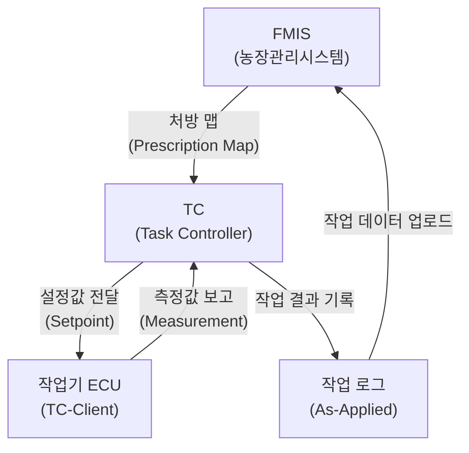
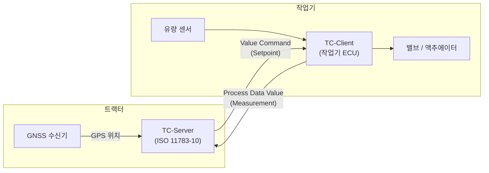
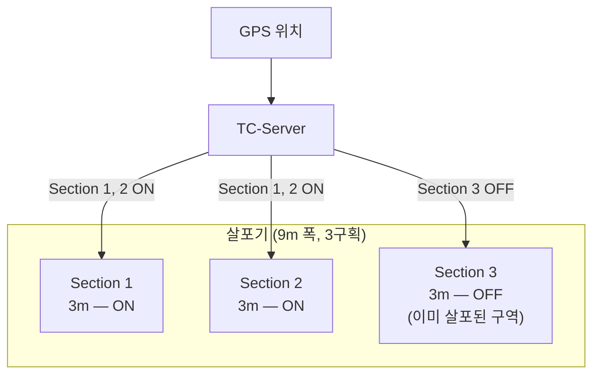
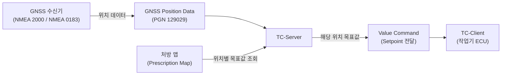

# Task Controller (TC) 기초

::: info 학습 목표
- Task Controller(TC)가 정밀 농업에서 담당하는 역할을 설명할 수 있다.
- TC-Server와 TC-Client의 차이를 구분하고 각각의 위치를 식별할 수 있다.
- Section Control과 Rate Control의 목적과 동작 원리를 비교할 수 있다.
- GPS 위치 데이터가 TC 제어에 어떻게 활용되는지 설명할 수 있다.
- Version·TC Status·Client Task 메시지 8바이트를 디코딩해 상대의 버전·기능성 옵션·Busy 상태를 판독할 수 있다.
- 태스크 상태 전이와 200 ms·2 s·6 s 연결 규칙을 묶어 TC 서버·클라이언트의 연결 상태 머신을 설계할 수 있다.
- TC가 보고한 버전과 붐·섹션·채널 수를 보고 클라이언트가 DDOP와 기능을 어떻게 낮춰야 하는지 진단할 수 있다.
:::

## 1. TC란 무엇인가

<strong>Task Controller(TC)</strong>는 ISO 11783-10에 정의된 정밀 농업의 핵심 컴포넌트이다.

> **ISO 11783 Part 10 — Task Controller and Management Information System Data Interchange**

TC는 두 가지 핵심 기능을 수행한다.

- **자동 제어**: 작업 계획(처방 맵, Prescription Map)에 따라 작업기를 자동으로 제어한다. 밭의 위치별로 미리 지정된 살포량·파종량을 GPS 위치와 연동하여 자동으로 적용한다.
- **작업 기록**: 실제 작업 결과(As-Applied Data)를 수집하고 기록한다. 어느 위치에서 얼마나 살포했는지를 나중에 분석할 수 있도록 로그로 남긴다.

TC가 없던 시대에는 농민이 수동으로 살포량을 조절해야 했다. TC는 이 과정을 자동화하여 비료·농약 과용을 줄이고 생산성을 높인다.

### TC 기능성 구분

Part 10 Annex F.2는 TC 기능을 네 가지 <strong>TC functionality</strong>로 구분한다. 제품이 어떤 기능성을 지원하는지에 따라 구현 요구사항이 달라진다.

| 기능성 | 의미 | 내용 |
|--------|------|------|
| **TC-BAS** | basic | 작업 총계(task total) 기록 — 위치와 무관한 작업량 문서화 |
| **TC-GEO** | geo-based | 위치 기반 로깅과 (선택적으로) 처방 맵 기반 위치 제어 |
| **TC-SC** | section control | 섹션 자동 ON/OFF 제어 |
| **LOG** | data logger | 로깅 전용 기능(DL) |

TC 외의 기능(UT, AUX-N, TIM 등)까지 포함한 AEF 기능 단위 전체 구도는 [AEF 기능 카테고리](/study/isobus/appendix-aef-functionalities)에서 다룬다.

현행 2015년판(2nd edition)은 프로토콜 <strong>버전 4</strong>를 정의하며, 로깅만 수행하는 별도 CF인 <strong>Data Logger(DL)</strong>와 Peer Control 등이 버전 4에서 추가되었다. DL은 TC 기능의 부분집합으로 같은 연결 메커니즘을 쓰고, 클라이언트는 동시에 TC 1개와 DL 1개에 연결할 수 있다.

### TC-BAS·TC-GEO 최소 요건

같은 기능성이라도 <strong>TC 서버와 TC 클라이언트가 지는 부담은 다르다</strong>. TC 서버는 ISO 11783-11에 해당 기능성 관련으로 정의된 DDI를 전부 지원해야 하지만, TC 클라이언트는 자신이 실제로 다루는 부분집합만 제공하면 된다 — 이 비대칭이 아래 요건 전체를 관통하는 원칙이다(부속서 F.2).

| 기능성 | TC 서버 요건 | TC 클라이언트 요건 |
|--------|--------------|---------------------|
| **TC-BAS** | ISO 11783-11에 총계로 정의된 모든 DDI 지원 | 총계의 부분집합만 제공 가능하나 <strong>최소 DDI 119(total time)는 필수</strong>. DDOP에 rate DDI가 있으면 대응하는 total DDI도 필수 |
| **TC-GEO** | TC-BAS 서버 요건 + ISO 11783-11의 <strong>모든 DDI</strong> 지원 + <strong>Grid type 1·2 처리 필수(최소 350행×350열)</strong> | TC-BAS 클라이언트 요건 + TC-BAS 자체도 함께 지원 필수 |

- <strong>TC-BAS</strong>: FMIS·TC·TC 클라이언트 모두 파일 세트(ISO11783_TaskData 등)와 Version 메시지에 TC 버전 <strong>3</strong>을 게시해야 한다. 파일 세트에 미지원 XML 요소(OperationTechnique, CodedCommentGroup 등)가 있어도 <strong>파일 세트 자체를 거부하면 안 되고</strong>, 해당 요소만 건너뛴 채 나머지 내용은 읽어야 한다.
- <strong>TC-GEO</strong>: 폴리곤 기반 처방 처리는 선택 기능이며, 지원할 경우 Control function functionalities 메시지에 명시해야 한다. TC 클라이언트는 TC가 Version 메시지로 보고하는 <strong>위치 기반 제어 채널 수 이하로</strong> 자신의 device descriptor가 보고하는 제어 채널 수를 제한해야 한다 — 서버가 지원 못 하는 채널을 클라이언트가 먼저 내세우면 안 된다는 뜻이다.

::: info 그리드는 서버의 일
Grid type 1·2 처리(350행×350열 이상)는 <strong>TC 서버</strong>의 요건이지 클라이언트의 요건이 아니다. TC 클라이언트는 자신의 device element·process data 구조와 채널 수 제한만 신경 쓰면 된다.
:::

연결 절차 자체는 [§6 클라이언트 초기화와 연결 유지](#_6-클라이언트-초기화와-연결-유지)를 참조한다.

기능성별 Version 메시지 옵션 비트·게시 버전 번호와 TC-SC·LOG 요건은 §13에서 이어서 다룬다.

## 2. TC의 역할

TC는 FMIS(Farm Management Information System, 농장관리시스템)와 작업기 사이를 연결하는 중간 다리이다.



각 단계의 의미는 다음과 같다.

| 단계 | 방향 | 내용 |
|------|------|------|
| 처방 맵 수신 | FMIS → TC | 밭의 구획별 목표 살포량·파종량이 담긴 계획 파일 |
| Setpoint 전달 | TC → 작업기 | GPS 위치에 해당하는 목표 값을 작업기에 명령 |
| Measurement 수집 | 작업기 → TC | 실제 살포된 양, 속도 등 센서 측정값 보고 |
| 작업 로그 기록 | TC → 저장 | 위치·시간·실제값을 묶어 As-Applied 파일로 저장 |

## 3. TC-Client vs TC-Server

ISOBUS에서 TC는 역할에 따라 두 가지로 구분된다.

| 구분 | 위치 | 역할 |
|------|------|------|
| **TC-Server** | 트랙터(또는 별도 단말기) | 처방 맵을 읽고 TC-Client에 명령을 내림 |
| **TC-Client** | 작업기 ECU | 명령을 받아 실제 작업을 수행하고 결과를 보고 |



- <strong>TC-Server</strong>는 처방 맵에서 현재 GPS 위치에 해당하는 값을 조회하고, 그 값을 TC-Client에 전달한다.
- <strong>TC-Client</strong>는 수신한 Setpoint에 맞게 밸브나 모터를 조절하고, 유량 센서 등으로 실제 값을 측정하여 TC-Server에 보고한다.

### TC 연결 관리

TC와 클라이언트의 연결은 Task Controller Status 메시지로 유지된다.

- 클라이언트는 address claim 완료 후 <strong>6초 대기</strong> → TC의 Status 메시지 수신 확인 → Working Set Master 메시지로 자신을 식별하며 연결 절차를 시작한다.
- TC는 Status 메시지를 <strong>2초 주기</strong>로 송신한다(상태 변화 시 즉시 송신해야 하며, 단 메시지 간 최소 200 ms).
- 타임아웃은 양방향 모두 <strong>6초</strong>다. 클라이언트가 TC Status를 6초간 못 받으면 TC의 비정상 종료로 간주하고, TC가 클라이언트의 Task 메시지를 6초간 못 받으면 클라이언트의 비정상 종료로 간주한다.
- 네트워크에는 TC가 여러 대 있을 수 있다. function instance 0인 TC가 <strong>primary TC</strong>이고, 오퍼레이터에게는 <strong>TC number</strong> = function instance + 1(1~32)로 표시한다. 클라이언트는 동시에 TC 1개·DL 1개에만 연결할 수 있다.

## 4. Section Control과 Rate Control

TC의 두 가지 핵심 제어 기능이다.

### Section Control

작업기를 여러 <strong>구획(Section)</strong>으로 나누어 각 구획을 독립적으로 ON/OFF하는 기능이다. 이미 작업한 영역이나 작업이 필요 없는 영역의 구획을 자동으로 끈다.

**목적**: 중복 살포(Overlap) 방지 → 비료·농약·씨앗 절감



### Rate Control

GPS 위치에 따라 살포량(Rate)을 **가변적으로** 제어하는 기능이다. 처방 맵에 지정된 위치별 목표량을 실시간으로 반영한다.

**목적**: 토양 조건(양분 상태, 수분 함량)에 맞는 정밀 시비·시약

| 구분 | 설명 | 제어 단위 |
|------|------|-----------|
| Section Control | 구획별 ON/OFF | 논리 값(켜짐/꺼짐) |
| Rate Control | 살포량 가변 조절 | 연속 수치(L/ha, kg/ha) |

두 기능은 함께 사용할 수 있다. 예를 들어, 밭의 경계에서 외부 구획은 OFF(Section Control)하면서 내부 구획의 살포량은 위치별로 조절(Rate Control)할 수 있다.

## 5. GPS 연동과 위치 기반 제어

TC는 GPS 위치 데이터를 이용해 현재 위치에 해당하는 처방 맵의 값을 조회한다.

### 위치·속도 관련 메시지

ISOBUS는 위치 정보를 자체 정의하지 않고 <strong>IEC 61162-3(NMEA 2000)</strong>의 항법 위치 메시지를 그대로 사용한다(Part 7 B.5). 속도는 Part 7이 자체 정의한 트랙터 메시지로 전달된다.

| 메시지 | PGN | 주요 데이터 |
|--------|-----|-------------|
| GNSS Position Data (NMEA 2000) | **129029** | 위도(Latitude), 경도(Longitude), 고도, 측위 방법 |
| COG & SOG, Rapid Update (NMEA 2000) | **129026** | 대지 진행 방향(COG), 대지 속도(SOG) |
| Wheel-based Speed and Distance (Part 7) | **65096** (0xFE48) | 휠 기준 차속·거리 |
| Ground-based Speed and Distance (Part 7) | **65097** (0xFE49) | 대지 기준(레이더 등) 차속·거리 |

### 위치 기반 제어 흐름



처방 맵은 격자(Grid) 또는 폴리곤(Polygon) 형태로 밭을 구획하고, 각 구획에 목표 값을 지정해 놓는다(둘 다 TreatmentZone을 참조한다). TC는 현재 GPS 위치가 어느 구획(TreatmentZone)에 속하는지 계산하고, 해당 구획의 목표 값을 TC-Client에 전달한다.

### NMEA와 ISOBUS

GPS 수신기는 NMEA 0183(시리얼) 또는 NMEA 2000(CAN 기반) 프로토콜로 데이터를 제공한다. Part 7이 항법 위치 메시지를 IEC 61162-3(NMEA 2000)에 위임하므로, NMEA 2000 항법 메시지는 ISOBUS 네트워크에서 그대로 사용된다. 이때 여러 데이터 프레임이 필요한 메시지(GNSS Position Data 등)는 ISO 11783-3의 transport protocol이 아니라 <strong>NMEA fast packet protocol</strong>을 사용해야 한다.

> **핵심 정리**
> - TC(Task Controller)는 ISO 11783-10에 정의된 정밀 농업 컴포넌트로, 처방 맵 기반 자동 제어와 작업 로그 기록을 담당한다. 기능성은 TC-BAS·TC-GEO·TC-SC·LOG로 구분된다(Annex F.2).
> - TC-Server는 트랙터 측에서 처방 맵을 읽고 명령하며, TC-Client는 작업기 ECU로 명령을 실행한다. 연결은 TC Status 메시지(2초 주기)로 유지되고 타임아웃은 양방향 6초다.
> - Section Control은 구획별 ON/OFF로 중복 살포를 방지하고, Rate Control은 위치별 살포량을 가변 조절한다.
> - GPS 위치(NMEA 2000 GNSS Position Data, PGN 129029)를 처방 맵과 대조하여 해당 위치의 Setpoint를 실시간으로 TC-Client에 전달한다.

## 6. 클라이언트 초기화와 연결 유지

앞 절들이 TC의 역할과 제어 기능을 다뤘다면, 여기서는 <strong>TC-Client가 전원이 켜진 순간부터 실제로 명령을 주고받기까지 반드시 거쳐야 하는 절차</strong>를 순서대로 짚는다.

::: warning 흔한 오해 — "DDOP만 올리면 준비 끝"
TC-Client 구현을 "DDOP를 만들어 업로드하는 일"로 요약하는 경우가 많은데, 반만 맞다. DDOP 업로드와 활성화는 클라이언트 초기화 <strong>9단계 중 8~9번째</strong>일 뿐이다. 그 앞에 주소 확정 → TC 확인 → Working Set Master 선언 → Task 메시지 시작 → 버전 협상까지 7단계가 정해진 순서대로 먼저 끝나야 하고, 순서를 건너뛰면 TC가 DDOP 자체를 받아주지 않는다.
:::

### 클라이언트 초기화 9단계

ISO 11783-10 §6.6.2가 정의하는 순서다.

| 단계 | 동작 | 왜 이 순서인가 |
|---|---|---|
| 1 | address claim 완료 후 <strong>6초 대기</strong> | 네트워크의 다른 CF들도 각자 주소 클레임 중일 수 있다. 6초는 클레임 경합이 가라앉을 시간을 준다 |
| 2 | 선택한 TC의 <strong>Task Controller Status 메시지 수신 대기</strong> | 클라이언트가 먼저 말을 걸지 않는다 — TC가 살아 있고 통신 준비가 됐다는 신호를 먼저 받아야 한다 |
| 3 | Working Set Master/Member 메시지(ISO 11783-7)로 자신을 <strong>Working Set Master로 식별</strong> | 버전 4부터 TC와의 통신은 Working Set Master CF로만 한정된다. 이 선언이 없으면 이후 어떤 메시지도 TC가 받아주지 않는다 |
| 4 | Client Task 메시지 송신 시작 | 이 시점부터 TC가 클라이언트의 생존을 감시한다(연결 유지 타이머 시작) |
| 5 | (버전 4 이상) Request Version으로 TC 버전 질의 → TC가 요구 버전·기능을 지원하지 않으면 <strong>자신의 기능을 TC가 지원하는 수준으로 제한</strong> | 기능을 낮추는 쪽은 항상 클라이언트다. 신형 클라이언트가 구형 TC에 맞춰야 통신이 성립한다 |
| 6 | (버전 4 이상) TC가 보내는 Request Version에 응답 | 버전 질의는 상호적이다 — 어느 쪽이 먼저 묻든 응답 의무가 있다 |
| 7 | (선택) TC에 언어·형식 메시지 요청 | 필수는 아니지만 로캘 설정을 맞추려면 이 단계에서 처리한다 |
| 8 | TC에 <strong>자신의 DDOP가 이미 있는지 질의</strong> | 재접속 상황이면 다시 올릴 필요가 없다 — 있는지부터 확인하는 게 먼저다 |
| 9 | 있으면 <strong>활성화</strong>, 없으면 TP/ETP(ISO 11783-3)로 <strong>DDOP 전송 후 활성화</strong> | DDOP는 Working Set Master 선언·버전 협상이 끝나고 상대가 누군지 확정된 뒤에야 의미가 있다 |

### TC 초기화 5단계

클라이언트 혼자 순서를 지킨다고 되는 일이 아니다. TC 쪽도 §6.6.1에 정해진 순서로 움직여야 위 9단계가 맞물린다.

| 단계 | 동작 |
|---|---|
| 1 | ISO 11783-5에 따라 address claim 완료, global 주소(255)로 address claimed 요청도 송신 |
| 2 | address claim 완료 후 <strong>6초 대기</strong> |
| 3 | Task Controller Status 메시지 송신 시작 |
| 4 | 클라이언트의 DDOP 업로드·초기화 허용 |
| 5 | (버전 4 이상) 클라이언트가 TC 버전을 요청하면 TC도 클라이언트 버전을 요청 |

두 순서를 맞대어 보면 왜 클라이언트가 "TC가 먼저 말할 때까지 기다린다"고 했는지 드러난다. TC의 3단계(Status 송신 시작)가 클라이언트의 2단계(Status 수신 대기)를 풀어주는 신호이고, TC의 4단계(DDOP 업로드 허용)가 클라이언트의 8~9단계를 받아주는 문이다. 버전 협상(클라이언트 5~6단계 / TC 5단계)도 서로가 서로를 향해 묻는 대칭 구조다 — 즉 초기화는 클라이언트 혼자 진행하는 절차가 아니라, TC와 클라이언트가 각자의 5단계·9단계를 교대로 밟는 <strong>맞물린 절차</strong>다.

### 연결 유지

연결이 성립한 뒤에는 [§3 TC 연결 관리](#tc-연결-관리)에서 다룬 값들이 그대로 적용된다 — TC Status는 2초 주기(상태 변화 시 즉시, 단 메시지 간 최소 200 ms), 타임아웃은 양방향 6초. 여기에 클라이언트 쪽 값을 더하면 그림이 완성된다.

| 항목 | 값 |
|---|---|
| Task Controller Status 주기 | 2초(변화 시 즉시, 최소 200 ms 간격) |
| Client Task 메시지 주기 | 2초 |
| 타임아웃(양방향) | 6초 |

- 클라이언트가 TC Status를 6초간 못 받으면 <strong>TC의 비정상 종료</strong>로 간주하고 Client Task 송신을 중단한다. 이후 초기화 절차를 처음부터 다시 밟아야 재연결된다.
- TC가 Client Task를 6초간 못 받으면 <strong>클라이언트의 비정상 종료</strong>로 간주한다. 클라이언트가 address claim 후 6초를 기다린 뒤에야 Client Task를 보내는 이유가 여기 있다 — 그 지연 자체가 TC 입장에서 "클라이언트가 막 재시작했다"는 신호로 읽힌다.

::: tip 권고가 아니라 필수값
200 ms·2초·6초는 참고 수치가 아니라 <strong>구현이 반드시 지켜야 하는 값</strong>이며, 정확도는 AEF(Agricultural Industry Electronics Foundation) 시험 요구사항의 대상이다. 임의로 늘리거나 줄이면 상호운용성 인증을 통과할 수 없다.
:::

### 재접속

작업 도중 클라이언트가 재시작하면 연결이 끊긴 시점의 상태로 되돌아가지 않는다. TC는 재접속한 클라이언트의 <strong>DDOP 업로드·활성화 요청을 다시 수락</strong>해야 하고(위 9단계를 처음부터 다시 밟는다), 그 클라이언트에 내리던 measurement 명령도 <strong>다시 내려야</strong> 한다. 즉 재접속은 "끊긴 지점에서 이어 붙이기"가 아니라 초기화 시퀀스의 재실행이다.

### 연결 종료

Key Switch가 off로 전환되면(ECU Power는 유지된 채) 정돈된 종료 절차가 시작된다. 클라이언트는 <strong>Connection Deactivate</strong> 명령을 보내 TC가 이를 비정상 종료로 오인하지 않게 하고, TC는 활성 DDOP를 가진 클라이언트의 마지막 전원 유지 요청 이후 최소 2초간 서비스를 유지해 수집 중이던 데이터가 정상적으로 마무리되게 한다. Key Switch가 다시 켜지면 양쪽 모두 위 초기화 절차를 재실행한다.

## 7. 태스크 — TC가 다루는 작업 단위

앞 절까지는 TC가 작업기를 어떻게 제어하고 연결을 유지하는지 봤다. 이 절은 TC가 실제로 관리하는 단위인 <strong>태스크(task)</strong>를 본다. Part 10은 태스크를 "한 고객(customer)의 한 partfield에서 농민이나 계약자가 계획했거나, 실행 중이거나, 이미 끝낸 작업"을 서로 구분하는 단위로 쓴다(ISO 11783-10:2015 5.1). FMIS 쪽에서 보면 태스크는 작업을 <strong>무엇을, 어디서, 어떻게, 누가, 언제</strong> 할지 정한 계획서다(5.2).

처음 나오는 용어 세 가지를 먼저 정리한다.

- partfield: 작물 하나만 재배하는 땅 구획이다. 태스크가 할당되는 가장 작은 XML 요소이기도 하다(3.12).
- MICS(mobile implement control system): 트랙터·작업기 쪽 시스템 전체다. TC는 MICS 안에 있다(5.1).
- coding data: 기계·약제 데이터처럼 자주 바뀌지 않거나, 태스크를 행정적으로 할당하려고 참조하는 데이터다(3.2).

### 태스크 관리의 두 목적

| 목적 | 관리 대상 | 주로 오가는 데이터 |
|---|---|---|
| 농장 자원 관리 | 트랙터·작업기·센서 시스템·작업자·자재 | 자원 지정자(resource designator) — coding data로 전송 |
| 농장 활동 관리 | 밭에서 하는 작업 | 태스크(task data) |

데이터는 양방향으로 흐른다. 계획된 태스크는 FMIS에서 MICS의 TC로 내려가고, 작업 결과는 TC에서 FMIS로 올라간다. 태스크는 FMIS와 MICS 어느 쪽에서도 만들 수 있다(5.1).

FMIS가 무엇을 내려보내는지는 농장의 관리 방식이 정한다(5.2).

| 운용 방식 | FMIS → MICS | MICS → FMIS |
|---|---|---|
| 작업 일지만 남기는 농장 | coding data만 보낸다. 태스크는 MICS에서 자원을 골라 만든다 | 태스크가 담긴 파일 세트(태스크는 이 방향에만 있다) |
| FMIS에서 계획하는 농장 | coding data + 계획 태스크. 계획 태스크는 자원 할당만 있는 것부터 site-specific 작업용 지리 정보까지 다양하다 | 실행 결과가 반영된 파일 세트 |

### FMIS → TC → 장치 → FMIS 흐름과 표준의 경계

§2의 흐름도를 Part 10의 워크플로우(5.1 a~h)로 쪼개면 다음과 같다.

| 단계 | 하는 일 | 주체 | 표준 범위 |
|---|---|---|---|
| a | 필드 태스크 계획, coding data 관리 | FMIS | 표준 밖(FMIS 소프트웨어) |
| b | 태스크 데이터를 XML로 변환 | FMIS | <strong>XML 형식은 표준</strong>(8장, Annex D) |
| c | (선택) 계획 태스크를 작업기·센서가 쓸 데이터에 할당 | 명시 없음 | — |
| d | FMIS에서 MICS의 TC로 전송 | TC 인터페이스 드라이버·데이터 캐리어 | <strong>표준 밖</strong>(5.4) |
| e | 태스크 데이터로 작업기 ECU에 process data 메시지 송신 | TC | <strong>네트워크 통신은 표준</strong>(Annex B) |
| f | 태스크의 DataLogTrigger에 따라 데이터 수집 | TC | 표준 |
| g | 수집 데이터를 FMIS로 전송. proprietary 형식이면 XML로 변환 | 명시 없음 | 형식만 표준 |
| h | XML을 읽어 FMIS 형식으로 저장·평가 | FMIS | 표준 밖 |

Figure 1 기준으로 표준이 정한 경계는 두 곳이다 — ① XML 데이터 전송 파일 세트, ② ISO 11783 네트워크 위의 TC와 CF 사이 통신. 드라이버가 파일을 TC로 옮기는 방식(메모리 카드, 무선 링크 등)과 파일 내용을 네트워크 메시지로 바꾸는 절차는 표준화 대상이 아니다(5.4). 드라이버는 제조사가 제공한 device descriptor 데이터를 덧붙여 작업기별 setpoint 데이터를 만들 수도 있다(5.4).

::: tip 에뮬레이터를 만든다면
TC 서버를 에뮬레이션해 클라이언트를 검증할 때도 맞춰야 할 표준 인터페이스는 이 두 곳이다. 파일 세트를 TC에 어떻게 넣느냐(USB, 클라우드 동기화 등)는 제품마다 달라도 된다(추론, 5.4). 파일 세트의 구조는 [종합 실습](/study/isobus/22-practice)에서, 네트워크 메시지는 이 장 §10과 [TC 프로세스 데이터](/study/isobus/19-tc-process-data)에서 다룬다.
:::

### 장치 사전 선택 — NAME과 마스크

FMIS는 계획 단계에서 "어떤 장치로 일할지"를 정할 수 있어야 한다. 그런데 이동 시스템의 클라이언트 장치를 유일하게 가리키는 수단은 <strong>CF NAME</strong>(Part 5의 8바이트 이름)뿐이다. 그래서 FMIS 관점에서 NAME은 전 세계에서 유일해야 하고, Identity Number와 NAME의 나머지 필드 조합이 유일하도록 보장할 책임은 장치 제조사에 있다(5.3). NAME 필드 구성은 [J1939 주소 체계](/study/isobus/10-j1939-address)에서 다룬다.

- DeviceAllocation 요소가 계획된 장치 할당을 담는다. 지정 수준은 특정 장치 하나부터 "이런 종류의 장치"처럼 느슨한 것까지 고를 수 있다(5.3).
- ClientNAMEValue는 8바이트 NAME이고, ClientNAMEMask는 그중 장치 선택에 쓸 비트를 고르는 마스크다. 마스크 비트 1은 "이 비트가 유효", 0은 "무시"다(D.20). 즉 후보 NAME과 ClientNAMEValue를 각각 마스크와 AND해 결과가 같으면 후보가 조건을 만족한다.
- 실제로 쓴 장치는 DeviceIdRef 속성에 기록한다. FMIS가 넣은 사전 선택 정보는 MICS가 덮어쓰지 않는다(5.3).

### TC 사용자 인터페이스

TC는 VT나 다른 인터페이스로 오퍼레이터와 상호작용할 수 있다. 태스크 하나를 자동으로 돌리는 단순한 TC는 UI가 없어도 되고, 고급 TC는 태스크 목록 선택, start/stop/resume/complete, 태스크 수정·생성, coding data 추가 같은 기능을 제공한다(5.5). 표준이 강제하는 것은 "태스크 <strong>실행</strong> 메커니즘은 반드시 있어야 한다(shall)"는 것뿐이고, 선택 메커니즘은 있어도 되는(can) 기능이다. 선택·시작·정지 방법 자체는 TC 설계자에게 맡긴다(6.1).

### 태스크 상태와 전이

태스크 상태는 6.1 Table 1이 정의하고, 파일에서는 Task 요소의 TaskStatus 속성 값(1~6)으로 기록한다(D.46).


| 상태 | 값 | 의미와 규칙 | 도입 |
|---|---|---|---|
| Planned | 1 | FMIS나 MICS에서 준비했지만 MICS에서 아직 처리하지 않은 태스크 | |
| Running | 2 | MICS에서 처리 중. <strong>TC 하나에 동시에 하나만</strong> active일 수 있다 | |
| Paused | 3 | 실행됐다가 멈췄고 아직 완료되지 않았다. TC 입장에서는 이것이 최종 상태일 수 있다. MICS에서 만든 파일 세트에 이 상태로 실린 태스크는 FMIS가 처리해야 한다 | |
| Completed | 4 | 끝난 태스크. <strong>오퍼레이터만</strong> 설정할 수 있고 MICS가 자동으로 설정하지 못한다. 지원은 선택이라 이 상태가 없는 TC도 있다. MICS에서 온 이 상태의 태스크도 FMIS가 처리해야 한다 | |
| Template | 5 | 시작하면 복사본을 만들어 그 복사본을 새 태스크로 시작한다. FMIS가 정의한 템플릿은 MICS가 고칠 수 없다. MICS가 만든 템플릿은 파일 세트에 새 태스크로 표시하고, 한 번 일반 태스크로 실체화된 뒤에는 고칠 수 없다 | v4 |
| Canceled | 6 | 태스크를 거둬들이기 위한 상태. FMIS나 MICS가 상대에게 "이 태스크를 철회하라"고 알릴 때 쓴다 | v4 |

표준은 전이도를 따로 그리지 않는다. 위 그림은 Table 1의 상태 정의, 5.5의 조작 목록(start/stop/resume/complete), 6.2의 "시작·재개할 때 effective Time 요소를 추가한다"는 서술을 엮어 그린 것이다. 특히 Canceled로 들어가는 출발 상태는 표준이 제한하지 않는다. 그림은 가장 흔한 경우인 "아직 실행하지 않은 Planned 태스크의 철회"만 그렸다.

상태 전이는 버스와 파일에 각각 흔적을 남긴다.

- 버스: TC Status 메시지 Byte 5 bit 1(Task totals active)은 "태스크가 시작되거나 재개돼 total이 누적될 수 있다"는 뜻이다(B.8.1). 이 비트가 0 → 1이 되면 클라이언트는 내부 task total을 0으로 리셋하고 세기 시작하며, 1 → 0이 되면 세기를 멈춘다. 멈춘 값은 TC가 Request Value로 읽어 갈 수 있다(B.8.1). 수거·복원 규칙은 [TC 프로세스 데이터](/study/isobus/19-tc-process-data)에서 다룬다.
- 파일: Time 요소는 <strong>태스크 상태가 바뀔 때, 자원 할당이 바뀔 때, TC가 기동·종료할 때만</strong> Task에 추가하고, 이미 기록한 Time은 고치지 않는다(6.2). MICS가 태스크를 시작했고 네트워크에 시간 정보가 있으면 Time 요소가 적어도 하나는 있어야 한다(D.46).

::: warning 상태 머신 구현 함정
- Completed를 "작업기 섹션이 모두 꺼졌다" 같은 조건으로 자동 설정하면 안 된다. 오퍼레이터만 설정할 수 있는 상태다(6.1 Table 1).
- 새 태스크를 Running으로 올리기 전에 기존 Running 태스크를 내려야 한다. TC 하나에 active 태스크는 하나뿐이다(6.1 Table 1).
- Template 태스크 자체를 Running으로 바꾸면 안 된다. 복사본을 만들어 그 복사본을 시작한다(6.1 Table 1, D.46).
- FMIS는 MICS에서 온 Paused 태스크도 처리해야 한다. FMIS 쪽 구현이 Completed만 집계하면 Paused로 끝난 작업 기록이 빠진다(추론, 6.1 Table 1).
:::

### 시간·위치·이벤트 기록 규칙

태스크를 실행하는 동안 일어난 일에는 날짜·시간·GPS 위치를 붙일 수 있다. 위치가 있는 코멘트를 붙이거나 작업자를 교대하는 것처럼 XML 요소끼리 연결되는 이벤트도 있고, 클라이언트에서 받은 process data 값을 로깅하는 이벤트도 있다. 후자에는 날짜·시간·위치를 반드시 붙여야 한다(6.2).

| 규칙 | 내용 | 근거 |
|---|---|---|
| 시간을 담는 요소 | AllocationStamp와 Time. 계획(planned)인지 실제(effective)인지 구분한다. 준비·비유효·수리·정리 같은 세부 시간 유형은 Task 수준의 Time에만 있다(§8) | 6.2 |
| 시간대 | 버전 3까지는 현지 날짜·시각만 썼다. 버전 4부터 시간대 정보를 붙이거나 UTC("Z")로 기록할 수 있다 | 6.2, D.48 |
| 위치 | AllocationStamp·Time에 GNSS 위치(Position) 요소를 최대 2개 넣는다. 첫 번째는 요소를 만들 때, 두 번째는 끝낼 때다. 하나만 있으면 시작 위치다. 연속 코멘트의 중간 위치는 TimeLog 바이너리 파일에 남긴다 | 6.2 |
| Task 안의 값 | Time 안에 DataLogValue를 여러 개 넣을 수 있지만 total이나 단일 인스턴스 값으로 제한한다. 값이 많으면 TimeLog를 쓴다 | 6.2 |
| TimeLog 파일 | TimeLog 하나가 파일 2개를 만든다 — 바이너리 데이터(.bin)와 그 구조를 정의하는 XML 헤더(.xml). 파일명 프리픽스의 유일성은 TC가 보장한다 | 6.2 |
| 자원 할당 | WorkerAllocation, DeviceAllocation, ProductAllocation, CommentAllocation, GuidanceAllocation, ControlAssignment가 같은 할당 패턴을 쓴다. 한 태스크에 같은 자원의 할당이 여러 번 나올 수 있다(계획 할당이 시작과 함께 실제가 될 때, 실행 중 자원을 뗐다 다시 붙일 때). 이미 기록한 할당은 고치지 않고 새 할당을 추가한다 | 6.4 |

"기록은 덧붙이기만 한다"가 6.2와 6.4를 관통하는 원칙이다. 태스크 파일은 실행 이력을 쌓는 로그처럼 다뤄야 하고, Time이나 할당을 고쳐 쓰는 구현은 FMIS가 받는 이력을 실제 실행과 어긋나게 만든다(추론). XML 요소 자체의 속성은 [종합 실습](/study/isobus/22-practice)과 [Part 10 부록](/study/isobus/appendix-iso-part10)에 있다.

### 다른 parameter group 값 로깅

TC는 process data뿐 아니라 버스에 흐르는 다른 PG의 값도 로깅할 수 있다(6.3). 로깅 대상은 DataLogTrigger·DataLogValue의 선택 속성으로 지정한다.

| 속성 | 값 | 근거 |
|---|---|---|
| DataLogDDI | `0xDFFE`(ParameterGroupNumberValue, PGN log value)로 고정 | 6.3, D.17 |
| DataLogPGN | 값을 꺼낼 PGN(0 ~ 2^18 - 1) | D.17 |
| DataLogPGNStartBit | 데이터 필드의 비트 위치를 0부터 센다. 0은 Byte 1의 최하위 비트다. 시작 비트가 값의 LSB가 된다 | D.17 |
| DataLogPGNStopBit | 끝 비트(포함). 값의 MSB가 된다. 값 크기는 최대 32비트다 | D.17, 6.3 |

PG에서 꺼낸 값도 어느 DeviceElement의 값인지 참조가 필요하다. ClientNAME 속성을 채운 Device 요소와 그 Device를 가리키는 DeviceElement를 TC가 만들거나 FMIS가 공급한다(6.3).

예를 들어 Wheel-based speed and distance(PGN 65096, `0xFE48`)를 보자. Byte 1~2가 차속(0.001 m/s/bit), Byte 7이 Maximum time of tractor power(1 min/bit), Byte 8 bits 4~3이 Key switch state다(Part 7:2015 B.3, A.8, A.11, A.12). 표준의 "Byte n, bit m"은 1부터 세고 DataLogPGNStartBit는 0부터 세므로 변환이 필요하다 — Byte 8 bit 3은 (8 - 1) × 8 + (3 - 1) = 58이다.

| 로깅할 값 | DataLogPGN | StartBit | StopBit |
|---|---|---|---|
| 차속(Byte 1~2) | 65096 | 0 | 15 |
| Maximum time of tractor power(Byte 7) | 65096 | 48 | 55 |
| Key switch state(Byte 8 bits 4~3) | 65096 | 58 | 59 |

::: details 파이썬으로 검산해 보기
Byte 8의 나머지 2비트 필드는 `11`로 채운 예시 프레임이다.

```python
def pg_value(data, start_bit, stop_bit):
    width = stop_bit - start_bit + 1
    assert 1 <= width <= 32
    return (int.from_bytes(data, "little") >> start_bit) & ((1 << width) - 1)


def zero_based_bit(byte_no, bit_no):
    return (byte_no - 1) * 8 + (bit_no - 1)


frame = bytes.fromhex("E8 03 00 00 00 00 05 F7")

speed_raw = pg_value(frame, 0, 15)
assert speed_raw == 1000
print("speed", speed_raw * 0.001, "m/s")

key_start, key_stop = zero_based_bit(8, 3), zero_based_bit(8, 4)
assert (key_start, key_stop) == (58, 59)
assert pg_value(frame, key_start, key_stop) == 0b01

power_start, power_stop = zero_based_bit(7, 1), zero_based_bit(7, 8)
assert (power_start, power_stop) == (48, 55)
assert pg_value(frame, power_start, power_stop) == 5

key_off_frame = bytes.fromhex("E8 03 00 00 00 00 05 F3")
assert pg_value(key_off_frame, key_start, key_stop) == 0b00
```

```
speed 1.0 m/s
```

차속 raw 1000 × 0.001 = 1.0 m/s, 남은 전원 시간 5분, Key switch state `01`(not Off)이다. 마지막 프레임은 Byte 8만 `F3`으로 바꿔 Key switch state가 `00`(Off)이 된 경우다. 이 비트가 §9 셧다운 절차의 출발 신호다.
:::

### 언어·형식·단위

VT가 쓰는 언어·형식·단위와 TC/DL의 로캘 설정은 다를 수 있다. 클라이언트는 TC/DL에 standard setup을 물어 device descriptor의 텍스트와 DeviceValuePresentation(DVP)을 TC/DL 화면에 맞게 바꿔야 한다(6.5). standard setup은 Part 7이 정의한 언어·형식·단위 메시지 묶음이고, 그중 Language command가 PGN 65039(`0xFE0F`)다(Part 7 B.21).

| 주체 | 요구사항 | 도입 |
|---|---|---|
| TC(VT가 있는 네트워크) | standard setup을 송신하고, 주 연결 VT(클라이언트 값을 표시할 VT)의 설정을 따른다. VT와 연결된 적 없는 공장 출하 상태면 제조사 기본값을 쓴다 | |
| TC | 클라이언트 초기화 때와 설정이 바뀔 때마다 standard setup을 보고한다. 오퍼레이터가 VT 설정을 바꾸거나 TC가 다른 VT에 붙은 경우가 해당한다 | |
| TC | standard setup을 비휘발성 메모리에 저장했다가 VT 연결 전 초기화 때 복원한다. VT와 연결되면 그 VT를 따른다 | |
| TC | 전역 주소로 온 Language Command 요청에 응답한다 | v4 |
| TC | TC에 직접 온 Language Command 요청에 응답한다 | v4 |
| TC(VT를 안 쓰는) | 언어·단위를 설정하는 proprietary 수단을 제공한다 | |
| 클라이언트 | device descriptor를 게시하는 <strong>그 TC</strong>의 setup을 따른다. 버전 3까지는 VT나 TECU 설정을 따랐다 | v4 |
| 클라이언트 | 선택된 언어를 지원하지 않으면 자기 기본 언어를 쓴다 | |

설정이 바뀌면 클라이언트는 표준 device descriptor 수정 방법으로 텍스트와 DVP를 고친다(6.5 b). 수정 메시지는 [TC 디바이스 디스크립션(DDOP)](/study/isobus/20-tc-ddop)에서 다룬다.

::: tip 정리
- 태스크는 FMIS와 MICS 사이를 오가는 작업 단위다. 표준이 정한 경계는 XML 파일 세트와 버스 메시지 두 곳뿐이다.
- 상태 값은 1~6이다. Running은 TC당 하나, Completed는 오퍼레이터만 설정하고, Template·Canceled는 버전 4에서 생겼다.
- 태스크 기록은 덧붙이기만 한다. Time과 할당은 상태·자원이 바뀔 때만 추가하고 고치지 않는다.
:::

## 8. 태스크 시간 기록 — Annex G

Part 10은 시간 기록을 두 수준으로 나눈다(Annex G.1).

| 수준 | 무엇을 기록하나 | 수단 |
|---|---|---|
| 태스크 수준 | 태스크가 거치는 시간 유형(준비·유효 작업·비유효·수리 등)의 시작·기간·끝 | Task 안의 Time 요소 |
| 장치 수준 | 각 장치가 TC/DL에 보고하는 상태(작업 중, 이동 중 등)와 그 변화 | 장치 데이터 로깅(DDI 119·120 같은 total, PG 로깅, TimeLog) |

### Time 유형 코드

Time 요소의 Type 속성 값이다(D.48, Table G.1).

| Type | 이름 | 정의 | 기록할 수 없으면 |
|---|---|---|---|
| 1 | Planned | 태스크의 계획 시작·정지·기간. 계획·일정 용도로만 쓰고 태스크당 최대 1개 | — |
| 2 | Preliminary | 농장에서 준비, 밭으로 이동, 밭에서 준비하는 시간. 태스크가 활성화되면 시작해 Effective나 다른 유형이 시작되면 끝난다 | Ineffective |
| 3 | (Preparation) | 버전 4에서 폐기. Preliminary보다 나은 정보를 주지 못했다 | — |
| 4 | Effective | 작업 과정에 절대적·직접적으로 필요한 활동. 태스크의 주 작업이 시작되면 시작한다. <strong>MICS가 제공해야 하는 최소 요건</strong>이다 | — |
| 5 | Ineffective | 주 작업이 활성이 아닌 시간. Effective 구간 사이에 쓴다 | — |
| 6 | Repair | 태스크 중 수리에 쓴 시간 | Ineffective |
| 7 | Clearing | 태스크 중 Effective가 마지막으로 멈춘 뒤부터 태스크가 멈출 때까지 | Ineffective |
| 8 | Powered Down | 시간 기록이 돌아가는 기계의 전원이 꺼진 때부터. 버전 4 도입 | Ineffective |

D.48은 규칙 두 가지를 더한다. FMIS가 주는 Time은 모두 Planned여야 한다. MICS가 Type 2~8을 써서 세부 구분을 하지 않는다면 MICS가 주는 Time은 모두 Effective(4)여야 하며, 이때 Effective 합계가 총 작업 시간이고 더 쪼갤 수 없다.

### Minimal과 Intermediate


| 수준 | MICS가 쓰는 Type | 설명 |
|---|---|---|
| 1. Minimal | 4 | 태스크의 시간을 Effective 하나로만 남긴다. 태스크 안 모든 Effective Time의 합이 그 태스크의 총 작업 시간이다 |
| 2. Intermediate | 2, 4, 5, 6, 7, 8 | 주 작업을 감지하면 2·4·5·7을 자동으로 기록할 수 있다. 감지에는 태스크에 할당된 장치들의 작업 상태(work status) 정보를 쓸 수 있다. 6(Repair)은 오퍼레이터 입력이 필요할 수 있고, 8(Powered Down)은 implement bus에 방송되는 정보로 자동 기록할 수 있다 |

(Annex G.2 Table G.2, Figure G.1)

구현으로 옮기면 할당 장치의 Actual Work State(DDI 141)를 받아 Effective와 Ineffective의 경계를 정하고, §7에서 본 Key switch state로 Powered Down을 정하는 식이 된다(추론).

같은 태스크라도 수준에 따라 "Effective"가 덮는 범위가 다르다는 점이 함정이다. Figure G.1에서 Minimal의 Effective는 태스크 시작부터 정지까지 전체(총 작업 시간)를 덮지만, Intermediate의 Effective는 주 작업 구간뿐이다. 그래서 FMIS가 서로 다른 수준의 TC에서 온 Effective 합계를 그대로 비교하면 안 된다(추론, G.2).

::: details 파이썬으로 검산해 보기
구간 길이(초)는 예시 값이다.

```python
intermediate = [(2, 600), (4, 3600), (5, 300), (4, 2400), (5, 900), (4, 1800), (7, 300)]
task_span_s = sum(duration for _, duration in intermediate)
minimal = [(4, task_span_s)]


def effective_total(times):
    return sum(duration for time_type, duration in times if time_type == 4)


assert task_span_s == 9900
assert effective_total(minimal) == 9900
assert effective_total(intermediate) == 7800
print(effective_total(minimal) / 3600, effective_total(intermediate) / 3600)
```

```
2.75 2.1666666666666665
```

같은 2시간 45분짜리 태스크가 Minimal에서는 Effective 2.75 h, Intermediate에서는 약 2.17 h로 기록된다.
:::

### 장치 수준 시간 — DDI 119와 120

| DDI | 이름 | 정의 | 단위 |
|---|---|---|---|
| 119 | Effective Total Time | 작업 위치에 있고 (거의 모든 필드 작업에서) 전진 속도가 있는 누적 시간. 관개 펌프를 돌리는 트랙터는 전진 없이 effective인 예다 | s |
| 120 | Ineffective Total Time | 작업 위치 밖이거나 정지 상태인 누적 시간 | s |

(G.3 Table G.3)

쟁기가 작업 위치에 있어도 트랙터가 서 있으면 그 시간은 Effective가 아니라 Ineffective다(G.3). 이 두 정의로 장치(또는 장치의 일부)가 Effective·Ineffective 상태였던 총 시간을 로깅할 수 있다. Part 7과 SAE J1939의 Wheel-based speed and distance, Implement operating state command 같은 PG도 시간 기록에 쓸 수 있다(G.3).

DDI 119는 TC-BAS 클라이언트가 조건 없이 제공해야 하는 최소 DDI이기도 하다(§1, F.2.1). "TC-BAS를 지원한다"는 말은 최소한 작업 위치와 전진 조건으로 유효 시간을 셀 줄 안다는 뜻이 된다(추론).

## 9. 연결 관리 심화 — 원문 대조, 시퀀스, 셧다운

§6은 연결 절차를 단계별 표로 요약했다. 여기서는 원문 6.6의 항목을 하나씩 대조하고, Figure 2의 시퀀스와 타이밍, 셧다운 절차까지 내려간다.

### §6의 9단계와 원문 a)~j)

원문 6.6.2는 클라이언트 초기화를 a)~j) 10개 항목으로 적는다. §6의 1단계가 a)와 b)를 합친 것이다.

| §6 단계 | 원문 | 원문이 덧붙이는 조건 | 버전 차이 |
|---|---|---|---|
| 1 | a) b) | Part 5 절차로 주소 클레임을 끝내고 6 s 기다린다. Part 5도 클레임에 성공한 CF가 250 ms 동안은 (address claimed 요청 응답 말고는) 송신을 시작하지 못하게 한다(Part 5:2019 4.5.2 d) | |
| 2 | c) | <strong>선택한</strong> TC가 TC Status를 보내기 시작할 때까지 기다린다. 어느 TC를 선택하는지는 §11 | |
| 3 | d) | Working Set Master·Working Set Member 메시지(Part 7 B.23, PGN 65037 `0xFE0D` / PGN 65036 `0xFE0C`)로 자신이 Working Set Master임을 밝힌다. 같은 메시지를 VT 초기화 같은 다른 용도로 보내도 된다 | 버전 3 이전에는 TC가 WS 전체와 통신할 수 있었다. 버전 4부터는 WSM 메시지로 식별은 하되 TC와의 통신은 WSM CF 하나로 한정한다 |
| 4 | e) | Client Task 송신 시작. 주소 클레임이 끝나고 최소 6 s가 지난 뒤여야 한다(6.6.3) | |
| 5 | f) | Request Version(B.5.2)으로 TC 버전을 묻는다. TC가 필요한 버전·기능을 지원하지 않으면 자기 버전·기능을 TC 수준으로 낮춘다 | 버전 4부터 의무. 이전에는 버전 3 이상 기능을 쓰려 할 때의 권고였다 |
| 6 | g) | 버전 4 TC가 보내는 Request Version을 기다렸다가 응답한다. TC가 클라이언트 정보를 올바르게 처리하기 위해서다 | 버전 4 |
| 7 | h) | 언어·형식 메시지 요청(선택) | |
| 8 | i) | 자기 DDOP가 TC에 이미 있는지 묻는다 | |
| 9 | j) | 있으면 activate, 없으면 Annex B 메시지와 TP 또는 ETP(Part 3)로 전송한 뒤 activate. TP와 ETP는 DDOP 크기로 고른다 | |

TC 쪽 6.6.1 a)~e)는 §6의 TC 초기화 5단계와 1:1로 대응한다. 두 가지만 덧붙인다.

- a)의 "전역(255)으로 address claimed 요청 송신"은 표준이 이유를 적지 않는다. 다만 이 요청으로 TC가 이미 버스에 있는 CF들의 NAME과 SA 대응을 처음부터 모을 수 있다 — 클라이언트는 NAME으로만 유일하게 구분되기 때문이다(추론, 5.3).
- e)는 "클라이언트가 TC 버전을 요청한 <strong>뒤에</strong>" TC가 클라이언트 버전을 요청한다는 순서 규정이다. 버전 4에서 추가됐고, 그 전의 TC는 클라이언트 버전을 물을 의무가 없었다.

### Figure 2로 보는 시퀀스


Figure 2(6.6.3)는 §6 표에 없는 세부를 세 가지 더 보여 준다.

1. <strong>풀을 검증하는 동안에도 TC Status는 2 s 주기를 지킨다.</strong> 이때 TC Status는 Busy로 나간다 — Byte 5 bit 4 = 1, Byte 6 = 처리 중인 클라이언트의 SA, Byte 7 = 실행 중인 B.6 명령의 Byte 1(§10). Activate 응답을 기다리는 클라이언트는 이 바이트로 TC가 자기 풀을 처리 중인지 볼 수 있다(추론).
2. <strong>활성화가 끝나야 클라이언트가 태스크에 들어간다.</strong> Activate Response 뒤에 TC는 device description을 파일 세트에 추가하고, 태스크가 실행 중이면 그 태스크에 DeviceAllocation과 AllocationStamp를 추가한 다음 measurement를 시작한다.
3. <strong>끊김 처리가 대칭이다.</strong> Client Task가 6 s 끊기면 TC는 (태스크가 실행 중이면) 그 DeviceAllocation의 AllocationStamp를 닫는다. TC Status가 6 s 끊기면 클라이언트는 (measurement가 활성이면) process data 송신을 멈춘다.

Request Localization Label 단계는 Structure Label 응답이 "이 ECU의 device descriptor가 TC에 없다"고 알렸으면 건너뛴다(6.6.3). DDOP 쪽 메시지 순서는 [TC 디바이스 디스크립션(DDOP)](/study/isobus/20-tc-ddop)에서 다룬다.

### 타이밍 규칙 한눈에

| 값 | 무엇 | 규칙 | 근거 |
|---|---|---|---|
| 6 s | 주소 클레임 후 대기 | TC는 TC Status 전, 클라이언트는 Client Task 전에 최소 6 s | 6.6.1 b, 6.6.2 b, 6.6.3 |
| 2 s | TC Status 주기 | 주기 송신 + 태스크 상태나 메시지의 <strong>어느 바이트든</strong> 바뀌면 즉시 송신 | 6.6.3, B.8.1 |
| 200 ms | TC Status 최소 간격 | 즉시 송신도 이 간격을 지킨다(최대 5 Hz) | 6.6.3 |
| 2 s | Client Task 주기 | 주기 송신 + 태스크 상태가 바뀔 때마다. 최소 간격 200 ms | 6.6.3, B.8.2 |
| 6 s | 양방향 타임아웃 | 상대의 주기 메시지를 최소 6 s 못 받으면 비정상 종료 가능성으로 본다 | 6.6.3 |
| 2 s | Deactivate 응답 | 정상 deactivate 응답의 최대 응답 시간 | B.6.11 |
| 2 s | 셧다운 중 서비스 유지 | 활성 DDOP를 가진 클라이언트의 마지막 Maintain Power 이후 최소 2 s | 6.6.4.1 b |
| 3 s | TC 번호 표시 | Request Identify Task Controller를 받은 TC가 TC 번호를 보여 주는 시간 | B.5.4 |

::: warning "바뀌면 즉시"와 200 ms를 같이 지켜야 한다
상태 비트가 짧은 시간에 여러 번 바뀌는 구간(예: DDOP 활성화로 Busy가 켜졌다 꺼질 때)에서 "바뀔 때마다 즉시 송신"만 구현하면 200 ms보다 짧은 간격으로 연달아 나간다. 바뀐 값을 모아 두었다가 직전 송신 + 200 ms 시점에 한 번에 보내야 한다. 6.6.3은 200 ms·2 s·6 s가 구현에 그대로 써야 하는 값이고, 정확도는 AEF 시험 요구사항의 대상이라고 못 박는다.
:::

::: details 파이썬으로 검산해 보기 — TC Status 송신 시각
즉시 송신 뒤 2 s 주기를 그 시점부터 다시 세는 방식으로 짠 예다. 주기를 다시 셀지 고정 격자로 둘지는 표준이 정하지 않는다. 어느 쪽이든 "주기 간격 2 s 이하, 송신 간격 200 ms 이상"을 지키면 된다(추론, 6.6.3).

```python
MIN_GAP_MS, PERIOD_MS = 200, 2000


def tc_status_send_times(change_times_ms, until_ms):
    pending, sent, last = sorted(change_times_ms), [], None
    while True:
        if last is not None:
            pending = [t for t in pending if t > last]
        periodic = 0 if last is None else last + PERIOD_MS
        on_change = max(pending[0], last + MIN_GAP_MS) if pending and last is not None else None
        nxt = periodic if on_change is None else min(periodic, on_change)
        if nxt > until_ms:
            return sent
        sent.append(nxt)
        last = nxt


times = tc_status_send_times([2500, 2550, 6100], until_ms=9000)
print(times)
assert times == [0, 2000, 2500, 2700, 4700, 6100, 8100]
gaps = [b - a for a, b in zip(times, times[1:])]
assert min(gaps) >= MIN_GAP_MS and max(gaps) <= PERIOD_MS
```

```
[0, 2000, 2500, 2700, 4700, 6100, 8100]
```

2500 ms와 2550 ms의 변화 두 번은 2500 ms 송신과 2700 ms 송신으로 나뉜다. 2550 ms 변화는 200 ms 간격을 채운 2700 ms에 나간다.
:::

### 클라이언트 연결 상태 머신 (구현 관점)

6.6.2~6.6.4를 구현 단위로 묶으면 다음 상태가 나온다. 상태 이름은 표준 용어가 아니라 정리용이다.

| 상태 | 하는 일 | 다음 상태로 가는 조건 |
|---|---|---|
| 주소 확보 | Part 5 주소 클레임 | 클레임 완료 → 대기 |
| 대기 | 6 s 타이머 | 6 s 경과 → TC 탐색 |
| TC 탐색 | 선택한 TC의 TC Status를 기다린다 | TC Status 수신 → 연결 수립 |
| 연결 수립 | WSM(+Member) 송신, Client Task 2 s 주기 시작, Request Version, TC의 Request Version에 응답, (선택) 언어 요청 | 버전 확인 → DDOP |
| DDOP | Structure Label 질의 → (필요하면) 전송 → Activate | 오류 없는 Activate Response → 운용 |
| 운용 | measurement 명령에 응답, process data 송신, Client Task 유지 | TC Status 6 s 미수신 → Client Task 중단 후 재초기화 / Key Switch Off → 셧다운 |
| 셧다운 | Maintain Power, Connection Deactivate | Key Switch Not Off → 재초기화 |

- Activate Response가 오류면 TC/DL은 그 풀을 휘발성 메모리에서 지운다(B.6.11). 다시 활성화하려면 풀을 다시 전송해야 한다.
- TC Status가 끊긴 뒤의 재초기화를 원문은 "초기화 절차를 다시 시작한다"고만 적는다(6.6.3). 이미 주소를 가진 클라이언트라면 TC 탐색부터 다시 밟는 구현이 자연스럽다(추론).
- 단, 셧다운 중의 TC Status 끊김은 예외다. 아래 6.6.4.2 d)에 따라 비정상 종료로 보지 않는다.

### 셧다운 — Key Switch Off 이후

§6 "연결 종료"를 원문 6.6.4로 풀면 다음과 같다. 시스템 셧다운은 <strong>Key Switch 상태가 Off인데 ECU Power는 아직 켜져 있는 구간</strong>이다. Actuator Power는 함께 켜져 있을 수도, 아닐 수도 있다(6.6.4). 아래 절차는 버전 4에서 도입돼 버전 4 구현에는 의무다.

Key Switch 상태는 Wheel-based speed and distance(PGN 65096) Byte 8 bits 4~3에 실린다 — `00` Off, `01` not Off, `10` error, `11` not available(Part 7 A.11). 같은 메시지 Byte 7은 Maximum time of tractor power(남은 전원 시간, 1 min/bit, 0~250)다(Part 7 A.12). TECU의 전원 관리는 [ISOBUS 네트워크 아키텍처](/study/isobus/13-isobus-architecture)에서 다룬다.

| TC(6.6.4.1) | 클라이언트(6.6.4.2) |
|---|---|
| a) "예상치 못한 클라이언트 종료 감지 로직"을 끈다. 한 클라이언트는 바로 꺼지고 다른 클라이언트는 ECU Power를 붙잡고 있을 때, 평소의 6 s 타임아웃 때문에 오퍼레이터에게 쓸데없는 알림이 가지 않게 하려는 것이다 | a) Maintain Power 메시지(Part 7 B.4, PGN 65095 `0xFE47`)를 보내 자기 상태를 알리고, 필요하면 이 메시지로 ECU Power·Actuator Power 유지를 요청한다 |
| b) 활성 DDOP를 가진 클라이언트들의 마지막 Maintain Power 요청 이후 최소 2 s 동안 서비스를 유지한다. 셧다운 중 수집하던 데이터를 올바르게 마무리하기 위해서다 | b) Maximum time of tractor power를 감시해 자기 전원 관리에 쓴다 |
| c) Key Switch를 계속 감시하다가 Off → Not Off로 돌아오면 TC Status를 끊고 표준 초기화(6.6.1)를 다시 한다 | c) TC에 Connection Deactivate를 보내 "예상치 못한 종료"로 보이지 않게 한다(B.6.10) |
| | d) TC Status나 다른 TC 메시지가 끊겨도 TC의 비정상 종료로 보지 않는다. 따라서 <strong>다른 TC로 연결을 시도하지 않는다</strong> |
| | e) Key Switch를 계속 감시하다가 Off → Not Off로 돌아오면 재초기화한다 |

구버전과 섞인 네트워크에서는 다음을 감안해야 한다.

- 버전 2는 셧다운 동작을 정의하지 않았고 버전 3은 의무로 정하지 않았다. 그래서 버전 3 이하 TC는 TC Status를 포함한 모든 통신을 그냥 끊을 수 있다(6.6.4.1 NOTE).
- 버전 3 이하 클라이언트도 경고 없이 통신을 끊을 수 있다. 일부 구버전 클라이언트는 Key Switch를 아예 보지 않고 전원이 끊길 때까지 평소처럼 동작한다(6.6.4.1, 6.6.4.2).

::: warning 셧다운을 끊김으로 오해하는 구현
키를 끄자마자 클라이언트가 "TC 연결 끊김" 경고를 띄우거나 TC 번호 2로 갈아타면 6.6.4.2 d) 위반이다. 반대로 TC가 키 오프 직후 클라이언트들의 Client Task 끊김마다 경고를 띄우면 6.6.4.1 a) 위반이다. 양쪽 모두 Key Switch Off 이후의 끊김을 정상으로 다뤄야 한다.
:::

### 전원 사이클 뒤 태스크 재개

전원이 다시 들어오면 TC는 다음 규칙을 따른다(6.6.4.3).

- TC는 전원 사이클 전의 태스크 상태를 복원해야 한다(shall). 모든 TC 기능을 재개하는 것이 권고다.
- 전원이 꺼지기 전에 데이터 로깅이나 위치 기반 제어가 켜져 있었다면, 자동으로 다시 켜거나 오퍼레이터에게 계속할지 확인을 받아야 한다.
- 자동 재개를 못 하는 구현은 "전원이 꺼지기 전에 태스크 기능이 활성이었고 재활성화가 필요하다"고 오퍼레이터에게 알려야 한다.
- 제어 명령을 실제로 실행할지 말지는 클라이언트 책임이다.

§7의 상태 머신으로 보면, Running이던 태스크는 전원 사이클 뒤에도 Running으로 복원되고, TC Status의 Task totals active와 measurement를 다시 세워야 한다는 뜻이다(추론, 6.6.4.3, 6.6.3).

::: tip 정리
- 원문 6.6.2는 a)~j) 10개 항목이다. 버전 질의(f)·응답(g)과 WSM 한정(d)이 버전 4에서 바뀐 부분이다.
- 활성화 중에도 TC Status는 2 s 주기와 200 ms 간격을 지키며 Busy를 보고한다. 6 s 끊김 처리는 TC와 클라이언트가 대칭이다.
- Key Switch Off 이후의 끊김은 정상 셧다운이다. 클라이언트는 Maintain Power와 Deactivate를 보내고 다른 TC로 옮기지 않는다.
:::

## 10. 연결 메시지의 바이트 — Version · TC Status · Client Task

### 공통 틀 — PGN 51968(0xCB00)

TC 관련 메시지는 모두 Process Data PG 하나를 쓴다(B.2). Data page 0, PDU format 203(`0xCB`), PDU specific = 목적지 주소이고, 길이는 가변이되 최소 8바이트다. Byte 1의 하위 니블(bits 4~1)이 Command다(B.1.1). 이 장에서 다루는 연결용 Command는 넷이다. 나머지 Command(값 요청·설정, measurement, PDACK)는 [TC 프로세스 데이터](/study/isobus/19-tc-process-data)의 범위다.

| Command | 메시지 | 기본 우선순위 | 목적지 |
|---|---|---|---|
| `0x0` | Technical data — Request Version, Version, Request Identify TC, Identify TC response | 5 | 지정(Request Identify TC는 보통 전역) |
| `0x1` | Device descriptor — Structure Label부터 Object-pool Activate/Deactivate까지 | 5 | 지정 |
| `0xE` | Task Controller Status | 3 | 전역 |
| `0xF` | Client Task | 3 | 지정 |

Command에 따라 우선순위를 3·4·5로 나눈 것은 버전 4다. 버전 3까지는 모든 Process Data 메시지가 3이었다. 제어·연결 유지 메시지를 요청·ACK 메시지보다 높게 둬 Part 3의 우선순위 권고에 맞춘 것이다(B.2). 그래서 버스 중재에서 TC Status·Client Task(3)가 Version(5)보다 앞선다.

29비트 CAN ID는 `우선순위 << 26 | 0xCB << 16 | DA << 8 | SA`다. ID 구조는 [J1939 메시지 구조](/study/isobus/09-j1939-message)에서 다룬다. 아래 예제는 클라이언트 SA를 `0x80`, TC SA를 `0xF7`로 둔 <strong>예시 값</strong>이다.

| 메시지 | 방향 | CAN ID |
|---|---|---|
| Request Version | 클라이언트 → TC | `0x14CBF780` |
| Version | TC → 클라이언트 | `0x14CB80F7` |
| TC Status | TC → 전역(255) | `0x0CCBFFF7` |
| Client Task | 클라이언트 → TC | `0x0CCBF780` |


### Request Version과 Version

TC·DL·클라이언트 누구나 상대가 구현한 ISO 11783-10 버전을 물을 수 있다(B.5.2). Request Version은 Byte 1 = `0x00`(bits 4~1 = 0000 technical data, bits 8~5 = 0000 Request Version), Byte 2~8 = `FF`인 8바이트이고, 목적지를 지정해 필요할 때만 보낸다.

```
00 FF FF FF FF FF FF FF
```

Version은 그 응답이다(B.5.3). Byte 1 = `0x10`(bits 8~5 = 0001 Version)이다.

| Byte | 필드 | 값과 규칙 | 정의된 버전 |
|---|---|---|---|
| 1 | Command·파라미터 | `0x10` | |
| 2 | 버전 번호 | 0 = DIS, 1 = FDIS.1, 2 = FDIS.2·초판 IS, 3 = 2판 DIS(E2.DIS), 4 = 2판 FDIS·IS(E2.FDIS/E2.IS) | |
| 3 | Boot time | 전원 사이클부터 첫 TC Status 송신까지 걸리는 최대 초. 정보가 없으면 `FF`. TC·DL만 의미 있는 값을 넣고 <strong>클라이언트는 `FF`</strong> | v3 |
| 4 | Provided options | bit 1 TC-BAS(documentation, task total을 어느 수준에서든 처리), bit 2 위치 기반 제어 없는 TC-GEO(위치 기반 로깅), bit 3 위치 기반 제어 있는 TC-GEO, bit 4 peer control assignment, bit 5 TC-SC, bits 6~8 = 0(예약) | v3 |
| 5 | Provided options byte 2 | 전부 0(예약) | v3 |
| 6 | 섹션 제어 붐 수 | TC는 지원하는 최대치, 클라이언트는 제어할 수 있는 수. 섹션 제어 붐 = Section Control State DDI(160)를 참조하는 DPD를 가진 DeviceElement | v3 |
| 7 | 섹션 수 | 모든 붐의 섹션 합. TC는 최대치, 클라이언트는 제어 가능한 수 | v3 |
| 8 | 위치 기반 제어 채널 수 | TC는 최대치, 클라이언트는 제어 가능한 수. 채널 = Prescription Control State DDI(158)를 참조하는 DPD를 가진 DeviceElement | v3 |

"v3" 표시 바이트는 버전 3에서 정의됐다. 버전 2 이하 구현은 그 바이트를 `FF`로 보낸다(B.5.3).

::: warning Version 메시지 디코딩 함정 세 가지
- <strong>버전 바이트를 먼저 본다.</strong> 버전 2 이하 상대는 Byte 3~8을 `FF`로 보낸다. 옵션 바이트 `0xFF`를 비트 그대로 읽으면 "TC-BAS·TC-GEO·peer control·TC-SC를 모두 지원하는 TC"가 돼 버린다. 버전이 2 이하면 Byte 3~8을 "정보 없음"으로 다뤄야 한다(추론, B.5.3).
- <strong>예약 비트는 0이다.</strong> Byte 4 bits 6~8과 Byte 5는 "0 = 예약"으로 정의된다. 예약을 1(`FF`)로 채우는 습관대로 보내면 수신 측이 정의되지 않은 옵션으로 읽을 수 있다(추론).
- <strong>클라이언트의 붐·섹션·채널 수는 조정 전 값이다.</strong> 클라이언트는 TC 능력에 맞춰 DDOP를 줄여야 하지만, Version 메시지에는 줄인 값이 아니라 자기 능력을 그대로 보고한다(B.5.3 각주 a).
:::

TC와 클라이언트가 주고받은 Version 예제를 읽어 보자.

```
TC → 클라이언트:  10 04 0A 1F 00 02 18 04
클라이언트 → TC:  10 04 FF 11 00 01 07 00
```

| 바이트 | TC | 클라이언트 |
|---|---|---|
| 2 버전 | 4 | 4 |
| 3 Boot time | `0x0A` = 10 s | `FF`(클라이언트는 항상 `FF`) |
| 4 옵션 | `0x1F` = bit 1~5 모두 | `0x11` = bit 1(TC-BAS) + bit 5(TC-SC) |
| 5 옵션 2 | 0 | 0 |
| 6 붐 | 2 | 1 |
| 7 섹션 | 24(`0x18`) | 7 |
| 8 채널 | 4 | 0 |

이 TC는 섹션 제어 붐 2개·섹션 24개·채널 4개까지 다루므로, 붐 1개·섹션 7개짜리 클라이언트는 DDOP를 줄일 필요가 없다. TC가 클라이언트보다 작은 경우는 §13에서 본다. 참고로 위치 기반 제어를 지원하는 TC가 bit 2(위치 기반 로깅)도 함께 세워야 하는지는 B.5.3이 말하지 않는다 — 이 예제는 모든 옵션을 지원하는 TC라 두 비트를 다 세웠다.

::: details 파이썬으로 검산해 보기
```python
PROCESS_DATA_PF = 0xCB


def can_id(priority, da, sa):
    return (priority << 26) | (PROCESS_DATA_PF << 16) | (da << 8) | sa


OPTION_BITS = {
    0x01: "TC-BAS",
    0x02: "TC-GEO (위치 기반 제어 없음)",
    0x04: "TC-GEO (위치 기반 제어 포함)",
    0x08: "peer control",
    0x10: "TC-SC",
}


def decode_version(data):
    assert len(data) == 8
    command, parameter = data[0] & 0x0F, data[0] >> 4
    assert (command, parameter) == (0x0, 0x1), "Version 메시지가 아니다"
    return {
        "version": data[1],
        "boot_time_s": None if data[2] == 0xFF else data[2],
        "options": [name for bit, name in OPTION_BITS.items() if data[3] & bit],
        "reserved_bits_ok": data[3] & 0xE0 == 0 and data[4] == 0,
        "booms": data[5],
        "sections": data[6],
        "channels": data[7],
    }


tc_version = decode_version(bytes.fromhex("10 04 0A 1F 00 02 18 04"))
client_version = decode_version(bytes.fromhex("10 04 FF 11 00 01 07 00"))
print(tc_version)
print(client_version)

assert tc_version["version"] == 4 and tc_version["boot_time_s"] == 10
assert len(tc_version["options"]) == 5 and tc_version["reserved_bits_ok"]
assert (tc_version["booms"], tc_version["sections"], tc_version["channels"]) == (2, 24, 4)

assert client_version["boot_time_s"] is None
assert client_version["options"] == ["TC-BAS", "TC-SC"]
assert (client_version["booms"], client_version["sections"], client_version["channels"]) == (1, 7, 0)

CLIENT_SA, TC_SA = 0x80, 0xF7
assert can_id(5, TC_SA, CLIENT_SA) == 0x14CBF780
assert can_id(5, CLIENT_SA, TC_SA) == 0x14CB80F7
```

```
{'version': 4, 'boot_time_s': 10, 'options': ['TC-BAS', 'TC-GEO (위치 기반 제어 없음)', 'TC-GEO (위치 기반 제어 포함)', 'peer control', 'TC-SC'], 'reserved_bits_ok': True, 'booms': 2, 'sections': 24, 'channels': 4}
{'version': 4, 'boot_time_s': None, 'options': ['TC-BAS', 'TC-SC'], 'reserved_bits_ok': True, 'booms': 1, 'sections': 7, 'channels': 0}
```
:::

### 파일 쪽 짝 — TaskControllerCapabilities

버전 4부터 MICS가 만든 파일 세트에는 그 파일을 만든 TC의 능력을 TaskControllerCapabilities(TCC) 요소로 최대 하나 넣는다(D.47). TC의 NAME, 제품명, VersionNumber(0~4), ProvidedCapabilities, 붐·섹션·채널의 최대 수(0~254, 지원하지 않으면 0)를 담는다.

ProvidedCapabilities 값 1·2·4·8·16은 Version 메시지 Byte 4의 bit 1~5와 같은 뜻이다. 그런데 <strong>32(polygon 처방 맵 지원)는 Version 메시지에 없다</strong>. 버스에서 polygon 지원은 Part 12의 Control function functionalities 메시지로 알린다(F.2.2). 그 메시지는 [ISOBUS 네트워크 관리](/study/isobus/14-isobus-network-mgmt)에서 다룬다.

### Request Identify Task Controller

오퍼레이터가 "지금 이 TC가 몇 번인가"를 확인할 때 쓰는 버전 4 메시지다(B.5.4). 클라이언트도 TC도 보낼 수 있고, 보통 전역으로 보내지만 목적지를 지정해도 된다. 받은 TC는 자기 TC 번호를 <strong>3 s 동안</strong> 표시해야 한다. 표시 방식은 TC 고유이고, DL에도 유효하다.

```
20 FF FF FF FF FF FF FF
```

목적지 지정으로 받았을 때만 TC가 Identify Task Controller response로 답한다(B.5.5). 이 응답도 Byte 1 bits 8~5 = 0010, Byte 2~8 = `FF`라 요청과 바이트가 똑같다. 그래서 수신 측은 내용이 아니라 "그 SA에 보낸 요청이 대기 중인가"로 응답을 가려야 한다(추론). GUI가 없는 TC는 번호를 표시하지 못할 수 있다(B.5.5 NOTE 1).

### Task Controller Status

TC(DL)가 자기 상태를 알리는 메시지다(B.8.1). 전역으로, 2 s 주기 + 어느 바이트든 바뀌면 즉시 보내고, 메시지 사이에는 최소 200 ms를 둔다.

| Byte | 내용 |
|---|---|
| 1 | `0xFE` — bits 4~1 = 1110(TC Status), bits 8~5 = 1111(element number 하위 니블, not available) |
| 2 | `FF` — element number, not available |
| 3~4 | `FF FF` — DDI, not available |
| 5 | 실제 TC/DL 상태(아래 비트) |
| 6 | B.6 명령을 처리 중인 클라이언트의 SA. Byte 5 bit 4가 1일 때만 유효하고, 아니면 0 |
| 7 | 처리 중인 B.6 명령의 Byte 1. Byte 5 bit 4가 1일 때만 유효하고, 아니면 0 |
| 8 | 예약 |

| Byte 5 비트 | 뜻 |
|---|---|
| bit 1 | Task totals active — 태스크가 시작·재개돼 total이 누적될 수 있다. 0 → 1이면 클라이언트 내부 task total을 0으로 리셋하고 세기 시작, 1 → 0이면 세기를 멈추고 TC/DL이 Request Value로 읽어 갈 수 있다 |
| bit 2 | 비휘발성 메모리에 저장 중(busy) |
| bit 3 | 비휘발성 메모리에서 읽는 중(busy) |
| bit 4 | B.6(device descriptor) 명령 실행 중(busy) |
| bits 5~7 | 0, 예약 |
| bit 8 | 메모리 부족 |

- element number·DDI의 not available 값은 버전 2에서 도입됐고, 클라이언트는 TC Status를 처리할 때 이 필드를 무시해야 한다(B.8.1 각주).
- Byte 8은 "예약"이라고만 적혀 있고 채움 값이 없다. 아래 예제는 `FF`로 둔 가정이고, 수신 측은 Byte 8 값에 의존하지 않는 편이 안전하다(추론).

| 바이트 열 | 해석 |
|---|---|
| `FE FF FF FF 01 00 00 FF` | bit 1만 1 — 태스크 실행 중, Busy 아님 |
| `FE FF FF FF 09 80 81 FF` | bit 1 + bit 4 — 태스크 실행 중이면서 SA `0x80` 클라이언트의 B.6 명령 `0x81`(Object-pool Activate/Deactivate)을 처리 중 |

### Client Task

연결을 유지하는 모든 클라이언트가 TC/DL에 보내는 생존·상태 메시지다(B.8.2). 목적지를 지정하고, 2 s 주기 + 태스크 상태가 바뀔 때마다 보내며, 메시지 사이에는 최소 200 ms를 둔다.

| Byte | 내용 |
|---|---|
| 1 | `0xFF` — bits 4~1 = 1111(Client Task), bits 8~5 = 1111(element number, not available) |
| 2 | `FF` |
| 3~4 | `FF FF` |
| 5~8 | 32비트 필드. bit 1 = TC Status Byte 5 bit 1에서 받은 Task totals active 값을 그대로 되돌린다. bits 2~32 = 0(예약) |

```
FF FF FF FF 01 00 00 00
```

TC/DL은 이 메시지의 element·DDI 필드를 무시한다(B.8.2 각주). bit 1을 되돌려 받으므로 TC는 각 클라이언트가 최신 Task totals active 상태를 받았는지 확인할 수 있다(추론).

### Connection Deactivate의 실체

6.6.4.2 c)와 6.7.1이 말하는 Connection Deactivate는 별도 메시지가 아니다. B.6.10 Object-pool Activate/Deactivate의 Byte 2를 0으로 보낸 것이다. Byte 2가 `FF`면 activate, 0이면 deactivate이고, deactivate는 "클라이언트가 의도적으로 연결을 끊는다"는 뜻이다. Byte 2 = 0의 정의는 버전 4에서 들어왔다(B.6.10).

```
81 00 FF FF FF FF FF FF    Object-pool Deactivate (클라이언트 → TC)
91 00 FF FF FF FF 00 FF    Object-pool Activate/Deactivate Response, 오류 없음 (TC → 클라이언트)
```

응답의 Byte 2 = 0은 오류 없음, Byte 3~4와 5~6은 오류 객체의 부모 ID와 객체 ID인데 오류가 없으면 NULL object ID(65535, `0xFFFF`)를 넣는다(B.6.11, A.1). 정상 deactivate에 대한 TC/DL의 최대 응답 시간은 2 s다(B.6.11). Deactivate가 버전 4 정의이므로, 버전 3 이하 TC에는 이 의미가 통하지 않을 수 있다 — 버전 교환 결과를 보고 판단해야 한다(추론). DDOP 쪽 B.6 메시지 전체는 [TC 디바이스 디스크립션(DDOP)](/study/isobus/20-tc-ddop)에 있다.

::: details 파이썬으로 검산해 보기
```python
PROCESS_DATA_PF = 0xCB


def can_id(priority, da, sa):
    return (priority << 26) | (PROCESS_DATA_PF << 16) | (da << 8) | sa


def tc_status(totals_active, saving=False, reading=False, busy_client=None, out_of_memory=False):
    busy = busy_client is not None
    status = (int(totals_active) | int(saving) << 1 | int(reading) << 2
              | int(busy) << 3 | int(out_of_memory) << 7)
    client_sa, b6_byte1 = busy_client if busy else (0x00, 0x00)
    return bytes([0xFE, 0xFF, 0xFF, 0xFF, status, client_sa, b6_byte1, 0xFF])


def client_task(totals_active_echo):
    return bytes([0xFF, 0xFF, 0xFF, 0xFF]) + int(totals_active_echo).to_bytes(4, "little")


CLIENT_SA, TC_SA = 0x80, 0xF7
OBJECT_POOL_ACTIVATE_BYTE1 = 0x81

assert tc_status(True).hex(" ").upper() == "FE FF FF FF 01 00 00 FF"
activating = tc_status(True, busy_client=(CLIENT_SA, OBJECT_POOL_ACTIVATE_BYTE1))
assert activating.hex(" ").upper() == "FE FF FF FF 09 80 81 FF"

assert client_task(True).hex(" ").upper() == "FF FF FF FF 01 00 00 00"
assert client_task(False).hex(" ").upper() == "FF FF FF FF 00 00 00 00"

deactivate = bytes.fromhex("81 00 FF FF FF FF FF FF")
deactivate_ok = bytes.fromhex("91 00 FF FF FF FF 00 FF")
assert deactivate[0] & 0x0F == 0x1 and deactivate[0] >> 4 == 0b1000 and deactivate[1] == 0x00
assert deactivate_ok[0] >> 4 == 0b1001 and deactivate_ok[1] == 0x00
assert int.from_bytes(deactivate_ok[2:4], "little") == 0xFFFF == int.from_bytes(deactivate_ok[4:6], "little")

assert can_id(3, 0xFF, TC_SA) == 0x0CCBFFF7
assert can_id(3, TC_SA, CLIENT_SA) == 0x0CCBF780
print("OK")
```

```
OK
```
:::

::: tip 정리
- 연결 메시지는 모두 PGN 51968을 쓰고 Byte 1 하위 니블이 Command다. Version(0)·Deactivate(1)·TC Status(E)·Client Task(F)로 갈린다.
- Version은 버전 바이트부터 읽는다. 옵션의 예약 비트는 0이고, 클라이언트가 보고하는 수치는 조정 전 능력이다.
- TC Status의 Busy(bit 4)는 Byte 6·7과 짝이고, Client Task는 Task totals active를 되돌려 보낸다.
:::

## 11. 다중 TC — TC 번호와 붙을 TC 고르기

### TC 번호는 NAME의 function instance에서 나온다

TC 번호(TC number)는 TC의 function instance에서 유도한 식별 번호다(3.18). function instance는 NAME의 5비트 필드(NAME Byte 5 bits 8~4)라 0~31이고(Part 5:2019 Table 1), 오퍼레이터에게는 <strong>TC 번호 = function instance + 1</strong>, 즉 1~32로 보인다(6.7, B.5.4). 0부터 세는 번호에 익숙하지 않은 오퍼레이터를 위한 오프셋이고, 모든 제조사의 TC가 같은 번호 체계를 보여 주게 하려는 것이다(6.7).

예를 들어 어떤 TC가 보낸 Address Claimed(PGN 60928, `0xEE00`) 데이터의 Byte 5가 `0x08`이면 bits 8~4 = `00001`이다. `0x08 >> 3` = 1이 function instance이고(나머지 bits 3~1은 ECU instance 0), TC 번호는 2다.

| 규칙 | 근거 |
|---|---|
| 네트워크에 TC가 있으면 function instance 0인 TC가 <strong>항상</strong> 있어야 한다 | 6.7 |
| TC는 공장 출하 때 function instance 0이고, 오퍼레이터가 설정한 값을 유지한다 | 6.7 |
| function instance를 바꾸는 proprietary 수단은 TC가 제공하고, TC끼리 중복이 생기지 않게 해야 한다 | 6.7 |
| 새로 설정한 값은 TC가 네트워크에 다시 접속한 뒤에야 쓴다 | 6.7 |
| function instance 0인 TC가 primary TC다. 0이 아닌 TC도 같은 연결 절차(6.6)를 따른다 | 6.7 |
| 여러 CF를 품은 ECU 안의 TC라면 오퍼레이터가 TC CF를 켜고 끌 수 있게 하는 것이 권고다 | 6.7 NOTE |

### 클라이언트는 어느 TC에 붙나

- 기본은 function instance 0(TC 번호 1)인 TC다(6.7.1).
- "Move to another Task Controller" 기능(예: "Next Task Controller" 소프트키)을 가진 클라이언트는 function instance가 0보다 큰 TC에도 붙을 수 있다. 이 기능은 사용 가능한 TC들을 <strong>차례로 하나씩</strong> 옮겨 가게 해야 한다(6.7.1).
- 이 기능은 네트워크에서 TC를 2대 이상 감지했을 때만 켜진다(6.7.1 a).

옮겨 갈 때의 순서는 다음과 같다(6.7.1 b). 오른쪽 열의 이유는 표준이 적지 않은 해설이다(추론).

| 순서 | 동작 | 이유 |
|---|---|---|
| 1 | 안전 상태로 전환한다. 안전 상태가 아니면 이 기능 자체를 막는다 | 연결을 바꾸는 동안 섹션·rate 명령이 주인 없이 남지 않게 |
| 2 | 현재 TC에 Connection Deactivate(B.6.10, Byte 2 = 0)를 보내고 응답을 기다린다 | 현재 TC가 비정상 종료로 오인하지 않게. 응답은 최대 2 s(B.6.11) |
| 3 | 현재 TC로 보내던 Client Task를 멈춘다 | 클라이언트당 TC 연결은 하나 |
| 4 | 다른 TC와 초기화(6.6.2)를 시작한다 | |

- 새 TC는 다음 전원 사이클의 <strong>preferred TC</strong>로 저장한다(6.7.1).
- 기동 후 일정 시간 안에 preferred TC가 나타나지 않으면 다른 TC에 붙어도 된다. 기다릴 최대 시간은 오퍼레이터가 설정하게 하거나, preferred TC가 Version 메시지 Byte 3에 보고한 boot time에서 얻는다(6.7.1). 기동 직후에는 그 TC와 아직 버전을 교환하지 않았으므로, 지난 연결 때 받아 둔 boot time을 저장해 쓰는 셈이다(추론).
- 클라이언트는 동시에 TC 하나, DL 하나에만 연결할 수 있다. 여러 TC나 여러 DL에 동시에 붙는 것은 이 판에서 허용되지 않는다(6.7.1 NOTE).

::: info 구현 관점 — TC Status를 보낸 쪽이 누구인가
TC Status는 TC도 DL도 보낸다(B.8.1의 상태 바이트 이름이 "Actual TC / DL status"다). 그래서 클라이언트는 TC Status의 SA를 주소 클레임으로 모은 NAME 표에서 찾아 ① function이 TC인지 DL인지(7.1, Part 1), ② function instance가 몇인지(6.7)를 확인한 뒤에야 "내가 선택한 TC"인지 판단할 수 있다(추론). TC와 DL을 구분하는 function 값 자체는 Part 1이 isobus.net 데이터베이스로 넘긴다.
:::

## 12. Data Logger — TC와 무엇이 같고 무엇이 다른가

DL(data logger)은 TC 클라이언트를 제어하지 않고 태스크와 무관한 로깅을 하려고 네트워크에 두는 CF다(7.1). 텔레매틱스 로거가 대표적이지만 텔레매틱스 환경에 한정되지 않는다(5.6). DL은 TC의 process data 프로토콜을 그대로 쓰며, device descriptor와 process data로 데이터를 모으는 데 더해 버스에 방송되거나 요청할 수 있는 다른 PG도 로깅할 수 있다(5.6, Part 1:2017 3.14). TC 기능의 부분집합이고 연결 메커니즘이 TC와 같으며, 버전 4에서 도입됐다(5.6).

| 항목 | TC | DL | 근거 |
|---|---|---|---|
| 네트워크 식별 | TC function | 별도의 DL function | 5.6, 7.1 |
| 도입 | 버전 1부터 | 버전 4 | 7.2 |
| 연결 절차 | 6.6 | 6.6.2와 같다 | 7.2 |
| 주기 메시지 | TC Status 송신, Client Task 수신 | 같다 | B.8, 7.1 |
| function instance 0 | primary TC, 네트워크에 반드시 있다 | 다른 instance와 역할이 같다 | 6.7, 7.2 |
| 여럿일 때 | TC 번호로 구분 | 유일한 function instance로 구분(설정은 proprietary) | 6.7, 7.2 |
| 섹션 제어 | 한다 | <strong>금지</strong> | 7.1 |
| 위치 기반 제어 | 한다 | <strong>금지</strong> | 7.1 |
| peer control 할당 설정 | 한다 | <strong>금지</strong>. 단 peer control CF가 로깅용 값을 주려고 DL에 붙는 것은 가능 | 7.1 |
| 값 설정(set) 명령 | settable DDI에 보낸다 | task total DDI 외에는 보내지 않는다 | 7.1 |
| process data 요청·measurement·default logging·PG 로깅 요청 | 한다 | 한다 | 7.1 |
| task total 누적 제어 | TC Status bit 1 | 자기 TC Status bit 1로 DL용 세트를 제어 | 7.1 |
| 6.8 통신 규칙(대역폭 등) | 적용 | DL과 DL 클라이언트 사이에도 적용 | 7.1 |
| Version 메시지 boot time | 의미 있음 | 의미 있음 | B.5.3 |

클라이언트 쪽에서 달라지는 것은 다음과 같다(7.2, 7.3).

- DDOP를 TC용과 DL용으로 따로 줄 수 있다. 같은 클라이언트라도 두 DDOP 내용이 다를 수 있고, 목적별로 최적화하는 것은 클라이언트 설계자 책임이다.
- TC와 DL에 동시에 붙으면 <strong>measurement 명령 세트를 서버별로 따로</strong> 유지해 병렬로 돌린다.
- task total도 <strong>서버별로 따로</strong> 누적한다. 각 세트는 해당 CF가 따로 set·reset·trigger할 수 있고 서로 간섭하면 안 된다. DL이 total을 자주 리셋하지 않더라도, 누적 시작점을 정하고 최대값에서 roll-over되는 것을 피하는 데 이 메커니즘을 쓸 수 있다.
- DL 클라이언트가 연결할 수 있는 DL은 최대 하나다(버전 4까지).

네트워크 구성은 세 가지다(7.2).

| 구성 | 내용 | 도입 |
|---|---|---|
| a) TC + TC 클라이언트 | 모든 TC 클라이언트가 TC에 연결 | 버전 1 |
| b) DL + DL 클라이언트 | 모든 DL 클라이언트가 DL에 연결. 연결 방식은 a)와 같다 | 버전 4 |
| c) TC + DL + TC/DL 클라이언트 | 두 기능을 다 가진 CF가 TC와 DL 중 하나 또는 둘 다에 연결. 둘에 동시에 붙을 수 있다 | 버전 4 |

::: warning 두 서버에 동시에 붙는 클라이언트의 함정
TC Status의 Task totals active가 0 → 1로 바뀌면 그 TC Status를 보낸 CF의 total 세트만 리셋해야 한다. TC가 태스크를 시작했다고 DL용 total까지 0으로 만들면 7.3의 "서로 간섭하면 안 된다"를 어긴다. Client Task·measurement·total 상태를 서버 SA별로 따로 들고 있어야 한다(추론, 7.3).
:::

## 13. TC 기능성 심화 — 요건, 옵션, 게시 버전

§1은 TC-BAS·TC-GEO의 최소 요건을 정리했다. 여기서는 Annex F.2 전체를 기능성 관점에서 다시 묶는다. DDOP를 기능성에 맞게 짜는 구조 규칙(F.3)은 [TC 디바이스 디스크립션(DDOP)](/study/isobus/20-tc-ddop)에서 다룬다.

TC functionality는 제품이 시스템 안에서 올바르게 동작하려면 구현해야 할 기능 묶음이다. 앞으로의 발전과 제품의 기술적 제약을 함께 담으려고 <strong>generation 번호</strong>로 버전을 매기고, 일부에는 선택 기능(option)을 둔다(F.2). 이 정의와 예시는 AEF와 협력해 만들었고 적합성 시험의 바탕이 된다(F.1). 현재 정의된 기능성은 모두 generation 1이다. AEF 기능 단위 전체는 [AEF 기능 카테고리](/study/isobus/appendix-aef-functionalities)에 있다.

| 기능성 | 한 줄 정의 | 위치 소스 | 게시 버전 | Version Byte 4 |
|---|---|---|---|---|
| TC-BAS (basic) | 태스크 기반 total 읽기·쓰기. 위치·시간 데이터가 필요 없다 | 불필요 | 3(파일 세트·Version) | bit 1 |
| TC-GEO (geo-based) | 위치에 따른 site-specific 값 처리. 제어 요소가 없는 클라이언트의 as-applied 매핑(콤바인 수확량, 플랜터 파종 밀도 등)도 포함한다 | GNSS 등 필요 | 3(파일 세트·Version) | bit 2(위치 기반 로깅) / bit 3(위치 기반 제어) |
| TC-SC (section control) | 위치에 따른 on/off 제어. 이미 작업한 영역이나 헤드랜드·필드 밖 같은 영역과 만나는지 판단해 중복과 누락을 줄인다 | 필요 | 3(Version만) | bit 5 |
| LOG (data logger) | lifetime total 읽기. 위치·시간 데이터가 필요 없다 | 불필요 | 4(파일 세트·Version) | 없음 |

| 기능성 | 서버 요건 | 클라이언트 요건 |
|---|---|---|
| TC-BAS | Part 11의 total DDI 전부 | total 부분집합 가능. <strong>DDI 119(total time) 필수</strong>. rate DDI가 있으면 대응 total도 |
| TC-GEO | Part 11의 DDI 전부 + TC-BAS + Grid type 1·2(350행 × 350열 이상) + 위치 기반 제어 채널 1개 이상 | 자기가 제어·로깅하는 프로세스 관련 DDI 부분집합. rate 제어가 있으면 setpoint·actual rate 쌍 최소 1개 권고(작업 깊이 같은 다른 setpoint도 제어 가능). TC-BAS도 지원 |
| TC-SC | 붐 1개·섹션 3개 이상 지원, Table F.3 DDI | 붐 1개·섹션 1개부터 적합, Table F.3 DDI |
| LOG | Part 11의 total DDI 전부 | lifetime total 부분집합 가능. <strong>DDI 274(lifetime total time) 필수</strong>. rate DDI가 있으면 대응 lifetime total도 |

(F.2.1~F.2.4, B.5.3) 장치 클래스별 권장 DDI 표(Table F.1·F.2·F.4)는 [Part 10 부록](/study/isobus/appendix-iso-part10)에 있다. peer control은 Version Byte 4 bit 4로 알리지만 F.2의 기능성은 아니다. LOG에는 Version 옵션 비트가 없다 — DL은 NAME의 function으로 식별된다(7.1).

### 옵션과 수치 협상

- TC-GEO의 polygon 처방 처리는 선택이다. 지원하면 Part 12의 Control function functionalities 메시지에 명시한다(F.2.2). 파일 세트 쪽 표시는 §10의 TaskControllerCapabilities 값 32다(D.47).
- 위치 기반 제어 채널 수(TC-GEO)와 붐·섹션 수(TC-SC)는 Control function functionalities 메시지와 Version 메시지 양쪽에 명시한다(F.2.2, F.2.3).
- 클라이언트는 TC가 Version 메시지로 보고한 수치에 맞춰 <strong>DDOP를 줄인다</strong>.
  - TC-GEO: DDOP에 보고하는 제어 채널 수를 TC가 보고한 채널 수 이하로 제한한다(F.2.2).
  - TC-SC: TC가 제어할 수 있는 붐·섹션 수가 클라이언트의 물리 능력보다 적으면, 물리적으로 제어 가능한 요소들을 <strong>묶어서</strong> 더 적은 수로 통신한다(F.2.3).
  - 그래도 클라이언트 자신의 Version 메시지에는 줄이기 전 능력을 보고한다(B.5.3 각주 a).

예를 들어 물리 섹션 12개짜리 붐 1개 스프레이어가 Version Byte 6~7 = 1·6을 보고한 TC에 붙으면, DDOP에는 이웃한 물리 섹션을 2개씩 묶은 섹션 6개를 정의한다. 클라이언트의 Version 메시지는 여전히 Byte 6~7 = 1·12다. 묶은 섹션의 폭·오프셋을 어떻게 정의하는지는 20장의 범위다.

### 파일 세트 하한과 TC-SC의 독립성

- TC-BAS·LOG: FMIS와 TC(LOG 서버)는 서로의 한계를 고려해야 하고, 임베디드 쪽은 큰 파일 세트를 만들지 않아야 한다. 최소한 <strong>XML 요소 총 20,000개, 요소 타입당 2,000개</strong>짜리 파일 세트는 FMIS와 TC(LOG 서버) 구현 모두 처리해야 한다(F.2.1, F.2.4).
- TC-BAS 구현은 OperationTechnique, OperationTechniqueReference, CodedCommentGroup, Connection, 모든 기하·지리 참조 요소를 처리하지 않아도 된다. 건너뛰어도 되지만 나머지 내용은 읽어야 하고 파일 세트를 거부하면 안 된다(F.2.1).
- TC-SC는 TC-BAS·TC-GEO와 <strong>독립</strong>이다. 둘 중 무엇과도 함께 지원할 필요가 없고, TC-SC만 제공하는 제품은 파일 세트 처리나 FMIS-TC 연결을 지원하지 않아도 된다. 게시 버전도 Version 메시지에만 쓰도록 정해져 있다(F.2.3).

TC-SC 필수 DDI(Table F.3)를 역할별로 묶으면 다음과 같다. 이름은 Annex F의 본문·그림 표기를 따랐다.

| 역할 | DDI |
|---|---|
| 기하 | 67 Actual Working Width, 70 Maximum Working Width, 134 Offset X, 135 Offset Y |
| 작업 상태 | 141 Actual Work State, 161~176 Actual Condensed Work State, 290~305 Setpoint Condensed Work State |
| 제어 상태 | 160 Section Control State |
| 지연 보정 | 142 Physical Setpoint Time Latency, 143 Physical Actual Time Latency, 205 SC Turn On Time, 206 SC Turn Off Time |

### 버전 3과 버전 4

Annex F는 기능성마다 게시할 버전 번호를 정한다. TC-BAS·TC-GEO·TC-SC generation 1은 <strong>3</strong>, LOG generation 1은 <strong>4</strong>다(F.2.1~F.2.4). 표준이 이유를 적지는 않지만, LOG가 4인 것은 DL 자체가 버전 4 기능이기 때문으로 보인다(추론, 5.6).

연결 계층에서 버전 4가 바꾼 것을 이 장의 범위에서 모으면 다음과 같다.

| 항목 | 버전 3 이하 | 버전 4 | 근거 |
|---|---|---|---|
| 클라이언트의 Request Version | 버전 3 기능을 쓰려면 권고 | 의무 | 6.6.2 f |
| TC의 클라이언트 버전 요청 | 의무 없음 | 클라이언트가 요청한 뒤 의무 | 6.6.1 e |
| TC가 보낸 Request Version에 응답 | — | 클라이언트 의무 | 6.6.2 g |
| TC와 통신하는 CF | (버전 3 이전) WS 전체 가능 | WSM 하나 | 6.6.2 d, B.2 |
| Process Data 우선순위 | 모두 3 | Command별 3·4·5 | B.2 |
| 셧다운 절차 | 버전 2 미정의, 버전 3 비의무 | 의무 | 6.6.4 |
| Object-pool Deactivate(Connection Deactivate) | 없음 | 있음 | B.6.10 |
| Request Identify Task Controller | 없음 | 있음 | B.5.4 |
| Language Command 응답(전역·직접) | 의무 없음 | 의무 | 6.5 |
| 클라이언트 standard setup 기준 | VT·TECU | 게시 대상 TC | 6.5 |
| Data Logger | 없음 | 있음 | 5.6, 7.2 |
| 태스크 상태 Template·Canceled | 없음 | 있음 | 6.1 |
| Time의 시간대, Type 8 Powered Down | 현지 시각만 | 시간대·UTC, Type 8 추가(Type 3 폐기) | 6.2, D.48 |
| TaskControllerCapabilities 요소 | 없음 | 있음 | D.47 |

Version 메시지 Byte 3~8(boot time·옵션·붐·섹션·채널)은 그보다 앞선 버전 3에서 생겼다. 버전 2 이하 상대는 이 바이트를 `FF`로 보낸다(B.5.3).

버전이 다른 TC와 클라이언트가 만나면 낮추는 쪽은 클라이언트다. TC가 필요한 버전·기능을 지원하지 않으면 클라이언트가 자기 버전·기능을 TC 수준으로 제한한다(6.6.2 f). 버전 4 클라이언트가 버전 3 TC를 만나면 Deactivate·Identify TC·peer control 같은 버전 4 기능에 기대면 안 되고, 버전 3 TC는 클라이언트 버전을 물을 의무가 없으므로 그 요청을 기다리며 멈춰서도 안 된다(6.6.1 e, 6.6.2 g). process data 쪽 버전 차이는 [TC 프로세스 데이터](/study/isobus/19-tc-process-data)에서 다룬다.

::: warning 확인 필요 — 버전 4 제품이 TC-BAS에 게시할 번호
Annex F 문구대로면 TC-BAS·TC-GEO·TC-SC gen 1 구현은 Version 메시지와 파일 세트에 3을 게시해야 한다. 그런데 6.6.2 f)~g), 6.6.4, B.6.10 같은 버전 4 의무를 모두 구현한 제품이 TC-BAS 적합을 위해 3을 게시해야 하는지, 4를 게시해도 되는지는 Annex F만으로 판단이 서지 않는다. 제품 설계 전에 AEF 적합성 시험 기준을 확인해야 한다.
:::

::: tip 정리
- 기능성은 TC-BAS·TC-GEO·TC-SC·LOG 넷이고 모두 generation 1이다. TC-GEO는 TC-BAS를 함께 요구하지만 TC-SC는 독립이다.
- 붐·섹션·채널 수는 서버가 보고하고 클라이언트가 DDOP를 줄여 맞춘다. 클라이언트의 Version 메시지는 원래 능력을 보고한다.
- 게시 버전은 BAS·GEO·SC가 3, LOG가 4다. 버전 4 의무는 버전 질의, WSM 한정, 셧다운, Deactivate처럼 연결 계층 곳곳에 흩어져 있다.
:::

::: details 확인 문제
1. (디코딩) 붐 1개·물리 섹션 7개·위치 기반 제어 채널 1개를 가진 버전 4 클라이언트가 TC-BAS·TC-GEO(위치 기반 제어)·TC-SC를 지원한다. 이 클라이언트가 TC에게서 Version 응답 `10 03 FF 11 00 01 05 00`을 받았다. TC에 대해 무엇을 알 수 있고, 클라이언트는 DDOP와 동작을 어떻게 바꿔야 하는가? 클라이언트 자신의 Version 메시지 Byte 6~8에는 무엇을 넣는가?
2. (장애 진단) 버전 4 TC와 버전 4 클라이언트가 작업하던 중 오퍼레이터가 키를 껐다. 클라이언트는 "TC 연결 끊김" 경고를 띄우고 TC 번호 2에 연결을 시도했고, TC는 "클라이언트 응답 없음" 알림을 띄웠다. 양쪽 구현에서 빠진 것은 무엇인가? 클라이언트는 어떤 바이트를 보고 셧다운을 알아챘어야 하는가?
3. (설계) SIL 검증용 TC 서버 에뮬레이터의 TC Status 송신부를 설계하라. 송신 시작 시점, 주기와 간격 규칙, Byte 5~7을 언제 어떻게 채우는지, §7의 태스크 상태 머신과 어떻게 연결되는지를 포함한다.

**답 가이드**

1. Byte 2 = 3이므로 2판 DIS(버전 3) TC다. Byte 3 = `FF`는 boot time 정보 없음이고, Byte 4 = `0x11`은 TC-BAS(bit 1) + TC-SC(bit 5)라 TC-GEO는 지원하지 않는다(bit 2·3 = 0). Byte 6~8 = 1·5·0은 섹션 제어 붐 1개, 섹션 5개, 위치 기반 제어 채널 0개다. 클라이언트는 물리 섹션 7개를 묶어 DDOP에 섹션 5개 이하로 보고하고(F.2.3), DDOP의 위치 기반 제어 채널 수를 0으로 제한한다(F.2.2). TC가 버전 3이므로 기능도 버전 3 수준으로 낮춰 Deactivate·Identify TC·peer control에 기대지 않고, TC의 Request Version을 기다리며 멈추지 않는다(6.6.2 f·g). 자기 Version Byte 6~8에는 조정 전 능력인 `01 07 01`을 넣는다(B.5.3 각주 a).
2. 셧다운은 Wheel-based speed and distance(PGN 65096) Byte 8 bits 4~3이 `01`(not Off)에서 `00`(Off)으로 바뀌는 것으로 알아챈다(Part 7 A.11). 클라이언트는 Maintain Power(PGN 65095)를 보내고, Maximum time of tractor power(같은 메시지 Byte 7)를 감시하고, Connection Deactivate(`81 00 FF FF FF FF FF FF`)를 보내야 했다. 또 TC Status 끊김을 비정상 종료로 보지 말고 다른 TC로 옮기지 말아야 했다(6.6.4.2 d). TC는 예상치 못한 클라이언트 종료 감지 로직을 끄고(6.6.4.1 a), 활성 DDOP를 가진 클라이언트의 마지막 Maintain Power 이후 최소 2 s 동안 서비스를 유지해야 했다(6.6.4.1 b). 키가 다시 Not Off가 되면 양쪽 모두 재초기화한다.
3. 시작: 주소 클레임과 전역 address claimed 요청을 마치고 6 s 뒤(6.6.1). 형식: PGN 51968, 우선순위 3, DA 255, Byte 1 `0xFE`, Byte 2~4 `FF`. 주기: 2 s + 어느 바이트든 바뀌면 즉시, 단 송신 간격 200 ms 이상(바뀐 값을 모아서 보낸다). Byte 5 bit 1은 태스크가 Running(시작·재개)이면 1, Paused·Completed로 가면 0이고, 이 전이가 클라이언트 task total의 리셋·정지 신호다. bit 4는 DDOP 전송·활성화 같은 B.6 명령을 처리하는 동안 1로 두고 Byte 6에 그 클라이언트 SA, Byte 7에 그 명령의 Byte 1을 넣으며, 아니면 Byte 6·7은 0이다. bit 2·3은 비휘발성 메모리 쓰기·읽기 중, bit 8은 메모리 부족이다. 짝이 되는 수신부는 클라이언트별 Client Task를 6 s 감시해 끊기면 (태스크 실행 중일 때) DeviceAllocation을 닫고, Key Switch Off 뒤에는 이 감시를 끈다. 전원 사이클 뒤에는 이전 태스크 상태를 복원한다(6.6.4.3).
:::

## 다음 챕터

- 다음 : [TC 프로세스 데이터](/study/isobus/19-tc-process-data)
