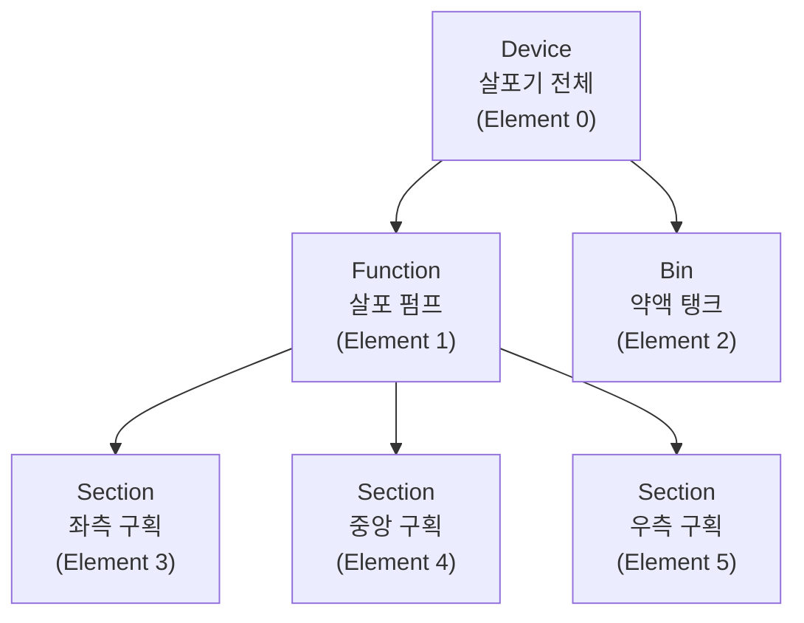
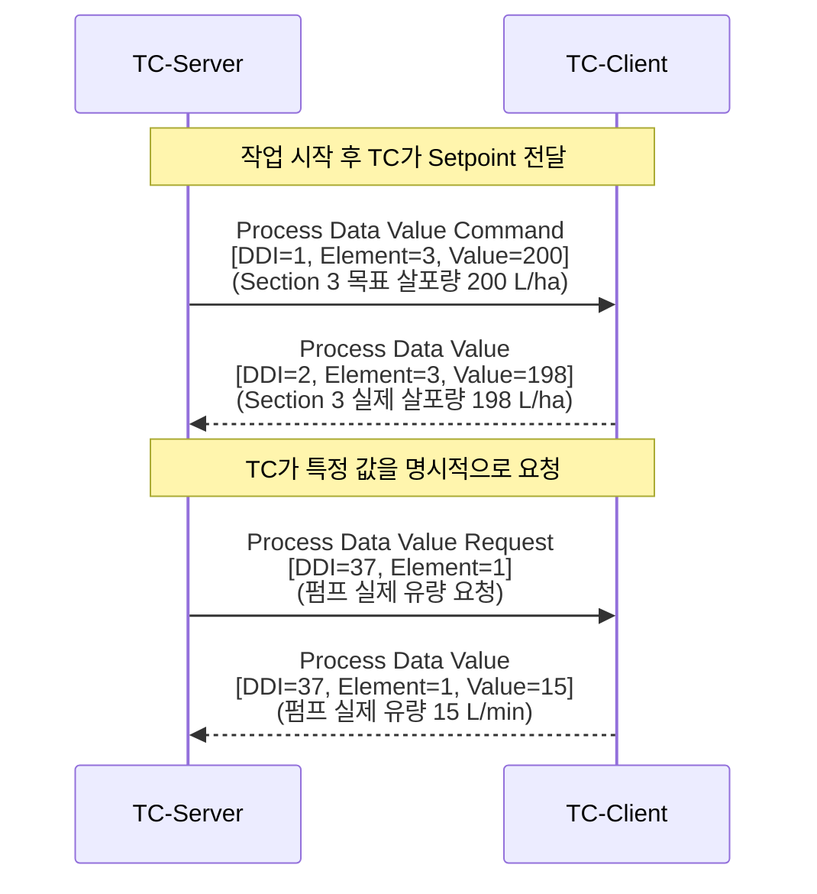
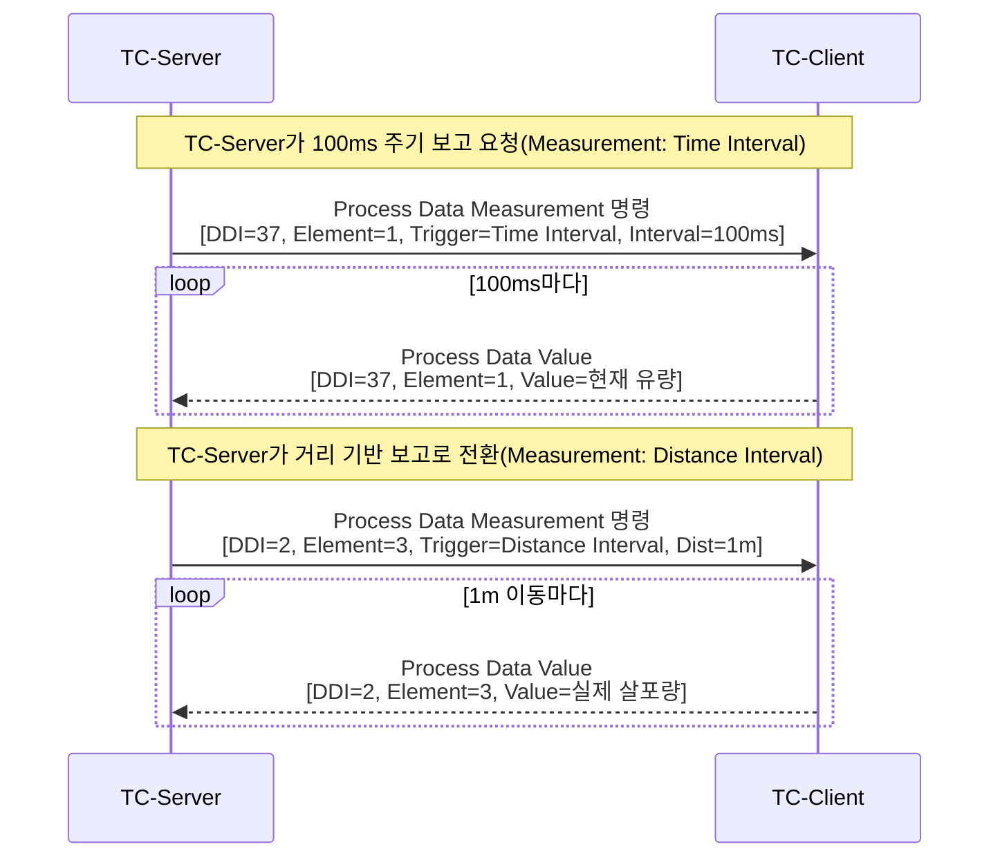
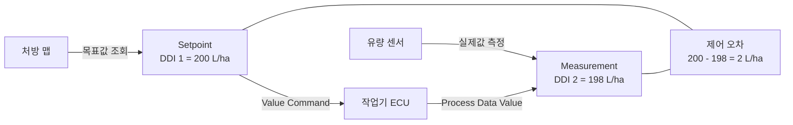
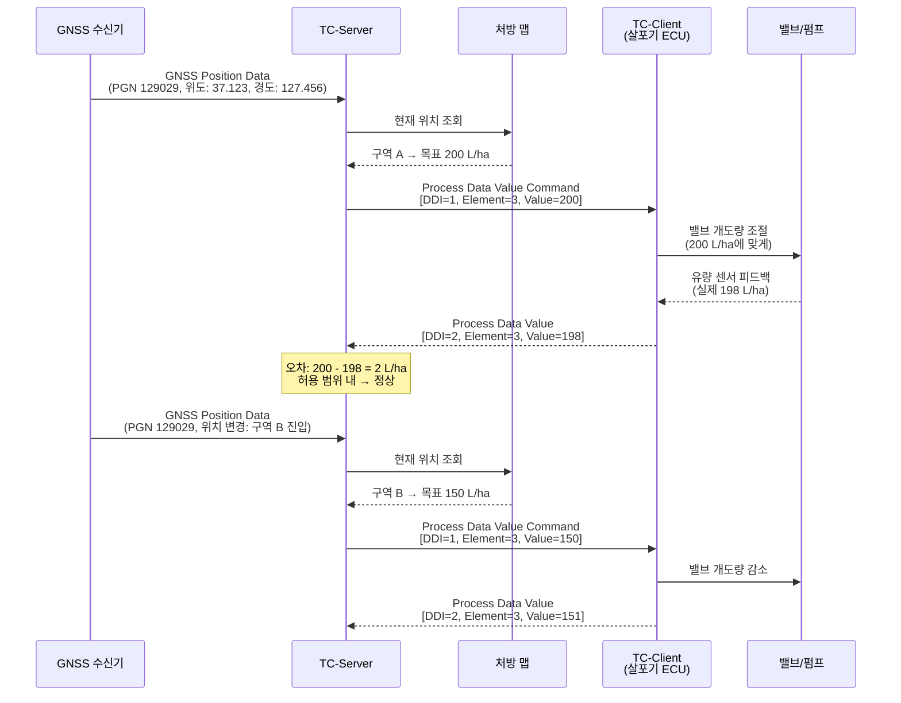

# TC 프로세스 데이터

::: info 학습 목표
- DDI(Data Dictionary Identifier)의 의미와 주요 번호를 설명할 수 있다.
- Device Element의 타입과 역할을 구분할 수 있다.
- Value Command와 Process Data Value의 흐름을 시퀀스 다이어그램으로 그릴 수 있다.
- Measurement와 Setpoint의 차이를 이해하고 제어 오차의 개념을 설명할 수 있다.
- 살포량 제어 시나리오를 통해 전체 프로세스 데이터 흐름을 추적할 수 있다.
- Process Data 메시지의 command 니블(`0x0`~`0xF`)을 보고 메시지 구조·송신 방향·기본 우선순위를 판별할 수 있다.
- PDACK 8바이트를 디코딩해 거부 사유와 응답 대상 명령을 진단할 수 있다.
- measurement 조합·task total·default logging·peer control 규칙에 맞춰 TC 서버의 데이터 수집 시퀀스를 설계할 수 있다.
:::

## 1. DDI (Data Dictionary Identifier)

<strong>DDI</strong>는 TC 프로세스 데이터 항목을 구분하는 표준화된 16비트 번호이다.

> DDI는 "어떤 종류의 데이터인가"를 나타낸다. 살포량인지, 속도인지, 면적인지를 숫자로 표현한다.

값을 주고받는 Process Data 메시지는 DDI를 포함하여 어떤 데이터를 주고받는지 명시한다. 주요 DDI는 다음과 같다.

| DDI | 이름 | 방향 | 설명 |
|-----|------|------|------|
| **1** | Setpoint Volume Per Area Application Rate | TC → 작업기 | 면적당 목표 살포량 (액체) |
| **2** | Actual Volume Per Area Application Rate | 작업기 → TC | 면적당 실제 살포량 (센서 측정) |
| **6** | Setpoint Mass Per Area Application Rate | TC → 작업기 | 면적당 목표 살포 질량 (고체) |
| **7** | Actual Mass Per Area Application Rate | 작업기 → TC | 면적당 실제 살포 질량 |
| **36** | Setpoint Volume Per Time Application Rate | TC → 작업기 | 시간당 목표 유량 |
| **37** | Actual Volume Per Time Application Rate | 작업기 → TC | 시간당 실제 유량 |
| **141** | Actual Work State | 작업기 → TC | 요소의 실제 작업 상태 (2비트: 00=Off, 01=On, 10=오류, 11=미설치) |
| **289** | Setpoint Work State | TC → 작업기 | 개별 요소의 ON/OFF 목표 명령 (DDI 141의 명령 짝) |
| **290** | Setpoint Condensed Work State (1-16) | TC → 작업기 | 섹션 1~16의 ON/OFF 일괄 명령 (섹션당 2비트) |

전체 DDI 목록은 [isobus.net](https://www.isobus.net/isobus/dDI)에서 확인할 수 있다. 현재 약 600개 이상의 DDI가 정의되어 있다.

### DDI가 없으면 TC는 데이터를 해석할 수 없다

TC가 수신하는 메시지에는 32비트 정수 값이 포함된다. 그 값이 어떤 의미인지—살포량인지, 유량인지, 속도인지—는 오직 DDI가 결정한다. DDI 없이 값만 전달되면 TC는 바이트 데이터의 의미를 전혀 해석할 수 없다. DDI는 데이터의 "단위표"이자 "해석 키"이다.

### Resolution(분해능)과 단위

각 DDI에는 표준으로 정해진 분해능과 단위가 있다. TC-Client는 이 규칙에 따라 정수 값을 인코딩하여 전송하고, TC-Server는 동일한 규칙으로 디코딩한다.

| DDI | 단위 | 분해능 | 예시 |
|-----|------|--------|------|
| 1 (Setpoint Volume Per Area) | mm³/m² | 0.01 | 원시값 2,000,000 → 20,000 mm³/m² = 200 L/ha |
| 2 (Actual Volume Per Area) | mm³/m² | 0.01 | 원시값 1,980,000 → 19,800 mm³/m² = 198 L/ha |
| 36 (Setpoint Volume Per Time) | mm³/s | 1 | 원시값 250,000 → 250,000 mm³/s = 15 L/min |
| 37 (Actual Volume Per Time) | mm³/s | 1 | 원시값 246,667 → 246,667 mm³/s ≈ 14.8 L/min |

mm³/m²는 μL/m²와 같은 값이며, 1 L/ha = 100 mm³/m²다. 시간당 유량은 1 L/min = 16,666.7 mm³/s로 환산된다. 분해능이 다른 DDI끼리 값을 교환하면 단위 불일치가 발생한다. TC 구현 시 DDI별 스케일 팩터를 반드시 적용해야 한다.

### Setpoint DDI와 Actual DDI의 쌍 구조

ISOBUS 표준은 같은 물리량에 대해 Setpoint DDI와 Actual DDI를 쌍으로 정의한다. TC-Server는 Setpoint DDI로 목표값을 명령하고, 작업기 ECU는 Actual DDI로 실제 측정값을 보고한다.

| 물리량 | <strong>Setpoint</strong> DDI (TC → 작업기) | <strong>Actual</strong> DDI (작업기 → TC) |
|--------|------|------|
| 면적당 살포량 | DDI 1 | DDI 2 |
| 시간당 유량 | DDI 36 | DDI 37 |
| 면적당 살포 질량 | DDI 6 | DDI 7 |
| 작업 상태(Work State) | DDI 289 | DDI 141 |

이 쌍 구조 덕분에 TC는 목표값(DDI 1)과 실제값(DDI 2)을 같은 물리 단위로 비교하여 제어 오차를 계산할 수 있다.

## 2. Element

<strong>Device Element(DeviceElement)</strong>는 작업기의 논리적 구성 단위이다. 물리적 장치를 계층적으로 표현한다.

### Element Type

| 코드 | 타입 | 설명 | 예시 |
|------|------|------|------|
| 1 | **Device** | 전체 장치 (최상위, DDOP당 1개, Element Number=0) | 살포기 전체 |
| 2 | **Function** | 기능 단위 | 살포 펌프, 교반기 |
| 3 | **Bin** | 저장 용기 | 약액 탱크, 비료 빈 |
| 4 | **Section** | 분할 구획 | 붐 스프레이어의 좌/우 섹션 |
| 5 | **Unit** | Section 하위의 가장 세분화된 주소 지정 단위 | 노즐, 파종 로우 유닛 |
| 6 | **Connector** | 연결 포인트 | 히치 연결부 |
| 7 | **Navigation Reference** | 위치 기준점 | GPS 안테나 기준 작업 위치 오프셋 |

각 Element는 <strong>Element Number</strong>로 식별된다. 예를 들어, Section 1은 Element Number 1, Section 2는 Element Number 2로 구분된다.



### Element 간 부모-자식 관계

Element는 계층 구조를 이룬다. <strong>Device</strong>가 최상위이며, 그 아래에 <strong>Function</strong>과 <strong>Bin</strong>이 중간 계층으로 위치한다. <strong>Section</strong>은 이 예시에서 가장 말단에 해당하며, 실제로는 그 아래에 노즐 단위인 <strong>Unit</strong>이 더 세분화된 계층으로 올 수 있다. TC-Server가 특정 Element에 명령을 보낼 때는 해당 Element Number를 지정한다. 부모 Element에 명령을 보내면 그 아래 모든 자식 Element에 적용되는 것이 일반적이다.

TC가 특정 Section에만 명령을 보내려면 해당 Section의 Element Number를 명시적으로 지정해야 한다. 예를 들어, Section 3(Element 5)에만 DDI 289(Setpoint Work State)로 OFF 명령을 보내면, 나머지 두 구획(Section 1, Section 2)은 살포를 계속하면서 우측 구획만 살포가 중단된다. 작업기 ECU는 실제로 반영된 상태를 DDI 141(Actual Work State)로 되돌려 보고한다. 이 메커니즘이 붐 스프레이어의 구획별 살포 제어(Section Control)를 가능하게 한다.

## 3. Value Command / Value Request

TC-Server와 TC-Client는 **Process Data** 메시지(PGN: 0x00CB00)를 통해 값을 주고받는다.

### 메시지 방향

| 메시지 | 방향 | Command 코드 | 설명 |
|--------|------|------|------|
| **Process Data Value Command** | TC-Server → TC-Client | 3<sub>16</sub> (Value command) | 설정값(Setpoint) 전달, 작업기에 목표값 명령 |
| **Process Data Value** | TC-Client → TC-Server | 3<sub>16</sub> (Value command) | 측정값(Measurement) 보고 |
| **Process Data Value Request** | TC-Server → TC-Client | 2<sub>16</sub> (Request value) | 특정 DDI의 현재값을 1회 요청 |

Process Data 메시지의 첫 니블은 이처럼 0<sub>16</sub>~F<sub>16</sub> 범위의 command 값으로 메시지 종류를 구분한다. 값 설정과 동시에 수신 확인이 필요하면 A<sub>16</sub>(Set Value and Acknowledge)을 쓰며, 이 경우 응답은 아래에서 다룰 PDACK(D<sub>16</sub>)로 온다.

### 시퀀스 다이어그램



### PGN 0x00CB00 메시지 구조

Process Data 메시지는 총 8바이트로 구성되며, 필드 순서는 <strong>Command → Element Number → DDI → Value</strong>다.

| 바이트 | 필드 | 설명 |
|--------|------|------|
| 0 (하위 4비트) | Command | 명령 코드 (2=Request Value, 3=Value Command, A=Set Value and Acknowledge 등) |
| 0 (상위 4비트) + 1 | Element Number | 대상 Element 번호 (12비트, 0~4095) |
| 2–3 | DDI | 데이터 항목 번호 (16비트) |
| 4–7 | Value | 32비트 부호 있는 정수 값 |

Element Number가 DDI보다 앞선 바이트에 위치한다는 점에 주의한다 — "어느 요소의 값인가"를 먼저 지정하고, 그 뒤에 "어떤 종류의 값인가(DDI)"를 붙이는 순서다.

### PDACK (Process Data Acknowledge)

TC-Client(Working Set Master)와 TC-Server는 명령을 수락·거부할 때 <strong>PDACK</strong>(command D<sub>16</sub>)로 응답할 수 있다. Element Number·DDI·오류 코드(0=정상, 그 외 비트=명령 미지원/잘못된 Element/DDI 미지원/트리거 미지원/설정 불가/유효 범위 초과 등)를 담아 반환한다. 불필요한 버스 부하를 피하기 위해, 오류 코드 0(정상)인 PDACK는 Measurement 명령(4~8<sub>16</sub>)과 Set Value and Acknowledge(A<sub>16</sub>)에 대해서만 보내고 나머지 명령에는 생략한다.

### Trigger Method

TC-Client가 Measurement 값을 TC-Server에 보고하는 조건을 <strong>Trigger Method</strong>라고 한다. TC-Server는 Measurement 명령(4~8<sub>16</sub>)을 보내 TC-Client에 트리거 방법과 그 파라미터(간격·임계값)를 설정한다.

| 트리거 방법 | 설명 | 예시 |
|-------------|------|------|
| **Time Interval** | 일정 시간마다 보고 | 100ms마다 현재 유량 전송 |
| **Distance Interval** | 일정 거리마다 보고 | 1m 이동할 때마다 살포량 전송 |
| **Threshold** | 값이 최소 임계값보다 클 때(6<sub>16</sub>) 또는 최대 임계값보다 작을 때(7<sub>16</sub>) 보고 | 유량이 5 L/min 미만으로 떨어지면 전송 |
| **On Change** | 마지막 보고 이후 변화량이 설정한 임계값 이상일 때 보고 | 섹션 상태가 ON→OFF로 바뀔 때만 전송 |
| **Total** | 누적값 요청 시 보고 | 작업 종료 후 총 살포량 요청 |

TC-Server가 트리거 방법을 설정하는 흐름은 다음과 같다.



트리거 방법을 적절히 설정하면 CAN 버스 트래픽을 줄이면서도 필요한 시점에 정확한 데이터를 수집할 수 있다.

## 4. Measurement / Setpoint

TC 프로세스 데이터는 크게 두 가지로 구분된다.

| 구분 | 생성 주체 | 방향 | 의미 |
|------|-----------|------|------|
| **Setpoint** | TC-Server | TC → 작업기 | TC가 처방 맵에서 조회한 목표 값 |
| **Measurement** | 작업기 센서 | 작업기 → TC | 작업기가 실제로 측정한 값 |



**제어 오차(Control Error)** = Setpoint − Measurement

작업기의 제어 시스템은 이 오차를 최소화하도록 밸브 개도량, 펌프 속도 등을 조절한다. TC는 오차가 허용 범위를 벗어나면 알람을 발생시킬 수 있다.

오차가 허용 범위를 벗어나면 TC는 ISO 11783-12에 정의된 <strong>DM1(Diagnostic Message 1)</strong> 진단 코드를 생성할 수 있다. DM1 메시지는 SPN(Suspect Parameter Number)과 FMI(Failure Mode Indicator)를 포함하여 어떤 파라미터가 어떤 방식으로 이상 상태인지 기록한다. 예를 들어 실제 살포량이 목표값 대비 20% 이상 낮으면 "유량 부족" 진단 코드가 발생할 수 있다.

작업기 ECU 내부에서는 <strong>PID(Proportional-Integral-Derivative) 제어 루프</strong>가 오차를 줄이는 방향으로 밸브를 조절한다. P 항은 현재 오차에 즉각적으로 반응하고, I 항은 지속적인 정상 오차(Steady-State Error)를 제거하며, D 항은 오차 변화율에 반응하여 과도한 진동을 억제한다. TC-Server는 Setpoint를 명령할 뿐이며, PID 제어는 전적으로 작업기 ECU(TC-Client 측)가 수행한다.

## 5. 프로세스 데이터 흐름 실습

### 시나리오: GPS 기반 살포량 제어

트랙터가 밭을 주행하면서 위치에 따라 비료 살포량을 자동으로 조절하는 시나리오이다.

**조건**
- 처방 맵: 구역 A = 200 L/ha, 구역 B = 150 L/ha
- 살포기: 3구획, 각 3m 폭 (총 9m)
- DDI 1: Setpoint Volume Per Area / DDI 2: Actual Volume Per Area



이 시퀀스는 TC 프로세스 데이터의 전체 흐름을 보여준다. GPS 위치 변화에 따라 처방 맵의 목표값이 바뀌고, TC는 그 값을 즉시 TC-Client에 전달한다.

> **핵심 정리**
> - DDI(Data Dictionary Identifier)는 TC 데이터 항목을 구분하는 16비트 표준 번호이다. DDI 1=Setpoint Volume Per Area Application Rate, DDI 2=Actual Volume Per Area Application Rate.
> - Device Element는 작업기의 논리적 구성 단위로, Device/Function/Bin/Section/Unit 등의 타입으로 분류된다.
> - TC-Server → TC-Client 방향의 Value Command로 Setpoint를 전달하고, TC-Client → TC-Server 방향의 Process Data Value로 Measurement를 보고한다.
> - Setpoint는 처방 맵 기반 목표값이고, Measurement는 센서 실측값이며, 그 차이가 제어 오차가 된다.
> - GPS 위치(NMEA 2000 GNSS Position Data, PGN 129029) → 처방 맵 조회 → Value Command 전송 → 밸브 조절 → Measurement 보고 순으로 제어 루프가 완성된다.

## 6. Process Data 메시지 조립하기

지금까지는 `[DDI=1, Element=3, Value=200]`처럼 필드를 나열한 표기로 메시지를 설명했다. 실제 버스에는 이 값들이 8바이트 안에 정확한 비트 위치로 눌러 담겨 나간다. §3의 바이트 배치표(Command → Element Number → DDI → Value)를 이번에는 숫자로 끝까지 채워본다.

### 목표: Section 3에 200 L/ha 명령하기

TC-Server가 Section 3(Element Number 3)에 DDI 1(Setpoint Volume Per Area Application Rate)로 목표 살포량 200 L/ha를 명령하는 상황이다. §1의 분해능 표에 따르면 DDI 1의 단위는 mm³/m², 분해능은 0.01이다.

1. 물리량 → mm³/m² 환산: 1 L/ha = 100 mm³/m²이므로 200 L/ha = 20,000 mm³/m²
2. mm³/m² → raw 값 환산: raw = 물리값 ÷ 분해능 = 20,000 ÷ 0.01 = 2,000,000

즉 버스에 실어야 하는 32비트 정수는 <strong>2,000,000</strong>(`0x1E8480`)이다.

### Byte 1~2 — Command 4비트와 Element Number 12비트를 나누어 담기

§3에서 다룬 대로 Command와 Element Number는 8비트 경계를 걸쳐 나뉜다. 헷갈리는 지점이 바로 여기다.

| 필드 | 비트 폭 | 위치 |
|---|---|---|
| Command | 4비트 | Byte 1의 <strong>하위</strong> 4비트(bit 4~1) |
| Element Number 하위 4비트 | 4비트 | Byte 1의 <strong>상위</strong> 4비트(bit 8~5) |
| Element Number 상위 8비트 | 8비트 | Byte 2 전체 |

Element Number는 한 바이트에 다 담기지 않는다. <strong>하위 4비트는 Command와 한 바이트를 나눠 쓰고, 남은 상위 8비트가 다음 바이트를 통째로 차지</strong>한다. Command가 Byte 1의 절반을 먼저 차지하고 있기 때문에 생기는 배치다.

이 명령은 Command = 3(Value command), Element Number = 3(Section 3)이다. Element Number 3을 12비트로 쓰면 `0000 0000 0011`이므로, 하위 4비트는 `0011`, 상위 8비트는 `0000 0000`이다.

| 니블 | 값 | 비트 |
|---|---|---|
| Byte 1 bit 8~5 (Element 하위 4비트) | 3 | `0011` |
| Byte 1 bit 4~1 (Command) | 3 | `0011` |
| Byte 1 전체 | `0x33` | `0011 0011` |
| Byte 2 (Element 상위 8비트) | 0 | `0000 0000` |

Element Number가 16 미만이면 Byte 2는 항상 `0x00`이 된다. Element Number가 16 이상으로 올라가야 비로소 Byte 2에 값이 실린다 — 예를 들어 Element Number 20(`0001 0100`)이면 하위 4비트 `0100`이 Byte 1 상위 니블에, 상위 8비트 `0000 0001`이 Byte 2 전체에 들어가 Byte 2가 `0x01`이 된다.

### Byte 3~8 채우기

| 바이트 | 필드 | 값 |
|---|---|---|
| Byte 3~4 | DDI(LSB, MSB) | DDI=1 → `0x01 0x00` |
| Byte 5~8 | Value(부호 있는 32비트, LSB부터) | 2,000,000 → `0x80 0x84 0x1E 0x00` |

완성된 8바이트:

```
33 00 01 00 80 84 1E 00
```

### 분해: 수신한 8바이트에서 되돌리기

이번엔 반대 방향이다. TC-Server가 Section 3의 DDI 2(Actual Volume Per Area Application Rate)를 Request Value(Command 2)로 요청했고, TC-Client가 다음 8바이트로 응답했다고 하자.

```
33 00 02 00 60 36 1E 00
```

| 단계 | 연산 | 결과 |
|---|---|---|
| Command | Byte1 bit 4~1 | `0x33 & 0x0F` = 3 → Value command(값 응답) |
| Element Number | (Byte1 bit 8~5) \| (Byte2 << 4) | `(0x33 >> 4) \| (0x00 << 4)` = 3 → Section 3 |
| DDI | Byte3 \| (Byte4 << 8) | `0x02 \| (0x00 << 8)` = 2 → Actual Volume Per Area |
| Value(raw) | Byte5~8, LSB 우선, 부호 있는 32비트 | `0x1E3660` = 1,980,000 |

### 해상도를 반영해야 진짜 값이 나온다

raw 값 1,980,000은 그 자체로는 단위가 없다. DDI 2의 분해능 0.01을 곱해야 mm³/m²가 되고, 다시 100으로 나눠야 L/ha가 된다.

1,980,000 × 0.01 = 19,800 mm³/m² → 19,800 ÷ 100 = <strong>198 L/ha</strong>

§1 표의 값과 정확히 일치한다. 만약 해상도를 반영하지 않고 raw 200을 그대로 DDI 1에 실어 보냈다면 어떻게 될까 — 조립 예제와 같은 8바이트 구조에 Value만 200을 넣으면 `33 00 01 00 C8 00 00 00`이 되고, 수신 측이 규정대로 0.01을 곱하면 200 × 0.01 = 2 mm³/m² = 0.02 L/ha로 해석된다. 목표한 200 L/ha의 1만분의 1이다. <strong>정수 200을 "200 L/ha"로 착각해 그대로 실어 보내는 것</strong>이 현장에서 흔히 나는 실수다.

### 같은 대상, 다른 Command — Byte 1이 어떻게 바뀌는가

Element Number(3)와 DDI(1)는 그대로 두고 Command만 바꿔보면, Byte 1의 상위 니블은 고정된 채 하위 니블만 움직인다.

| Command | 의미 | Byte 1 | 전체 프레임 |
|---|---|---|---|
| 2 | Request value(값 요청) | `0x32` | `32 00 01 00 00 00 00 00` |
| 3 | Value command(설정값 전달) | `0x33` | `33 00 01 00 80 84 1E 00` |
| A | Set Value and Acknowledge(설정 + 수신 확인 요구) | `0x3A` | `3A 00 01 00 80 84 1E 00` |

Request value(2)의 Value 필드는 위 표에서 0으로 채웠다 — 값을 요청하는 메시지이므로 응답 전까지는 채울 값이 없다는 점만 확인 가능할 뿐, 이 자리를 반드시 0으로 채워야 한다는 규칙이 표준 원문에 명시된 것은 아니다. Command만 3에서 A로 바뀌어도 Byte 3~8은 동일하다는 점에 주목한다 — 두 메시지의 차이는 "TC-Client가 PDACK로 수신 확인을 보내야 하는가"뿐이며, 가리키는 대상과 값은 같다.

:::details 파이썬으로 검산해 보기
```python
def build_frame(command, element, ddi, value):
    byte1 = ((element & 0xF) << 4) | (command & 0xF)
    byte2 = (element >> 4) & 0xFF
    ddi_bytes = ddi.to_bytes(2, "little")
    value_bytes = value.to_bytes(4, "little", signed=True)
    return bytes([byte1, byte2]) + ddi_bytes + value_bytes


def parse_frame(frame):
    command = frame[0] & 0x0F
    element = (frame[0] >> 4) | (frame[1] << 4)
    ddi = frame[2] | (frame[3] << 8)
    value = int.from_bytes(frame[4:8], "little", signed=True)
    return command, element, ddi, value


# 조립: Section 3(Element=3), DDI 1, 200 L/ha
raw = int(200 * 100 / 0.01)          # 200 L/ha -> 20,000 mm3/m2 -> raw
frame = build_frame(command=3, element=3, ddi=1, value=raw)
print(frame.hex(' ').upper())        # 33 00 01 00 80 84 1E 00

# 분해: 수신 프레임에서 필드 복원
received = bytes.fromhex("33 00 02 00 60 36 1E 00")
command, element, ddi, value = parse_frame(received)
print(command, element, ddi, value)  # 3 3 2 1980000
print(value * 0.01 / 100)            # 198.0 (L/ha)

# 해상도를 빼먹은 경우
mistake = build_frame(command=3, element=3, ddi=1, value=200)
print(mistake.hex(' ').upper())      # 33 00 01 00 C8 00 00 00
print(200 * 0.01 / 100)              # 0.02 (L/ha) — 의도한 200의 1/10000
```
:::

## 7. 클라이언트가 지켜야 할 송신 규칙

지금까지 다룬 예제는 대부분 TC가 먼저 명령이나 요청을 보내고 클라이언트가 응답하는 흐름이었다. 그런데 클라이언트가 스스로 값을 밀어 넣을 수 있는 경로도 있다(§3의 Measurement, §1의 Trigger Method). 이 절은 그 송신 쪽에 표준이 정해 둔 제약을 정리한다.

### 핵심 원칙 — 요청받은 것만 보낸다

클라이언트는 자기가 가진 값을 임의로 골라 TC에 뿌리지 않는다. 클라이언트가 값을 보낼 수 있는 경로는 다음 세 가지뿐이다.

| 경로 | 트리거 |
|---|---|
| Request value 명령 | TC의 1회성 요청(Command 2, §3) |
| Default data logging | `RequestDefaultProcessData`(DDI `0xDFFF`)로 활성화된, 클라이언트 스스로 정한 데이터·주기 |
| 개별 measurement 명령 | TC가 지정한 Trigger Method(Command 4~8, §3)에 따른 주기적 보고 |

이 세 경로 밖에서 클라이언트가 임의로 값을 송신하는 것은 표준을 벗어난 동작이다.

### 대역폭 상한과 burst 예외

<strong>연결당·process data variable당 초당 최대 10개 메시지</strong>가 기본 상한이다. 예외적으로 헤드랜드 진입·이탈처럼 work state를 짧게 몰아 제어해야 하는 상황에서는 이 상한을 일시적으로 넘길 수 있다. 단 이 예외는 아무 DDI에나 적용되지 않고, <strong>Setpoint/Actual Condensed Work State(§1의 DDI 290 등) 같이 ISO 11783-11 데이터 사전에 명시된 DDI</strong>에 한정된다.

### measurement 명령 ACK — 응답 전에는 다음 명령 불가

TC가 보내는 measurement 명령(Command 4~8, §3)에는 클라이언트가 반드시 <strong>PDACK</strong>(§3)로 응답해야 한다. 이 응답이 오기 전까지 TC는 같은 클라이언트로 다음 measurement 명령을 보낼 수 없다 — 명령이 순차적으로만 진행된다는 뜻이다.

수락 시 클라이언트는 <strong>positive ACK와 함께, 측정을 시작하는 시점의 초기값</strong>을 함께 보낸다. 이 초기값 전송은 버전 4에서 도입됐다 — 버전 3까지는 거부할 때만 negative ACK를 보내면 됐고, 수락 시 초기값을 함께 보내야 한다는 규정은 없었다.

### 요청-응답 동기화 — 버전 3과 버전 4의 차이

버전 4부터는 TC가 보낸 요청에 클라이언트가 응답해야만 TC가 같은 클라이언트로 다음 요청을 보낼 수 있다. 버전 3까지는 이와 달리, 클라이언트의 응답을 기다리지 않고 요청을 여러 개 묶어 보내는 <strong>블록 요청</strong>이 가능했다. 즉 버전 4는 요청 흐름을 순차적(하나씩 확인하며 진행)으로 바꾼 변화다.

### DDOP 활성화 전 초기화 의무

클라이언트는 DDOP를 TC에 <strong>활성화하기 전에</strong> 내부 process data variable들을 올바른 운영값으로 초기화해 둬야 한다. DDOP가 활성화되면 TC는 곧바로 장치 지오메트리 등을 요청할 수 있는데, 이때 클라이언트가 아직 초기화 전이라 임의값이나 미정의값을 돌려주면 TC는 그 잘못된 값을 그대로 신뢰하고 이후 제어를 시작하게 된다.

### Task totals active 비트와 measurement

TC Status 메시지의 <strong>"Task totals active" 비트</strong>가 0에서 1로, 또는 1에서 0으로 바뀌면 — 즉 태스크가 시작되거나 종료되는 시점마다 — 그 TC Status를 송신하는 CF가 지정한 <strong>모든 measurement를 클라이언트가 중지</strong>해야 한다. 중지된 measurement는 TC가 개별 measurement 명령을 다시 보내거나 default data logging 트리거로 재시작한다.

비트가 0인 동안(태스크 비활성 상태)에도 TC가 시작한 measurement는 존재할 수 있다 — 이 measurement는 TC가 중지 명령으로 멈출 수 있지만, <strong>비트를 0에서 1로 바꾸기 직전에 미리 중지해서는 안 된다</strong>. "Task totals active" 비트 자체는 default data logging 명령의 송수신만 제한할 뿐, 그 외의 Process Data 명령 송수신 전반을 막지는 않는다.

### TC 쪽 대응 규칙 — 참고

반대로 TC는 태스크 파일에 없는 process data variable을 담은 메시지도 만들 수 있다(예: 센서 시스템 값 활용). 다만 TC는 <strong>클라이언트가 지원한다고 밝힌 variable만</strong> 그 클라이언트에 송신·요청해야 한다 — 클라이언트 입장에서는 DDOP에 선언한 범위를 벗어난 요청이 오지 않는다는 전제로 동작한다.

### 재시도

PGN 응답 대기 시간, 요청이 응답 없이 실패했을 때의 재시도 간격은 이 표준이 아니라 <strong>ISO 11783-3</strong>(네트워크 계층)을 따른다. 클라이언트가 특정 measurement를 지원하지 않아 TC가 주기적 값 요청(Command 2)으로 폴백하는 경우도 마찬가지다.

## 8. 전체 흐름 — 두 오브젝트 풀과 처방 맵

§5는 이미 작업이 시작된 뒤의 제어 루프만 보여준다. 그런데 그 루프가 성립하려면 그 전에 준비가 끝나 있어야 한다. TC는 어떻게 DDI 1이 이 살포기의 살포량이라는 걸 알았고, 화면의 숫자는 누가 고치는가. 연결부터 실적 기록까지를 한 줄로 이으면 다음과 같다.

### 데이터가 어디에 있는가

먼저 짚을 것은, 작업기 ECU가 <strong>서로 다른 두 개의 오브젝트 풀</strong>을 플래시에 갖고 있다는 점이다.

| | VT 오브젝트 풀 | DDOP |
|---|---|---|
| 정의 | ISO 11783-6 | ISO 11783-10 |
| 올리는 곳 | Virtual Terminal | Task Controller |
| 담는 것 | Data Mask, Output Number, Button 등 <strong>그리는 방법</strong> | DVC, DET, DPD 등 <strong>기계의 구조와 쓸 수 있는 DDI</strong> |
| 읽는 주체 | 사람(운전자) | 소프트웨어(TC) |
| 값 식별 | Object ID | DDI |
| PGN | 0xE700 / 0xE600 | 0xCB00 |

여기에 세 번째 데이터가 더해진다. <strong>처방 맵</strong>이다. 이건 작업기가 아니라 FMIS가 만들어 USB로 들어오고, CAN이 아니라 파일로 전달된다. TASKDATA.XML 안에 TreatmentZone(구획)과 그 구획의 목표값(ProcessDataVariable)이 들어 있고, 격자형 맵은 셀 값이 별도 바이너리 파일에 담긴다.

정리하면 <strong>작업기는 "나를 어떻게 그리는지"와 "나를 어떻게 조작하는지"를, FMIS는 "밭의 어디에 얼마를 뿌릴지"를 각각 들고 온다.</strong> 이 셋이 만나야 가변 살포가 성립한다.

### 직접 재생해 보기

아래 애니메이션은 전원을 켠 순간부터 실제 살포까지를 그대로 재생한다. 위쪽에서는 패킷이 버스를 타고 노드 사이를 날아다니며 각 장치가 데이터를 하나씩 채워 가고, 아래에서는 트랙터가 처방 맵 위를 지나간다. <strong>붐의 섹션 6개가 각각 다른 색으로 바뀌는 순간</strong>을 보자 — 그때마다 Value command가 나간다. 화면을 누르면 멈추고 다시 누르면 이어진다.

<IsobusFlowDemo />

### 흐름에서 놓치기 쉬운 것

<strong>두 풀은 서로를 모른다.</strong> TC가 setpoint를 바꿔 보내도 VT 화면은 저절로 바뀌지 않는다. 작업기 ECU가 값을 받은 뒤 <strong>따로</strong> VT에 Change Numeric Value를 보내 화면을 고친다. 표준에는 이 둘을 잇는 자동 경로가 없고, 동기화는 작업기 펌웨어의 몫이다. 이 분리 덕분에 VT만 있는 트랙터에서도 화면은 뜨고, TC만 지원하는 작업기도 처방 맵 제어가 된다.

<strong>setpoint는 주기적으로 나가지 않는다.</strong> 표준은 관련 DeviceElement가 새 TreatmentZone에 들어갔을 때 그 구획의 setpoint를 전송하도록 규정한다. 구획 경계를 넘는 순간이 트리거다.

<strong>구획 판정은 기계 단위가 아니라 device element 단위다.</strong> 12미터 붐이 경계에 걸쳐 있으면 왼쪽 섹션과 오른쪽 섹션이 서로 다른 구획에 속할 수 있고, 각각 다른 setpoint를 받는다. 이것이 정밀 살포의 핵심이며, DDOP에서 섹션을 DET로 하나하나 선언하는 이유이기도 하다.

<strong>DDOP에 없는 DDI는 쓸 수 없다.</strong> DPD의 property 비트에 settable이 서 있는 DDI만 TC가 setpoint로 내릴 수 있고, 선언되지 않은 DDI로 명령하면 작업기는 PDACK로 거부한다. §5의 `[DDI=1, Element=3, Value=200]`이 성립하는 근거가 바로 연결 시점에 올라간 DDOP다.

:::tip 한 줄 요약
작업기는 VT 풀(화면)과 DDOP(구조)를 각각 다른 서버에 올리고, FMIS는 처방 맵을 파일로 넣는다. TC는 DDOP로 "무엇을 보낼 수 있는지"를, 처방 맵으로 "얼마를 보낼지"를, GNSS로 "지금 어디인지"를 알아 Value command 한 줄을 만든다.
:::

## 9. Command 니블 전체 지도 — `0x0`부터 `0xF`까지

§3과 §6은 command 2·3·4~8·A·D만 다뤘다. Byte 1 하위 4비트(SPN 5199, 0~15)는 16개 값을 가질 수 있고, 값마다 나머지 바이트를 읽는 법이 다르다(ISO 11783-10:2015 B.1.1, Table B.1). 수신 측 파서는 이 니블부터 분기해야 한다.

| Command | 이름 | 대표 흐름 | 길이 | 기본 우선순위 | 나머지 바이트 |
|---|---|---|---|---|---|
| `0x0` | Technical capabilities | TC ↔ 클라이언트 | 8 | 5 | 상위 니블 = 하위 명령(B.5) |
| `0x1` | Device descriptor | 클라이언트 ↔ TC/DL | 8 이상 | 5 | 상위 니블 = 하위 명령(B.6) |
| `0x2` | Request value | TC → 클라이언트 | 8 | 5 | B.3 공통 배치 |
| `0x3` | Value command | 양방향 | 8 | 3 | B.3 공통 배치 |
| `0x4` | Measurement: time interval | TC/DL → 클라이언트 | 8 | 5 | B.3, 값 = 주기(ms) |
| `0x5` | Measurement: distance interval | TC/DL → 클라이언트 | 8 | 5 | B.3, 값 = 거리(mm) |
| `0x6` | Measurement: minimum threshold | TC/DL → 클라이언트 | 8 | 5 | B.3, 값 = 하한 |
| `0x7` | Measurement: maximum threshold | TC/DL → 클라이언트 | 8 | 5 | B.3, 값 = 상한 |
| `0x8` | Measurement: change threshold | TC/DL → 클라이언트 | 8 | 5 | B.3, 값 = 변화량 |
| `0x9` | Peer control assignment (v4) | TC → CF, 응답 CF → TC | 14 / 8 | 5 | B.4 전용 배치(§16) |
| `0xA` | Set Value and Acknowledge (v4) | TC → 클라이언트 | 8 | 3 | B.3 공통 배치 |
| `0xB`, `0xC` | 예약 | - | - | - | - |
| `0xD` | PDACK | 양방향 | 8 | 4 | B.7 전용 배치(§10) |
| `0xE` | Task Controller Status | TC/DL → 전역 | 8 | 3 | B.8.1 |
| `0xF` | Client Task | 클라이언트 → TC/DL | 8 | 3 | B.8.2 |

나머지 바이트를 읽는 법으로 묶으면 네 무리다.

- <strong>하위 명령형(`0x0`·`0x1`)</strong>: Byte 1 상위 니블이 element number가 아니라 하위 명령이다. `0x0`의 Version 계열은 [TC 기초](/study/isobus/18-tc-basics)에서, `0x1`의 DDOP 관리 명령은 [다음 챕터](/study/isobus/20-tc-ddop)에서 다룬다.
- <strong>B.3 공통형(`0x2`~`0x8`, `0xA`)</strong>: §6에서 조립한 Command 4비트 + Element 12비트 + DDI 16비트 + 값 32비트다.
- <strong>전용형(`0x9`, `0xD`)</strong>: 앞 4바이트는 B.3과 같고, 5바이트째부터 뜻이 달라진다.
- <strong>상태형(`0xE`, `0xF`)</strong>: element number와 DDI 자리를 not available(`FFF`, `FFFF`)로 채우고 Byte 5부터 상태 비트를 싣는다. 이 not available 표기는 버전 2에서 도입됐고, 받는 쪽은 이 필드를 무시해야 한다(B.8.1·B.8.2). 송신 주기와 연결 유지 규칙은 [TC 기초](/study/isobus/18-tc-basics)를 본다.

### 기본 우선순위는 버전 4에서 세 단계가 됐다

Process Data 메시지의 PGN은 51968(`0xCB00`), PDU format은 203이다(B.2). PF가 240보다 작은 PDU1 형식이라 PS 자리에 목적지 주소(DA)가 들어간다. 데이터 길이는 가변이고 최소 8바이트다.

기본 우선순위는 command마다 다르다. 3·A·E·F는 3, D는 4, 나머지(0·1·2·4~9)는 5다. 버전 3까지는 모두 3이었다. 원문은 이렇게 나눈 이유를 "ISO 11783-3의 우선순위 권고에 맞춰, 제어·연결 유지 메시지를 요청·확인 메시지보다 높게 두기 위해서"라고 밝힌다(B.2). 값 설정(3·A)과 상태(E·F)가 가장 높고, 확인(D)이 그다음, 요청과 측정 설정이 가장 낮다.

우선순위는 29비트 CAN ID의 맨 앞 3비트다. 그래서 PGN이 같아도 command에 따라 ID가 달라진다. TC의 SA를 `0xF7`, 클라이언트 SA를 `0x80`으로 두면(예시 값) 다음과 같다.

| 메시지 | 우선순위 | DA | SA | 29비트 CAN ID |
|---|---|---|---|---|
| TC → 클라이언트 Value command(3) | 3 | `0x80` | `0xF7` | `0x0CCB80F7` |
| TC → 클라이언트 Request value(2) | 5 | `0x80` | `0xF7` | `0x14CB80F7` |
| 클라이언트 → TC PDACK(D) | 4 | `0xF7` | `0x80` | `0x10CBF780` |

::: warning 로그 필터는 우선순위 비트를 빼고 건다
CAN 로그에서 Process Data를 CAN ID 하나(`0x0CCB80F7` 같은)로 거르면 우선순위가 다른 Request value나 PDACK가 빠진다. 우선순위 3비트를 마스크하고 PGN·DA·SA만 비교해 거른다. 원문이 정한 것은 "기본(default)" 우선순위이고, 버전 3 장비는 모든 command를 3으로 보낸다는 점도 함께 고려한다.
:::

그 밖에 메시지 전체에 걸리는 규칙은 다음과 같다.

- 전역 목적지(`0xFF`)로도 보낼 수 있다. 다만 컨트롤러는 자기에게 주소 지정된 것으로 판단한 메시지만 처리한다(B.2).
- Process Data 메시지는 "Task totals active" 비트 값과 무관하게 버스에 나타날 수 있고, TC·DL과 클라이언트 사이 통신 밖에서도 나타날 수 있다(B.1.1). §16의 peer control source가 user에게 직접 보내는 Value command가 그 예다.
- 독점(proprietary) DDI를 담아도 메시지 형식은 Annex B 정의를 그대로 따른다(B.1.1). DDI 범위는 §17에서 본다.
- 버전 4부터 TC 하나는 버스에서 CF 하나로 나타나야 하고, TC와의 통신은 Working Set Master만 한다(B.2). multi-member Working Set은 VT 연결용으로는 그대로 선언할 수 있지만, TC와는 Master만 말한다.

### Value command(3)는 응답이면서 설정이다

Table B.1은 Command 3을 "요청에 대한 값 응답"과 "값 설정"에 함께 쓴다고 정의한다. 같은 `33 00 02 00 …`이라도 누가 누구에게 보냈느냐로 뜻이 갈린다.

| 방향 | 의미 | 근거 |
|---|---|---|
| 클라이언트 → TC | Request value 응답, measurement 트리거에 따른 보고, default logging 보고 | Table B.1, 6.8 |
| TC → 클라이언트 | settable DPD의 값 설정(setpoint, task total 복원) | Table B.1, 6.8.3 |
| source CF → user CF | peer control로 할당된 setpoint 직접 전달 | 6.8.5 |

TC 서버 입장에서 클라이언트가 보낸 Command 3은 자기가 요청한 측정의 결과다. §7의 규칙대로 클라이언트는 요청받은 값만 보내야 하고, 요청보다 많은 값이 오면 TC는 초과분을 무시한다(6.8.2).

### Set Value and Acknowledge(A) — 성공을 확인받는 설정 명령

Command A는 값을 설정하면서 수신 확인을 요구한다(버전 4 도입). 응답은 PDACK(D)다(Table B.1). Command 3과의 차이는 "성공했을 때도 답이 오느냐"다. B.7은 오류 코드 0인 PDACK를 command 0·1·2·3·9·D·E·F에 대한 응답으로 보내지 말라고 정한다. 그래서 Command 3으로 setpoint를 보내면 성공은 침묵이고 실패만 PDACK로 돌아온다. Command A로 보내면 성공도 오류 코드 0인 PDACK로 돌아온다.

```
TC -> 클라이언트   3A 00 01 00 80 84 1E 00   Set Value and Acknowledge, Section 3, DDI 1, 200 L/ha
클라이언트 -> TC   3D 00 01 00 00 FA FF FF   PDACK: 오류 0, 응답 대상 command A
```

PDACK Byte 6의 `FA`는 하위 니블 `A`(응답 대상 command)와 예약된 상위 니블 `F`다. 이 필드는 §10에서 다시 본다.

A를 쓸 때 조심할 점은 세 가지다.

- 버전 4 명령이다. 클라이언트는 연결 초기화 때 Request Version으로 TC 버전을 확인하고 쓸 기능을 TC에 맞춘다(6.6.2 f·g). TC도 상대가 버전 3이면 Command 3을 쓰는 것이 안전하다(추론 — 버전 3 클라이언트는 A를 모른다).
- 확인 응답만큼 메시지가 늘어난다. variable당 초당 10개 상한(6.8 a)을 생각하면 A는 빈번한 제어보다 한 번만 확실히 넣어야 하는 값에 어울린다(추론).
- 섹션 on/off는 다른 확인 방식을 쓴다. Annex F는 Setpoint Condensed Work State에 on change measurement를 걸어 두고, 명령마다 클라이언트가 갱신 값을 돌려보내게 하라고 권한다(F.3.5.1). F.3.5.5의 시퀀스는 이 응답 메시지와 상태 변화 시작 즉시 보내는 actual 상태 갱신을 필수로 둔다.

::: tip 정리
- Command 니블이 메시지 구조를 정한다. `0x0`·`0x1`은 하위 명령형, `0x2`~`0x8`·`0xA`는 B.3 공통형, `0x9`·`0xD`는 전용형, `0xE`·`0xF`는 상태형이다.
- 기본 우선순위는 버전 4부터 3(3·A·E·F), 4(D), 5(나머지)로 나뉜다.
- Command 3은 응답과 설정을 겸한다. 설정의 성공 확인까지 필요하면 버전 4의 A를 쓴다.
:::

## 10. PDACK 해부 — 8바이트와 오류 비트

PDACK(Process Data Acknowledge)는 클라이언트(Working Set Master)나 TC/DL이 명령 또는 process data를 수락·거부할 때 보내는 응답이다(B.7). §3에서는 오류 코드의 이름만 나열했다. 여기서는 바이트 단위로 연다.


| 위치 | 내용 | 해당 없음일 때 |
|---|---|---|
| Byte 1 bit 4~1 | `1101` (PDACK) | - |
| Byte 1 bit 8~5, Byte 2 | 대상 element number(12비트) | `FFF` |
| Byte 3~4 | 대상 DDI(LSB, MSB) | `FFFF` |
| Byte 5 | Process Data 오류 코드(0 = 오류 없음) | - |
| Byte 6 bit 4~1 | 이 PDACK가 응답하는 command(버전 4) | `F` |
| Byte 6 bit 8~5 | 예약 | `F` |
| Byte 7~8 | 예약 | `FF FF` |

오류가 특정 element나 DDI와 관계없으면 그 자리를 not available로 채운다(B.7). 버전 4 이전 장비는 Byte 6 하위 니블도 `F`로 보낸다. 그래서 Byte 6이 `FF`인 PDACK는 "상대가 버전 3 이하이거나, 응답 대상 명령을 특정할 수 없는 오류"로 읽는다.

### 오류 비트 8개

| 비트 | 마스크 | 의미(B.7) | 점검할 곳 |
|---|---|---|---|
| 1 | `0x01` | Process Data command 미지원 | 상대가 모르는 command(예: 버전 3 장비에 A·9) |
| 2 | `0x02` | element number가 잘못됨 | DDOP에 없는 element number |
| 3 | `0x04` | 그 element가 DDI를 지원하지 않음 | element는 있지만 그 DET가 해당 DDI의 DPD·DPT를 참조하지 않음 |
| 4 | `0x08` | trigger method 미지원 | DPD trigger 비트에 없는 measurement 명령 |
| 5 | `0x10` | process data가 settable이 아님 | DPD properties의 settable 비트가 0 |
| 6 | `0x20` | interval·threshold가 무효이거나 미지원 | 장비가 지원하지 않는 주기·간격, 범위 밖 임계값 |
| 7 | `0x40` | 값이 DDI 정의에 맞지 않음(버전 4) | DDI 범위를 벗어난 값, 정의되지 않은 코드 |
| 8 | `0x80` | 값이 이 장치의 운영 범위 밖(버전 4) | DDI 범위 안이지만 이 기계가 낼 수 없는 값 |

"점검할 곳"은 각 비트의 의미에서 바로 따라 나오는 대응이다. 비트 2와 3을 구별해 두면 진단이 빨라진다. 2는 번호 자체가 DDOP에 없고, 3은 번호는 있는데 그 element에 그 DDI가 없다. 비트 7과 8도 짝이다. 7은 사전(DDE) 기준 위반이고, 8은 사전 범위 안이지만 기계 한계를 넘은 값이다.

### 수락 응답은 command마다 다르다

오류 코드 0인 PDACK는 command 0·1·2·3·9·D·E·F에 대한 응답으로 보내지 않는다(B.7). 남는 것은 measurement(4~8)와 A다. measurement는 버전 4부터 수락이든 거부든 PDACK로 답해야 한다(6.8 c).

| 받은 command | 수락하면 | 거부하면 |
|---|---|---|
| 2 Request value | Value command(3)로 값 회신 | PDACK(오류 비트) |
| 3 Value command | 회신 없음 | PDACK(오류 비트) |
| 4~8 measurement | PDACK(오류 0) + 측정 시작 시점 값(v4) | PDACK(오류 비트) |
| 9 peer control assignment | 같은 메시지를 Ack 모드로 회신(§16) | PDACK(오류 비트) |
| A Set Value and Acknowledge | PDACK(오류 0) | PDACK(오류 비트) |
| 0, 1 하위 명령 | 각 하위 명령의 응답 메시지 | 응답 메시지의 오류 필드 |

### 디코딩 예

| 수신 바이트 | element | DDI | 오류 | 응답 대상 | 해석 |
|---|---|---|---|---|---|
| `3D 00 02 00 10 FA FF FF` | 3 | 2 | bit 5 | A | Actual Volume Per Area에 값을 설정하려 했다. 읽기 전용이다 |
| `BD 00 01 00 04 F3 FF FF` | 11 | 1 | bit 3 | 3 | 섹션(element 11)에 DDI 1이 없다. [20장 §6](/study/isobus/20-tc-ddop) 설계에서 섹션에 살포량을 명령한 경우다 |
| `FD FF FF FF 01 FF FF FF` | 해당 없음 | 해당 없음 | bit 1 | `F` | 상대가 command 자체를 모른다. Byte 6이 `FF`라 버전 3 이하 장비일 가능성이 크다 |

::: details 파이썬으로 검산해 보기 — CAN ID와 PDACK
```python
def can_id(priority, pgn, da, sa):
    pf = (pgn >> 8) & 0xFF
    assert pf < 240                      # PDU1: PS 자리가 목적지 주소
    return (priority << 26) | ((pgn & 0x30000) << 8) | (pf << 16) | (da << 8) | sa


def build_frame(command, element, ddi, value):
    byte1 = ((element & 0xF) << 4) | (command & 0xF)
    return (bytes([byte1, element >> 4]) + ddi.to_bytes(2, "little")
            + value.to_bytes(4, "little", signed=True))


def build_pdack(element, ddi, error_bits, acked_command):
    byte1 = ((element & 0xF) << 4) | 0xD
    byte6 = 0xF0 | (acked_command & 0xF)   # bit 8~5 예약 = F
    return (bytes([byte1, element >> 4]) + ddi.to_bytes(2, "little")
            + bytes([error_bits, byte6, 0xFF, 0xFF]))


ERRORS = ["명령 미지원", "잘못된 element", "element의 DDI 미지원", "trigger 미지원",
          "settable 아님", "interval·threshold 무효", "DDI 정의 위반", "운영 범위 밖"]


def parse_pdack(frame):
    assert frame[0] & 0x0F == 0xD
    element = (frame[0] >> 4) | (frame[1] << 4)
    ddi = frame[2] | (frame[3] << 8)
    reasons = [ERRORS[b] for b in range(8) if frame[4] >> b & 1]
    return element, ddi, reasons or ["정상"], frame[5] & 0x0F


# 기본 우선순위: 3(3·A·E·F), 4(D), 5(나머지). SA는 예시 값(TC 0xF7, 클라이언트 0x80)
assert can_id(3, 0xCB00, da=0x80, sa=0xF7) == 0x0CCB80F7   # TC -> 클라이언트, Value command
assert can_id(5, 0xCB00, da=0x80, sa=0xF7) == 0x14CB80F7   # TC -> 클라이언트, Request value
assert can_id(4, 0xCB00, da=0xF7, sa=0x80) == 0x10CBF780   # 클라이언트 -> TC, PDACK

# Set Value and Acknowledge(A) -> 수락 PDACK
cmd = build_frame(0xA, element=3, ddi=1, value=2_000_000)
ack = build_pdack(element=3, ddi=1, error_bits=0x00, acked_command=0xA)
assert cmd.hex(" ").upper() == "3A 00 01 00 80 84 1E 00"
assert ack.hex(" ").upper() == "3D 00 01 00 00 FA FF FF"

# 읽기 전용 DDI 2에 A를 보냈을 때 -> bit 5
nak = build_pdack(element=3, ddi=2, error_bits=1 << 4, acked_command=0xA)
assert nak.hex(" ").upper() == "3D 00 02 00 10 FA FF FF"

# 20장 §6 설계에서 섹션(element 11)에 DDI 1 Value command -> bit 3
nak2 = build_pdack(element=11, ddi=1, error_bits=1 << 2, acked_command=0x3)
assert nak2.hex(" ").upper() == "BD 00 01 00 04 F3 FF FF"

print(parse_pdack(bytes.fromhex("3D 00 02 00 10 FA FF FF")))
print(parse_pdack(bytes.fromhex("BD 00 01 00 04 F3 FF FF")))
print(parse_pdack(bytes.fromhex("FD FF FF FF 01 FF FF FF")))
```
```
(3, 2, ['settable 아님'], 10)
(11, 1, ['element의 DDI 미지원'], 3)
(4095, 65535, ['명령 미지원'], 15)
```
:::

::: warning PDACK가 오지 않아도 정상일 수 있다
Command 3으로 setpoint를 보내고 PDACK를 기다리는 TC 서버는 영원히 기다린다. 수락은 침묵이 규칙이다(B.7). 반대로 measurement 명령에 PDACK가 오지 않으면 버전 4 기준으로 클라이언트 쪽 위반이다(6.8 c). 응답 대기 시간과 재시도는 ISO 11783-3의 PGN 응답 규칙을 따른다(6.8 d).
:::

## 11. Measurement 명령 — 단위, 조합, 멈추는 값

measurement 명령(4~8)은 값을 나르는 메시지가 아니라 "언제 값을 보내라"는 설정이다. Value 자리의 숫자가 트리거 파라미터다(Table B.1).

| Command | Value 자리의 뜻 | 단위 | 클라이언트가 값을 보내는 때 |
|---|---|---|---|
| 4 time interval | 송신 주기 | ms | 그 주기마다 |
| 5 distance interval | 송신 거리 간격 | mm | 그 거리를 지날 때마다 |
| 6 minimum threshold | 하한 임계값 | DDI 단위 | 값이 임계값보다 클 때 |
| 7 maximum threshold | 상한 임계값 | DDI 단위 | 값이 임계값보다 작을 때 |
| 8 change threshold | 변화량 임계값 | DDI 단위 | 마지막 송신 뒤 변화량이 임계값 이상일 때 |

Command 8의 비교는 버전 3에서 "초과"가 "이상"으로 바뀌었다. DataLogTrigger 정의(D.17)와 맞추기 위해서다(Table B.1). 버전 2 이하 장비는 변화량이 임계값과 정확히 같을 때 보내지 않는다는 뜻이다.

### DDOP trigger 비트와 명령의 대응

DDOP의 DPD는 받을 수 있는 트리거를 trigger 비트로 밝힌다(A.4). TC는 비트가 선 트리거만 명령해야 하고, 서 있지 않은 트리거를 명령하면 PDACK bit 4가 돌아온다.

| DPD trigger 비트 | 값 | 대응 명령 |
|---|---|---|
| bit 1 time interval | `0x01` | 4 |
| bit 2 distance interval | `0x02` | 5 |
| bit 3 threshold limits | `0x04` | 6, 7 |
| bit 4 on change | `0x08` | 8 |
| bit 5 total | `0x10` | 없음 — 이 DPD가 총계라는 표시(§12) |

표준이 이 대응을 표 하나로 묶어 주지는 않는다. DPD trigger 비트 값(D.23)과 DataLogTrigger의 DataLogMethod 비트 값(D.17)이 1·2·4·8·16으로 같고, D.17의 속성(시간 간격·거리 간격·최소·최대·변화 임계값)이 명령 4~8의 값과 하나씩 맞물린다. Annex F가 DPD에 "Change Threshold 트리거를 지원하라"고 쓸 때(F.3.4.1)도 on change 비트를 가리키는 것으로 읽힌다. total 비트에는 대응 명령이 없다. 총계 값은 Request value나 시간·거리 간격 measurement로 받는다(6.8.3.1 d).

### 조합 규칙 (D.17)

같은 DDI에 measurement를 여러 개 걸 수 있다. 조합의 의미는 DataLogTrigger 정의(D.17)가 정한다. TC는 DataLogTrigger를 measurement 명령으로 바꿔 보내므로(6.8.2) 이 규칙이 곧 명령 조합의 의미다.

- 시간 간격·거리 간격·on change는 어떤 조합이든 쓸 수 있다. 셋 중 먼저 일어난 사건이 송신을 일으키고, 그 순간 켜져 있는 트리거가 모두 다시 시작한다.
- threshold limits는 위 조합에 "문"을 하나 더한다. 값이 임계 범위 안에 들어오면 기록이 시작되고, 범위 안에 있는 동안만 기록한다.
- 최소 임계값이 최대 임계값보다 작으면 둘 사이(띠 안)가 기록 구간이다. 최소가 최대보다 크면 최소보다 크거나 최대보다 작은 값(띠 밖)이 기록 구간이다.
- total은 다른 방법과 독립이고 어떤 조합과도 함께 쓸 수 있다. total 값은 태스크의 Time 요소마다 한 번 저장한다.

예를 들어 시간 간격 5 s와 on change 10 L/ha를 함께 걸면, 값이 10 L/ha 이상 바뀔 때 즉시 한 번 보내고 5 s 타이머도 그 시점부터 다시 센다. 값이 거의 안 변하면 5 s마다 한 번씩만 나간다. 6.8이 권하는 "on change를 주 트리거로, 긴 시간 간격을 대체 수단으로" 쓰는 조합이 이 형태다(5 s는 예시 값).

::: warning 경계값 해석이 두 정의에서 다르다
D.17은 최소·최대 임계값 자체를 기록 범위에 포함한다고 적는다. Table B.1은 command 6을 "임계값보다 클 때", 7을 "작을 때"로 적는다. command 8은 버전 3에서 D.17에 맞춰 "이상"으로 고쳤지만 6·7은 그대로다. 값이 임계값과 정확히 같을 때의 동작은 장비마다 다를 수 있으니, TC 서버는 경계값에서 한 번 더 오거나 덜 오는 경우를 오류로 보지 않는 편이 안전하다(추론).
:::

### 값의 범위와 멈추는 값

D.17은 각 속성의 범위와 "측정을 멈추는 값"을 정한다. Annex B의 명령 표에는 멈추는 값이 따로 없다. TC가 DataLogTrigger를 그대로 명령으로 옮기므로 같은 값을 명령에 쓰는 것으로 읽는다(추론).

| 명령 | 범위(D.17) | 멈추는 값 | 비고 |
|---|---|---|---|
| 4 time interval | 0~60,000 ms | 0 | 최소 간격 100 ms |
| 5 distance interval | 0~1,000,000 mm | 0 | |
| 6 minimum threshold | −2³¹+1 ~ 2³¹−1 | 2³¹−1 (`0x7FFFFFFF`) | |
| 7 maximum threshold | −2³¹+1 ~ 2³¹−1 | −2³¹+1 (`0x80000001`) | |
| 8 change threshold | −2³¹+1 ~ 2³¹−1 | 0 | 1이면 모든 변화를 기록 |

6·7의 멈추는 값은 "어떤 값도 조건을 만족할 수 없게" 만드는 값이다. 최소 임계값을 정수 최댓값으로 두면 어떤 값도 그보다 클 수 없다. 시간 간격의 100 ms 하한은 variable당 초당 10개 상한(6.8 a)과 맞아떨어진다(추론).

### 바이트로 보기

Section 3(element 3)의 DDI 2(Actual Volume Per Area)에 각 명령을 건 예다. 임계값은 §6과 같은 분해능(1 L/ha = 원시값 10,000)으로 바꿨다.

| 설정 | 프레임 |
|---|---|
| time interval 1000 ms | `34 00 02 00 E8 03 00 00` |
| distance interval 10 m | `35 00 02 00 10 27 00 00` |
| minimum threshold 150 L/ha | `36 00 02 00 60 E3 16 00` |
| maximum threshold 250 L/ha | `37 00 02 00 A0 25 26 00` |
| change threshold 10 L/ha | `38 00 02 00 A0 86 01 00` |
| time interval 정지 | `34 00 02 00 00 00 00 00` |
| minimum threshold 정지 | `36 00 02 00 FF FF FF 7F` |
| maximum threshold 정지 | `37 00 02 00 01 00 00 80` |

명령마다 PDACK를 받아야 다음 명령을 보낼 수 있다(6.8 c). 위 다섯 개를 거는 데 왕복 다섯 번이 든다. time interval을 수락한 클라이언트는 PDACK `3D 00 02 00 00 F4 FF FF`(Byte 6 하위 니블 4)와 측정 시작 시점의 값(`33 00 02 00 60 36 1E 00` 같은 Value command)을 보낸다. 둘의 순서는 원문이 정하지 않는다.

::: details 파이썬으로 검산해 보기 — measurement 명령
```python
def build_frame(command, element, ddi, value):
    byte1 = ((element & 0xF) << 4) | (command & 0xF)
    return (bytes([byte1, element >> 4]) + ddi.to_bytes(2, "little")
            + value.to_bytes(4, "little", signed=True))


def lha_to_raw(lha):                  # DDI 1·2: 1 L/ha = 100 mm3/m2, 분해능 0.01
    return round(lha * 100 / 0.01)


hexs = lambda f: f.hex(" ").upper()
E, DDI = 3, 2                         # Section 3의 Actual Volume Per Area

cmds = {
    "time interval 1000 ms": build_frame(4, E, DDI, 1000),
    "distance interval 10 m": build_frame(5, E, DDI, 10_000),
    "minimum threshold 150 L/ha": build_frame(6, E, DDI, lha_to_raw(150)),
    "maximum threshold 250 L/ha": build_frame(7, E, DDI, lha_to_raw(250)),
    "change threshold 10 L/ha": build_frame(8, E, DDI, lha_to_raw(10)),
}
expected = {
    "time interval 1000 ms": "34 00 02 00 E8 03 00 00",
    "distance interval 10 m": "35 00 02 00 10 27 00 00",
    "minimum threshold 150 L/ha": "36 00 02 00 60 E3 16 00",
    "maximum threshold 250 L/ha": "37 00 02 00 A0 25 26 00",
    "change threshold 10 L/ha": "38 00 02 00 A0 86 01 00",
}
for name, frame in cmds.items():
    assert hexs(frame) == expected[name], (name, hexs(frame))
    print(f"{name:28s} {hexs(frame)}")

# 수락 PDACK: Byte 6 하위 니블에 응답 대상 command
ack_time = bytes([0x3D, 0x00, 0x02, 0x00, 0x00, 0xF0 | 4, 0xFF, 0xFF])
assert hexs(ack_time) == "3D 00 02 00 00 F4 FF FF"
assert hexs(build_frame(4, E, DDI, 5_000)) == "34 00 02 00 88 13 00 00"

# 측정을 멈추는 값(D.17 DataLogTrigger 정의)
stops = {
    "time interval": build_frame(4, E, DDI, 0),
    "distance interval": build_frame(5, E, DDI, 0),
    "minimum threshold": build_frame(6, E, DDI, 2**31 - 1),
    "maximum threshold": build_frame(7, E, DDI, -2**31 + 1),
    "change threshold": build_frame(8, E, DDI, 0),
}
assert hexs(stops["minimum threshold"]) == "36 00 02 00 FF FF FF 7F"
assert hexs(stops["maximum threshold"]) == "37 00 02 00 01 00 00 80"
for name, frame in stops.items():
    print(f"stop {name:23s} {hexs(frame)}")

# min/max 조합으로 값이 기록되는 구간(D.17)
def logging_enabled(value, tmin, tmax):
    if tmin < tmax:
        return tmin <= value <= tmax
    return value >= tmin or value <= tmax

assert logging_enabled(200, 150, 250) and not logging_enabled(100, 150, 250)
assert logging_enabled(300, 250, 150) and not logging_enabled(200, 250, 150)
```
:::

::: tip 정리
- measurement 명령의 Value는 트리거 파라미터다. 단위는 4가 ms, 5가 mm, 6~8이 DDI 단위다.
- 시간·거리·on change는 먼저 일어난 쪽이 보내고 모두 다시 시작한다. threshold는 기록 구간을 정하는 문이다.
- 멈추는 값은 4·5·8이 0, 6이 2³¹−1, 7이 −2³¹+1이다(D.17).
:::

## 12. Totals — task total과 lifetime total (6.8.3)

총계(total)는 면적·거리·시간·투입량 같은 누적값이다. 표준은 두 종류를 나눈다(6.8.3).

| 구분 | task total | lifetime total |
|---|---|---|
| TC가 값을 정할 수 있나 | 있다 — 태스크를 시작·재개할 때 이어서 셀 값을 내려준다 | 없다 — 요청하고 저장만 한다 |
| DDOP 표시 | trigger total + properties settable | trigger total + settable 0 |
| 시작·일시정지·재개 영향 | 받는다 | 받지 않는다. 갱신은 전적으로 클라이언트 몫 |
| 다루는 쪽 | TC는 필수, DL은 선택(다루면 TC와 같은 규칙) | TC·DL 모두 요청·기록 가능 |
| default data set | 넣지 않기를 권장 | 넣지 않기를 권장 |

DPD 바이트로 쓰면 다음과 같다. trigger에 시간·거리 간격을 함께 세운 경우다(6.8.3.1 d와 6.8.3.2 c가 둘 다 권장한다).

| 종류 | properties | trigger | 예 |
|---|---|---|---|
| task total | `0x02` | `0x13` (total + distance + time) | DDI 116 Total Area |
| lifetime total | `0x00` | `0x13` | DDI 271 Lifetime Total Area |

### 클라이언트가 지킬 것

- 전원을 켠 뒤 "Task totals active" = 1을 처음 받기 전까지 task total을 0으로 둔다. 태스크 시작 전에 요청을 받으면 0을 답한다(6.8.3).
- TC Status의 이 비트가 0→1로 바뀌면 task total을 0으로 리셋하고 세기 시작한다. 1→0으로 바뀌면 세기를 멈춘다. 멈춘 값은 TC·DL이 Request value로 읽어 간다(B.8.1).
- 재개는 시작처럼 처리하되, TC가 보내 준 이전 값에서부터 이어서 센다(6.8.3.1).
- lifetime total은 태스크 사건과 무관하게 스스로 갱신한다(6.8.3.2).

### TC가 지킬 것 (6.8.3.1)

1. 연결된 모든 클라이언트의 DDOP를 파싱해 task total 목록을 만든다.
2. 태스크가 실행에서 일시정지나 완료로 바뀌면 모든 task total을 요청해 Time 요소에 저장한다.
3. 재개하면 저장해 둔 값을 모든 클라이언트에 되돌려 준다.
4. 예기치 못한 종료에 대비해 정기적으로(예: 1분 간격) 모든 task total을 요청한다. measurement를 써도 된다.
5. 태스크의 가장 최근 Time 요소에 그 태스크의 모든 task total을 담는다. 최근 실행 구간에 없던 클라이언트의 것도 포함한다.

lifetime total을 다루는 TC·DL은 1·2·4·5와 같은 책임을 진다(6.8.3.2). TC Status의 순서도 정해져 있다. 0→1을 알리는 TC Status는 total 값을 설정하기 전에, 1→0을 알리는 TC Status는 최종 total을 요청하기 전에 보낸다(6.8.3.1). total이 주기적으로 Process Data로 들어오고 있다면 정지 시점의 요청을 생략할 수도 있다(6.8.3). Time 요소와 TimeLog의 XML·바이너리 구조는 [종합 실습](/study/isobus/22-practice)에서 다룬다.


§7에서 본 대로 totals active 비트가 바뀌는 순간 클라이언트는 그 TC가 건 measurement를 모두 멈춘다. 그래서 재개 뒤에는 measurement를 다시 걸어야 한다(6.8).

### 바이트로 보기

| 단계 | 프레임 | 뜻 |
|---|---|---|
| 재개 직후 total 복원 | `03 00 74 00 39 30 00 00` | element 0, DDI 116 = 12,345 m² |
| 일시정지 뒤 요청 | `02 00 77 00 00 00 00 00` | element 0, DDI 119 요청 |
| 응답 | `03 00 77 00 28 23 00 00` | 9,000 s = 2.5 h |

DDI 116이 m², 119가 초 단위라는 것은 Part 10 6.8.4 예 1의 DVP 배율에서 거꾸로 읽을 수 있다. 그 예에서 116에 붙은 DVP는 배율 1E-04로 ha를, 119에 붙은 DVP는 배율 2.777778E-04로 hr를 표시한다. 1 ha = 10,000 m², 1 hr = 3,600 s이므로 원시값 단위는 각각 m²와 s다.

::: details 파이썬으로 검산해 보기 — totals와 default logging
```python
def build_frame(command, element, ddi, value):
    byte1 = ((element & 0xF) << 4) | (command & 0xF)
    return (bytes([byte1, element >> 4]) + ddi.to_bytes(2, "little")
            + value.to_bytes(4, "little", signed=True))


hexs = lambda f: f.hex(" ").upper()

# 재개: TC가 Time 요소에 저장해 둔 total을 element 0으로 되돌려 준다
restore_area = build_frame(3, 0, 0x0074, 12_345)        # DDI 116 Total Area, m2
assert hexs(restore_area) == "03 00 74 00 39 30 00 00"

# 일시정지 뒤 최종 total 요청과 응답
req_time = build_frame(2, 0, 0x0077, 0)                  # DDI 119 Total Time
ans_time = build_frame(3, 0, 0x0077, 9_000)              # 9000 s
assert hexs(req_time) == "02 00 77 00 00 00 00 00"
assert hexs(ans_time) == "03 00 77 00 28 23 00 00"

# default data logging 요청: element 0, DDI DFFF
req_default = build_frame(2, 0, 0xDFFF, 0)
assert hexs(req_default) == "02 00 FF DF 00 00 00 00"

# 6.8.4 예 1의 DPD 속성(C)·트리거(D)를 비트로 풀기
PROPS = {1: "default set", 2: "settable", 4: "control source"}
TRIGS = {1: "time", 2: "distance", 4: "threshold", 8: "on change", 16: "total"}
bits = lambda v, table: [n for b, n in table.items() if v & b]
for ddi, c, d in [(0x0074, 2, 16), (0x0077, 2, 16), (0x008D, 1, 3),
                  (0x0043, 1, 3), (0xDFFF, 0, 31)]:
    print(f"DDI {ddi:5d} props={bits(c, PROPS)} triggers={bits(d, TRIGS)}")

# DVP 배율로 거꾸로 읽는 단위: hr = s * 2.777778E-04, ha = m2 * 1E-04
assert round(9_000 * 2.777778e-04, 2) == 2.50
assert round(12_345 * 1e-04, 2) == 1.23
```
```
DDI   116 props=['settable'] triggers=['total']
DDI   119 props=['settable'] triggers=['total']
DDI   141 props=['default set'] triggers=['time', 'distance']
DDI    67 props=['default set'] triggers=['time', 'distance']
DDI 57343 props=[] triggers=['time', 'distance', 'threshold', 'on change', 'total']
```
:::

::: warning 재개 뒤 총계가 0부터 다시 쌓이는 장애
재개는 클라이언트 입장에서 시작과 같다. 0→1 전이에서 total이 0이 되고, TC가 저장해 둔 값을 Value command로 보내야 거기서부터 이어서 센다. TC가 복원 단계를 빼먹으면 재개 이후의 값만 남는다. 클라이언트가 복원 값을 받고도 0부터 센다면 클라이언트 쪽 위반이다. 로그에서는 0→1 TC Status 바로 뒤에 total DDI(116·119 등)의 Command 3이 해당 element로 나갔는지부터 확인한다.
:::

## 13. Default data logging — RequestDefaultProcessData(DDI `0xDFFF`)

DataLogTrigger로 DDI를 하나하나 지정하는 대신, 클라이언트가 고른 데이터를 클라이언트가 정한 주기·트리거로 보내게 하는 방법이다(6.8.4). 특수 DDI `0xDFFF`(57343)를 쓴다. 쓰는 경우는 두 가지다.

- 클라이언트의 DPD가 너무 많아 TC가 무엇을 어떤 주기로 받아야 할지 모를 때. 고르는 일을 클라이언트에 맡긴다.
- FMIS가 태스크마다 `DFFF`를 넣어 "로깅을 켜라"는 뜻만 전할 때.

| 항목 | 규칙(6.8.4) |
|---|---|
| 요청 방법 | Request value(Command 2), DDI `0xDFFF` |
| 요청 대상 | 장치의 element 0에서만 |
| DDOP 요건 | DPD를 default set(properties bit 1)으로 지정했다면 DDI `0xDFFF`인 DPD를 하나 넣고 trigger를 `0x1F`로 둔다 |
| 사용 조건 | "Task totals active"가 0일 때 TC는 이 요청을 쓰면 안 된다 |
| 멈추는 방법 | "Task totals active"의 1→0 전이뿐 |
| 권장 관행 | 특정 DPD용 트리거가 없는 태스크에는 `DFFF` DataLogTrigger를 넣어 최소한 default set은 기록되게 한다 |
| 총계 | task·lifetime total은 default set에 넣지 않기를 권장(6.8.3) |

사용 조건은 멈추는 방법에서 나온다. 끌 방법이 비트의 1→0 전이 하나뿐이라, 비트가 0인 동안 켜면 끌 수단이 없다(6.8.4).

요청 프레임은 `02 00 FF DF 00 00 00 00`이다. Value 자리의 값은 원문이 정하지 않는다(§6과 같은 이유로 0으로 채웠다).

### 6.8.4 예 1의 DDOP 읽기

Part 10은 경운기(Tiller) DDOP를 XML로 예시한다. DPD의 C 속성(properties)과 D 속성(trigger)을 비트로 풀면 다음과 같다.

| DPD | DDI | C | D | 해석 |
|---|---|---|---|---|
| 2 | `0x0074`(116) "Area" | 2 | 16 | settable + total → task total |
| 3 | `0x0077`(119) "Time ON" | 2 | 16 | settable + total → task total |
| 4 | `0x008D`(141) "Work ON/OFF" | 1 | 3 | default set, 시간·거리 간격 |
| 5 | `0x0043`(67) "Width" | 1 | 3 | default set, 시간·거리 간격 |
| 6 | `0xDFFF` | 0 | 31 | default logging 지원 표시 |

task total 두 개는 default set이 아니고(권장 그대로), 작업 상태와 작업 폭만 default set이다. 이 장치에 `02 00 FF DF …`를 보내면 141과 67이 장치가 정한 방식으로 들어온다. 태스크 쪽에서는 `DLT` 요소에 DDI `DFFF`와 방법 31을 적는다(6.8.4 예 2). DataLogTrigger의 XML 구조는 [종합 실습](/study/isobus/22-practice)에서 다룬다.

## 14. 로그 레코드 규칙과 Log Count(DDI `0x0093`)

DDI마다 송신 주기와 응답 지연이 다르다. 그래서 TC는 들어오는 값을 어느 레코드(TimeLog 한 줄)에 넣을지 규칙이 필요하다(6.8.4).

1. 시간·위치는 TimeLog 인스턴스당 최대 한 번 기록한다.
2. process data 값도 TimeLog 인스턴스당 최대 한 번이다. TC 성능 때문에 낮은 주기로만 기록할 수 있다면 어떤 값이 남을지는 TC 설계에 달렸다.
3. TC가 가장 자주 오는 DDI의 속도를 따라갈 수 있으면, 그 DDI 값이 올 때마다 새 레코드를 연다. 그 사이에 온 다른 값은 현재 레코드에 넣는다.
4. 받은 값은 최대 한 번만 기록한다. 다음 레코드에 새 값이 없으면 그 DDI는 비워 둔다.

이 규칙대로면 한 레코드 안의 값들은 최대 레코드 간격만큼 시간이 어긋날 수 있다. 여러 DDI를 반드시 한 묶음으로 남기려면 클라이언트가 Log Count(DDI `0x0093`, 147)를 가장 높은 반복률로 보낸다. 묶음을 보내기 전에 항상 새 레코드가 열리므로, FMIS는 Log Count 값으로 같은 묶음을 가려낸다(6.8.4 예 4).

::: details 파이썬으로 검산해 보기 — 레코드 자르기
```python
def cut_records(stream, leader):
    """leader DDI가 도착할 때마다 새 레코드를 연다(6.8.4 규칙 c)."""
    records, current = [], None
    for ddi, value in stream:
        if ddi == leader or current is None:
            current = {}
            records.append(current)
        if ddi in current:            # 규칙 b: 레코드당 DDI 값은 한 번만
            continue
        current[ddi] = value          # 규칙 d: 받은 값은 한 번만 기록된다
    return records


# 6.8.4 예 3: A가 가장 자주 오는 DDI
ex3 = [("A", 1), ("B", 1), ("A", 2), ("C", 1), ("A", 3), ("A", 4)]
assert cut_records(ex3, "A") == [{"A": 1, "B": 1}, {"A": 2, "C": 1}, {"A": 3}, {"A": 4}]

# 6.8.4 예 4: Log Count(DDI 0x0093)를 맨 앞에 보내 묶음을 만든다
LC = 0x0093
ex4 = [(LC, 1), ("A", 1), ("B", 1), ("C", 1), ("D", 1),
       (LC, 2), ("A", 2), ("D", 2), ("B", 2), ("C", 2),
       (LC, 3), ("D", 3), ("B", 3), ("C", 3), ("A", 3)]
for record in cut_records(ex4, LC):
    print(record)
assert all(set(r) == {LC, "A", "B", "C", "D"} for r in cut_records(ex4, LC))
```
```
{147: 1, 'A': 1, 'B': 1, 'C': 1, 'D': 1}
{147: 2, 'A': 2, 'D': 2, 'B': 2, 'C': 2}
{147: 3, 'D': 3, 'B': 3, 'C': 3, 'A': 3}
```
:::

TimeLog 바이너리 파일 구조는 [종합 실습](/study/isobus/22-practice)과 [Part 10 정리](/study/isobus/appendix-iso-part10)를 본다.

## 15. Site-specific 제어 — setpoint가 나가는 조건 (6.8.1)

TC는 태스크 데이터의 지오메트리를 실제 위치와 맞춰 Process Data 송신 시점을 정한다(6.8.1). §8에서 본 "새 TreatmentZone에 들어갈 때 setpoint를 보낸다"는 규칙의 세부는 다음과 같다.

- 지오메트리는 grid cell 또는 polygon이고, 고유 식별자를 붙인다. 둘 다 setpoint 값이 연결된 TreatmentZone을 가리킨다.
- polygon이 겹치면 TC는 그 위치의 바깥(exterior) polygon 정의를 쓴다. 안쪽 경계는 바깥 polygon의 구멍이다.
- polygon 방식은 제품·가변 setpoint 종류마다 polygon 세트를 따로 둔다. 이 세트 하나가 variable rate layer다. polygon으로 정의한 TreatmentZone에는 ProcessDataVariable을 하나만 넣는다. 그래서 레이어 하나에는 가변 rate가 최대 하나다.
- setpoint를 보낼 때 TC는 레이어의 ProcessDataVariable에 setpoint DPD가 할당된 device element마다, 그 element가 레이어의 어느 TreatmentZone 안에 있는지 판정한다.
- grid 방식은 태스크당 Grid 요소가 하나이고, 셀 정의는 별도 바이너리 파일에 담는다. 파일 구조는 [종합 실습](/study/isobus/22-practice)에서 다룬다.

### 위치에 지연을 더한다

6.8 도입부는 TC가 "클라이언트 element의 위치를 grid에서 찾아 그 클라이언트의 동작 지연과 결합해" 데이터를 보낸다고 설명한다. Annex F에서 그 지연을 DDOP로 알리는 DDI가 Physical Setpoint Time Latency(142)다(F.3.4.6).

- TC가 위치 갱신을 받고 rate 변경 명령을 보내면 T2에 rate가 바뀌기 시작해 T4에 끝난다. T4−T2(ms)가 클라이언트가 보고하는 142 값이다.
- 보정하는 TC는 T2에 받은 위치를 T4 시점의 추정 위치로 옮기고, 그 위치의 setpoint를 보낸다.
- Physical Actual Time Latency(143)가 있으면 TC·FMIS가 맵 위 실제 값의 위치를 보정하는 데 쓴다. 143은 음수일 수 있지만 142는 양수만 가능하다.

예를 들어(예시 값) 10 km/h(약 2.78 m/s)로 달리고 142가 400 ms면, TC는 약 1.11 m 앞 위치의 setpoint를 미리 보낸다.

### 순서 규칙 — Prescription Control State(DDI 158)

붐에 setpoint DPD가 있으면 같은 레벨에 158도 있어야 하고, 이 DPD는 settable이면서 on change를 지원해야 한다(F.3.4.4). 메시지 순서도 정해진다.

1. 태스크가 멈추면 클라이언트는 스스로 158을 DISABLED/OFF로 둔다.
2. TC는 rate 값을 보내기 전에 158을 ENABLED/ON으로 설정한다.
3. ENABLED/ON을 받은 클라이언트는 대응하는 setpoint를 정해 둔 안전 값으로 리셋한다.
4. TC는 on change measurement로 158의 변화를 받는다.

섹션 제어의 Section Control State(DDI 160)도 같은 4단계 규칙을 따른다(F.3.5.3). ENABLED/ON 같은 상태가 어떤 정수인지는 Part 10이 아니라 ISOBUS Data Dictionary가 정한다. DDOP 쪽 배치는 [다음 챕터](/study/isobus/20-tc-ddop)에서 본다.

## 16. Peer Control — Peer Control Assignment(command 9)

Peer control은 어떤 CF가 다른 CF의 setpoint 공급원(source)이 되게 하고, 그 할당을 TC가 정하고 기록하는 장치다(6.8.5, 버전 4). 작업 계획 때는 정할 수 없고 실행 중에 정해지는 setpoint — 예를 들어 주행하며 재는 센서가 직접 rate를 정하거나 처방 맵 rate를 고치는 경우 — 를 표준 방식으로 rate controller에 넘기려고 만들었다.

### 두 CF의 DDOP 요건

| 역할 | DPD 요건 |
|---|---|
| setpoint value user(rate controller) | 그 DDI의 DPD properties가 settable(bit 2) |
| setpoint value source(센서 CF) | 같은 DDI의 DPD properties가 control source(bit 3, 버전 4) |

settable과 control source는 함께 설 수 없다. source도 settable DPD를 따로 가질 수 있는데, 이것이 Map Overlay다. TC가 보낸 위치 기반 setpoint를 source가 자기 알고리즘으로 고쳐 user에게 넘긴다(6.8.5). 한 장치가 같은 DDI의 source와 user를 겸하면 두 DPD를 한 device element에서 참조하면 안 되고 element를 둘로 나눠야 한다(F.3.3). 두 CF 모두 DDOP를 올리고 활성화한 TC 클라이언트여야 한다.

### 메시지 배치 (B.4)

TC → CF 할당 메시지는 14바이트라 TP로 나가고, CF → TC 응답은 8바이트 단일 프레임이다.

| 위치 | 내용 |
|---|---|
| Byte 1 bit 4~1 | `1001` (command 9) |
| Byte 1 bit 8~5, Byte 2 | 받는 CF 쪽 element number |
| Byte 3~4 | DDI |
| Byte 5 bit 4~1 | control assignment mode |
| Byte 5 bit 8~5, Byte 6 | Destination Element number(user 쪽 element, 12비트) |
| Byte 7~14 | 상대 CF의 NAME(8바이트) |

| mode | 이름 | 방향 |
|---|---|---|
| 0 | Assign Receiver | TC → user |
| 1 | Unassign Receiver | TC → user |
| 2 | Receiver Ack | user → TC |
| 3 | Assign Transmitter | TC → source |
| 4 | Unassign Transmitter | TC → source |
| 5 | Transmitter Ack | source → TC |
| 6~15 | 예약 | |

- Destination Element number는 Transmit 계열에서만 쓴다. source가 user에게 Value command를 보낼 때 실을 user 쪽 element 번호다. Receiver 계열에서는 `FFF`로 채운다.
- DDI 자리가 하나뿐인 이유는 source와 user의 DDOP에서 같은 DDI여야 TC가 할당할 수 있기 때문이다.
- 응답은 같은 메시지에서 mode만 Ack 값으로 바꾸고, Byte 5 상위 니블을 `F`, Byte 6~8을 `FF`로 채운 단일 프레임이다.
- 거부는 PDACK로 하고, 오류 비트로 사유를 밝힌다.
- 한 CF에는 응답이나 타임아웃 전까지 할당·해제 메시지를 하나만 보낸다.
- 상대를 NAME으로 지정하므로, 상대 SA가 새 address claim으로 바뀌면 그 변화를 따라가는 것은 할당받은 CF의 책임이다(6.8.5).

### 운영 규칙 (6.8.5)

| 항목 | 규칙 |
|---|---|
| 할당 시점 | 태스크가 inactive → active로 바뀔 때마다, 외부 source에 할당된 device element마다 |
| 응답 기한 | 250 ms. 응답이 없으면 거부로 본다(하위 호환) |
| source 송신 | 태스크 active 동안 1초 주기 + on change(최대 5 Hz) |
| 수신 타임아웃 | 3 s 동안 setpoint가 없으면 user는 TC 통신을 잃은 것처럼 대응 |
| TC 통신 상실 | TC Status로 판단한다. 양쪽 모두 태스크가 inactive가 된 것처럼 대응 |
| 태스크 inactive | user는 setpoint 거부, source는 송신 중지, 양쪽 모두 할당 취소 |
| 할당 없음·무효 | user는 태스크 active 동안 TC의 setpoint만 받는다 |
| 해제 | task totals가 active → inactive가 되면 끊긴다. 그 전에 끊으려면 같은 필드로 Unassign 모드를 보낸다 |
| 기록 | 할당은 Task 요소의 ControlAssignment(CAT)로 저장해 같은 태스크를 다시 시작할 때 쓰고 FMIS도 참조한다 |


### 바이트로 보기

source CF의 element 2가 내는 DDI 1(Setpoint Volume Per Area)을 user CF의 element 3이 받게 하는 할당이다. 두 NAME은 예시 값이다.

```
TC -> source    29 00 01 00 33 00 C7 FF 3F 07 00 84 0C A0   Assign Transmitter, 목적지 element 3, user NAME (14B, TP)
source -> TC    29 00 01 00 F5 FF FF FF                      Transmitter Ack
TC -> user      39 00 01 00 F0 FF 01 00 40 00 00 8E 10 A0   Assign Receiver, 목적지 FFF, source NAME (14B, TP)
user -> TC      39 00 01 00 F2 FF FF FF                      Receiver Ack
source -> user  33 00 01 00 20 0B 20 00                      Value command, element 3, 210 L/ha
```

첫 프레임 Byte 5의 `33`은 상위 니블 3(목적지 element 하위 4비트)과 하위 니블 3(Assign Transmitter)이 우연히 같아서 생긴 값이다. NAME 8바이트는 Address Claimed 메시지처럼 LSB부터 싣는다. NAME은 수(number)로 다룰 수 있게 필드가 배열돼 있고(ISO 11783-5:2019 4.3.2), 다바이트 수치는 LSB부터 보내기 때문이다(ISO 11783-7:2015 3.3.1).

::: details 파이썬으로 검산해 보기 — peer control assignment
```python
def element_bytes(low_nibble_owner, element):
    return ((element & 0xF) << 4) | low_nibble_owner, element >> 4


def assignment(element, ddi, mode, dest_element, name):
    b1, b2 = element_bytes(0x9, element)
    b5 = ((dest_element & 0xF) << 4) | mode
    b6 = (dest_element >> 4) & 0xFF
    return (bytes([b1, b2]) + ddi.to_bytes(2, "little") + bytes([b5, b6])
            + name.to_bytes(8, "little"))


def assignment_ack(element, ddi, ack_mode):
    b1, b2 = element_bytes(0x9, element)
    return bytes([b1, b2]) + ddi.to_bytes(2, "little") + bytes([0xF0 | ack_mode, 0xFF, 0xFF, 0xFF])


hexs = lambda f: f.hex(" ").upper()
USER_NAME = 0xA00C8400073FFFC7       # 예시 NAME(Part 10 D.19 예의 값)
SRC_NAME = 0xA0108E0000400001        # 예시 NAME

# TC -> source: source의 element 2, DDI 1을 user의 element 3으로 보내라(Assign Transmitter)
to_src = assignment(element=2, ddi=1, mode=3, dest_element=3, name=USER_NAME)
assert len(to_src) == 14             # 8바이트 초과 -> TP
assert hexs(to_src) == "29 00 01 00 33 00 C7 FF 3F 07 00 84 0C A0"

# TC -> user: user의 element 3, DDI 1이 source에서 setpoint를 받는다(Assign Receiver)
to_user = assignment(element=3, ddi=1, mode=0, dest_element=0xFFF, name=SRC_NAME)
assert hexs(to_user) == "39 00 01 00 F0 FF 01 00 40 00 00 8E 10 A0"

# 응답: mode만 Ack로 바꾸고 Byte 5 상위 니블 F, Byte 6~8 FF, 단일 프레임
assert hexs(assignment_ack(2, 1, 5)) == "29 00 01 00 F5 FF FF FF"
assert hexs(assignment_ack(3, 1, 2)) == "39 00 01 00 F2 FF FF FF"

# 할당 뒤 source가 user에게 직접 보내는 Value command (210 L/ha)
b1, b2 = element_bytes(0x3, 3)
direct = bytes([b1, b2]) + (1).to_bytes(2, "little") + (2_100_000).to_bytes(4, "little", signed=True)
assert hexs(direct) == "33 00 01 00 20 0B 20 00"
print(hexs(to_src)); print(hexs(to_user)); print(hexs(direct))
```
:::

## 17. Part 11 — DDI 사전은 무엇을 정하나

ISO 11783-11:2011은 본문이 3쪽뿐이다. 범위는 "Part 10의 Process Data 메시지에 쓰는 데이터 요소의 식별자"이고(1절), 실제 목록은 싣지 않는다. 대신 온라인 ISOBUS Data Dictionary(isobus.net)를 필수 참조 문서로 지정하고(2절), Process Data 메시지로 보내는 가변 데이터는 이 사전 정의를 따라야 한다고 정한다(4.1). 사전 유지관리는 ISO/TMB가 지명한 maintenance agency인 VDMA가 맡는다(4.1 NOTE). 절별 요약은 [Part 11 정리](/study/isobus/appendix-iso-part11)에 있다.

### 사전 항목(DDE)이 갖출 것

Part 10은 사전 항목 하나를 data dictionary entity(DDE)라 부르고 "식별자·정의·값 범위·분해능·단위를 기술한 것"으로 정의한다(Part 10 3.3). Part 11 4.2도 같은 다섯 속성을 요구한다.

| 속성 | 구현에서 쓰는 곳 |
|---|---|
| identification number | 메시지 Byte 3~4, DPD·DPT의 DDI 필드 |
| definition | 어떤 물리량인지, Setpoint·Actual·Default 중 무엇인지 |
| range | PDACK bit 7(DDI 정의 위반) 판정 기준 |
| resolution | 원시 정수와 물리값 사이 변환(§6) |
| units | 표시 단위, DVP 배율 계산의 출발점 |

Part 10은 process data variable도 "범위·분해능·단위 속성으로 이뤄진다"고 정의한다(3.14). 메시지 안에서 DDI는 2바이트(LSB 먼저, SPN 5201), 값은 부호 있는 4바이트(SPN 5202)이고, 분해능과 범위는 DDE를 따른다(B.3.3·B.3.4).

### Part 10이 사전에 맡겨 둔 것

다섯 속성 말고도 Part 10은 몇 가지 판단을 사전에 넘긴다.

- variable당 초당 10개 상한의 예외(burst)가 허용되는 DDI. 예외는 사전에 명시돼야 한다(6.8 a).
- 어떤 DDI가 총계인지. TC-BAS·LOG 서버는 사전에 총계로 정의된 DDI를 모두 지원해야 한다(F.2.1·F.2.4).
- TC-GEO 서버는 사전의 모든 DDI를 지원해야 한다(F.2.2).
- Prescription Control State(158)와 Section Control State(160)의 값 정의. Annex F는 사전 정의에 동작 규칙만 더한다(F.3.4.4·F.3.5.3).

사전이 바뀌면 TC 서버의 적합성 범위도 바뀐다는 뜻이다. TC 서버를 만든다면 사전 내보내기 파일을 버전으로 관리하고, 모르는 DDI의 값은 버리지 말고 원시값 그대로 기록하는 편이 안전하다(추론).

### Part 10이 직접 쓰는 특수 값

| 값 | 이름 | 쓰는 곳 |
|---|---|---|
| DDI `0xDFFE`(57342) | ParameterGroupNumberValue | 다른 PGN의 비트 구간을 로깅할 때 DataLogDDI에 넣는다(6.3, D.17) |
| DDI `0xDFFF`(57343) | RequestDefaultProcessData | default data logging(§13, 6.8.4) |
| DDI `0x0093`(147) | Log Count | 로그 묶음 표시(§14, 6.8.4) |
| DDI `0xFFFF` | not available | PDACK·Status의 "해당 없음"(B.7·B.8) |
| element `0xFFF` | not available | 같은 용도(B.7·B.8) |

독점(proprietary) DDI는 B.1.1이 "독점 DDI 값 범위"라는 말로 언급하지만, 그 범위의 숫자는 Part 10과 Part 11 어디에도 없다. 온라인 사전에서 확인해야 한다(확인 필요). 범위가 어디든 메시지 형식은 Annex B 그대로다(B.1.1).

::: warning DDI 범위 표기가 두 곳에서 다르다
Table A.3은 DPD의 DDI 필드를 0~65535로, B.3.3은 메시지 DDI의 데이터 범위를 0~65255로 적는다. 파서가 65255보다 큰 DDI를 버리면 not available(`0xFFFF`)을 담은 PDACK·Status까지 버리게 된다. 필드는 2바이트 전체(0~65535)로 받고, 의미 판정은 사전과 위 특수 값 표로 하는 편이 안전하다(추론).
:::

::: details 확인 문제
1. (디코딩) TC 서버 로그에 `FD FF FF FF 01 FF FF FF`가 찍혔다. 직전에 TC가 같은 클라이언트로 `3A 00 01 00 80 84 1E 00`을 보냈다. 이 PDACK를 필드별로 풀고 원인과 대응을 설명하라.
2. (설계) Section 3(element 3)의 Actual Volume Per Area(DDI 2)를 "10 L/ha 이상 바뀔 때마다, 그리고 적어도 5초에 한 번" 받고 싶다. TC가 보낼 프레임과 순서, 클라이언트가 돌려줄 메시지를 적어라.
3. (진단) 일시정지했다가 재개한 태스크의 Total Area가 재개 시점부터 0에서 다시 쌓였다. 버스 로그에서 무엇을 어떤 순서로 확인하는가?

<strong>답 가이드</strong>

1. element `FFF`와 DDI `FFFF`는 해당 없음, Byte 5 `0x01`은 bit 1(command 미지원), Byte 6 `FF`는 응답 대상 command를 `F`로 적은 것이다. 버전 4 이전 장비의 표기다. 버전 3 클라이언트가 버전 4 명령 A를 모른다는 뜻이다. Request Version으로 상대 버전을 확인하고(6.6.2 f·g) Command 3으로 다시 보낸다. 성공 확인이 필요하면 Request value로 값을 다시 읽는다.
2. `38 00 02 00 A0 86 01 00`(change threshold 100,000 = 10 L/ha) → 클라이언트 PDACK `3D 00 02 00 00 F8 FF FF`와 시작 시점 값(Value command) → `34 00 02 00 88 13 00 00`(time interval 5,000 ms) → PDACK `3D 00 02 00 00 F4 FF FF`와 시작 시점 값. 각 PDACK를 받은 뒤에야 다음 명령을 보낸다(6.8 c). 두 트리거는 먼저 일어난 쪽이 송신하고 둘 다 다시 시작한다(D.17). DPD trigger 비트에 on change(`0x08`)와 time interval(`0x01`)이 서 있어야 하고, 없으면 PDACK bit 4가 온다.
3. ① 재개 때 totals active 0→1 TC Status가 나갔는지 ② 그 직후 TC가 저장해 둔 Total Area를 Command 3(DDI 116 = `0x0074`)으로 해당 element에 보냈는지 ③ 이후 클라이언트가 보고한 값이 복원 값에서 이어지는지 ④ 일시정지 때 1→0 TC Status 뒤에 Request value로 최종값을 받아 Time 요소에 저장했는지. ②가 없으면 TC 쪽, ②가 있는데 0부터 세면 클라이언트 쪽 문제다(6.8.3.1).
:::

## 다음 챕터

- 다음 : [TC DDOP](/study/isobus/20-tc-ddop)
