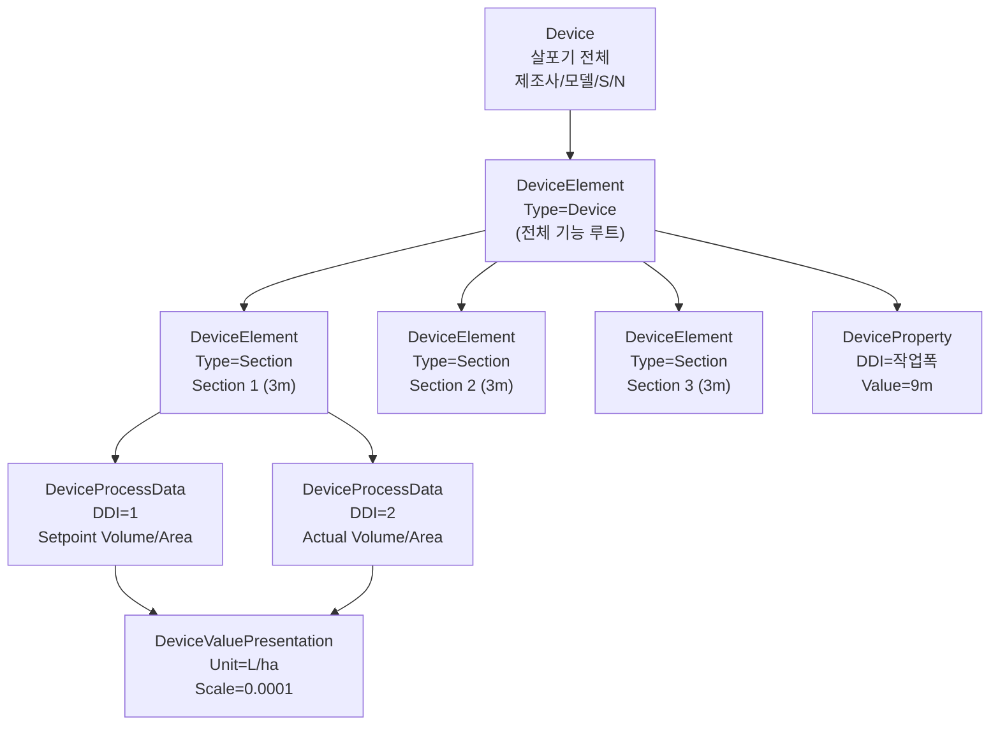
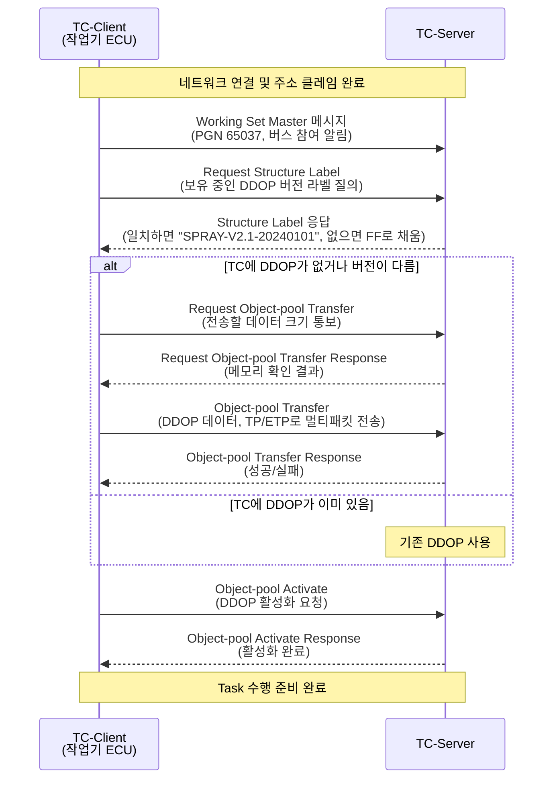
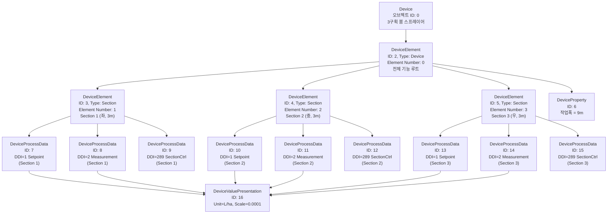

# TC 디바이스 디스크립션 (DDOP)

::: info 학습 목표
- DDOP가 무엇이고 왜 필요한지 설명할 수 있다.
- DDOP를 구성하는 5가지 오브젝트 타입의 역할을 구분할 수 있다.
- DDOP 전송 과정을 시퀀스 다이어그램으로 그릴 수 있다.
- 3구획 살포기의 DDOP를 직접 설계하고 오브젝트 표를 작성할 수 있다.
- DDOP 오브젝트 레코드(DVC·DET·DPD·DPT·DVP)를 바이트 단위로 조립하고 디코딩할 수 있다.
- Device descriptor 하위 명령의 응답 바이트로 DDOP 업로드·활성화 실패 원인을 진단할 수 있다.
- Annex F 규칙으로 섹션 제어용 DDOP를 점검하고 빠진 오브젝트를 설계할 수 있다.
:::

## 1. DDOP란

<strong>DDOP(Device Description Object Pool)</strong>는 작업기가 자기 자신의 구조와 능력을 TC에게 알려주는 데이터 집합이다.

> DDOP는 "작업기의 자기소개서"이다.

TC-Server는 버스에 연결된 작업기에 대해 아무런 사전 정보가 없다. 작업기가 어떤 구획(Section)을 가졌는지, 어떤 DDI를 지원하는지, 작업폭이 얼마인지를 TC는 알 수 없다. DDOP는 이 정보를 구조화된 형식으로 TC에 전달하여, TC가 작업기를 이해하고 제어할 수 있게 한다.

**DDOP가 없다면:**
- TC는 작업기에 어떤 명령을 보낼 수 있는지 모른다.
- 처방 맵의 살포량을 어느 DDI로 전달해야 하는지 알 수 없다.
- Section Control을 위해 몇 개의 구획이 있는지 파악하지 못한다.

**DDOP가 있다면:**
- TC는 작업기의 구조를 파악하고 적절한 명령을 선택한다.
- 지원되지 않는 DDI로의 명령 시도를 사전에 방지한다.

## 2. DDOP 오브젝트 구조

DDOP는 5가지 타입의 오브젝트로 구성된다.

| 오브젝트 타입 | 역할 | 주요 속성 |
|--------------|------|-----------|
| **Device** | 장치 전체 정보 (최상위) | 제조사, 제품명, 시리얼번호, Structure Label |
| **DeviceElement** | 장치의 논리적 구성 요소 | Element Type, Element Number, 부모 Element |
| **DeviceProcessData** | 지원하는 프로세스 데이터 항목 | DDI, Property Flag (default/settable/control source), Trigger Methods |
| **DeviceProperty** | 고정 속성값 | DDI, 값 (작업폭, 구획 폭 등) |
| **DeviceValuePresentation** | 데이터 표현 방식 | 오프셋, 스케일, 소수 자릿수, 단위 기호 |



### 오브젝트 타입 상세

**Device**
- DDOP 전체의 루트 오브젝트이다.
- `Structure Label`: DDOP 버전을 나타내는 식별자이다. 클라이언트(작업기)는 TC에 이 라벨이 있는지 조회해 DDOP를 새로 올릴지 TC에 저장된 것을 쓸지 결정한다.
- `Localization Label`: 언어·단위 설정

**DeviceElement**
- 작업기의 논리적 부품이다. Element Type(1바이트 코드)으로 역할을 정의한다.
- `1 Device`: 장치 전체를 대표하는 Element (DDOP당 1개)
- `2 Function`: 살포 펌프, 파종 유닛 등 기능 단위
- `3 Bin`: 씨앗·비료 저장 용기
- `4 Section`: 독립 제어 가능한 구획
- `5 Unit`: Section 하위의 가장 세분화된 단위 (노즐, 파종 로우 유닛 등)
- `6 Connector`: 히치 연결점
- `7 Navigation Reference`: GPS 안테나 등 내비게이션 기준 위치
- Element Number는 12비트(0~4095)이며, Parent Object ID로 상위 Element(또는 Device)를 참조해 계층을 구성한다.

**DeviceProcessData**
- DeviceElement에 연결되며, 해당 Element에서 지원하는 DDI 항목을 정의한다.
- `Property Flag`(3비트): bit1 = 기본값(default) 세트 멤버 여부, bit2 = settable(TC가 값을 설정 가능 — Setpoint류), bit3 = control source(다른 CF의 setpoint 값을 결정하는 소스로 동작). bit2·bit3은 동시에 설정될 수 없다.
- `Trigger Methods`(5비트): time interval(시간 간격), distance interval(거리 간격), threshold limits(임계값), on change(변화량), total(누적값)

**DeviceProperty**
- 변하지 않는 고정 속성이다. 작업폭, 구획 폭 등이 여기에 해당한다.
- DeviceProcessData와 달리 TC가 값을 변경하지 않는다.

**DeviceValuePresentation**
- 숫자값을 사람이 읽기 쉬운 형식으로 변환하는 규칙이다.
- 공식: `표시값 = (원시값 + Offset) × Scale`
- 예: 원시값 2,000,000(DDI 1), Offset=0, Scale=0.0001 → 표시값 200.00 L/ha
- `Number of decimals`(0~7) 속성으로 표시 소수 자릿수도 함께 정의한다.

## 3. DDOP 전송 과정

DDOP 관련 메시지는 모두 <strong>TC-Client가 TC/DL에게 보내는 요청</strong>과 그에 대한 TC의 응답으로 구성된다 — TC가 먼저 DDOP를 요구하는 것이 아니라, 클라이언트가 자신의 device descriptor를 TC에 질의·전송·활성화하는 흐름이다.



### 전송 프로토콜

DDOP 데이터는 일반적으로 수백 바이트~수 킬로바이트에 달하므로, 단일 CAN 프레임으로 전송할 수 없다. ISO 11783의 <strong>TP(Transport Protocol, TP.CM 60416/TP.DT 60160)</strong> 또는 <strong>ETP(Extended Transport Protocol, ETP.CM 51200/ETP.DT 50944)</strong>를 사용하여 멀티패킷으로 분할 전송한다. 명령 바이트 1개를 포함한 Object-pool Transfer 메시지가 1,785바이트를 넘으면 ETP를 쓰거나, 완전한 오브젝트 단위로 나눠 Object-pool Transfer를 여러 번 보낸다(B.6.8).

## 4. DDOP 설계 예제

### 대상: 3구획 붐 스프레이어

- 총 작업폭: 9m (3구획 × 3m)
- 지원 기능: Section Control(구획별 ON/OFF), Rate Control(살포량 가변)
- 지원 DDI: DDI 1(Setpoint Volume/Area), DDI 2(Actual Volume/Area), DDI 289(Setpoint Work State — 구획 ON/OFF 명령)

### DDOP 계층 구조



### DDOP 오브젝트 정의 표

| 오브젝트 ID | 타입 | 주요 속성 | 값 |
|------------|------|----------|-----|
| 0 | Device | 제품명 | BoomSprayer-3S |
|   |        | 제조사 | ExampleCo |
|   |        | Structure Label | SPRY3-V1.0 |
| 2 | DeviceElement | Type | Device |
|   |               | Element Number | 0 |
|   |               | 부모 | Device(0) |
| 3 | DeviceElement | Type | Section |
|   |               | Element Number | 1 |
|   |               | 부모 | DE(2) |
| 4 | DeviceElement | Type | Section |
|   |               | Element Number | 2 |
|   |               | 부모 | DE(2) |
| 5 | DeviceElement | Type | Section |
|   |               | Element Number | 3 |
|   |               | 부모 | DE(2) |
| 6 | DeviceProperty | DDI | 작업폭 DDI |
|   |               | Value | 9000 (단위: mm) |
|   |               | 연결 Element | DE(2) |
| 7 | DeviceProcessData | DDI | 1 (Setpoint Vol/Area) |
|   |                   | Property Flag | Setpoint 지원 |
|   |                   | 연결 Element | DE(3) — Section 1 |
| 8 | DeviceProcessData | DDI | 2 (Actual Vol/Area) |
|   |                   | Property Flag | Measurement 지원 |
|   |                   | Trigger | on change 지원(10 L/ha 임계값은 TC가 measurement 명령으로 지정) |
|   |                   | 연결 Element | DE(3) — Section 1 |
| 9 | DeviceProcessData | DDI | 289 (Setpoint Work State) |
|   |                   | Property Flag | Setpoint 지원 |
|   |                   | 연결 Element | DE(3) — Section 1 |
| 10–12 | DeviceProcessData | (Section 2 동일 구조) | DE(4) 연결 |
| 13–15 | DeviceProcessData | (Section 3 동일 구조) | DE(5) 연결 |
| 16 | DeviceValuePresentation | Offset | 0 |
|    |                         | Scale | 0.0001 |
|    |                         | Unit Symbol | L/ha |

이 DDOP를 수신한 TC-Server는 다음을 파악한다.

- 이 작업기는 3개의 Section을 가진 살포기이다.
- 각 Section에 DDI 1(Setpoint), DDI 2(Measurement), DDI 289(Setpoint Work State)를 지원한다.
- 전체 작업폭은 9m이다.
- 값의 단위는 L/ha이며 스케일 인자는 0.0001이다.

> **핵심 정리**
> - DDOP(Device Description Object Pool)는 작업기가 TC에게 자신의 구조와 능력을 알리는 데이터로, "작업기의 자기소개서"이다.
> - DDOP는 Device, DeviceElement, DeviceProcessData, DeviceProperty, DeviceValuePresentation 5가지 오브젝트로 구성된다.
> - TC-Client는 연결 시 자신의 Structure Label을 TC에 질의하고, TC가 모르는 버전이면 스스로 DDOP 전체를 멀티패킷으로 전송한다.
> - TC는 DDOP를 파싱하여 지원 DDI, Section 구성, 작업폭 등을 파악한 뒤 Task를 활성화한다.
> - 3구획 살포기 DDOP에는 Section별로 DDI 1(Setpoint), DDI 2(Measurement), DDI 289(Setpoint Work State) 항목이 정의된다.

## 5. DDOP를 바이트로 보기

§2와 §4에서 다룬 DDOP 오브젝트들은 결국 TP/ETP로 전송되는 바이트열이다. 어디까지 바이트 단위로 확인 가능한지, 그리고 그 바이트가 §4의 3구획 스프레이어 예제에서 무엇을 나타내는지 살펴본다.

### 오브젝트 공통 구조

모든 DDOP 오브젝트는 <strong>Object ID</strong>(DDOP 전체에서 유일, 참조 없음은 NULL Object ID `0xFFFF`)와 오브젝트 타입(Device·DeviceElement·DeviceProcessData·DeviceProperty·DeviceValuePresentation 다섯 종류 중 하나) 뒤에 타입별 속성이 이어지는 구조다.

:::info 확인 범위
이 절에서 다루는 것은 <strong>타입별로 어떤 필드가 몇 바이트인지</strong>까지다. Object ID와 오브젝트 타입 식별자가 바이트열의 정확히 몇 번째 바이트에 어떤 순서로 놓이는지 — 오브젝트 타입을 텍스트로 싣는지 숫자 코드로 싣는지를 포함해서 — 는 이번에 확인한 정리 자료(`appendix-iso-part10.md`)에 명시돼 있지 않다. 그래서 전체 오브젝트를 바이트 오프셋까지 조립하는 대신, 각 오브젝트가 담아야 하는 필드와 그 폭까지만 다룬다.

원문 Annex A 표로 확인한 결과는 §7에 있다. 모든 레코드는 Table ID(ASCII 3바이트, `DVC`·`DET` 등)로 시작하고 그 뒤에 Object ID 2바이트가 온다.
:::

### DeviceElement — 계층을 만드는 필드

| 필드 | 폭 | §4 Object 3(DE, Section 1)의 값 |
|---|---|---|
| DeviceElementType | 1바이트 | 4(Section) |
| DeviceElementNumber | 2바이트 (0~4095) | 1 |
| Parent Object ID | Object ID와 같은 폭(2바이트) | 2 (DE(2), 전체 기능 루트) |

DeviceElementNumber가 4095까지인 것은 우연이 아니다. Process Data 메시지의 Element Number 필드도 12비트(0~4095)이므로, DDOP에서 선언한 Element Number를 그대로 [Process Data 메시지의 Element Number 자리](/study/isobus/19-tc-process-data)에 실어 보낼 수 있다.

### DeviceProcessData — DDI·property·trigger를 담는 필드

| 필드 | 폭 | 내용 |
|---|---|---|
| Process data DDI | 2바이트 | ISO 11783-11 정의 DDI |
| Process data properties | 1바이트(비트셋) | bit1=default set 멤버, bit2=settable, bit3=control source(bit2·3 동시 설정 불가) |
| Process data available trigger methods | 1바이트(비트셋) | bit1=time interval, bit2=distance interval, bit3=threshold limits, bit4=on change, bit5=total |
| Device value presentation object ID | 2바이트 | 없으면 NULL(`0xFFFF`) |

§4의 Object 7(Section 1의 DDI 1, Setpoint)과 Object 8(Section 1의 DDI 2, Measurement — 변화량 10 L/ha 이상 트리거)을 이 필드에 채우면 다음과 같다.

| Object | DDI | Properties 비트 | Properties 바이트 | Trigger 비트 | Trigger 바이트 |
|---|---|---|---|---|---|
| 7 (Setpoint) | 1 | bit2(settable)=1, 나머지 0 | `0x02` | §4 표에 트리거 명시 없음 | 확인 불가 |
| 8 (Measurement) | 2 | 전부 0(설정 불가) | `0x00` | bit4(on change)=1, 나머지 0 | `0x08` |

<strong>Object 7의 Properties 바이트가 `0x02`로 bit2(settable)를 세운 것</strong>이 [TC 프로세스 데이터 챕터의 "전체 흐름"](/study/isobus/19-tc-process-data)에서 말한 "DDOP에 없는 DDI는 쓸 수 없다"의 실체다. TC가 `[DDI=1, Element=3, Value=200]`처럼 Value Command를 내려도, 대상 Element에 연결된 DeviceProcessData의 Properties 바이트에 bit2가 서 있지 않으면 작업기는 이를 받아들일 근거가 없어 PDACK 오류 코드(bit5, "process data가 settable 아님")로 거부한다. Object 8은 반대로 bit2가 0이므로 TC가 setpoint로 내릴 수 없고, 오직 작업기가 측정값을 올리는 용도로만 쓰인다.

### DDOP 전송도 같은 PGN, 같은 바이트 배치를 쓴다

앞 챕터에서 다룬 Process Data 메시지(PGN 51968/`0xCB00`, Command 4비트 + Element/DDI/Value)는 살포량 같은 "값"을 나를 때의 구조다. DDOP 자체를 실어 나르는 메시지는 같은 PGN 위에서 <strong>Command 1(Device descriptor)</strong>의 서브커맨드로 오간다. Byte 1의 자리 배치는 형식적으로 같다 — 하위 4비트가 Command(`0001`), 상위 4비트는 이번엔 Element Number가 아니라 서브커맨드를 나타낸다.

| 서브커맨드(Byte 1 bit 8~5) | 메시지 | Byte 1 |
|---|---|---|
| `0000` | Request Structure Label | `0x01` |
| `0110` | Object-pool Transfer(DDOP 본문 전송) | `0x61` |
| `1000` | Object-pool Activate/Deactivate | `0x81` |

`0x61`(Object-pool Transfer)로 시작한 메시지의 뒤(Byte 2~n)에 위에서 채운 DVC·DET·DPD·DPT·DVP 오브젝트 레코드들이 이어져 TP(1,785바이트 이하) 또는 ETP(초과 시)로 분할 전송된다. 즉 DDOP 전송과 Process Data 값 전달은 같은 PGN·같은 Command 니블 구조를 공유하되, Command 값(1 vs 2~A)에 따라 그 뒤에 오는 바이트열의 의미가 완전히 달라진다.

:::details 파이썬으로 검산해 보기
```python
def properties_byte(default=False, settable=False, control_source=False):
    return (int(default) << 0) | (int(settable) << 1) | (int(control_source) << 2)


def trigger_byte(time_interval=False, distance_interval=False,
                  threshold=False, on_change=False, total=False):
    return (
        (int(time_interval) << 0)
        | (int(distance_interval) << 1)
        | (int(threshold) << 2)
        | (int(on_change) << 3)
        | (int(total) << 4)
    )


def device_descriptor_byte1(subcommand):
    command = 1  # Device descriptor
    return (subcommand << 4) | command


# Object 7 — DDI 1 Setpoint: settable만 세운다
print(hex(properties_byte(settable=True)))          # 0x2

# Object 8 — DDI 2 Measurement: settable 없음, on change 트리거
print(hex(properties_byte()))                       # 0x0
print(hex(trigger_byte(on_change=True)))            # 0x8

# Device descriptor 서브커맨드별 Byte 1
print(hex(device_descriptor_byte1(0b0000)))         # 0x1  Request Structure Label
print(hex(device_descriptor_byte1(0b0110)))         # 0x61 Object-pool Transfer
print(hex(device_descriptor_byte1(0b1000)))         # 0x81 Object-pool Activate/Deactivate
```
:::

## 6. 실물 예시: 7섹션 붐 살포기

§4의 3구획 예시는 살포량·구획 ON/OFF만 다루는 최소 구성이었다. 실제 붐 스프레이어는 총계 보고(TC-BAS)·구획 제어(TC-SC)·기하 정보까지 함께 갖춘다. 이 절은 12m 붐에 1,714mm 폭 섹션 7개를 단 살포기의 DDOP를, `appendix-iso-part10.md`의 Annex A·F와 `appendix-ddi.md`에서 확인한 값만으로 설계한다.

### DDOP 계층 구조

Device 아래 루트 Device Element(Element 0) 하나를 두고, 그 형제로 커넥터(트랙터 히치 연결점, type 6)·빈(약액 탱크, type 3)·붐(Function, type 2)을 배치한 뒤 붐 아래에 섹션(type 4) 7개를 매단다. Section의 Element Number는 <strong>기계 좌→우 순으로 증가</strong>시키는 것이 권장 규칙이므로(Annex F.3.5), 11~17을 좌에서 우로 배정한다.

```
DVC Device                                        Object ID 0
└─ DET type=1 device            Element 0         Object ID 2
   ├─ DET type=6 connector      Element 1         Object ID 3
   ├─ DET type=3 bin            Element 2         Object ID 4
   └─ DET type=2 function(붐)   Element 3         Object ID 5
      ├─ DET type=4 section 1   Element 11        Object ID 6
      ├─ DET type=4 section 2   Element 12        Object ID 7
      ├─ DET type=4 section 3   Element 13        Object ID 8
      ├─ DET type=4 section 4   Element 14        Object ID 9
      ├─ DET type=4 section 5   Element 15        Object ID 10
      ├─ DET type=4 section 6   Element 16        Object ID 11
      └─ DET type=4 section 7   Element 17        Object ID 12
```

이 배치는 "Function이 붐인 경우 actual/setpoint 값·X·Y offset·maximum working width는 모두 그 Function 안에 두고, 루트는 actual work state 속성 외의 actual/setpoint 값을 가지면 안 된다"(Annex F.3.4)는 규칙을 따른다 — 그래서 살포량·구획 상태 관련 DPD는 전부 붐(Element 3) 아래에 몰려 있고 루트(Element 0)에는 총계만 남는다.

### 레벨별 DPD·DPT

<strong>Device 레벨(Element 0)</strong> — 총계만 붙는다. TC-BAS는 "TC 클라이언트는 총계의 부분집합만 제공해도 되지만 최소한 DDI 119(total time)는 제공해야 한다"고 요구하므로 DDI 119는 필수다.

| Object ID | DDI | 이름 | 타입 | Properties | Trigger |
|---|---|---|---|---|---|
| 13 | 119 | Effective Total Time | DPD | settable | total, time interval |
| 14 | 116 | Total Area | DPD | settable | total |
| 15 | 117 | Total Distance | DPD | settable | total |

task total DDI는 "trigger method total + property settable"을 함께 세우는 것이 일반 규칙이다 — TC가 태스크 시작 시 이어서 셀 시작값을 지정할 수 있어야 하기 때문이다. DDI 119만 Annex F.3.3에 따라 time interval 트리거가 추가로 요구된다.

<strong>붐(Function) 레벨(Element 3)</strong>

| Object ID | DDI | 이름 | 타입 | Properties | Trigger | 비고 |
|---|---|---|---|---|---|---|
| 16 | 1 | Setpoint Volume Per Area | DPD | settable | - | TC→작업기, 살포량 목표 |
| 17 | 2 | Actual Volume Per Area | DPD | (읽기 전용) | on change | 작업기→TC, 실제 살포량 |
| 18 | 141 | Actual Work State | DPD | (읽기 전용) | on change, time interval | 붐의 마스터 작업 스위치 |
| 19 | 161 | Actual Condensed Work State | DPD | (읽기 전용) | on change, time interval | 7섹션 실제 ON/OFF 비트 |
| 20 | 290 | Setpoint Condensed Work State | DPD | settable | on change | 7섹션 목표 ON/OFF 비트, TC→작업기 |
| 21 | 160 | Section Control State | DPD | settable | on change | TC-SC 활성/비활성 스위치 |
| 22 | 70 | Maximum Working Width | DPT | - | - | 11,998mm |

141·161의 on change·time interval은 Annex F.3.5가 "Actual Work State(들)와 Actual Condensed Work State(들)에는 On Change·Time Interval 지원이 필수"라고 못 박은 항목이다. 160(Section Control State)은 같은 절에서 "settable + on-change 트리거 필수"로 명시된다.

<strong>섹션 레벨(대표: Section 1, Element 11)</strong> — DPD 없이 DPT만 붙는다.

| Object ID | DDI | 이름 | 타입 | 값 |
|---|---|---|---|---|
| 23 | 70 | Maximum Working Width | DPT | 1,714mm |
| 24 | 134 | Offset X | DPT | 0mm |
| 25 | 135 | Offset Y | DPT | −5,142mm |
| 26 | 136 | Offset Z | DPT | 0mm |

Section 2~7도 같은 4개 DPT 패턴이 반복된다(Object ID 27~50). DDI 70(1,714mm)·134·136(0mm)은 7개 섹션이 전부 동일하고, DDI 135(Offset Y)만 섹션마다 다르다 — 다음 절에서 계산한다. Offset X·Z를 0mm로 둔 것은 이 예시에서 모든 섹션이 붐과 같은 전후·높이 위치에 일렬로 달려 있다고 가정했기 때문이다(실측값이 아니라 이 예시의 설계 가정).

표시용 DeviceValuePresentation은 §4와 같은 패턴으로 2개면 충분하다 — Object ID 51(Offset 0, Scale 0.0001, L/ha)을 DDI 1·2가 참조하고, Object ID 52(Offset 0, Scale 1, mm)를 DDI 70·134·135·136이 참조한다. 여기까지 합치면 DVC 1개, DET 11개, DPD 9개(장치 3 + 붐 6), DPT 29개(붐 1 + 섹션 7×4), DVP 2개로 총 52개 오브젝트다.

### Y 오프셋 계산

DRP(Device Reference Point) 기준 오른손 좌표계에서 y축은 <strong>주행 방향 기준 우측이 양수</strong>다(Annex A.1). 섹션이 홀수 개(7개)이므로 가운데 4번 섹션이 y=0에 오고, 나머지 6개가 좌우로 대칭 배치된다.

| 섹션 | Element | Object ID(DDI 135) | Y 오프셋 |
|---|---|---|---|
| 1 | 11 | 25 | −5,142mm |
| 2 | 12 | 29 | −3,428mm |
| 3 | 13 | 33 | −1,714mm |
| 4 | 14 | 37 | 0mm |
| 5 | 15 | 41 | 1,714mm |
| 6 | 16 | 45 | 3,428mm |
| 7 | 17 | 49 | 5,142mm |

붐 전체 폭은 7 × 1,714mm = 11,998mm — 정확히 12m는 아니고 2mm 모자란다. DDI 70(Maximum Working Width)에는 이 11,998mm를 붐(Function) 레벨 값으로 넣는다.

:::details 파이썬으로 검산해 보기
```python
n = 7
width = 1714  # mm, 섹션 1개 폭

offsets = {i: (i - 4) * width for i in range(1, n + 1)}
for i, y in offsets.items():
    print(f"section {i} (element {10+i}): Y = {y:+d} mm")

# 홀수 섹션 → 가운데(4번)가 0, 나머지는 좌우 대칭
assert offsets[4] == 0
assert offsets[1] == -offsets[7]
assert offsets[2] == -offsets[6]
assert offsets[3] == -offsets[5]

print("total width =", n * width, "mm")
```
```
section 1 (element 11): Y = -5142 mm
section 2 (element 12): Y = -3428 mm
section 3 (element 13): Y = -1714 mm
section 4 (element 14): Y = +0 mm
section 5 (element 15): Y = +1714 mm
section 6 (element 16): Y = +3428 mm
section 7 (element 17): Y = +5142 mm
total width = 11998 mm
```
:::

### 설계 판단 세 가지

**섹션 폭은 DPT, 살포량은 DPD인 이유.** 섹션 폭(1,714mm)은 물리적으로 고정된 값이라 DeviceProperty(DPT)로 담는다 — TC가 바꿀 수도, 바뀔 수도 없는 상수다. 반대로 살포량은 처방 맵·운전자 입력에 따라 태스크 중 계속 바뀌므로 DeviceProcessData(DPD)로 담아야 한다. 이 구분을 반대로 하면 안 되는 이유가 DDI 67(Actual Working Width)에서 드러난다 — 붐(Function) 레벨의 DDI 67은 "On 상태인 하위 섹션 폭의 합"으로 정의된다. 섹션 하나가 꺼지면 이 값 자체가 줄어든다는 뜻이라, 섹션의 물리적 폭을 이 값 하나로만 표현했다면 "섹션이 꺼져서 폭이 줄어든 것"과 "섹션 자체 폭이 바뀐 것"을 구분할 수 없다. 그래서 이 설계는 <strong>섹션 개별 폭(고정, DPT 70)</strong>과 <strong>붐 레벨 Actual Working Width(가변, on 섹션의 합)</strong>를 별도 DDI로 분리해 둔다 — 이번 DDOP에는 DDI 67 자체를 넣지 않았지만, 넣었다면 반드시 붐 레벨의 process data(DPD)여야지 섹션의 property가 되면 안 된다는 뜻이다.

**섹션별 개별 setpoint 대신 Condensed를 쓰는 이유.** ISO 11783-10 Annex F.3.5는 "DDOP에서 섹션 작업 상태의 보고·제어에 허용되는 것은 Actual/Setpoint Condensed Work State뿐이다 — Section 요소 안에 개별 Actual Work State(141)나 개별 Setpoint Work State(289)를 두면 안 된다"고 명시한다. 즉 섹션 7개마다 DDI 289를 하나씩 붙이는 구성은 최적화 이전에 <strong>표준 위반</strong>이다. 설령 허용됐더라도 대역폭이 문제다 — [연결당·variable당 상한은 초당 10개](/study/isobus/19-tc-process-data)인데, 이 상한을 넘겨도 되는 예외는 <strong>Condensed Work State류 DDI</strong>에만 적용된다. 헤드랜드 진입처럼 여러 섹션을 한꺼번에 전환해야 하는 순간에도, DDI 290 하나로 7섹션 상태를 동시에 담으면 이 burst 예외를 그대로 쓸 수 있다.

**settable 비트는 DDI 1과 290에만 세운다.** DDI 2(Actual Volume Per Area)·141(Actual Work State)·161(Actual Condensed Work State)은 작업기가 실측·실제 상태를 보고하는 값이다. 이 DPD들의 Properties 바이트에 settable(bit2)을 세우면 TC가 "실측값"이라는 이름의 필드에 값을 명령할 수 있게 되는데, §5에서 다룬 Object 8(DDI 2)의 규칙과 같은 원리로 잘못이다 — 읽기 전용이어야 할 DDI를 설정용으로 여는 것이 흔한 설계 실수다. 이 DDOP에서 settable은 DDI 1(살포량 목표)·290(구획 목표 상태)·160(Section Control State, TC-SC 활성화 스위치)·그리고 앞서 device 레벨에 둔 총계 3종(119·116·117 — 총계는 태스크 시작 시 TC가 이어서 셀 시작값을 지정할 수 있어야 하므로 성격이 다른 settable이다)에만 세운다.

### 이 DDOP로 만들 수 있는 메시지

이 DDOP는 붐(Element 3)에만 DDI 1을 정의하고 섹션(Element 11~17)에는 DDI 1을 두지 않는다 — 즉 "섹션 1의 살포량만 따로 정한다"는 명령 자체가 이 설계에서 성립하지 않는다. `[DDI=1, Element=11]`로 명령을 보내면 작업기는 그 Element에 연결된 DeviceProcessData가 없으므로 PDACK(command D)로 거부한다. 붐 전체 살포량을 바꾸는 유일한 방법은 붐(Element 3)에 명령하는 것이다.

바이트 배치는 [CH19 §6](/study/isobus/19-tc-process-data)의 Command 4비트(Byte 1 하위)+Element Number 12비트(Byte 1 상위 4비트+Byte 2)를 그대로 따른다.

**메시지 1 — 붐 전체 살포량 220 L/ha 설정 (Element 3, DDI 1, Command 3)**

| Byte | 1 | 2 | 3 | 4 | 5 | 6 | 7 | 8 |
|---|---|---|---|---|---|---|---|---|
| 값 | `0x33` | `0x00` | `0x01` | `0x00` | `0xC0` | `0x91` | `0x21` | `0x00` |

220 L/ha → 22,000 mm³/m² → raw = 22,000 ÷ 0.01 = 2,200,000(`0x2191C0`), LSB부터 `C0 91 21 00`.

**메시지 2 — 붐의 7섹션 ON/OFF 일괄 명령 (Element 3, DDI 290, Command 3)**

가장자리 두 섹션(1·7)은 끄고 가운데 다섯 섹션(2~6)은 켜는 상황을 예로 든다. DDI 290은 [섹션당 2비트(00=Off, 01=On)로 최대 16섹션까지 한 32비트 값에 담는다](/study/isobus/19-tc-process-data). 섹션 1이 LSB 쪽 2비트를 차지한다고 두면(이 대응 순서 자체는 이번 확인 자료에 명시돼 있지 않아 이 예시의 가정이다), 정의되지 않은 8~16번은 141(Actual Work State)에서 확인된 2비트 코드표(00=Off, 01=On, 10=오류, 11=미설치) 중 "미설치(11)"를 빌려 채운다 — 290 자체의 코드값이 이번 확인 자료에 별도로 명시돼 있지는 않다.

| Byte | 1 | 2 | 3 | 4 | 5 | 6 | 7 | 8 |
|---|---|---|---|---|---|---|---|---|
| 값 | `0x33` | `0x00` | `0x22` | `0x01` | `0x54` | `0xC5` | `0xFF` | `0xFF` |

:::details 파이썬으로 검산해 보기
```python
def build_frame(command, element, ddi, value):
    byte1 = ((element & 0xF) << 4) | (command & 0xF)
    byte2 = (element >> 4) & 0xFF
    ddi_bytes = ddi.to_bytes(2, "little")
    value_bytes = value.to_bytes(4, "little", signed=True)
    return bytes([byte1, byte2]) + ddi_bytes + value_bytes


# 메시지 1: 붐(Element 3)에 DDI 1, 220 L/ha
raw = int(220 * 100 / 0.01)
frame1 = build_frame(command=3, element=3, ddi=1, value=raw)
print(frame1.hex(' ').upper())   # 33 00 01 00 C0 91 21 00

# 메시지 2: 붐(Element 3)에 DDI 290, 섹션 1·7 Off / 2~6 On / 8~16 미설치
states = {1: 0, 2: 1, 3: 1, 4: 1, 5: 1, 6: 1, 7: 0}
value = 0
for i in range(1, 17):
    bits = states.get(i, 0b11)   # 정의 안 된 섹션(8~16)은 미설치
    value |= bits << (2 * (i - 1))
value_signed = value - 2**32 if value >= 2**31 else value

frame2 = build_frame(command=3, element=3, ddi=290, value=value_signed)
print(frame2.hex(' ').upper())   # 33 00 22 01 54 C5 FF FF
```
:::

두 메시지 모두 Byte 1이 `0x33`인 것은 우연이다 — Command(3, Value command)와 Element Number(3, 붐)가 두 메시지에서 같은 값이라 니블이 똑같이 채워졌을 뿐이다. Byte 3~4(DDI)와 Byte 5~8(Value)이 완전히 다른 두 명령을 구분한다.

## 7. 오브젝트 레코드의 실제 바이트 배치 (Annex A)

§5의 "확인 범위"에서 남긴 빈칸을 원문 Annex A의 표(Table A.1~A.5)로 채운다. DDOP는 오브젝트 레코드를 이어 붙인 바이트열이고, 모든 레코드는 같은 머리로 시작한다(ISO 11783-10:2015 Annex A).

| 머리 필드 | 크기 | 값 |
|---|---|---|
| Table ID | 3바이트 문자열 | `DVC`·`DET`·`DPD`·`DPT`·`DVP` (XML 요소 이름) |
| Object ID | 2바이트 정수 | DVC는 항상 0, 나머지는 1~65534. 참조가 없을 때는 NULL Object ID `0xFFFF`(65535) |

Object ID는 DDOP 전체에서 유일해야 한다(A.1). DET의 Parent ObjectId가 0이면 부모가 DVC라는 뜻이다(D.21).

Annex A는 바이트 순서를 따로 적지 않는다. 이 시리즈의 메시지 형식 규칙대로 2·4·8바이트 정수는 LSB부터, 문자열은 왼쪽 글자부터 싣는다(ISO 11783-7:2015 3.3.1의 일반 규칙). DVP의 Scale은 원문 표에 "Float 4바이트"라고만 적혀 있다. 이 글의 예제는 IEEE 754 단정밀도를 LSB부터 싣는 것으로 두었다(원문에서 바이트 표현은 확인하지 못함 — 확인 필요).


### DVC — 가변 길이 문자열이 셋

| Record byte | 필드 | 크기 | 범위·규칙 |
|---|---|---|---|
| 1~3 | Table ID | 3 | `DVC` |
| 4~5 | Object ID | 2 | 0 |
| 6 | designator 바이트 수 N | 1 | 0~128 |
| 7 | Device designator | N | UTF-8, 최대 32자 |
| 7+N | software version 바이트 수 M | 1 | 0~128 |
| 8+N | Device software version | M | UTF-8, 최대 32자 |
| 8+N+M | ClientNAME | 8 | 이 CF의 address claim NAME과 같아야 한다 |
| 16+N+M | serial number 바이트 수 O | 1 | 0~128 |
| 17+N+M | DeviceSerialNumber | O | UTF-8, 최대 32자 |
| 17+N+M+O | Device structure label | 7 | 각 바이트 0~254 |
| 24+N+M+O | Device localization label | 7 | 바이트 1~6은 0~254, 바이트 7은 255 |
| 31+N+M+O | extended structure label 바이트 수 P | 1 | 0~32(버전 4) |
| 32+N+M+O | Extended structure label | P | 각 바이트 0~255(버전 4) |

"Record byte" 열은 원문 표의 표기다. 앞 문자열 길이에 따라 뒤 필드 위치가 밀리므로, 파서는 레코드를 처음부터 차례로 읽어야 한다. DVC에는 제조사 이름 필드가 없다. 제조사는 ClientNAME 안의 manufacturer code(ISO 11783-5 NAME 필드)로 표현된다.

### DET·DPD·DPT·DVP

| 오브젝트 | Record byte 배치 |
|---|---|
| DET | 1~3 `DET` · 4~5 Object ID · 6 DeviceElementType(1~7) · 7 N · 8 designator · 8+N element number(0~4095) · 10+N Parent ObjectId(0~65534) · 12+N 참조 개수 K · 14+N 참조 Object ID 2바이트 × K |
| DPD | 1~3 `DPD` · 4~5 Object ID · 6~7 DDI(0~65535) · 8 properties(0~7) · 9 trigger methods(0~31) · 10 N · 11 designator · 11+N DVP Object ID |
| DPT | 1~3 `DPT` · 4~5 Object ID · 6~7 DDI · 8~11 property value(부호 있는 32비트) · 12 N · 13 designator · 13+N DVP Object ID |
| DVP | 1~3 `DVP` · 4~5 Object ID · 6~9 Offset(부호 있는 32비트) · 10~13 Scale(float) · 14 Number of decimals(0~7) · 15 N · 16 UnitDesignator |

구현할 때 놓치기 쉬운 참조 규칙은 셋이다(A.3~A.7).

- DET의 참조 목록에 들어가는 것은 DPD와 DPT뿐이다. 자식 DET는 참조 목록이 아니라 자식 쪽 Parent ObjectId로 연결한다. DVP는 DPD·DPT가 참조한다.
- DPD·DPT 하나를 여러 DET가 함께 참조할 수 있고, DVP 하나를 여러 DPD·DPT가 참조할 수 있다(A.7). 값이 같은 property는 오브젝트 하나로 공유할 수 있다는 뜻이다. §12에서 이 점을 활용한다.
- DPD·DPT의 DVP Object ID 범위는 1~65535이고, DVP가 없으면 NULL(`0xFFFF`)을 넣는다.

### Designator — 바이트 수와 글자 수는 다르다

문자열 속성은 BOM 없는 UTF-8이다. UTF-8 한 글자는 최대 4바이트이므로 바이트 배열의 최대 길이는 XML 정의 글자 수의 4배다(A.1). 그래서 designator는 "최대 32자, 최대 128바이트"다. 128바이트 상한은 버전 4에서 32바이트에서 늘어난 것이다(Table A.1~A.5 각주, B.6.14).

| 문자열 | 글자 | UTF-8 바이트 | 버전 3 상한(32 B) | 버전 4 상한(128 B, 32자) |
|---|---|---|---|---|
| `Section 1` | 9 | 9 | 통과 | 통과 |
| `좌측 섹션` | 5 | 13 | 통과 | 통과 |
| `좌측 붐 1번 섹션 노즐 그룹` | 16 | 36 | 초과 | 통과 |

한글은 UTF-8로 한 글자 3바이트다. 길이 바이트에는 글자 수가 아니라 바이트 수를 적는다. 클라이언트는 연결한 TC의 버전·기능에 자신을 맞춰야 하므로(6.6.2 f), 버전 3 TC에 연결할 때는 designator를 32바이트 안에 맞춘다(추론 — 원문은 범위가 늘어났다는 사실만 적는다).

### Structure label·Localization label·Extended structure label

<strong>Structure label</strong>(7바이트)은 DDOP 구조의 버전 라벨이다. 내용은 제조사가 정하고, 각 바이트는 0~254다(Table A.1). 255(`FF`)를 못 쓰는 이유를 원문이 적지는 않지만, TC가 "그런 라벨 없음"을 7바이트 `FF`로 답하기 때문으로 보인다(B.6.3, 추론). 구성이 여러 개인 장치는 구성마다 structure label(과 extended structure label) 조합을 따로 둔다(A.2).

<strong>Localization label</strong>(7바이트)은 언어·단위 설정의 라벨이다. 바이트 1~6은 Language command(PGN 65039, `0xFE0F`)의 바이트 1~6과 같고, 바이트 7은 예약값 `FF`다(Table A.1, ISO 11783-7 B.21).

| 바이트 | Language command 내용(ISO 11783-7 B.21, A.23) |
|---|---|
| 1~2 | 언어 코드(ISO 639 두 글자, 예: `en` = `65 6E`) |
| 3 | bit 8~7 소수점 기호(00 쉼표, 01 점), bit 6~5 시간 형식(00 24시간, 01 12시간) |
| 4 | 날짜 형식(0 = ddmmyyyy … 4 = yyyymmdd) |
| 5 | 거리·면적·부피·질량 단위(각 2비트, 00 = 미터법) |
| 6 | 온도·압력·힘 단위와 단위계(각 2비트) |
| 7 | 예약 `FF` |

언어나 단위만 바꾸면 localization label만 바뀌고 structure label은 그대로다. §10의 런타임 변경 규칙이 이 구분에 기댄다.

<strong>Extended structure label</strong>(0~32바이트)은 버전 4에서 생긴 structure label의 연장이다. 두 가지 규칙이 구현을 가른다(A.2).

- TC와 클라이언트가 모두 버전 4 이상일 때만 쓴다. 한쪽이라도 버전 3 이하면 가장 낮은 공통 버전으로 내려가고 extended 관련 속성 2개(바이트 수와 라벨)를 모두 쓰지 않는다. 버전 3 TC에 보내는 DVC 레코드는 localization label에서 끝난다.
- extended label을 쓰지 않는 버전 4 클라이언트는 버전 4 TC에 바이트 수 0을 보낸다(레코드 끝에 `00` 1바이트).

같은 장치라도 상대 버전에 따라 DVC 레코드 길이가 달라진다는 뜻이다. 파서는 협상된 버전으로 레코드 끝을 판단해야 한다.

§4 예제의 Structure Label `SPRY3-V1.0`은 10바이트라 7바이트 필드에 다 들어가지 않는다. 버전 4 연결이면 `SPRY3-V`(7바이트)를 structure label에, `1.0`(3바이트)을 extended structure label에 나눠 담을 수 있다. 버전 3 TC와 연결되면 7바이트만으로 구성을 구별해야 한다. §8의 바이트 예제는 버전 4 연결을 가정한다.

### XML과 CAN에서 라벨 바이트 순서가 반대다

TC는 받은 DDOP를 XML 파일 세트로 바꿔 저장한다(A.1). 이때 라벨은 xs:hexBinary 값이 되는데, 라벨 배열의 바이트 1이 hexBinary의 최하위 바이트다(D.19). 그래서 XML 문자열과 버스의 바이트 순서가 뒤집힌다. D.19의 예는 다음과 같다.

| 라벨 | XML 속성 값 | CAN 버스 순서(바이트 1부터) |
|---|---|---|
| structure label | `F="F9FAFBFCFDFE39"` | `39 FE FD FC FB FA F9` |
| localization label | `G="FF000000006E65"` | `65 6E 00 00 00 00 FF` |
| structure label + extended 8바이트 | `F="E8E7E6E5E4E3E2E1F9FAFBFCFDFE39"` | `39 FE … F9` + localization 7바이트 + `08` + `E1 E2 … E8` |

XML에서는 extended label이 structure label 앞(상위 바이트 쪽)에 한 문자열로 이어 붙고, 버스에서는 둘 사이에 localization label과 바이트 수가 끼어든다. DDOP를 XML로 내보내는 TC 서버라면 이 변환을 따로 테스트해 두는 편이 좋다(추론).

### DPD properties는 0~5만 유효하다

Table A.3은 properties 범위를 0~7로 적지만, bit 2(settable)와 bit 3(control source)은 함께 설 수 없다. 실제로 쓸 수 있는 값은 여섯 가지다.

| 값 | 비트 | 뜻 |
|---|---|---|
| `0x00` | - | 읽기 전용 |
| `0x01` | bit 1 | default set 멤버 |
| `0x02` | bit 2 | settable |
| `0x03` | bit 1+2 | default set + settable |
| `0x04` | bit 3 | control source(버전 4) |
| `0x05` | bit 1+3 | default set + control source(버전 4) |

`0x06`과 `0x07`은 규칙 위반이다. trigger methods는 0~31(`0x1F`) 비트셋이고, 비트와 measurement 명령의 대응은 [19장 §11](/study/isobus/19-tc-process-data)에 정리했다. DDI `0xDFFF`의 DPD는 trigger를 `0x1F`로 둔다(6.8.4).

### DVP — 표시 공식과 float32

표시값 = (정수 값 + Offset) × Scale이고, 결과는 Number of decimals 자릿수로 반올림한다(D.25). Offset은 부호 있는 32비트, Scale은 0.000000001~100000000.0 범위의 float 4바이트, decimals는 0~7이다(Table A.5).

| 예 | 정수 값 | Offset | Scale | decimals | 표시 |
|---|---|---|---|---|---|
| DDI 1 → L/ha | 2,000,000 | 0 | 0.0001 | 2 | 200.00 L/ha |
| DDI 119 → hr (6.8.4 예 1) | 9,000 | 0 | 2.777778E-04 | 2 | 2.50 hr |
| DDI 67 → m (6.8.4 예 1) | 9,000 | 0 | 1.0E-03 | 1 | 9.0 m |

Scale은 float32라 십진수가 정확히 담기지 않는다. 0.0001을 float32로 바꾸면 `17 B7 D1 38`이고, 되읽으면 0.000099999997…이다. 표시값은 반올림이 오차를 덮지만, 이 배율을 거꾸로 써서 운전자 입력을 원시값으로 바꾸는 코드는 오차를 조심해야 한다(추론).

DVP는 사람에게 보여 줄 때만 쓴다. Process Data 메시지의 값은 언제나 DDE의 분해능으로 해석한다(Part 11 4.2). DVP를 바꿔도 버스의 원시값은 그대로다. 그래서 언어·단위가 바뀔 때 DVP만 다시 보내는 런타임 갱신이 허용된다(8.7, §10).

::: details 파이썬으로 검산해 보기 — 라벨·designator·DVP
```python
import struct

# XML hexBinary는 배열 바이트 1이 맨 오른쪽(최하위). CAN에는 바이트 1부터 나간다(D.19 예 1)
xml_to_can = lambda h: bytes.fromhex(h)[::-1]
assert xml_to_can("F9FAFBFCFDFE39").hex(" ").upper() == "39 FE FD FC FB FA F9"
assert xml_to_can("FF000000006E65").hex(" ").upper() == "65 6E 00 00 00 00 FF"

# 확장 라벨 8바이트(D.19 예 2): XML은 15바이트 한 덩어리, CAN에서는 7 + (로컬 7) + 개수 1 + 8
ext_xml = "E8E7E6E5E4E3E2E1F9FAFBFCFDFE39"
label15 = xml_to_can(ext_xml)
label, ext = label15[:7], label15[7:]
assert ext.hex(" ").upper() == "E1 E2 E3 E4 E5 E6 E7 E8"

# localization label 디코딩(Part 7 B.21 Language command 바이트 1~6)
def decode_loc(loc):
    b3, b4, b5, b6 = loc[2], loc[3], loc[4], loc[5]
    two = lambda b, hi: (b >> (hi - 2)) & 0b11
    return dict(language=loc[:2].decode("ascii"),
                decimal=["comma", "point", "reserved", "no action"][two(b3, 8)],
                time=["24h", "12h", "reserved", "no action"][two(b3, 6)],
                date_format=b4,
                distance=two(b5, 8), area=two(b5, 6), volume=two(b5, 4), mass=two(b5, 2),
                temperature=two(b6, 8), pressure=two(b6, 6), force=two(b6, 4), system=two(b6, 2),
                byte7=hex(loc[6]))

print(decode_loc(xml_to_can("FF000000006E65")))
print(decode_loc(bytes([0x65, 0x6E, 0x40, 0x04, 0x00, 0x00, 0xFF])))

# designator: 버전 4는 128바이트·32자, 버전 3은 32바이트가 상한
for s in ["Section 1", "좌측 섹션", "좌측 붐 1번 섹션 노즐 그룹"]:
    n = len(s.encode("utf-8"))
    print(f"{s!r}: {len(s)}자 {n}B  v3 OK={n <= 32}  v4 OK={n <= 128 and len(s) <= 32}")

# DVP scale은 float32라 십진 값이 정확히 담기지 않는다
for scale in (0.0001, 2.777778e-04, 0.001):
    raw = struct.pack("<f", scale)
    print(scale, raw.hex(" ").upper(), struct.unpack("<f", raw)[0])
assert struct.pack("<f", 0.0001).hex(" ").upper() == "17 B7 D1 38"

# 표시값 = (정수 + Offset) x Scale, NumberOfDecimals로 반올림(D.25)
present = lambda raw, off, scale, dec: round((raw + off) * scale, dec)
assert present(2_000_000, 0, 0.0001, 0) == 200          # DDI 1, L/ha
assert present(9_000, 0, 2.777778e-04, 2) == 2.5         # DDI 119, hr
assert present(2_000_000, 0, 0.01, 2) == 20_000.0        # 0.01을 쓰면 100배 틀린다
```
```
{'language': 'en', 'decimal': 'comma', 'time': '24h', 'date_format': 0, 'distance': 0, 'area': 0, 'volume': 0, 'mass': 0, 'temperature': 0, 'pressure': 0, 'force': 0, 'system': 0, 'byte7': '0xff'}
{'language': 'en', 'decimal': 'point', 'time': '24h', 'date_format': 4, 'distance': 0, 'area': 0, 'volume': 0, 'mass': 0, 'temperature': 0, 'pressure': 0, 'force': 0, 'system': 0, 'byte7': '0xff'}
'Section 1': 9자 9B  v3 OK=True  v4 OK=True
'좌측 섹션': 5자 13B  v3 OK=True  v4 OK=True
'좌측 붐 1번 섹션 노즐 그룹': 16자 36B  v3 OK=False  v4 OK=True
0.0001 17 B7 D1 38 9.999999747378752e-05
0.0002777778 B5 A2 91 39 0.00027777781360782683
0.001 6F 12 83 3A 0.0010000000474974513
```
:::

## 8. §4 예제를 바이트열로 조립하기

§4의 3구획 스프레이어 풀에서 오브젝트 7개를 떼어 실제 바이트로 만든다. §6에서 본 대로 섹션마다 붙인 DDI 289는 TC-SC 규칙(F.3.5.1) 위반이라 이 축소판에서는 뺐다. 작업폭 DPT는 Maximum Working Width(DDI 70)로 두었다.

| Object | 내용 |
|---|---|
| DVC 0 | designator `BoomSprayer-3S`, 버전 `1.0`, NAME `0xA00C8400073FFFC7`(D.19 예의 값), serial `SN-0001`, structure label `SPRY3-V` + extended `1.0`, localization `en`(D.19 예의 값) |
| DET 2 | type 1(device), element 0, 부모 0(DVC), 참조 DPT 6 |
| DET 3 | type 4(section), element 1, 부모 2, 참조 DPD 7·8 |
| DPT 6 | DDI 70 = 9,000 mm |
| DPD 7 | DDI 1, properties `0x02`, trigger `0x00`, DVP 16 |
| DPD 8 | DDI 2, properties `0x00`, trigger `0x08`, DVP 16 |
| DVP 16 | Offset 0, Scale 0.0001, decimals 0, `L/ha` |

```
DVC  0  44 56 43 00 00 0E 42 6F 6F 6D 53 70 72 61 79 65 72 2D 33 53 03 31 2E 30
        C7 FF 3F 07 00 84 0C A0 07 53 4E 2D 30 30 30 31 53 50 52 59 33 2D 56
        65 6E 00 00 00 00 FF 03 31 2E 30                                    58 B
DET  2  44 45 54 02 00 01 07 53 70 72 61 79 65 72 00 00 00 00 01 00 06 00  22 B
DET  3  44 45 54 03 00 04 09 53 65 63 74 69 6F 6E 20 31 01 00 02 00 02 00
        07 00 08 00                                                         26 B
DPT  6  44 50 54 06 00 46 00 28 23 00 00 00 FF FF                           14 B
DPD  7  44 50 44 07 00 01 00 02 00 00 10 00                                 12 B
DPD  8  44 50 44 08 00 02 00 00 08 00 10 00                                 12 B
DVP 16  44 56 50 10 00 00 00 00 00 17 B7 D1 38 00 04 4C 2F 68 61            19 B
```

DET 3을 필드로 나누면 다음과 같다. §5의 표가 폭까지만 말했던 부분이다.

| 바이트 | 값 | 필드 |
|---|---|---|
| 1~3 | `44 45 54` | Table ID `DET` |
| 4~5 | `03 00` | Object ID 3 |
| 6 | `04` | section |
| 7 | `09` | designator 9바이트 |
| 8~16 | `53 65 … 31` | `Section 1` |
| 17~18 | `01 00` | element number 1 |
| 19~20 | `02 00` | 부모 Object ID 2 |
| 21~22 | `02 00` | 참조 2개 |
| 23~26 | `07 00 08 00` | DPD 7, DPD 8 |

DVC는 N=14, M=3, O=7이라 structure label이 Record byte 17+14+3+7 = 41~47, localization label이 48~54, extended 바이트 수가 55, extended label이 56~58에 놓인다.

일곱 레코드를 합치면 163바이트다. 클라이언트는 먼저 Request Object-pool Transfer로 크기를 알린다.

```
41 A3 00 00 00 FF FF FF     Request Object-pool Transfer, 163 B (0x000000A3)
```

크기 필드를 원문은 "요청하는 전송 데이터 크기(바이트)"라고만 적는다. 이 예제는 명령 바이트를 뺀 레코드 바이트 수로 두었다(추론). Object-pool Transfer는 명령 바이트 `61`을 더해 164바이트이고, 1,785바이트 이하라 TP로 나간다.

::: details 파이썬으로 검산해 보기 — 직렬화와 역파싱
```python
import struct

u8 = lambda v: bytes([v])
u16 = lambda v: v.to_bytes(2, "little")
i32 = lambda v: v.to_bytes(4, "little", signed=True)


def text(s):
    raw = s.encode("utf-8")              # BOM 없는 UTF-8
    assert len(raw) <= 128 and len(s) <= 32
    return u8(len(raw)) + raw


def dvc(designator, sw, name, serial, label, loc, ext=None):
    assert len(label) == 7 and 0xFF not in label
    assert len(loc) == 7 and loc[6] == 0xFF
    rec = (b"DVC" + u16(0) + text(designator) + text(sw) + name.to_bytes(8, "little")
           + text(serial) + label + loc)
    if ext is not None:                  # 양쪽이 버전 4 이상일 때만
        rec += u8(len(ext)) + ext
    return rec


def det(oid, etype, designator, number, parent, refs):
    return (b"DET" + u16(oid) + u8(etype) + text(designator) + u16(number)
            + u16(parent) + u16(len(refs)) + b"".join(u16(r) for r in refs))


def dpd(oid, ddi, props, triggers, designator="", dvp=0xFFFF):
    return b"DPD" + u16(oid) + u16(ddi) + u8(props) + u8(triggers) + text(designator) + u16(dvp)


def dpt(oid, ddi, value, designator="", dvp=0xFFFF):
    return b"DPT" + u16(oid) + u16(ddi) + i32(value) + text(designator) + u16(dvp)


def dvp(oid, offset, scale, decimals, unit):
    return b"DVP" + u16(oid) + i32(offset) + struct.pack("<f", scale) + u8(decimals) + text(unit)


pool = [
    dvc("BoomSprayer-3S", "1.0", 0xA00C8400073FFFC7, "SN-0001",
        b"SPRY3-V", bytes.fromhex("65 6E 00 00 00 00 FF"), ext=b"1.0"),
    det(2, 1, "Sprayer", 0, 0, [6]),
    det(3, 4, "Section 1", 1, 2, [7, 8]),
    dpt(6, 70, 9000),                                   # Maximum Working Width, mm
    dpd(7, 1, 0x02, 0x00, dvp=16),                      # settable
    dpd(8, 2, 0x00, 0x08, dvp=16),                      # on change
    dvp(16, 0, 0.0001, 0, "L/ha"),
]
for rec in pool:
    print(f"{len(rec):3d}B  {rec.hex(' ').upper()}")

assert pool[1].hex(" ").upper() == "44 45 54 02 00 01 07 53 70 72 61 79 65 72 00 00 00 00 01 00 06 00"
assert pool[4].hex(" ").upper() == "44 50 44 07 00 01 00 02 00 00 10 00"
assert pool[6][9:13].hex(" ").upper() == "17 B7 D1 38"      # record byte 10~13, float32 0.0001

size = sum(map(len, pool))
request = bytes([0x41]) + size.to_bytes(4, "little") + b"\xFF" * 3
transfer = bytes([0x61]) + b"".join(pool)
print("pool", size, "B | request", request.hex(" ").upper())
print("transfer", len(transfer), "B ->", "TP" if len(transfer) <= 1785 else "ETP")


def parse(buf, v4=True):
    """레코드를 순서대로 읽는다. 문자열 길이 때문에 다음 필드 위치가 매번 달라진다."""
    pos, out = 0, []

    def take(n):
        nonlocal pos
        pos += n
        return buf[pos - n:pos]

    num = lambda n, signed=False: int.from_bytes(take(n), "little", signed=signed)
    txt = lambda: take(num(1)).decode("utf-8")
    while pos < len(buf):
        tid, oid = take(3).decode(), num(2)
        if tid == "DVC":
            obj = dict(designator=txt(), sw=txt(), name=hex(num(8)), serial=txt(),
                       label=take(7), loc=take(7).hex(" "))
            if v4:
                obj["ext"] = take(num(1))
        elif tid == "DET":
            obj = dict(type=num(1), designator=txt(), number=num(2), parent=num(2))
            obj["refs"] = [num(2) for _ in range(num(2))]
        elif tid == "DPD":
            obj = dict(ddi=num(2), props=num(1), triggers=num(1), designator=txt(), dvp=num(2))
        elif tid == "DPT":
            obj = dict(ddi=num(2), value=num(4, True), designator=txt(), dvp=num(2))
        elif tid == "DVP":
            obj = dict(offset=num(4, True), scale=struct.unpack("<f", take(4))[0],
                       decimals=num(1), unit=txt())
        else:
            raise ValueError(f"unknown table id {tid!r} at {pos - 5}")
        out.append((tid, oid, obj))
    return out


for tid, oid, obj in parse(transfer[1:]):
    print(tid, oid, obj)

# 버전 3 TC처럼 extended label 필드가 없다고 보고 읽으면 DVC 끝 4바이트가 다음 레코드로 잘못 읽힌다
try:
    parse(transfer[1:], v4=False)
except (ValueError, UnicodeDecodeError) as e:
    print("v3 parser:", e)
```
```
 58B  44 56 43 00 00 0E 42 6F 6F 6D 53 70 72 61 79 65 72 2D 33 53 03 31 2E 30 C7 FF 3F 07 00 84 0C A0 07 53 4E 2D 30 30 30 31 53 50 52 59 33 2D 56 65 6E 00 00 00 00 FF 03 31 2E 30
 22B  44 45 54 02 00 01 07 53 70 72 61 79 65 72 00 00 00 00 01 00 06 00
 26B  44 45 54 03 00 04 09 53 65 63 74 69 6F 6E 20 31 01 00 02 00 02 00 07 00 08 00
 14B  44 50 54 06 00 46 00 28 23 00 00 00 FF FF
 12B  44 50 44 07 00 01 00 02 00 00 10 00
 12B  44 50 44 08 00 02 00 00 08 00 10 00
 19B  44 56 50 10 00 00 00 00 00 17 B7 D1 38 00 04 4C 2F 68 61
pool 163 B | request 41 A3 00 00 00 FF FF FF
transfer 164 B -> TP
DVC 0 {'designator': 'BoomSprayer-3S', 'sw': '1.0', 'name': '0xa00c8400073fffc7', 'serial': 'SN-0001', 'label': b'SPRY3-V', 'loc': '65 6e 00 00 00 00 ff', 'ext': b'1.0'}
DET 2 {'type': 1, 'designator': 'Sprayer', 'number': 0, 'parent': 0, 'refs': [6]}
DET 3 {'type': 4, 'designator': 'Section 1', 'number': 1, 'parent': 2, 'refs': [7, 8]}
DPT 6 {'ddi': 70, 'value': 9000, 'designator': '', 'dvp': 65535}
DPD 7 {'ddi': 1, 'props': 2, 'triggers': 0, 'designator': '', 'dvp': 16}
DPD 8 {'ddi': 2, 'props': 0, 'triggers': 8, 'designator': '', 'dvp': 16}
DVP 16 {'offset': 0, 'scale': 9.999999747378752e-05, 'decimals': 0, 'unit': 'L/ha'}
v3 parser: unknown table id '\x031.' at 54
```
:::

마지막 줄이 §7의 extended label 규칙을 보여 준다. 버전 3 TC처럼 extended 필드가 없다고 보고 읽으면, DVC 끝의 `03 31 2E 30`이 다음 레코드의 Table ID 자리로 읽혀 파싱이 깨진다. 협상된 버전과 레코드 형식이 어긋나면 이렇게 된다.

## 9. Device descriptor 하위 명령 전체 (B.6)

§5는 하위 명령 3개(0000·0110·1000)만 보였다. Command 1의 하위 명령은 14개이고, 모두 기본 우선순위 5다(B.2). C→T는 클라이언트 → TC/DL, T→C는 그 반대다.

| 하위 명령 | Byte 1 | 메시지 | 방향 | 길이 | 나머지 바이트 |
|---|---|---|---|---|---|
| 0000 | `01` | Request Structure Label | C→T | 8~40 | 2~8 라벨(모두 `FF`면 최신 라벨 질의), 9~ extended(v4, TP) |
| 0001 | `11` | Structure Label | T→C | 8~40 | 2~8 라벨, 9~ extended. 없으면 7바이트 `FF` 단일 프레임 |
| 0010 | `21` | Request Localization Label | C→T | 8 | 2~8 라벨(모두 `FF`면 최신 질의) |
| 0011 | `31` | Localization Label | T→C | 8 | 2~8 라벨. 없으면 모두 `FF` |
| 0100 | `41` | Request Object-pool Transfer | C→T | 8 | 2~5 전송 크기(바이트), 6~8 `FF` |
| 0101 | `51` | Request Object-pool Transfer Response | T→C | 8 | 2 상태: 0 메모리가 충분할 수 있음, 1 부족(전송 금지). 3~8 `FF` |
| 0110 | `61` | Object-pool Transfer | C→T | 가변 | 2~n 오브젝트 레코드 |
| 0111 | `71` | Object-pool Transfer Response | T→C | 8 | 2 오류: 0 정상, 1 전송 중 메모리 소진, 2 기타. 3~6 받은 크기, 7~8 `FF` |
| 1000 | `81` | Object-pool Activate/Deactivate | C→T | 8 | 2: `FF` activate, `00` deactivate(v4). 3~8 `FF` |
| 1001 | `91` | Object-pool Activate/Deactivate Response | T→C | 8 | 아래 표 |
| 1010 | `A1` | Object-pool Delete | C→T | 8 | 2~8 `FF` |
| 1011 | `B1` | Object-pool Delete Response | T→C | 8 | 2 오류(0/1), 3 상세(v4): 0 태스크 데이터가 참조 중, 1 참조 확인 불가, `FF` 상세 없음. 4~8 `FF` |
| 1100 | `C1` | Change Designator | C→T | 가변 | 2~3 Object ID, 4 길이(0~128), 5~n UTF-8 |
| 1101 | `D1` | Change Designator Response | T→C | 8 | 2~3 Object ID, 4 오류(0/1), 5~8 `FF` |

하위 명령 1110과 1111은 B.6에 정의돼 있지 않다.

::: info 원문 표의 줄 밀림
B.6.13(Delete Response)의 원문 표는 "Bytes 2 to 8: Error code", "Byte 2: Error detail", "Byte 3: 0 = …" 순으로 적혀 한 줄씩 밀린 것처럼 보인다. 상세 바이트에 붙은 각주가 "버전 4에서 정의됐고 버전 3까지는 `FF`로 보냈다"고 말하므로, Byte 2를 오류 코드, Byte 3을 상세로 읽는 것이 맞다(추론). B.6.7도 상태 값 1 앞에 "Bytes 6 to 8"이 잘못 붙어 있는데, Byte 2 상태 값으로 읽는다. [Part 10 정리](/study/isobus/appendix-iso-part10)도 같은 해석이다.
:::

### 라벨 질의 — 무엇을 묻고 무엇을 고르나

- Request Structure Label의 바이트 2~8을 모두 `FF`로 보내면 "TC에 있는 최신 DDOP의 라벨"을 묻는다. 버전 3 이하의 방식이고 버전 4에서도 통한다(B.6.2).
- 특정 라벨을 넣어 보내면 그 라벨의 DDOP가 있는지 묻는다. 있으면 같은 라벨이, 없으면 `FF` 7바이트가 돌아온다. extended label까지 넣으면 8바이트를 넘으므로 TP를 쓴다(B.6.2·B.6.3).
- 업로드 없이 Activate를 보내면 TC는 마지막으로 성공 응답한 Structure Label 요청의 DDOP를 활성화한다(B.6.10). 구성이 여러 개인 장치는 라벨 질의로 "어느 구성을 쓸지"를 고르는 셈이다.
- 6.6.2 i)는 "DDOP가 이미 있는지 조회하라"고만 적는다. structure label이 맞은 뒤 localization label까지 확인하는 순서는 흔히 쓰는 구성일 뿐 원문이 강제하는 순서는 아니다(추론).

### 전송 — 크기 확인, 분할, 응답

- Request Object-pool Transfer Response의 0은 "충분할 수도 있다"는 뜻이다. 오브젝트 저장 오버헤드 때문에 TC도 확답하지 못한다(B.6.7). 그래서 전송 도중 메모리가 바닥나는 경우(Transfer Response 1)가 따로 있다.
- Object-pool Transfer는 여러 메시지로 나눠도 되지만, 메시지 하나하나가 완전한 오브젝트 기술이어야 한다(B.6.8). 레코드 중간에서 자르면 안 된다.
- Transfer Response의 바이트 3~6(받은 크기)은 클라이언트가 보낸 크기와 맞춰 보는 데 쓴다.

### 활성화 응답 — 실패 원인이 다 들어 있다

| 위치 | 내용(B.6.11) |
|---|---|
| Byte 2 | bit 1 = DDOP에 오류(Byte 3~7 참조), bit 2 = 활성화 중 메모리 부족, bit 3 = 기타 오류, bit 4 = 같은 structure label의 다른 DDOP가 이미 있어 활성화하지 않음(v4), bit 5~8 = 0 |
| Byte 3~4 | 오류 오브젝트의 부모 Object ID(오류 없으면 NULL) |
| Byte 5~6 | 오류 오브젝트의 Object ID(오류 없으면 NULL) |
| Byte 7 | bit 1 = TC/DL이 지원하지 않는 method·attribute, bit 2 = 모르는 오브젝트 참조(누락), bit 3 = 기타 오류, bit 4 = DDOP를 휘발성 메모리에서 삭제함, bit 5~8 = 0 |
| Byte 8 | `FF` |

정상 응답은 `91 00 FF FF FF FF 00 FF`다. 원문이 정한 동작은 네 가지다(B.6.11).

- 활성화 때 어떤 종류든 오류로 답하면 TC/DL은 그 DDOP를 휘발성 메모리에서 지운다. 사유는 운전자에게 알릴 수 있다.
- FMIS 파일 세트에 이미 있는 device descriptor를 클라이언트가 활성화하지 못하면 그 클라이언트와의 통신을 이어 가지 않는다.
- 오류가 있는 device descriptor는 MICS → FMIS 파일 세트에 쓰지 않는다.
- deactivate에 대한 정상 응답은 최대 2 s 안에 와야 한다.

예를 들어 `91 01 03 00 08 00 09 FF`(예시)는 "DET 3 아래의 DPD 8에 TC가 지원하지 않는 method·attribute가 있어 DDOP를 지웠다"로 읽는다. Byte 2 bit 1, 부모 3, 오브젝트 8, Byte 7 = bit 1 + bit 4다.

Byte 2 bit 4는 structure label 관리 실수를 잡는다. 구조를 바꾸고도 라벨을 그대로 두면 TC에 남아 있는 같은 라벨의 다른 DDOP 때문에 활성화가 거부된다. 8.7은 structure label이 element·오브젝트 번호 체계까지 포함한 관계를 "영구히" 유일하게 기술하도록 하는 것을 클라이언트 책임으로 둔다.

### 삭제와 designator 변경

- Delete는 그 클라이언트가 정의한 DDOP만 지운다. FMIS에서 받은 DDOP는 영향을 받지 않는다(B.6.12).
- 로그 데이터나 태스크 할당이 그 DDOP를 참조하면 TC가 지우지 못할 수 있다. 버전 3까지는 이때 Delete Response로 답할지 PDACK로 거부할지가 불분명했다. 버전 4부터는 모든 Delete에 Delete Response로 답해야 하고, 상세 바이트로 이유를 밝힌다(B.6.12).
- Change Designator는 Object ID와 새 designator를 보낸다. 길이 바이트는 UTF-8 바이트 수(0~128, 최대 32자)다(B.6.14). DET 3의 이름을 `좌측 섹션`으로 바꾸면 17바이트라 TP로 나간다.

```
C1 03 00 0D EC A2 8C EC B8 A1 20 EC 84 B9 EC 85 98   Change Designator, Object 3, 13 B
D1 03 00 00 FF FF FF FF                               Change Designator Response, 오류 0
```

TC는 B.6 명령을 처리하는 동안 TC Status의 Byte 5 bit 4를 세우고, Byte 6에 대상 클라이언트 SA를, Byte 7에 처리 중인 명령의 Byte 1을 싣는다(B.8.1). 클라이언트는 이 값으로 TC가 자기 DDOP를 처리하고 있는지 알 수 있다. TC Status의 나머지 필드와 주기는 [TC 기초](/study/isobus/18-tc-basics)에서 다룬다.


::: details 파이썬으로 검산해 보기 — 하위 명령과 Activate Response
```python
FF = lambda n: b"\xFF" * n
dd = lambda sub: bytes([(sub << 4) | 0x1])          # Command 1 + 하위 명령 니블
hexs = lambda b: b.hex(" ").upper()

LABEL, EXT = b"SPRY3-V", b"1.0"
LOC = bytes.fromhex("65 6E 00 00 00 00 FF")
POOL_SIZE = 163

msgs = {
    "Request Structure Label (최신)": dd(0x0) + FF(7),
    "Request Structure Label (특정, v3 호환)": dd(0x0) + LABEL,
    "Request Structure Label (확장 포함, v4, TP)": dd(0x0) + LABEL + EXT,
    "Structure Label (없음)": dd(0x1) + FF(7),
    "Request Localization Label": dd(0x2) + LOC,
    "Localization Label (있음)": dd(0x3) + LOC,
    "Request Object-pool Transfer": dd(0x4) + POOL_SIZE.to_bytes(4, "little") + FF(3),
    "Request Object-pool Transfer Response (0)": dd(0x5) + b"\x00" + FF(6),
    "Object-pool Transfer Response (0)": dd(0x7) + b"\x00" + POOL_SIZE.to_bytes(4, "little") + FF(2),
    "Object-pool Activate": dd(0x8) + b"\xFF" + FF(6),
    "Object-pool Deactivate": dd(0x8) + b"\x00" + FF(6),
    "Activate Response (정상)": dd(0x9) + b"\x00" + FF(4) + b"\x00" + FF(1),
    "Object-pool Delete": dd(0xA) + FF(7),
    "Object-pool Delete Response (참조 중)": dd(0xB) + b"\x01\x00" + FF(5),
}
name = "좌측 섹션".encode("utf-8")
msgs["Change Designator (DET 3)"] = dd(0xC) + (3).to_bytes(2, "little") + bytes([len(name)]) + name
msgs["Change Designator Response (0)"] = dd(0xD) + (3).to_bytes(2, "little") + b"\x00" + FF(4)

for k, v in msgs.items():
    print(f"{k:44s} {len(v):2d}B  {hexs(v)}")

assert hexs(msgs["Request Object-pool Transfer"]) == "41 A3 00 00 00 FF FF FF"
assert hexs(msgs["Activate Response (정상)"]) == "91 00 FF FF FF FF 00 FF"
assert hexs(msgs["Change Designator (DET 3)"]) == "C1 03 00 0D EC A2 8C EC B8 A1 20 EC 84 B9 EC 85 98"


def decode_activate_response(m):
    assert m[0] == 0x91
    b2 = ["pool에 오류(Byte 3~7 참조)", "활성화 중 메모리 부족", "기타 오류",
          "같은 structure label의 다른 DDOP가 이미 있음(v4)"]
    b7 = ["TC/DL이 지원하지 않는 method·attribute", "모르는 오브젝트 참조(누락)",
          "기타 오류", "풀을 휘발성 메모리에서 삭제함"]
    oid = lambda lo: int.from_bytes(m[lo:lo + 2], "little")
    return dict(errors=[t for i, t in enumerate(b2) if m[1] >> i & 1] or ["정상"],
                parent=oid(2), faulty=oid(4),
                pool_errors=[t for i, t in enumerate(b7) if m[6] >> i & 1])


print(decode_activate_response(bytes.fromhex("91 01 03 00 08 00 09 FF")))
print(decode_activate_response(bytes.fromhex("91 08 FF FF FF FF 00 FF")))
```
```
Request Structure Label (최신)                  8B  01 FF FF FF FF FF FF FF
Request Structure Label (특정, v3 호환)           8B  01 53 50 52 59 33 2D 56
Request Structure Label (확장 포함, v4, TP)      11B  01 53 50 52 59 33 2D 56 31 2E 30
Structure Label (없음)                          8B  11 FF FF FF FF FF FF FF
Request Localization Label                    8B  21 65 6E 00 00 00 00 FF
Localization Label (있음)                       8B  31 65 6E 00 00 00 00 FF
Request Object-pool Transfer                  8B  41 A3 00 00 00 FF FF FF
Request Object-pool Transfer Response (0)     8B  51 00 FF FF FF FF FF FF
Object-pool Transfer Response (0)             8B  71 00 A3 00 00 00 FF FF
Object-pool Activate                          8B  81 FF FF FF FF FF FF FF
Object-pool Deactivate                        8B  81 00 FF FF FF FF FF FF
Activate Response (정상)                        8B  91 00 FF FF FF FF 00 FF
Object-pool Delete                            8B  A1 FF FF FF FF FF FF FF
Object-pool Delete Response (참조 중)            8B  B1 01 00 FF FF FF FF FF
Change Designator (DET 3)                    17B  C1 03 00 0D EC A2 8C EC B8 A1 20 EC 84 B9 EC 85 98
Change Designator Response (0)                8B  D1 03 00 00 FF FF FF FF
{'errors': ['pool에 오류(Byte 3~7 참조)'], 'parent': 3, 'faulty': 8, 'pool_errors': ['TC/DL이 지원하지 않는 method·attribute', '풀을 휘발성 메모리에서 삭제함']}
{'errors': ['같은 structure label의 다른 DDOP가 이미 있음(v4)'], 'parent': 65535, 'faulty': 65535, 'pool_errors': []}
```
:::

## 10. 런타임 변경 — 무엇을 바꿀 수 있고 무엇은 다시 올려야 하나 (8.7)

| 바꾸려는 것 | 방법 | 근거 |
|---|---|---|
| 오브젝트 이름(designator) | Change Designator | 8.7, B.6.14 |
| 언어·측정 단위 | DVC(structure label 그대로, localization label만 갱신)와 DVP 오브젝트만 다시 전송 | 8.7 |
| DPD로 정의한 값(오프셋·지연 등) | Process Data 메시지로 변경. 연결 중·태스크 중에도 가능 | 8.7 |
| DPT로 정의한 값 | 새 device descriptor 업로드 | 8.7 |
| 그 밖의 구조(element·DPD 추가, DDI 변경 등) | deactivate → 새 structure label로 DDOP 전체 전송 → activate | 8.7 |

- 런타임 갱신 시점에 제한은 없지만, 태스크가 active인 동안은 최대한 피해야 한다.
- 갱신 중 오류가 나면 TC는 Activate Response에 오류를 표시하고, 갱신 이전 것까지 포함해 DDOP 전체를 휘발성 메모리에서 지운다. 알람 같은 방식으로 운전자에게 알릴 수 있다.
- 같은 DDI를 한 element에 DPT와 DPD로 동시에 넣으면 안 된다. 오프셋·시간 지연·용량 같은 파라미터는 둘 중 하나로만 정의한다.
- 클라이언트는 내부 값을 올바른 운영값으로 초기화한 뒤에 DDOP를 활성화해야 한다. 활성화 직후 TC가 지오메트리를 물을 수 있기 때문이다(6.8). [19장 §7](/study/isobus/19-tc-process-data)에서 다뤘다.

DPT와 DPD의 선택은 이 표로 정해진다. 기계 수명 동안 안 변하는 값(connector type 등)은 DPT, 구성 변경으로 바뀔 수 있는 지오메트리는 DPD가 낫다(F.3.4.2). DPT로 둔 값을 바꾸려면 structure label을 바꿔 전체를 다시 올려야 하기 때문이다.

## 11. DDOP 설계 규칙 점검표

8.7·Annex A·Annex F.3에 흩어진 규칙을 한곳에 모은다. Annex F.3은 예시 풀과 함께 설계 규칙을 정의하고, 변형을 구현할 때도 이 규칙을 따라야 한다고 못 박는다. 여러 기능성을 지원하는 장치는 각 기능성 예시의 속성을 합친 집합을 담아야 한다(F.3). TC 기능성 자체의 정의와 서버 요건은 [TC 기초](/study/isobus/18-tc-basics)에서 다룬다.

### 구조

| 규칙 | 근거 |
|---|---|
| DVC는 정확히 1개, Object ID 0 | A.2, A.7 |
| type 1(device) DET는 정확히 1개, element number 0, 부모는 DVC(0) | A.3.1, 8.7 |
| Object ID는 풀 전체에서 유일, 참조 없음은 `0xFFFF` | A.1 |
| DET가 참조하는 것은 DPD·DPT뿐. DET 계층은 자식의 Parent ObjectId로 만든다 | A.3 |
| DPD·DPT는 여러 DET가, DVP는 여러 DPD·DPT가 함께 참조할 수 있다 | A.7 |
| 한 element에 같은 DDI를 DPT와 DPD로 동시에 넣지 않는다 | 8.7 |
| ClientNAME은 그 CF의 address claim NAME과 같다 | A.2 |

### element 번호와 지오메트리

| 규칙 | 근거 |
|---|---|
| 같은 타입·같은 계층의 element 번호는 좌→우, 앞→뒤, 위→아래 오름차순. 행렬 배치는 좌→우부터 센다 | B.3.2 |
| 위치 기반 제어에서는 element 오프셋·치수 값이 번호보다 우선한다 | B.3.2, F.3.5.2 |
| 좌표는 DRP(0,0,0) 기준 오른손 좌표계: x는 주행 방향, y는 오른쪽, z는 아래(지면 쪽)가 양수 | 8.7 |
| DRP는 트랙터면 뒷차축 중심, 바퀴 달린 작업기면 앞차축 중심, 그 밖에는 자유 | 8.7 |
| connector는 DRP와 같은 위치(0,0,0)라도 x·y·z 지오메트리를 DPD나 DPT로 제공한다 | A.3.6 |
| navigation reference도 x·y·z 위치를 제공한다 | A.3.7 |
| connector·navigation element는 루트(DET-0) 바로 아래에만 두고 X·Y 오프셋과 connector type 정의를 갖는다(원문은 둘을 함께 묶어 적는다) | F.3.4.2, F.3.5.4 |

### 섹션 제어(TC-SC)용 붐

| 규칙 | 근거 |
|---|---|
| 붐은 Function 또는 루트(Device) 타입 element이고, 붐 하나가 커버리지 레이어 하나다 | F.3.1 |
| 붐에 141 Actual Work State. on change와 time interval 지원 필수(TC-GEO는 Change Threshold 지원 요구) | F.3.5.1, F.3.4.1 |
| 섹션 작업 상태는 161·290(Condensed)으로만 다룬다. Section element 안에 141·289를 두지 않는다 | F.3.5.1 |
| 161은 on change·time interval 필수, 290은 on change 권장 | F.3.5.1 |
| 160 Section Control State는 290과 같은 레벨에 settable + on change로 둔다. TC-SC가 불가능한 붐에는 두지 않는다 | F.3.5.3 |
| 붐에 Offset X·Y와 working width. 붐 지오메트리를 섹션에서 유도하지 않는다 | F.3.4.2, F.3.5.4 |
| Section마다 working width를 최소 1종 둔다. 여럿이면 67 → 70 → 68 순으로 쓴다 | F.3.5.2 |
| Section의 67은 그 섹션 상태와 무관하고, 붐 레벨 67은 On인 섹션 폭의 합이다 | F.3.5.2 |
| 한 붐의 Section은 겹침·틈 없이 정확히 한 줄로 놓인다 | F.3.5.2 |
| 부모가 Offset X를 가지면 Section은 Offset X를 생략할 수 있다(유일한 예외) | F.3.5.4 |
| 신규 설계는 붐에 205·206(SC Turn On/Off Time)을 settable + on change로 둔다 | F.3.5.5 |
| 지오메트리 DPD에는 on change 권장, TC는 기동 때 지오메트리를 질의한다 | F.3.4.2, F.3.5.4 |

### rate 제어와 총계

| 규칙 | 근거 |
|---|---|
| 루트에 119 Total Time(TC-BAS 필수) | F.2.1, F.3.3 |
| rate DDI가 있으면 대응 total DDI도 제공하고, total은 actual rate와 같은 element에 둔다 | F.3.3 |
| 같은 rate DDI를 루트와 Bin에, Function과 Bin에, 루트와 붐 Function에 동시에 두지 않는다 | F.3.3 |
| 붐에 setpoint가 있으면 같은 레벨에 158(settable + on change)과 대응하는 actual을 둔다 | F.3.4.4 |
| Function이 붐이면 actual·setpoint·Offset X·Y·최대 폭·158을 모두 그 Function에 둔다. 루트에는 actual work state 말고는 actual·setpoint 값을 두지 않는다 | F.3.4.5 |
| 붐이 여럿이면 179 Actual Cultural Practice를 붐 Function이나 그 아래 Bin에 둔다 | F.3.3 |
| 178 Element Type Instance는 Bin 안에 둔다 | F.3.3 |
| 같은 DDI의 setpoint source와 user를 한 장치가 겸하면 element를 둘로 나눈다 | F.3.3 |

## 12. §6의 7섹션 DDOP를 규칙으로 점검하고 고치기

§11의 점검표로 §6 설계를 검사하면 일곱 군데가 걸린다. §6은 총계(TC-BAS)·구획 제어(TC-SC)·지오메트리를 목표로 했고, 붐에 setpoint rate(DDI 1)를 두었으니 처방 맵 rate 제어(TC-GEO) 규칙도 함께 적용된다. 여러 기능성을 지원하면 속성 집합을 합쳐야 하기 때문이다(F.3).

| # | 걸린 규칙 | §6의 상태 | 고칠 내용 | 근거 |
|---|---|---|---|---|
| 1~3 | connector는 X·Y 오프셋과 connector type을 갖는다 | Element 1에 속성 없음 | DPT 134·135·157 추가 | F.3.4.2, F.3.5.4, A.3.6 |
| 4~5 | 붐은 Offset X·Y를 갖고, 지오메트리를 섹션에서 유도하지 않는다 | 붐(Element 3)의 지오메트리 속성은 70뿐 | 붐에 DPT 134·135 추가 | F.3.4.2, F.3.4.5 |
| 6 | setpoint가 있는 붐은 같은 레벨에 158을 둔다 | 158 없음 | DPD 158(settable, on change) 추가 | F.3.4.4 |
| 7 | rate DDI의 total은 actual rate와 같은 element에 | 2(actual rate)는 붐에, total은 루트의 116·117·119뿐 | 붐에 rate 총계 DPD 추가 | F.3.3, Table F.1 |

7번에는 Table F.1이 Sprayers 클래스에 권장하는 총계(80·116·117·119) 가운데 아직 없는 DDI 80을 붙였다. DDI 80의 이름과 단위는 Part 10에 없어 온라인 사전에서 확인해야 한다(확인 필요). 총계이고 TC가 시작값을 정해야 하므로 settable + total로 둔다(6.8.3).

권장 사항 두 가지도 반영한다.

- <strong>섹션 on/off 지연</strong>: 신규 설계는 붐에 205·206을 settable + on change로 둔다(F.3.5.5). TC-SC 서버는 이 시간만큼 섹션 on/off 명령을 앞당겨 보내고, 클라이언트는 보고한 시간과 다르게 타이밍을 바꾸면 안 된다. 켜는 시간과 끄는 시간은 달라도 된다. 섹션에 142만 있는 옛 방식이면 서버가 142로 앞당기되 on/off 지연을 구분하지 못한다. 205·206과 142가 함께 있으면 섹션 제어 명령에서는 142를 무시한다.
- <strong>섹션 오브젝트 줄이기</strong>: 붐이 Offset X를 가지면 섹션은 Offset X를 생략할 수 있다(F.3.5.4). 섹션 폭 1,714 mm는 일곱 섹션이 같으므로 DPT 하나를 일곱 DET가 함께 참조한다(A.7). Offset Z(136)는 TC-SC 최소 지오메트리(Offset X·Y·폭)에 들지 않아 이 예에서는 뺐다.


고친 풀은 DVC 1 + DET 11 + DPD 13 + DPT 14 + DVP 2 = 41개 오브젝트다. §6의 52개보다 11개 적다. DPT가 29개에서 14개로 줄어든 덕분이다. 섹션 DPT는 공유하는 70 하나와 섹션마다 다른 135 일곱 개다.

::: details 파이썬으로 검산해 보기 — 규칙 점검기
```python
# element number -> (type, parent element, {DDI: "S" settable DPD | "R" 읽기 전용 DPD | "P" DPT})
DEVICE, FUNCTION, BIN, SECTION, CONNECTOR = 1, 2, 3, 4, 6
WIDTH = {67, 70, 68}
TOTAL_OF_RATE = {2: 80}      # Table F.1 Sprayers 권장 총계 80 (DDI 이름은 온라인 사전에서 확인)


def check(ddop, boom):
    errs = []
    root = [n for n, (t, _, _) in ddop.items() if t == DEVICE]
    if root != [0]:
        errs.append("type 1(device) element는 정확히 1개, number 0 (A.3.1)")
    if 119 not in ddop[0][2]:
        errs.append("루트에 DDI 119 total time 필요 (F.2.1)")
    for n, (t, parent, a) in ddop.items():
        if t == CONNECTOR:
            if parent != 0:
                errs.append(f"el {n}: connector는 루트 바로 아래 (F.3.4.2)")
            for ddi in (134, 135, 157):
                if ddi not in a:
                    errs.append(f"el {n}: connector에 {ddi} 없음 (F.3.4.2·F.3.5.4)")
        if t == SECTION:
            for ddi in (141, 289):
                if ddi in a:
                    errs.append(f"el {n}: section 안의 개별 work state {ddi} 금지 (F.3.5.1)")
            if not WIDTH & a.keys():
                errs.append(f"el {n}: section에 working width 없음 (F.3.5.2)")
            if 135 not in a or (134 not in a and 134 not in ddop[parent][2]):
                errs.append(f"el {n}: section offset 부족 (F.3.5.4)")
    _, _, b = ddop[boom]
    for ddi in (134, 135):
        if ddi not in b:
            errs.append(f"붐 el {boom}: offset {ddi} 없음 (F.3.4.2)")
    if not WIDTH & b.keys():
        errs.append(f"붐 el {boom}: working width 없음 (F.3.4.2)")
    if 1 in b and 158 not in b:
        errs.append(f"붐 el {boom}: setpoint rate가 있으면 158 필요 (F.3.4.4)")
    for rate, total in TOTAL_OF_RATE.items():
        if rate in b and total not in b:
            errs.append(f"붐 el {boom}: rate {rate}의 총계 DDI {total}이 같은 element에 없음 (F.3.3)")
    for ddi in (160, 161, 290):
        if ddi not in b:
            errs.append(f"붐 el {boom}: TC-SC 붐에 {ddi} 없음 (F.3.5.1·F.3.5.3)")
    return errs


sections = {10 + i: (SECTION, 3, {70: "P", 134: "P", 135: "P", 136: "P"}) for i in range(1, 8)}
original = {
    0: (DEVICE, None, {119: "S", 116: "S", 117: "S"}),
    1: (CONNECTOR, 0, {}),
    2: (BIN, 0, {}),
    3: (FUNCTION, 0, {1: "S", 2: "R", 141: "R", 161: "R", 290: "S", 160: "S", 70: "P"}),
    **sections,
}
fixed = dict(original)
fixed[1] = (CONNECTOR, 0, {134: "P", 135: "P", 157: "P"})
fixed[3] = (FUNCTION, 0, {**original[3][2], 158: "S", 205: "S", 206: "S", 80: "S",
                          134: "P", 135: "P"})
for n in range(11, 18):
    fixed[n] = (SECTION, 3, {70: "P", 135: "P"})

for e in check(original, boom=3):
    print("-", e)
assert len(check(original, boom=3)) == 7
assert check(fixed, boom=3) == []

# 오브젝트 수: 같은 값의 DPT는 여러 element가 한 오브젝트를 참조할 수 있다(A.7)
dpd = sum(v == "S" or v == "R" for _, _, a in fixed.values() for v in a.values())
section_dpt = 1 + 7                      # 공유 70(1,714 mm) 1개 + 섹션마다 다른 135 7개
dpt = 3 + 3 + section_dpt                # connector 3 + 붐 3
total = 1 + len(fixed) + dpd + dpt + 2   # DVC + DET + DPD + DPT + DVP
print("objects:", total, "(DET", len(fixed), "DPD", dpd, "DPT", dpt, ")")
assert total == 41
```
```
- el 1: connector에 134 없음 (F.3.4.2·F.3.5.4)
- el 1: connector에 135 없음 (F.3.4.2·F.3.5.4)
- el 1: connector에 157 없음 (F.3.4.2·F.3.5.4)
- 붐 el 3: offset 134 없음 (F.3.4.2)
- 붐 el 3: offset 135 없음 (F.3.4.2)
- 붐 el 3: setpoint rate가 있으면 158 필요 (F.3.4.4)
- 붐 el 3: rate 2의 총계 DDI 80이 같은 element에 없음 (F.3.3)
objects: 41 (DET 11 DPD 13 DPT 14 )
```
:::

### 이 DDOP로 오가는 섹션 제어 메시지

고친 DDOP가 활성화되면 TC-SC 서버와 클라이언트는 대략 다음 순서로 움직인다(F.3.5.1·F.3.5.3·F.3.5.5, 측정을 거는 순서는 예시). 메시지 바이트 배치는 [19장](/study/isobus/19-tc-process-data)과 같다.

1. 지오메트리를 DPD로 정의했다면 TC는 기동 때 그 값을 질의한다(F.3.5.4). 이 DDOP처럼 지오메트리가 모두 DPT면 질의나 변화 감시가 필요 없다(F.3.5).
2. TC가 160(Section Control State)에 on change measurement를 걸고, 161에 on change·time interval, 290에 on change를 건다.
3. TC가 160을 ENABLED/ON으로 설정한다. 클라이언트는 대응 work state를 안전 상태 값으로 리셋한다.
4. TC가 위치를 보고 205·206만큼 앞당겨 290(Setpoint Condensed Work State)을 element 3으로 보낸다.
5. 클라이언트는 290 갱신(on change 응답)과 161 갱신을 섹션 상태 변화가 시작되는 즉시 보낸다. 이 두 응답은 필수다(F.3.5.5).
6. 태스크가 멈추면 클라이언트는 스스로 160을 DISABLED/OFF로 둔다.

작업 상태는 element 계층을 따라 합쳐서 판정한다. 상위 element의 141이 Off면 섹션이 On이어도 TC-SC 서버는 Off로 처리한다(F.3.5.1). 붐의 141이 그 작업의 마스터 작업 스위치다.

::: details 확인 문제
1. (디코딩) DDOP를 올리고 Activate를 보냈더니 `91 01 05 00 0C 00 02 FF`가 돌아왔다. 무엇이 문제이고, 지금 TC 메모리에는 무엇이 남아 있나? 다음에 무엇을 보내야 하나?
2. (버전 협상) 버전 4 클라이언트가 structure label `AB12CD3`, extended structure label `2026-10`을 쓴다. 버전 3 TC와 버전 4 TC에 보낼 Request Structure Label 바이트를 각각 적고, DVC 레코드의 끝이 어떻게 달라지는지 설명하라.
3. (설계) §4 설계(섹션마다 DDI 289)를 TC-SC용으로 고치려 한다. 무엇을 빼고, 무엇을 어느 element에 더하는가?

<strong>답 가이드</strong>

1. Byte 2 bit 1(DDOP에 오류), 부모 Object 5, 오류 오브젝트 12, Byte 7 bit 2(모르는 오브젝트 참조, 누락)다. 오브젝트 12가 풀에 없는 DPD·DPT·DVP를 참조한다. 활성화 오류이므로 TC는 이 DDOP를 휘발성 메모리에서 지웠다(B.6.11). 참조를 고치거나 빠진 오브젝트를 넣고, 바꾼 구조에 맞는 새 structure label로 Request Object-pool Transfer → Object-pool Transfer → Activate를 다시 진행한다.
2. 버전 3 TC에는 `01 41 42 31 32 43 44 33`(8바이트)을 보내고, DVC 레코드는 localization label에서 끝난다(extended 바이트 수·라벨 없음). 버전 4 TC에는 `01 41 42 31 32 43 44 33 32 30 32 36 2D 31 30`(15바이트, TP)을 보내고, DVC 레코드 끝에 `07 32 30 32 36 2D 31 30`이 붙는다(A.2, B.6.2). 버전 3 TC와는 7바이트 라벨만으로 구성을 구별해야 한다.
3. 섹션에서 289(와 141)를 뺀다(F.3.5.1). 붐 역할인 루트(§4의 DET 2)에 141(on change·time interval), 161(on change·time interval), 290(on change 권장), 160(settable·on change)을 더한다. 붐에 Offset X·Y와 폭, 섹션마다 폭(67·70·68 중 하나)과 Offset Y를 두고, 붐에 Offset X가 있으면 섹션의 Offset X는 생략해도 된다. 루트 바로 아래 connector element에 134·135·157을 두고, 신규 설계라면 205·206도 붐에 둔다.
:::

## 다음 챕터

- 다음 : [ISOBUS 기타 기능](/study/isobus/21-isobus-misc)
