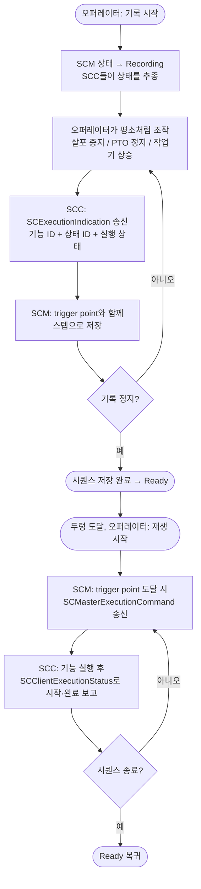
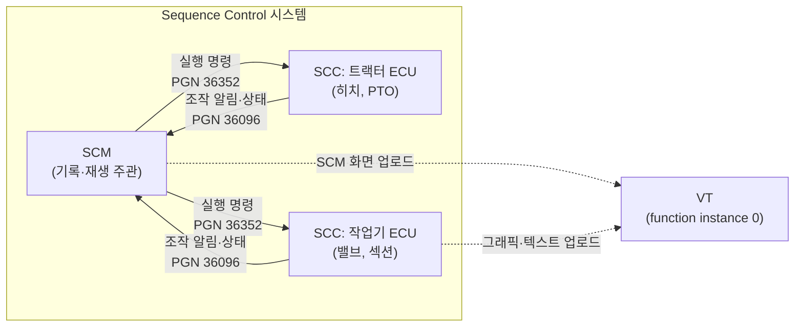
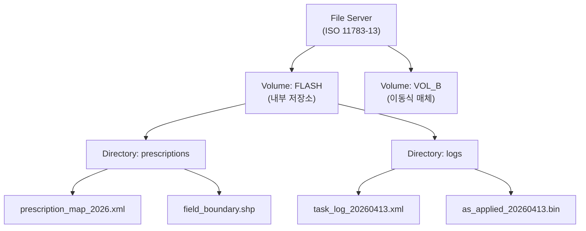
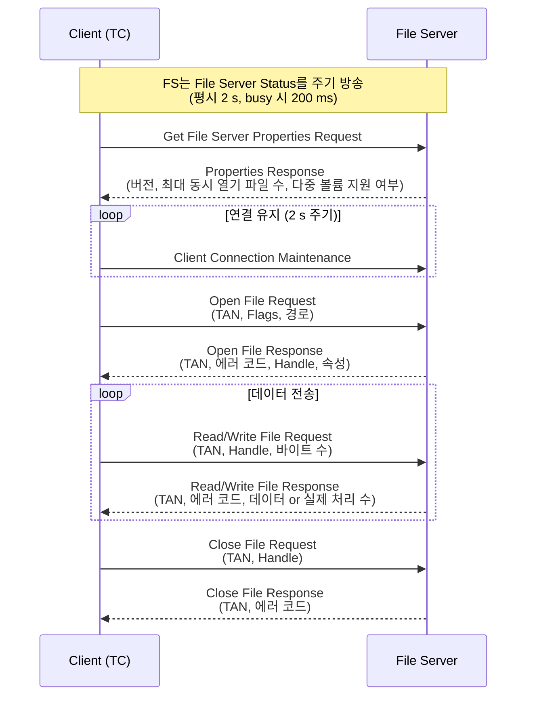

# ISOBUS 기타 기능

::: info 학습 목표
- ISO 11783-14 Sequence Control의 <strong>기록(recording)·재생(playback)</strong> 모델과 SCM/SCC의 역할을 설명할 수 있다.
- Headland Management에서 오퍼레이터 조작이 어떻게 기록되고 재생되는지 순서도로 표현할 수 있다.
- ISO 11783-13 File Server의 파일 계층 구조(Volume / Directory / File)와 연결 유지 방식을 이해한다.
- TAN(Transaction Number)이 명령-응답 통신의 유실·중복 실행 문제를 어떻게 해결하는지 설명할 수 있다.
- SCMasterStatus·SCClientExecutionStatus 같은 SC 메시지 바이트를 디코딩하고, SCM·SCC 상태 머신의 천이 조건으로 기록·재생 중 타임아웃·Abort가 각 노드를 어떤 상태로 보내는지 진단할 수 있다.
- SCC 초기화 순서(capability 확인 → 저장된 SCD 확인 → 업로드 또는 로드 → 활성화)와 SCD 오브젝트 레코드를 바이트 단위로 설계할 수 있다.
- File Server 요청·응답 바이트(Open File·Read Directory·Volume Status)를 디코딩하고, 오류 코드와 200 ms·600 ms·6 s 타이밍으로 클라이언트의 재시도·연결 유지 로직을 설계할 수 있다.
:::

## 1. Sequence Control — ISO 11783-14

### 1.1 개요

<strong>Sequence Control(SC)</strong>은 오퍼레이터가 반복 수행하는 일련의 조작을 <strong>한 번 기록해 두고, 이후 명령 한 번으로 재생</strong>하는 표준이다.
GPS 같은 외부 센서가 시퀀스를 자동 실행하는 모델이 아니라, 오퍼레이터의 수동 조작을 녹화(record)했다가 오퍼레이터의 재생(play back) 지시에 따라 그대로 되풀이하는 모델이다.

가장 대표적인 활용 사례가 <strong>Headland Management(두렁 관리)</strong>이다.
포전 끝(두렁)에서 선회할 때마다 반복하는 조작 — 살포 중지, PTO 정지, 작업기 상승, 선회 후 하강, 살포 재개 — 을 한 번 기록해 두면, 이후 두렁에 도달할 때마다 오퍼레이터가 버튼 하나로 전체 시퀀스를 재생할 수 있다.

시스템은 두 가지 역할로 구성된다.

| 역할 | 이름 | 담당 |
|------|------|------|
| 마스터 | <strong>SCM</strong>(Sequence Control Master) | 기록·재생을 주관한다. 기록 중 수신한 조작을 trigger 정보와 함께 저장하고, 재생 중 trigger point에 도달하면 해당 명령을 SCC에 송신한다 |
| 클라이언트 | <strong>SCC</strong>(Sequence Control Client) | PTO·히치·밸브 같은 client function을 소유한 ECU. 기록 중 오퍼레이터 조작을 SCM에 알리고, 재생 중 SCM의 명령을 수동 조작과 동일한 방식으로 실행한다 |

active SCM은 동시에 하나만 존재할 수 있고, 트랙터도 SCC이자 SCM으로 동작할 수 있다. SCC들은 서로 독립적이며 SCC 간 직접 통신은 없다.

### 1.2 Headland Management 기록·재생 흐름



각 스텝의 <strong>trigger</strong>는 시간 기반(두 기능 활성화 사이의 시간) 또는 거리 기반(두 기능 활성화 사이의 주행 거리)으로 저장된다.
재생 중 문제가 생기면 어떤 SCC든 <strong>SCClientAbort</strong> 메시지로 전체 재생을 즉시 중단시킬 수 있고, 이때 각 SCC는 SCM이 명령했던 자기 기능을 스스로 정의한 safe state로 전환한다.

SCM과 SCC는 각각 상태 머신으로 동작한다.

| 구분 | 상태 |
|------|------|
| SCM | Inactive(시동 후 기본) · Ready · Recording · Recording Completion · Play Back · Abort |
| SCC | Disabled(시동 후 기본) · Ready · Recording · Play Back · Abort |

active SCM이 자신의 상태를 <strong>SCMasterStatus</strong> 메시지로 broadcast하면 enabled SCC들이 이를 따라간다.
SCC는 active SCM이 enable을 명령할 때만 Disabled에서 벗어날 수 있고, SCMasterStatus가 timeout 되면 스스로 Disabled로 복귀한다.
반대로 SCM도 어떤 SCC의 상태 메시지가 timeout 되면 기록을 취소하거나 재생을 중단한다 — 양방향 감시로 어느 한쪽이 사라져도 시스템이 safe state로 수렴한다.

### 1.3 Sequence Control 메시지 구조

SC 통신에는 PGN이 단 두 개 예약되어 있고, 메시지 종류는 데이터 <strong>Byte 1의 message code</strong>로 구분한다.

| PGN | 방향 | 특성 |
|-----|------|------|
| 36352 (0x8E00) | SCM → SCC | destination-specific, 우선순위 4 |
| 36096 (0x8D00) | SCC → SCM | destination-specific, 우선순위 4 |

주요 message code:

| code | 메시지 | 방향 | 역할 |
|------|--------|------|------|
| 0x32 | SCExecutionIndication / Response | SCC → SCM / SCM → SCC | 기록 중 "이 기능을 조작했다" 알림과 저장 확인 |
| 0x33 | SCMasterExecutionCommand | SCM → SCC | 재생 중 trigger point 도달 시 실행 명령 |
| 0x34 | SCClientExecutionStatus / Acknowledgement | SCC → SCM / SCM → SCC | 명령 실행의 시작·완료 보고와 확인 |
| 0x31 | SCClientAbort | SCC → 전역 | 재생 즉시 중단 요구 |
| 0x95 | SCMasterStatus | SCM → 전체 | SCM 상태 broadcast (Ready 1 Hz, 활동 상태 5 Hz) |
| 0x96 | SCClientStatus | SCC → SCM | SCC 상태 보고 (주기 동일) |

명령·요청은 응답을 받을 때까지 최소 100 ms 간격으로 반복하고, 1.6 s까지 응답이 없으면 무응답으로 처리한다.

C 언어로 작성한 SCMasterExecutionCommand(재생 중 실행 명령) 전송 예시:

```c
#include <stdint.h>

/* ISO 11783-14 message codes (data Byte 1) */
#define SC_MSG_CLIENT_ABORT        0x31
#define SC_MSG_EXEC_INDICATION     0x32
#define SC_MSG_MASTER_EXEC_CMD     0x33
#define SC_MSG_CLIENT_EXEC_STATUS  0x34

/* Build and send an SCMasterExecutionCommand (playback trigger) */
int scm_send_execution_command(uint8_t function_id, uint8_t state_id,
                               uint8_t tan, uint32_t function_value,
                               uint8_t da, uint8_t sa,
                               void (*can_send)(uint32_t id, const uint8_t *data, uint8_t len))
{
    uint8_t frame[8];

    frame[0] = SC_MSG_MASTER_EXEC_CMD;      /* message code 0x33 */
    frame[1] = function_id;                 /* SCD function object의 function ID */
    frame[2] = state_id & 0x3F;             /* bits 1-6 = state ID, 상위 2비트 예약(0) */
    frame[3] = tan;                         /* transaction number */
    frame[4] = (uint8_t)(function_value);   /* 기록 시 저장된 function value, LSB first */
    frame[5] = (uint8_t)(function_value >> 8);
    frame[6] = (uint8_t)(function_value >> 16);
    frame[7] = (uint8_t)(function_value >> 24);

    /* priority 4, PGN 36352 (0x8E00), PDU specific = destination address */
    uint32_t can_id = (4UL << 26) | (0x8EUL << 16) | ((uint32_t)da << 8) | sa;
    can_send(can_id, frame, sizeof(frame));
    return 0;
}
```

SCC는 이 명령에 <strong>SCClientExecutionStatus</strong>(code 0x34)로 응답하며, 응답에는 명령과 같은 TAN을 실어 어느 명령에 대한 응답인지 밝힌다.

### 1.4 SCD와 TAN

기록·재생이 성립하려면 SCM이 각 SCC가 어떤 기능을 갖고 있는지 알아야 한다.
이를 위해 SCC는 초기화 때 <strong>SCD</strong>(Sequence Control Data)라는 오브젝트 풀을 SCM에 업로드한다.

- SCD는 basic object(SCC 식별) → function object(기록 가능한 기능, 최대 255개) → state object(기능별 상태, 최대 64개)의 계층 구조다.
- 각 오브젝트는 SCC가 VT에 올린 그래픽·텍스트 오브젝트의 ID를 참조하고, SCM은 External Object Pointer로 이를 자기 화면 안에 표시한다. 그래서 SCM과 SCC 모두 function instance 0인 VT에 접속한다.
- SCM은 SCC당 SCD 하나를 비휘발성 메모리에 저장할 수 있어, 매 시동 시 SCD 업로드를 생략할 수 있다.



<strong>TAN</strong>(Transaction Number)은 명령-응답을 짝 맞추는 장치다.
송신자는 새 명령마다 자기 TAN 카운터를 1 증가시키고, 같은 명령을 반복 송신할 때는 같은 TAN을 유지하며, 수신자는 받은 TAN을 응답에 그대로 되돌린다.
수신 측은 TAN·function ID·state ID가 모두 일치할 때만 응답을 처리하므로, 반복 송신된 명령과 뒤늦게 도착한 응답이 섞여도 혼동이 없고, 한 SCC가 여러 client command를 동시에 걸어 둘 수도 있다.
TAN은 File Server에서도 같은 목적으로 쓰인다(§2.3).

> **Sequence Control 핵심 정리**
> - ISO 11783-14는 오퍼레이터 조작을 기록(recording)했다가 재생(playback)하는 표준이다. GPS 기반 자동 실행 모델이 아니다.
> - SCM이 기록·재생을 주관하고 SCC가 기능을 소유·실행한다. active SCM은 동시에 하나뿐이다.
> - PGN은 2개(SCM→SCC 36352, SCC→SCM 36096)이고 데이터 Byte 1의 message code로 메시지를 구분한다.
> - trigger는 시간·거리 기반으로 저장되고, 재생 중단(Abort) 시 SCC는 자기 기능을 safe state로 전환한다.

## 2. File Server — ISO 11783-13

### 2.1 개요

<strong>File Server(FS)</strong>는 ISOBUS 네트워크 위에서 파일을 저장하고 공유하는 서비스를 제공하는 독립 ECU이다.
USB 메모리나 별도 물리 매체 없이 ECU 간에 파일을 주고받을 수 있고, 자체 저장소가 없는 ECU도 네트워크 공용 저장소를 쓸 수 있다.

주요 활용 사례:
- <strong>처방 맵(Prescription Map)</strong>: FMIS에서 생성한 처방 맵을 TC로 전달
- <strong>작업 로그(Task Log / As-Applied Map)</strong>: TC가 기록한 실제 살포 데이터를 FMIS로 회수
- <strong>공용 저장소</strong>: 대용량 데이터를 다루는 ECU가 자체 저장 장치 없이 네트워크 저장소를 활용

통신에는 PGN 2개가 예약되어 있다(둘 다 destination-specific, 우선순위 7). 9바이트 이상 메시지는 TP(ISO 11783-3)·ETP로 전송한다. Part 13(2011)은 ETP를 ISO 11783-6 소관으로 인용하지만, 이 스터디가 근거로 쓴 판에서 ETP는 ISO 11783-3:2018 5.11에 정의돼 있다([12장](/study/isobus/12-isobus-overview) 참고).

| PGN | 방향 |
|-----|------|
| 43520 (0xAA00) | Client → FS |
| 43776 (0xAB00) | FS → Client |

### 2.2 파일 계층 구조

File Server는 **Volume → Directory → File** 3단계 계층으로 파일을 관리한다.
경로 구분자는 `\`(백슬래시)이고, 최상위의 볼륨 목록은 `\\`로 지정한다.

```
\\ (볼륨 목록, 최상위)
└── FLASH (Volume)
    ├── prescriptions (Directory)
    │   ├── prescription_map_2026.xml
    │   └── field_boundary.shp
    └── logs (Directory)
        ├── task_log_20260413.xml
        └── as_applied_20260413.bin
```



볼륨까지 포함한 절대 경로는 `\\FLASH\logs\task_log_20260413.xml` 형태이고, 볼륨 이름 없이 쓴 경로는 클라이언트별 <strong>current directory</strong> 기준 상대 경로로, `\` 하나로 시작하면 current volume의 루트 기준으로 처리된다(Annex A.2.3.1).
클라이언트가 연결되면 FS는 current directory를 primary volume의 루트로 초기화한다.

### 2.3 File Server 접근 흐름

클라이언트(TC, VT 등)가 File Server에 접근하는 순서는 다음과 같다.



핵심 규칙:

- 클라이언트는 FS와 상호작용하는 동안 <strong>Client Connection Maintenance</strong> 메시지를 2 000 ms 주기로 보낸다. FS가 이 메시지를 <strong>6초</strong>간 못 받으면 그 클라이언트의 열린 파일을 모두 닫고 Handle을 무효화한다 — 클라이언트가 정리 없이 버스에서 이탈해도 FS가 리소스를 회수하는 장치다.
- Read/Write 요청에는 오프셋이 없다. 파일 내 위치 이동은 별도의 <strong>Seek File</strong> 명령으로 수행한다.
- 클라이언트는 응답을 받기 전에 다음 명령을 보내면 안 된다. FS status가 busy를 표시하지 않는데 600 ms 안에 응답이 없으면 실패로 간주하고 <strong>같은 TAN으로</strong> 재요청한다.
- FS는 클라이언트별 마지막 응답을 기억한다. 같은 TAN의 요청이 다시 오면 재전송으로 간주해 <strong>실행 없이</strong> 이전 응답만 다시 보낸다 — 응답 유실 시 Read File 같은 명령이 두 번 실행되어 파일 포인터가 밀리는 사고를 막는다.

### 2.4 Python으로 File Server 메시지 파싱

ISO 11783-13 명령의 Byte 1은 상위 4비트가 커맨드 그룹, 하위 4비트가 함수다.
File Access 그룹(0010)의 함수 코드는 다음과 같고, <strong>요청과 응답이 같은 코드를 쓰며 방향(PGN)으로 구분</strong>된다. Byte 2에는 항상 TAN이 들어간다.

| 명령 | Byte 1 | 요청 배치 (Byte 2~) | 응답 배치 (Byte 2~) |
|------|--------|--------------------|--------------------|
| Open File | 0x20 (32) | TAN, Flags, 경로 길이(2B), 경로 | TAN, 에러 코드, Handle, Attributes |
| Seek File | 0x21 (33) | TAN, Handle, Position Mode, Offset(4B) | TAN, 에러 코드, 예약(FF), 새 Position(4B) |
| Read File | 0x22 (34) | TAN, Handle, Count(2B) | TAN, 에러 코드, Count, Data |
| Write File | 0x23 (35) | TAN, Handle, Count(2B), Data | TAN, 에러 코드, 실제 쓴 Count |
| Close File | 0x24 (36) | TAN, Handle | TAN, 에러 코드 |

아래는 Open File 요청 생성과 응답 파싱의 Python 예시이다.

```python
import struct

# ISO 11783-13 File Access group (command group 0b0010, Annex C)
# 요청과 응답은 같은 함수 코드를 쓰고, 방향(PGN)으로 구분한다.
FS_FUNC_OPEN_FILE  = 0x20  # 32: Open File
FS_FUNC_SEEK_FILE  = 0x21  # 33: Seek File
FS_FUNC_READ_FILE  = 0x22  # 34: Read File
FS_FUNC_WRITE_FILE = 0x23  # 35: Write File
FS_FUNC_CLOSE_FILE = 0x24  # 36: Close File

# Open File Flags (ISO 11783-13 B.14)
FLAG_READ_ONLY  = 0x00  # bits 1,0 = 00
FLAG_WRITE_ONLY = 0x01  # bits 1,0 = 01
FLAG_READ_WRITE = 0x02  # bits 1,0 = 10
FLAG_DIRECTORY  = 0x03  # bits 1,0 = 11 (디렉터리 열기)
FLAG_CREATE     = 0x04  # bit 2: 없으면 파일·디렉터리 생성
FLAG_APPEND     = 0x08  # bit 3: 파일 포인터를 파일 끝으로
FLAG_EXCLUSIVE  = 0x10  # bit 4: 배타적 접근 (이미 열려 있으면 실패)

# Error Codes (ISO 11783-13 B.9)
ERROR_CODES = {
    0:  "Success",
    1:  "Access Denied",
    2:  "Invalid Access",
    3:  "Too many files open",
    4:  "File, path or volume not found",
    5:  "Invalid Handle",
    6:  "Invalid given source name",
    7:  "Invalid given destination name",
    8:  "Volume out of free space",
    9:  "Failure during a write operation",
    10: "Media is not present",
    11: "Failure during a read operation",
    12: "Function not supported",
    13: "Volume is possibly not initialized",
    42: "Invalid request length",
    43: "Out of memory",
    44: "Any other error",
    45: "File pointer at end of file",
}


def parse_open_file_response(data: bytes) -> dict:
    """
    Parse an Open File Response (Byte 1 = 0x20, 8 bytes).
    Layout: [0]=FuncCode, [1]=TAN, [2]=ErrorCode, [3]=Handle,
            [4]=Attributes, [5..7]=reserved (0xFF)
    """
    if len(data) < 5:
        raise ValueError(f"Frame too short: {len(data)} bytes")

    func_code, tan, error_code, handle, attributes = data[:5]

    if func_code != FS_FUNC_OPEN_FILE:
        raise ValueError(f"Unexpected function code: 0x{func_code:02X}")

    success = error_code == 0 and handle != 0xFF  # Handle 255 = 배정 실패
    return {
        "function":   "Open File Response",
        "tan":        tan,
        "error":      ERROR_CODES.get(error_code, f"Reserved({error_code})"),
        "handle":     handle if success else None,
        "attributes": attributes,
        "success":    success,
    }


def build_open_file_request(tan: int, path: str, flags: int = FLAG_READ_ONLY) -> bytes:
    """
    Build an Open File Request (Byte 1 = 0x20).
    Layout: [0]=FuncCode, [1]=TAN, [2]=Flags,
            [3,4]=Path Name Length (LSB first), [5..n]=Path
    """
    path_bytes = path.encode("latin-1")  # ISO/IEC 8859-1 문자 집합
    header = bytes([FS_FUNC_OPEN_FILE, tan, flags])
    return header + struct.pack("<H", len(path_bytes)) + path_bytes


# Example usage
if __name__ == "__main__":
    # Simulate received Open File Response frame
    raw = bytes([0x20, 0x07, 0x00, 0x03, 0x20, 0xFF, 0xFF, 0xFF])
    result = parse_open_file_response(raw)
    print(f"Result : {result['error']} (TAN {result['tan']})")
    print(f"Handle : {result['handle']}")

    # Build a read-only open request (경로 구분자는 백슬래시)
    req = build_open_file_request(7, r"\\FLASH\prescriptions\prescription_map_2026.xml")
    print(f"Request: {req.hex()}")
```

이 Open File 요청은 8바이트를 넘으므로 단일 CAN 프레임이 아니라 TP로 전송된다.
클라이언트는 응답의 TAN이 요청의 TAN과 같은지 확인해 명령 유실 여부를 검증하고, 에러 코드가 0이 아니면 그 뒤의 파라미터(Handle 등)는 무시해야 한다.

> **File Server 핵심 정리**
> - ISO 11783-13 File Server는 ISOBUS 네트워크에서 USB 없이 파일을 공유하는 독립 ECU다.
> - 계층 구조는 Volume → Directory → File이며, 경로 구분자는 `\`, 최상위 볼륨 목록은 `\\`다.
> - 클라이언트는 Client Connection Maintenance(2 s 주기)로 연결을 유지하고, Open → Seek/Read/Write → Close 순서로 파일에 접근한다.
> - 모든 명령·응답은 Byte 2의 TAN으로 짝을 맞추고, FS는 같은 TAN의 재요청에 실행 없이 이전 응답을 재전송해 중복 실행을 막는다.

## 3. Sequence Control 구현 세부 — 상태 머신·초기화·메시지 바이트

§1은 기록·재생 모델의 큰 그림이었다. 이 절은 SCM이나 SCC를 직접 만들 때 지켜야 하는 규범 세부를 ISO 11783-14:2013(1판) 원문 기준으로 정리하고, 근거 절 번호를 `(4.4.2)`, `(E.6)`처럼 단다. 메시지·오브젝트별 전체 표는 [표준 정리: Part 14](/study/isobus/appendix-iso-part14)에 있으니, 여기서는 구현 순서와 바이트 예제를 중심으로 본다.

::: warning 먼저 알아 둘 표기 세 가지
- Part 14의 message code는 16진수다. 원문은 `30₁₆`, `95₁₆`처럼 아래 첨자 16을 붙인다. SCMasterStatus의 Byte 1은 10진 95가 아니라 `0x95`(10진 149)다. 반대로 Part 13(File Server)은 함수 코드를 `32₁₀`처럼 10진수로 적는다.
- 메시지(Annex C~F)는 바이트 안의 비트를 1~8로 센다(Bit 1 = 최하위). "Bits 7-8"은 상위 2비트, 즉 `(b >> 6) & 0x03`이다. 같은 Part 14라도 SCD의 Bitmask(Annex A)는 Bit 0부터 센다(A.1.2). Part 13도 0부터 센다.
- Part 14는 다중 바이트 값의 바이트 순서를 따로 적지 않는다. 이 절의 예제는 ISO 11783-7:2015 3.3.1과 Part 13 5.1이 정한 LSB 우선(little-endian)을 가정한다.
:::

### 3.1 SCM이 갖춰야 할 기능과 화면 연결 (4.1~4.3)

<strong>SCM의 필수·선택 기능.</strong> SCM은 시퀀스를 만드는 수단(RECORD 또는 EDIT)을 최소 하나, 선택한 시퀀스를 재생하는 수단(PLAY BACK)을 반드시 제공한다(4.1, 4.4.5). SCM 구성(CONFIG), 인식된 SCC와 그 기능·선호 trigger의 표시, SCC enable/disable은 선택이다. enable/disable은 기록·편집 때 시스템 구성을 단순하게 하고 버스 부하를 줄이는 용도이고, SCM은 enabled SCC만 시퀀스 관리에 넣는다(4.1).

- 운용 중 활성화될 수 있는 모든 시퀀스에는 서로 다른 시퀀스 번호를 준다(4.4.5). 입력 4개로 시퀀스 4개를 부르는 SCM이라면 번호 4개가 모두 달라야 한다.
- 기록된 시퀀스는 SCM마다 따로 저장·관리한다. 시퀀스를 다른 SCM이나 PC로 옮기는 표준 방법은 없다(4.4).
- SCM은 비휘발성 메모리에 SCC당 SCD를 하나만 보관한다(4.4).

<strong>화면 연결 — External Object Pointer.</strong> SCM은 시퀀스 내용을 보여 줄 때 SCC의 그림·글자를 직접 갖고 있지 않다. SCC(또는 그 Working Set Master)가 자기 오브젝트 풀(SCCOP)에 그림·텍스트를 담아 VT에 올리고, SCM은 SCD에 적힌 object ID만 받아 자기 오브젝트 풀(SCMOP)의 External Object Pointer로 가리킨다(4.2). External Object Pointer는 VT version 5에서 도입된 오브젝트로, SCM이 SCC마다 큰 그래픽이나 언어 갱신을 떠안지 않게 하려고 쓴다. 같은 VT를 써야 참조가 성립하므로 SCM과 SCC의 Working Set Master는 모두 function instance 0인 VT에 접속한다. SCC의 주 화면이 다른 VT(function instance > 0)에 있다면 SCC working set은 VT 연결 두 개를 동시에 유지해야 할 수 있다(4.2, Figure 1). VT 오브젝트 풀 자체는 [VT 오브젝트 풀](/study/isobus/16-vt-object-pool)에서 다뤘다.

연결은 NAME 기반으로 4단계를 거친다(4.2.1). 원문 Figure 2·3의 object ID로 따라가면 다음과 같다.

| 단계 | 주체 | 하는 일 | 예 (Figure 2·3) |
|---|---|---|---|
| 1 | SCM | SCMOP를 올릴 때 External Reference NAME 오브젝트는 disabled, External Object Pointer는 NULL(0xFFFF)로 둔다 | 0x2A disabled, 0x2B·0x2C = 0xFFFF |
| 2 | SCC | active SCM의 NAME을 확인하고, 자기 External Object Definition 오브젝트의 NAME을 SCM NAME으로 바꿔 enable한다(Change Attribute) | 0x3A = SCM NAME, 목록 0x3C·0x3B |
| 3 | SCM | SCC NAME을 확인하고 External Reference NAME 오브젝트에 SCC NAME을 넣어 enable한다 | 0x2A = SCC NAME |
| 4 | SCM | SCD의 object ID로 External Object Pointer마다 External Reference NAME ID와 External Object ID를 설정한다 | 0x2B → (0x2A, 그림 0x3C), 0x2C → (0x2A, 텍스트 0x3B) |

SCM–VT 메시지에는 8바이트 NAME 대신 External Reference NAME 오브젝트의 2바이트 object ID가 실린다. 참조를 바꿀 때마다 NAME 전체를 보내지 않으려는 설계다(4.2.1).

::: warning 화면 연결에서 생기는 구현 함정
- SCM은 SCD에 적힌 object ID의 오브젝트 종류를 확인할 수단이 없다. 텍스트 자리에 그림 ID를 넣는 실수를 막는 책임은 SCC에 있고, SCM은 VT가 참조를 거부하는 경우에 대비해야 한다(4.2.1).
- SCC의 External Object Definition 목록에 오른 오브젝트만 참조할 수 있다(4.2.1). VT는 그리기 전에 참조가 유효한지 확인한다. External Reference NAME이 enabled인지, 참조 대상 풀이 VT에 올라와 있는지, 그 풀에 참조자 NAME을 담은 enabled External Object Definition이 있는지, 대상 ID가 그 목록에 있는지를 보고, 하나라도 어긋나면 Default Object ID의 오브젝트를 그린다(ISO 11783-6:2018 4.6.11.6).
- 4.2.1 본문은 포인터 하나에 Change Attribute가 두 번 든다고 쓰는데, 초기화 흐름도(Figure 8)는 Change Numeric Value로 그린다. Part 6 B.24는 External Object Pointer에 두 명령을 모두 허용하고, 4.2.1이 말하는 두 속성은 Part 6 Table B.70의 AID 2(External Reference NAME ID)와 AID 3(External Object ID)이다.
:::

<strong>Working Set master/member.</strong> SCC가 Working Set member이면 VT 연결과 SCCOP는 Working Set Master가, SCM 연결(SCD 업로드 포함)은 SCC 자신이 맡는다. 이때 SCD basic object의 SCCWS Master NAME에는 SCC가 아닌 Working Set Master의 NAME을 넣는다. member가 master 오브젝트 풀의 object ID를 어떻게 알아내는지는 Part 14의 범위 밖이다(4.3.2).

### 3.2 SCM·SCC 상태 머신과 천이 조건 (4.4.1, 4.4.3)

§1.2의 상태 목록을 천이 조건까지 그리면 다음과 같다. 원문 Figure 4를 재구성했고, `*`는 선택(optional) 요구사항이다.


| 천이 | 조건 (원문 코드) | 구현 메모 |
|---|---|---|
| Inactive → Ready | SCM_A: 오퍼레이터 Master ON | 다른 SCM이 active인 동안 inactive SCM은 상태를 바꾸지 못하고, 오퍼레이터에게 기존 SCM을 먼저 끄라고 알린다(F.2, 4.4.4.1) |
| Ready → Inactive | SCM_B: 오퍼레이터 Master OFF | 비활성화는 Ready에서만 가능하다(4.4.4.1) |
| Ready → Recording | SCM_C: Start Recording | 모든 enabled SCC가 Ready를 보고할 때만(4.4.5.2) |
| Recording → Recording Completion | SCM_G: Stop Recording, 그런데 아직 10·11을 보내지 않은 기능이 있음 | 이 상태에서 새로 보고된 기능 시작은 무시한다(4.4.1.1) |
| Recording·Recording Completion → Ready | SCM_D: Stop Recording, 기록한 모든 기능이 10(완료) 또는 11(오류)을 보냄 / SCM_H: 남은 기능이 모두 10·11을 보냄 / SCM_I: 내부 취소 조건 / SCM_E*: Cancel Record / SCM_F*: SCExecutionIndication에 11 | SCM_I의 예는 SCC 메시지 타임아웃, SCC가 갑자기 disabled로 떨어짐이다 |
| Ready → Play Back | SCM_K: Start Play Back | 선택한 시퀀스의 모든 SCC가 Ready를 보고할 때만(4.4.7.1) |
| Play Back → Ready | SCM_L: 정상 종료 | |
| Play Back → Abort | SCM_M: SCClientAbort 수신 / SCM_N: 오퍼레이터 Abort / SCM_R*: 내부 중단 조건 / SCM_P*: SCClientExecutionStatus에 11 / SCM_F*: SCExecutionIndication에 11 | |
| Abort → Ready | SCM_T: 모든 enabled SCC가 Abort를 반영함 | |

읽을 때 놓치기 쉬운 점이 셋 있다.

- <strong>SCM_F*는 두 곳에 있다.</strong> 기록 중 SCExecutionIndication의 실행 상태 11(실행 중 오류)은 기록 취소(Ready)로, 재생 중 11은 Abort로 이어진다. 재생 중의 11은 "오퍼레이터가 손으로 기능을 조작했다"는 뜻이다(4.4.7.2, E.4). 둘 다 선택 요구사항이라 SCM이 그 기능만 빼고 계속 진행해도 된다.
- <strong>Abort는 Play Back에서만 들어간다.</strong> SCM은 Play Back 상태에서만 SCClientAbort를 받아들인다(4.4.3). 기록 중의 문제는 abort가 아니라 cancel이고, 결과는 Ready다.
- <strong>active SCM은 기록·재생 중 자기 상태를 바꾸지 못하게 해야 한다(F.2).</strong> 오퍼레이터가 Master OFF를 눌러도 Ready로 돌아온 다음에 처리한다(4.4.4.1).

SCC 쪽 Figure 5를 재구성하면 다음과 같다.


| 천이 | 조건 (원문 코드) |
|---|---|
| 시동 → Disabled | SCC_A: active SCM의 상태 수신. 첫 SCClientStatus는 Initialization 1회 |
| Disabled → Ready | SCC_B: SCStateCommand Enabled |
| enabled 상태 → Disabled | SCC_C: SCStateCommand Disabled / SCC_D: SCMasterStatus 타임아웃 / SCC_E: 오퍼레이터가 SC 불참 선택 / SCC_F*: SCC 내부의 치명적 조건 / SCC_G: SCM이 SCC 메시지에 NACK |
| Ready → Recording | SCC_K: SCM 상태 Recording |
| Recording → Ready | SCC_L: SCM 상태 Ready / SCC_M: SCM 상태가 Recording Completion이고 이 SCC의 기능 실행이 모두 끝남 |
| Ready → Play Back | SCC_N: SCM 상태 Play Back / SCC_O: SCMasterExecutionCommand 수신 |
| Play Back → Abort | SCC_R: SCM 상태 Abort / SCC_S: 다른 SCC의 SCClientAbort / SCC_T*: SCS를 멈춰야 하는 내부 조건 |
| Play Back·Abort → Ready | SCC_L: SCM 상태 Ready |

SCC는 Ready·Recording·Play Back에 SCM 명령으로만 들어간다. Abort만 예외로, SCM 명령·다른 SCC의 전역 SCClientAbort·자기 판단 가운데 무엇으로도 들어갈 수 있다(4.4.1.2). SCC_O 덕분에 SCM 상태 변화를 놓친 SCC도 첫 실행 명령을 받으면 Play Back으로 넘어가 명령을 수행한다(4.4.7.1).

enabled SCC가 SCClientStatus Byte 4(sequence state)에 싣는 값은 SCM 상태에 따라 정해진다(4.4.3, F.3).

| SCM이 알리는 상태 (SCMasterStatus Byte 4) | SCC가 싣는 값 (SCClientStatus Byte 4) |
|---|---|
| Ready `0x01` | Ready `0x01` |
| Recording `0x02` | Recording `0x02` |
| Recording completion `0x03` | 기능 실행이 남았으면 Recording `0x02`, 끝났으면 Ready `0x01`. SCC에는 `0x03` 값이 없다 |
| Play back `0x04` | Play back `0x04`. 재생을 멈춰야 하면 Abort `0x05` |
| Abort `0x05` | Abort `0x05` |

client function 일부가 고장이어도 SCC는 SCM과 같은 값을 싣는다(4.4.3). 고장은 Byte 5의 ClientFunctionErrorState로 따로 알린다(§3.8). SCM 쪽 규칙도 짝으로 기억해 둔다.

- client command는 SCClientStatus가 Play Back이나 Ready인 SCC에만 보낸다. 기록 중에는 Recording을 반영한 enabled SCC의 command만 저장한다(4.4.3).
- SCC가 F.3 타임아웃 안에 SCM 상태를 따라오지 않으면 SCM은 그 SCC의 SCD를 휘발성 메모리에서 지우고, 이후 메시지를 NACK해 재연결을 강제한다. 예외는 SCC 상태가 일부러 달라지는 Recording Completion뿐이다(4.5.3.4).
- 빠른 반응을 위해 SCM은 이전 재생이 끝나기 전에 다음 재생을 시작할 수 있다. 이때 첫 시퀀스의 명령 송신을 멈추고 SCMasterStatus의 시퀀스 번호를 먼저 바꾼 뒤 다음 시퀀스 명령을 보낸다. 활성 시퀀스는 한 번에 하나뿐이고, 이전 시퀀스 명령을 마무리하는 SCC의 피드백을 fault로 보면 안 된다(4.4.7.1).

### 3.3 초기화 — SCD 업로드·로드·활성화 (4.4.2, Annex C·D)


시동 직후 모든 SCM은 inactive, 모든 SCC는 disabled이고, 둘 다 상태 메시지 Byte 2에 Initialization(`0x02`)을 한 번 실어 시동을 알린다. 상대가 예기치 않은 리셋을 알아채게 하려는 장치다(4.4.2). 주소 클레임은 [J1939 주소 체계](/study/isobus/10-j1939-address)의 절차를 그대로 따른다. 이후 순서는 다음과 같다.

1. <strong>SCM 준비</strong>: function instance 0 VT에 SCMOP를 올린다. External Object Pointer는 모두 비활성(0xFFFF)이다. 오퍼레이터가 고를 때까지 inactive로 있다가, 선택되면 SCMasterStatus를 연속 송신한다(4.4.2.1 a~c).
2. <strong>SCM의 SCD 초기화</strong>: active가 된 SCM은 휘발성 메모리의 SCD를 모두 지우고, SCC가 Initialization을 알리기 전까지 그 밖의 SCClientStatus를 NACK한다. SCMasterStatus 주기 안에서 quick reset한 경우만 예외다(4.4.2.1 d).
3. <strong>SCC 상태 보고</strong>: SCC는 active SCM의 SCMasterStatus를 받은 뒤에 SCClientStatus를 시작한다. SCM보다 먼저 부팅해도 기다린다. 첫 메시지는 Initialization, 이후 Disabled 연속이다(4.4.2.2 a).
4. <strong>capability 확인</strong> (`0x90`): SCC가 자기 SC 표준 버전을 보내면, SCM이 10바이트 응답(TP 필요)으로 버전, 그래픽 크기(Byte 3·4, 최소 32픽셀), designator 최대 표시 문자 수(Byte 5·6, 최소 32), 폰트 색·크기·종류·스타일(Byte 7~10)을 알린다. 그래픽 크기로는 사용 중인 VT의 soft key 크기를 보고해야 한다(C.2, C.3). SCC는 이 값에 맞춰 SCCOP 오브젝트를 다듬는다. 정의보다 큰 오브젝트는 VT에서 중요한 정보가 잘릴 수 있기 때문이다(4.4.2.2 b).
5. <strong>SCCOP 업로드</strong>: SCC의 Working Set Master가 function instance 0 VT에 접속해, 색·언어 같은 VT capability에 맞춘 풀을 올린다. 자기 화면을 이 VT에 띄우지 않더라도 SCMOP가 참조할 텍스트·그래픽을 담은 SCCOP만큼은 반드시 올린다(4.4.2.2 c).
6. <strong>저장된 SCD 확인</strong> (`0x01`, `0x02`): SCDVersionRequest·SCDConfigurationLabelRequest로 SCM에 자기 SCD가 있는지, 버전과 기계 구성이 맞는지 본다. SCM은 SCD basic object의 NAME Mask로 저장된 SCD와 SCC를 맞춘다(D.2~D.5, A.3). 응답 Byte 2는 00(레이블 첨부), 01(일치하는 SCD 없음), FF(기타 오류)이고, 오류면 Byte 4~8을 FF로 채운 8바이트다. 레이블 내용은 SCC 제조사 고유이고, SCC 소프트웨어 갱신으로 저장된 SCD가 무효가 될 수 있다(4.4.2.2 e).
7. <strong>메모리 확인</strong> (`0x91`): SCMasterMemoryRequest Byte 2~5에 올리거나 불러올 SCD의 바이트 수를 싣는다. 응답 Byte 2가 00이면 진행하되, "충분할 수도 있다"는 뜻일 뿐이다. 오브젝트 저장 오버헤드 때문에 확답할 수 없어서다. 01이면 전송도 로드도 하면 안 된다(C.4, C.5).
8. <strong>업로드 또는 로드</strong>: SCD가 없거나 맞지 않으면 SCDTransfer(`0x03`)로 올린다. TP가 필요하고, 1 785바이트를 넘으면 ETP를 쓴다(D.6). 응답 Byte 2는 00(정상 수신), 01(전송 중 오류), FF다(D.7). 저장된 SCD를 쓰기로 했으면 SCDLoadCommand(`0x07`)로 비휘발성 메모리에서 휘발성 메모리로 불러온다. 응답은 00 성공, 01 없음, 02 파일 시스템 오류·데이터 손상, 03 휘발성 메모리 부족, FF다(D.14, D.15).
9. <strong>활성화</strong> (`0x04`): SCDActivationCommand를 받은 SCM은 SCD 무결성을 파싱하면서 SCMasterStatus Byte 5의 bit 2(SCD 파싱 중)를 켠다. 결과는 SCDActivationResponse Byte 2의 오류 코드와 Byte 3~4의 첫 결함 object ID(정상이면 0xFFFF)로 온다. 오류 코드가 0이 아니면 그 SCD는 쓸 수 없다. SCC는 긍정 응답을 받기 전까지 SCClientStatus 외의 SC 통신을 이어 가면 안 된다(4.4.2.2 g, D.8, D.9).
10. <strong>저장(선택)</strong> (`0x06`): 다음 시동에 다시 올리지 않으려면 SCDStoreCommand로 파싱이 끝난 SCD를 비휘발성 메모리에 저장시킨다. SCM은 NAME Mask로 SCC당 하나만 남기고 이전 버전을 덮어쓴다. 응답 01(파싱 미완료)이나 02(비휘발성 메모리 부족)로 실패해도 휘발성 메모리의 SCD는 계속 쓸 수 있고, 다음 시동에 다시 올리면 된다(D.12, D.13).
11. <strong>Enabled 대기</strong>: 초기화가 끝나도 SCC는 SCStateCommand(`0x30`) Enabled를 받을 때까지 Disabled다(4.4.2.2 i). SCM은 받은 SCD로 External Object Pointer를 채운다(Figure 8).

SCD를 지울 때는 SCDDeleteCommand(`0x05`)를 쓴다. Byte 2가 00이면 휘발성, 01이면 비휘발성 메모리의 SCD를 지운다. 메모리 제약으로 연결이 끊겨 일부만 전송된 SCD를 치울 때도 쓴다(D.10, D.11).

::: tip SCD 메시지에는 응답 타임아웃이 없다
Annex D 메시지는 응답별 타임아웃을 정하지 않는다. SCM의 메모리 처리 시간이 SCD 크기 등에 크게 좌우되기 때문이다. 대신 SCC는 타임아웃을 잴 때 SCMasterStatus의 busy flag를 존중해야 하고, flag(bit 1 비휘발성 메모리 접근 중, bit 2 SCD 파싱 중)가 켜진 동안에는 SCM에 대한 미결 응답의 타임아웃 측정을 멈춘다(D.1, F.2).
:::

::: warning 레이블 길이 64자와 63자
A.3 표는 SCD Version Label과 Configuration Label의 길이를 각각 1~64로 정한다. 그런데 SCDVersionResponse·SCDConfigurationLabelResponse의 길이 필드는 Byte 3의 Bits 1-6이라 최대 63이고(D.3, D.5), SCDActivationResponse 오류 코드 09·0B는 "0 또는 63바이트 초과"를 길이 오류로 본다(D.9). 원문 안에서 값이 엇갈리므로 레이블은 63자 이하로 만드는 편이 안전하다(추론).
:::

### 3.4 SCD 바이트 구조 (Annex A)

SCD는 VT 오브젝트 풀과 비슷한 레코드 묶음이다. 공통 규칙부터 본다(A.1, A.2).

- object ID는 SCD 전체에서 유일하고 범위는 0~65534다. 65535(0xFFFF)는 NULL로 예약된다.
- basic object는 SCD당 하나이고 object ID는 항상 0이다. function object는 basic object당 1~255개, state object는 function object당 0~64개다.
- Function ID가 1바이트, State ID가 6비트인 이유는 관련 CAN 메시지를 8바이트 안에 담기 위해서다. 그래서 SCD 하나의 기능은 최대 255개, 기능 하나의 상태는 최대 64개다(A.4, A.5).
- 자료형은 Bitmask(1바이트, Bit 0 = 최하위), Byte Array, Float(IEEE 754 32비트), Integer(1·2·4바이트)다(A.1.2).

세 오브젝트의 레코드 바이트 배치는 다음과 같다(Table A.1~A.3 재구성). 속성의 뜻과 값 범위는 [Part 14 정리의 Annex A](/study/isobus/appendix-iso-part14)에 있다.

| 오브젝트 | 레코드 바이트 배치 | 전체 길이 |
|---|---|---|
| basic (Type 0) | 1-2 Object ID(=0) · 3 Type · 4 SC Version · 5-12 SCCWS Master NAME · 13-20 SCC NAME Mask · 21-22 SCD Designator · 23-24 SCD Graphic · 25 Version Label 길이 N · 26 Configuration Label 길이 M · 27 function object 수 O · 28~ Version Label, Configuration Label, function object ID × O | 27 + N + M + 2O |
| function (Type 1) | 1-2 Object ID · 3 Type · 4 Function ID · 5 Preferred trigger · 6 Attributes · 7-10 Min · 11-14 Max · 15-18 Offset · 19-22 Scale · 23 number of decimals · 24-25 Unit String · 26-27 Designator · 28-29 Graphic · 30 state object 수 S · 31~ state object ID × S | 30 + 2S |
| state (Type 2) | 1-2 Object ID · 3 Type · 4 State ID · 5-6 Designator · 7-8 Graphic | 8 |

구현할 때 눈여겨볼 필드는 다음과 같다.

- <strong>SCC NAME Mask</strong>: 비트가 1이면 그 NAME 비트가 일치해야 하고, 0이면 무시해도 된다. 모두 1(0xFF × 8)이면 정확히 그 작업기만 맞고, Identity Number(NAME 하위 21비트, ISO 11783-5:2019 Table 1) 비트만 0이면 같은 기종 여러 대 가운데 아무것이나 맞는다. SCM은 마스크보다 더 엄격하게 걸러도 된다(A.3). SCC NAME 자체는 SCD에 없고, SCM이 SCD와 함께 따로 저장한다.
- <strong>Version Label</strong>: ISO/IEC 8859-1의 보이는 문자만 쓰고 길이에 맞게 뒤를 공백으로 채운다. 오퍼레이터에게 보이거나 파일 이름 일부로 쓰일 수 있어서 역슬래시, 큰따옴표, 작은따옴표, 백틱, 슬래시, 콜론, 별표, 부등호 두 개, 세로선, 물음표 11자는 금지다(A.3). 내용은 SCC 제조사 고유이고 검사 책임은 SCC에 있지만, SCM도 SCS 무결성을 위해 SCS를 정의할 때 쓴 두 레이블을 추적해야 한다.
- <strong>Designator</strong>: 길이 제한은 VT string 오브젝트의 제약뿐이다. SCM이 화면에 맞게 자를 수 있지만 최소 32자는 보여야 한다(A.3~A.5).
- <strong>Preferred trigger</strong>: 1 시간 기반, 2 거리 기반, 255 상관없음 가운데 하나만 지정한다. SCM은 모든 trigger 방식을 지원할 의무도, 이 선호를 따를 의무도 없다(A.4).
- <strong>Function value 표시</strong>: 저장·전송되는 값은 항상 32비트 unsigned다. 화면 값 = (값 + Offset) × Scale이고, 역변환은 값 = 화면 값 / Scale − Offset이다. Min·Max도 같은 식으로 스케일링해 입력 범위로 쓴다(A.4). Attributes Bit 0-1이 00이면 SCM은 값을 표시하지 않고, 01이면 편집 화면에 표시만 하고, 10이면 표시하면서 범위 안의 변경을 허용한다. Min·Max는 00·01일 때, Offset·Scale·decimals·Unit String은 00일 때 FF로 채운다.

예를 들어 3점 히치 위치를 0~10 000(0.01 % 단위)으로 보내는 SCC가 Offset 0, Scale 0.01, decimals 1로 정의하면, 기록된 값 7 500은 화면에 75.0으로 보인다. 4.4.8의 예처럼 SCC는 히치가 멈춘 위치를 이 값에 담아 완료를 보고하고, 재생 때 같은 값을 돌려받아 같은 높이에서 멈춘다.

::: warning Scale 필드의 0xFFFFFFFF
표시 방식이 00이면 Scale(Float) 자리에도 0xFFFFFFFF를 넣는다(A.4). 이 비트 패턴을 IEEE 754로 읽으면 NaN이다. 파서는 Float로 해석하기 전에 원시 4바이트가 0xFFFFFFFF인지 먼저 확인하는 편이 안전하다(추론).
:::

::: details Python으로 SCD 레코드 만들기와 NAME Mask 매칭
Annex A는 오브젝트 레코드만 정의하고, SCDTransfer(D.6)의 Byte 2~N에 레코드를 어떤 순서로 이어 붙일지는 따로 적지 않는다. 아래 예제는 VT 오브젝트 풀처럼 basic → function → state 순서로 이어 붙인다고 가정한다. 다중 바이트 값은 LSB 우선으로 가정한다.

```python
import struct

NULL_ID = 0xFFFF
FORBIDDEN = set('\\"\'`/:*<>|?')  # A.3: not allowed in an SCD Version Label


def basic_object(ws_master_name: int, name_mask: int, designator: int, graphic: int,
                 version: str, config: str, function_ids: list, sc_version: int = 2) -> bytes:
    """Table A.1 SCD basic object. Object ID = 0, Type = 0."""
    v, c = version.encode("latin-1"), config.encode("latin-1")
    assert 1 <= len(v) <= 64 and 1 <= len(c) <= 64
    assert not FORBIDDEN & set(version)
    assert 1 <= len(function_ids) <= 255
    head = struct.pack("<HBBQQHHBBB", 0, 0, sc_version, ws_master_name, name_mask,
                       designator, graphic, len(v), len(c), len(function_ids))
    assert len(head) == 27  # record bytes 1-27
    return head + v + c + b"".join(struct.pack("<H", i) for i in function_ids)


def function_object(obj_id: int, fn_id: int, trigger: int, attr: int,
                    vmin: int, vmax: int, offset: int, scale: float, decimals: int,
                    unit: int, designator: int, graphic: int, state_ids: list) -> bytes:
    """Table A.2 SCD function object. Type = 1."""
    assert 1 <= obj_id <= 65534 and trigger in (1, 2, 255) and len(state_ids) <= 64
    body = struct.pack("<HBBBBIIifBHHHB", obj_id, 1, fn_id, trigger, attr,
                       vmin, vmax, offset, scale, decimals, unit, designator, graphic,
                       len(state_ids))
    assert len(body) == 30  # record bytes 1-30
    return body + b"".join(struct.pack("<H", i) for i in state_ids)


def state_object(obj_id: int, state_id: int, designator: int, graphic: int) -> bytes:
    """Table A.3 SCD state object. Type = 2, 8 bytes."""
    assert 1 <= obj_id <= 65534 and 0 <= state_id <= 63
    return struct.pack("<HBBHH", obj_id, 2, state_id, designator, graphic)


def name_matches(stored: int, candidate: int, mask: int) -> bool:
    """A.3: mask bit 1 = this NAME bit shall match, 0 = may be ignored."""
    return (stored ^ candidate) & mask == 0


def displayed(raw: int, offset: int, scale: float) -> float:
    """A.4: Displayed Value = (Value Attribute + Offset) * Scaling Factor."""
    return (raw + offset) * scale


if __name__ == "__main__":
    NAME = 0xA00C810012345678                 # example NAME of the SCC (= its WS master)
    MASK = 0xFFFFFFFFFFE00000                 # ignore the 21-bit Identity Number

    scd = (basic_object(NAME, MASK, designator=0x003B, graphic=0x003C,
                        version="SW 2.1.0", config="3PH+PTO", function_ids=[1])
           + function_object(1, fn_id=0x05, trigger=2, attr=0b10,
                             vmin=0, vmax=10000, offset=0, scale=0.01, decimals=1,
                             unit=0x0040, designator=0x0041, graphic=0x0042, state_ids=[2, 3])
           + state_object(2, state_id=1, designator=0x0043, graphic=0x0044)
           + state_object(3, state_id=2, designator=0x0045, graphic=0x0046))

    assert len(scd) == (27 + 8 + 7 + 2) + (30 + 4) + 8 + 8 == 94
    assert scd[24] == 8 and scd[25] == 7 and scd[26] == 1      # bytes 25, 26, 27
    assert scd[27:35] == b"SW 2.1.0"                           # bytes 28 .. 28+N-1

    mem_req = bytes([0x91]) + struct.pack("<I", len(scd)) + b"\xFF" * 3
    assert mem_req.hex(" ").upper() == "91 5E 00 00 00 FF FF FF"
    transfer = bytes([0x03]) + scd
    assert len(transfer) == 95                                 # > 8 bytes -> TP

    other_unit = NAME ^ 0x000000000001F00F                     # same model, other identity
    assert name_matches(NAME, other_unit, MASK)
    assert not name_matches(NAME, other_unit, 0xFFFFFFFFFFFFFFFF)

    assert round(displayed(7500, 0, 0.01), 2) == 75.0
    print(scd[:27].hex(" ").upper())
    print("SCD bytes:", len(scd), "/ SCDTransfer bytes:", len(transfer))
    print("all asserts passed")
```

실행하면 basic object의 고정부 27바이트 `00 00 00 02 78 56 34 12 00 81 0C A0 00 00 E0 FF FF FF FF FF 3B 00 3C 00 08 07 01`과 전체 크기가 출력되고 모든 assert가 통과한다. SCD가 94바이트이므로 SCMasterMemoryRequest는 `91 5E 00 00 00 FF FF FF`이고, SCDTransfer는 Byte 1(`0x03`)을 더한 95바이트라 TP로 보낸다.
:::

### 3.5 메시지 지도와 재생 한 스텝 바이트 예제 (Annex B~F)

PGN은 두 개뿐이다. SCM→SCC는 PGN 36352(0x8E00), SCC→SCM은 PGN 36096(0x8D00)이고, 둘 다 PDU1이라 PS 자리에 목적지 주소가 들어간다(B.2, B.3). 데이터 길이는 "가변(최소 8바이트)"이다. 기본 우선순위 4는 SC 자동 기능을 덮어쓸 수 있는 VT auxiliary control처럼 더 높은 우선순위의 메시지를 방해하지 않으려고 정한 값이다(B.1). SCM이 0x8C, SCC가 0x81(예시 주소)이라면 29비트 CAN ID는 다음과 같다.

| 메시지 | DA | CAN ID |
|---|---|---|
| SCM → SCC (일반) | 0x81 | `0x108E818C` |
| SCC → SCM (일반) | 0x8C | `0x108D8C81` |
| SCMasterStatus (전역 broadcast) | 0xFF | `0x108EFF8C` |
| SCClientAbort (전역) | 0xFF | `0x108DFF81` |

메시지 종류는 Byte 1의 message code로 가른다.

| code | 메시지 | 방향 | 응답·확인 | 절 |
|---|---|---|---|---|
| 0x01~0x07 | SCD operation: Version, ConfigurationLabel, Transfer, Activation, Delete, Store, Load | SCC 요청 → SCM 응답 | 같은 code의 Response | D.2~D.15 |
| 0x30 | SCStateCommand | SCM → SCC | 전용 응답 없음. SCClientStatus Byte 2로 확인 | E.2 |
| 0x31 | SCClientAbort | SCC → 전역 | SCMasterStatus의 Abort | E.3 |
| 0x32 | SCExecutionIndication / Response | SCC → SCM / SCM → SCC | Response가 확인 | E.4, E.5 |
| 0x33 | SCMasterExecutionCommand | SCM → SCC | SCClientExecutionStatus | E.6 |
| 0x34 | SCClientExecutionStatus / Acknowledgement | SCC → SCM / SCM → SCC | Acknowledgement가 확인 | E.7, E.8 |
| 0x35 | SCClientFunctionErrorRequest / Response | SCM → SCC / SCC → SCM | Response | E.9, E.10 |
| 0x90 | SCMasterCapabilityRequest / Response | SCC → SCM / SCM → SCC | Response (10바이트) | C.2, C.3 |
| 0x91 | SCMasterMemoryRequest / Response | SCC → SCM / SCM → SCC | Response | C.4, C.5 |
| 0x95 | SCMasterStatus | SCM → 전역 | — | F.2 |
| 0x96 | SCClientStatus | SCC → SCM | — | F.3 |

요청과 응답이 같은 code를 쓰므로 방향은 PGN으로 가른다. 0x34는 PGN 0x8D00이면 SCClientExecutionStatus, 0x8E00이면 SCClientExecutionAcknowledgement다.

상태 메시지의 Byte 3 시퀀스 번호는 0x00~0x31(10진 0~49)이고, Ready일 때와 SCM inactive·SCC disabled일 때는 0xFF다(F.2, F.3). 원문이 범위를 16진수로 적으므로 0~31로 읽으면 안 된다. SCC가 싣는 번호는 지금 SCExecutionIndication을 보내거나 SCMasterExecutionCommand를 실행 중인 시퀀스의 번호이고, 진단 용도로만 쓴다(F.3).

E.4·E.5·E.7·E.8의 Byte 3은 Bits 1-6에 State ID, Bits 7-8에 function execution state를 담는다. 00은 시작과 완료가 동시, 01은 시작, 10은 완료, 11은 실행 중 오류다. SCExecutionIndication의 11은 재생 중 오퍼레이터 개입도 뜻한다. State ID가 2라면 00 → `0x02`, 01 → `0x42`, 10 → `0x82`, 11 → `0xC2`다. E.6 SCMasterExecutionCommand는 Bits 7-8을 0으로 둔다.

::: warning TAN과 error code의 바이트 위치가 메시지마다 다르다
| 메시지 | Byte 4 | Byte 5 | 나머지 |
|---|---|---|---|
| E.4 SCExecutionIndication | TAN | function value 시작 | Byte 5~8 function value. 시작만 알리면 FFFFFFFF |
| E.5 SCExecutionIndicationResponse | error code | TAN | Byte 6~8 FF |
| E.6 SCMasterExecutionCommand | TAN | function value 시작 | Byte 5~8 function value |
| E.7 SCClientExecutionStatus | error code | TAN | Byte 6~8 FF |
| E.8 SCClientExecutionAcknowledgement | TAN | FF | Byte 5~8 FF |

error code가 없는 E.4·E.6·E.8은 TAN이 Byte 4에 있고, error code를 싣는 E.5·E.7은 error code가 Byte 4, TAN이 Byte 5다. E.8은 응답이지만 error code가 없어 TAN이 Byte 4에 온다. E.2 SCStateCommand는 Byte 3을, E.3 SCClientAbort는 Byte 2~3을 예약으로 비워 두는데, 원문은 "error code를 모든 메시지에서 같은 바이트에 두려고"라고 이유를 단다. 그래서 E.3의 error code도 Byte 4다. 파서를 메시지 종류별로 따로 짜야 하는 이유다.
:::

재생 한 스텝을 바이트로 따라가 보자. 시퀀스 0x02를 재생 중이고, SCM이 function 0x05(3점 히치)의 state 2(상승)를 function value 7 500으로 명령한다. SCM의 직전 TAN은 0x11이었다고 하자.

| # | 방향 | CAN ID | 데이터 | 뜻 |
|---|---|---|---|---|
| 1 | SCM → 전역 | `0x108EFF8C` | `95 01 02 04 00 FF FF FF` | SCMasterStatus: Active, 시퀀스 0x02, Play back, busy 없음 |
| 2 | SCM → SCC | `0x108E818C` | `33 05 02 12 4C 1D 00 00` | 실행 명령: function 0x05, state 2, TAN 0x12, value 7 500(0x1D4C) |
| 3 | SCC → SCM | `0x108D8C81` | `34 05 42 00 12 FF FF FF` | 실행 시작(01), error 00, TAN 0x12 |
| 4 | SCM → SCC | `0x108E818C` | `34 05 42 12 FF FF FF FF` | 시작 확인. TAN은 Byte 4 |
| 5 | SCC → SCM | `0x108D8C81` | `34 05 82 00 12 FF FF FF` | 실행 완료(10), TAN 0x12 |
| 6 | SCM → SCC | `0x108E818C` | `34 05 82 12 FF FF FF FF` | 완료 확인 |

반복 규칙도 같이 본다(4.4.7.1). SCM은 2번을 같은 TAN으로 100 ms마다 반복하다가 3번이 오면 멈춘다. SCC는 3번을 100 ms마다 반복하다가 4번을 받거나, SCM이 Abort로 바뀌거나, 타임아웃이 나거나, 완료를 보고할 시점(5번)에 이르면 멈춘다. 받은 응답의 TAN·function ID·state ID 가운데 하나라도 다르면 무시한다(4.6).

::: details Python으로 SC 메시지 인코딩·디코딩
위 표의 바이트를 만들고 되읽는 코드다. function value의 바이트 순서는 LSB 우선으로 가정했다.

```python
import struct

# ISO 11783-14 message codes (Byte 1). The standard writes them in hex (30₁₆ ...).
SC_STATE_COMMAND        = 0x30  # E.2  SCM -> SCC
SC_CLIENT_ABORT         = 0x31  # E.3  SCC -> global
SC_EXEC_INDICATION      = 0x32  # E.4 / E.5 (request and response share the code)
SC_MASTER_EXEC_COMMAND  = 0x33  # E.6  SCM -> SCC
SC_CLIENT_EXEC_STATUS   = 0x34  # E.7 / E.8
SC_FUNCTION_ERROR       = 0x35  # E.9 / E.10
SC_MASTER_STATUS        = 0x95  # F.2  SCM -> broadcast
SC_CLIENT_STATUS        = 0x96  # F.3  SCC -> SCM

PGN_SCM_TO_SCC = 0x8E00  # 36352 (B.2)
PGN_SCC_TO_SCM = 0x8D00  # 36096 (B.3)

SEQ_STATE = {0x01: "Ready", 0x02: "Recording", 0x03: "Recording completion",
             0x04: "Play back", 0x05: "Abort", 0xFF: "n/a"}
EXEC_STATE = {0b00: "started+completed", 0b01: "started",
              0b10: "completed", 0b11: "error"}


def can_id(pgn: int, da: int, sa: int, priority: int = 4) -> int:
    """29-bit identifier for a PDU1 PGN (PF < 240): DA goes into the PS field."""
    return (priority << 26) | ((pgn >> 8) << 16) | (da << 8) | sa


def pack_state(state_id: int, exec_state: int) -> int:
    """Byte 3: bits 1-6 = state ID, bits 7-8 = function execution state."""
    assert 0 <= state_id <= 63 and 0 <= exec_state <= 3
    return (exec_state << 6) | state_id


def unpack_state(b3: int) -> tuple:
    return b3 & 0x3F, (b3 >> 6) & 0x03


def master_status(state: int, seq_no: int, seq_state: int, busy: int = 0) -> bytes:
    return bytes([SC_MASTER_STATUS, state, seq_no, seq_state, busy, 0xFF, 0xFF, 0xFF])


def parse_status(frame: bytes) -> dict:
    code, state, seq_no, seq_state, b5 = frame[:5]
    assert code in (SC_MASTER_STATUS, SC_CLIENT_STATUS)
    out = {"code": hex(code), "state": state, "seq_no": seq_no,
           "seq_state": SEQ_STATE.get(seq_state, f"reserved({seq_state:#04x})")}
    if code == SC_MASTER_STATUS:
        out["nvm_busy"] = bool(b5 & 0x01)   # Bit 1
        out["parsing"] = bool(b5 & 0x02)    # Bit 2
    else:
        out["error_state"] = b5             # ClientFunctionErrorState
    return out


def master_exec_command(fn_id: int, state_id: int, tan: int, value: int) -> bytes:
    # E.6: bits 7-8 of byte 3 are reserved (0); function value assumed LSB first
    return bytes([SC_MASTER_EXEC_COMMAND, fn_id, pack_state(state_id, 0), tan]) + struct.pack("<I", value)


def client_exec_status(fn_id: int, state_id: int, exec_state: int, err: int, tan: int) -> bytes:
    # E.7: error code in byte 4, TAN in byte 5
    return bytes([SC_CLIENT_EXEC_STATUS, fn_id, pack_state(state_id, exec_state), err, tan, 0xFF, 0xFF, 0xFF])


def exec_ack(fn_id: int, state_id: int, exec_state: int, tan: int) -> bytes:
    # E.8: TAN in byte 4 (not byte 5)
    return bytes([SC_CLIENT_EXEC_STATUS, fn_id, pack_state(state_id, exec_state), tan, 0xFF, 0xFF, 0xFF, 0xFF])


def parse_function_errors(frame: bytes) -> list:
    """E.10: Byte 2 = count, then 2-byte structures (function ID, error status)."""
    assert frame[0] == SC_FUNCTION_ERROR
    out = []
    for i in range(frame[1]):
        fn_id, b = frame[2 + 2 * i], frame[3 + 2 * i]
        out.append({"function_id": fn_id, "status": b & 0x0F, "confirm": bool(b & 0x80)})
    return out


if __name__ == "__main__":
    SCM, SCC = 0x8C, 0x81  # example source addresses

    assert can_id(PGN_SCM_TO_SCC, SCC, SCM) == 0x108E818C
    assert can_id(PGN_SCC_TO_SCM, SCM, SCC) == 0x108D8C81
    assert can_id(PGN_SCM_TO_SCC, 0xFF, SCM) == 0x108EFF8C   # SCMasterStatus, global
    assert can_id(PGN_SCC_TO_SCM, 0xFF, SCC) == 0x108DFF81   # SCClientAbort, global

    st = master_status(0x01, 0x02, 0x04)
    assert st.hex(" ").upper() == "95 01 02 04 00 FF FF FF"
    assert parse_status(st)["seq_state"] == "Play back"

    cmd = master_exec_command(0x05, 0x02, 0x12, 7500)
    assert cmd.hex(" ").upper() == "33 05 02 12 4C 1D 00 00"

    started = client_exec_status(0x05, 0x02, 0b01, 0x00, 0x12)
    assert started.hex(" ").upper() == "34 05 42 00 12 FF FF FF"
    assert unpack_state(started[2]) == (2, 0b01)
    ack = exec_ack(0x05, 0x02, 0b01, 0x12)
    assert ack.hex(" ").upper() == "34 05 42 12 FF FF FF FF"
    done = client_exec_status(0x05, 0x02, 0b10, 0x00, 0x12)
    assert done.hex(" ").upper() == "34 05 82 00 12 FF FF FF"

    # The same code 0x34 in both directions: only the PGN tells E.7 and E.8 apart
    assert started[0] == ack[0] == SC_CLIENT_EXEC_STATUS

    errs = parse_function_errors(bytes.fromhex("35 02 05 82 07 03 FF FF"))
    assert errs == [{"function_id": 5, "status": 2, "confirm": True},
                    {"function_id": 7, "status": 3, "confirm": False}]

    for f in (st, cmd, started, ack, done):
        print(f.hex(" ").upper())
    print("all asserts passed")
```
:::

### 3.6 주기·타임아웃 한눈에 보기 (E.1, F.2, F.3)

| 항목 | 값 | 근거 |
|---|---|---|
| SCMasterStatus 송신 | Byte 2~5가 바뀌면 즉시. Ready 1회/s, Recording·Recording Completion·Play Back·Abort 5회/s. 메시지 간 최소 100 ms | F.2 |
| inactive SCM의 SCMasterStatus | 시동 직후 Initialization 1회, 오퍼레이터 입력으로 상태가 바뀐 직후 Inactive 1회만 | F.2 |
| SCMasterStatus 타임아웃 (SCC가 감시) | 활동 상태 600 ms, Ready 3 s | F.2 |
| SCClientStatus 송신 | Byte 2~5가 바뀌면 즉시. Ready·disabled 1회/s, Recording·Play Back·Abort 5회/s. 메시지 간 최소 100 ms | F.3 |
| SCClientStatus 타임아웃 (SCM이 감시) | Recording·Play Back·Abort 600 ms, Ready 3 s | F.3 |
| 명령·요청 반복 (Annex E) | 응답이 올 때까지 초당 최대 5회, 반복 간 최소 100 ms. 최소 1.6 s 동안 응답이 없으면 무응답 | E.1 |
| 같은 TAN 반복 (절차 서술) | 100 ms 간격 | 4.4.5.2, 4.4.7.1 |
| SCD operation 응답 (Annex D) | 개별 타임아웃 없음. busy flag가 켜진 동안 측정 정지 | D.1, F.2 |

활동 상태에서는 송신 주기를 5배로 촘촘히 하고 타임아웃을 600 ms로 줄인다. 600 ms는 200 ms 주기의 3배, 3 s는 1 s 주기의 3배라서 연속 두 메시지를 잃어도 버티도록 잡은 값으로 보인다(추론).

::: warning 반복 주기가 원문 안에서 엇갈린다
E.1은 반복을 "초당 최대 5회"(간격 200 ms 이상)와 "반복 간 최소 100 ms"로 적고, 4.4.5.2·4.4.7.1은 같은 TAN을 "100 ms 간격"으로 반복하라고 적는다. 100 ms 간격은 초당 10회라 E.1의 "최대 5회"와 글자 그대로는 맞지 않는다. 원문이 둘의 관계를 설명하지 않으므로 확인 필요다.
:::

SCMasterStatus가 사라졌을 때의 처리는 SCC 상태에 따라 다르다. enabled SCC는 타임아웃 뒤 SCC_D로 Disabled가 되고, 통신 오류를 감지한 쪽으로서 일반 안전 요구를 고려해 스스로 조치한다(4.5.2). 이미 disabled인 SCC는 오퍼레이터 경고를 띄우지 말고 정상 종료로 해석해, 새 SC 통신이 시작될 때까지 자기 SCClientStatus도 멈춘다(4.4.4.1). SCM이 정상 종료할 때는 Ready를 계속 보내면서 enabled SCC를 모두 disable시키고, 모두 disabled를 반영하면 Inactive를 한 번 알린 뒤 송신을 멈춘다. 이 한 번을 놓친 쪽은 타임아웃으로 종료를 판단한다(4.4.4.1).

SCC가 SC 통신에서 빠질 때는 먼저 SCClientStatus Byte 2를 Disabled로 바꾸고, 첫 NACK을 받을 때까지 계속 보낸다. SCM이 불필요한 타임아웃 경고를 띄우지 않게 하려는 절차다(4.4.4.2).

### 3.7 기록·재생에서 TAN과 실행 상태 다루기 (4.4.5~4.4.9, 4.6)

<strong>기록.</strong> SCM은 SCC가 기능 실행 시작을 보고할 때 trigger를 기록하고, 완료를 보고할 때 function value를 기록한다. 시작과 완료를 모두 받은 기능만 SCS에 저장되고, 00(시작·완료 동시)은 둘을 한 번에 알린다(4.4.5.2). SCC는 다음을 지킨다.

- 기능을 활성화할 때마다 자기 TAN을 1 올린 SCExecutionIndication을 보낸다. SCM이 Ready로 돌아가거나, 타임아웃이 나거나, SCExecutionIndicationResponse로 확인할 때까지 같은 TAN으로 100 ms마다 반복한다.
- 시작만 알리는 표시의 function value(Byte 5~8)는 FFFFFFFF다(E.4, 4.4.8).
- 고장 난 기능은 SCExecutionIndication을 보내지 않는다. Task Controller 같은 다른 시스템의 명령으로 생긴 동작도 보통 보고하지 않는다. 조작 한 번이 붐 상승과 유량 차단을 함께 일으키면 command 두 개로 보고해도, 복합 command 하나로 보고해도 된다(4.4.5.2).

SCM의 SCExecutionIndicationResponse Byte 4가 저장 결과다. 00 저장됨, 01 정의되지 않은 Function ID, 02 정의되지 않은 State ID, 03 실행 상태 불일치, 04 SCM 메모리 부족, FF 기타이고, 05·06은 재생 중 실행 상태 11에 대한 응답 전용이다(E.5). 00이 아니면 SCC가 오퍼레이터에게 폐기 사실을 알릴 수 있다.

시나리오 (d), 곧 완료 전에 같은 기능을 다시 조작하는 경우를 바이트로 보면 TAN 처리가 분명해진다. 오퍼레이터가 히치 상승(state 2)을 시작하고, 끝나기 전에 하강(state 1)을 누른 경우다(4.4.5.2 d).

| # | 방향 | 데이터 | 뜻 |
|---|---|---|---|
| 1 | SCC → SCM | `32 05 42 07 FF FF FF FF` | 상승 시작(01), TAN 0x07, value 없음 |
| 2 | SCM → SCC | `32 05 42 00 07 FF FF FF` | 저장 확인(error 00). TAN은 Byte 5 |
| 3 | SCC → SCM | `32 05 82 07 4C 1D 00 00` | 같은 TAN으로 상승 완료(10), 멈춘 위치 7 500 |
| 4 | SCM → SCC | `32 05 82 00 07 FF FF FF` | 완료 확인 |
| 5 | SCC → SCM | `32 05 41 08 FF FF FF FF` | 곧바로 TAN 0x08로 하강 시작(01) |

다른 기능을 이전 기능이 끝나기 전에 시작하는 경우(시나리오 e, 예: 히치가 내려가는 도중 특정 높이에서 PTO를 켬)도 기능마다 TAN이 달라 command와 응답이 섞이지 않는다. 그래서 SC에서는 미결 command가 동시에 여러 개 있을 수 있다(4.4.5.2 e, 4.6).

<strong>재생.</strong> SCClientExecutionStatus 시나리오도 기록과 짝을 이룬다(4.4.7.2). 시작과 완료가 동시면 00 한 번, 오래 걸리면 01 뒤 10, 도중에 오류가 나면 01 뒤 11(완료는 보내지 않음), 고장 기능에 명령이 오면 바로 11과 error code(01 기능 오류, 02 오퍼레이터 개입, 03 SCC 조건상 실행 불가)를 보낸다. 실행 중인 기능에 새 명령이 겹치면, 먼저 첫 명령의 TAN으로 완료(10)를 보내고 곧바로 둘째 명령의 TAN으로 해당 상태를 보낸다.

재생 중 오퍼레이터가 기능을 손으로 조작하면 SCC는 SCExecutionIndication에 11을 실어 알린다. SCM은 전체 재생을 Abort하거나(SCM_F*), 이번 재생 동안 그 기능에만 명령을 보내지 않거나(Response error 05), 그냥 무시할 수 있다. 다만 메시지 응답 자체는 생략할 수 없다(4.4.7.2). SCM이 타임아웃 안에 올바른 TAN·function ID·state ID의 응답을 받지 못하면 재생을 멈춘다.

TAN은 File Server에도 있지만 쓰임새가 다르다.

| 항목 | SC (Part 14 4.6) | FS (Part 13 5.3) |
|---|---|---|
| TAN 카운터 | 참여자마다(SCM·SCC 각자). 새 command를 시작하는 쪽이 1씩 올린다 | 클라이언트마다. FS는 카운터가 없다 |
| 동시 미결 명령 | 여러 개 가능 (기능마다 다른 TAN) | 하나뿐 (응답 전에 다음 명령 금지, C.1.1) |
| 응답 짝 맞춤 | TAN, function ID, state ID 셋 다 일치 | TAN 일치 |
| 재전송 처리 | 같은 TAN 반복을 같은 명령으로 인식 | FS가 클라이언트별 직전 TAN·응답을 기억해 실행 없이 재전송 |
| 반복 주기 | 100 ms (E.1은 초당 최대 5회) | 타임아웃 뒤 재요청 (busy가 아니면 600 ms) |

<strong>검증·편집·저장.</strong> active SCM은 저장된 시퀀스를 불러온 뒤, SCClientStatus 타임아웃 뒤, 수동 정의·편집을 마친 뒤, SCC의 예기치 않은 상태 변화 뒤, SCD 업로드 뒤에 선택된 시퀀스를 재생 전에 검증한다. 요건은 SCC·Working Set Master의 64비트 NAME(NAME Mask 적용)과 SCD Version·Configuration Label이 시퀀스에 저장된 값과 일치하고, 시퀀스의 모든 기능이 로드된 SCD에 있는 것이다(4.4.6). Manual Edit는 SCM 내부 상태라 SCC에 알리지 않고, 그동안 SCMasterStatus는 Ready에 시퀀스 번호 0xFF를 싣는다. 오퍼레이터가 바꿀 수 없게 정의된 function value는 새 스텝에서 FFFFFFFF로 두고 기존 스텝에서는 보존한다(4.4.5.3). 시퀀스를 저장하는 SCM은 나중에 불러올 때 무결성을 검사할 수 있게(예: 체크섬) 저장해야 하고, 손상된 시퀀스는 불러오지 않는다(4.4.9.1, 4.4.9.2).

### 3.8 오류 처리 — 기능 고장, Abort, 비준수 참여자 (4.5, E.3, E.9, E.10)

<strong>기능 고장 보고.</strong> SCC는 SCClientStatus Byte 5(ClientFunctionErrorState)로 기능 상태를 상시 알린다(F.3).

| 값 | 뜻 | SCM의 의무 |
|---|---|---|
| 0x00 | 오류 없음 | — |
| 0x01 | 마지막 상세 보고 이후 오류 상태 변화 없음 | — |
| 0x02 | 변화 있음. SCM 조치는 필요 없음(SCC가 자체 경고하는 경우 등) | 상세 요청은 선택(may) |
| 0x03 | 오퍼레이터 확인이 필요한 변화 있음. 0x02보다 우선한다 | 상세 요청 필수(shall) |
| 0xFF | disabled | — |

상세는 SCClientFunctionErrorRequest(`35 FF FF FF FF FF FF FF`)로 묻는다. SCC는 Response에 기능당 2바이트 구조(function ID, 오류 상태)를 실어 답한 뒤 Byte 5를 0x01로 되돌린다(E.9, E.10, 4.5). 오류 상태의 Bits 1-4는 01 일회성, 02 영구, 03 잠김(locked), 04 오퍼레이터가 SCC에서 비활성화, 0F 기타이고, Bit 8이 1이면 오퍼레이터 확인이 필요하다. 자체 화면이 없는 SCC가 SCM에 알림을 맡길 때 쓰는 비트이고, SCM은 Bit 8이 켜진 기능을 즉시 오퍼레이터에게 알려야 한다.

예를 들어 `35 02 05 82 07 03 FF FF`는 구조 2개다. function 0x05는 0x82, 곧 영구 오류(02)에 확인 필요(Bit 8)이고, function 0x07은 0x03, 곧 잠김이고 확인이 필요 없다. 구조가 3개 미만이면 FF로 8바이트를 채우고, 3개면 정확히 8바이트, 4개부터는 TP가 필요하다(E.10).

기능 고장에 대한 조치 책임은 SCC에 있다. 진행 중 동작을 멈추거나 추가 명령을 무시하는 식이다. SCM은 SCC가 고장 해소를 알릴 때까지 그 기능의 스텝을 건너뛸 수 있고, 다음 시퀀스에서도 계속 건너뛸 수 있다(4.5.1).

<strong>Abort.</strong> 재생을 멈춰야 하는 SCC는 SCM의 Abort 상태를 받을 때까지 전역 SCClientAbort를 반복하고, 자기 SCClientStatus에도 Abort를 싣는다(4.4.7.3). Byte 4 error code는 01 상태 메시지 타임아웃, 02 오퍼레이터 상호작용, 03 기능 실행 중 오류, FF 기타다(E.3). 오퍼레이터가 작업기 쪽 정지 버튼을 눌렀다면 CAN ID `0x108DFF81`, 데이터 `31 FF FF 02 FF FF FF FF`가 된다.

- Abort 동안 SCC는 이번 시퀀스에서 SCM이 명령했던 기능만 SCC가 정의한 safe state로 보낸다. SCM이 명령하지 않은 기능은 건드리지 않는다(4.4.7.3).
- SCMasterStatus와 SCClientStatus는 Abort 중에도 계속 보낸다(E.3).
- SCM은 모든 enabled SCC의 Abort 반영을 확인하면 Ready로 돌아간다(SCM_T). 중단된 재생은 SCM에 대한 오퍼레이터의 명시적 확인 없이는 다시 시작할 수 없다(E.3).

<strong>비준수 참여자.</strong> SCM이 쓰는 수단은 하나로 모인다. 그 SCC의 SCD를 휘발성 메모리에서 지우고, 이후 SC 메시지를 NACK한다. 로드·검증된 SCD가 초기화 완료의 일부라서, SCD가 지워진 연결은 무효가 되고 SCC는 재초기화할 수밖에 없다(4.5.3.1). SCM이 이렇게 처리하는 경우는 응답·상태 메시지 누락(4.5.3.2), SCM 상태를 따라오지 않음(4.5.3.4), enable/disable 명령 뒤 E.1 타임아웃 안에 상태를 바꾸지 않음(4.5.3.5, 이때는 명령된 상태를 보고할 때까지 아무 메시지도 보내지 않는다), 예기치 않은 disabled 전환(4.5.3.6)이다. 초기화 뒤 보내면 안 되는 메시지, 예를 들어 disabled SCC의 SCExecutionIndication도 NACK한다. SCC 쪽은 서로 다른 SCMasterStatus를 받아 active SCM이 둘 이상이라고 판단하면 즉시 Disabled로 간다(4.5.3.3).

통신 장애에 대한 조치는 누가 감지했느냐에 따라 다르다. SCC는 일반 안전 요구를 고려해 스스로 조치하고, SCM은 선택한 시퀀스에 속한 기능과의 통신 장애를 감지하면 기록·재생을 허용하지 않고, 이미 진행 중이면 기록을 취소하거나 재생을 멈춘다. 장애가 간헐적일 수 있으므로 다시 허용하기 전에 오퍼레이터 개입을 요구할 수 있다(4.5.2).

::: info NACK은 어떤 메시지인가
Part 14는 NACK의 형식을 따로 정의하지 않는다. ISO 11783-3:2018 5.4.5의 Acknowledgement(PGN 59392, 0xE800)에서 control byte 1(Negative Acknowledgement)을 쓰는 것이 자연스러워 보인다(추론). SCC는 상태 메시지에 NACK이 오면 언제든 Disabled로 돌아가 연결을 다시 세울 수 있다(4.4.2.2 j). PGN 59392는 [PGN·SPN 부록](/study/isobus/appendix-pgn-spn)에도 정리돼 있다.
:::

::: tip 정리 — SC 구현 체크리스트
- message code는 16진수(SCD operation 0x01~0x07, 0x30~0x35, 0x90·0x91, 0x95·0x96)이고, 요청과 응답은 같은 code를 PGN(0x8E00·0x8D00)으로 구분한다.
- SCM은 모든 enabled SCC가 Ready일 때만 Recording에, 시퀀스의 모든 SCC가 Ready일 때만 Play Back에 들어간다. Abort는 Play Back에서만 생긴다.
- SCC 초기화는 capability(0x90) → 버전·레이블(0x01·0x02) → 메모리(0x91) → 전송(0x03) 또는 로드(0x07) → 활성화(0x04) 순서이고, Enabled는 그 뒤 SCStateCommand로만 받는다.
- E.4·E.6·E.8은 TAN이 Byte 4에 있고, error code를 싣는 E.5·E.7은 error code가 Byte 4, TAN이 Byte 5다.
- 상태 메시지 타임아웃은 활동 상태 600 ms, Ready 3 s다. 비준수 SCC에 대한 SCM의 답은 SCD 삭제와 NACK이다.
:::

## 4. File Server 구현 세부 — 메시지 전체·타이밍·볼륨

§2가 접근 흐름의 큰 그림이었다면, 이 절은 FS 클라이언트나 FS 에뮬레이터를 만들 때 필요한 세부를 ISO 11783-13:2011(2판) 원문 기준으로 정리한다. 2판은 2007년 초판의 minor revision이고, 이 판을 따르는 FS·클라이언트는 Version Number 3을 보고한다(B.5). 파라미터 표 전체는 [표준 정리: Part 13](/study/isobus/appendix-iso-part13)에 있다.

### 4.1 메시지 공통 형식과 명령 바이트 지도 (5.1, 5.2, B.1, B.2, C.1.1)

공통 규칙은 다음과 같다(5.1, 5.2).

- 문자열은 왼쪽 문자부터, 2바이트 이상 수치는 LSB부터 보낸다.
- 8바이트 이하 메시지는 CAN 프레임 하나로, 9바이트 이상은 TP 또는 ETP로 보낸다(Part 13은 ETP를 ISO 11783-6으로 인용하나, 현행 ETP 규정은 ISO 11783-3:2018 5.11에 있다). 8바이트보다 짧으면 남는 바이트를 0xFF로 채운다. TP와 ETP는 [J1939 Transport Protocol](/study/isobus/11-j1939-transport)에서 다뤘다.
- 파일 데이터는 0x00~0xFF를 그대로 다룬다. 제어 문자·줄 끝·파일 끝 표시를 특별 취급하지 않는다(5.2.1). FS에게는 텍스트 파일도 바이트 묶음이다.
- 9~16비트 비트 그룹(File Date·File Time)은 하위 바이트(bit 7…0) 다음 상위 바이트(bit 15…8) 순서다(5.2.2). Seek의 Offset만 2의 보수 signed 32비트이고, 나머지 수치는 unsigned다(5.2.3).

Byte 1은 상위 4비트가 command group, 하위 4비트가 function이다(B.1, B.2). 원문은 이 값을 `32₁₀`처럼 10진수로 적는다. 함수 전체를 한 표로 모으면 다음과 같다.

| Byte 1 | 그룹 | 함수 | TAN | 요청 / 응답 길이 | 절 |
|---|---|---|---|---|---|
| 0x00 | Connection Management | File Server Status (FS → 전역) | 없음 | 8 | C.1.2 |
| 0x00 | 〃 | Client Connection Maintenance (클라이언트 → FS) | 없음 | 8 | C.1.3 |
| 0x01 | 〃 | Get File Server Properties | 없음 | 8 / 8 | C.1.4, C.1.5 |
| 0x02 | 〃 | Volume Status | 없음 | 가변 / 가변 | C.1.6, C.1.7 |
| 0x10 | Directory Handling | Get Current Directory | 있음 | 8 / 가변 | C.2.2 |
| 0x11 | 〃 | Change Current Directory | 있음 | 가변 / 8 | C.2.3 |
| 0x20 | File Access | Open File | 있음 | 가변 / 8 | C.3.3 |
| 0x21 | 〃 | Seek File | 있음 | 8 / 8 | C.3.4 |
| 0x22 | 〃 | Read File | 있음 | 8 / 가변 | C.3.5 |
| 0x23 | 〃 | Write File | 있음 | 가변 / 8 | C.3.6 |
| 0x24 | 〃 | Close File | 있음 | 8 / 8 | C.3.7 |
| 0x30 | File Handling | Move File | 있음 | 가변 / 8 | C.4.2 |
| 0x31 | 〃 | Delete File | 있음 | 가변 / 8 | C.4.3 |
| 0x32 | 〃 | Get File Attributes | 있음 | 가변 / 8 | C.4.4 |
| 0x33 | 〃 | Set File Attributes | 있음 | 가변 / 8 | C.4.5 |
| 0x34 | 〃 | Get File Date & Time | 있음 | 가변 / 8 | C.4.6 |
| 0x40 | Volume Access | Initialize Volume | 있음 | 가변 / 8 | C.5.2 |

- 0x00은 File Server Status와 Client Connection Maintenance가 함께 쓴다. 방향(PGN 0xAB00 / 0xAA00)으로 가른다.
- Connection Management(0x00~0x02)에는 TAN이 없고, Byte 2에 상태·버전·Volume Mode가 온다. 나머지 명령은 모두 Byte 2가 TAN이다.
- 모든 FS는 함수 전체를 구현해야 하지만, 이후 개정에서 추가된 함수를 모르는 구판 기반 FS도 있을 수 있다. 그래서 Directory Handling·File Access·File Handling·Volume Handling 그룹의 미지원 함수에는 error 12(Function not supported)로 답해야 한다(C.1.1). 이 목록에 Connection Management는 없다.
- B.1은 0100 그룹을 Volume Handling, C.5는 Volume Access라고 부른다. 같은 그룹이다.

우선순위는 7이고 PGN 43520(0xAA00, 클라이언트 → FS)과 43776(0xAB00, FS → 클라이언트)은 둘 다 PDU1이다(C.1.1). 클라이언트 0x80, FS 0x3A(예시 주소)라면 요청은 `0x1CAA3A80`, 응답은 `0x1CAB803A`, File Server Status는 DA 0xFF라 `0x1CABFF3A`다. Get File Server Properties는 연결 유지를 시작하기 전에도 보낼 수 있다(C.1.1).

### 4.2 전송 제어 — 요청은 한 번에 하나, 타이밍은 여섯 가지 (5.3, C.1.1~C.1.3)

| 타이밍 | 값 | 감시하는 쪽 | 만료되면 | 근거 |
|---|---|---|---|---|
| File Server Status 송신 | busy가 아니면 2 000 ms, busy reading·writing이면 200 ms. Byte 2가 바뀌면 초당 최대 5회 | 클라이언트 | — | C.1.2 |
| File Server Status 부재 | 6 s | 클라이언트 | FS가 꺼졌을 수 있으므로 FS 통신 자원을 해제해도 된다 | C.1.2 |
| Client Connection Maintenance | 2 000 ms. FS와 활발히 상호작용하는 동안 보낸다 | FS | 6 s 동안 못 받으면 그 클라이언트의 열린 파일을 닫고, 모든 Handle을 무효로 하고, working directory를 기본값으로 되돌린다 | C.1.3 |
| busy 통지 | 요청 완료 뒤 응답이 200 ms보다 오래 걸리면 FS가 busy를 표시한 status를 보낸다 | FS | — | 5.3.3 |
| 요청 타임아웃 | File Server Status가 busy를 보이지 않으면 600 ms | 클라이언트 | 실패로 보고 같은 TAN으로 재요청 | 5.3.3 |
| TP·ETP | TP·ETP 타임아웃 준수. Part 13은 ETP 타임아웃을 ISO 11783-6으로 인용하나, 현행 규정은 ISO 11783-3:2018 5.11 | 양쪽 | — | 5.3.3 |

명령마다 처리 시간이 크게 달라 고정 응답 타임아웃을 줄 수 없으므로, 클라이언트는 File Server Status로 처리 상태를 지켜본다(C.1.1). 이를 클라이언트 동작으로 옮기면 다음과 같다. 각 규칙은 원문이고, 순서로 엮은 것은 정리다.

1. 직전 TAN에 1을 더해 요청을 보낸다(5.3.2). 응답이 오기 전에는 다음 명령을 보내지 않는다(C.1.1).
2. 요청 전송이 끝난 시점부터 시간을 잰다. File Server Status Byte 2에 busy(bit 0 reading, bit 1 writing)가 보이면 계속 기다린다.
3. busy 표시 없이 600 ms가 지나면 같은 TAN으로 다시 보낸다(5.3.3).
4. 응답이 오면 Byte 1(함수)과 TAN을 확인하고, Error Code가 0이 아니면 그 뒤의 파라미터를 버린다(B.9).
5. 상호작용하는 동안 Client Connection Maintenance를 2 s마다 보낸다. File Server Status가 6 s 동안 오지 않으면 FS가 사라진 것으로 보고 Handle을 버린다(C.1.2, C.1.3).

5.3.3은 200 ms busy 규칙에서 600 ms 타임아웃을 끌어낸다. busy status가 200 ms 주기로 오므로, 600 ms 동안 한 번도 보이지 않았다면 FS가 그 요청을 처리하고 있지 않다고 판단하는 셈이다(추론).

::: warning 연결 유지와 TAN에서 생기는 함정
- Client Connection Maintenance는 "FS와 활발히 상호작용하는 동안" 보낸다(C.1.3). 로그 파일을 열어 두고 한참 쓰지 않는 클라이언트도 이 메시지를 멈추면 6 s 뒤 Handle이 무효가 되고, 다음 Write는 Invalid Handle(5)로 실패한다.
- FS는 클라이언트별로 <strong>직전</strong> 요청 하나의 TAN과 응답만 기억하고, 새 요청의 TAN이 그것과 같으면 실행하지 않는다(5.3.2). 재요청하면서 TAN을 바꾸면 FS는 새 요청으로 실행해 Read File의 파일 포인터가 한 번 더 움직인다.
- TAN 카운터는 전원 인가 뒤 0부터 시작하는 것이 권고(should)다(5.3.2). 클라이언트가 빠르게 재시작해 6 s 타임아웃 전에 다시 요청하면, 새 첫 요청의 TAN이 FS가 기억하는 직전 TAN과 우연히 같을 때 재전송으로 오인될 수 있다. 원문은 이 경우를 따로 다루지 않는다(추론).
:::

::: details Python으로 TAN 재전송 처리 확인하기
FS가 TAN을 기억할 때와 기억하지 않을 때, 응답 하나가 유실된 상황에서 클라이언트가 받는 데이터를 비교한다(5.3.2).

```python
class FileServer:
    """5.3.2: remember the last request TAN and response per client."""

    def __init__(self, data: bytes, use_tan: bool = True):
        self.data, self.pos, self.use_tan = data, 0, use_tan
        self.last = {}                       # client SA -> (tan, response)

    def read(self, client: int, tan: int, count: int) -> bytes:
        if self.use_tan and client in self.last and self.last[client][0] == tan:
            return self.last[client][1]      # same TAN: do not execute, resend
        chunk = self.data[self.pos:self.pos + count]
        self.pos += len(chunk)               # Read File advances the file pointer
        self.last[client] = (tan, chunk)
        return chunk


def client_reads(fs: FileServer) -> bytes:
    got = b""
    fs.read(0x80, tan=5, count=4)            # response lost on the bus
    got += fs.read(0x80, tan=5, count=4)     # timeout -> repeat with the SAME TAN
    got += fs.read(0x80, tan=6, count=4)     # next request -> new TAN
    return got


if __name__ == "__main__":
    assert client_reads(FileServer(b"ABCDEFGHIJKL")) == b"ABCDEFGH"
    assert client_reads(FileServer(b"ABCDEFGHIJKL", use_tan=False)) == b"EFGHIJKL"  # "ABCD" lost
    print("all asserts passed")
```

FS가 TAN을 기억하면 응답을 한 번 잃어도 클라이언트는 `ABCDEFGH`를 빠짐없이 받는다. TAN 비교가 없으면 재요청이 새 읽기로 실행돼 `ABCD`가 사라진다.
:::

### 4.3 날짜·시간, 다중 클라이언트, 파일 Handle (5.4~5.6)

<strong>날짜·시간.</strong> 파일 날짜·시간은 UTC다. FS는 자체 실시간 시계를 두거나 ISO 11783-7의 Time/Date 파라미터 그룹으로 시각을 얻는다. 기록되는 시각은 실제로 수정된 마지막 시각이라, read/write로 열었어도 쓰지 않았다면 시각을 갱신하면 안 된다(5.4). 날짜·시간을 지원하지 않는 FS는 모든 비트를 0으로 보내므로 "1980-00-00", "00-00-00"이 된다(B.24, B.25).

<strong>다중 클라이언트.</strong> FS는 클라이언트를 하나 이상 지원하고, 여럿이 동시에 연결돼도 각자에게 자기만 있는 것처럼 동작해야 한다. 클라이언트 사이에 간섭이 없어야 한다(5.5). 클라이언트가 연결되면 FS는 그 클라이언트의 current directory를 primary volume의 루트로, 볼륨이 없으면 볼륨 목록 `\\`로 초기화한다. 공용 파일을 같이 쓰는 클라이언트끼리 디렉터리·파일 이름을 맞추는 일은 클라이언트 책임이다.

<strong>제조사 전용 디렉터리.</strong> 이름은 `MCMC` 뒤에 ISO 11783-5 제조사 코드를 앞자리 0을 채운 10진 4자리로 붙인다. 제조사 코드가 123이라면 `MCMC0123`이다(예시). NAME의 제조사 코드 필드는 11비트(0~2047)라 4자리로 충분하다(ISO 11783-5 Table 1).

- 클라이언트는 자기 NAME과 다른 제조사 코드로 이 이름을 쓰면 안 된다. 다른 제조사의 전용 디렉터리 안 파일을 열려 하면 FS는 Access Denied(1)를 돌려준다(5.5).
- 전용 디렉터리는 각 볼륨의 루트에만 둘 수 있고, 만드는 일은 클라이언트 책임이다(5.5).
- 경로 맨 앞이나 볼륨 이름 바로 뒤의 `~`는 current volume의 전용 디렉터리로 바뀐다. current volume이 없으면 primary volume을 쓴다. `~`는 이름 안에 써도 되지만, `~` 한 글자만으로 된 이름은 전용 디렉터리로 해석된다(A.2.3.1).

<strong>파일 Handle.</strong> Move나 Delete처럼 경로만 받는 명령을 처리하려고 FS가 내부에서 Handle을 만들면 그것도 열린 파일 수에 더한다(5.6). 이 수가 File Server Status Byte 3(Number of Open Files)이다. 그래서 Move File·Get/Set File Attributes·Get File Date & Time도 Too many files open(3)으로 실패할 수 있고, 실제로 이들의 응답 오류 목록에 3이 있다(C.4). 클라이언트가 연 파일이 적어도 생길 수 있는 오류다.

### 4.4 볼륨과 이동식 매체 제거 (5.7, B.29~B.32, C.1.6, C.1.7)

볼륨은 특정 논리·물리 저장 단위를 가리키는 디렉터리다(3.11). FLASH, 이동식 매체, 견고형 디스크를 서로 다른 볼륨에 둘 수 있고, 초기화되지 않은 매체나 장치가 없어서 볼륨이 하나도 없는 FS도 있을 수 있다. 볼륨 목록 `\\`가 디렉터리 구조의 최상위다(5.7).

Volume Status(`0x02`)는 Version 3에서 생긴 메시지로, 이동식 매체를 안전하게 빼는 데 쓴다(C.1.6, C.1.7).

| 바이트 | Volume Status Request (클라이언트 → FS) | Volume Status Response (FS → 클라이언트 또는 전역) |
|---|---|---|
| 1 | 0x02 | 0x02 |
| 2 | Volume Mode: bit 1 = 제거 준비 요청, bit 0 = 1 사용 중 / 0 사용 안 함. 0x00이면 현재 상태 조회 | Volume Status: 0 Present, 1 In use, 2 Preparing for removal, 3 Removed |
| 3 | Path Name Length (3~4). 0이면 current directory의 볼륨 | Maximum Time Before Volume Removal (1 min/bit, 0~250) |
| 4 | 〃 | Error Code: 0, 1, 2, 4, 6, 43, 44 |
| 5 ~ | Volume Name | Path Name Length (5~6), Volume Name (7~) |


제거 절차는 다음과 같다(C.1.7).

1. FS가 이동식 볼륨을 감지하면 Present를 알린다.
2. 어떤 클라이언트가 제거 준비(Volume Mode bit 1)를 요청하면 FS는 Preparing for removal을 알리고, 모든 클라이언트는 그 볼륨의 파일·디렉터리를 닫아야 한다.
3. 볼륨을 붙잡아 두려는 클라이언트는 "사용 중"(bit 0 = 1) 요청, 곧 Maintain을 계속 보내야 한다. FS는 마지막 Maintain 뒤 2 s 동안 볼륨을 유지하되 Maximum Time Before Volume Removal을 넘기지 않는다.
4. 모든 클라이언트가 파일을 닫으면 FS는 Removed를 모든 클라이언트에 알린다. 모든 클라이언트가 사용 안 함을 보고하면 바로 제거해도 된다.

- 상태 변화는 전역 주소(DA 0xFF)로 알린다. 클라이언트 요청 때문에 바뀐 경우에도 전역으로 보낸다. 전역 응답은 상태가 바뀌었다는 뜻이라 Error Code가 Success이고, 실패 응답은 요청자에게만 보낸다. Volume Name이 `\\`이면 모든 볼륨의 상태 변화를 뜻한다.
- 상태를 물었을 때 그 볼륨에 열린 파일·디렉터리가 있거나, Preparing for removal 중 Maintain을 받았다면 In use로 답한다.
- 이동식이 아닌 볼륨에 제거 준비를 요청하거나, Path Name Length가 0인데 current directory가 없으면 Invalid Access(2)다.
- Maximum Time Before Volume Removal은 FS가 정한다. 매체를 꺼낼 때 사용자에게 보여 주는 시간일 수도, 전원이 꺼질 때 FS가 버틸 수 있는 시간일 수도 있다.

current directory의 볼륨을 대상으로 한 요청은 상태 조회 `02 00 00 00 FF FF FF FF`, Maintain `02 01 00 00 FF FF FF FF`, 제거 준비 요청 `02 02 00 00 FF FF FF FF`다. 특정 볼륨을 지정할 때 Volume Name에 `\\VOL_B`처럼 볼륨 목록 표시를 붙이는지, `VOL_B`만 쓰는지는 원문에 예가 없다. C.1.6은 B.34(볼륨·경로·파일·와일드카드 이름)를 참조하고 B.33의 VolumeName 문법에는 `\`가 없어 확인 필요다.

::: warning Version 2 FS와 Volume Status
Volume Status는 Version 3 이상 FS에만 적용된다(B.30, C.1.6). 그런데 C.1.1이 "미지원 함수에는 error 12로 답하라"고 정한 그룹 목록에 Connection Management가 빠져 있어서, Version 2 FS가 이 요청에 어떻게 반응할지는 원문으로 알 수 없다. Get File Server Properties 응답의 Version Number가 3 이상인지 먼저 확인하고 쓰는 편이 안전하다(추론).
:::

볼륨 생성·초기화는 서비스 툴용 Initialize Volume(`0x40`)이 맡고, 완료되면 볼륨의 데이터가 모두 사라진다(C.5.2). 요청은 Byte 3~6 Space(512바이트 단위), Byte 7 Volume Flags, Byte 8~9 이름 길이, Byte 10~ Volume Name이다. Volume Flags의 bit 1은 0이면 가용 공간 전부, 1이면 지정한 공간을 쓰고, bit 0은 0이면 같은 볼륨이 있을 때 실패, 1이면 덮어쓴다(B.29). 잘못된 공간 요청에는 Invalid request length(42)가 돌아온다. 볼륨 이름은 FS가 정하지만 서비스 툴이 이름을 붙이게 허용할 수 있고, 목록에 없는 매체를 서비스 툴이 어떻게 고르는지는 정하지 않는다(5.7 NOTE).

### 4.5 경로 문법과 특수 이름 (Annex A, Annex D)

- <strong>8.3 이름과 긴 이름.</strong> 긴 파일 이름을 지원하지 않는 FS는 이름 최대 8자에 점과 확장자 최대 3자를 쓴다(A.1). 이때 쓸 수 있는 문자(ShortNameChar)는 숫자, 대문자, 기호 `- ! # $ % & ' ( ) @ ^ _`와 백틱, `{ } ~`, 0xA1~0xFF이고, 소문자와 공백은 없다. 대소문자를 구분하지 않는 FS는 소문자(0x61~0x7A)를 대문자(0x41~0x5A)로 바꾼다. 긴 이름은 1~254자이고 NUL, `\`, `*`, `?`만 빼고 쓸 수 있다(A.2.2.1).
- <strong>길이 필드.</strong> Filename Length는 8.3 FS에서 최대 12, 긴 이름 FS에서 최대 254다. Version 2 이하는 31자였다(B.22).

current directory가 `\\VOL_B\LOGS\`이고 클라이언트의 제조사 코드가 123(예시)일 때, FS가 경로를 해석하는 방식은 다음과 같다(A.2.3).

| 요청 경로 | FS가 해석한 위치 | 규칙 |
|---|---|---|
| `TASK.XML` | `\\VOL_B\LOGS\TASK.XML` | current directory 기준 |
| `..\CFG\A.TXT` | `\\VOL_B\CFG\A.TXT` | `..`은 상위 디렉터리 |
| `\CFG\A.TXT` | `\\VOL_B\CFG\A.TXT` | `\` 하나로 시작하면 current volume 루트 기준 |
| `~\A.TXT` | `\\VOL_B\MCMC0123\A.TXT` | `~`는 current volume의 전용 디렉터리 |
| `\\FLASH\~\A.TXT` | `\\FLASH\MCMC0123\A.TXT` | 볼륨 이름 뒤의 `~` |
| `\\` | 볼륨 목록 | 디렉터리 목록을 요청하면 볼륨을 나열한다 |

- `.`과 `..`은 경로에 쓸 수 있지만 디렉터리 목록에는 나오지 않는다. 볼륨이 하나뿐인 FS도 `\\` 목록을 지원해야 한다. 클라이언트가 이동식 매체를 조회할 수 있게 하려는 것이다(A.2.3.1).
- Move·Copy에서 디렉터리를 가리킬 때는 경로 끝에 `\`를 붙인다(C.4.2.1).
- <strong>와일드카드.</strong> `*`는 0자 이상, `?`는 정확히 1자에 맞고, 디렉터리 목록에만 써야 한다(A.2.3.3). Open File의 경로 필드가 와일드카드 이름까지 받으므로(B.34), 걸러진 목록은 `\\VOL_B\LOGS\*.XML`을 디렉터리로 열고(Flags 0x03) Read File로 읽는 식이 된다(추론). Move·Delete·Set File Attributes의 경로 필드도 B.34를 참조하지만 A.2.3.3이 와일드카드를 목록에 한정하므로, 일괄 처리를 와일드카드에 기대지 않는 편이 안전하다(추론). Get File Attributes와 Get File Date & Time은 와일드카드가 없는 B.35를 쓴다.
- <strong>문자 인코딩.</strong> 길이 필드는 "문자 수"다(B.12, B.22). 긴 이름은 Unicode 문자를 허용하지만(A.2.2.1), 그 문자를 바이트로 어떻게 인코딩하는지는 원문에 없다. ISO/IEC 8859-1 범위 밖 문자는 확인 필요다.

Annex D는 FS 구현에 흔히 쓰는 파일 시스템의 이름 제약을 참고로 든다. FAT(8.3)는 소문자를 쓸 수 없고 CON·PRN·AUX·NUL·COM1~9·LPT1~9 같은 이름을 막으며, ext2~4는 대소문자를 구분한다. Annex A의 이름 규칙은 이런 파일 시스템에서 기능 손실이 적도록 정한 것이다(A.2.2.1). 볼륨의 대소문자 구분 여부는 Attributes bit 7로 알린다(Version 3 이상, B.15).

### 4.6 파라미터 세부 — 플래그·속성·오류 코드 (Annex B)

Open File의 Flags(B.14)는 다음 조합을 자주 쓴다.

| Flags | 비트 해석 | 쓰임 |
|---|---|---|
| 0x00 | 읽기 전용, 공유, 포인터 처음, 기존 파일만 | 처방 맵 읽기 |
| 0x05 | 쓰기 전용, 없으면 생성 | 새 로그 파일 |
| 0x0D | 쓰기 전용, 생성, append(포인터 끝) | 기존 로그 뒤에 이어 쓰기 |
| 0x16 | 읽기·쓰기, 생성, 배타적(이미 열려 있으면 실패) | 다른 클라이언트와의 동시 수정 방지 |
| 0x03 | 디렉터리 열기 (bit 3 무시, read-only 취급) | 디렉터리 목록 |
| 0x07 | 디렉터리 열기, 생성 | 디렉터리 경로 만들기 |

Attributes(B.15) 한 바이트에는 볼륨(bit 7 대소문자 구분, bit 6 이동식 아님, bit 5 긴 이름 지원, bit 2 hidden 지원), Handle(bit 4 디렉터리, bit 3 볼륨), 파일(bit 1 hidden, bit 0 read-only)의 속성이 섞여 있다. bit 7과 bit 2는 Version 3 이상에서만 의미가 있다. 예를 들어 0x70은 고정 볼륨, 긴 이름 지원, 디렉터리를 가리키는 Handle이다.

Set Attributes Command(B.16)는 2비트씩 00 해제, 01 설정, 11 그대로이고, bit 7~4는 11로 보낸다. 그래서 read-only 설정은 0xFD, 해제는 0xFC, hidden 설정은 0xF7, 해제는 0xF3이다. hidden은 볼륨이 hidden을 지원할 때만 의미가 있다.

File Handling Mode(B.27)는 bit 0 copy, bit 1 force, bit 2 recursive다. 0x00은 이동·이름 변경, 0x01은 복사, 0x05는 디렉터리 재귀 복사, 0x06은 read-only 파일이 든 디렉터리 삭제(force와 recursive)다. Access Denied(1)는 네 경우에 돌아온다. 목적지에 같은 이름이 이미 있는데 force가 없을 때, 하위 항목이 있는 디렉터리를 recursive 없이 옮기거나 지울 때, recursive 이동·복사의 목적지가 원본 경로 안일 때, 쓰기 보호(read-only) 파일이나 그런 파일이 든 디렉터리를 force 없이 지울 때다(C.4.2, C.4.3).

Seek File(C.3.4)의 Position Mode는 0이면 파일 처음 + Offset(0 이상), 1이면 현재 위치 + Offset(양·음), 2이면 파일 끝 + Offset(0 이하)이다. Handle이 디렉터리면 단위가 바이트가 아니라 Directory Entry다. 이미 EOF인 포인터를 EOF 너머로 옮기려 하면 File pointer at end of file(45)이 오고, B.9는 42(Invalid request length)를 포인터가 파일 처음에 부딪치거나 볼륨 공간 요청이 잘못됐을 때 쓴다고 설명한다.

명령마다 돌아올 수 있는 오류 코드는 Annex C의 응답 정의에 따로 나열돼 있다. 클라이언트의 오류 처리 분기를 짤 때 쓰도록 한 표로 모은다.

| 명령 | 응답에 올 수 있는 Error Code |
|---|---|
| Volume Status | 0, 1, 2, 4, 6, 43, 44 |
| Get Current Directory | 0, 10, 13, 43, 44 |
| Change Current Directory | 0, 1, 2, 4, 7, 10, 13, 43, 44 |
| Open File | 0, 1, 2, 3, 4, 6, 8, 10, 13, 43, 44 |
| Seek File | 0, 5, 11, 42, 43, 44, 45 |
| Read File (파일) | 0, 1, 5, 11, 42, 43, 44, 45 |
| Read File (디렉터리) | 0, 5, 11, 42, 43, 44, 45 |
| Write File | 0, 1, 5, 8, 9, 42, 43, 44 |
| Close File | 0, 1, 5, 8, 9, 43, 44 |
| Move File | 0, 1, 3, 4, 6, 7, 8, 9, 10, 11, 13, 43, 44 |
| Delete File | 0, 1, 4, 6, 9, 10, 11, 13, 43, 44 |
| Get File Attributes | 0, 1, 3, 4, 6, 10, 11, 13, 43, 44 |
| Set File Attributes | 0, 1, 3, 4, 6, 8, 9, 10, 11, 13, 43, 44 |
| Get File Date & Time | 0, 1, 3, 4, 6, 10, 11, 13, 43, 44 |
| Initialize Volume | 0, 1, 4, 6, 8, 9, 10, 11, 13, 42, 43, 44 |

- 이 표 밖에, 미지원 함수에는 그룹 공통으로 12(Function not supported)가 온다(C.1.1).
- Close File이 8(공간 부족)·9(쓰기 실패)를 돌려줄 수 있는 것은 닫을 때 내부 버퍼를 기록하고 디렉터리 엔트리를 갱신하기 때문이다(C.3.7). Close 응답의 성공을 확인하기 전에는 기록이 끝났다고 보면 안 된다.
- Error Code 체계는 Version 3 이상 FS가 지원한다(B.9). B.9는 값 10에 "Version 2 FS에서는 아래 13번 오류의 코드였다"는 주석을 단다. 글자 그대로 읽으면 Version 2 FS가 보내는 10은 지금의 13(Volume is possibly not initialized)에 해당한다(해석).

### 4.7 바이트로 따라가는 디렉터리 읽기 (Annex C)

클라이언트 0x80이 FS 0x3A(예시 주소)에 연결해 `\\VOL_B\LOGS\`의 목록을 읽는 과정이다. 요청은 PGN 0xAA00, 응답은 0xAB00으로 간다.

| # | 방향 | 데이터 | 뜻 |
|---|---|---|---|
| 1 | FS → 전역 | `00 00 00 FF FF FF FF FF` | File Server Status: busy 아님, 열린 파일 0 (2 s마다) |
| 2 | C → FS | `01 FF FF FF FF FF FF FF` | Get File Server Properties |
| 3 | FS → C | `01 03 08 01 FF FF FF FF` | Version 3, 동시 열기 최대 8, 다중 볼륨 지원 |
| 4 | C → FS | `00 03 FF FF FF FF FF FF` | Client Connection Maintenance, 클라이언트 Version 3 (이후 2 s마다) |
| 5 | C → FS | `20 0A 03 0D 00 5C 5C 56 4F 4C 5F 42 5C 4C 4F 47 53 5C` | Open File, TAN 0x0A, Flags 0x03(디렉터리), 경로 13자. 18바이트라 TP |
| 6 | FS → C | `20 0A 00 02 10 FF FF FF` | 성공, Handle 0x02, Attributes 0x10(디렉터리) |
| 7 | C → FS | `22 0B 02 0A 00 00 FF FF` | Read File, TAN 0x0B, Handle 0x02, 엔트리 10개, hidden 제외 |
| 8 | FS → C | `22 0B 00 02 00` + 엔트리 39바이트 | 성공, 실제로 읽은 엔트리 2개. 전체 44바이트라 TP |
| 9 | C → FS | `22 0C 02 0A 00 00 FF FF` | 다음 묶음 요청 |
| 10 | FS → C | `22 0C 2D …` | 45(File pointer at end of file), 목록 끝 |
| 11 | C → FS | `24 0D 02 FF FF FF FF FF` | Close File, Handle 0x02 |
| 12 | FS → C | `24 0D 00 FF FF FF FF FF` | 성공 |

Handle이 디렉터리면 Count는 읽을 엔트리 수이고, Report Hidden Files(Byte 6)가 0이면 hidden 파일을 뺀다. 255(파라미터 없음)도 빼는 것으로 처리하므로(C.3.5, B.28), Byte 6을 0xFF로 채운 요청도 hidden 파일을 받지 않는다. 목록 끝에 이르면 요청보다 적게 돌아오고, 이미 끝에 있는 포인터로 더 읽으면 45가 온다(C.3.5.1). 10번 응답처럼 Error Code가 0이 아니면 뒤의 바이트는 해석하지 않는다(B.9).

8번 응답의 엔트리 부분은 Directory Entry(B.21)가 Count만큼 이어 붙은 것이다.


엔트리 하나의 길이는 이름 길이 L에 10을 더한 값이고, B.21의 n은 L + 1이다. 첫 엔트리를 풀어 보면 다음과 같다.

```
0C                                    Filename Length = 12
54 41 53 4B 30 34 31 33 2E 58 4D 4C   "TASK0413.XML"
01                                    Attributes: read-only
8D 5C                                 File Date 0x5C8D: 46 + 1980 = 2026년, 4월, 13일
05 74                                 File Time 0x7405: 14시 32분, 5 x 2 = 10초
00 48 00 00                           Size 0x00004800 = 18 432바이트
```

둘째 엔트리 `07 41 52 43 48 49 56 45 10 81 5C 00 40 00 00 00 00`은 이름 "ARCHIVE", Attributes 0x10(디렉터리), 2026-04-01 08:00:00, 크기 0이다.

::: details Python으로 디렉터리 읽기 응답 파싱 (§2.4 예제에 이어서)
§2.4의 Open File 파서와 같은 방식으로, 디렉터리 열기 요청과 Read File 요청을 만들고 Read Directory Response를 엔트리 단위로 풀어낸다. 날짜·시간은 B.24·B.25의 비트 그룹을 그대로 옮겼다.

```python
import struct
from datetime import datetime

FS_FUNC_OPEN_FILE, FS_FUNC_READ_FILE, FS_FUNC_CLOSE_FILE = 0x20, 0x22, 0x24
FLAG_DIRECTORY = 0x03
ATTR_BITS = {7: "case-sensitive", 6: "not-removable", 5: "long-filenames",
             4: "directory", 3: "volume", 2: "hidden-supported", 1: "hidden", 0: "read-only"}


def encode_date(dt: datetime) -> int:
    return ((dt.year - 1980) << 9) | (dt.month << 5) | dt.day           # B.24


def encode_time(dt: datetime) -> int:
    return (dt.hour << 11) | (dt.minute << 5) | (dt.second // 2)        # B.25


def decode_date_time(date: int, time: int) -> str:
    y, mo, d = (date >> 9) + 1980, (date >> 5) & 0x0F, date & 0x1F
    h, mi, s = time >> 11, (time >> 5) & 0x3F, (time & 0x1F) * 2
    return f"{y:04d}-{mo:02d}-{d:02d} {h:02d}:{mi:02d}:{s:02d}"


def decode_attributes(a: int) -> list:
    return [name for bit, name in ATTR_BITS.items() if a & (1 << bit)]


def build_open_directory(tan: int, path: str) -> bytes:
    p = path.encode("latin-1")
    return bytes([FS_FUNC_OPEN_FILE, tan, FLAG_DIRECTORY]) + struct.pack("<H", len(p)) + p


def build_read(tan: int, handle: int, count: int, report_hidden: int = 0) -> bytes:
    # C.3.5.2: Byte 6 = Report Hidden Files, Bytes 7-8 reserved
    return bytes([FS_FUNC_READ_FILE, tan, handle]) + struct.pack("<H", count) + bytes([report_hidden, 0xFF, 0xFF])


def build_entry(name: str, attr: int, dt: datetime, size: int) -> bytes:
    n = name.encode("latin-1")
    return bytes([len(n)]) + n + struct.pack("<BHHI", attr, encode_date(dt), encode_time(dt), size)


def parse_read_directory_response(data: bytes) -> dict:
    """C.3.5.4: [0]=0x22 [1]=TAN [2]=Error [3,4]=Count [5..]=Directory Entries (B.21)."""
    func, tan, err = data[0], data[1], data[2]
    assert func == FS_FUNC_READ_FILE
    if err != 0:                       # B.9: ignore every parameter after the error code
        return {"tan": tan, "error": err, "entries": []}
    count = struct.unpack_from("<H", data, 3)[0]
    entries, pos = [], 5
    for _ in range(count):
        length = data[pos]
        name = data[pos + 1:pos + 1 + length].decode("latin-1")
        attr, date, time, size = struct.unpack_from("<BHHI", data, pos + 1 + length)
        entries.append({"name": name, "attributes": decode_attributes(attr),
                        "modified": decode_date_time(date, time), "size": size})
        pos += 1 + length + 9           # one entry = Filename Length + 10 bytes
    assert pos == len(data), "trailing bytes after the last entry"
    return {"tan": tan, "error": 0, "entries": entries}


if __name__ == "__main__":
    req = build_open_directory(0x0A, "\\\\VOL_B\\LOGS\\")
    assert req.hex(" ").upper() == "20 0A 03 0D 00 5C 5C 56 4F 4C 5F 42 5C 4C 4F 47 53 5C"
    assert len(req) == 18                                   # > 8 bytes -> TP

    assert build_read(0x0B, 0x02, 10).hex(" ").upper() == "22 0B 02 0A 00 00 FF FF"

    e1 = build_entry("TASK0413.XML", 0x01, datetime(2026, 4, 13, 14, 32, 10), 18432)
    e2 = build_entry("ARCHIVE", 0x10, datetime(2026, 4, 1, 8, 0, 0), 0)
    assert e1.hex(" ").upper() == ("0C 54 41 53 4B 30 34 31 33 2E 58 4D 4C "
                                   "01 8D 5C 05 74 00 48 00 00")
    assert e2.hex(" ").upper() == "07 41 52 43 48 49 56 45 10 81 5C 00 40 00 00 00 00"

    resp = bytes([FS_FUNC_READ_FILE, 0x0B, 0x00]) + struct.pack("<H", 2) + e1 + e2
    assert len(resp) == 44
    parsed = parse_read_directory_response(resp)
    assert parsed["entries"][0] == {"name": "TASK0413.XML", "attributes": ["read-only"],
                                    "modified": "2026-04-13 14:32:10", "size": 18432}
    assert parsed["entries"][1]["attributes"] == ["directory"]

    eof = parse_read_directory_response(bytes([0x22, 0x0C, 45, 0xFF, 0xFF, 0xFF, 0xFF, 0xFF]))
    assert eof["error"] == 45 and eof["entries"] == []

    assert decode_date_time(0x5C8D, 0x7405) == "2026-04-13 14:32:10"
    assert decode_attributes(0x70) == ["not-removable", "long-filenames", "directory"]
    for e in parsed["entries"]:
        print(e)
    print("all asserts passed")
```
:::

나머지 명령도 같은 틀이다(C.2~C.5). 대표 바이트를 모아 둔다. TAN은 앞 표에 이어 0x0E부터 붙였다.

| 명령 | 요청 예 | 응답 예와 메모 |
|---|---|---|
| Get Current Directory | `10 0E FF FF FF FF FF FF` | `10 0E 00` + Total Space(4) + Free Space(4) + 경로 길이(2) + 경로. 공간 단위는 512바이트이고 경로는 `\\VOL\DIR\SUBDIR` 형태다 |
| Change Current Directory | `11 0F` + 경로 길이(2) + 경로 | `11 0F 00 FF FF FF FF FF` |
| Seek File (끝에서 100바이트 앞, Handle 0x01) | `21 10 01 02 9C FF FF FF` | `21 10 00 FF` + 새 Position(4). Offset −100은 0xFFFFFF9C다 |
| Write File (Handle 0x01) | `23 11 01` + Count(2) + Data | `23 11 00` + 실제로 쓴 Count(2) + `FF FF FF` |
| Delete File (read-only 파일이 든 디렉터리) | `31 12 06` + 경로 길이(2) + `…\OLD\` | `31 12 00 FF FF FF FF FF` |
| Get File Date & Time | `34 13` + 경로 길이(2) + 경로 | `34 13 00 8D 5C 05 74 FF`, 곧 2026-04-13 14:32:10 |

Read·Write 한 번에 오가는 데이터는 TP로 최대 1 780바이트, ETP로 최대 65 530바이트다(C.3.5.1, C.3.6.1). TP 최대 1 785바이트에서 함수·TAN·Handle(또는 Error Code)·Count 2바이트의 앞부분 5바이트를 뺀 값이고, 65 530에 5를 더하면 16비트 최대값 65 535가 된다(추론). 디렉터리를 가리키는 Handle에는 Write File을 쓸 수 없다(C.3.6.1).

::: tip 정리 — FS 클라이언트 체크리스트
- Byte 1은 그룹(상위 4비트)과 함수(하위 4비트)다. Connection Management(0x00~0x02)만 TAN이 없고, 나머지는 Byte 2가 TAN이다.
- 요청은 한 번에 하나다. busy 표시 없이 600 ms가 지나면 같은 TAN으로 재요청한다.
- 상호작용하는 동안 Client Connection Maintenance를 2 s마다 보낸다. 6 s 끊기면 FS가 그 클라이언트의 Handle을 모두 닫는다. 반대로 File Server Status가 6 s 끊기면 FS가 사라진 것으로 본다.
- Error Code가 0이 아니면 뒤 파라미터는 버린다. Close File의 성공까지 확인해야 기록이 끝난 것이다.
- 이동식 볼륨에 Preparing for removal이 오면 파일을 닫는다. 볼륨을 붙잡아야 한다면 Maintain을 2 s보다 짧은 주기로 보낸다(추론: 마지막 Maintain 뒤 2 s 유지 규칙에서).
:::

::: details 확인 문제
1. (디코딩) 재생 중인 SCM이 PGN 0x8D00으로 SCC에게서 `96 01 02 04 03 FF FF FF`와 `34 05 C2 03 12 FF FF FF`를 연달아 받았다. 두 프레임의 뜻은 무엇이고, SCM은 무엇을 보내야 하는가?
2. (장애 진단) FS 클라이언트가 Read File(TAN 0x21)을 보냈는데 응답이 없다. 그동안 File Server Status는 `00 00 01 FF FF FF FF FF`만 2 s 주기로 온다. 700 ms가 지났을 때 클라이언트는 무엇을 해야 하는가? 재요청에서 실수로 TAN 0x22를 쓰면 어떤 일이 생기는가?
3. (시나리오) Play Back 중 SCC가 SCMasterStatus를 700 ms 동안 받지 못했다. SCC와 SCM은 각각 어느 상태로 가는가? 같은 일이 Ready 상태에서 일어났다면 어떤가?

**답 가이드**
1. 첫 프레임은 SCClientStatus(0x96)다. Enabled, 시퀀스 0x02, Play back(0x04), ClientFunctionErrorState 0x03(오퍼레이터 확인이 필요한 변화)이다. 둘째는 SCClientExecutionStatus(0x34)다. function 0x05, Byte 3 0xC2는 state 2에 실행 상태 11(오류), error code 03은 SCC 조건상 실행 불가, TAN 0x12다. SCM은 먼저 SCClientExecutionAcknowledgement `34 05 C2 12 FF FF FF FF`(TAN은 Byte 4)로 확인한다(4.4.7.1, E.8). ErrorState가 0x03이므로 SCClientFunctionErrorRequest `35 FF FF FF FF FF FF FF`로 상세를 받아, Bit 8이 켜진 기능을 즉시 오퍼레이터에게 알려야 한다(4.5, E.9, E.10). 재생은 Abort(SCM_P*)할 수도, 그 기능을 건너뛰고 계속할 수도 있다(4.4.7.2, 4.5.1).
2. Byte 2가 0x00이라 busy 표시가 없으므로, 600 ms가 지난 시점에 요청을 실패로 보고 같은 TAN 0x21로 다시 보낸다(5.3.3). FS가 첫 요청을 이미 실행하고 응답만 잃었다면 같은 TAN을 알아보고 실행 없이 이전 응답을 다시 보낸다. TAN 0x22를 쓰면 FS는 새 요청으로 실행해 파일 포인터가 한 번 더 움직이고, 첫 응답의 데이터는 영영 받지 못한다(5.3.2). Byte 3의 0x01은 FS에 열린 파일이 하나라는 뜻이다.
3. 활동 상태에서 SCMasterStatus 타임아웃은 600 ms다(F.2). SCC는 SCC_D로 Disabled가 되고, 통신 오류를 감지한 쪽으로서 안전 요구를 고려해 스스로 조치한다(4.5.2). SCM이 살아 있다면 SCC가 예기치 않게 Disabled로 떨어진 것을 보고 재생을 중단(SCM_R*, Abort)하고, 그 SCC의 SCD를 지우고 메시지를 NACK해 재연결을 강제한다(4.5.3.6). Ready에서는 타임아웃이 3 s라 700 ms 공백만으로는 아무 일도 일어나지 않는다.
:::

## 다음 챕터

- 다음 : [종합 실습](/study/isobus/22-practice)
