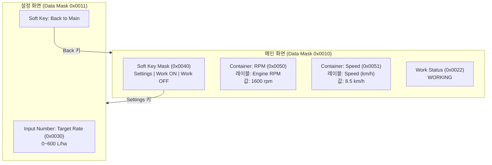
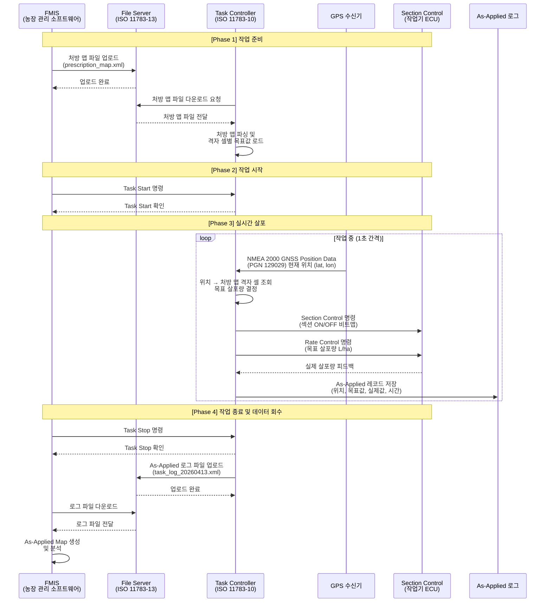

# 종합 실습

::: info 학습 목표
- 실제 ISOBUS CAN 로그에서 PGN과 SA를 식별하고 메시지 유형을 분류할 수 있다.
- Python 코드로 CAN 프레임을 자동 파싱하여 SPN 값을 추출할 수 있다.
- VT 오브젝트 풀을 구성하는 오브젝트 유형과 계층 구조를 설계할 수 있다.
- TC 처방 맵 기반 가변 살포 시나리오 전체 흐름을 순서도로 표현할 수 있다.
- 루트 속성·ID 규칙·태스크 상태를 근거로 FMIS가 보내는 TASKDATA.XML과 TC가 돌려주는 TASKDATA.XML을 설계할 수 있다.
- grid type 1·2 바이너리 파일을 만들고, GPS 좌표에서 셀 인덱스와 바이트 오프셋을 계산할 수 있다.
- TimeLog 헤더 XML만 보고 바이너리 레코드의 바이트 배치를 계산해 디코딩할 수 있다.
:::

## 1. CAN 로그 종합 분석

### 1.1 캡처 예시 데이터

아래는 실제 ISOBUS 트래픽에서 캡처한 예시 로그이다.
형식은 `CAN_ID#DATA` (socketcan candump 포맷)이다.

```
0CF00400#FF3C320000FFFF00
18EAFFFE#00EE00
18EEFF00#FFB0320400000200
0CFE49F0#014B00FA02000000
18EA2681#C5FD00
1CEA00F9#DAFE00
18ECFF26#20120003FF12FF00
18EBFF26#01B003020006043C
18EBFF26#02FFFFFFFFFFFFFE
18EBFF26#03FF640000FFFFFF
0CF00400#FF8C4B0000FFFF00
18E60026#000132000100051F
```

각 메시지를 분석한다.

| # | CAN ID | PGN | SA | DA | 분류 |
|---|--------|-----|----|----|------|
| 1 | `0CF00400` | 0xF004 (EEC1) | 0x00 | - | Engine Speed (엔진 RPM) |
| 2 | `18EAFFFE` | 0xEA00 (Request PGN) | 0xFE | 0xFF | PGN 0xEE00 요청 (Address Claimed) |
| 3 | `18EEFF00` | 0xEE00 (Address Claimed) | 0x00 | 0xFF | 주소 클레임 (SA=0x00, 엔진 ECU의 NAME — Part 5 A.1) |
| 4 | `0CFE49F0` | 0xFE49 (Ground-based Speed) | 0xF0 | - | 지상 속도 (Ground-based Speed and Distance) |
| 5 | `18EA2681` | 0xEA00 (Request PGN) | 0x81 | 0x26 | VT(0x26)에게 PGN 0xFDC5(ECU identification) 요청 |
| 6 | `1CEA00F9` | 0xEA00 (Request PGN) | 0xF9 | 0x00 | 엔진(0x00)에게 PGN 0xFEDA(Software identification) 요청 |
| 7 | `18ECFF26` | 0xEC00 (TP.CM) | 0x26 | 0xFF | Transport Protocol 연결 개시 (BAM — Proprietary B PGN 0xFF12, 18바이트·3패킷) |
| 8 | `18EBFF26` | 0xEB00 (TP.DT) | 0x26 | 0xFF | Transport Protocol 데이터 패킷 1 |
| 9 | `18EBFF26` | 0xEB00 (TP.DT) | 0x26 | 0xFF | Transport Protocol 데이터 패킷 2 |
| 10 | `18EBFF26` | 0xEB00 (TP.DT) | 0x26 | 0xFF | Transport Protocol 데이터 패킷 3 |
| 11 | `0CF00400` | 0xF004 (EEC1) | 0x00 | - | Engine Speed (같은 엔진의 다음 샘플) |
| 12 | `18E60026` | 0xE600 (VT-to-ECU) | 0x26 | 0x00 | VT 소프트키 상태 전송 (Soft Key Activation) |

### 1.2 분석 도구 소개

**python-can**

```bash
pip install python-can
```

```python
import can

# Log file replay
with can.Bus(interface="virtual", channel="test") as bus:
    with can.LogReader("isobus_capture.asc") as reader:
        for msg in reader:
            print(f"ID=0x{msg.arbitration_id:08X}  "
                  f"Data={msg.data.hex().upper()}")
```

**SavvyCAN**
- GUI 기반 CAN 분석 도구 (무료, 오픈소스)
- ISOBUS 전용 디코더 플러그인 지원
- J1939 PGN 데이터베이스 내장
- 다운로드: https://www.savvycan.com

## 2. PGN 디코딩 종합

### 2.1 CAN ID에서 PGN·SA 추출 공식

29비트 CAN ID 구조 (J1939 기준):


PF < 0xF0 이면 Peer-to-Peer(DA 있음), PF >= 0xF0 이면 Broadcast.

```python
def decode_can_id(can_id: int) -> dict:
    """
    Decode a 29-bit J1939/ISOBUS CAN ID into its components.
    Returns priority, pgn, da (if P2P), sa.
    """
    priority  = (can_id >> 26) & 0x7
    reserved  = (can_id >> 25) & 0x1
    data_page = (can_id >> 24) & 0x1
    pf        = (can_id >> 16) & 0xFF   # PDU Format
    ps        = (can_id >> 8)  & 0xFF   # PDU Specific
    sa        = can_id & 0xFF

    if pf >= 0xF0:
        # Broadcast — PS is part of PGN
        pgn = (data_page << 17) | (pf << 8) | ps
        da  = None
    else:
        # Peer-to-Peer — PS is Destination Address
        pgn = (data_page << 17) | (pf << 8)
        da  = ps

    return {
        "priority":  priority,
        "pgn":       pgn,
        "pgn_hex":   f"0x{pgn:04X}",
        "da":        f"0x{da:02X}" if da is not None else "Broadcast",
        "sa":        f"0x{sa:02X}",
    }
```

### 2.2 EEC1 (PGN 0xF004) SPN 디코딩 — 엔진 RPM

```python
import struct

def decode_eec1(data: bytes) -> dict:
    """
    Decode PGN 0xF004 (Electronic Engine Controller 1), SAE J1939-71 definitions.
    SPN 190 = Engine Speed: bytes [3..4], resolution 0.125 rpm/bit.
    SPN 512 = Driver's Demand Engine - Percent Torque: byte [1], 1 %/bit, offset -125 %.
    """
    if len(data) < 8:
        raise ValueError("EEC1 requires 8 bytes")

    demand_raw = data[1]
    rpm_raw    = struct.unpack_from("<H", data, 3)[0]  # Little-endian uint16

    return {
        "engine_speed_rpm":         rpm_raw * 0.125,
        "driver_demand_torque_pct": demand_raw - 125,
    }


def decode_ground_speed(data: bytes) -> dict:
    """
    Decode TECU Ground-based Speed and Distance (PGN 0xFE49 / SPN 1859).
    Bytes [0..1]: speed in mm/s (1 bit = 1 mm/s), valid range 0..64255 (0xFAFF);
    0xFB00 and above are indicator values, not speeds (ISO 11783-7 3.3.3 Table 1).
    """
    if len(data) < 2:
        raise ValueError("Ground Speed requires at least 2 bytes")

    raw_speed = struct.unpack_from("<H", data, 0)[0]
    speed_mps = raw_speed / 1000.0  # Convert mm/s to m/s

    return {
        "speed_mm_s":   raw_speed,
        "speed_km_h":   round(speed_mps * 3.6, 2),
    }


def batch_decode(log_lines: list[str]) -> list[dict]:
    """
    Batch-decode a list of candump log lines (format: 'CANID#HEXDATA').
    Identifies PGN and dispatches to the appropriate decoder.
    """
    DECODERS = {
        0xF004: decode_eec1,
    }
    results = []
    for line in log_lines:
        line = line.strip()
        if not line or "#" not in line:
            continue
        id_str, data_str = line.split("#")
        can_id = int(id_str, 16)
        data   = bytes.fromhex(data_str)
        info   = decode_can_id(can_id)
        pgn    = info["pgn"]

        if pgn in DECODERS:
            decoded = DECODERS[pgn](data)
        else:
            decoded = {"raw": data_str}

        results.append({**info, **decoded, "raw_id": f"0x{can_id:08X}"})
    return results


# Example
if __name__ == "__main__":
    log = [
        "0CF00400#FF3C320000FFFF00",
        "0CFE49F0#014B00FA02000000",
        "0CF00400#FF8C4B0000FFFF00",
    ]
    for entry in batch_decode(log):
        print(entry)
```

실행 결과 예시:

```
{'priority': 3, 'pgn': 61444, 'pgn_hex': '0xF004', 'da': 'Broadcast',
 'sa': '0x00', 'engine_speed_rpm': 0.0, 'driver_demand_torque_pct': -65, 'raw_id': '0x0CF00400'}
{'priority': 3, 'pgn': 65097, 'pgn_hex': '0xFE49', 'da': 'Broadcast',
 'sa': '0xF0', 'raw': '014B00FA02000000', 'raw_id': '0x0CFE49F0'}
{'priority': 3, 'pgn': 61444, 'pgn_hex': '0xF004', 'da': 'Broadcast',
 'sa': '0x00', 'engine_speed_rpm': 0.0, 'driver_demand_torque_pct': 15, 'raw_id': '0x0CF00400'}
```

EEC1의 바이트 배치와 SPN 정의는 SAE J1939-71 기준이며, 이 스터디가 근거로 삼는 ISO 11783 로컬 원문 밖의 내용이다. Byte 2(코드의 `data[1]`)는 SPN 512 Driver's Demand Engine – Percent Torque로, 1 %/bit에 −125 % 오프셋을 둔다. 그래서 `0x3C`(60)는 −65 %, `0x8C`(140)는 15 %가 된다. 가속 페달 위치(SPN 91)는 EEC1이 아니라 EEC2(PGN 61443)에 있다.

## 3. VT 오브젝트 풀 전체 구성

### 3.1 화면 구성 개요

아래 VT 오브젝트 풀은 다음 두 화면으로 구성된다.

- **메인 화면**: 엔진 RPM, 차속, 작업 상태 표시
- **설정 화면**: 살포량 목표값 입력

### 3.2 오브젝트 정의 목록

| Object ID | 유형 | 이름 | 속성 |
|-----------|------|------|------|
| 0x0001 | Working Set | Root WS | 메인 데이터 마스크 참조 |
| 0x0010 | Data Mask | Main Screen | 800×480, 배경색 흰색 |
| 0x0011 | Data Mask | Settings Screen | 800×480, 배경색 회색 |
| 0x0020 | Output Number | Engine RPM | 값 범위 0~4000, 단위 rpm |
| 0x0021 | Output Number | Ground Speed | 값 범위 0~50, 단위 km/h |
| 0x0022 | Output String | Work Status | "WORKING" / "STOPPED" |
| 0x0030 | Input Number | Target Rate | 입력 범위 0~600, 단위 L/ha |
| 0x0040 | Soft Key Mask | Main SKM | 소프트키 4개 배치 |
| 0x0041 | Key | Key: Settings | 설정 화면으로 전환 |
| 0x0042 | Key | Key: Work ON | 작업 시작 명령 |
| 0x0043 | Key | Key: Work OFF | 작업 중지 명령 |
| 0x0050 | Container | RPM Container | RPM 레이블 + 출력 오브젝트 묶음 |
| 0x0051 | Container | Speed Container | 속도 레이블 + 출력 오브젝트 묶음 |
| 0x0060 | Output String | RPM Label | "Engine RPM" 고정 텍스트 |
| 0x0061 | Output String | Speed Label | "Speed (km/h)" 고정 텍스트 |

### 3.3 화면 레이아웃 다이어그램



### 3.4 VT 오브젝트 풀 ISOXML 예시 (핵심 발췌)

```xml
<!-- Working Set Object (ID=0x0001) -->
<WorkingSet ObjectID="1" BackgroundColour="1" Selectable="true"
            ActiveMask="16">
  <Include ObjectID="16"/>  <!-- Main Screen -->
  <Include ObjectID="17"/>  <!-- Settings Screen -->
</WorkingSet>

<!-- Main Screen Data Mask (ID=0x0010) -->
<DataMask ObjectID="16" BackgroundColour="1" SoftKeyMask="64">
  <Include ObjectID="80"/>  <!-- RPM Container -->
  <Include ObjectID="81"/>  <!-- Speed Container -->
  <Include ObjectID="34"/>  <!-- Work Status String -->
</DataMask>

<!-- Engine RPM Output Number (ID=0x0020) -->
<OutputNumber ObjectID="32" BackgroundColour="1"
              Value="0" Offset="0" Scale="1.0"
              NumberOfDecimals="0" Format="false"
              Justification="right" Width="120" Height="30"
              VariableReference="0">
</OutputNumber>

<!-- Target Rate Input Number (ID=0x0030) -->
<InputNumber ObjectID="48" BackgroundColour="1"
             Value="150" Offset="0" Scale="1.0"
             NumberOfDecimals="0" Format="false"
             Justification="right" Width="100" Height="30"
             MinValue="0" MaxValue="600"
             VariableReference="0">
</InputNumber>
```

## 4. TC 시나리오 시뮬레이션

### 4.1 처방 맵 기반 가변 살포 시나리오 전체 흐름



### 4.2 처방 맵 격자 조회 Python 시뮬레이션

```python
from dataclasses import dataclass, field
from datetime import datetime

@dataclass
class GridCell:
    """Single cell in a prescription map grid."""
    lat_min: float
    lat_max: float
    lon_min: float
    lon_max: float
    target_rate_lha: float  # Target application rate (L/ha)


@dataclass
class AsAppliedRecord:
    """Single as-applied log record."""
    timestamp: str
    lat: float
    lon: float
    target_rate: float
    actual_rate: float
    sections_active: list[int]


class PrescriptionMap:
    """
    Simple prescription map with GPS-based cell lookup.
    In production, this would be loaded from an ISOXML TaskData file.
    """

    def __init__(self, cells: list[GridCell]):
        self.cells = cells

    def lookup(self, lat: float, lon: float) -> float | None:
        """Return target rate for the given GPS position, or None if outside map."""
        for cell in self.cells:
            if (cell.lat_min <= lat <= cell.lat_max and
                    cell.lon_min <= lon <= cell.lon_max):
                return cell.target_rate_lha
        return None


class TaskControllerSimulator:
    """
    Simulate TC variable-rate application based on a prescription map.
    Demonstrates Phase 3 of the scenario (real-time application loop).
    """

    def __init__(self, presc_map: PrescriptionMap, num_sections: int = 4):
        self.presc_map  = presc_map
        self.num_sections = num_sections
        self.log: list[AsAppliedRecord] = []

    def _determine_sections(self, target_rate: float) -> list[int]:
        """Simple rule: disable all sections if rate == 0."""
        if target_rate == 0:
            return [0] * self.num_sections
        return [1] * self.num_sections

    def process_position(self, lat: float, lon: float,
                         actual_rate: float) -> dict:
        """
        Process a GPS position update:
        1. Look up prescription map
        2. Determine section commands
        3. Log the record
        """
        target = self.presc_map.lookup(lat, lon)
        if target is None:
            target = 0.0  # Outside map — stop application

        sections = self._determine_sections(target)
        record = AsAppliedRecord(
            timestamp       = datetime.utcnow().isoformat(),
            lat             = lat,
            lon             = lon,
            target_rate     = target,
            actual_rate     = actual_rate,
            sections_active = sections,
        )
        self.log.append(record)

        return {
            "target_rate_lha": target,
            "section_cmd":     sections,
            "log_count":       len(self.log),
        }

    def export_log(self) -> list[dict]:
        return [vars(r) for r in self.log]


# --- Simulation entry point ---
if __name__ == "__main__":
    # Define a simple 2x2 prescription map grid
    cells = [
        GridCell(37.500, 37.501, 127.000, 127.001, target_rate_lha=150.0),
        GridCell(37.500, 37.501, 127.001, 127.002, target_rate_lha=200.0),
        GridCell(37.501, 37.502, 127.000, 127.001, target_rate_lha=100.0),
        GridCell(37.501, 37.502, 127.001, 127.002, target_rate_lha=180.0),
    ]
    presc_map = PrescriptionMap(cells)
    tc_sim    = TaskControllerSimulator(presc_map, num_sections=4)

    # Simulate 5 GPS position updates (tractor moving across field)
    gps_trace = [
        (37.5005, 127.0005),
        (37.5005, 127.0015),
        (37.5015, 127.0005),
        (37.5015, 127.0015),
        (37.5025, 127.0025),  # Outside map
    ]

    print("=== TC Variable-Rate Simulation ===")
    for lat, lon in gps_trace:
        result = tc_sim.process_position(lat, lon, actual_rate=148.0)
        print(f"GPS({lat:.4f},{lon:.4f}) → "
              f"Target={result['target_rate_lha']:6.1f} L/ha  "
              f"Sections={result['section_cmd']}")

    print(f"\nTotal as-applied records: {len(tc_sim.log)}")
```

실행 결과:

```
=== TC Variable-Rate Simulation ===
GPS(37.5005,127.0005) → Target= 150.0 L/ha  Sections=[1, 1, 1, 1]
GPS(37.5005,127.0015) → Target= 200.0 L/ha  Sections=[1, 1, 1, 1]
GPS(37.5015,127.0005) → Target= 100.0 L/ha  Sections=[1, 1, 1, 1]
GPS(37.5015,127.0015) → Target= 180.0 L/ha  Sections=[1, 1, 1, 1]
GPS(37.5025,127.0025) → Target=   0.0 L/ha  Sections=[0, 0, 0, 0]

Total as-applied records: 5
```

> **종합 실습 핵심 정리**
> - CAN ID 29비트에서 Priority / PGN / DA / SA를 분리하면 모든 ISOBUS 메시지를 분류할 수 있다.
> - EEC1(0xF004) SPN 190은 0.125 rpm/bit 해상도로 엔진 RPM을 인코딩한다.
> - VT 오브젝트 풀은 Working Set → Data Mask → Container → Output/Input 계층으로 구성된다.
> - TC 시나리오는 처방 맵 로드 → GPS 위치 수신 → 셀 조회 → 명령 전송 → As-Applied 로그 순서로 동작한다.

## 5. ISOXML 태스크 파일 세트 실습

4절은 처방 맵과 As-Applied 로그를 "파일"이라고만 그렸다. 5절부터 8절까지는 그 파일을 ISO 11783-10 8장 규칙대로 직접 만들고 읽는다. FMIS(Farm Management Information System, 농장 관리 소프트웨어)와 MICS(Mobile Implement Control System, TC가 들어 있는 차량 쪽 시스템)는 CAN 메시지가 아니라 <strong>데이터 전송 파일 세트</strong>(data transfer file set)로 태스크를 주고받는다(ISO 11783-10:2015 3.6, 5.1, 8.1). FMIS가 계획한 태스크를 보내고, TC가 작업 결과를 같은 형식으로 돌려준다. 현장에서는 이 파일 세트를 흔히 ISOXML이라 부르지만 표준 본문에는 그 이름이 없다.

::: info 앞 절과 이어 읽을 때
- 3.4절의 XML은 VT 오브젝트 풀을 사람이 읽기 쉽게 적은 도구별 표기다. Part 6에는 오브젝트 풀의 XML 형식이 없고, 풀은 바이너리 레코드로 전송된다(Part 6 C.2). 이 절의 XML은 Part 10 8장과 Annex D가 정한 규범 형식이다.
- 4.1 그림의 `prescription_map.xml`, `task_log_20260413.xml`은 설명용 이름이다. 실제 파일 세트는 `TASKDATA.XML`, `GRD00001.BIN`, `TLG00001.XML`처럼 이름 규칙이 정해져 있다(Part 10 8.5, D.27, D.49).
- 4.1 그림의 "FMIS → TC: Task Start 명령"에 해당하는 메시지는 Part 10 Annex B(B.1~B.8)에 없다. 태스크를 고르고 시작·정지하는 방법은 TC 설계자가 정한다(Part 10 6.1). 버스에 드러나는 것은 TC가 Task Controller Status 메시지 Byte 5 bit 1(task totals active)로 태스크 시작·재개를 알리는 것이다(Part 10 B.8.1, [TC 프로세스 데이터](/study/isobus/19-tc-process-data)).
:::

### 5.1 파일 세트의 모양과 이름 규칙


| 규칙 | 내용 | 근거(Part 10) |
|---|---|---|
| 메인 파일 | 루트 요소 `ISO11783_TaskData`를 담은 `TASKDATA.XML` 하나 | 8.5 |
| 위치 | 이동식 매체면 매체 루트의 `TASKDATA` 디렉터리. 다른 전송 매체는 제조사 고유 | 8.5 |
| 이름 | 디렉터리·파일 이름은 대소문자를 구분하고 모두 대문자 | 8.5 |
| 디렉터리 | 바이너리 파일까지 모든 파일이 같은 디렉터리 | 8.1 |
| 인코딩 | XML 1.0, UTF-8, 텍스트 전용. 첫 줄은 `<?xml version="1.0" encoding="UTF-8"?>` | 8.1, 8.5 |
| 표현 | 요소 안에 텍스트를 두지 않고 모든 정보를 속성으로 담는다. 요소·속성 이름은 약어(`WKR`, `A`, `B` …), 대소문자 구분, 속성값은 따옴표 | 8.2 |
| 유효성 | well-formed이면서 스키마 `ISO11783_TaskFile`로 valid해야 한다. 아니면 처리할 수 없다 | 8.2, 8.4 |
| 바이너리 | grid 셀 값, 로그 데이터(둘 다 태스크 소속), Point 기하(v4) 세 종류 | 8.6.1 |

속성 이름이 `A`, `B`, `C`인 이유를 원문은 메모리와 전송 대역폭 절약이라고 적는다(Part 10 8.2). 대신 같은 글자라도 요소마다 뜻이 다르다. TSK의 `G`는 태스크 상태이고 GRD의 `G`는 파일 이름이다. 파서를 만들 때 속성 사전을 요소별로 따로 두는 이유다.

받는 쪽은 coding data 요소를 요소 종류마다 최소 2,000개, 전체 최소 20,000개 처리할 수 있어야 한다(Part 10 8.5). coding data는 "자주 바뀌지 않는 데이터나 태스크를 행정적으로 할당하려고 참조하는 데이터"다(Part 10 3.2). 경계 점 같은 기하 요소는 coding data가 아니라 이 한도에 들지 않는다(Part 10 8.5). 제조사 고유 요소·속성은 `P` + 십진 제조사 코드 + `_`로 시작하고(예: `P500_MyElement`), 다른 제조사 시스템은 그 내용을 무시한다(Part 10 8.4.1). 전체 규칙은 [Part 10 부록](/study/isobus/appendix-iso-part10)의 8장 정리에 있다.

### 5.2 루트 요소 ISO11783_TaskData

루트 요소의 속성만은 약어가 아니라 이름 그대로 쓴다(Part 10 D.32).

| 속성 | 필수 | 값과 규칙 |
|---|---|---|
| `VersionMajor` | r | 0~4. 2판(2015) FDIS 기준이 4다. 버전은 스키마 파일 이름에도 들어간다(`ISO11783_TaskFile_V4-0.xml` 식, Part 10 8.4) |
| `VersionMinor` | r | 0~99. 같은 Major 안의 스키마 리비전 |
| `ManagementSoftwareManufacturer`, `ManagementSoftwareVersion` | o/r | FMIS 이름·버전, 최대 32자 |
| `TaskControllerManufacturer`, `TaskControllerVersion` | o/r | TC 이름·버전, 최대 32자. MICS가 만든 파일에서 필수, FMIS가 만든 파일에서는 쓰지 않는다 |
| `DataTransferOrigin` | r | 1 = FMIS, 2 = MICS. 파일 세트를 마지막으로 만든 쪽이다. 양쪽 모두 제대로 갱신해야 한다(Part 10 8.5) |
| `lang` | o | DataTransferLanguage(v4). 파일 세트를 만든 시스템의 언어, `xs:language` |
| 자식 `TCC` | o/r | TaskControllerCapabilities(v4). MICS가 만든 파일에만, 최대 1개(Part 10 D.47) |

원문 8.5의 루트 틀에는 스키마 검증용 `xmlns:xsi`와 `xsi:noNamespaceSchemaLocation`도 들어 있다. 스키마에는 ISO 11783 전용 네임스페이스가 없다(Part 10 8.4).

::: warning 원문 표와 예제가 어긋나는 곳
원문 D.32 표의 각주는 o/r 네 속성이 FMIS 출처 파일에서는 쓰이지 않는다고 적는다. 그런데 같은 절의 예제는 `DataTransferOrigin="1"`(FMIS) 파일에 `TaskControllerManufacturer`까지 채워 넣고, 각주가 붙은 `ManagementSoftware*`는 FMIS가 자기 이름을 적는 자리다. 각주는 TC 속성을 겨냥한 것으로 읽힌다. 받는 쪽은 네 속성이 있든 없든 파일을 거부하지 않는 편이 안전하다(추론).
:::

어떤 `VersionMajor`를 써야 하는지는 기능 세대가 정한다. Annex F의 TC-BAS·TC-GEO generation 1 구현은 TC 버전 3을, LOG generation 1 구현은 4를 파일 세트와 Version 메시지에 게시한다(Part 10 F.2.1, F.2.2, F.2.4, [TC 기초](/study/isobus/18-tc-basics)). 아래 예제는 v4에서 들어온 `lang`, `TCC`, 시간대 표기를 쓰므로 4로 적는다.

### 5.3 ID 규칙

식별자 속성을 가진 요소는 모두 엔티티이고, 그 ID는 파일 세트 전체에서 유일해야 한다(Part 10 8.4). 외부 파일로 나눠도 유일성 범위는 파일 세트 전체다.

- 형식은 네임스페이스 문자(요소 약어) + 십진수다. 숫자는 선행 0 없이 최대 11자리이고 ID는 최소 4바이트다(Part 10 8.4). Annex D의 ID 속성은 `(TSK|TSK-)([0-9])+` 형식과 4~14자 길이를 함께 적는다(Part 10 D.46 등).
- 0과 −2147483648은 예약값이라 쓸 수 없다. 0은 버전 3에서 예약됐고, 그 전에는 FMIS가 만든 양수 ID처럼 해석됐다(Part 10 8.4).
- MICS에서 새로 만든 엔티티는 음수를 쓴다(`WKR-1`). FMIS가 준 양수 ID와 섞이지 않게 하려는 규칙이고, 유일성은 만든 쪽이 책임진다(Part 10 8.4).
- MICS는 coding data 요소를 바꾸거나 지울 수 없고 새 인스턴스를 추가만 할 수 있다. coding data 수정은 FMIS만 한다(Part 10 8.4, 8.5). coding data가 아닌 요소는 고칠 수 있다.
- IDREF 속성은 ID 하나만 담는다(Part 10 8.4).
- 파일 이름 속성(GRD `G`, TLG `A`, XFR `A`, PNT `J`)은 `GRD00001`처럼 접두사 + 5자리 숫자이고 선행 0이 있다(Part 10 D.27, D.38, D.49, D.55). 엔티티 ID와 형식이 다르지만 이 속성들도 `xs:ID` 타입이라 다른 ID와 겹치면 안 된다.

::: tip ID는 문자열로 다룬다
예약값 −2147483648이 int32 최솟값인 것으로 보아, 숫자 부분을 32비트 정수로 다루는 구현을 염두에 둔 규칙으로 보인다(추론). 하지만 원문이 허용하는 11자리 숫자(예: `TSK12345678901`)는 int32 범위를 넘는다. ID는 문자열 그대로 저장하고, 새 음수 ID를 만들 때만 숫자 부분을 계산하는 편이 안전하다(추론).
:::

### 5.4 요소 지도 — 무엇이 어디에 들어가나


루트 바로 아래에는 coding data 요소와 TSK가 함께 온다(Part 10 D.32). PFD 안의 PLN·LSG·PNT는 coding data 요소 안에 들어 있지만 Part 10 Table 2 기준으로 coding data가 아니다. 그래서 필지 경계 점이 아무리 많아도 5.1절의 2,000개 한도에 들지 않는다(Part 10 8.5). TSK 안의 요소는 IDREF로 coding data를 가리킨다.

| 요소 | 역할 | 이 실습에서 쓰는 속성 |
|---|---|---|
| TSK | 태스크. 파일 세트의 중심 요소(Part 10 D.46) | `A` ID, `C`·`D`·`E` 고객·농장·필지, `F` 책임 작업자, `G` 상태, `H`·`I`·`J` 기본·측위 상실·필드 밖 TZN 코드 |
| TZN | 같은 DDI를 같은 값으로 처리할 구역(Part 10 D.50) | `A` 코드(0~254, 태스크 안에서 유일), `B` 이름, `C` 색 |
| PDV | TZN 안의 DDI와 값(Part 10 D.41) | `A` DDI(4자리 hex), `B` 값(int32), `C` 제품, `D` 장치 요소, `E` 표시 방법 |
| GRD | 격자 정의, 태스크당 최대 1개(Part 10 D.27) | 6절 |
| DLT | 무엇을 어떤 조건으로 기록할지(Part 10 D.17) | `A` DDI, `B` 방법 비트, `D` 시간 간격(ms), `G` 변화 임계값, `H` 장치 요소 |
| TLG | 바이너리 로그 파일 참조(Part 10 D.49) | 7절 |
| TIM | 시간 기록. PTN·DLV를 담는다(Part 10 D.48) | `A` 시작, `B` 끝, `C` 기간(초), `D` 유형 |
| ASP | 할당 이벤트의 시각(Part 10 D.2) | `A` 시작, `B` 끝, `C` 기간, `D` 유형(1 planned, 4 effective) |
| DAN | 장치 할당(Part 10 D.20) | `A` 클라이언트 NAME, `B` NAME 마스크, `C` DVC |
| PFD, PLN, LSG, PNT | 필지와 경계 기하(Part 10 D.37, D.39, D.33, D.38) | PFD `C` 이름, `D` 면적(m²) / PLN `A` 1 = 필지 경계 / LSG `A` 1 = 외곽 경계 / PNT `C` 위도, `D` 경도 |
| CTR, FRM, WKR, PDT, CPC | 고객·농장·작업자·제품·작업 종류(coding data) | `A` ID, `B` 이름. FRM `I` → CTR |
| VPN | 정수값 표시 방법(coding data, Part 10 D.51) | `B` Offset, `C` Scale, `D` 소수 자릿수, `E` 단위. 표시값 = (정수 + Offset) × Scale |

TZN에는 특별한 쓰임이 셋 있다(Part 10 D.50). TSK `H`가 가리키는 기본 TZN은 태스크 전체에 적용되고, TC가 태스크를 시작·재개할 때 그 안의 PDV 값을 해당하는 모든 클라이언트에 보낸다. `I`가 가리키는 측위 상실 TZN은 위치를 알 수 없게 됐을 때, `J`가 가리키는 필드 밖 TZN은 클라이언트(의 일부)가 필드 경계 폴리곤을 벗어났을 때 보낸다. 폴리곤으로 기하를 정한 TZN은 PDV를 하나만 담아야 하고(v4에서 목록이 하나로 바뀜), 기하가 없는 TZN(grid 템플릿이나 TSK 속성이 가리키는 것)은 PDV 목록을 가질 수 있다(Part 10 D.50). 요소별 속성 전체는 [Part 10 부록](/study/isobus/appendix-iso-part10)의 Annex D 정리를 본다.

### 5.5 태스크 상태

TSK `G`는 1~6이고 5와 6은 v4에서 추가됐다(Part 10 D.46). 상태별 의미는 Part 10 6.1의 Table 1이 정한다.

| G | 상태 | 의미와 규칙 |
|---|---|---|
| 1 | planned | FMIS나 MICS에서 준비됐지만 아직 MICS에서 처리하지 않았다 |
| 2 | running | MICS가 처리 중이다. TC 하나에서 동시에 하나만 활성일 수 있다 |
| 3 | paused | 실행했다가 멈췄고 아직 끝나지 않았다. TC 입장에서는 최종 상태일 수 있고, MICS가 보낸 파일의 paused 태스크는 FMIS가 처리해야 한다 |
| 4 | completed | 끝났다. 운전자만 설정할 수 있고 MICS가 자동으로 설정할 수 없다. 선택 기능이라 지원하지 않는 TC도 있다 |
| 5 | template | 시작하면 복사본이 새 태스크로 만들어져 시작된다. FMIS가 정의한 템플릿은 MICS가 수정하지 않는다 |
| 6 | canceled | 태스크를 철회한다. FMIS와 MICS가 서로에게 철회를 알리는 데 쓴다 |

상태가 바뀔 때는 시간 기록 규칙이 따라온다.

- TIM은 태스크 상태 변화, 자원 할당 변화(제품 할당 포함), TC 시작·종료 때만 추가하고, 이미 기록한 TIM은 고치지 않는다(Part 10 6.2).
- MICS가 태스크를 시작했고 네트워크에 시간 정보가 있으면 TIM을 최소 1개 추가해야 한다(Part 10 D.46).
- FMIS가 주는 TIM은 모두 type 1(planned)이고 태스크당 최대 1개다. MICS가 세부 유형(2, 5~8)을 구분하지 않으면 MICS가 쓰는 TIM은 모두 type 4(effective)다(Part 10 D.48). 세부 유형의 뜻은 Part 10 Annex G에 있다.
- v4부터 TIM·ASP 시각에 시간대를 붙일 수 있다. 시간대를 알면 `Z`(UTC)나 `+09:00` 같은 오프셋을 붙여야 하고, 모르면 표기 없이 로컬 시간으로 쓴다(Part 10 D.1, D.48).

### 5.6 외부 파일 XFR·XFC

메인 파일이 커지면 최상위 요소를 다른 XML 파일로 뺄 수 있다(Part 10 8.5, D.54, D.55).

- 메인 파일 `TASKDATA.XML`만 XFR을 가질 수 있다. 참조는 중첩되지 않는다. XFR도, XFC도 재귀로 쓸 수 없다.
- 외부 파일의 루트는 XFC다. 외부 파일도 XML 선언으로 시작하는 well-formed 파일이어야 한다.
- 외부 파일 하나에는 한 종류의 최상위 요소만 넣는다. 고객 파일에 필지를 섞을 수 없다. 같은 종류의 최상위 요소가 메인 파일과 외부 파일 양쪽에 있는 것은 괜찮다.
- XFR `A`는 `(CCG|CCT|CLD|CPC|CTP|CTR|DVC|FRM|OTQ|PDT|PFD|PGP|TSK|VPN|WKR)[0-9]{5}` 형식의 8자이고 확장자를 넣지 않는다. `B`는 1(XML)뿐이다. 원문 Figure 9는 그 파일을 `TSK00001.xml`로 적는다.
- TC와 FMIS는 단일 파일과 파일 세트를 모두 받을 준비가 돼 있어야 하고, 둘 다 바이너리 파일을 참조할 수 있다(Part 10 8.5).

`TASKDATA.XML` 쪽:

```xml
<?xml version="1.0" encoding="UTF-8"?>
<ISO11783_TaskData VersionMajor="4" VersionMinor="0" DataTransferOrigin="1">
  <CTR A="CTR1" B="Kim"/>
  <XFR A="TSK00002" B="1"/>
</ISO11783_TaskData>
```

`TSK00002.XML` 쪽:

```xml
<?xml version="1.0" encoding="UTF-8"?>
<XFC>
  <TSK A="TSK2" G="1"/>
</XFC>
```

### 5.7 실습 ① FMIS가 보내는 TASKDATA.XML

4.2절 시뮬레이터의 처방을 그대로 파일로 옮긴다.

| 4.2절 시뮬레이터 | 파일 세트 |
|---|---|
| 2×2 격자, 셀마다 150·200·100·180 | GRD type 2 + 템플릿 TZN 1 + `GRD00001.BIN`(6절) |
| 격자 밖이면 목표 0, 섹션 끔 | 필지 경계 PLN(격자와 같은 사각형) + TSK `J` → TZN 9(값 0) |
| 위치를 모를 때 | TSK `I` → TZN 0(기본값 150) |
| 시작·재개 때 보낼 기본값 | TSK `H` → TZN 0 |
| As-Applied 기록 | DLT 두 개. TLG는 TC가 만든다(7절) |

단위는 하나 바꾼다. 4.2절은 L/ha로 적었지만, 이 실습은 단위와 분해능이 원문 예제로 확정되는 DDI 6(Setpoint Mass Per Area Application Rate)을 쓴다. 원문 D.41 예1은 DDI 6 값 15000 mg/m²를 150 kg/ha로, VPN `C="0.01"`을 kg/ha 표시로 적는다. 1 kg/ha = 100 mg/m²이므로 150·200·100·180 kg/ha는 15000·20000·10000·18000이 된다. 액체를 L/ha로 처방하면 DDI 1을 쓰고 환산 계수만 달라진다. DDI 1의 단위·분해능은 Part 11이 가리키는 ISOBUS Data Dictionary에서 확인한다(Part 11 4.1, [DDI 부록](/study/isobus/appendix-ddi)). Annex F는 비료 장치(Fertilizers)와 살포기(Sprayers)의 권장 rate DDI로 똑같이 1·2·6·7을 든다(Part 10 F.2.2 Table F.2).

```xml
<?xml version="1.0" encoding="UTF-8"?>
<ISO11783_TaskData VersionMajor="4" VersionMinor="0"
    ManagementSoftwareManufacturer="StudyFMIS" ManagementSoftwareVersion="1.0"
    DataTransferOrigin="1" lang="ko-KR">
  <CPC A="CPC1" B="fertilization"/>
  <CTR A="CTR1" B="Kim"/>
  <FRM A="FRM1" B="Study Farm" I="CTR1"/>
  <PFD A="PFD1" C="North Field" D="39256" E="CTR1" F="FRM1">
    <PLN A="1" B="Field boundary">
      <LSG A="1">
        <PNT A="2" C="37.500" D="127.000"/>
        <PNT A="2" C="37.500" D="127.002"/>
        <PNT A="2" C="37.502" D="127.002"/>
        <PNT A="2" C="37.502" D="127.000"/>
        <PNT A="2" C="37.500" D="127.000"/>
      </LSG>
    </PLN>
  </PFD>
  <PDT A="PDT1" B="Liquid Fertilizer"/>
  <TSK A="TSK1" B="VRA North Field" C="CTR1" D="FRM1" E="PFD1" F="WKR1"
       G="1" H="0" I="0" J="9">
    <TZN A="0" B="Default rate">
      <PDV A="0006" B="15000" C="PDT1" E="VPN1"/>
    </TZN>
    <TZN A="1" B="Grid template">
      <PDV A="0006" B="0" C="PDT1" E="VPN1"/>
    </TZN>
    <TZN A="9" B="Out of field">
      <PDV A="0006" B="0" C="PDT1" E="VPN1"/>
    </TZN>
    <OTP A="CPC1"/>
    <DLT A="0006" B="8" G="1"/>
    <DLT A="0007" B="9" D="10000" G="100"/>
    <GRD A="37.500" B="127.000" C="0.001" D="0.001" E="2" F="2"
         G="GRD00001" H="16" I="2" J="1"/>
  </TSK>
  <VPN A="VPN1" B="0" C="0.01" D="0" E="kg/ha"/>
  <WKR A="WKR1" B="Kim"/>
</ISO11783_TaskData>
```

읽는 요령은 다음과 같다.

- 루트는 `DataTransferOrigin="1"`이고 TC 속성이 없다. coding data와 TSK가 루트 바로 아래에 있다.
- 자식 요소 순서는 Annex D 표의 나열 순서(Part 10 D.32, D.46)를 따랐다. XSD는 자식 요소의 순서까지 정할 수 있으므로(Part 10 8.3) 순서 제약은 배포된 스키마로 검증한다.
- PFD `D="39256"`은 필지 면적(m²)이고 계산은 6.3절에서 한다. PLN `A="1"`은 필지 경계, LSG `A="1"`은 외곽 경계다. v4부터 외곽·내부 경계 LineString은 첫 점을 마지막에 한 번 더 적어 닫는다. 버전 2·3은 마지막 점에서 첫 점으로 선을 긋는 방식이었다(Part 10 D.33).
- TZN 1의 PDV `B="0"`은 자리만 채운 값이고 실제 값은 grid 바이너리에 있다(Part 10 8.6.2). 원문 D.41 예4는 같은 자리를 `B=""`로 비워 두지만 D.41 표에서 `B`는 필수 `xs:long`이다. 쓸 때는 0을 넣고, 읽을 때는 둘 다 받아들이는 편이 안전하다(추론).
- DLT `B`는 방법 비트 조합이다. 1 시간 간격, 2 거리 간격, 4 임계 범위, 8 변화 시, 16 total이다(Part 10 D.17). `B="8" G="1"`은 설정값이 바뀔 때마다, `B="9" D="10000" G="100"`은 10초마다 또는 값이 100(= 1 kg/ha) 이상 바뀔 때 기록하라는 뜻이다. 시간·거리·변화 방법은 먼저 일어난 이벤트가 기록을 일으키고 셋 다 다시 시작한다. 시간 간격의 최솟값은 100 ms다(Part 10 D.17).
- DLT에 `H`(장치 요소)가 없으면 TC는 그 DDI를 줄 수 있는 모든 장치 요소에서 기록한다. FMIS가 `H`를 채우면 특정 장치를 계획한 것이고, 비워 두면 MICS가 장치를 할당한 뒤 채울 수 있다(Part 10 D.17). PDV `D`도 비웠다. TC는 일치하는 DDI를 setpoint로 받을 수 있는 연결된 클라이언트에 PDV를 할당할 수 있어야 한다(Part 10 D.41).
- DDI 7은 실제 살포량(질량/면적)이다. 이름과 단위는 [DDI 부록](/study/isobus/appendix-ddi) 기준이다.

### 5.8 실습 ② TC가 돌려주는 TASKDATA.XML

작업을 마친 TC는 같은 파일 세트를 고쳐 FMIS로 돌려준다(Part 10 5.1, 8.1). coding data는 그대로 두고, 새로 생긴 것을 더하고, TSK 안을 갱신한다. 바뀐 부분만 보인다.

```xml
<?xml version="1.0" encoding="UTF-8"?>
<ISO11783_TaskData VersionMajor="4" VersionMinor="0"
    ManagementSoftwareManufacturer="StudyFMIS" ManagementSoftwareVersion="1.0"
    TaskControllerManufacturer="StudyTC" TaskControllerVersion="1.0"
    DataTransferOrigin="2" lang="ko-KR">
  <CPC A="CPC1" B="fertilization"/>
  <CTR A="CTR1" B="Kim"/>
  <DVC A="DVC-1" B="Sprayer" C="1.0" D="A00C84000B20408B"
       F="30353035344042" G="FF000000006F6B">
    <DET A="DET-1" B="1" C="1" D="Sprayer" E="0" F="0">
      <DOR A="20"/>
    </DET>
    <DET A="DET-2" B="2" C="2" D="Rate control" E="1" F="1">
      <DOR A="21"/>
      <DOR A="22"/>
    </DET>
    <DPD A="20" B="0077" C="1" D="16" E="Effective Total Time"/>
    <DPD A="21" B="0006" C="2" D="8" E="Setpoint Rate" F="40"/>
    <DPD A="22" B="0007" C="1" D="9" E="Actual Rate" F="40"/>
    <DVP A="40" B="0" C="0.01" D="0" E="kg/ha"/>
  </DVC>
  <!-- FRM, PFD, PDT: FMIS 파일과 같다 -->
  <TSK A="TSK1" B="VRA North Field" C="CTR1" D="FRM1" E="PFD1" F="WKR1"
       G="4" H="0" I="0" J="9">
    <TZN A="0" B="Default rate">
      <PDV A="0006" B="15000" C="PDT1" D="DET-2" E="VPN1"/>
    </TZN>
    <TZN A="1" B="Grid template">
      <PDV A="0006" B="0" C="PDT1" D="DET-2" E="VPN1"/>
    </TZN>
    <TZN A="9" B="Out of field">
      <PDV A="0006" B="0" C="PDT1" D="DET-2" E="VPN1"/>
    </TZN>
    <TIM A="2026-04-13T09:30:00+09:00" B="2026-04-13T09:30:40+09:00" D="4"/>
    <OTP A="CPC1"/>
    <DAN A="A00C84000B20408B" C="DVC-1">
      <ASP A="2026-04-13T09:30:00+09:00" B="2026-04-13T09:30:40+09:00" D="4"/>
    </DAN>
    <DLT A="0006" B="8" G="1"/>
    <DLT A="0007" B="9" D="10000" G="100"/>
    <TLG A="TLG00001" C="1"/>
    <GRD A="37.500" B="127.000" C="0.001" D="0.001" E="2" F="2"
         G="GRD00001" H="16" I="2" J="1"/>
  </TSK>
  <TCC A="A00082000A20001B" B="Study TC" C="4" D="5" E="0" F="0" G="1"/>
  <!-- VPN, WKR: FMIS 파일과 같다 -->
</ISO11783_TaskData>
```

| 바뀐 곳 | 내용 | 근거(Part 10) |
|---|---|---|
| 루트 | `DataTransferOrigin="2"`, TC 이름·버전 필수 | D.32 |
| TCC | v4 MICS 출처 파일에 최대 1개. `D="5"` = 1(문서화) + 4(위치 기반 제어가 있는 TC-GEO), `E`·`F` = 0(섹션 제어 없음), `G="1"`(제어 채널 1개). NAME은 예시 값 | D.47 |
| DVC-1, DET-1, DET-2 | TC가 버스로 받은 DDOP를 XML로 바꿔 저장했다. MICS에서 생긴 엔티티라 음수 ID다. coding data지만 새 인스턴스 추가는 허용된다. ClientNAME은 원문 D.20 예제 값 | A.1, 8.4, 8.5 |
| TSK `G="4"` | 운전자가 완료 처리했다. completed는 MICS가 자동으로 설정할 수 없다 | 6.1 |
| TIM | type 4(effective), 시간대 `+09:00` 포함 | D.48 |
| DAN | 실제로 쓴 클라이언트의 NAME + DVC 참조 + effective ASP. 원문 D.20 예3과 같은 모양 | D.20 |
| PDV `D="DET-2"` | 실제 기계가 정해진 뒤 할당을 PDV에 기록할 수 있다 | D.41 |
| TLG | `A="TLG00001"`, `C="1"`(binary timelog type 1). 선택 속성 `B`(파일 길이)는 생략 | D.49 |

DDOP 쪽에서는 DET-1(device, element number 0)에 DDI 119(`0077`, Effective Total Time)를 달았다. TC-BAS 클라이언트는 최소 DDI 119를 제공해야 하고, rate DDI가 있으면 그에 대응하는 total도 제공해야 한다(Part 10 F.2.1). 예제는 지면 때문에 rate total을 뺐다. DLT `B`도 DPD `D`가 밝힌 트리거 안에서 골랐다. DPD `D`는 그 DDI에 쓸 수 있는 트리거 방법이다(Part 10 D.23). 실제 DDOP 설계는 [TC 디바이스 디스크립션(DDOP)](/study/isobus/20-tc-ddop)에서 다룬다.

::: details check_ids.py — ID·IDREF·coding data 규칙 검사 (실행 검증)
FMIS 파일과 TC가 돌려준 파일을 함께 넣으면 Part 10 8.4·8.5의 규칙을 검사한다. SIL 환경에서 TC 서버 에뮬레이터가 내놓는 파일을 회귀 테스트할 때 쓸 수 있다.

```python
"""Check ISOXML ID rules (ISO 11783-10 8.4, 8.5) between an FMIS file and the TC's returned file."""
import re
import sys
import xml.etree.ElementTree as ET

ID_ATTR = {"CTR": "A", "FRM": "A", "PFD": "A", "PDT": "A", "CPC": "A", "VPN": "A",
           "WKR": "A", "TSK": "A", "DVC": "A", "DET": "A"}
REFS = {"FRM": {"I": "CTR"}, "PFD": {"E": "CTR", "F": "FRM"},
        "TSK": {"C": "CTR", "D": "FRM", "E": "PFD", "F": "WKR"},
        "PDV": {"C": "PDT", "D": "DET", "E": "VPN"}, "OTP": {"A": "CPC"},
        "DAN": {"C": "DVC"}, "DLT": {"H": "DET"}, "DLV": {"C": "DET"}}
CODING = {"CPC", "CTR", "FRM", "PFD", "PDT", "VPN", "WKR", "DVC"}


def check(path):
    root = ET.parse(path).getroot()
    ids = {}
    for el in root.iter():
        if el.tag in ID_ATTR:
            v = el.get(ID_ATTR[el.tag])
            assert re.fullmatch(rf"{el.tag}-?[1-9][0-9]{{0,10}}", v), f"bad ID {v}"
            assert 4 <= len(v) <= 14 and v not in ids, f"length/duplicate {v}"
            ids[v] = el.tag
    for el in root.iter():
        for attr, target in REFS.get(el.tag, {}).items():
            v = el.get(attr)
            assert v is None or ids.get(v) == target, f"{el.tag} {attr}={v} -> no {target}"
    return root, ids


def coding(root):
    return {ET.tostring(c) for c in root if c.tag in CODING}


if __name__ == "__main__":
    fmis, _ = check(sys.argv[1])
    mics, ids = check(sys.argv[2])
    assert not coding(fmis) - coding(mics), "MICS changed or deleted FMIS coding data"
    print("added by MICS:", sorted(ET.fromstring(x).get("A") for x in coding(mics) - coding(fmis)))
    print("negative IDs:", sorted(i for i in ids if "-" in i))
    print("all checks passed")
```

5.7절 파일과 5.8절 파일(주석 자리를 FMIS 파일 내용으로 채운 전체본)로 돌린 결과다. TC가 WKR1의 이름을 바꾼 파일을 넣으면 `AssertionError: MICS changed or deleted FMIS coding data`로 멈춘다.

```
added by MICS: ['DVC-1']
negative IDs: ['DET-1', 'DET-2', 'DVC-1']
all checks passed
```
:::

### 5.9 XML 장치 기술(DVC)과 DDOP의 대응

5.8절의 DVC는 클라이언트가 버스로 보낸 DDOP를 옮긴 것이다. DDOP의 바이너리 객체는 XML 요소를 객체로 정의한 것이어서(Part 10 A.1) 둘은 거의 1:1로 대응한다. 객체별 바이트 배치는 [TC 디바이스 디스크립션(DDOP)](/study/isobus/20-tc-ddop)에서 다루고, 여기서는 XML로 옮길 때의 대응만 정리한다.

| XML | DDOP 객체·필드(Part 10 Annex A) | 옮길 때의 규칙 |
|---|---|---|
| DVC | DeviceObject, Table ID `DVC`, Object ID 0 고정(Part 10 A.2) | 풀마다 정확히 1개 |
| DVC `A` (`DVC-1`) | 없음 | 파일 세트용 ID. TC가 변환할 때 만든다 |
| DVC `B`, `C`, `E` | designator, software version, serial number | UTF-8, BOM 없음. 바이트 수(N) + 문자열 |
| DVC `D` | ClientNAME 8바이트 | CF의 주소 클레임 NAME과 같아야 한다(Part 10 A.2) |
| DVC `F` | structure label 7바이트 + extended structure label 0~32바이트(v4) | XML hexBinary는 배열 바이트 1이 문자열 끝이다(Part 10 D.19) |
| DVC `G` | localization label 7바이트 | 바이트 1~6은 language command 정의, 바이트 7은 FF |
| DET | DeviceElementObject, Table ID `DET` | |
| DET `A` (`DET-2`) | 없음 | PDV `D`, DLV `C`, DLT `H`, CNN이 이 ID로 참조한다 |
| DET `B` | Object ID(1~65534) | 풀 안에서 유일 |
| DET `C` | DeviceElementType(1 device, 2 function, 3 bin, 4 section, 5 unit, 6 connector, 7 navigation) | device 타입은 풀에 하나, element number 0(Part 10 A.3.1) |
| DET `E` | DeviceElementNumber(0~4095) | 프로세스 데이터 메시지에 실리는 element number |
| DET `F` | Parent ObjectId | 0이면 DeviceObject를 가리킨다 |
| DET 안의 DOR `A` | Number of objects to follow + ObjectId 목록 | XML은 자식 요소, 바이너리는 개수 + 2바이트 ID 나열 |
| DPD `A`~`F` | Object ID, DDI 2바이트, properties 비트, trigger 비트, designator, DVP Object ID | 참조가 없으면 바이너리는 NULL Object ID 65535(FFFF₁₆), XML은 `F`를 생략 |
| DPT `A`~`E` | Object ID, DDI, value(int32), designator, DVP Object ID | |
| DVP `A`~`E` | Object ID, offset(int32), scale(4바이트 float), decimals, unit designator | XML의 scale은 `xs:decimal` |

옮길 때 챙길 곳은 다섯 군데다.

- <strong>ID가 두 벌이다.</strong> DET `B`·DPD `A`·DOR `A`는 클라이언트가 정한 DDOP 객체 ID로, 한 풀 안에서만 유일하다(Part 10 A.1). DVC·DET의 `A`는 파일 세트 전체에서 유일한 XML ID다. 5.8절의 DOR `A="21"`은 객체 ID를, PDV `D="DET-2"`는 XML ID를 가리킨다.
- <strong>버스에는 element number가 실린다.</strong> TC가 받은 측정값에는 element number와 DDI가 있고(Part 10 Annex B), DLV는 DET의 XML ID를 요구한다(Part 10 D.18). 따라서 TC는 (클라이언트, element number)로 그 클라이언트 DVC 안의 DET를 찾아 `DET-2`를 채워야 한다. 메시지 바이트는 [TC 프로세스 데이터](/study/isobus/19-tc-process-data)에 있다.
- <strong>라벨 바이트 순서가 반대다.</strong> XML `F="30353035344042"`는 버스에서 `42 40 34 35 30 35 30` 순으로 나간다. `G="FF000000006F6B"`는 버스 순서로 `6B 6F 00 00 00 00 FF`이고, 첫 두 바이트가 언어 코드 `ko`다(Part 10 D.19 예1과 같은 규칙).
- <strong>문자열 길이 단위가 다르다.</strong> XML designator는 최대 32자이고, 바이너리는 UTF-8 문자당 최대 4바이트라 바이트 길이를 최대 128까지 쓴다. 이 상한은 v4에서 32에서 128로 늘었다(Part 10 A.1, A.2).
- <strong>같은 장치가 이미 있으면</strong> TC는 structure label을 비교해 기존 정의를 갱신하거나 새 DVC로 저장한다. 어느 쪽인지는 MICS 재량이다(Part 10 A.1).

```python
>>> bytes.fromhex("30353035344042")[::-1].hex(" ").upper()
'42 40 34 35 30 35 30'
>>> bytes.fromhex("FF000000006F6B")[::-1][:2].decode()
'ko'
```

::: tip 정리
- 파일 세트는 `TASKDATA` 디렉터리의 대문자 고정 이름 파일들이고, 루트는 `ISO11783_TaskData` 하나다.
- ID는 접두사 + 선행 0 없는 숫자이고, MICS가 만든 엔티티는 음수다. MICS는 coding data를 추가만 한다.
- TC가 돌려주는 파일은 출처 2, TC 속성·TCC, 음수 ID의 DVC, effective TIM·DAN, TLG가 더해진 같은 파일 세트다.
:::

## 6. 처방 맵을 grid 바이너리로

grid의 셀 값은 바이너리 파일로만 정의할 수 있다(Part 10 8.6.2). XML의 GRD 요소는 격자의 위치·크기·파일 이름만 적고, 셀 값은 `GRD00001.BIN`에 들어간다.

### 6.1 GRD가 정하는 격자와 셀 순서

| 속성 | 뜻 | 형식(Part 10 D.27) |
|---|---|---|
| `A` GridMinimumNorthPosition | 격자의 최소 북위 = 남쪽 모서리 | `xs:decimal`, −90~90, WGS84 |
| `B` GridMinimumEastPosition | 격자의 최소 동경 = 서쪽 모서리 | `xs:decimal`, −180~180 |
| `C` GridCellNorthSize | 셀 하나의 남북 크기(도) | `xs:double`, 0~1 |
| `D` GridCellEastSize | 셀 하나의 동서 크기(도) | `xs:double`, 0~1 |
| `E` GridMaximumColumn | 동쪽 방향 셀 개수 | 0~2³²−1 |
| `F` GridMaximumRow | 북쪽 방향 셀 개수 | 0~2³²−1 |
| `G` Filename | `GRD` + 5자리 숫자 | `xs:ID`, 8자 |
| `H` Filelength | 셀 파일 길이(바이트) | 선택 |
| `I` GridType | 1 또는 2 | 필수 |
| `J` TreatmentZoneCode | type 2의 템플릿 TZN 코드 | 선택 |

셀 순서는 Part 10 6.8.1.1이 정한다. 최소 북·동 위치(원점)의 셀에서 시작해 같은 행 안에서 동쪽으로 열 번호가 올라가고, 행이 끝나면 북쪽 다음 행의 맨 서쪽 열에서 다시 시작한다. 원문 Figure 4는 원점을 격자 남서 모서리에 두고, 셀 0(row 0, column 0)을 남서쪽 끝 셀로, 14번째 셀(row 0, column 13)을 같은 행 동쪽 끝 셀로 그린다. 셀 자체에는 순서 정보가 없으므로 격자는 빠짐없는 오름차순 배열이어야 한다(Part 10 D.27).

```
row    = floor((위도 - A) / C)        0 <= row < F 일 때만 격자 안
col    = floor((경도 - B) / D)        0 <= col < E 일 때만 격자 안
index  = row * E + col
offset = index * (셀당 바이트)
```


### 6.2 type 1과 type 2

| 항목 | type 1 | type 2 |
|---|---|---|
| GRD `I` / `J` | 1 / 없음 | 2 / 템플릿 TZN 코드 |
| 셀 값 | 그 셀이 속한 TZN 코드 1개(unsigned 8-bit) | 템플릿 TZN의 PDV마다 값 1개(signed 32-bit) |
| 셀당 크기 | 1바이트 | 4 × 템플릿 PDV 수 |
| 처방 값이 있는 곳 | XML의 TZN·PDV(구역 수만큼) | 바이너리(XML TZN은 틀만) |
| 맞는 경우 | 처방이 몇 단계 구역으로 나뉠 때. grid가 TZN 조회표 역할 | 셀마다 값이 달라 구역으로 묶이지 않을 때 |
| 바이트 순서 | 1바이트라 없음 | ISO 11783-6 규칙(Part 10 8.6.2) = 리틀 엔디언(Part 6 C.2) |

두 type 모두 TZN 하나에 PDV 여러 개를 넣어 여러 변수를 위치 기반으로 함께 제어할 수 있다(Part 10 D.27). type 2의 레코드는 템플릿 TZN에 정의한 PDV 순서대로 값이 이어진다. 원문 8.6.2 예2는 템플릿 PDV가 DDI 0001·0006·001A 세 개라서 셀마다 12바이트이고, 첫 셀 (11100)(15000)(190)은 `5C 2B 00 00 98 3A 00 00 BE 00 00 00`이다.

같은 처방을 type 1로 쓰면 템플릿 대신 값마다 TZN을 하나씩 두고 바이너리에는 코드만 남긴다. TZN 0(기본값)과 TZN 9(필드 밖)는 5.7절과 같다.

```xml
<TZN A="1" B="150 kg/ha"><PDV A="0006" B="15000" C="PDT1" E="VPN1"/></TZN>
<TZN A="2" B="200 kg/ha"><PDV A="0006" B="20000" C="PDT1" E="VPN1"/></TZN>
<TZN A="3" B="100 kg/ha"><PDV A="0006" B="10000" C="PDT1" E="VPN1"/></TZN>
<TZN A="4" B="180 kg/ha"><PDV A="0006" B="18000" C="PDT1" E="VPN1"/></TZN>
<GRD A="37.500" B="127.000" C="0.001" D="0.001" E="2" F="2"
     G="GRD00001" H="4" I="1"/>
```

이때 `GRD00001.BIN`은 `01 02 03 04` 네 바이트다.

### 6.3 크기 계산 — 파일 길이와 셀의 실제 크기

- <strong>파일 길이</strong>는 E × F × 셀당 바이트다. 이 예제는 type 1이 2 × 2 × 1 = 4바이트, type 2(PDV 1개)가 2 × 2 × 4 = 16바이트이고, 이 값을 GRD `H`에 적는다. 셀에 순서 정보가 없으므로 길이가 한 바이트만 어긋나도 뒤의 모든 셀이 밀린다. 읽기 전에 파일 길이를 먼저 확인하는 편이 안전하다(추론).
- <strong>TC 쪽 상한</strong>: TC-GEO는 grid type 1·2 처리가 필수이고 최소 350행 × 350열을 지원해야 한다(Part 10 F.2.2). 이 크기면 type 1은 122,500바이트, type 2는 PDV 1개일 때 490,000바이트, PDV 3개일 때 1,470,000바이트다. FMIS가 처방 해상도를 정할 때 이 범위 안에 두면 최소 사양 TC도 받을 수 있다(추론).
- <strong>각도 셀의 실제 크기</strong>: 위도 37.5° 부근에서 위도 1°는 약 110,987 m, 경도 1°는 약 88,424 m다(WGS84 근사식으로 계산, 원문 밖 값). 따라서 0.001° 셀은 남북 111.0 m × 동서 88.4 m, 약 9,814 m²(0.98 ha)다. 5.7절의 필지 0.002° × 0.002°는 약 39,256 m²이고, 이 값을 PFD `D`에 적었다. 같은 C·D라도 고위도로 갈수록 동서 폭이 cos(위도)에 비례해 줄어든다.

### 6.4 Python으로 GRD 바이너리 만들고 다시 읽기

4.2절의 GPS 궤적 다섯 점을 type 1·type 2 파일 양쪽에서 조회해 같은 값이 나오는지 assert로 확인한다.

::: details grid_demo.py (실행 검증)
```python
"""Build and read back ISOXML grid binary files (ISO 11783-10 6.8.1.1, 8.6.2, D.27)."""
import math
import struct

GRD = {
    "A": 37.500,   # GridMinimumNorthPosition (south edge)
    "B": 127.000,  # GridMinimumEastPosition (west edge)
    "C": 0.001,    # GridCellNorthSize [deg]
    "D": 0.001,    # GridCellEastSize [deg]
    "E": 2,        # GridMaximumColumn (cells toward east)
    "F": 2,        # GridMaximumRow (cells toward north)
}

# Section 4.2 prescription in kg/ha, row 0 = south row, west -> east
RATES_KG_HA = [
    [150, 200],  # row 0: 37.500 .. 37.501
    [100, 180],  # row 1: 37.501 .. 37.502
]


def kg_ha_to_ddi6(kg_ha):
    # DDI 6 Setpoint Mass Per Area Application Rate [mg/m2]: 150 kg/ha = 15000 (D.41 example 1)
    return round(kg_ha * 100)


def cells_in_file_order(grid_2d):
    """Row 0 first, columns west to east inside each row (6.8.1.1)."""
    return [value for row in grid_2d for value in row]


def build_type1(zone_codes):
    """Grid type 1: one unsigned 8-bit TreatmentZoneCode per cell."""
    return bytes(zone_codes)


def build_type2(records):
    """Grid type 2: per cell, one signed 32-bit value per template PDV, little endian."""
    return b"".join(struct.pack("<%di" % len(rec), *rec) for rec in records)


def cell_index(grd, lat, lon):
    col = math.floor((lon - grd["B"]) / grd["D"])
    row = math.floor((lat - grd["A"]) / grd["C"])
    if 0 <= col < grd["E"] and 0 <= row < grd["F"]:
        return row * grd["E"] + col
    return None


def read_type1(blob, grd, lat, lon):
    assert len(blob) == grd["E"] * grd["F"], "file length != E*F"
    idx = cell_index(grd, lat, lon)
    return None if idx is None else blob[idx]


def read_type2(blob, grd, n_pdv, lat, lon):
    rec_size = 4 * n_pdv
    assert len(blob) == grd["E"] * grd["F"] * rec_size, "file length != E*F*4*nPDV"
    idx = cell_index(grd, lat, lon)
    if idx is None:
        return None
    return struct.unpack_from("<%di" % n_pdv, blob, idx * rec_size)


if __name__ == "__main__":
    # Type 1: zone codes 1..4 -> TZN 1=150, 2=200, 3=100, 4=180 kg/ha
    zone_of_rate = {150: 1, 200: 2, 100: 3, 180: 4}
    tzn_value = {code: kg_ha_to_ddi6(rate) for rate, code in zone_of_rate.items()}
    t1 = build_type1([zone_of_rate[r] for r in cells_in_file_order(RATES_KG_HA)])

    # Type 2: template TZN with a single PDV (DDI 0006)
    t2 = build_type2([(kg_ha_to_ddi6(r),) for r in cells_in_file_order(RATES_KG_HA)])

    print("GRD00001.BIN type 1 (%d bytes):" % len(t1), t1.hex(" ").upper())
    print("GRD00001.BIN type 2 (%d bytes):" % len(t2), t2.hex(" ").upper())

    gps_trace = [  # same trace as section 4.2
        (37.5005, 127.0005, 150),
        (37.5005, 127.0015, 200),
        (37.5015, 127.0005, 100),
        (37.5015, 127.0015, 180),
        (37.5025, 127.0025, None),  # outside the grid
    ]
    for lat, lon, expected in gps_trace:
        code = read_type1(t1, GRD, lat, lon)
        v2 = read_type2(t2, GRD, 1, lat, lon)
        rate1 = None if code is None else tzn_value[code] / 100
        rate2 = None if v2 is None else v2[0] / 100
        assert rate1 == rate2 == (None if expected is None else float(expected))
        print(f"({lat:.4f},{lon:.4f}) idx={cell_index(GRD, lat, lon)} "
              f"type1 TZN={code} type2 raw={v2} -> {rate2} kg/ha")

    # Size check for the TC-GEO minimum grid (F.2.2: 350 rows x 350 columns)
    n = 350 * 350
    print("350x350: type1 =", n, "bytes, type2 (1 PDV) =", n * 4, "bytes, type2 (3 PDV) =", n * 12, "bytes")
    print("all assertions passed")
```
:::

실행 결과:

```
GRD00001.BIN type 1 (4 bytes): 01 02 03 04
GRD00001.BIN type 2 (16 bytes): 98 3A 00 00 20 4E 00 00 10 27 00 00 50 46 00 00
(37.5005,127.0005) idx=0 type1 TZN=1 type2 raw=(15000,) -> 150.0 kg/ha
(37.5005,127.0015) idx=1 type1 TZN=2 type2 raw=(20000,) -> 200.0 kg/ha
(37.5015,127.0005) idx=2 type1 TZN=3 type2 raw=(10000,) -> 100.0 kg/ha
(37.5015,127.0015) idx=3 type1 TZN=4 type2 raw=(18000,) -> 180.0 kg/ha
(37.5025,127.0025) idx=None type1 TZN=None type2 raw=None -> None kg/ha
350x350: type1 = 122500 bytes, type2 (1 PDV) = 490000 bytes, type2 (3 PDV) = 1470000 bytes
all assertions passed
```

다섯 번째 점은 격자 밖이라 셀 값이 없다. 이 예제는 필지 경계를 격자와 같은 사각형으로 두었으므로 격자 밖이 곧 필지 밖이고, TC는 TSK `J`가 가리키는 필드 밖 TZN(값 0)을 보낸다(Part 10 D.50). 4.2절 시뮬레이터가 격자 밖에서 0을 돌려준 동작이 파일 세트에서는 이렇게 표현된다. 필지 안이면서 격자 밖인 위치에서 TC가 무엇을 보내야 하는지는 원문에서 찾지 못했다.

::: warning grid 구현 함정
- <strong>`E`·`F`는 개수다.</strong> 이름은 GridMaximumColumn·Row지만 원문 설명은 "동·북 방향 셀 개수"다(Part 10 D.27). 최대 인덱스로 읽으면 한 줄씩 어긋난다.
- <strong>`A`·`B`는 셀 중심이 아니라 격자 모서리다.</strong> 셀 (row, col)의 중심은 (A + (row + 0.5) × C, B + (col + 0.5) × D)다.
- <strong>원문 안의 불일치</strong>: 원문 6.8.1.1은 grid 파일 정의마다 바이너리와 XML 헤더 두 파일이 생긴다고 적지만, 8.6.2와 D.27은 grid당 바이너리 파일 하나와 GRD 요소로 정의한다. XML 헤더 두 파일 구조는 TLG의 것이다. 이 글은 D.27과 8.6.2 예제를 따랐다.
- <strong>확장자 대소문자</strong>: 원문 8.5는 파일 이름을 모두 대문자로 쓰라고 하지만, 6.8.1.1은 접미사를 `.bin`·`.xml`로 적고 원문 그림도 `GRD00001.bin`처럼 소문자를 쓴다. 쓸 때는 대문자로 쓰고, 읽을 때는 대소문자를 가리지 않고 찾는 편이 안전하다(추론).
- <strong>경계 위의 점</strong>을 어느 셀에 넣을지는 원문에서 찾지 못했다. 위 코드는 floor로 남·서 경계를 그 셀에 넣는다. 경계 근처에서는 부동소수 오차로 이웃 셀로 넘어갈 수 있으니, `xs:decimal`인 `A`·`B`는 문자열을 `Decimal`로 파싱하면 오차를 줄일 수 있다(추론).
:::

## 7. TimeLog로 작업 기록 남기기

5.8절에서 TC가 TSK에 넣은 `<TLG A="TLG00001" C="1"/>`이 가리키는 파일을 만든다. DLT가 요청한 값은 이 바이너리 로그에 쌓인다.

### 7.1 TLG = XML 헤더 + 바이너리 레코드

- 태스크 파일의 TLG는 TIM·PTN·DLV를 직접 담지 않고 파일 두 개를 가리킨다. 레코드 구조를 정하는 XML 헤더(`TLG00001.XML`)와 바이너리 로그(`TLG00001.BIN`)다(Part 10 8.6.3). 두 파일 이름은 파일 세트의 모든 TLG 사이에서 유일해야 한다(Part 10 D.49).
- 헤더의 TIM은 type 4(effective)여야 하고, TLG `C`(TimeLogType)는 현행 방식인 1이다(Part 10 D.49).
- <strong>값이 빈 속성(`""`)은 레코드마다 바이너리에 기록되는 필드</strong>이고, 값이 있는 속성은 모든 레코드에 공통인 고정값이다(Part 10 8.6.3).
- 빈 속성은 헤더에 어떤 순서로 적어도 되지만, 바이너리 안의 값 순서는 원문 Table 3 순서를 따른다. Table 3에 없는 속성은 바이너리에 쓸 수 없다(Part 10 8.6.3). 그래서 DLV의 `A`(DDI)와 `C`(장치 요소)는 반드시 헤더에 고정값으로 적고, 바이너리에는 `B`(값)만 들어간다.
- DLV는 헤더에 정의한 순서대로 0, 1, 2 … 번호(DLVn)를 받는다. 레코드에는 실제로 담은 값의 개수 #DLV와 (DLVn, 값) 쌍이 이어진다. 그래서 레코드마다 담는 DLV 집합이 달라도 되고, #DLV가 1바이트라 한 레코드에 최대 255개다(Part 10 8.6.3).

이 실습의 헤더는 다음과 같다.

```xml
<?xml version="1.0" encoding="UTF-8"?>
<TIM A="" D="4">
  <PTN A="" B="" D="" H="" I=""/>
  <DLV A="0006" B="" C="DET-2"/>
  <DLV A="0007" B="" C="DET-2"/>
</TIM>
```

### 7.2 필드별 바이트 배치와 단위

위 헤더가 만드는 레코드다. 전체 Table 3은 [Part 10 부록](/study/isobus/appendix-iso-part10)의 8.6.3 정리에 있다.

| 오프셋 | 필드 | XML | 타입 | 단위·인코딩 | N/A |
|---|---|---|---|---|---|
| 0 | TimeStart 시각 | TIM `A` | u32 | 로컬 시간 자정 이후 ms | FFFFFFFF₁₆ |
| 4 | TimeStart 날짜 | TIM `A` | u16 | 로컬 1980-01-01 이후 일수 | FFFF₁₆ |
| 6 | PositionNorth | PTN `A` | i32 | 10⁻⁷도, WGS-84 | FFFFFFFF₁₆ |
| 10 | PositionEast | PTN `B` | i32 | 10⁻⁷도, WGS-84 | FFFFFFFF₁₆ |
| 14 | PositionStatus | PTN `D` | u8 | 0 no fix, 1 GNSS, 2 DGNSS, 3 Precise GNSS, 4 RTK fixed, 5 RTK float, 6 DR, 7 수동 입력, 8 시뮬레이트, 9~13 예약, 14 오류, 15 값 없음 | FF₁₆ |
| 15 | GpsUtcTime | PTN `H` | u32 | UTC 자정 이후 ms | FFFFFFFF₁₆ |
| 19 | GpsUtcDate | PTN `I` | u16 | UTC 1980-01-01 이후 일수 | FFFF₁₆ |
| 21 | #DLV | 없음 | u8 | 뒤따르는 (DLVn, 값) 쌍의 수 | 없음 |
| 22 | DLVn | 없음 | u8 | 헤더 DLV 순번(0부터) | 없음 |
| 23 | ProcessDataValue | DLV `B` | i32 | DDI 정의대로 | 없음 |

고정부는 22바이트이고 DLV 하나마다 5바이트가 붙는다. 헤더에서 PTN `C`를 비우면 East 뒤에 i32 PositionUp(mm)이, `E`·`F`·`G`를 비우면 Status 뒤에 u16 PDOP, u16 HDOP(둘 다 0.1 단위), u8 위성 수가 끼어든다(Part 10 Table 3).


- <strong>바이트 순서</strong>: 원문 8.6.3에는 바이트 순서 문장이 없다. 같은 8.6의 grid 규정이 int32에 ISO 11783-6 규칙을 적용하라고 하고(Part 10 8.6.2), Part 6은 1바이트보다 큰 값을 리틀 엔디언으로 보낸다(Part 6 C.2). 이 실습은 TLG도 리틀 엔디언으로 쓰고 읽는다(추론).
- <strong>위치 분해능</strong>: 10⁻⁷도는 위도 방향으로 약 11.1 mm다. 경도 ±180°도 ±1,800,000,000이라 int32(최대 2,147,483,647) 안에 들어간다.
- <strong>시간대</strong>: v4가 XML 시각에 시간대를 붙일 수 있게 했어도 바이너리의 TimeStart는 계속 로컬 시간이다(Part 10 8.6.3). v4 이전에는 TLG에 UTC와 로컬 시간이 함께 기록된 경우에만 둘의 차로 시간대를 계산할 수 있었다(Part 10 D.48). 이 헤더가 GpsUtcTime·Date를 함께 비워 둔 이유다.

### 7.3 Python으로 레코드 만들고 디코딩하기

헤더의 빈 속성 목록에서 레코드 형식을 만들고, 4.2절 궤적을 따라 레코드 여섯 개를 쓴 뒤 다시 읽는다. 두 번째 레코드는 실제 살포량만 바뀐 경우라 DLV가 하나뿐이다.

::: details tlg_demo.py (실행 검증)
```python
"""Write and decode an ISOXML TimeLog binary file (ISO 11783-10 8.6.3, Table 3, D.49)."""
import datetime as dt
import struct
import xml.etree.ElementTree as ET

TLG_HEADER = """<?xml version="1.0" encoding="UTF-8"?>
<TIM A="" D="4">
  <PTN A="" B="" D="" H="" I=""/>
  <DLV A="0006" B="" C="DET-2"/>
  <DLV A="0007" B="" C="DET-2"/>
</TIM>
"""

# Table 3 order: (element, attribute, field name, struct code)
TABLE3 = [
    ("TIM", "A", "time_ms", "I"),     # local ms since midnight
    ("TIM", "A", "date", "H"),        # local days since 1980-01-01
    ("PTN", "A", "north", "i"),       # 1e-7 deg
    ("PTN", "B", "east", "i"),        # 1e-7 deg
    ("PTN", "C", "up", "i"),          # mm
    ("PTN", "D", "status", "B"),
    ("PTN", "E", "pdop", "H"),        # 0.1
    ("PTN", "F", "hdop", "H"),        # 0.1
    ("PTN", "G", "sats", "B"),
    ("PTN", "H", "utc_ms", "I"),
    ("PTN", "I", "utc_date", "H"),
]
EPOCH = dt.date(1980, 1, 1)


def parse_header(xml_text):
    """Return (fixed-part struct format, field names, DLV definitions in header order)."""
    tim = ET.fromstring(xml_text)
    ptn = tim.find("PTN")
    present = {"TIM": tim.attrib, "PTN": {} if ptn is None else ptn.attrib}
    fmt, names = "<", []
    for elem, attr, name, code in TABLE3:
        if present[elem].get(attr) == "":
            fmt += code
            names.append(name)
    dlvs = [(d.get("A"), d.get("C")) for d in tim.findall("DLV")]
    for ddi, det in dlvs:
        assert ddi and det, "DDI and DeviceElementIdRef must be fixed values"
    return fmt + "B", names + ["n_dlv"], dlvs


def encode_record(fmt, names, values, dlv_items):
    fixed = [values[n] for n in names[:-1]] + [len(dlv_items)]
    out = struct.pack(fmt, *fixed)
    for n, v in dlv_items:
        out += struct.pack("<Bi", n, v)
    return out


def decode(blob, fmt, names, dlvs):
    size, off, records = struct.calcsize(fmt), 0, []
    while off < len(blob):
        rec = dict(zip(names, struct.unpack_from(fmt, blob, off)))
        off += size
        rec["dlv"] = {}
        for _ in range(rec.pop("n_dlv")):
            n, v = struct.unpack_from("<Bi", blob, off)
            off += 5
            rec["dlv"][dlvs[n][0]] = v
        records.append(rec)
    return records


def as_fields(local, utc, lat, lon, status):
    ms = lambda t: ((t.hour * 60 + t.minute) * 60 + t.second) * 1000 + t.microsecond // 1000
    return {
        "time_ms": ms(local), "date": (local.date() - EPOCH).days,
        "north": round(lat * 1e7), "east": round(lon * 1e7), "status": status,
        "utc_ms": ms(utc), "utc_date": (utc.date() - EPOCH).days,
    }


if __name__ == "__main__":
    fmt, names, dlvs = parse_header(TLG_HEADER)
    print("record fixed part:", fmt, struct.calcsize(fmt), "bytes;", names)

    kst = dt.timezone(dt.timedelta(hours=9))
    start = dt.datetime(2026, 4, 13, 9, 30, 0, tzinfo=kst)
    # (seconds, lat, lon, [(DLVn, value), ...]) -- DLV0 = DDI 6, DLV1 = DDI 7
    log = [
        (0,  37.5005, 127.0005, [(0, 15000), (1, 14820)]),
        (5,  37.50052, 127.00093, [(1, 14950)]),  # only DLV1 changed
        (10, 37.5005, 127.0015, [(0, 20000), (1, 19750)]),
        (20, 37.5015, 127.0005, [(0, 10000), (1, 10110)]),
        (30, 37.5015, 127.0015, [(0, 18000), (1, 17940)]),
        (40, 37.5025, 127.0025, [(0, 0), (1, 0)]),
    ]
    blob = b""
    for sec, lat, lon, items in log:
        local = (start + dt.timedelta(seconds=sec)).replace(tzinfo=None)
        utc = (start + dt.timedelta(seconds=sec)).astimezone(dt.timezone.utc)
        blob += encode_record(fmt, names, as_fields(local, utc, lat, lon, 4), items)

    print("TLG00001.BIN length:", len(blob))
    print("record 0:", blob[:32].hex(" ").upper())
    print("record 1:", blob[32:59].hex(" ").upper())

    recs = decode(blob, fmt, names, dlvs)
    assert len(recs) == len(log)
    for rec, (sec, lat, lon, items) in zip(recs, log):
        assert abs(rec["north"] / 1e7 - lat) < 1e-9 and abs(rec["east"] / 1e7 - lon) < 1e-9
        assert rec["dlv"] == {dlvs[n][0]: v for n, v in items}
        offset_h = ((rec["time_ms"] - rec["utc_ms"]) / 3_600_000) + (rec["date"] - rec["utc_date"]) * 24
        assert offset_h == 9
    r0 = recs[0]
    print("decoded 0:", EPOCH + dt.timedelta(days=r0["date"]),
          dt.timedelta(milliseconds=r0["time_ms"]), r0["north"] / 1e7, r0["east"] / 1e7,
          "status", r0["status"], r0["dlv"])
    print("decoded 1:", recs[1]["dlv"])
    print("time zone from local - UTC:", offset_h, "h")
    print("all assertions passed")
```
:::

실행 결과:

```
record fixed part: <IHiiBIHB 22 bytes; ['time_ms', 'date', 'north', 'east', 'status', 'utc_ms', 'utc_date', 'n_dlv']
TLG00001.BIN length: 187
record 0: C0 D9 09 02 08 42 48 1F 5A 16 08 BD B2 4B 04 40 77 1B 00 08 42 02 00 98 3A 00 00 01 E4 39 00 00
record 1: 48 ED 09 02 08 42 10 20 5A 16 D4 CD B2 4B 04 C8 8A 1B 00 08 42 01 01 66 3A 00 00
decoded 0: 2026-04-13 9:30:00 37.5005 127.0005 status 4 {'0006': 15000, '0007': 14820}
decoded 1: {'0007': 14950}
time zone from local - UTC: 9.0 h
all assertions passed
```

`<IHiiBIHB`의 `<`는 리틀 엔디언이면서 정렬 패딩이 없다는 뜻이다. 패딩이 들어가는 기본 정렬(`@`)로 쓰면 고정부 크기가 달라지므로 바이너리 파일 형식에는 항상 `<`를 쓴다. 파일 길이 187바이트는 2-DLV 레코드 다섯 개(32 × 5)와 1-DLV 레코드 하나(27)를 더한 값이다.

### 7.4 바이트로 따라가기 — 레코드 0

| 바이트 | 값 | 뜻 |
|---|---|---|
| `C0 D9 09 02` | 0x0209D9C0 = 34,200,000 | 로컬 09:30:00.000 |
| `08 42` | 0x4208 = 16,904 | 1980-01-01 + 16,904일 = 2026-04-13 |
| `48 1F 5A 16` | 0x165A1F48 = 375,005,000 | 37.5005° |
| `08 BD B2 4B` | 0x4BB2BD08 = 1,270,005,000 | 127.0005° |
| `04` | 4 | RTK fixed |
| `40 77 1B 00` | 0x001B7740 = 1,800,000 | UTC 00:30:00.000 |
| `08 42` | 16,904 | UTC로도 같은 날 |
| `02` | 2 | (DLVn, 값) 두 쌍 |
| `00` `98 3A 00 00` | DLV0 = 15,000 | DDI 6 설정값 150 kg/ha |
| `01` `E4 39 00 00` | DLV1 = 14,820 | DDI 7 실제값 148.2 kg/ha |

로컬 − UTC = 34,200,000 − 1,800,000 = 32,400,000 ms = 9시간이다. 레코드 1은 `… 01 01 66 3A 00 00`으로 끝난다. #DLV = 1, DLVn = 1이므로 DDI 7만 14,950(149.5 kg/ha)으로 기록됐다. DLT `G="100"`이 정한 변화 임계값을 넘은 실제값만 남은 것이다.

::: warning TLG 디코더 함정
- <strong>레코드 길이가 가변이다.</strong> #DLV에 따라 레코드마다 길이가 달라 임의의 위치부터 읽을 수 없다. 처음부터 순서대로 읽어야 하고, 한 번 어긋나면 뒤의 모든 레코드가 깨진다.
- <strong>고정부 형식은 헤더가 정한다.</strong> 디코더에 필드 배치를 하드코딩하면 다른 TC가 PTN `C`나 `G`를 비운 헤더를 쓸 때 레코드 경계가 밀린다. 7.3절처럼 헤더의 빈 속성에서 형식을 만든다.
- <strong>위치 N/A 값이 실제 좌표와 겹친다.</strong> PositionNorth·East의 N/A는 FFFFFFFF₁₆인데 i32로 읽으면 −1, 곧 −0.0000001°다. 원문은 이 충돌을 따로 다루지 않으니 PositionStatus(0 no fix, 15 값 없음)와 함께 판단하는 편이 안전하다(추론).
- <strong>DLV가 없는 헤더</strong>: 헤더에 DLV가 하나도 없을 때 #DLV 바이트를 쓰는지는 원문에서 확인하지 못했다. Table 3은 #DLV를 조건 없이 목록에 둔다.
:::

## 8. Point 바이너리와 사전 정의 첨부 파일

### 8.1 Point 데이터 바이너리 파일(v4)

PNT 요소들을 XML 대신 바이너리로 보낼 수 있다(Part 10 8.6.4). 목적은 정밀도다. 바이너리에서 North·East는 64비트 정수이고 단위가 10⁻¹⁶도다. 헤더 방식은 TLG와 같아서, PNT 요소에서 빈 속성이 바이너리 필드가 되고 값이 있는 속성은 모든 레코드의 고정값이 된다. 바이너리 순서는 원문 Table 4를 따른다.

| 순서 | 필드 | XML | 타입 | 단위 | N/A |
|---|---|---|---|---|---|
| 1 | PointType | PNT `A` | u8 | PointType 열거값 | FF₁₆ |
| 2 | PositionNorth | PNT `C` | i64 | 10⁻¹⁶도, WGS-84 | FFFFFFFFFFFFFFFF₁₆ |
| 3 | PositionEast | PNT `D` | i64 | 10⁻¹⁶도, WGS-84 | FFFFFFFFFFFFFFFF₁₆ |
| 4 | PositionUp | PNT `E` | i32 | mm, WGS-84 타원체 기준 | FFFFFFFF₁₆ |
| 5 | PointColour | PNT `F` | u8 | ISO 11783-6 팔레트 | FF₁₆ |
| 6 | PointHorizontalAccuracy | PNT `H` | u16 | RMS 오차 mm | FFFF₁₆ |
| 7 | PointVerticalAccuracy | PNT `I` | u16 | RMS 오차 mm | FFFF₁₆ |

원문 D.38 예2는 `<PNT A="2" C="" D="" E="" F="1" J="PNT00001" K="40"/>`다. PointType 2와 색 1은 고정이고, 레코드는 North 8 + East 8 + Up 4 = 20바이트다. `K`(파일 길이) 40이므로 점이 두 개다. XML의 PNT `H`·`I`는 m 단위 소수(0.0~65.0)지만 바이너리는 mm 단위 u16이다(Part 10 D.38, Table 4). 옮길 때 1000을 곱해야 한다. 180° × 10¹⁶ = 1.8 × 10¹⁸은 int64 최댓값(약 9.22 × 10¹⁸)보다 작다.

10⁻¹⁶도 단위 정수는 18~19자리라 float(유효 숫자 15~17자리)를 거치면 끝자리가 틀어진다. 예를 들어 `37.5005123456789`를 float로 곱하면 375005123456788992가 되어 Decimal로 계산한 375005123456789000과 8만큼 다르다. 좌표는 문자열에서 `Decimal`로 바로 정수로 바꾼다. 바이트 순서 문장은 원문 8.6.4에도 없으므로 TLG와 같은 추론으로 리틀 엔디언을 썼다.

```python
>>> import struct
>>> from decimal import Decimal
>>> rec = struct.pack("<qqi", int(Decimal("37.50052") * 10**16), int(Decimal("127.00093") * 10**16), 50)
>>> len(rec), rec.hex(" ").upper()
(20, '00 A0 EC 16 3E 49 34 05 00 48 F1 C3 BA FA 9F 11 32 00 00 00')
```

### 8.2 사전 정의 첨부 파일 LINKLIST.XML(Annex E, v4)

파일 세트의 ID(`TSK1`, `PFD-3` …)는 그 파일 세트 안에서만 유일하다(Part 10 E.3). FMIS 데이터베이스의 키나 UUID와 오래 묶어 두려면 따로 매핑이 필요하다. v4는 이를 위해 사전 정의 첨부 파일 `LINKLIST.XML`을 두었다(Part 10 E.1).

- TASKDATA.XML에 AFE로 첨부를 알린다. AFE `A`는 대문자 8.3 파일 이름(이름 8자 + 확장자 3자), `B`는 보존 여부(1 = TC가 보존할 필요 없음, 2 = 보존했다가 FMIS로 반송), `C`는 제조사 GS1 GLN이고 ISO 사전 정의 첨부면 비운다. `D`는 파일 유형으로 1~127이 ISO 사전 정의, 128~254가 제조사 정의이며 1이 LINKLIST다(Part 10 D.3).
- LINKLIST.XML은 TASKDATA.XML 하나당 최대 1개이고 이름은 대문자 `LINKLIST.XML`로 고정이다(Part 10 D.3, E.2). 루트는 `ISO11783LinkList`(VersionMajor 4 이상, ManagementSoftware 이름·버전과 DataTransferOrigin 필수)다(Part 10 E.2).
- 루트 아래 LGP(LinkGroup)가 키 유형 하나의 링크를 묶고, 그 안의 LNK가 `A` 객체 ID와 `B` 키 값(최대 255자)을 잇는다(Part 10 E.3, E.4).
- LGP `B` 유형은 1 UUID, 2 제조사 고유 키(GLN 필수), 3 고유하게 해석되는 URI(LGP `D` 네임스페이스 + LNK `B`), 4 정보성 URI다. 4는 홈페이지 같은 휘발성 링크용이라 식별·매핑에 쓰면 안 된다(Part 10 E.4, E.4.4).
- UUID는 ISO/IEC 9834-8(RFC 4122 호환)의 버전 4(랜덤)로 만든다. MICS에서 새로 만든 요소의 UUID는 GLN이 빈 type 1 그룹에 넣고, GLN이 빈 그룹들 안에서는 요소 하나에 Link가 최대 1개다(Part 10 E.4.1).

```xml
<AFE A="LINKLIST.XML" B="2" C="" D="1"/>
```

```xml
<?xml version="1.0" encoding="UTF-8"?>
<ISO11783LinkList VersionMajor="4" VersionMinor="0"
    ManagementSoftwareManufacturer="StudyFMIS" ManagementSoftwareVersion="1.0"
    DataTransferOrigin="1">
  <LGP A="LGP1" B="1">
    <LNK A="PFD1" B="{3F2A6C1E-8B4D-4E21-9A7C-5D0E1F2A3B4C}"/>
    <LNK A="TSK1" B="{B7E19C40-2D5F-4A8B-8C3E-6F1A2B3C4D5E}"/>
  </LGP>
</ISO11783LinkList>
```

SIL 플랫폼처럼 같은 필지·태스크를 여러 번 주고받는 환경이라면, 파일 세트마다 새로 붙는 `TSK1` 같은 ID 대신 이 UUID를 데이터베이스 키로 쓰면 왕복 후에도 같은 객체를 찾을 수 있다(추론).

::: tip 핵심 정리 — ISOXML 실습
- grid 원점 (A, B)는 남서 모서리이고, 셀 순서는 행 우선(동쪽으로 열, 북쪽으로 행)이다. index = row × E + col.
- type 1은 셀당 u8 TZN 코드, type 2는 셀당 (int32 리틀 엔디언 × 템플릿 PDV 수)이다. 파일 길이 = E × F × 셀당 바이트.
- TLG는 헤더의 빈 속성이 바이너리 필드다. 레코드 = 헤더가 고른 Table 3 순서의 필드 + #DLV + (DLVn, PDV) × #DLV이고, TimeStart는 로컬 시간이다.
- DVC를 XML로 옮길 때는 ID 두 벌(DDOP 객체 ID와 XML ID), element number, 라벨 바이트 역순을 챙긴다.
:::

::: details 확인 문제
1. (계산형) `<GRD A="37.500" B="127.000" C="0.001" D="0.001" E="2" F="2" G="GRD00001" I="2" J="1"/>`의 템플릿 TZN 1에 PDV가 세 개(DDI 0001, 0006, 001A) 있다. 좌표 (37.5015, 127.0005)의 값 세 개는 파일의 몇 번째 바이트부터 몇 바이트를 읽어야 하나? GRD `H`에는 얼마를 적어야 하나?
2. (디코딩형) TLG 헤더가 `<TIM A="" D="4"><PTN A="" B="" D=""/><DLV A="0006" B="" C="DET1"/><DLV A="0007" B="" C="DET1"/></TIM>`이다. 레코드 `80 EE 36 00 08 42 48 1F 5A 16 08 BD B2 4B 01 01 01 E4 39 00 00`을 해석하라.
3. (장애 진단형) FMIS가 어떤 TC가 돌려준 TLG00001.BIN을 읽는데, 첫 레코드부터 위도·경도는 맞지만 그 뒤 값이 엉망이고 두 번째 레코드부터는 시각도 틀린다. 헤더는 `<PTN A="" B="" C="" D=""/>`이고, 디코더는 원문 D.49 예제 헤더(`<PTN A="" B="" D=""/>`)에 맞춰 고정부를 `<IHiiB`(TimeStart 시각·날짜, North, East, Status)로 하드코딩해 두었다. 원인과 고칠 점은?

**답 가이드**
1. row = floor((37.5015 − 37.500) / 0.001) = 1, col = floor((127.0005 − 127.000) / 0.001) = 0, index = 1 × 2 + 0 = 2다. 레코드 크기는 4 × 3 = 12바이트라 오프셋 24부터 12바이트(24~35)를 읽고, 순서대로 DDI 0001·0006·001A 값이다. `H` = 2 × 2 × 12 = 48.
2. 고정부는 u32 + u16 + i32 + i32 + u8 + #DLV u8 = 16바이트다. `80 EE 36 00` = 3,600,000 ms = 로컬 01:00:00, `08 42` = 2026-04-13, 위도 37.5005°, 경도 127.0005°, PositionStatus 1(GNSS fix), #DLV = 1, DLVn = 1 → 헤더 두 번째 DLV인 DDI 0007의 값 `E4 39 00 00` = 14,820(148.2 kg/ha). 레코드 길이는 16 + 5 = 21바이트다.
3. 헤더가 PTN `C`(PositionUp)를 비웠으므로 Table 3 순서상 East 뒤, Status 앞에 i32 4바이트가 있다. 하드코딩한 디코더는 PositionUp의 첫 바이트를 Status로, 그다음 바이트를 #DLV로 읽어 (DLVn, 값) 쌍을 엉뚱한 위치에서 찾고, 가변 길이라 두 번째 레코드부터 경계가 통째로 밀린다. 7.3절처럼 헤더의 빈 속성 목록에서 Table 3 순서로 고정부 형식을 매번 만들어야 한다. 바이트 순서는 리틀 엔디언(`<`)으로, 정렬 패딩 없이 읽는다.
:::

## 다음 챕터

- 다음 : [용어집 (Glossary)](/study/isobus/appendix-glossary)
